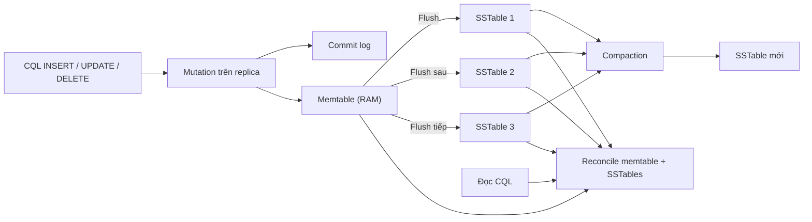
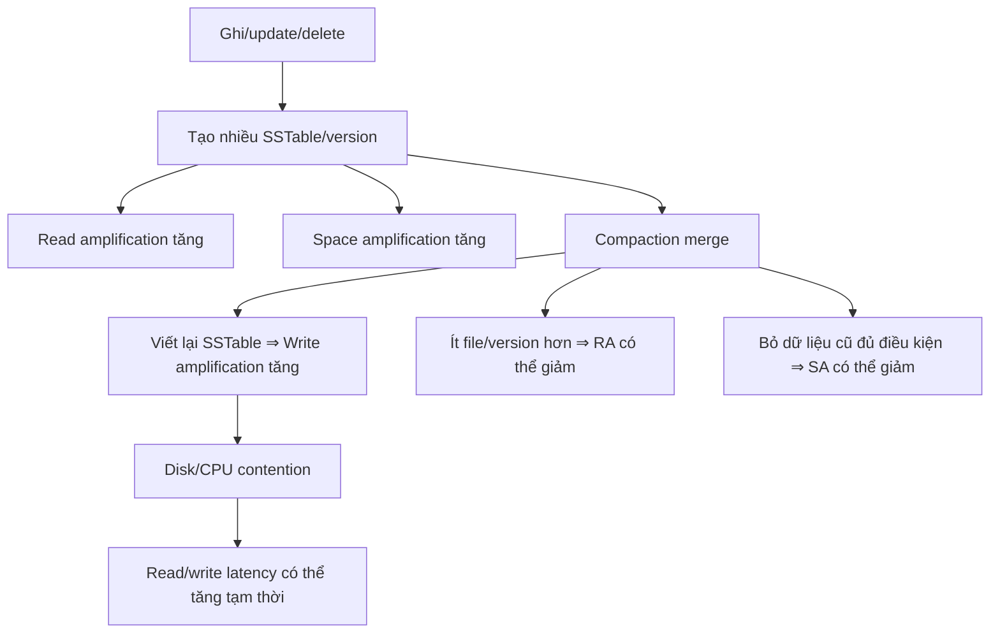

# Read/write/space amplification trong LSM-tree

> **Chương:** SSTable và compaction  
> **Mô-đun:** `DATABASE_ENGINE_WIDE_COLUMN_CASSANDRA` — Apache Cassandra, cơ sở dữ liệu wide-column phân tán.  
> **Trọng tâm:** Hiểu vì sao Cassandra ghi nhanh bằng memtable và SSTable bất biến, nhưng phải trả chi phí đọc, ghi lại và chiếm chỗ; biết đo và chọn chiến lược compaction theo workload.

Cassandra tổ chức dữ liệu trên từng node theo tư tưởng **Log-Structured Merge Tree (LSM-tree)**. Ghi mới đi qua commit log, cập nhật memtable trong bộ nhớ, rồi được flush ra các tệp **SSTable bất biến**. Nhiều SSTable cùng tồn tại, chứa các phiên bản dữ liệu, tombstone và các partition có thể chồng lấn nhau. **Compaction** hợp nhất chúng để tối ưu trạng thái lưu trữ.

Sự đánh đổi thể hiện qua ba đại lượng:

- **Read amplification (RA):** để phục vụ một phép đọc logic, hệ thống phải kiểm tra bao nhiêu cấu trúc/đọc bao nhiêu dữ liệu vật lý?
- **Write amplification (WA):** để ghi một lượng dữ liệu logic, hệ thống cuối cùng phải ghi bao nhiêu dữ liệu vật lý, kể cả các lần compaction viết lại?
- **Space amplification (SA):** để lưu lượng dữ liệu *còn sống* nhất định, đĩa phải dành thêm bao nhiêu chỗ cho bản cũ, tombstone, tệp trung gian và dữ liệu phụ trợ?

Không có chiến lược compaction nào tối ưu tuyệt đối cả ba mục tiêu trong mọi tải. Cách thiết kế partition key, kiểu truy vấn CQL, mức TTL, tần suất cập nhật và tình trạng ổ đĩa cũng quyết định chi phí thực.

## 1. Mục tiêu sau bài học

Sau khi học, bạn có thể:

1. Vẽ đường đi của một mutation từ commit log và memtable đến SSTable, compaction và kết quả đọc.
2. Định nghĩa RA, WA, SA với **mẫu số và phạm vi đo rõ ràng**, tránh trộn lẫn chi phí mỗi node và cả cluster.
3. Giải thích vì sao nhiều SSTable chồng lấn làm đọc khó hơn, compaction nhiều vòng làm tăng ghi và phiên bản cũ/tombstone làm tăng dung lượng.
4. So sánh **SizeTieredCompactionStrategy (STCS)**, **LeveledCompactionStrategy (LCS)**, **TimeWindowCompactionStrategy (TWCS)** và **UnifiedCompactionStrategy (UCS)** khi phiên bản hỗ trợ.
5. Thiết kế bài đo p95/p99 latency, SSTable-per-read, disk usage, write throughput và compaction backlog cho workload thực tế.
6. Phân biệt compaction với repair/replication, nhận biết rủi ro tombstone, TTL, snapshot và disk-full.

## 2. Từ ghi CQL tới một hoặc nhiều SSTable

### 2.1. Vì sao SSTable bất biến?

Trên một node nhận mutation hợp lệ, đường ghi điển hình:

1. Ghi mutation vào **commit log** để phục vụ phục hồi khi tiến trình chết trước lúc memtable được flush.
2. Cập nhật **memtable** của bảng trong RAM.
3. Khi đủ điều kiện, **flush memtable** thành SSTable bất biến trên đĩa.
4. Các lần ghi/đổi/xóa sau có thể tạo SSTable mới chứa giá trị hoặc tombstone cho cùng khóa.
5. Compaction hợp nhất tập SSTable theo chiến lược đã cấu hình; khi an toàn, nó loại bỏ những dữ liệu cũ không còn cần thiết.



Sơ đồ mang tính khái niệm. Lúc compaction kết thúc, tệp đầu vào hợp lệ sẽ được thay thế/xóa khi không còn cần thiết; sơ đồ không thể hiện cache, bloom filter, chỉ mục trong SSTable, compression hay các chu kỳ compaction lặp lại.

**Bất biến** có nghĩa Cassandra không sửa trực tiếp từng dòng ở giữa SSTable mỗi lần cập nhật. Nhờ vậy đường ghi thông thường chủ yếu là append/sequential, nhưng đổi lại **một khóa có thể xuất hiện trong nhiều SSTable** cho tới khi được hợp nhất.

### 2.2. Đọc cần hợp nhất nhiều nguồn dữ liệu

Với truy vấn có đầy đủ partition key, Cassandra có thể định vị replica theo token; tại replica đó, read path có thể phải:

- Đọc dữ liệu mới trong memtable.
- Sử dụng cache/partition index/index summary và bloom filter để tránh mở những SSTable không thể chứa partition.
- Đọc từ các SSTable còn khả năng có partition và hợp nhất cell theo timestamp/tombstone.
- Áp dụng TTL, deletion marker và giới hạn clustering range để xác định kết quả logic.

Ví dụ, cùng partition có lịch sử:

| Thời điểm | Thành phần lưu | Nội dung |
|---|---|---|
| T1 | SSTable A | `status = 'NEW'` |
| T2 | SSTable B | `status = 'PAID'` |
| T3 | SSTable C | Tombstone xóa một cột |
| T4 | Memtable | Giá trị cập nhật khác của cùng partition |

Một phép `SELECT` có thể cần xét **nhiều nguồn** để biết trạng thái đúng. Sau compaction, số tệp chồng lấn có thể giảm, nhưng mọi bản ghi cũ không phải lúc nào cũng bị xóa được ngay.

### 2.3. Compaction làm gì và không làm gì?

Compaction chọn SSTable đầu vào, đọc các phiên bản liên quan, thực hiện merge/reconciliation và ghi ra **SSTable đầu ra mới**. Việc này:

- Có thể giảm số tệp và số phiên bản dữ liệu phải kiểm tra khi đọc.
- Có thể loại những phiên bản bị shadow hoặc tombstone đã đủ điều kiện bỏ.
- Có thể cải thiện tổ chức dữ liệu và giải phóng không gian sau khi thay tệp cũ.
- **Tốn thêm I/O, CPU và tạm thời cần dung lượng đĩa** cho output.

Compaction là hoạt động **cục bộ trên mỗi node**; nó **không thay cho anti-entropy repair giữa các replica**. Replication factor (RF) và consistency level (CL) vẫn quyết định việc phân bố và xác nhận dữ liệu ở cluster. Một node có SSTable được compact gọn gàng vẫn có thể thiếu mutation mà replica khác đang giữ.

## 3. Read amplification: một lần đọc logic phải làm bao nhiêu việc?

### 3.1. Định nghĩa hữu dụng

Trong ngữ cảnh LSM-tree, read amplification diễn tả lượng thao tác đọc vật lý hoặc cấu trúc lưu trữ phải kiểm tra so với một lần đọc logic. Có nhiều cách đo hợp lệ:

\[
RA_{\mathrm{files}}=\frac{\text{số lượt SSTable được kiểm tra}}{\text{số truy vấn đọc logic}}
\]

\[
RA_{\mathrm{bytes}}=\frac{\text{tổng byte thực đọc từ lưu trữ}}{\text{byte dữ liệu hữu ích trả về}}
\]

**Không đánh đồng hai đơn vị.** Một SSTable được kiểm tra qua bloom filter hoặc index chưa chắc gây một lần đọc đĩa; một SSTable có thể cần nhiều I/O cho một truy vấn range lớn. Cache và hệ điều hành còn thay đổi lượng I/O vật lý quan sát được.

Khi đo, hãy ghi rõ là **mỗi truy vấn ở một replica/node**, hay **toàn bộ công việc các replica**. Một `LOCAL_QUORUM` read có thể tác động nhiều replica; không được diễn giải chỉ số per-replica thành tổng chi phí cluster.

### 3.2. Ví dụ tính theo tệp

Giả sử trong 1.000 truy vấn đọc partition:

- 800 truy vấn kiểm tra một SSTable.
- 150 truy vấn kiểm tra ba SSTable.
- 50 truy vấn kiểm tra bảy SSTable.

Ta có:

\[
RA_{\mathrm{files}}=
\frac{800\times1+150\times3+50\times7}{1000}=1{,}6
\]

Trung bình **1,6 lượt SSTable mỗi truy vấn**. Nhưng 50 truy vấn cuối có thể chi phối p99 latency; vì thế cần xem histogram, phân vị và nhóm partition “nóng”, **không chỉ giá trị trung bình**.

Đây là số liệu minh họa, không phải chỉ số benchmark mặc định của Cassandra.

### 3.3. Điều gì làm RA tăng?

- **Nhiều SSTable chồng lấn token/clustering range:** các phiên bản cùng khóa nằm trong nhiều file.
- **Update/delete liên tiếp:** phải kiểm tra mutation mới, cũ và tombstone trước khi trả kết quả.
- **Compaction backlog:** SSTable nhỏ tích tụ nhanh hơn tốc độ gộp.
- **Đọc range hoặc partition lớn:** số row/chunk/block phải duyệt tăng; có thể chạm nhiều file dù partition key đã biết.
- **Tombstone nhiều:** việc bỏ qua những cell đã xóa/tới hạn TTL vẫn tiêu tốn tài nguyên.
- **Cache miss:** cùng số SSTable, lượng I/O vật lý thực tế lớn hơn.
- **Truy vấn không phù hợp partition key:** coordinator phải liên hệ rộng nhiều node hoặc thực hiện lọc kém hiệu quả; đây còn là **distributed read amplification** ngoài cấp SSTable.

### 3.4. Bloom filter giúp gì?

Bloom filter của SSTable trả lời đại ý “partition **chắc chắn không có**” hoặc “**có thể có**”. Nó giúp tránh một số disk read âm tính.

- **False positive:** bloom filter có thể báo “có thể có” dù partition không tồn tại → vẫn phải kiểm tra sâu hơn.
- **Không có false negative theo thiết kế:** nếu nói “không có”, SSTable đó không chứa partition tương ứng.
- Với một partition thật sự có mặt trong nhiều SSTable, bloom filter **không thể xóa chi phí đọc những bản cũ**.
- RAM cho bloom filter, key cache, index summary và OS page cache ảnh hưởng nhiều đến kết quả đo.

Cần phân biệt truy vấn **không tìm thấy partition** (negative lookup) với truy vấn **tìm một partition có nhiều version** (positive lookup); mô hình chi phí khác nhau.

## 4. Write amplification: cùng dữ liệu bị ghi lại bao nhiêu lần?

### 4.1. Định nghĩa và phạm vi

Một định nghĩa dùng để so sánh chính sách compaction trên **một node**:

\[
WA_{\mathrm{SSTable}}=
\frac{\text{tổng byte SSTable output do flush + compaction ghi trong kỳ}}
{\text{byte dữ liệu đầu vào logic mới trong cùng kỳ}}
\]

Phép đo chỉ có ý nghĩa nếu nêu rõ cách tính byte đầu vào, trạng thái hệ thống (steady state hay đang build/backfill), dữ liệu nén hay không nén và khoảng thời gian. Với thời gian quá ngắn, compaction của dữ liệu cũ có thể làm tỷ lệ tăng cao bất thường, còn backlog chưa chạy làm nó thấp giả tạo.

**Không cộng RF một cách tùy tiện vào cùng chỉ số.** Nếu RF = 3, ba replica lưu dữ liệu trên ba node và tổng physical writes của cluster tăng, nhưng `WA_SSTable` như định nghĩa ở trên **là chi phí trên một node**, không phải hệ số replication.

Nếu muốn đo **toàn bộ chi phí ghi đĩa**, phải nêu thêm commit log, index, metadata, write-ahead/log overhead, compaction và số replica. Tỷ lệ này khác `WA_SSTable`.

### 4.2. Ví dụ số

Giả sử trong một giai đoạn steady state trên một node:

- 100 GiB dữ liệu logic mới (được quy đổi về cùng cơ sở byte để so sánh).
- Flush tạo 100 GiB SSTable mới.
- Các vòng compaction về sau ghi thêm tổng 300 GiB output.

Khi đó:

\[
WA_{\mathrm{SSTable}} = \frac{100+300}{100}=4
\]

Có thể diễn đạt **1× ghi để flush và 3× ghi lại do compaction**. Nếu 300 GiB compaction chưa hoàn tất tại thời điểm kết thúc phép đo, con số quan sát sẽ không mô tả chính xác chi phí vòng đời; hãy ghi nhận backlog và so sánh trong cùng điều kiện.

Nếu ghi cùng dữ liệu tới ba replica RF = 3, tổng số byte ghi cluster sẽ còn phụ thuộc dữ liệu mỗi replica, cấu hình và compaction độc lập ở từng node. Không suy ra cluster WA chính xác bằng 12 từ ví dụ một node.

### 4.3. Điều gì làm WA tăng?

- **LCS hoặc cơ chế nhiều tầng thường xuyên rewrite:** một vùng dữ liệu có thể được gộp nhiều lần khi chuyển qua các level.
- **Update/delete trên cùng partition:** nhiều version/tombstone tạo thêm dữ liệu cần ghi và xử lý.
- **Dữ liệu đến trễ so với phân vùng thời gian:** compaction chiến lược theo window có thể phải làm thêm việc.
- **Đổi chiến lược compaction/backfill/rebuild index:** có thể làm tăng I/O trong giai đoạn chuyển đổi.
- **Compaction thủ công diện rộng:** tạo lượng ghi lớn và cần ổ đĩa trống.
- **Giá trị nén/compression và SSTable format:** ảnh hưởng số byte vật lý; cần so sánh cùng cách đo.

Cassandra có thể ACK ghi trước khi compaction diễn ra, vì đường ghi là commit log + memtable. Tuy nhiên, backlog compaction kéo dài sẽ cạnh tranh disk I/O và CPU, dẫn tới **p95/p99 read/write latency xấu đi**, flush áp lực và nguy cơ hết đĩa. “Write nhanh ở thời điểm ACK” không có nghĩa WA thấp.

## 5. Space amplification: dữ liệu sống cần bao nhiêu đĩa?

### 5.1. Định nghĩa tránh nhầm

Trong cùng phạm vi node/table và **cùng cách biểu diễn byte**, có thể ước lượng:

\[
SA_{\mathrm{SSTable}}=
\frac{\text{byte dữ liệu SSTable đang chiếm trên đĩa}}
{\text{byte dữ liệu live tương đương nếu chỉ lưu phiên bản mới nhất}}
\]

Tử số có thể chứa phiên bản cũ, tombstone và metadata; mẫu số phải là ước tính live snapshot **trên cùng node, cùng compression/encoding**. Nếu lấy logical uncompressed bytes làm mẫu số mà compressed SSTable bytes làm tử số, tỷ lệ có thể không còn phản ánh riêng phần dư thừa do LSM.

Phải công bố rõ có tính **snapshot/hard link, index, commit log, tệp tạm compaction và filesystem overhead** hay không. Chúng ảnh hưởng disk headroom thật nhưng có thể không được tính vào `SA_SSTable`.

### 5.2. Ví dụ tính SA và dung lượng an toàn

Giả sử trên một node:

| Thành phần | Dung lượng |
|---|---:|
| Live snapshot ước lượng, cùng encoding/compression | 400 GiB |
| SSTable hiện có, gồm bản cũ và tombstone | 640 GiB |
| Tệp output tạm của compaction đang chạy | 100 GiB |
| Snapshot/hard link giữ các SSTable cũ | 90 GiB |

Từ đó:

\[
SA_{\mathrm{SSTable}}=\frac{640}{400}=1{,}6
\]

Nếu các phần tạm/snapshot trong ví dụ **thực sự chiếm thêm block đĩa độc lập** và chưa nằm trong số 640 GiB, tổng không gian cần có tại thời điểm này là:

\[
640+100+90=830\ \text{GiB}
\]

Hệ số disk footprint so với live snapshot tương ứng `830/400=2{,}075`. **Đây không phải hệ số SA chuẩn chung**, mà là một thước đo vận hành cho tình huống cụ thể. Với snapshot hard link, block đã chia sẻ không được cộng hai lần; cần dựa trên số liệu block thực chiếm.

**RF = 3** có thể khiến cluster cần ba bản sao live dữ liệu (chưa kể repair/streaming/index); không trộn hệ số do RF với SA trên một node. Tách câu hỏi “một bản sao lưu thừa bao nhiêu?” khỏi “cụm cần bao nhiêu bản sao?”.

### 5.3. Vì sao dữ liệu đã xóa vẫn còn?

Cassandra ghi **tombstone** để biểu thị việc xóa; nó cần bảo vệ khỏi trường hợp một replica cũ quay lại và tái tạo bản ghi đã xóa. Tombstone hoặc dữ liệu đã hết TTL không nhất thiết được loại ngay khi ứng dụng không còn đọc thấy:

- Có quy tắc **gc_grace_seconds** và kiểm tra an toàn của compaction.
- Dữ liệu cũ có thể tồn tại trong SSTable chồng lấn chưa được compact chung.
- Repair/replica đã Down và sự kiện bỏ lỡ delete làm rủi ro resurrection tăng nếu tùy tiện hạ grace.
- TTL hết hạn tạo trạng thái logic “đã xóa”; byte vật lý chỉ được giải phóng khi compaction/cleanup an toàn và không còn file giữ tham chiếu.
- Snapshot/backup dạng hard link có thể giữ block đĩa ngay cả khi SSTable gốc đã được thay.

**Không nên đổi `gc_grace_seconds` xuống rất thấp để chữa đĩa đầy** nếu chưa xét repair, lịch sử node down, cơ chế tombstone purge và khả năng phục hồi. Việc này có thể gây mất tính nhất quán logic.

## 6. Ba amplification liên quan nhau ra sao?



Một compaction tích cực có thể giảm RA và SA steady state nhưng tăng WA và I/O tức thời. Trì hoãn compaction có thể giảm WA trong thời gian ngắn, song nợ compaction tích lũy, RA/SA tăng và hệ thống có nguy cơ hết disk.

| Biện pháp hoặc hiện tượng | RA | WA | SA | Giải thích |
|---|---|---|---|---|
| Nhiều flush nhỏ, backlog | Thường tăng | Thấp tạm thời | Tăng | Nhiều SSTable chưa merge |
| Compaction tích cực | Thường giảm sau khi xong | Tăng | Có thể giảm | Viết lại để giảm overlap/version |
| Update cùng partition liên tục | Tăng trước compaction | Tăng vòng đời | Tăng trước purge | Nhiều version/tombstone |
| Partition key phù hợp truy vấn | Giảm fan-out/read rộng | Ít tác động trực tiếp | Ít tác động trực tiếp | Định vị replica và partition tốt hơn |
| TTL cho dữ liệu time series | Có thể tăng trong thời gian giữ tombstone | Phụ thuộc chiến lược | Cuối cùng giảm nếu purge được | Cần quản lý expiry và compaction |
| Nâng cache/bloom hiệu quả | Giảm physical read I/O | Có chi phí phụ | Tăng chút RAM/metadata | Không xóa version cũ |
| Tăng RF | Có thể tăng tổng read work theo CL | Tăng tổng ghi cluster | Tăng tổng dung lượng cluster | Không phải cách tối ưu compaction trên một node |

Các mũi tên là xu hướng khái niệm, **không phải bảo đảm cho mọi workload**.

## 7. STCS, LCS, TWCS và UCS: chiến lược nào đổi chi phí gì?

Compaction strategy quyết định **tập SSTable nào được hợp nhất, khi nào và ở phạm vi nào**. Cấu hình hợp lý phụ thuộc kiểu ghi, đọc, TTL, mật độ update và phiên bản Cassandra.

### 7.1. SizeTieredCompactionStrategy (STCS)

STCS thường gộp các SSTable có **kích thước gần nhau** thành tệp lớn hơn. Đây là hướng dễ hiểu cho workload ghi nhiều, không có pattern TTL theo thời gian rõ rệt.

**Xu hướng:**

- WA có thể tương đối thấp khi không liên tục compact qua nhiều level sâu.
- Nhiều SSTable có token range chồng lấn; RA đối với partition bị cập nhật nhiều có thể cao.
- SA và nhu cầu **free disk tạm thời** có thể đáng kể: output mới tồn tại trước khi input cũ được xóa.
- Sau nhiều đợt flush/update, bảng có thể giữ nhiều tệp lớn cùng giao nhau.

**Tốt khi:** ưu tiên throughput ghi, đọc không quá ngẫu nhiên/nhạy p99, có đủ headroom và theo dõi backlog.

**Cần kiểm chứng:** SSTables per read, disk occupancy trong lúc compaction và hiệu quả dọn tombstone.

### 7.2. LeveledCompactionStrategy (LCS)

LCS chia SSTable thành các **level**; từ những level ổn định (trừ L0), thiết kế hướng đến **không chồng lấn token range giữa các SSTable trong cùng level**. Một partition đọc thường chỉ cần xét một file trên mỗi level ổn định, cộng các tệp ở L0/các trường hợp đặc biệt.

**Xu hướng:**

- RA tốt hơn cho nhiều kiểu point lookup vì giới hạn overlap theo level.
- WA thường **cao hơn STCS** do dữ liệu được rewrite khi dịch chuyển và merge giữa level.
- SA steady state có thể gọn hơn, nhưng không tránh được tệp tạm, tombstone và snapshot.
- Cần chú ý compaction debt và p99 khi ghi rất nhiều hoặc ổ đĩa chậm.

**Tốt khi:** read-heavy, truy vấn theo partition key/ngẫu nhiên nhiều, yêu cầu latency có thể dự đoán, và ngân sách I/O ghi đủ.

**Cần kiểm chứng:** độ sâu level, kích thước SSTable, write rate, read latency và compaction throughput.

### 7.3. TimeWindowCompactionStrategy (TWCS)

TWCS nhóm dữ liệu theo **cửa sổ thời gian**. Nó phù hợp dữ liệu time series **ghi gần theo thời gian**, đặc biệt khi phần lớn row có TTL gần nhau và workload hiếm khi sửa dữ liệu cũ.

Ý tưởng:

- Các SSTable trong cửa sổ đang hoạt động được gộp để hạn chế file nhỏ.
- Cửa sổ đã khép lại sẽ ít bị rewrite; khi dữ liệu trong một SSTable/window đều hết hiệu lực và đủ điều kiện, có thể xóa trọn SSTable mà không cần quét lại từng row để loại tombstone.
- Vì vậy WA có thể thấp cho dữ liệu immutable/TTL theo thời gian, SA có thể được giải phóng theo đợt và RA phù hợp với truy vấn phân vùng thời gian.

**Cảnh báo quan trọng:** nếu ghi lại dữ liệu lịch sử, cập nhật cột cũ, TTL lệch mạnh giữa row hoặc flush trộn dữ liệu nhiều thời điểm, lợi thế TWCS giảm và việc loại SSTable hết hạn có thể bị trì hoãn. Không xem TWCS như cách tự động sửa mọi tombstone.

**Tốt khi:** log/event/metrics theo thời gian, ghi gần như append-only, TTL nhất quán, truy vấn theo tenant/day/hour.

### 7.4. UnifiedCompactionStrategy (UCS)

Một số phiên bản Cassandra mới (đặc biệt Apache Cassandra 5.x trở lên khi khả dụng) hỗ trợ **UnifiedCompactionStrategy**, cho phép điều chỉnh chính sách compaction theo mục tiêu read/write/space amplification và đặc tính workload, thay vì chỉ chọn một triết lý cố định của STCS hay LCS.

- Có thể đặt ưu tiên theo read-latency, write-overhead hoặc space.
- Cần hiểu tham số cụ thể (chẳng hạn cấu hình scaling parameters) **đúng phiên bản** trước khi áp dụng.
- Không giả định tên tùy chọn, default hay lợi ích của UCS giống hệt giữa mọi bản phân phối.
- Không đổi toàn cluster một lúc chỉ vì nghe “UCS tối ưu hơn”; benchmark trên representative workload, theo dõi tốc độ tích lũy compaction và tệp cần chỗ tạm.

### 7.5. So sánh định tính

| Chiến lược | RA điển hình | WA điển hình | SA/headroom | Workload phù hợp |
|---|---|---|---|---|
| **STCS** | Có thể cao do SSTable overlap | Thường thấp hơn LCS với nhiều tải ghi | Cần dự phòng khi merge file lớn | Ghi nhiều, đọc không quá nhạy latency |
| **LCS** | Thường thấp cho lookup theo partition | Thường cao do rewrite nhiều level | Steady state có thể gọn, vẫn cần chỗ tạm | Đọc ngẫu nhiên nhiều, p99 nghiêm ngặt |
| **TWCS** | Phụ thuộc cửa sổ/partition thời gian | Có thể thấp với dữ liệu immutable có TTL | Xóa window đủ điều kiện hiệu quả; sai pattern sẽ tăng SA | Metrics, log, events append-only + TTL |
| **UCS** | Có thể cấu hình theo trade-off | Có thể cấu hình theo trade-off | Cần đo theo tham số và bản triển khai | Workload phức tạp, cluster hỗ trợ UCS |

Bảng chỉ thể hiện **xu hướng thiết kế**. Workload có partition lớn, out-of-order writes, một giá trị rất nóng hoặc TTL kéo dài có thể đảo ngược kết quả. Đừng lấy tên chiến lược làm bằng chứng performance.

## 8. Ví dụ CQL: workload ảnh hưởng amplification như thế nào?

### 8.1. Tạo bảng theo partition key phục vụ đọc

Bài lab dùng datacenter `dc1`. RF = 3 chỉ phù hợp nếu lab có đủ node/replica theo topology; điều chỉnh trước khi chạy.

```sql
CREATE KEYSPACE IF NOT EXISTS lab_lsm
WITH replication = {
    'class': 'NetworkTopologyStrategy',
    'dc1': 3
};

CREATE TABLE IF NOT EXISTS lab_lsm.events_by_tenant_day (
    tenant_id uuid,
    event_day date,
    event_time timestamp,
    event_id timeuuid,
    event_type text,
    payload text,
    PRIMARY KEY ((tenant_id, event_day), event_time, event_id)
) WITH CLUSTERING ORDER BY (event_time DESC, event_id DESC)
  AND compaction = {
    'class': 'TimeWindowCompactionStrategy',
    'compaction_window_unit': 'DAYS',
    'compaction_window_size': '1'
  }
  AND default_time_to_live = 604800;
```

Một sự kiện có partition key `(tenant_id, event_day)`, nên truy vấn theo tenant và ngày định vị partition rõ ràng:

```sql
CONSISTENCY LOCAL_QUORUM;

INSERT INTO lab_lsm.events_by_tenant_day (
    tenant_id, event_day, event_time, event_id, event_type, payload
) VALUES (
    11111111-1111-1111-1111-111111111111,
    '2026-11-21',
    '2026-11-21 08:00:00+0000',
    7c627d5a-a6b0-11ef-8ae8-0242ac120002,
    'checkout',
    'sample'
);

SELECT event_time, event_id, event_type
FROM lab_lsm.events_by_tenant_day
WHERE tenant_id = 11111111-1111-1111-1111-111111111111
  AND event_day = '2026-11-21'
LIMIT 50;
```

TTL 604.800 giây tương đương 7 ngày. Ví dụ này **cố ý dùng dữ liệu gần như bất biến** để TWCS có cơ hội phát huy. Nếu cần sửa trạng thái sự kiện liên tục, cân nhắc bảng riêng hoặc chiến lược khác; đừng giả định update vào dữ liệu đã đóng window là rẻ.

### 8.2. Thêm update/delete thì chuyện gì xảy ra?

Giả sử sau đó ứng dụng cập nhật `payload` ba lần hoặc xóa một hàng:

```sql
UPDATE lab_lsm.events_by_tenant_day
SET payload = 'revised'
WHERE tenant_id = 11111111-1111-1111-1111-111111111111
  AND event_day = '2026-11-21'
  AND event_time = '2026-11-21 08:00:00+0000'
  AND event_id = 7c627d5a-a6b0-11ef-8ae8-0242ac120002;

DELETE FROM lab_lsm.events_by_tenant_day
WHERE tenant_id = 11111111-1111-1111-1111-111111111111
  AND event_day = '2026-11-21'
  AND event_time = '2026-11-21 08:00:00+0000'
  AND event_id = 7c627d5a-a6b0-11ef-8ae8-0242ac120002;
```

Khi flush thành nhiều SSTable:

- Giá trị cũ và tombstone có thể nằm ở file khác nhau.
- Đọc cùng partition phải reconcile nhiều bản, làm RA tăng trước compaction.
- Các version và tombstone vẫn chiếm dung lượng, làm SA tăng.
- Compaction để xử lý chúng phải rewrite, làm WA tăng.

Với TWCS, update hoặc delete trên **sự kiện cũ** còn ảnh hưởng khả năng thu gom theo cửa sổ; đây là tín hiệu phải kiểm tra lại sự phù hợp của chiến lược.

### 8.3. Thử thay chiến lược trên bảng lab

Một bảng đọc thường xuyên theo partition, ít TTL, có thể dùng LCS để làm thí nghiệm:

```sql
-- Chỉ làm trên bảng lab riêng để so sánh, không áp tự động vào production.
ALTER TABLE lab_lsm.events_by_tenant_day
WITH compaction = {
    'class': 'LeveledCompactionStrategy'
};
```

Đổi compaction strategy có thể tạo quá trình chuyển đổi/compaction nền đáng kể, không phải biến mọi SSTable sang layout mới ngay. Các tham số chi tiết như SSTable size và tùy chọn throughput phụ thuộc phiên bản, hãy đọc đúng tài liệu triển khai.

**Không dùng cùng một bảng production và luân phiên đổi STCS/LCS/TWCS để “test nhanh”.** Các chiến lược có lịch sử tạo file khác nhau; cần dataset và môi trường tái lập để so sánh có ý nghĩa.

## 9. Đo ba amplification: lấy số liệu ở đâu?

### 9.1. Lệnh theo dõi ở mỗi node

Các lệnh `nodetool` sau dành cho quan sát trong lab/cluster được phép truy cập:

```bash
nodetool status
nodetool tablestats lab_lsm.events_by_tenant_day
nodetool tablehistograms lab_lsm events_by_tenant_day
nodetool compactionstats
nodetool compactionhistory
nodetool tpstats
```

Tên chỉ số, định dạng output và khả năng hỗ trợ lệnh có thể thay đổi theo phiên bản Cassandra. Lưu lại phiên bản và chạy `nodetool help <command>` nếu cú pháp khác.

| Đối tượng quan sát | Câu hỏi | Liên hệ amplification |
|---|---|---|
| SSTable count, SSTables per read | Mỗi đọc phải xem bao nhiêu tệp? | RA |
| Bloom filter false positives, read latency | Negative lookup tốn bao nhiêu I/O? | RA |
| Bytes flushed, bytes compacted, compaction throughput | Đã ghi lại bao nhiêu byte do compaction? | WA |
| Pending/active compaction | Có nợ compaction tăng liên tục không? | RA/SA sắp tăng, WA chưa phát sinh đủ |
| Live disk used, total disk used, snapshots | Dung lượng hiện chiếm gồm những gì? | SA và headroom |
| Droppable tombstone ratio, tombstone read stats | Bao nhiêu dữ liệu “xóa logic” còn tồn tại? | RA/SA, nguy cơ đọc chậm |
| Disk read/write IOPS và bandwidth | Có tranh tài nguyên với truy vấn không? | RA/WA chuyển thành p99 |
| Compaction failure, disk fullness | Compaction có bị chặn không? | Nguy cơ backlog/disk-full |

**Một số chỉ số phải lấy từ monitoring/JMX/Prometheus theo phiên bản**, không phải mọi dòng đều có trong `tablestats`. Đặc biệt “bytes physically written during compaction” hoặc “compression ratio theo SSTable” cần kiểm tra nguồn và đơn vị chính xác.

### 9.2. Dựng phép đo read amplification

Chọn một tập partition representative:

1. **Hot partition** được update liên tục.
2. **Cold partition** gần như chỉ đọc.
3. **Partition không tồn tại** để kiểm tra negative lookup.
4. **Partition lớn** có nhiều clustering rows.
5. **Partition có tombstone/TTL** để đánh giá merge.

Với mỗi loại, cố định CQL, CL và page size, chạy ở QPS mục tiêu và đo p50/p95/p99, SSTables per read, disk read bandwidth và cache miss. Chạy một vòng warm-up khi hợp lý, nhưng ghi rõ benchmark là **cold-cache** hay **warm-cache**. So sánh sau khi compaction bắt kịp, rồi thử thêm giai đoạn backlog.

### 9.3. Dựng phép đo write amplification

Đo trên cùng node, cùng table và khoảng thời gian đủ dài:

- **Input logical bytes:** từ ingestion pipeline hoặc telemetry ứng dụng, xác định rõ cách tính.
- **SSTable bytes do flush tạo:** chỉ tính output mới.
- **SSTable bytes do compaction tạo:** thống kê trong kỳ và cộng cả các lần rewrite.
- **Commit log và index overhead:** tách riêng nếu báo cáo WA end-to-end.
- **RF/replica:** báo cáo per-node trước rồi tổng hợp cluster, không nhân một hệ số tùy ý.
- **Compaction backlog:** nếu còn nhiều pending, phải ghi vì chưa quan sát đủ WA vòng đời.

Tính ratio bằng dữ liệu đo được, đồng thời so p99 write latency và disk write throughput. **Ghi nhanh nhưng backlog tăng mãi là kết quả không bền vững.**

### 9.4. Dựng phép đo space amplification

Lấy một snapshot logic của **live keys/values** có phạm vi xác định; đo dữ liệu live ở cùng encoding/compression nếu có thể. Tại cùng thời điểm, đo:

1. SSTable disk bytes trong bảng đang hoạt động.
2. Tệp tạm compaction mà hệ thống chưa xóa.
3. Snapshot/hard-linked SSTable còn giữ block.
4. Index/commit log và phần khác nếu muốn tính tổng disk footprint.

Báo cáo **hai con số**: `SA_SSTable` (theo định nghĩa chọn) và **disk headroom cần có**. Không bắt buộc chạy `SELECT COUNT(*)` toàn bảng production chỉ để ước tính live rows; câu đếm diện rộng trong Cassandra có thể rất đắt. Có thể dùng ingestion telemetry, sampling, snapshot/offline job hoặc hệ thống thống kê chuyên dụng.

### 9.5. Bảng ghi kết quả thí nghiệm

| Kịch bản | P99 đọc | SSTables/read | Byte flush+compact | Data live | SSTable on disk | Pending compactions |
|---|---:|---:|---:|---:|---:|---:|
| STCS, ghi nhiều | *Đo* | *Đo* | *Đo* | *Đo* | *Đo* | *Đo* |
| LCS, ghi nhiều | *Đo* | *Đo* | *Đo* | *Đo* | *Đo* | *Đo* |
| TWCS, TTL đều | *Đo* | *Đo* | *Đo* | *Đo* | *Đo* | *Đo* |
| TWCS, dữ liệu đến trễ | *Đo* | *Đo* | *Đo* | *Đo* | *Đo* | *Đo* |

Không điền sẵn số liệu giả như thể là benchmark. Khi phân tích, bổ sung thông số cluster, RF, CL, compression, partition size, tỉ lệ UPDATE/DELETE, TTL và QPS để người khác có thể tái lập.

## 10. Tương tác với replication, repair, streaming và CL

Bản chất LSM là cơ chế lưu trữ **tại từng node**. Nhưng Cassandra còn là hệ phân tán; cần xem ba amplification ở hai mức:

| Cấp | Điều phát sinh chi phí |
|---|---|
| **SSTable trên node** | Flush/compaction, bloom filter/cache, version/tombstone |
| **Replica và cluster** | RF bản sao, read/write CL, read repair, anti-entropy repair, bootstrap/replace streaming |

Ví dụ RF = 3 và `LOCAL_QUORUM`:

- Một mutation được truyền tới các replica thích hợp; mỗi replica có commit log, memtable và vòng compaction riêng.
- Một truy vấn có thể cần nhiều replica trả lời tùy CL và trạng thái cluster.
- Compaction trên node A **không** chứng minh node B cũng có dữ liệu mới nhất.
- Repair có thể truyền dữ liệu giữa replica, bổ sung SSTable/mutation và gián tiếp tạo thêm áp lực compaction.
- Bootstrap/replace/decommission có streaming SSTable và đòi disk headroom; nếu compaction đồng thời quá tải, cả latency lẫn khả năng hoàn tất topology change đều bị ảnh hưởng.

**Đừng nhầm “việc hợp nhất SSTable” với “việc đối chiếu dữ liệu giữa các replica”.** Nếu hạ `gc_grace_seconds` hoặc bỏ lịch repair để dọn tombstone nhanh, nguy cơ tái xuất hiện dữ liệu đã xóa tăng khi replica cũ quay lại.

## 11. Ảnh hưởng tới ứng dụng Java và truy vấn CQL

Compaction diễn ra nền, nên ứng dụng Java không cần tự chọn SSTable hay gọi merge. Tuy nhiên, **đường truy vấn** và **cách retry** vẫn quyết định khuếch đại tải.

Ví dụ DataStax/Apache Cassandra Java Driver 4.x:

```java
import com.datastax.oss.driver.api.core.CqlSession;
import com.datastax.oss.driver.api.core.DefaultConsistencyLevel;
import com.datastax.oss.driver.api.core.cql.BoundStatement;
import com.datastax.oss.driver.api.core.cql.PreparedStatement;
import com.datastax.oss.driver.api.core.cql.ResultSet;
import java.net.InetSocketAddress;
import java.time.LocalDate;
import java.util.UUID;

public class EventReader {
    public static void main(String[] args) {
        UUID tenant = UUID.fromString("11111111-1111-1111-1111-111111111111");
        LocalDate day = LocalDate.of(2026, 11, 21);

        try (CqlSession session = CqlSession.builder()
                .addContactPoint(new InetSocketAddress("127.0.0.1", 9042))
                .withLocalDatacenter("dc1")
                .build()) {
            PreparedStatement select = session.prepare(
                "SELECT event_time, event_type FROM lab_lsm.events_by_tenant_day " +
                "WHERE tenant_id = ? AND event_day = ? LIMIT 50"
            );

            BoundStatement query = select.bind(tenant, day)
                .setConsistencyLevel(DefaultConsistencyLevel.LOCAL_QUORUM)
                .setPageSize(50);

            ResultSet rows = session.execute(query);
            rows.forEach(row ->
                System.out.println(row.getInstant("event_time") + " " +
                                   row.getString("event_type")));
        }
    }
}
```

Bản Java Driver có thể yêu cầu mapping `date` thành `LocalDate` tương ứng; ví dụ dùng API Java Driver 4.x. Đoạn mã giả định cluster/keyspace đã chuẩn bị, đúng DC và đủ RF/replica cho CL.

**Để tránh tăng RA từ phía ứng dụng:**

- Cung cấp **đầy đủ partition key** và clustering bounds đúng nhu cầu; đừng quét rất nhiều partition bằng một truy vấn thiếu khóa.
- Tránh `SELECT *` hoặc lấy partition quá lớn khi chỉ cần vài cột/hàng.
- Đặt page size, timeout phù hợp; `LIMIT` chỉ giới hạn kết quả logic chứ không bảo đảm ít SSTable được đọc.
- Không retry vô hạn khi p99 tăng do disk/compaction backlog; retry vô kiểm soát làm nghẽn hệ thống hơn.
- Theo dõi per-query p99, QPS, number of pages, unavailable/timeout cùng bảng metrics trên Cassandra.

**Để tránh tăng WA từ phía ứng dụng:** loại bỏ update thừa, hạn chế viết lại cùng giá trị khi không cần, dùng TTL phù hợp, chọn partition/bucket tránh tạo một partition quá nóng; ghi không có ích cũng trở thành SSTable và compaction work.

## 12. Chẩn đoán bốn tình huống thực tế

### 12.1. “INSERT vẫn nhanh, nhưng SELECT p99 ngày càng chậm”

**Khả năng:** memtable ghi tốt, nhưng flush tạo SSTable nhanh hơn tốc độ compaction; RA tăng. Ngoài ra có thể gặp tombstone-heavy read, cache miss hoặc partition lớn.

**Kiểm tra:** `nodetool tablestats`, SSTables per read, `compactionstats`, disk I/O, p99 theo partition. Nếu pending compactions tăng liên tục, kiểm tra disk headroom, throughput và sự phù hợp strategy trước khi vội tăng concurrency.

### 12.2. “Đĩa đầy dù ứng dụng đã DELETE hàng triệu row”

**Khả năng:** DELETE tạo tombstone, bản cũ vẫn nằm trên SSTable, chưa tới điều kiện purge hoặc snapshot đang giữ tệp.

**Kiểm tra:** disk space thật, snapshot, tombstone ratio, compaction backlog, `gc_grace_seconds`, lịch repair và SSTable overlap. **Không hạ grace hoặc chạy major compaction bừa bãi** khi ổ đĩa gần đầy; major compaction có thể cần nhiều chỗ tạm.

### 12.3. “Chuyển STCS sang LCS, read nhanh hơn nhưng CPU/IO tăng”

Đây là dạng đánh đổi có thể dự đoán: LCS giảm overlap, song dữ liệu có thể phải rewrite qua nhiều level. Cần so p99 đọc, disk write bandwidth, compaction backlog và WA dài hạn. Nếu cluster chủ yếu ingest và đọc ít, lợi ích RA thấp có thể không đáng giá WA tăng.

### 12.4. “TWCS dùng TTL 7 ngày nhưng tệp cũ không được dọn”

**Khả năng:** có ghi/TTL trễ vào window cũ, SSTable chứa dữ liệu sống trộn nhiều tuổi, compaction/chốt window chưa đạt điều kiện purge, hoặc snapshot giữ block.

**Kiểm tra:** timestamp dữ liệu, TTL thực, ingestion out-of-order, cấu hình TWCS, thời điểm SSTable tạo, compaction logs, snapshot và GC grace. Không kết luận TWCS hỏng chỉ vì sau đúng 7 ngày byte chưa biến mất.

## 13. Quy trình quyết định và vận hành an toàn

### Trước khi chọn strategy

1. Mô tả workload: đọc/ghi QPS, point lookup hay range query, update/delete ratio, TTL, dữ liệu đến trễ.
2. Kiểm tra partition key, kích thước partition, clustering và query shape. Nếu schema không phục vụ truy vấn, đổi compaction khó cứu p99.
3. Đo baseline RA/WA/SA theo định nghĩa cụ thể và quan sát disk headroom.
4. Ưu tiên STCS cho ghi nặng, LCS cho point read nhiều, TWCS cho time series TTL phù hợp, UCS khi có và có năng lực tuning — **chỉ là ứng viên để thử**, không phải quy tắc tuyệt đối.
5. Dựng benchmark tái lập với dữ liệu đủ lớn, tombstone/TTL và phân bố hot partition.

### Khi thay strategy hoặc tăng compaction throughput

1. Chọn phạm vi thử nghiệm nhỏ và thời điểm tải thích hợp.
2. Bảo đảm free disk đủ cho input/output compaction, tránh va chạm streaming/repair lớn.
3. Theo dõi `compactionstats`, disk utilization, read/write p99, SSTables per read và dropped/tombstone warning.
4. Xác minh compaction debt có xu hướng giảm khi hệ thống trở về steady state.
5. Dừng rollout và dùng phương án khôi phục đã chuẩn bị nếu latency, disk hoặc correctness xấu đi.

### Sau khi ổn định

1. So sánh chỉ số trong cùng khoảng thời gian, traffic, RF/CL, cluster size và data retention.
2. Ghi rõ trade-off được chấp nhận: ví dụ đổi thêm disk write I/O lấy p99 đọc thấp hơn.
3. Tiếp tục lịch **repair, backup và giám sát snapshot**; compaction không thay thế chúng.
4. Đánh giá lại khi workload đổi: ví dụ từ append-only sang update liên tục, TTL khác nhau hoặc số tenant tăng mạnh.

## 14. Bài tập tự kiểm tra

**Bài 1 — Tính RA.** Trong 2.000 lần đọc, 1.400 truy vấn xem 1 SSTable, 400 truy vấn xem 2 SSTable, 200 truy vấn xem 6 SSTable. Tính `RA_files` và giải thích vì sao p99 vẫn có thể cao.

**Bài 2 — Tính WA.** Một node ingest 50 GiB dữ liệu quy đổi, flush ghi 50 GiB, compaction về sau ghi thêm 150 GiB. Tính `WA_SSTable`, rồi giải thích tại sao không được nhân kết quả cho RF = 3 mà không đổi định nghĩa.

**Bài 3 — Tính SA.** Trên một node, live snapshot tương đương 200 GiB nén, SSTables hiện chiếm 320 GiB cùng cách tính, tệp compaction tạm 40 GiB, snapshot giữ thêm 60 GiB block độc lập. Tính `SA_SSTable` và disk footprint tương đối.

**Bài 4 — Chọn chiến lược.** Hai workload: (A) logs append-only có TTL 14 ngày và ghi gần theo event time; (B) profile mỗi user bị update 100 lần/ngày, đọc ngẫu nhiên p99 nghiêm ngặt. Đề xuất strategy ứng viên và hai số liệu cần đo cho mỗi workload.

**Bài 5 — Tombstone.** Tại sao sau DELETE và flush, Cassandra có thể vẫn trả “không còn hàng” dù dữ liệu cũ còn trên SSTable? Vì sao không được xóa tombstone ngay khi thấy nó?

**Bài 6 — Phân biệt mức đo.** Cluster RF = 3, `LOCAL_QUORUM`, một node đang chạy compaction. Hãy phân biệt I/O do compaction trên node đó, số replica được ghi theo RF và số replica tham gia đọc do CL.

### Gợi ý đáp án

1. `(1400×1 + 400×2 + 200×6)/2000 = 1{,}7`; nhóm phải xem sáu SSTable có thể làm đuôi latency dài.
2. `(50+150)/50 = 4`; đây là tỷ lệ tại một node, chưa là tổng cluster.
3. `320/200 = 1{,}6`; footprint `(320+40+60)/200 = 2{,}1` nếu đúng là các block phụ không trùng nhau.
4. A thử TWCS; B thử LCS/UCS phù hợp phiên bản, đồng thời so STCS làm baseline. Đo p99/SSTables per read và disk write/compaction backlog.
5. Tombstone thắng reconciliation ở read path; xóa quá sớm có thể làm replica cũ phục hồi bản ghi.
6. Compaction là việc lưu trữ cục bộ; RF chi phối bản sao dữ liệu trên cluster; CL chi phối điều kiện xác nhận request. Ba đại lượng khác nhau.

## 15. Ghi nhớ

- **LSM-tree đổi tốc độ ghi ban đầu lấy công việc đọc/merge sau này.** Memtable và SSTable bất biến tạo đường ghi thuận lợi nhưng có nhiều version của một khóa.
- **RA** mô tả công việc đọc vượt quá một read logic; **WA** mô tả số byte ghi lại trong vòng đời lưu trữ; **SA** mô tả dung lượng dư so với dữ liệu còn sống.
- Compaction có thể giảm RA và SA, nhưng tăng WA, băng thông đĩa và chi phí CPU; trì hoãn mãi sẽ tạo nợ compaction.
- **STCS/LCS/TWCS/UCS** thể hiện các ưu tiên và cơ chế khác nhau. Hãy đo theo query shape, update/delete, TTL, data age và headroom thay vì chọn theo tên.
- Tombstone, TTL, snapshot, RF, CL, repair và streaming đều ảnh hưởng trải nghiệm vận hành. **Compaction là thao tác nội bộ node**, không phải bảo đảm nhất quán giữa replica.
- Một quyết định tối ưu chỉ có giá trị khi kèm **định nghĩa metric, workload, khoảng thời gian, cách đo và giới hạn tài nguyên cụ thể**.
