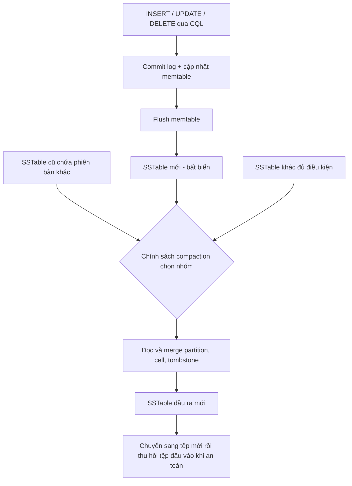
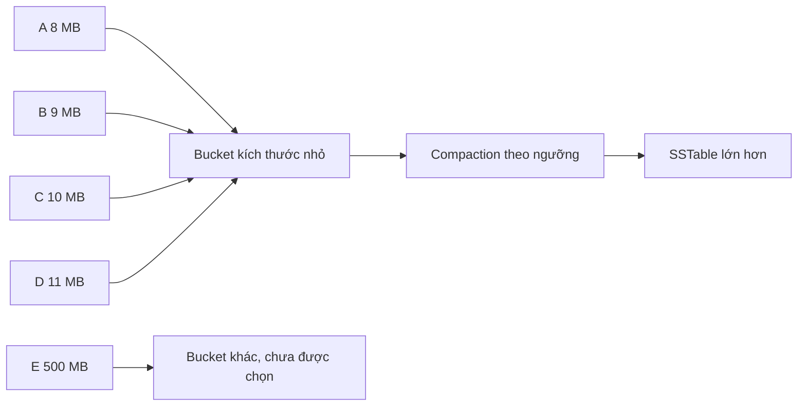
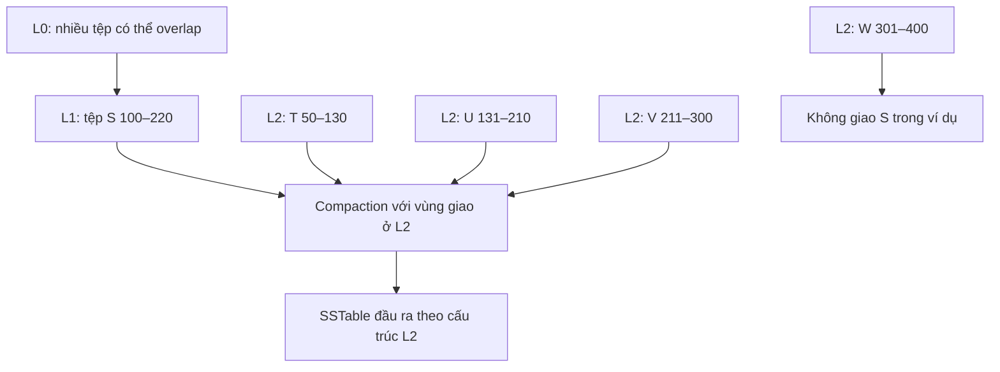

# Mục đích compaction và cách Cassandra lựa chọn SSTable được hợp nhất

## 1. Bài toán: tại sao dữ liệu đã ghi rồi vẫn cần hợp nhất?

**Apache Cassandra** là cơ sở dữ liệu phân tán theo mô hình **wide-column**, tối ưu việc ghi tuần tự bằng kiến trúc gần với **log-structured merge tree (LSM tree)**. Dữ liệu đi qua commit log và memtable trước khi memtable được ghi thành **SSTable** (*Sorted String Table*) trên đĩa. Một SSTable là cấu trúc được ghi tuần tự và về cơ bản **bất biến**: cập nhật một giá trị thường tạo thêm phiên bản mới trong memtable/SSTable mới, thay vì sửa tại chỗ tệp cũ.

Nhờ đó, đường ghi có thể nhanh. Đổi lại, sau nhiều lần flush, đĩa chứa nhiều SSTable, có thể cùng lưu các phiên bản cũ/mới của một partition hoặc tombstone. Một phép đọc phải tìm và đối chiếu dữ liệu liên quan từ memtable cùng các SSTable có khả năng chứa partition đó. **Compaction** giải quyết vấn đề tích lũy các tệp và phiên bản bằng cách đọc nhiều SSTable đầu vào, hợp nhất bản ghi theo quy tắc Cassandra và ghi ra SSTable mới.

Bài này thuộc chương **SSTable và compaction** của mô-đun `DATABASE_ENGINE_WIDE_COLUMN_CASSANDRA`. Trọng tâm không chỉ là định nghĩa compaction, mà là **vì sao cần hợp nhất và thuật toán nào quyết định những SSTable nào được chọn trong một đợt**. Những quyết định đó ảnh hưởng đến độ trễ đọc/ghi, ổ đĩa, TTL/tombstone, tài nguyên vận hành và hiệu quả mô hình bảng theo truy vấn.

### Mục tiêu học tập

Sau bài này, người học có thể:

1. Trình bày đường đi từ memtable flush đến SSTable, từ đó giải thích mục đích compaction.
2. Phân biệt **quyết định khi nào compaction** và **quyết định chọn tệp đầu vào**.
3. So sánh cách chọn SSTable của **STCS**, **LCS**, **TWCS** và **UCS** khi phiên bản hỗ trợ.
4. Giải thích vì sao phiên bản cũ/tombstone không được loại bỏ tùy tiện và repair ảnh hưởng tới nhóm SSTable có thể hợp nhất.
5. Quan sát công việc compaction với CQL, `nodetool`, metrics và chọn chiến lược theo workload.

## 2. Từ một lần UPDATE đến nhiều SSTable

Hình dưới mô tả luồng ở **một replica**. Với replication factor lớn hơn một, mỗi replica xử lý lưu trữ và compaction cục bộ theo trạng thái của mình.



Ví dụ một hàng được ghi qua ba đợt flush:

| SSTable | Dữ liệu biểu diễn (đơn giản hóa) | Trạng thái |
| --- | --- | --- |
| `A.db` | `customer=42, name="An", ts=100` | Giá trị cũ |
| `B.db` | `customer=42, name="Anh", ts=200` | Giá trị mới hơn |
| `C.db` | `customer=42, phone="090...", ts=250` | Bổ sung cột |

Khi đọc `customer=42`, Cassandra cần kết hợp các giá trị có liên quan để trả trạng thái nhất quán với dữ liệu đã ghi và mức nhất quán đọc. Nếu A, B, C được chọn cùng một đợt compaction, đầu ra có thể chứa tên từ B và số điện thoại từ C; cell tên cũ ở A không còn cần giữ trong **tập SSTable đầu vào đó**.

**Nhưng không thể mặc định mọi dữ liệu cũ đều bị xóa.** Có thể còn SSTable bên ngoài nhóm compaction, replica chưa nhận tombstone, hoặc điều kiện an toàn giữ tombstone chưa được thỏa. Đây là lý do chọn đầu vào và quy tắc loại bỏ dữ liệu cũ có quan hệ chặt chẽ.

### Bốn mục đích chính

- **Giảm read amplification:** hạn chế số SSTable có thể phải kiểm tra khi đọc cùng một partition.
- **Giải phóng không gian từ phiên bản bị che khuất:** loại bỏ các phiên bản cell đã được thay thế khi thỏa điều kiện an toàn.
- **Hỗ trợ xử lý TTL và tombstone:** thu hồi dữ liệu hết hạn/xóa khi đủ điều kiện; không phải cứ chạy compaction là hết tombstone.
- **Tổ chức SSTable theo chiến lược:** duy trì các nhóm kích thước, level hoặc cửa sổ thời gian để phù hợp đường đọc/ghi.

Đổi lại, compaction cần **đọc SSTable đầu vào, ghi SSTable đầu ra**, tiêu thụ disk I/O, CPU, bộ nhớ, cache và có thể tạm thời dùng thêm dung lượng đĩa. Nó tạo ra **write amplification**. Vì thế mục tiêu không phải “compaction càng nhiều càng tốt”.

## 3. Phân biệt flush, compaction, repair và replication

| Hoạt động | Khi nào xảy ra? | Dữ liệu đi đâu? | Có thay cho compaction không? |
| --- | --- | --- | --- |
| **Flush memtable** | Khi bộ nhớ/ngưỡng/điều kiện flush kích hoạt | Memtable → SSTable mới | Không; flush còn làm tăng số SSTable |
| **Compaction** | Scheduler/strategy thấy nhóm SSTable đủ điều kiện hoặc thao tác quản trị phù hợp | Nhiều SSTable cục bộ → SSTable đầu ra cục bộ | Chính là quá trình hợp nhất |
| **Repair** | Theo lịch vận hành/sự cố để đồng bộ replica | Đối chiếu và truyền dữ liệu giữa replica theo phạm vi repair | Không; repair không đơn thuần hợp nhất SSTable |
| **Replication** | Theo cấu hình keyspace và placement khi ghi/đọc | Dữ liệu trên các replica được chọn theo token/DC/rack | Không; mỗi replica vẫn cần compaction riêng |
| **Cleanup** | Sau thay đổi topology và hoàn tất trách nhiệm token range | Xóa dữ liệu node không còn sở hữu hợp lệ | Khác mục đích, khác điều kiện an toàn |

Compaction **không phải giao thức đồng thuận**, không quyết định read/write consistency level và không chữa được replica thiếu bản ghi vì không giao tiếp đối soát với các replica khác. Với RF = 3, ba node có thể chọn những đợt compaction khác nhau ở những thời điểm khác nhau mà vẫn phục vụ cùng dữ liệu logic.

Tác vụ repair có thể tạo **repaired/unrepaired** hoặc **pending repair** SSTable và quá trình anti-compaction để đánh dấu phạm vi đã repair. Trạng thái repair này trở thành ràng buộc đối với việc chọn SSTable compaction; không thể tùy ý gộp mọi SSTable có cùng partition range.

## 4. Cơ chế lựa chọn: từ ứng viên đến nhiệm vụ compaction

Cassandra dùng **compaction strategy** ở mức bảng để xác định cách tổ chức SSTable và đề xuất công việc cho hệ thống thực thi. Có hai câu hỏi riêng:

1. **Đã đến lúc compaction chưa?** Có đủ SSTable tương thích trong bucket/level/window? Có tác vụ nền tồn đọng, tombstone compaction hoặc yêu cầu thủ công?
2. **Chọn SSTable nào?** Một tập đầu vào phải tuân thủ logic chiến lược, giới hạn tài nguyên và ràng buộc của trạng thái repair, dữ liệu đã thuộc cùng nhóm hay chưa.

Ở mức khái quát:

```text
Tất cả SSTable của một bảng trên một node
    ↓ phân loại theo trạng thái repair, thuộc tính chiến lược và topology đĩa
Những nhóm có thể compaction cùng nhau
    ↓ áp dụng STCS / LCS / TWCS / UCS
Nhóm ứng viên đủ điều kiện và được ưu tiên
    ↓ xét giới hạn task, không trùng với task đang chạy, tài nguyên sẵn có
SSTable đầu vào được khóa cho task compaction
    ↓ merge + ghi tệp mới + cập nhật metadata / tham chiếu
SSTable đầu ra, tệp cũ được thu hồi khi không còn tham chiếu
```

Các quyết định cụ thể thay đổi theo phiên bản và scheduler. **Không phải cứ hai SSTable chứa cùng partition key là sẽ được chọn hợp nhất ngay**, và cũng không phải cứ tệp nhỏ nhất sẽ luôn được ưu tiên.

### Thuật ngữ cần nắm

| Thuật ngữ | Ý nghĩa trong bài |
| --- | --- |
| **SSTable candidate** | Tệp có thể tham gia một nhiệm vụ compaction |
| **Bucket** | Nhóm tệp có đặc điểm giống nhau, ví dụ kích thước tương tự của STCS |
| **Level** | Tầng tổ chức SSTable của LCS, với quy tắc khác nhau ở L0 và tầng cao |
| **Time window** | Khoảng thời gian dùng để gom SSTable trong TWCS |
| **Overlap** | Tệp có phạm vi token/partition có thể giao nhau; điều này ảnh hưởng khả năng cần đọc nhiều tệp |
| **Repaired/unrepaired/pending repair** | Trạng thái liên quan repair, ràng buộc các SSTable có thể hợp nhất với nhau |
| **Compaction backlog** | Công việc chờ hoặc lượng byte ước tính còn phải compaction |
| **Read/write/space amplification** | Chi phí đọc thêm, ghi thêm và chiếm thêm đĩa do lưu nhiều cấu trúc/phiên bản |

## 5. SizeTieredCompactionStrategy (STCS): chọn các SSTable có kích thước gần nhau

**STCS** tổ chức các SSTable vào những **bucket theo kích thước**. Khi một bucket có đủ tệp, chiến lược ưu tiên chọn một nhóm tệp có kích thước tương tự để hợp nhất thành tệp lớn hơn. Các giới hạn như `min_threshold` và `max_threshold` ảnh hưởng số tệp đủ điều kiện / tối đa trong một nhiệm vụ.

### Ví dụ minh họa

Giả sử cùng một bảng trên node có các SSTable **cùng trạng thái repair**:

| Tệp | Kích thước | Nhận xét |
| --- | ---: | --- |
| A | 8 MB | Gần nhóm nhỏ |
| B | 9 MB | Gần nhóm nhỏ |
| C | 10 MB | Gần nhóm nhỏ |
| D | 11 MB | Gần nhóm nhỏ |
| E | 500 MB | Khác hẳn kích thước |

Với `min_threshold = 4`, một lựa chọn **điển hình** là A + B + C + D, tạo một SSTable lớn hơn và chừa E lại. Đây chỉ là ví dụ mô phỏng để hiểu **logic chọn theo size**; bucket thực tế, thứ tự ưu tiên, kích thước đầu ra và thời điểm task chạy phụ thuộc phiên bản, kích thước trung bình, ngưỡng, dữ liệu đã bị ghi đè và tài nguyên.

Một tệp F = 9 MB nhưng có trạng thái **repaired** khác các tệp A–D **không được tự động tính vào cùng nhóm ứng viên** chỉ vì kích thước giống nhau.



### Đặc tính và đánh đổi

- Phù hợp nhiều workload **write-heavy** có kích thước SSTable phát sinh tương đối đều; thường tạo ít compaction sớm hơn so với chiến lược san bằng level.
- Đọc có thể phải kiểm tra nhiều SSTable ở nhiều kích thước khác nhau; read amplification có thể cao, nhất là khi một partition xuất hiện trong nhiều đời tệp.
- Các SSTable rất lớn/cô lập có thể lâu không gặp đủ ứng viên để được chọn tiếp; phiên bản cũ hoặc tombstone nằm trong tệp này có thể tồn tại lâu.
- Giai đoạn compaction lớn có thể tạo spike I/O và cần không gian đĩa cho cả đầu vào lẫn đầu ra.

Ví dụ cấu hình **minh họa**:

```sql
ALTER TABLE app_ks.events_by_device
WITH compaction = {
    'class': 'SizeTieredCompactionStrategy',
    'min_threshold': '4',
    'max_threshold': '32'
};
```

Không sao chép câu lệnh vào production trước khi xác minh bảng tồn tại, workload và cấu hình hiện tại. Thay đổi strategy là **thay đổi schema**, sau đó dữ liệu có thể được tổ chức dần qua các lần compaction; không bảo đảm tất cả SSTable được viết lại ngay.

## 6. LeveledCompactionStrategy (LCS): chọn SSTable theo level và vùng token giao nhau

**LCS** chia SSTable thành các **level**. Ý tưởng chính:

- **L0** có thể chứa nhiều SSTable với phạm vi token chồng lấn.
- Từ **L1 trở lên**, chiến lược duy trì mức độ không chồng lấn theo phạm vi token **trong cùng một level** (theo quy tắc triển khai).
- Một task thường chọn SSTable ở một level và **các SSTable giao phạm vi token ở level kế tiếp** để viết lại, phục hồi các bất biến của level.

### Ví dụ chọn ứng viên

Giả sử tệp `S` ở level L1 có token range `[100, 220]`. Ở L2 có ba tệp:

| Tệp | Level | Token range | Giao với S? |
| --- | --- | --- | --- |
| S | L1 | [100, 220] | Tệp nguồn |
| T | L2 | [50, 130] | Có, vùng 100–130 |
| U | L2 | [131, 210] | Có |
| V | L2 | [211, 300] | Có, vùng 211–220 |
| W | L2 | [301, 400] | Không |

Nếu chọn S từ L1 để đẩy xuống L2, một nhiệm vụ điển hình cần đưa T, U, V vào đầu vào vì chúng giao phạm vi token; **không mặc định chọn W**. Tùy phiên bản và hoạch định, có thêm tệp mở rộng hoặc thứ tự ưu tiên khác. Đây là ví dụ để hiểu **quy tắc overlap theo level**, không phải dự đoán chính xác scheduler.



LCS thường **giảm read amplification** vì việc tổ chức level giới hạn số vùng SSTable phải xét khi đọc, đặc biệt với truy vấn cập nhật/đọc thường xuyên. Đổi lại, cùng dữ liệu có thể bị viết lại nhiều lần khi di chuyển qua level, làm tăng **write amplification** và áp lực I/O. Nó phù hợp các bảng read-heavy hoặc có nhiều cập nhật trên cùng key, khi ưu tiên hiệu năng đọc ổn định hơn chi phí ghi bổ sung.

Ví dụ:

```sql
ALTER TABLE app_ks.profile_by_user
WITH compaction = {
    'class': 'LeveledCompactionStrategy',
    'sstable_size_in_mb': '160'
};
```

`sstable_size_in_mb` là tùy chọn kích thước mục tiêu của SSTable theo cơ chế LCS; **160** chỉ là số minh họa, phải đo tác động và xem giới hạn phiên bản/đĩa. Tăng hoặc giảm kích thước mục tiêu không tự chữa hot partition và không loại bỏ nghĩa vụ repair.

## 7. TimeWindowCompactionStrategy (TWCS): chọn theo cửa sổ thời gian

**TWCS** hướng tới dữ liệu **time-series** ghi chủ yếu theo thứ tự thời gian, thường đi kèm TTL tương tự giữa các bản ghi. Chiến lược nhóm SSTable theo **cửa sổ thời gian**, rồi tổ chức/hợp nhất các tệp phù hợp **trong cửa sổ đó**. Cửa sổ hiện tại có thể dùng hành vi tương tự STCS để giảm số tệp; khi cửa sổ cũ được đóng, compaction tạo nhóm SSTable ổn định hơn.

Ví dụ cấu hình cửa sổ một ngày:

```sql
ALTER TABLE app_ks.sensor_events_by_day
WITH compaction = {
    'class': 'TimeWindowCompactionStrategy',
    'compaction_window_unit': 'DAYS',
    'compaction_window_size': '1'
};
```

Giả sử các tệp cùng nhóm trạng thái repair:

| SSTable | Thời gian dữ liệu/metadata điển hình | Ứng viên |
| --- | --- | --- |
| A | 20/11, cửa sổ ngày 20 | Cùng nhóm ngày 20 |
| B | 20/11, cửa sổ ngày 20 | Có thể gộp với A |
| C | 21/11, cửa sổ ngày 21 | Nhóm hiện tại |
| D | 21/11, cửa sổ ngày 21 | Có thể gộp với C |

TWCS không chủ động gộp mọi cửa sổ thành một tệp lớn: tệp thuộc ngày 20 thường không được gom chung với ngày 21 theo compaction nền. Lựa chọn cửa sổ dựa trên **timestamp mà Cassandra quản lý đối với SSTable** (trong đó có timestamp tối đa của SSTable), không phải phép nhóm tùy ý theo tên thư mục hay cột `event_day`.

### Vì sao TWCS tốt cho TTL?

Khi dữ liệu ở một cửa sổ có thời điểm sống và hết hạn gần nhau, **toàn bộ SSTable** có thể trở nên hết hạn đủ điều kiện và được thu hồi tương đối hiệu quả, thay vì phải đọc/ghi lại để loại bỏ từng giá trị. Tuy nhiên, việc xóa an toàn vẫn chịu các điều kiện về tombstone, `gc_grace_seconds`, dữ liệu liên quan và trạng thái replica; “TTL hết” **không đồng nghĩa** “tệp sẽ biến mất đúng thời điểm đó”.

### Bẫy của dữ liệu đến muộn và ghi đè

- Dữ liệu viết muộn với timestamp cũ, hoặc cùng partition bị cập nhật nhiều cửa sổ, có thể làm các tệp chứa timestamp trải nhiều khoảng.
- Các SSTable “nhiễm” timestamp của cửa sổ khác có thể cản trở kỳ vọng thu hồi trọn tệp và tăng read amplification.
- Các workload cập nhật/xóa thường xuyên dữ liệu cũ thường **không phù hợp** TWCS thuần túy; cân nhắc bảng theo thời gian/TTL và chiến lược khác.
- Thao tác manual compaction không phù hợp có thể làm mất tính gom cửa sổ, ảnh hưởng thu hồi TTL. Cần hiểu kế hoạch trước khi ép major compaction trên bảng TWCS.

Chọn `compaction_window_size` dựa vào tốc độ ghi, kích thước SSTable, TTL, chu kỳ đến muộn và lượng dữ liệu mỗi cửa sổ, không dựa riêng vào việc schema có cột ngày.

## 8. UnifiedCompactionStrategy (UCS): đánh đổi có thể điều chỉnh

Ở những bản Apache Cassandra **có hỗ trợ**, đặc biệt dòng **5.0**, **UCS** cung cấp cách tổ chức và lựa chọn SSTable linh hoạt hơn giữa các mục tiêu đọc/ghi/không gian đĩa. Thay vì gắn cố định vào một kiểu “bucket kích thước” hoặc “level” duy nhất, UCS dùng thông tin về độ lớn/mật độ của các nhóm SSTable và tham số cấu hình để chọn cấu trúc hợp nhất, cân bằng **read amplification**, **write amplification** và **space amplification**.

Không thể chỉ dựa vào tên UCS để suy đoán tệp nào sẽ được chọn: thuật toán và thông số như **scaling parameters** cần đối chiếu tài liệu **đúng phiên bản Cassandra**. Trên cụm không hỗ trợ UCS, `ALTER TABLE ... UnifiedCompactionStrategy` sẽ không phải một giải pháp khả thi.

| Tiêu chí | STCS | LCS | TWCS | UCS (nếu có) |
| --- | --- | --- | --- | --- |
| Cơ chế chọn chủ đạo | Nhóm SSTable **gần kích thước** | Level + **token overlap** | **Cửa sổ thời gian**, rồi chọn tệp trong cửa sổ | Nhóm theo mật độ/thuộc tính, **tham số đánh đổi** |
| Workload phù hợp thường gặp | Nhiều ghi, không cần đọc tối ưu nhất | Nhiều đọc/cập nhật, quan tâm p99 đọc | Time-series ghi gần tuần tự, TTL | Workload cần tinh chỉnh trade-off trên bản hỗ trợ |
| Read amplification | Có thể cao | Thường thấp hơn STCS | Theo số cửa sổ/tệp liên quan | Phụ thuộc cấu hình |
| Write amplification | Thường thấp hơn LCS | Có thể cao | Theo từng cửa sổ | Phụ thuộc scaling |
| Lưu ý chính | Tệp lớn tồn lâu, tombstone khó thu hồi | I/O và dung lượng tạm khi viết lại nhiều | Dữ liệu đến muộn, timestamp trộn cửa sổ | Cần hiểu thông số/phiên bản và đo thực tế |

Không có chiến lược thắng tuyệt đối. Bảng trên là **định hướng ban đầu**, không thay cho benchmark của truy vấn thực tế.

## 9. Tombstone, TTL: vì sao không được xóa tùy tiện trong compaction?

Trong Cassandra, `DELETE` thường tạo **tombstone**, một dấu mốc logic biểu thị dữ liệu đã bị xóa. TTL cũng dẫn tới trạng thái hết hạn cần được tôn trọng khi đối chiếu các phiên bản. Vì replica có thể tạm thời không nhận được thao tác xóa, nếu một node loại tombstone quá sớm, phiên bản cũ còn trên replica khác có thể xuất hiện trở lại khi trao đổi dữ liệu (*zombie data*).

Ví dụ rút gọn:

```text
t=100: replica A và B có row X = "open"
t=200: client DELETE X; replica A nhận tombstone, B đang offline
t=300: A compaction nhưng vẫn phải giữ dấu xóa khi chưa an toàn
t=400: B quay lại; repair/đồng bộ theo quy trình giúp B biết X đã bị xóa
```

Nếu A loại bỏ tombstone khi B vẫn còn phiên bản cũ, B có thể mang giá trị cũ trở lại. **`gc_grace_seconds` không phải một đồng hồ hẹn giờ xóa chắc chắn**; điều kiện thu hồi phụ thuộc thời gian, các SSTable có thể chứa dữ liệu liên quan, overlap, thông tin replica/repair và quy tắc an toàn của bản Cassandra. Các bản mới có thể có tính năng bảo vệ tombstone bổ sung với điều kiện cụ thể; tuyệt đối không suy rằng đặt `gc_grace_seconds = 0` luôn an toàn.

### Chọn SSTable ảnh hưởng việc loại tombstone thế nào?

Giả sử tombstone mới nằm ở SSTable B, còn phiên bản cũ của hàng ở SSTable A. Nếu chỉ compaction B với các tệp khác, nhưng **A vẫn nằm ngoài đầu vào**, hệ thống phải thận trọng để không loại dấu xóa khi dữ liệu cũ còn có thể được đọc. Chọn đúng tập đầu vào và biết các SSTable giao token range hỗ trợ Cassandra quyết định có thể loại tombstone an toàn hay không.

Vì thế:

- Một SSTable có nhiều tombstone **chưa chắc** lập tức được xếp vào compaction; chiến lược và các ngưỡng liên quan có thể quyết định khác.
- `tombstone_threshold` và các tùy chọn liên quan ở một số chiến lược có thể kích hoạt nhiệm vụ bổ sung; không bảo đảm loại được mọi tombstone khi chạy.
- **Repair đều đặn** và giữ replica không offline quá lâu là trách nhiệm vận hành liên quan tới an toàn xóa. Compaction không thay thế repair.
- Xóa toàn bộ partition theo lịch TTL có thể hiệu quả với TWCS khi data model và timestamp phù hợp; vẫn phải tuân thủ các quy tắc an toàn.

## 10. Repair-state và ranh giới chọn đầu vào

Nhiều công cụ giải thích compaction đơn giản hóa thành “chọn N SSTable nhỏ nhất”. Thực tế, ở Cassandra có **nhóm dữ liệu đã repair, chưa repair và pending repair**. Trộn các nhóm không đúng cách có thể làm mất thông tin phục vụ incremental repair và không được scheduler lựa chọn như thể chúng tương đương.

| Yếu tố | Ý nghĩa khi chọn SSTable |
| --- | --- |
| Cùng table | Compaction xử lý SSTable trong phạm vi bảng của replica; không gộp tùy ý giữa bảng |
| Cùng nhóm trạng thái repair | Tránh hợp nhất tệp đã repaired với tệp unrepaired/pending repair không tương thích |
| Cùng bucket/level/window theo strategy | Điều kiện chủ đạo để xác định nhóm đầu vào |
| Không bị task khác sử dụng | Không thể đồng thời ghi lại cùng SSTable đầu vào bằng nhiều task xung đột |
| Đủ tài nguyên và task slot | Scheduler có thể trì hoãn dù có nhóm ứng viên hợp lệ |
| Đủ điều kiện purge tombstone | Phụ thuộc an toàn dữ liệu; độc lập với việc task compaction được phép chạy |

Đừng can thiệp bằng cách xóa tay SSTable trong thư mục data hay đổi trạng thái repair thủ công để “ép cân”. Các thao tác sửa metadata/tệp không đúng quy trình có nguy cơ mất dữ liệu hoặc phá khả năng repair.

## 11. Tình huống chọn strategy theo workload

### 11.1. Bảng hồ sơ cập nhật liên tục

Một ứng dụng Java đọc hồ sơ theo `user_id`, mỗi lần cập nhật có thể ghi lại vài cột. Cùng partition xuất hiện ở nhiều SSTable, p99 đọc tăng khi số SSTable nhiều. **LCS** thường đáng thử vì hạn chế overlap giữa các level; cần theo dõi I/O khi compaction và disk headroom.

```sql
CREATE TABLE IF NOT EXISTS app_ks.profile_by_user (
    user_id uuid PRIMARY KEY,
    display_name text,
    preferences map<text, text>,
    updated_at timestamp
) WITH compaction = {'class': 'LeveledCompactionStrategy'};
```

### 11.2. Bảng log thiết bị theo ngày, TTL cố định

Một dịch vụ IoT ghi phần lớn sự kiện mới theo thời gian, ứng dụng truy vấn bằng `device_id` và `event_day`. Nếu dữ liệu đến theo thứ tự và ít sửa lịch sử, **TWCS** có thể giúp nhóm cùng tuổi/TTL. Tuy nhiên, thứ tự thời gian dữ liệu đi vào SSTable, timestamp và TTL mới là yếu tố quyết định, **không chỉ khóa `event_day`**.

```sql
CREATE TABLE IF NOT EXISTS app_ks.sensor_events_by_day (
    device_id text,
    event_day date,
    event_time timestamp,
    event_id uuid,
    value double,
    PRIMARY KEY ((device_id, event_day), event_time, event_id)
) WITH CLUSTERING ORDER BY (event_time DESC, event_id ASC)
  AND default_time_to_live = 604800
  AND compaction = {
      'class': 'TimeWindowCompactionStrategy',
      'compaction_window_unit': 'DAYS',
      'compaction_window_size': '1'
  };
```

TTL ví dụ là **604800 giây = 7 ngày**. Không nên mặc định cửa sổ một ngày tối ưu cho mọi độ lớn dữ liệu. Nếu thiết bị gửi sự kiện cũ tới muộn hoặc sửa sự kiện thường xuyên, hãy đo thử rủi ro trộn cửa sổ.

### 11.3. Bảng ingestion ghi nhiều, ít đọc

Một bảng lưu batch ingest với nhiều key độc lập, ít cập nhật, truy vấn đọc không yêu cầu p99 cực thấp có thể thử **STCS** để giảm write amplification so với LCS. Nếu số SSTable, read latency hoặc tombstone backlog tăng, cần đánh giá lại chiến lược chứ không chỉ tăng throughput compaction.

### 11.4. Khi nào cân nhắc UCS?

Trên Cassandra 5.x hỗ trợ UCS, có thể dùng nó làm ứng viên khi cần tinh chỉnh chi phí đọc/ghi/đĩa một cách hệ thống. Xác định SLA và đo trước/sau trên tập truy vấn thật. Các thông số scaling không thay đổi bản chất **partition key**: một hot partition quá lớn vẫn cần xử lý tại mô hình dữ liệu.

## 12. Cách kiểm tra compaction trên cụm

Ví dụ keyspace `app_ks` và bảng `sensor_events_by_day`; thực tế thay bằng tên bảng của cụm. Để xem chiến lược đang dùng:

```sql
SELECT keyspace_name, table_name, compaction
FROM system_schema.tables
WHERE keyspace_name = 'app_ks'
  AND table_name = 'sensor_events_by_day';
```

Để kiểm tra hoạt động ở một node:

```bash
nodetool status app_ks
nodetool compactionstats
nodetool tablestats app_ks.sensor_events_by_day
nodetool compactionhistory
```

Tên cột, chi tiết, tham số lệnh và metrics tùy phiên bản Cassandra. `nodetool status` cho biết node đang Up/Normal, `compactionstats` cho biết compaction đang chạy/đợi, `tablestats` giúp quan sát SSTable count, kích thước dữ liệu, partition và read/write latency; `compactionhistory` hỗ trợ nhìn công việc hoàn thành. Khi cần cú pháp chính xác, chạy `nodetool help <command>` của phiên bản đang vận hành.

**Những chỉ số nên đặt cạnh nhau** trong cùng khoảng thời gian:

| Dấu hiệu | Cách diễn giải sơ bộ | Việc nên kiểm tra tiếp |
| --- | --- | --- |
| SSTable count tăng đều | Flush phát sinh nhanh hơn compaction hợp nhất | Write rate, flush rate, strategy, backlog |
| Read latency và SSTable-per-read tăng | Read amplification có thể tăng | Partition model, SSTable overlap, cache, LCS/STCS |
| Compaction pending cao, disk I/O bão hòa | Task nền không theo kịp hoặc đã gần giới hạn tài nguyên | Throttling, disk bandwidth, concurrency, workload |
| Free disk giảm lúc compaction | Tệp đầu vào/đầu ra cùng tồn tại tạm thời | Disk headroom; snapshot và tệp tạm |
| Tombstone nhiều, expired data tồn tại | Chưa đủ điều kiện purge hoặc chọn tệp không phù hợp | `gc_grace_seconds`, repair, TTL, overlap |
| TWCS có nhiều cửa sổ lạ/tệp kéo dài tuổi | Late arrivals, ghi đè timestamp, tệp chứa nhiều thế hệ | Kiểm tra timestamp dữ liệu và lịch ingestion |
| Data giữa replica không đồng đều | Có thể do topology, flush/compaction tiến độ khác hoặc repair | `tablestats` theo node, replication, repair trạng thái |

Không lấy **số SSTable tuyệt đối** làm thước đo duy nhất: một bảng nhỏ có 50 tệp và một bảng lớn có 50 tệp không nhất thiết có cùng vấn đề. Tối ưu phải dựa vào read/write latency, QPS, CPU/disk I/O, dung lượng còn trống và mục tiêu nghiệp vụ.

### Điều chỉnh throughput và rủi ro manual compaction

Compaction dùng I/O và CPU của node. Cassandra cung cấp cơ chế giới hạn/điều chỉnh thông lượng compaction tùy phiên bản và cấu hình. Tăng mức này có thể giúp xử lý backlog nhưng cũng tranh chấp tài nguyên với request đọc/ghi.

Lệnh kiểu `nodetool compact <keyspace> <table>` là thao tác **bảo trì chủ động**, không phải cách “sửa nhanh” mọi bảng. Với dữ liệu lớn, nó có thể đọc/ghi rất nhiều byte, tăng disk usage tạm và làm p99 tăng; với **TWCS**, thao tác compaction thủ công thiếu hiểu biết còn có thể phá lợi ích của cửa sổ thời gian. Trước khi chạy ở production cần mục đích cụ thể, kế hoạch disk headroom, theo dõi metrics và phương án giảm tải.

**Tuyệt đối không xóa file SSTable bằng tay để giảm disk usage.** Trong trường hợp cần thu hồi snapshot, cleanup, repair, hoặc xử lý file hỏng, áp dụng công cụ/quy trình riêng của Cassandra phù hợp phiên bản và backup/khôi phục đã được xác nhận.

## 13. Ví dụ truy cập từ Java: vì sao ứng dụng nên quan tâm compaction?

Ứng dụng Java qua DataStax/Apache Cassandra Java Driver 4.x không tự chọn SSTable nào sẽ compaction. Đó là công việc của Cassandra. Nhưng code có thể quan sát **triệu chứng** như p99 read latency, timeout và sự khác biệt giữa các partition. Ví dụ truy vấn được thiết kế đúng partition key:

```java
import com.datastax.oss.driver.api.core.cql.PreparedStatement;
import com.datastax.oss.driver.api.core.cql.BoundStatement;
import com.datastax.oss.driver.api.core.cql.Row;
import java.time.LocalDate;

// Giả sử CqlSession session đã được cấu hình đúng local DC.
PreparedStatement prepared = session.prepare("""
    SELECT event_time, event_id, value
    FROM app_ks.sensor_events_by_day
    WHERE device_id = ? AND event_day = ?
    LIMIT 100
    """);

BoundStatement statement = prepared.bind(
    "sensor-42",
    LocalDate.of(2026, 11, 21)
);
long start = System.nanoTime();
Row first = session.execute(statement).one();
long elapsedNs = System.nanoTime() - start;
// Đẩy elapsedNs, result/timeout và partition key được ẩn danh vào metrics.
```

Ví dụ dùng text block nên yêu cầu Java 15+ (Java 17 là lựa chọn phù hợp trong nhiều dự án mới). `session.execute` là ví dụ API đồng bộ; trong hệ thống thực tế có thể dùng async và metrics driver. Khi phát hiện latency tăng, xem thêm metrics Cassandra và `nodetool compactionstats` thay vì mặc định “đổi CL” hoặc tăng retry. Hành vi đọc còn phụ thuộc cache, mô hình partition, mức nhất quán, network và tải nền.

**Lưu ý:** gọi `.one()` chỉ lấy một hàng từ kết quả; để benchmark toàn bộ page hoặc toàn bộ tập kết quả cần định nghĩa rõ số hàng thực đọc, fetching/paging và đo thời gian tương ứng.

## 14. Hướng dẫn lựa chọn và xử lý sự cố theo tình huống

| Tình huống | Hướng điều tra và hành động |
| --- | --- |
| Write-heavy, latency đọc chấp nhận được | Bắt đầu bằng STCS hoặc UCS phù hợp phiên bản; quan sát SSTable count/backlog |
| Read-heavy, cập nhật lặp trên cùng key | Thử LCS, kiểm soát disk I/O, theo dõi write amplification và p99 |
| Time-series, phần lớn append, TTL đều | Thử TWCS với cửa sổ phù hợp; kiểm tra dữ liệu đến muộn |
| Bảng có nhiều tombstone | Đánh giá chiến lược, TTL, repair, điều kiện purge; không đặt `gc_grace_seconds=0` theo cảm tính |
| Compaction backlog tăng mạnh | Kiểm tra compactionstats, disk bandwidth, number of tables, flush rate và throttling |
| Không gian đĩa gần đầy | Xem dung lượng đầu vào/đầu ra, snapshot, backup, file tạm; tránh compaction lớn khi không đủ headroom |
| Tăng RF, thêm/bớt node | Tách việc streaming/cleanup/repair khỏi compaction thường; xác minh trạng thái topology trước khi kết luận |
| Sau đổi strategy, dữ liệu chưa được sắp theo cấu trúc mới | Chờ scheduler xử lý và đo tiến độ; không tự suy rằng một lệnh ALTER đã rewrite mọi SSTable |

**Một quy trình chẩn đoán lặp lại được:**

1. Ghi lại phiên bản Cassandra, tên bảng, compaction map, RF/DC, mô hình khóa và mẫu truy vấn.
2. Thu thập 15–30 phút metrics (thời lượng minh họa), so sánh khung giờ có tải tương đương: read/write p50/p95/p99, disk I/O, CPU, SSTable count và pending compaction.
3. Kiểm tra partition lớn/hot, tỷ lệ update/delete, TTL, dữ liệu đến muộn, snapshot và lịch repair.
4. Xác định liệu cần thay **strategy**, chỉnh **throughput**, sửa **mô hình bảng** hoặc chỉ đợi tác vụ bảo trì hoàn tất.
5. Thử thay đổi trên staging/lab có lượng dữ liệu và distribution gần thực tế; theo dõi đủ chu kỳ flush/compaction rồi mới so sánh.
6. Nếu rollout production, triển khai có giám sát, disk headroom và phương án khôi phục. Đo lại cùng metric; cập nhật tài liệu vận hành.

## 15. Câu hỏi tự kiểm tra

1. Vì sao một `UPDATE` mới không thay trực tiếp giá trị nằm trong SSTable cũ, và tác động gì đến số lượng tệp cần đọc?
2. STCS chọn bốn tệp 8–11 MB để hợp nhất nhưng không chọn tệp 500 MB trong ví dụ. Nguyên nhân chính là gì?
3. Vì sao LCS thường chọn thêm các tệp giao token range ở level kế tiếp? Điều gì xảy ra nếu bỏ qua các tệp giao đó?
4. TWCS dùng cửa sổ dựa trên điều gì? Có phải chỉ cần bảng có cột `event_day` là đủ để được gom đúng cửa sổ không?
5. Vì sao một tombstone đủ “già” về mặt thời gian vẫn có thể chưa được loại bỏ?
6. Giữa compaction, repair và replication, hoạt động nào đối chiếu dữ liệu giữa các replica?
7. Nếu `nodetool compactionstats` cho thấy backlog cao nhưng query p99 bình thường, nên xem thêm điều gì trước khi tăng compaction throughput?
8. Việc tăng `num_tokens` hoặc đổi consistency level có trực tiếp giải quyết một hot partition/compaction backlog không?
9. Một bảng TWCS ghi nhiều sự kiện đến muộn có thể chịu hệ quả gì về TTL và số SSTable?
10. Lý do nào khiến một major compaction thủ công tiềm ẩn rủi ro trên bảng dữ liệu lớn?

## 16. Kết luận

**Compaction** hợp nhất SSTable cục bộ để quản lý nhiều phiên bản dữ liệu, kiểm soát số tệp và thu hồi dữ liệu đủ điều kiện, đổi lại việc đọc/ghi lại tệp và sử dụng dung lượng đĩa tạm thời. **Việc lựa chọn SSTable đầu vào** là đặc tính cốt lõi của compaction strategy: **STCS** dựa vào kích thước, **LCS** dựa vào level và vùng token giao nhau, **TWCS** dựa vào cửa sổ thời gian, còn **UCS** (trên phiên bản hỗ trợ) điều chỉnh đánh đổi thông qua nhóm dữ liệu/tham số. Tất cả đều phải tôn trọng trạng thái repair, điều kiện loại bỏ tombstone và giới hạn tài nguyên.

Quyết định đúng không phải tìm một chiến lược “tốt nhất” nói chung, mà là chọn **chiến lược phù hợp với mô hình đọc/ghi và vòng đời dữ liệu**, đo trên workload đại diện, rồi theo dõi compaction backlog, latency và dung lượng trong vận hành.
