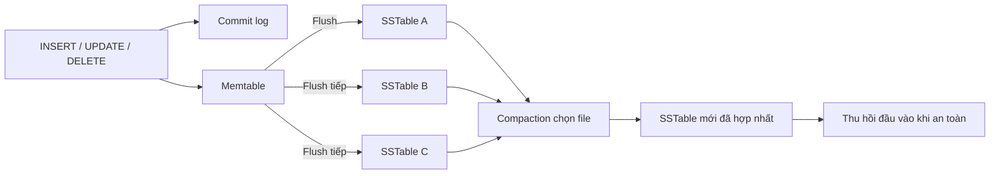

# STCS, LCS, TWCS và đặc điểm tải cần đối chiếu

Apache Cassandra lưu các bản ghi đã flush trên đĩa dưới dạng **SSTable bất biến**. Mỗi lần memtable được flush có thể sinh một hoặc nhiều SSTable mới, trong khi các lần UPDATE/DELETE tiếp theo ghi thêm phiên bản hoặc tombstone thay vì sửa trực tiếp file cũ. **Compaction** chọn những SSTable cần hợp nhất, ghi SSTable mới và bỏ file đầu vào khi an toàn. Vì thế, lựa chọn chiến lược compaction tác động trực tiếp đến tốc độ đọc, lượng ghi lại trên đĩa, tốc độ giải phóng dữ liệu hết hạn, dung lượng dự phòng và độ ổn định khi cụm chịu tải.

Bài thuộc chương **SSTable và compaction** của mô-đun **DATABASE_ENGINE_WIDE_COLUMN_CASSANDRA**. Trọng tâm là cách đối chiếu **SizeTieredCompactionStrategy (STCS)**, **LeveledCompactionStrategy (LCS)** và **TimeWindowCompactionStrategy (TWCS)** theo *đặc điểm tải thật*, thay vì chọn theo tên hoặc mặc định. Nội dung nối với thiết kế partition key, CQL, replication, consistency, repair, xử lý lỗi và ứng dụng Java. Không có một chiến lược nào tối ưu cho mọi bảng.

## 1. Mục tiêu học tập

Sau bài này, bạn có thể:

1. Giải thích vì sao SSTable bất biến làm phát sinh compaction và phân biệt nó với **flush**, **repair** và **backup**.
2. Mô tả nguyên tắc chọn SSTable của **STCS**, các level của **LCS** và cửa sổ thời gian của **TWCS**.
3. So sánh **read amplification**, **write amplification**, **space amplification**, tombstone/TTL và mức độ ổn định của độ trễ.
4. Liên hệ chiến lược với tải ghi liên tục, đọc nhiều, sự kiện theo thời gian, update/delete, backfill và retention.
5. Khai báo compaction trong CQL, xem số liệu bằng nodetool/metrics và xây phép benchmark có đối chứng.
6. Phát hiện những quyết định sai: đổi strategy để chữa **partition nóng**, ép major compaction, hoặc dùng TWCS cho bảng cập nhật dữ liệu quá khứ thường xuyên.

## 2. Trước hết: compaction đang giải quyết vấn đề gì?

Giả sử bảng lưu trạng thái đơn hàng. Một khóa `order_id` ban đầu có `status = 'NEW'`, sau đó cập nhật thành `'PAID'` và cuối cùng thành `'SHIPPED'`. Các phiên bản của cùng khóa có thể tạm nằm trong các SSTable khác nhau. Khi đọc, Cassandra cần phối hợp dữ liệu từ memtable/SSTable và chọn phiên bản thắng theo quy tắc timestamp, đồng thời xét tombstone.



**Flush** chuyển dữ liệu mới trong memtable thành SSTable; **compaction** đọc và viết lại những SSTable hiện có để tổ chức chúng hiệu quả hơn. **Repair** so sánh/đồng bộ dữ liệu giữa các replica, còn **backup/snapshot** lưu bản sao để phục hồi khi cần; các thao tác này có quan hệ nhưng không thể dùng thay thế cho nhau.

| Hiện tượng khi SSTable ngày càng nhiều | Tác động thực tế |
| --- | --- |
| Cùng một partition/cell nằm trong nhiều SSTable | Truy vấn có thể phải xét thêm file, index, Bloom filter và các phiên bản dữ liệu. |
| Tombstone ở file này, dữ liệu cũ ở file khác | Không thể xóa tombstone bừa bãi, nếu không dữ liệu đã xóa có thể xuất hiện lại. |
| SSTable nhỏ liên tục được sinh khi ghi | Số file và metadata tăng; read path và lịch compaction phức tạp hơn. |
| Compaction ghi file mới | Tiêu tốn CPU, disk I/O và dung lượng tạm; có thể cạnh tranh tài nguyên với truy vấn. |

Ba chiến lược chủ yếu khác nhau ở **những SSTable nào được chọn để hợp nhất, khi nào và với mục tiêu gì**. Từng strategy không làm thay đổi partition key, replication factor hay consistency level. Việc chọn strategy thường thực hiện **cho từng bảng**, trong cùng keyspace có thể có bảng dùng chiến lược khác nhau.

## 3. Ba khái niệm “amplification” cần phân biệt

| Chỉ số | Cách hiểu | Vì sao ảnh hưởng SLA |
| --- | --- | --- |
| **Read amplification** | Số SSTable/phần dữ liệu hoặc thao tác I/O phải xét để trả một truy vấn logic. | Cao có thể tăng CPU, disk read và đuôi latency `p95/p99`. |
| **Write amplification** | Dữ liệu bị ghi lại bao nhiêu lần do flush, compaction và tổ chức lại file so với dữ liệu đầu vào. | Cao gây disk I/O, CPU, wear SSD và backlog compaction. |
| **Space amplification** | Dung lượng vật lý dùng cho nhiều phiên bản, tombstone, SSTable đầu vào/đầu ra, snapshot và khoảng trống tạm so với dữ liệu sống. | Cao gây áp lực dung lượng và tăng rủi ro full disk khi compaction. |

Các khái niệm trên là **cách đo xu hướng**, không phải hằng số cố định cho từng strategy. Một bảng có cùng số hàng nhưng nhiều UPDATE/DELETE, tombstone hoặc repair sẽ có chi phí khác bảng append-only. SSTable count **toàn bảng** cũng không bằng số SSTable thực sự bị chạm cho **một partition/range cụ thể**.

Hãy luôn đọc workload theo năm câu:

1. Ghi **mới** liên tục hay **cập nhật/xóa** nhiều trên cùng khóa?
2. Truy vấn theo **một partition + dải clustering** hay phải đọc nhiều partition/scan lớn?
3. Dữ liệu có **TTL tương đối đồng nhất** và có **retention theo thời gian** không?
4. Có **late arrivals, backfill, out-of-order timestamps** hoặc repair/streaming dữ liệu cũ thường xuyên không?
5. Ưu tiên **thông lượng ghi**, **p99 đọc**, **thời gian xóa dữ liệu hết hạn** hay **mức I/O/dung lượng**?

## 4. STCS — SizeTieredCompactionStrategy

**STCS** nhóm và compact các SSTable có kích thước tương đối gần nhau. Một nhóm đủ số lượng theo ngưỡng mới được chọn để hợp nhất; các file nhỏ tạo thành file lớn hơn, và những file lớn có thể trở thành ứng viên cho vòng compaction tiếp theo. Ngưỡng thường được điều khiển bởi `min_threshold` và `max_threshold`.

Ví dụ ý tưởng (không phải lịch thực thi cứng):

```text
4 SSTable cỡ 100 MB
    -> compact
1 SSTable cỡ 400 MB

Nhiều SSTable cỡ 400 MB
    -> có thể compact thành SSTable lớn hơn
```

**Ưu điểm**:

- Thường phù hợp **tải ghi cao**, dữ liệu đến liên tục và ít yêu cầu độ trễ đọc thấp tuyệt đối.
- Không bắt buộc một hệ thống level cố định; chi phí ghi lại có thể thấp hơn LCS trong một số workload.
- Dễ bắt đầu cho những bảng có dữ liệu không tuân quy luật thời gian/TTL chặt chẽ.

**Đánh đổi**:

- Nhiều SSTable kích thước khác nhau có thể chồng lên cùng vùng khóa; truy vấn đọc phải chạm nhiều file hơn.
- Có thể cần **dung lượng trống đáng kể** khi compact các file lớn vì đầu vào và đầu ra cùng tồn tại trong quá trình compaction.
- Việc thu hồi tombstone/expired data có thể chậm nếu những file liên quan hiếm khi cùng được compact; không thể chỉ dựa vào `gc_grace_seconds` để dự đoán chính xác ngày giải phóng dung lượng.
- Độ trễ đọc có thể biến động khi backlog SSTable hoặc compaction tăng.

**Phù hợp thường gặp:** bảng ingest dữ liệu lớn, các batch ghi, ít truy vấn điểm đòi hỏi p99 rất thấp; bảng có update/late write khiến mô hình TWCS không thích hợp. **Không phù hợp khi:** cần tính ổn định cao của latency đọc trên bảng có nhiều chồng lấn SSTable.

### CQL STCS

```sql
CREATE TABLE IF NOT EXISTS compaction_lab.write_heavy_by_bucket (
  tenant_id text,
  bucket_day date,
  event_id timeuuid,
  payload text,
  PRIMARY KEY ((tenant_id, bucket_day), event_id)
) WITH compaction = {
  'class': 'SizeTieredCompactionStrategy',
  'min_threshold': '4',
  'max_threshold': '32'
};
```

Các ngưỡng trên dùng để **minh họa tùy chọn hợp lệ**, không phải đề xuất tối ưu cố định cho mọi cụm. Mỗi phiên bản có mặc định/giới hạn riêng; tránh thay đổi khi chưa đo backlog và tác động đọc/ghi.

## 5. LCS — LeveledCompactionStrategy

**LCS** sắp xếp SSTable theo các **level**. Ở các level đã ổn định từ L1 trở lên, các SSTable trong cùng level thường được tổ chức để **không chồng lấn khoảng token/khóa** theo quy tắc strategy; dữ liệu chồng lấn từ level trước sẽ được compact sang level tiếp theo. **L0** là ngoại lệ quan trọng: SSTable mới có thể chồng lấn nhau, và backlog L0 quá lớn vẫn gây read amplification.

```text
L0: SSTable mới, có thể chồng lấn
    AAAAA    BBBBBB    CCCCC

L1: nhiều SSTable nhỏ, khoảng khóa không chồng lấn trong level
    |---1---|---2---|---3---|

L2: dữ liệu lớn hơn L1, cũng được chia thành các dải trong level
    |-------4-------|-------5-------|

Khi cần di chuyển dữ liệu giữa các level, một số SSTable được đọc
và viết lại để giữ tính chất tổ chức của các level.
```

**Ưu điểm**:

- Với **đọc theo khóa/partition** trên nhiều dữ liệu lịch sử, số SSTable cần xét thường dễ kiểm soát hơn STCS khi các level khỏe mạnh.
- Độ trễ đọc có thể **ổn định hơn**, thích hợp workload đọc thường xuyên hoặc nhạy cảm với `p95/p99`.
- File đầu ra có kích thước mục tiêu có thể cấu hình bằng `sstable_size_in_mb`.

**Đánh đổi**:

- **Write amplification và disk I/O** thường cao hơn STCS vì dữ liệu được ghi lại nhiều lần qua các level.
- Nếu ingest lớn hơn khả năng compact, L0/backlog tăng và lợi thế đọc giảm mạnh.
- Cần theo dõi write latency, pending compaction, số file mỗi level, CPU/disk bandwidth và dung lượng dự phòng.
- LCS không thể tự sửa partition quá lớn, hot partition, thiết kế truy vấn sai hoặc yêu cầu quét toàn bảng.

**Phù hợp thường gặp:** bảng **read-heavy** với truy vấn theo primary key, bảng profile/tài khoản cập nhật tương đối thường xuyên nhưng cần độ trễ đọc ổn định. **Cần cân nhắc:** workload ghi cực cao với I/O hữu hạn, khi LCS có thể tạo backlog và gây tranh chấp với read path.

### CQL LCS

```sql
CREATE TABLE IF NOT EXISTS compaction_lab.profile_by_user (
  user_id uuid PRIMARY KEY,
  display_name text,
  settings_json text,
  updated_at timestamp
) WITH compaction = {
  'class': 'LeveledCompactionStrategy',
  'sstable_size_in_mb': '160'
};
```

Giá trị **160 MB** ở đây là cấu hình ví dụ, **không phải benchmark hay quy tắc chung**. Kích thước SSTable, số level và hiệu quả phụ thuộc dữ liệu, phiên bản Cassandra, dung lượng bộ nhớ và disk throughput.

## 6. TWCS — TimeWindowCompactionStrategy

**TWCS** chia dữ liệu SSTable thành các **cửa sổ thời gian** dựa trên **timestamp** của dữ liệu, sau đó compact chủ yếu trong cùng cửa sổ. Khi dữ liệu mới liên tục đến với timestamp tăng theo thời gian, các cửa sổ cũ có thể ngừng nhận cập nhật, giảm việc phải viết lại dữ liệu cũ. Đây là lựa chọn điển hình cho **time-series, append-only, TTL đều và retention rõ ràng**.

```text
Window 1 (ngày 1): [SSTable cũ đã compact]
Window 2 (ngày 2): [SSTable cũ đã compact]
Window 3 (ngày 3): [SSTable cũ đã compact]
Window 4 (ngày 4): [SSTable đang nhận dữ liệu, có thể dùng
                    compaction theo size trong cửa sổ hoạt động]
```

**Lợi thế chính**:

- Các window cũ chủ yếu ở trạng thái ổn định, nên giảm việc đọc/ghi lại dữ liệu quá khứ sau mỗi đợt ingest mới.
- Với TTL tương đối đồng nhất và dữ liệu có vòng đời theo thời gian, một SSTable có thể trở thành **fully expired**; khi thỏa điều kiện an toàn, Cassandra có thể bỏ cả SSTable mà không cần quét/tái ghi từng hàng.
- Phù hợp với lưu telemetry/log/metric theo thời gian và yêu cầu xóa theo retention.

**Rủi ro đặc thù**:

- **Cập nhật bản ghi cũ** có timestamp mới, ingest dữ liệu lịch sử, restore/streaming và clock skew có thể trộn dữ liệu “cũ” và “mới” vào các SSTable thuộc window khác nhau.
- Nếu một SSTable chứa cả dữ liệu hết hạn và chưa hết hạn, khả năng **drop nguyên SSTable** giảm; tombstone có thể bị giữ lâu hơn.
- Phép đọc trải qua nhiều cửa sổ phải xét nhiều SSTable; TWCS không tự tạo chỉ mục nhanh cho mọi truy vấn time-range.
- TTL không đều, row không TTL, hoặc cập nhật/xóa lặp lại cùng partition theo thời gian có thể làm giảm lợi thế chiến lược.
- Thay đổi window size tùy tiện có thể làm phân bố SSTable không đồng đều và tạo compaction backlog.

**Không nhầm lẫn:** TWCS tổ chức **SSTable theo timestamp và window**, không tự động phân vùng CQL theo ngày. Muốn truy vấn hẹp, ứng dụng vẫn phải thiết kế **partition key và clustering key** theo query.

### CQL TWCS

```sql
CREATE TABLE IF NOT EXISTS compaction_lab.metrics_by_device_day (
  device_id text,
  event_day date,
  ts timeuuid,
  cpu_percent double,
  PRIMARY KEY ((device_id, event_day), ts)
) WITH CLUSTERING ORDER BY (ts DESC)
  AND default_time_to_live = 604800
  AND compaction = {
    'class': 'TimeWindowCompactionStrategy',
    'compaction_window_unit': 'DAYS',
    'compaction_window_size': '1'
  };
```

Ở đây:

- **TTL = 604800 giây (7 ngày)** là giả định giữ dữ liệu trong 7 ngày tính theo thời điểm ghi. Mọi hàng trong bảng dùng một TTL mặc định, thuận lợi cho xóa theo lô cửa sổ.
- **Window = 1 ngày** là mốc minh họa. Window được chọn theo tốc độ ingest, retention, lượng file mỗi window, kiểu truy vấn và khả năng compact; không có quy tắc “TTL 7 ngày thì luôn chọn window 1 ngày”.
- `event_day` trong partition key giúp truy vấn một thiết bị/ngày, trong khi `ts` cho phép đọc theo thời gian trong partition. Partition theo ngày không tự ép SSTable vào đúng window ngày tương ứng nếu timestamps/timing thực tế không cùng ngày.

## 7. Bảng so sánh quyết định

| Tiêu chí | STCS | LCS | TWCS |
| --- | --- | --- | --- |
| **Nguyên tắc chọn SSTable** | Nhóm file gần kích thước. | Compact giữa các level, hạn chế chồng lấn trong level ổn định. | Nhóm theo window timestamp, compact chủ yếu trong window. |
| **Tải điển hình** | Write-heavy, ingest liên tục, đọc vừa phải. | Read-heavy, tra cứu theo khóa, cần p99 ổn định. | Append-only time-series, TTL/retention tương đối đều. |
| **Read amplification** | Có thể cao khi nhiều file chồng lấn. | Thường thấp/ổn định hơn khi levels khỏe mạnh. | Phụ thuộc số window và phạm vi đọc; query rộng qua nhiều window có thể tốn kém. |
| **Write amplification** | Thường dễ chấp nhận hơn LCS ở tải ghi cao. | Thường cao do ghi lại qua levels. | Có thể thấp cho dữ liệu cũ bất biến; tăng khi late writes làm lẫn window. |
| **Dung lượng cho compaction** | Có thể cần nhiều chỗ tạm khi hợp nhất file lớn. | Cần headroom cho rewrite và compaction liên tục. | Cần headroom cho active window và tombstone/expired file chưa an toàn để drop. |
| **TTL/tombstone** | Thu hồi tùy các lần compact file liên quan. | Thu hồi theo compaction/overlap, cần kiểm soát tombstone. | Rất hợp với TTL đồng nhất, toàn file đủ điều kiện expired. |
| **Update dữ liệu cũ** | Thường linh hoạt hơn TWCS. | Thích hợp đọc điểm và cập nhật khi I/O đủ. | Thường là dấu hiệu cảnh báo nếu diễn ra nhiều. |
| **Rủi ro nổi bật** | Nhiều file overlap và nhu cầu disk trống. | Compaction backlog, write amplification. | Backfill/clock skew/TTL lệch gây trộn window, chậm giải phóng file. |
| **Có sửa được schema truy vấn sai?** | Không. | Không. | Không. |

Bảng trên là **định hướng chọn thử nghiệm**, không phải xếp hạng hiệu năng tuyệt đối. Quyết định cuối cùng phải dựa trên truy vấn, dataset và metrics cụ thể.

## 8. Ví dụ ba workload và quyết định ban đầu

### Trường hợp A — Ghi sự kiện liên tục, ít tra cứu ngược

Một hệ thống ingest message theo tenant, ghi hàng trăm nghìn sự kiện/giờ, chủ yếu ghi mới. Người dùng đôi khi tra cứu theo `tenant_id + bucket_day`, nhưng p99 không quá chặt; dữ liệu được giữ lâu, có backfill định kỳ.

**Bắt đầu thử STCS.** Lý do: tải ghi cao và backfill làm TWCS kém hấp dẫn. Đo lượng SSTable, latency đọc trên partition có kích thước lớn, pending compaction và dung lượng trống. Nếu đọc theo khóa là ưu tiên hơn ingest, đưa LCS vào phép so sánh.

### Trường hợp B — Hồ sơ người dùng đọc liên tục

Bảng `profile_by_user` phục vụ login/UI, nhận nhiều SELECT theo `user_id` và UPDATE khi thay đổi hồ sơ. Không có TTL đồng đều theo thời gian. SLA đọc có p99 chặt.

**Bắt đầu thử LCS.** Lý do: muốn giới hạn số file phải xét cho tra cứu điểm. Đo read latency `p95/p99` và mức write amplification; nếu disk không theo kịp compaction, tối ưu throughput/hardware và so sánh STCS. Không đánh đổi tính sẵn sàng của cụm chỉ để có mức p99 tốt trong benchmark ngắn.

### Trường hợp C — Metric theo ngày, tự hết hạn sau bảy ngày

Thiết bị liên tục gửi điểm đo timestamp gần thời điểm ghi, rất hiếm sửa dữ liệu cũ. Truy vấn chủ yếu trên một thiết bị/ngày hoặc dải ngắn theo thời gian; các record hết hạn sau cùng một TTL.

**Bắt đầu thử TWCS** với cửa sổ đủ nhỏ và hợp lý theo ingest/retention. Đo thời gian file cũ trở thành fully expired, tốc độ reclaim dung lượng, số SSTable mỗi window và ảnh hưởng của late-arriving events. Nếu có backfill thường xuyên hoặc TTL không đều, phải thử lại STCS/LCS hoặc tách bảng.

### Câu hỏi kiểm tra lựa chọn

Một hệ thống “time-series” nhưng mỗi giờ đều sửa nhiều ngày lịch sử với timestamp hiện tại, đồng thời một số bản ghi không có TTL. Có nên chọn TWCS chỉ vì dữ liệu chứa cột thời gian? **Không.** Cần phân tích timestamp thực tế, quy tắc update, độ lệch TTL và khả năng drop expired SSTable. Nhãn “time-series” không đủ xác nhận workload có tính chất **append-only, time-ordered và retention đồng đều**.

## 9. TTL, tombstone, repair và tính an toàn của TWCS

Trong Cassandra, một cell có TTL khi hết hạn trở thành dữ liệu bị xóa logic; tombstone và các metadata liên quan được dùng để bảo đảm giá trị cũ từ replica/SSTable khác không xuất hiện lại. Việc được phép loại tombstone phụ thuộc thời gian grace, dữ liệu chồng lấn và các điều kiện an toàn khác, **không chỉ phụ thuộc TTL vừa hết**.

Ví dụ bảng TWCS có TTL bảy ngày:

```text
Ngày 1: ghi event A (TTL 7 ngày)
Ngày 8: A hết hạn logic, truy vấn bình thường không còn trả A.
Sau đó: SSTable chứa A có thể vẫn chiếm dung lượng.
Khi đủ điều kiện gc grace/overlap và expiration:
          một SSTable fully expired có thể bị loại bỏ.
```

**Tuyệt đối không suy luận rằng toàn bộ dữ liệu ngày 1 được xóa vật lý đúng vào đầu ngày 8.** Cùng SSTable có thể chứa dữ liệu với TTL khác, dữ liệu không TTL, hoặc entry cập nhật muộn. Chiến lược cần compaction và điều kiện an toàn cụ thể mới thu hồi được.

### Vì sao gc_grace_seconds và repair có liên quan?

Khi một replica down lâu, nó có thể giữ phiên bản cũ của bản ghi đã bị xóa ở replica khác. Nếu tombstone bị loại quá sớm rồi replica cũ trở lại, dữ liệu xóa có nguy cơ **resurrection (zombie data)**. Vì vậy:

1. Giữ cấu hình `gc_grace_seconds` và lịch repair phù hợp với thời gian tối đa replica vắng mặt, chính sách TTL và phiên bản hệ thống.
2. Bảo đảm repair được thực hiện đủ thường xuyên theo chiến lược vận hành để replica bắt kịp thông tin xóa.
3. Không hạ `gc_grace_seconds` xuống 0 để “giúp TWCS xóa nhanh” nếu chưa chứng minh an toàn cho toàn bộ vòng đời replica và repair.
4. Không bật tùy chọn bỏ qua kiểm tra an toàn khi drop SSTable hết hạn chỉ để lấy lại dung lượng trước mắt.

### Out-of-order writes và repair/streaming

TWCS chọn cửa sổ từ timestamp của dữ liệu/SSTable; **một SSTable thường được phân loại theo timestamp lớn nhất của nó**. Khi insert dữ liệu cũ bằng timestamp hiện tại, update cùng khóa sau nhiều ngày, hoặc streaming khiến file chứa timestamps từ các window khác nhau, dữ liệu đã hết TTL có thể nằm cùng file với dữ liệu mới. Khi đó lợi thế “drop nguyên file của window cũ” suy giảm.

**Khuyến nghị vận hành:** đồng bộ clock trên các node, tránh tùy ý cấp timestamp thủ công `USING TIMESTAMP`, làm rõ luồng backfill, kiểm tra quy trình repair/streaming trong mô hình TWCS và theo dõi file còn tồn tại sau hạn retention. Nếu cần tiếp nhận dữ liệu lịch sử dài hạn, xem xét **bảng riêng cho backfill** hoặc mô hình đọc khác để không làm ô nhiễm cửa sổ của luồng ingest chính.

## 10. Thực hành CQL: ba bảng, ba chiến lược

Ví dụ dùng cụm lab có datacenter tên `dc1`, ít nhất ba replica khả dụng và CQL phù hợp phiên bản. Hãy điều chỉnh RF theo lab thực tế; không triển khai máy ảo một node với RF = 3 rồi kết luận lỗi CL là lỗi compaction.

### Bước 1 — Khởi tạo keyspace

```sql
CREATE KEYSPACE IF NOT EXISTS compaction_lab
WITH replication = {
  'class': 'NetworkTopologyStrategy',
  'dc1': 3
}
AND durable_writes = true;
```

Ba lệnh `CREATE TABLE` của các phần trước tạo ba bảng thử nghiệm độc lập: `write_heavy_by_bucket` (STCS), `profile_by_user` (LCS), `metrics_by_device_day` (TWCS). Dữ liệu không phải đang được copy từ bảng này sang bảng khác; để benchmark công bằng, hãy **nạp dữ liệu có cùng phân bố và kiểu truy vấn** vào những bảng/schema được chuẩn hóa tương đương, chỉ thay strategy.

### Bước 2 — Ghi và đọc đúng partition

```sql
CONSISTENCY LOCAL_QUORUM;

INSERT INTO compaction_lab.metrics_by_device_day
  (device_id, event_day, ts, cpu_percent)
VALUES ('device-01', '2026-11-21', now(), 72.5);

INSERT INTO compaction_lab.metrics_by_device_day
  (device_id, event_day, ts, cpu_percent)
VALUES ('device-01', '2026-11-21', now(), 70.0);

SELECT ts, cpu_percent
FROM compaction_lab.metrics_by_device_day
WHERE device_id = 'device-01'
  AND event_day = '2026-11-21'
LIMIT 100;
```

Truy vấn có đủ partition key `(device_id, event_day)`, dùng clustering order để lấy thời điểm mới. **LIMIT 100 chỉ giới hạn số hàng trả**, không thay thế việc đo read path; với một partition hot, việc đọc và compaction vẫn có thể đắt.

### Bước 3 — Kiểm tra cấu hình của bảng

Trong cqlsh:

```sql
DESCRIBE TABLE compaction_lab.write_heavy_by_bucket;
DESCRIBE TABLE compaction_lab.profile_by_user;
DESCRIBE TABLE compaction_lab.metrics_by_device_day;
```

Xem trường `compaction` để xác nhận strategy và các lựa chọn đã đặt; xem cả `default_time_to_live` và `gc_grace_seconds` khi đánh giá TWCS. Giá trị mặc định thay đổi theo phiên bản và cách deploy, không đoán từ tài liệu ví dụ.

### Bước 4 — Thay đổi strategy khi có bằng chứng

Ví dụ CQL đổi một bảng **lab** từ STCS sang LCS:

```sql
ALTER TABLE compaction_lab.write_heavy_by_bucket
WITH compaction = {
  'class': 'LeveledCompactionStrategy',
  'sstable_size_in_mb': '160'
};
```

Thay `compaction` qua `ALTER TABLE` **không làm mọi SSTable đang có biến đổi tức thì**. Cụm cần xử lý các file/compaction tiếp theo để đạt cấu trúc strategy mới; trong giai đoạn chuyển đổi có thể tăng I/O, backlog và nhu cầu dung lượng. Không chạy thử trực tiếp trên production hoặc bật liên tục các thay đổi chỉ để đo một vài phút rồi kết luận.

## 11. Quan sát: đo điều gì để biết strategy phù hợp?

Các lệnh thông thường trên một nút Cassandra (cú pháp/tên trường có thể khác theo phiên bản):

```bash
nodetool status
nodetool tablestats compaction_lab.profile_by_user
nodetool tablehistograms compaction_lab profile_by_user
nodetool compactionstats
```

Đo trên **tất cả node liên quan**, không chỉ một node có dữ liệu nhẹ. Các trường metrics đáng xem:

| Nhóm đo | Chỉ số/câu hỏi |
| --- | --- |
| **Read latency** | p50/p95/p99 khi GET theo khóa, range trong partition và scan giới hạn; số SSTable được xét mỗi read? |
| **Write latency & throughput** | Ghi/giây ở cùng consistency, p95/p99 khi có compaction cạnh tranh? |
| **SSTable counts/levels** | Tổng và phân bố SSTable theo level/window; L0 tăng liên tục ở LCS hay không? |
| **Compaction backlog** | Pending/running compactions, bytes processed, I/O, task duration và mức ổn định theo giờ/ngày? |
| **Disk footprint** | Live/total disk space, free disk, dữ liệu tạm trong compaction, snapshots tồn tại? |
| **Tombstone/TTL** | Tombstone scanned per read, SSTable hết hạn còn chiếm đĩa, thời gian từ expiry đến reclaim? |
| **Replica health** | Hints, repairs, streaming đang chạy, node lag; có đang làm nhiễu benchmark không? |
| **Host resources** | CPU, GC, read/write IOPS, disk throughput/latency, network và memory. |

**Đừng chỉ theo dõi tổng số SSTable hoặc kích thước bảng.** Một bảng STCS có ít SSTable nhưng vẫn đọc chậm do partition khổng lồ; bảng LCS nhiều SSTable trên toàn token range vẫn có thể đọc nhanh do ít overlap trên từng key. Đo cùng lúc **truy vấn thật + disk/compaction metrics**.

### Phép thử có đối chứng

1. Chuẩn bị các bảng lab có **schema và dữ liệu tương đương**, thay compaction strategy. Kiểm soát cùng node/hardware, replication, consistency và driver.
2. Tạo dataset với số partition, phân bố kích thước partition, tỷ lệ UPDATE/DELETE, TTL, độ trễ write và backfill giống production dự kiến.
3. Chạy các pha **ingest → steady state → read mixed → TTL expiry → repair/backfill**. Không benchmark quá ngắn đến mức chưa xuất hiện compaction thật.
4. Thu p50/p95/p99, throughput, bytes rewritten, disk high watermark và các metric ở bảng trên. Phân biệt warm cache/cold cache.
5. So sánh dưới **cùng SLA**: ví dụ LCS đạt p99 đọc tốt hơn nhưng write throughput giảm và compaction backlog tăng; TWCS reclaim tốt hơn khi có TTL đều nhưng p99 scan dài không cải thiện.
6. Giữ các biến ngoài compaction càng ổn định càng tốt: số node hoạt động, dữ liệu, tải khác, thời điểm repair, token distribution và số kết nối Java driver.

| Trường hợp benchmark | STCS cần quan sát | LCS cần quan sát | TWCS cần quan sát |
| --- | --- | --- | --- |
| Nạp dữ liệu lớn liên tục | Write throughput, file lớn cần compact, disk headroom | L0 backlog, bytes rewritten, write p99 | Active window backlog, số file/window |
| Đọc điểm khi ingest | Read latency phụ thuộc overlap | Lợi ích read p99 so với write cost | Đọc trải nhiều window hay chỉ window gần? |
| Update/delete nhiều | Tombstone và overlap | Rewrite, tombstone và backlog | Dữ liệu xuyên window, giảm khả năng drop file |
| TTL đồng đều và hết hạn | Thời gian reclaim, việc cần compact | Reclaim và chi phí rewrite | Khả năng drop fully expired SSTable |
| Backfill dữ liệu quá khứ | Khả năng hấp thu và read tail | Thêm áp lực lên levels | Mức trộn timestamp vào window mới |

## 12. Điều chỉnh window và ngưỡng: tránh “tối ưu” thiếu cơ sở

### Với STCS

- Nếu quá ít SSTable cùng kích thước, compaction có thể không kích hoạt sớm, dẫn đến nhiều file tồn tại.
- Nếu ép compact quá tích cực, disk I/O tăng; không tự động cải thiện đọc nếu schema phải quét quá rộng.
- Dung lượng trống phải tính đến các SSTable đầu vào/đầu ra của những compaction lớn **và** snapshot/streaming cùng thời điểm.

### Với LCS

- Theo dõi **phân bố SSTable theo level**, đặc biệt L0. L0 tích tụ là tín hiệu tốc độ flush lớn hơn khả năng compact.
- `sstable_size_in_mb` làm thay đổi số file/overhead quản lý và độ lớn đơn vị compaction; cần benchmark chứ không tăng/giảm tùy ý.
- Nếu pending compaction liên tục, kiểm tra disk IOPS/bandwidth, CPU, repair/streaming cạnh tranh và giới hạn thông lượng compaction trước khi chỉ thay tham số.

### Với TWCS

- Window quá nhỏ có thể tạo nhiều SSTable/window và metadata, đặc biệt ở tốc độ ghi thấp hoặc dữ liệu rải nhiều ngày.
- Window quá lớn làm chung SSTable chứa nhiều hàng với thời điểm hết hạn khác nhau; việc drop file toàn phần có thể muộn.
- Chọn window size theo **tốc độ sinh SSTable, retention, distribution TTL, khả năng phân tách timestamp và kiểu truy vấn**, không chỉ theo khoảng thời gian người dùng thường chọn trong UI.
- Nếu dữ liệu lịch sử đến muộn thường xuyên, nên cân nhắc tái thiết kế luồng ingest/bảng trước khi tăng số window.

**Major compaction** có thể tạo những file rất lớn và tiêu thụ nhiều I/O/dung lượng; không sử dụng như một nút “cleanup nhanh” mặc định. Trên TWCS, việc gom dữ liệu từ những window không phù hợp có thể làm mất lợi thế phân tách theo thời gian; chỉ làm theo runbook đã thử nghiệm và phù hợp phiên bản.

## 13. Mối quan hệ với partition key, replication và Java

### Schema đúng là điều kiện tiên quyết

Với hệ thống metric, partition `((device_id, event_day), ts)` giúp lấy một ngày của một thiết bị. Nếu một thiết bị tạo quá nhiều điểm trong một ngày, partition vẫn có thể quá lớn dù chọn TWCS. Có thể chia theo `hour_bucket` hoặc `shard_id` rồi tổng hợp ở Java/API:

```sql
-- Phương án schema khác, chỉ dùng khi workload cần chia nhỏ partition.
CREATE TABLE IF NOT EXISTS compaction_lab.metrics_by_device_hour (
  device_id text,
  event_day date,
  hour_bucket tinyint,
  ts timeuuid,
  cpu_percent double,
  PRIMARY KEY ((device_id, event_day, hour_bucket), ts)
) WITH compaction = {
  'class': 'TimeWindowCompactionStrategy',
  'compaction_window_unit': 'HOURS',
  'compaction_window_size': '6'
};
```

Với schema này, ứng dụng phải biết **hour_bucket** khi query; nếu muốn báo cáo cả ngày, nó truy vấn/ghép nhiều partition một cách có giới hạn. Compaction strategy không thay được thiết kế khóa phục vụ truy vấn.

### Replication và consistency

- Replica của một partition có **SSTable/compaction state riêng**. Không có nghĩa cả ba replica compact cùng thời điểm hoặc có đúng số SSTable giống nhau.
- `LOCAL_QUORUM` với RF = 3 cần hai replica phản hồi; thay STCS thành LCS **không** làm tăng/giảm RF, không biến reads thành linearizable và không thay các quy tắc winner timestamp.
- Repair/hinted handoff/streaming có thể sinh dữ liệu/SSTable mới và ảnh hưởng compaction backlog; khi benchmark, phải ghi nhận tình trạng đồng bộ và lịch repair.
- Nếu một replica thiếu dữ liệu do outage, **compaction không tự kéo dữ liệu từ replica khác**. Cần cơ chế hints/repair hoặc rebuild phù hợp.

### Ứng dụng Java 4.x

Prepared statement trong Java driver phục vụ truy vấn đúng partition; compaction thường là cấu hình **phía bảng/server**, ứng dụng không nên gửi `ALTER TABLE` ở từng request:

```java
import java.time.LocalDate;
import com.datastax.oss.driver.api.core.ConsistencyLevel;
import com.datastax.oss.driver.api.core.cql.PreparedStatement;
import com.datastax.oss.driver.api.core.cql.BoundStatement;
import com.datastax.oss.driver.api.core.cql.Row;
import com.datastax.oss.driver.api.core.cql.ResultSet;

PreparedStatement select = session.prepare(
    "SELECT ts, cpu_percent FROM compaction_lab.metrics_by_device_day " +
    "WHERE device_id = ? AND event_day = ? LIMIT 100");

BoundStatement bound = select.bind(
        "device-01", LocalDate.of(2026, 11, 21))
    .setConsistencyLevel(ConsistencyLevel.LOCAL_QUORUM);

ResultSet rows = session.execute(bound);
for (Row row : rows) {
    // Xử lý timeuuid và cpu_percent của từng sự kiện.
}
```

Để đo hiệu năng, ứng dụng nên log **loại truy vấn, partition key (hoặc hash để bảo vệ dữ liệu), số hàng trả, latency, timeout** và mức đồng thời. Đừng thay đổi retry policy hoặc page size giữa hai vòng benchmark rồi quy mọi khác biệt cho compaction.

## 14. Lỗi phổ biến

| Nhận định | Điều cần sửa |
| --- | --- |
| “Cassandra dùng SSTable nên compaction nào cũng giống nhau.” | Strategy quyết định chọn/hợp nhất file theo đặc trưng khác nhau, ảnh hưởng đọc/ghi/space. |
| “LCS luôn tốt nhất vì ít file chồng lấn.” | Có trade-off ghi lại nhiều và compaction backlog; dưới tải ingest cao L0 có thể tăng. |
| “STCS luôn giải phóng tombstone nhanh.” | Cần có compaction thích hợp và thỏa điều kiện an toàn; file lớn có thể tồn tại lâu. |
| “TWCS phù hợp mọi bảng có timestamp.” | Cần append-only, thời gian tăng tương đối đều và TTL/retention phù hợp; late writes làm mất lợi ích. |
| “TWCS tự chia dữ liệu thành partition theo ngày.” | CQL partition key phải tự thiết kế; window của SSTable là chuyện khác. |
| “TTL bảy ngày nghĩa là đĩa được giải phóng đúng sau bảy ngày.” | TTL hết hạn logic trước; drop tombstone/SSTable phụ thuộc grace, overlap, compaction và an toàn. |
| “Có repair thì có thể hạ `gc_grace_seconds` xuống 0 ngay.” | Phải xét downtime dài, vòng đời tombstone và runbook repair; giảm tùy tiện gây zombie. |
| “SSTable toàn bảng ít thì p99 luôn tốt.” | Cần xét SSTable bị chạm theo key, partition size, tombstone, cache và I/O. |
| “Đổi compaction qua ALTER là số liệu thay đổi ngay.” | Chuyển strategy làm thay đổi tiến trình compaction, có thể cần thời gian/I/O lớn. |
| “Compaction sửa được partition hot hoặc ALLOW FILTERING quét rộng.” | Schema/query/tải là nguyên nhân gốc; compaction không thay đường truy cập dữ liệu. |
| “Node UP có nghĩa replica đã đồng bộ và compact xong.” | Trạng thái node không chứng minh repair hoàn tất hoặc cấu trúc SSTable giống nhau. |

## 15. Bài tập thực hành và tiêu chí hoàn thành

### Bài A — Chọn chiến lược có giải thích

Với ba workload sau, chọn STCS/LCS/TWCS để thử nghiệm trước, rồi nêu ít nhất **hai metric** để xác minh:

1. **Log ingest**: ghi liên tục, thỉnh thoảng backfill dữ liệu cũ, ít SELECT điểm, giữ lâu không TTL.
2. **Customer profile**: GET theo ID liên tục, UPDATE rải rác, SLA p99 đọc chặt, không TTL.
3. **Monitoring metrics**: append-only, TTL bảy ngày đồng nhất, ít late data, dashboard xem dải gần hiện tại.

Trình bày một tình huống khiến lựa chọn ban đầu **phải đổi** (ví dụ log ingest đột nhiên cần p99 đọc rất chặt hoặc metric bắt đầu nhận backfill đa tháng).

### Bài B — Benchmark có bảng kết quả

Tạo môi trường lab, nạp workload có cùng phân phối vào các bảng được thiết kế tương đương với ba strategy. Ghi lại bảng sau (số liệu phải **đo**, không tự điền từ suy luận):

| Strategy | Workload | Read p95/p99 | Write p95/p99 | SSTable/level/window | Pending compactions | Disk peak / reclaimed |
| --- | --- | --- | --- | --- | --- | --- |
| STCS | ... | ... | ... | ... | ... | ... |
| LCS | ... | ... | ... | ... | ... | ... |
| TWCS | ... | ... | ... | ... | ... | ... |

Nếu TWCS kém hơn ở workload update nhiều, giải thích bằng **timestamp/window và overlap**, không kết luận mơ hồ “TWCS chậm”.

### Bài C — Phân tích tombstone

Một bảng TWCS có TTL bảy ngày. Đến ngày thứ tám, SELECT không trả các sự kiện ngày đầu, nhưng disk usage chưa giảm. Giải thích **ít nhất ba nguyên nhân hợp lý** (grace period, SSTable chưa fully expired, các entry có TTL khác, dữ liệu trộn window, compaction/snapshot) và một cách quan sát/đối chiếu cho mỗi nguyên nhân.

### Bài D — Rà soát phương án vận hành

Đội vận hành muốn chạy major compaction toàn bộ bảng rồi giảm `gc_grace_seconds` xuống 0 để lấy lại dung lượng. Hãy chỉ ra rủi ro dữ liệu cũ xuất hiện lại, chi phí I/O/dung lượng, tác động đến TWCS và dữ liệu cần có trước khi phê duyệt bất kỳ thay đổi nào.

**Hoàn thành bài** khi học viên có thể bảo vệ một lựa chọn bằng ba lớp chứng cứ: **(a)** dạng truy vấn và partition thực tế, **(b)** đặc điểm update/TTL/timestamp, **(c)** metrics đọc/ghi/compaction/disk trên một workload đại diện.

## 16. Câu hỏi tự kiểm tra

1. Vì sao LCS giảm khả năng overlap SSTable trong từng level mà vẫn có thể gặp L0 backlog?
2. Vì sao STCS có thể tiết kiệm write amplification nhưng cần nhiều disk headroom trong một số đợt compact?
3. Đối với TWCS, điều kiện nào giúp một SSTable cũ được drop nguyên file? Vì sao dữ liệu không TTL trong file đó gây khó khăn?
4. Vì sao hai bảng cùng chứa cột timestamp chưa chắc phải chọn cùng strategy?
5. Vì sao TTL bảy ngày, window một ngày không đồng nghĩa disk được thu hồi chính xác sau bảy ngày?
6. Tại sao xóa tombstone sớm khi replica cũ chưa đồng bộ lại có thể làm dữ liệu đã xóa xuất hiện trở lại?
7. Đổi STCS sang LCS có thay RF, consistency hoặc partition key không? Nếu không, cơ chế nào cần xử lý riêng các vấn đề đó?
8. Bạn sẽ trình bày những metric nào để biết lợi ích đọc của LCS đáng đánh đổi chi phí ghi tăng?

## 17. Tài liệu tham khảo

- [Apache Cassandra Documentation — Compaction](https://cassandra.apache.org/doc/latest/cassandra/managing/operating/compaction/overview.html): cơ chế compaction, STCS, LCS, TWCS và các lựa chọn tùy phiên bản.
- [Apache Cassandra Documentation — Storage Engine](https://cassandra.apache.org/doc/latest/cassandra/architecture/storage_engine.html): memtable, SSTable bất biến, commit log và tác động của compaction.
- [Apache Cassandra Documentation — CQL CREATE TABLE](https://cassandra.apache.org/doc/latest/cassandra/developing/cql/ddl.html): khai báo `WITH compaction`, TTL và `gc_grace_seconds`.
- [Apache Cassandra Documentation — Repair](https://cassandra.apache.org/doc/latest/cassandra/managing/operating/repair.html): an toàn tombstone và sự hội tụ giữa replica.
- [Apache Cassandra Documentation — nodetool](https://cassandra.apache.org/doc/latest/cassandra/managing/tools/nodetool/nodetool.html): quan sát tablestats, compactionstats và tablehistograms theo phiên bản.

**Ghi nhớ:** STCS nhóm file theo **kích thước** để phục vụ ingest; LCS tổ chức **level** để kiểm soát overlap và ổn định đọc; TWCS gom theo **cửa sổ thời gian** để tận dụng dữ liệu append-only có TTL. Đặt câu hỏi về **truy vấn/khóa phân vùng, tỉ lệ update-delete, timestamp/retention, p99 và ngân sách disk I/O**, sau đó đo trên cụm và dataset đại diện. Một chiến lược compaction tốt chỉ phát huy khi thiết kế bảng và vận hành replica/repair cũng đúng.
