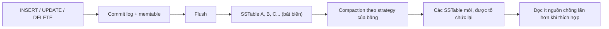
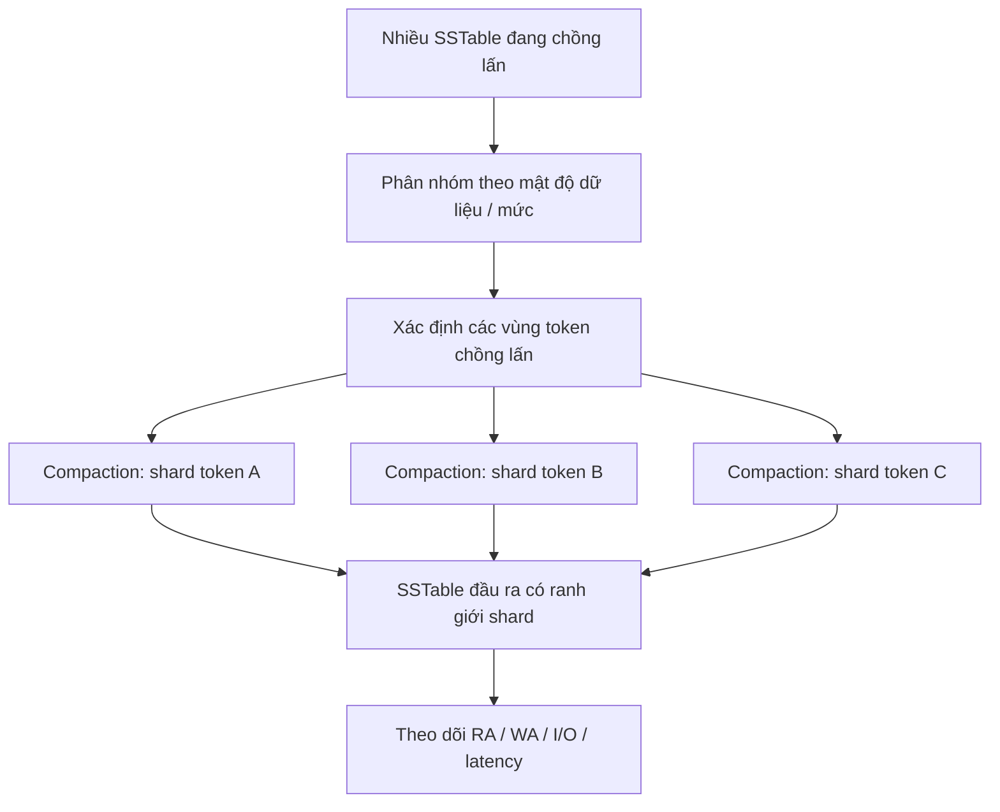
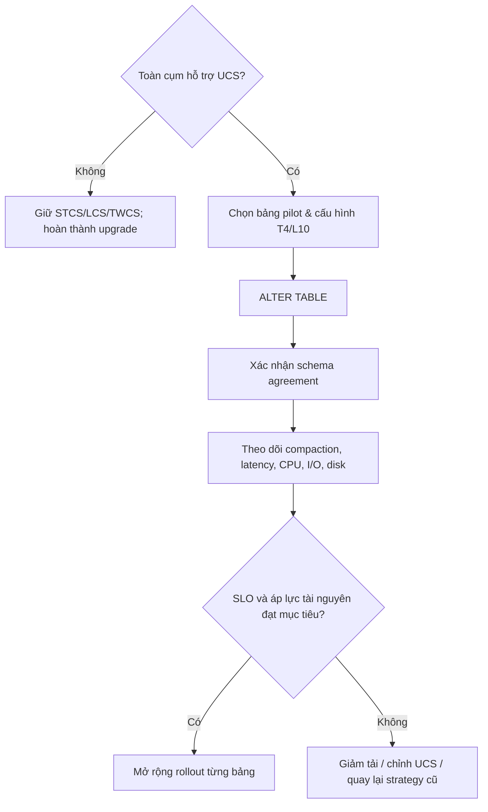

# UCS và điều kiện phiên bản hỗ trợ

> **Chương:** SSTable và compaction  
> **Học phần:** `DATABASE_ENGINE_WIDE_COLUMN_CASSANDRA` — Apache Cassandra

**Unified Compaction Strategy (UCS)** là chiến lược compaction của Apache Cassandra cho phép điều chỉnh giữa ưu tiên đọc và ưu tiên ghi trên cùng một mô hình. Điểm then chốt khi triển khai là **UCS được giới thiệu trong Apache Cassandra 5.0**: một cụm chạy Cassandra 4.1 hoặc cũ hơn không thể đơn giản cấu hình `UnifiedCompactionStrategy` rồi mong nó hoạt động. Trên cụm đang nâng cấp nhiều node, cần đánh giá **phiên bản của toàn cụm** trước khi bật strategy này cho bất kỳ bảng nào.

Bài học giải thích UCS hoạt động như thế nào, khi nào được hỗ trợ, cách khai báo và kiểm tra qua CQL, cách so sánh với STCS/LCS/TWCS và những rủi ro phải kiểm soát khi chuyển đổi. Bối cảnh là Cassandra phân tán theo mô hình wide-column: lựa chọn partition key, cách thiết kế bảng theo truy vấn, replication, consistency level, repair và ứng dụng Java vẫn tác động đến kết quả vận hành, dù compaction được cấu hình theo từng bảng.

**Mục tiêu học tập**

- Trình bày vai trò của SSTable và compaction trong đường ghi/đọc Cassandra.
- Nêu rõ điều kiện **Apache Cassandra 5.0 trở lên** để dùng UCS trong bản phân phối Apache chính thức.
- Giải thích `scaling_parameters` như `T4`, `L10`, `N` và các lựa chọn theo tầng.
- Viết được CQL `CREATE TABLE` / `ALTER TABLE` chọn UCS, kiểm tra cấu hình hiện hành.
- Lập kế hoạch chuyển từ STCS/LCS/TWCS có giám sát và phương án quay lui.
- Phân biệt thứ UCS tối ưu được với những việc vẫn phải xử lý bằng data modeling, replication, repair hoặc ứng dụng.

## 1. Vì sao Cassandra cần compaction?

Trên một replica, mutation được ghi vào **commit log** và **memtable**. Khi memtable flush, Cassandra tạo một hoặc nhiều **SSTable**, là các tệp dữ liệu có cấu trúc, bất biến. Dữ liệu mới có thể nằm ở SSTable khác với phiên bản cũ của cùng một hàng hoặc với tombstone đánh dấu xóa.

Khi đọc một partition, Cassandra có thể phải kiểm tra nhiều SSTable rồi hợp nhất những phiên bản phù hợp. **Compaction** sắp xếp lại và hợp nhất SSTable để hạn chế số nguồn phải tra cứu, giảm chi phí đọc và hỗ trợ loại bỏ dữ liệu đã hết hạn/xóa khi đáp ứng điều kiện an toàn.



Compaction không miễn phí:

- **Read amplification (RA):** số lượng nguồn/tệp SSTable cần kiểm tra để phục vụ một lần đọc. Nhiều SSTable chồng lấn thường làm việc đọc khó hơn.
- **Write amplification (WA):** lượng dữ liệu phải ghi lại bởi compaction sau ghi ban đầu. Compaction càng thường xuyên thì chi phí ghi và I/O nền càng lớn.
- **Space amplification (SA):** dung lượng bổ sung cần cho nhiều phiên bản dữ liệu, tombstone và cả tệp đầu ra compaction được tạo trước khi tệp cũ có thể giải phóng.

Không có chiến lược nào làm cả ba chi phí luôn bằng không. Chiến lược phù hợp phụ thuộc tỷ lệ read/write, partition size, TTL, cập nhật/xóa, loại đĩa, lượng RAM, khả năng chịu I/O và mục tiêu latency.

## 2. UCS thay đổi cách tổ chức SSTable như thế nào?

Những chiến lược cũ thường được chọn theo nhóm workload:

- **SizeTieredCompactionStrategy (STCS):** ghép các SSTable có kích cỡ tương tự; thường hiệu quả về lượng dữ liệu phải ghi lại, nhưng có thể còn nhiều SSTable trùng phạm vi token.
- **LeveledCompactionStrategy (LCS):** tổ chức theo level để giảm chồng lấn và hỗ trợ truy vấn đọc, nhưng thường phải ghi lại dữ liệu nhiều hơn.
- **TimeWindowCompactionStrategy (TWCS):** nhóm SSTable theo cửa sổ thời gian, hữu ích cho dữ liệu time series chủ yếu bất biến, có TTL và được ghi gần theo thứ tự thời gian.

**UCS (UnifiedCompactionStrategy)** thống nhất các đặc tính tiered/leveled trong một cơ chế có thể cấu hình linh hoạt. Thay vì chỉ dựa vào kích cỡ SSTable, UCS dùng **density**:

\[
d = \frac{s}{v}
\]

Trong đó `s` là kích cỡ SSTable, `v` là phần tỷ lệ phạm vi token mà SSTable bao phủ **trong phần token node thực sự sở hữu**. Với vnode, không thể tính `v` đơn giản bằng hiệu giữa token lớn nhất và nhỏ nhất.

Dựa trên density, UCS sắp SSTable thành các tầng với các ngưỡng tăng theo fanout factor; khi một nhóm SSTable chồng lấn vượt ngưỡng, UCS chọn tập tin cần compact. UCS còn chia kết quả theo **ranh giới shard của không gian token**, để những compaction ở các phần không giao nhau có thể chạy song song.



Lợi ích thực tế của cách chia này là tránh phải xử lý một khối SSTable cực lớn trong một tác vụ duy nhất, cho phép điều chỉnh sự cân bằng đọc/ghi bằng tham số và hỗ trợ các tập dữ liệu lớn trên node mật độ cao. Tuy nhiên, **UCS không thay thế partition key tốt**: một phân vùng quá nóng, quá rộng, truy vấn không được thiết kế cho Cassandra hoặc đĩa đã bão hòa vẫn có thể gây vấn đề.

## 3. Điều kiện phiên bản hỗ trợ: điều phải xác minh đầu tiên

### Ma trận tương thích cho Apache Cassandra chính thức

| Phiên bản Apache Cassandra | `UnifiedCompactionStrategy` | Hướng xử lý |
| --- | --- | --- |
| 3.x | **Không hỗ trợ** | Dùng strategy có trong phiên bản đang chạy; lập kế hoạch nâng cấp theo lộ trình hỗ trợ. |
| 4.0.x | **Không hỗ trợ** | Dùng STCS/LCS/TWCS phù hợp; không đưa UCS vào `WITH compaction`. |
| 4.1.x | **Không hỗ trợ** | Tương tự; Cassandra 4.1 không có UCS trong bản Apache chính thức. |
| **5.0.x** | **Có hỗ trợ** | Có thể dùng UCS sau khi hoàn tất xác minh phiên bản và tình trạng cụm. |
| Các bản sau 5.0 | **Xem tài liệu đúng nhánh và gói phân phối** | Không suy ra option/default giống hệt 5.0; kiểm tra trước khi áp dụng. |

Nguồn phát hành chính thức liệt kê Unified Compaction Strategy là **tính năng mới trong Cassandra 5.0**. Mọi tuyên bố rằng một bản cũ có UCS cần được kiểm tra bằng **tài liệu và binary thực tế** của bản phân phối đó; không giả định vendor backport cũng giống Apache Cassandra chính thức.

### Vì sao phải xét toàn cụm?

Cassandra lưu định nghĩa compaction ở **schema của bảng**, và schema đó lan truyền tới nhiều node. Các node có phiên bản không nhận diện `UnifiedCompactionStrategy` hoặc option đi kèm có thể không xử lý schema/trạng thái bảng như mong đợi.

**Nguyên tắc vận hành an toàn:** trong rolling upgrade từ 4.x lên 5.0, giữ cấu hình compaction tương thích với bản cũ **cho đến khi toàn bộ node phục vụ keyspace/table đã được nâng cấp và schema agreement đạt**. Sau đó mới thử UCS trên một bảng có phạm vi nhỏ rồi mở rộng. Đừng bật UCS khi cụm đang ở trạng thái phiên bản pha trộn.

Những điều cần kiểm tra ngoài phiên bản:

1. **Binary và loại triển khai:** Apache Cassandra OSS hay sản phẩm phái sinh; một dịch vụ managed có thể giới hạn DDL hoặc chiến lược compaction.
2. **Schema agreement:** các node đã nhận cùng phiên bản schema, không đang dở quá trình nâng cấp.
3. **Khả năng tương thích cấu hình:** tên class, key option, cú pháp giá trị của bản đang chạy.
4. **Dung lượng và I/O:** đủ khoảng trống cho SSTable đầu ra, compaction và các tác vụ đồng thời như repair/streaming.
5. **Khả năng phục hồi:** backup đã kiểm tra, kế hoạch thay đổi có giám sát và rollback.
6. **Tác động ứng dụng:** điều chỉnh compaction không đổi CQL query hay primary key, nhưng có thể thay đổi p95/p99 của Java client do lượng I/O nền.

### Kiểm tra phiên bản và cấu hình trước migration

Trên **từng node**, một nhân sự có quyền vận hành có thể dùng:

```bash
nodetool version
nodetool status
nodetool describecluster
```

- `nodetool version` cho biết phiên bản Cassandra của node mà lệnh kết nối tới; chạy trên từng node hoặc qua hạ tầng quản trị tương đương để tránh chỉ kiểm tra coordinator.
- `nodetool status` giúp phát hiện node không ở trạng thái mong đợi.
- `nodetool describecluster` có thể hiển thị những schema version trong cụm; cần đối chiếu xem đã đạt schema agreement.

Trong `cqlsh`, có thể xem cấu hình compaction hiện tại:

```sql
SELECT keyspace_name, table_name, compaction
FROM system_schema.tables
WHERE keyspace_name = 'telemetry'
  AND table_name = 'events_by_device';
```

Bảng hệ thống ở ví dụ trên có đường dẫn đọc schema; tên keyspace/table chỉ là minh họa. Có thể dùng `DESCRIBE TABLE telemetry.events_by_device;` trong `cqlsh` để xem CQL định nghĩa bảng.

**Không dựa vào “driver kết nối thành công” để kết luận cluster hỗ trợ UCS.** Một ứng dụng Java dùng driver tương thích CQL vẫn có thể kết nối Cassandra 4.1, nhưng điều đó không làm server 4.1 hiểu class strategy của Cassandra 5.0.

## 4. Hiểu `scaling_parameters`: ưu tiên đọc hay ghi?

UCS dùng `scaling_parameters` để điều chỉnh trade-off giữa RA và WA. Các giá trị thông dụng được viết dưới dạng:

| Giá trị | Cách hiểu | Phù hợp để bắt đầu thử | Đánh đổi |
| --- | --- | --- | --- |
| `T4` | Tiered, fanout 4; gần hành vi STCS với ngưỡng 4 | Ghi nhiều hoặc tải hỗn hợp khi muốn giảm WA | Có thể tăng số SSTable cần xét lúc đọc. |
| `T8` | Tiered, fanout 8 | Tải ghi nặng hoặc time-series phù hợp | Ít compaction hơn, có thể phải đọc nhiều SSTable hơn. |
| `L10` | Leveled, fanout 10; gần đặc trưng LCS | Đọc nặng, cập nhật/xóa và cần giảm chồng lấn | Chi phí ghi nền thường lớn hơn kiểu tiered. |
| `N` | Mốc trung hòa, tương đương T2/L2 | Muốn trung hòa hai phía trong bài toán thử nghiệm | Vẫn cần benchmark trước khi dùng rộng rãi. |
| `T8, T4, N, L4` | Tùy chỉnh theo các mức density | Workload có yêu cầu khác nhau theo tầng | Khó vận hành hơn; cần dữ liệu đo trước khi tinh chỉnh. |

Trực giác: **giá trị tiered cao hơn** thường giảm write amplification nhưng tăng read amplification; **kiểu leveled** giảm số nguồn chồng lấn phải đọc nhưng tốn ghi lại dữ liệu hơn.

Trong cấu hình nhiều giá trị `T8, T4, N, L4`, UCS áp dụng lần lượt cho các tầng; nếu số tầng thực tế nhiều hơn số giá trị, UCS tiếp tục dùng **giá trị cuối** cho các tầng cao hơn. Đừng diễn giải dãy này là “thứ tự chạy bốn tác vụ compaction”.

Hai tùy chọn thường gặp khác:

- `target_sstable_size`: mục tiêu kích thước SSTable đầu ra, ví dụ `'512MiB'` hoặc `'1GiB'`. Giá trị nhỏ có thể hỗ trợ streaming/repair và rút ngắn tác vụ nhưng làm tăng số file và overhead metadata; giá trị lớn làm điều ngược lại.
- `base_shard_count`: số shard cơ sở của cơ chế chia phạm vi token, ví dụ `'4'`. Đây **không** phải số replica và cũng không phải số partition của ứng dụng.

Các tùy chọn và giá trị mặc định có thể khác theo bản release; một số tham số nâng cao như điều khiển expiration, overlap hoặc SSTable growth cần đối chiếu tài liệu đúng nhánh trước khi thay đổi. Chỉ nên tinh chỉnh sau khi có baseline về dữ liệu và tải.

## 5. Ví dụ CQL: sử dụng UCS trong Cassandra 5.0

Giả sử keyspace `telemetry` đã tồn tại, có replication đúng topology, và **mọi node phục vụ bảng đều chạy Apache Cassandra 5.0**. Bảng được thiết kế theo truy vấn “đọc sự kiện của một thiết bị trong một ngày”:

```sql
-- Chỉ thực hiện khi đã xác minh toàn cụm hỗ trợ UCS.
CREATE TABLE telemetry.events_by_device (
    device_id text,
    event_date date,
    event_id timeuuid,
    payload text,
    PRIMARY KEY ((device_id, event_date), event_id)
) WITH compaction = {
    'class': 'UnifiedCompactionStrategy',
    'scaling_parameters': 'T4'
};
```

Khóa phân vùng `(device_id, event_date)` giới hạn số sự kiện mỗi partition theo ngày. Nhưng nếu thiết bị tạo cực nhiều sự kiện/ngày, vẫn cần cân nhắc bucket bổ sung để phân tải và kiểm soát kích cỡ partition. UCS không làm partition tự nhỏ lại.

### Đổi bảng đã có từ STCS hoặc LCS

Sau khi đo baseline, có thể dùng:

```sql
-- Ví dụ chuyển sang cấu hình gần hành vi STCS:
ALTER TABLE telemetry.events_by_device
WITH compaction = {
    'class': 'UnifiedCompactionStrategy',
    'scaling_parameters': 'T4',
    'target_sstable_size': '1GiB',
    'base_shard_count': '4'
};

-- Hoặc lựa chọn thiên về đọc, sau khi đánh giá write amplification:
ALTER TABLE telemetry.events_by_device
WITH compaction = {
    'class': 'UnifiedCompactionStrategy',
    'scaling_parameters': 'L10',
    'target_sstable_size': '256MiB',
    'base_shard_count': '8'
};
```

Hai câu `ALTER` là **hai phương án độc lập để minh họa**, không nên chạy liên tiếp chỉ để “tối ưu”. Câu thứ hai thay cấu hình được chọn trong câu thứ nhất.

UCS cho phép thay đổi `scaling_parameters` trong khi vận hành và thích ứng dần; không bắt buộc major compaction toàn bảng trước khi đổi từ STCS/LCS sang UCS. Tuy nhiên:

- Chuyển đổi cấu hình **không bảo đảm chi phí I/O tức thời bằng không**: các compaction nền vẫn được lập lịch để điều chỉnh SSTable.
- Không hiểu `ALTER TABLE` là “đã chuyển toàn bộ SSTable cũ sang định dạng khác ngay lập tức”.
- Compaction strategy khác với **SSTable format**. Đổi strategy không tự đặt lại dữ liệu, thay partition key, replication factor hoặc consistency level.
- Với dữ liệu có nhiều tombstone và TTL, vẫn phải tuân thủ quy tắc an toàn về `gc_grace_seconds`, trạng thái replica và repair. Không bật `unsafe_aggressive_sstable_expiration` chỉ để thu hồi dung lượng nhanh vì có thể gây vấn đề tính đúng đắn.

### Điều chỉnh ở nhiều level

```sql
ALTER TABLE telemetry.events_by_device
WITH compaction = {
    'class': 'UnifiedCompactionStrategy',
    'scaling_parameters': 'T8, T4, N, L4',
    'target_sstable_size': '512MiB'
};
```

Đây là cấu hình nâng cao để minh họa khả năng pha trộn tiered và leveled theo tầng. Hãy bắt đầu từ tham số đơn giản, đo và thử trên bảng representative trước khi triển khai rộng.

## 6. UCS có thay thế STCS, LCS, TWCS hoàn toàn không?

**Với Cassandra 5.0+, tài liệu Apache khuyến nghị UCS cho phần lớn workload**, nhưng “khuyến nghị” không có nghĩa “mọi bảng đang chạy đều phải lập tức chuyển”, cũng không khẳng định UCS luôn là mặc định trong mọi phiên bản/phân phối.

| Tình huống | Cách tiếp cận |
| --- | --- |
| Bảng mới, cụm đã hoàn toàn lên 5.0+ | Có thể chọn UCS làm ứng viên đầu tiên, bắt đầu từ `T4` hoặc cấu hình theo mục tiêu. |
| Bảng hiện dùng STCS và ghi nhiều | Thử UCS `T4` trên cùng workload, so sánh write p99, read p99, disk I/O và số SSTable. |
| Bảng hiện dùng LCS và đọc nặng | Thử UCS `L10`, đánh giá RA/WA, CPU, tốc độ compaction và chi phí bộ nhớ metadata. |
| Bảng time series chủ yếu bất biến, TTL có quy luật rõ ràng | UCS có khả năng phục vụ time series; cần so sánh với TWCS hiện hữu, đặc biệt về expired SSTable và đặc tính ghi đến muộn. |
| Cụm còn node 4.1 | Giữ strategy cũ; hoàn thành nâng cấp trước. |
| Dung lượng còn rất ít hoặc I/O đã nghẽn | Ổn định lưu trữ và giảm áp lực trước khi đẩy thay đổi compaction lớn. |

**Đối với TWCS:** TWCS dùng cửa sổ thời gian cụ thể; UCS chủ yếu tổ chức theo density và sự chồng lấn token, nhưng cũng có thể xử lý tốt nhiều workload TTL/time series. Hai chiến lược **không đồng nghĩa về thuật toán**. Hãy đo hành vi dữ liệu ghi trễ, TTL phân tán và mức thu hồi disk khi quyết định chuyển.

**Đối với default:** khi tra cứu “Cassandra mặc định compaction là gì?”, phải xác định đúng phiên bản, template tạo bảng và trạng thái schema thực tế; trong một số tài liệu/nhánh STCS vẫn được nêu là mặc định, dù UCS được khuyến nghị cho workload mới. Cách đáng tin cậy là đọc thuộc tính `compaction` của từng bảng.

## 7. Quy trình migration có kiểm soát

### Trước khi chuyển

1. **Xác nhận điều kiện phiên bản:** mỗi node cần hỗ trợ UCS; xác nhận schema agreement, binary và nhà cung cấp dịch vụ.
2. **Lập danh sách bảng mục tiêu:** ghi strategy, option, bảng có TTL/tombstone, dữ liệu time series, cách partition và lưu lượng đọc/ghi.
3. **Chụp baseline:** p50/p95/p99 read/write latency, pending compaction, disk throughput/await, CPU, số SSTable, dung lượng và tombstone.
4. **Đánh giá sức chứa:** có khoảng trống cho SSTable đầu ra và tác vụ khác; nếu thiếu dung lượng cần mở rộng trước.
5. **Chuẩn bị kế hoạch rollback:** lưu định nghĩa `WITH compaction` cũ và giá trị từng option đã dùng, biết cách đưa strategy trở lại và tiêu chí dừng rollout.

### Trong khi chuyển



- Thay đổi **từng bảng hoặc nhóm nhỏ**, tránh chuyển cả keyspace có nhiều bảng lớn trong cùng một thời điểm.
- Xác nhận đồng bộ schema và kiểm tra `SELECT/INSERT/UPDATE/DELETE` đại diện sau thay đổi.
- Để các compaction nền có thời gian ổn định, quan sát theo chu kỳ đủ dài và theo peak load; một snapshot benchmark ngắn chưa đủ.
- Không chạy `nodetool compact` trên toàn bảng như bước “bắt buộc” khi chuyển strategy; major compaction tạo I/O lớn và có thể cần nhiều dung lượng tạm.
- Nếu có lỗi tăng mạnh ở latency, pending compaction, disk usage hoặc cluster health, **dừng rollout** trước khi áp dụng cho bảng tiếp theo.

### Sau khi chuyển

Kiểm tra lại:

```sql
SELECT keyspace_name, table_name, compaction
FROM system_schema.tables
WHERE keyspace_name = 'telemetry'
  AND table_name = 'events_by_device';
```

```bash
nodetool compactionstats
nodetool tablestats telemetry.events_by_device
nodetool tpstats
```

`nodetool compactionstats` xem tác vụ compaction đang/pending; `tablestats` cung cấp thống kê bảng, trong đó có các chỉ số giúp hiểu SSTable và latency; `tpstats` theo dõi tác vụ/hàng chờ. Tùy phiên bản Cassandra, tên trường metric và cách hiển thị thay đổi, nên bổ sung hệ thống giám sát dài hạn thay vì chỉ đọc một lần từ CLI.

**Quay lui cấu hình** có thể là đặt lại `WITH compaction` sang strategy trước đó nếu phiên bản hỗ trợ, nhưng việc quay lại không đồng nghĩa xóa bỏ lập tức mọi thay đổi SSTable đã được tạo trong thời gian UCS hoạt động. Khối lượng I/O và hành vi trong giai đoạn phục hồi cần tiếp tục được đo.

## 8. Chỉ số nào để biết UCS có thực sự giúp?

| Chỉ số | Kỳ vọng khi tuning hiệu quả | Báo động cần kiểm tra |
| --- | --- | --- |
| Read p95/p99 theo các query chính | Giảm hoặc ổn định ở mức mục tiêu | Tăng do nhiều SSTable chồng lấn, I/O hoặc cache |
| Write p95/p99 | Không vượt SLO khi compaction chạy nền | Tăng cùng pending compaction, disk await |
| Pending compactions | Không tích tụ kéo dài dưới tải dự kiến | Tăng liên tục theo thời gian |
| SSTable count/overlap | Phù hợp chiến lược được chọn | Quá nhiều SSTable gây đọc chậm và metadata lớn |
| Disk utilization và IOPS | Có dư địa cho read, write, repair, stream | Device luôn bão hòa, I/O queue dài |
| Free disk capacity | Còn khoảng trống cho compaction output | Có nguy cơ đầy đĩa dù bảng chưa tăng nhanh |
| Tombstone/TTL behavior | Dữ liệu hết hạn được thu hồi theo điều kiện an toàn | Tombstone tồn đọng hoặc đọc chậm do tombstone |
| CPU, heap/off-heap | Không ảnh hưởng quá mức đến node | Đổi sang nhiều SSTable nhỏ gây metadata overhead |

Cẩn thận khi so sánh: muốn kết luận UCS tốt hơn STCS/LCS/TWCS, hãy giữ tương đương workload, data volume, cache warmup, partition distribution, RF, CL và điều kiện I/O. Một thay đổi đồng thời về topology hoặc batch size của Java driver có thể khiến số liệu trước/sau không còn so sánh được.

## 9. Ứng dụng Java có cần đổi code không?

**Thông thường không:** compaction là thuộc tính **schema của bảng trên server**. Java Driver gửi CQL đọc/ghi, còn Cassandra dùng strategy để sắp xếp SSTable nền. Câu truy vấn có khóa phân vùng phù hợp vẫn giữ nguyên.

Ví dụ Java Driver 4.x truy vấn một thiết bị trong một ngày:

```java
import java.time.LocalDate;
import com.datastax.oss.driver.api.core.CqlSession;
import com.datastax.oss.driver.api.core.cql.PreparedStatement;
import com.datastax.oss.driver.api.core.cql.ResultSet;

public final class EventReader {
    private final CqlSession session;
    private final PreparedStatement select;

    public EventReader(CqlSession session) {
        this.session = session;
        this.select = session.prepare(
            "SELECT event_id, payload " +
            "FROM telemetry.events_by_device " +
            "WHERE device_id = ? AND event_date = ?");
    }

    public ResultSet readDay(String deviceId, LocalDate day) {
        return session.execute(select.bind(deviceId, day));
    }
}
```

Đổi từ STCS sang UCS không yêu cầu thay đoạn CQL trên. Nhưng ứng dụng vẫn cần:

- Gửi truy vấn theo partition key phù hợp, không dựa vào UCS để sửa một truy vấn quét toàn cụm.
- Theo dõi read/write timeout, latency và retry. Compaction cạnh tranh I/O có thể gây thay đổi trong p99.
- Chọn mức nhất quán đọc/ghi theo replication và yêu cầu nghiệp vụ; UCS không làm `LOCAL_QUORUM` thành `ONE` hoặc ngược lại.
- Vẫn duy trì repair/backup và kiểm soát tombstone; thay strategy không thay thế consistency/repair.
- Kiểm thử dữ liệu lớn, partition nóng và tình huống node mất replica trong quá trình rollout.

## 10. Những hiểu nhầm thường gặp

**“Cassandra 4.1 có cách nào bật UCS bằng `ALTER TABLE`?”**  
Với Apache Cassandra 4.1 chính thức: **không**. UCS là tính năng được giới thiệu trong bản Apache 5.0. Nâng cấp theo quy trình hỗ trợ, rồi mới đổi strategy khi toàn cụm đã sẵn sàng.

**“Chỉ coordinator 5.0 là đủ?”**  
Không. Schema bảng là trạng thái phân tán; mọi replica/node liên quan phải hiểu strategy và version schema. Không bật khi cụm còn pha trộn version.

**“Chuyển sang UCS lập tức giải quyết đĩa đầy?”**  
Không. Compaction tạo SSTable đầu ra và có thể làm tăng I/O cùng nhu cầu dung lượng trong thời gian xử lý. Phải giải quyết thiếu dung lượng trước.

**“T4 tốt hơn L10 trong mọi trường hợp?”**  
Không. T4 thường giảm chi phí ghi lại; L10 thiên về giảm read amplification. Chọn theo truy vấn thực tế và số liệu benchmark.

**“UCS tự xóa tombstone không cần repair?”**  
Không. Loại bỏ tombstone vẫn phụ thuộc điều kiện an toàn, thời gian grace, trạng thái replica và các chi tiết của lưu trữ. Không dùng option expiration thiếu an toàn như cách bỏ qua yêu cầu nhất quán.

**“UCS là chế độ lưu trữ hay cách thay partition key?”**  
Không. Đây là chiến lược compaction của SSTable theo bảng. Hash/token của partition key, replication và CQL data model vẫn là các phần khác của Cassandra.

## 11. Bài tập thực hành và câu hỏi ôn tập

### Bài tập 1 — Đánh giá hỗ trợ phiên bản

Một cụm có ba node: hai node Cassandra 5.0, một node Cassandra 4.1, vẫn đang rolling upgrade. Nhóm muốn chuyển bảng `telemetry.events_by_device` sang UCS vì thấy p99 đọc chậm.

- Có nên chạy `ALTER TABLE ... UnifiedCompactionStrategy` ngay không?
- Phải hoàn thành những bước nào trước?

### Bài tập 2 — Chọn cấu hình theo tải

Bảng A được đọc theo khóa phân vùng rất thường xuyên, có nhiều cập nhật. Bảng B thu thập event append-only, ghi rất lớn, đọc tổng hợp không thường xuyên. Trên cụm 5.0 đã nâng cấp xong, hãy chọn **một cấu hình khởi đầu để benchmark** cho từng bảng từ `T4` và `L10`, kèm hai chỉ số để theo dõi.

### Bài tập 3 — Lập migration

Một bảng hiện dùng LCS, dung lượng trống chỉ 7%, compaction pending đang tăng. Có nên đổi UCS và chạy major compaction toàn bảng cùng lúc? Hãy đề xuất thứ tự xử lý.

### Bài tập 4 — Đọc CQL

```sql
ALTER TABLE telemetry.events_by_device
WITH compaction = {
    'class': 'UnifiedCompactionStrategy',
    'scaling_parameters': 'T8, T4, N, L4'
};
```

Giải thích ý nghĩa danh sách tham số. Nếu có nhiều hơn bốn level thì level thứ năm dùng giá trị nào?

<details>
<summary>Gợi ý đáp án</summary>

1. Chưa. Cần hoàn thành nâng cấp toàn cụm, kiểm tra health/schema agreement, backup và baseline; sau đó pilot trên bảng phù hợp.
2. A có thể thử `L10` để giảm read amplification; B có thể thử `T4` cho chi phí ghi lại thấp hơn. Theo dõi read/write p99, pending compaction và I/O dưới cùng tải.
3. Không. Ưu tiên khôi phục dung lượng/khả năng I/O, xác nhận nguyên nhân compaction backlog, sao lưu và đo baseline, rồi mới thử chuyển trên bảng pilot khi có dư địa.
4. `T8` cho level đầu, `T4` cho level tiếp theo, `N` cho level ba, `L4` cho level bốn; các level cao hơn dùng lại `L4`.

</details>

## Ghi nhớ

- UCS là **Unified Compaction Strategy**, được giới thiệu trong **Apache Cassandra 5.0**; không dùng trực tiếp trong bản Apache 4.1 trở về trước.
- Cần xác nhận **tất cả node đã hỗ trợ, hoàn thành upgrade và đạt schema agreement** trước khi thay compaction trong cụm.
- `T4` thiên về write, `L10` thiên về read, `N` trung gian; danh sách `scaling_parameters` có thể khác nhau theo tầng.
- UCS chia SSTable theo density và token shard để có thể compact song song và điều chỉnh giữa RA/WA.
- CQL `ALTER TABLE ... WITH compaction` là thay đổi schema; nó không tự chuyển đổi cả dữ liệu ngay tức khắc, không sửa partition key và không thay replication/repair.
- Pilot có baseline, quan sát latency, compaction backlog, I/O và dung lượng trước khi rollout; **không chạy major compaction toàn cụm chỉ vì chuyển UCS**.

### Tài liệu chính thức

- [Apache Cassandra — New Features in 5.0 (UCS)](https://cassandra.apache.org/doc/stable/cassandra/new/)
- [Apache Cassandra — Unified Compaction Strategy](https://cassandra.apache.org/doc/stable/cassandra/managing/operating/compaction/ucs.html)
- [Apache Cassandra — Compaction overview](https://cassandra.apache.org/doc/stable/cassandra/managing/operating/compaction/overview.html)
- [Apache Cassandra — CQL compaction options](https://cassandra.apache.org/doc/stable/cassandra/reference/cql-commands/compact-subproperties.html)

