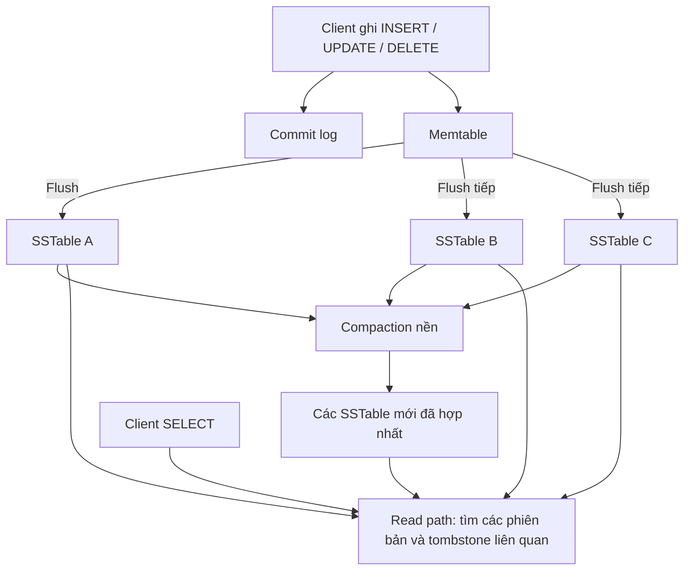
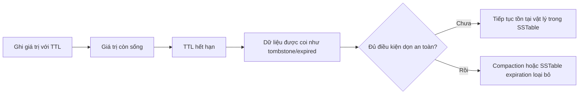

# Cấu hình chiến lược theo dữ liệu cập nhật, TTL và chuỗi thời gian

**Chương:** SSTable và compaction  
**Module:** `DATABASE_ENGINE_WIDE_COLUMN_CASSANDRA` — Apache Cassandra

Apache Cassandra ghi dữ liệu theo kiến trúc **LSM-tree**: cập nhật được đưa vào commit log và memtable; sau flush, dữ liệu trở thành các tệp **SSTable bất biến** trên đĩa. Khi cùng một khóa được sửa, xóa hoặc hết hạn TTL, nhiều phiên bản và tombstone có thể cùng tồn tại trong nhiều SSTable. **Compaction** đọc và kết hợp các SSTable để giảm số tệp phải xét khi đọc, hợp nhất phiên bản và dọn dữ liệu hết hiệu lực khi đủ điều kiện an toàn.

Trong module về Cassandra, hiểu partition key, bảng thiết kế theo truy vấn, consistency level, replication, repair và kết nối Java là nền tảng để vận hành dữ liệu đáng tin cậy. Bài này giải quyết câu hỏi tiếp theo: **nên cấu hình chiến lược compaction khác nhau thế nào cho bảng thường xuyên cập nhật, bảng có TTL và bảng dữ liệu chuỗi thời gian?**

Đây là bài hướng dẫn kỹ thuật với ví dụ chạy trong **cluster thử nghiệm**. Không thay đổi cấu hình một bảng production khi chưa đo tải, dung lượng trống và kế hoạch phục hồi.

## 1. Bạn cần hiểu và thực hành được gì?

Sau bài này, bạn có thể:

1. Giải thích sự khác nhau giữa **flush**, **compaction**, **TTL expiration**, **tombstone** và **repair**.
2. So sánh **SizeTieredCompactionStrategy (STCS)**, **LeveledCompactionStrategy (LCS)**, **TimeWindowCompactionStrategy (TWCS)** và **UnifiedCompactionStrategy (UCS)** trong phiên bản hỗ trợ.
3. Dự đoán tác động của **ghi đè thường xuyên**, **ghi nối tiếp theo thời gian**, **TTL đồng nhất** và **ghi đến trễ/backfill** đến số SSTable và chi phí đọc/ghi.
4. Viết CQL `WITH compaction = ...` và `ALTER TABLE ... WITH compaction = ...` đúng cho từng loại bảng.
5. Quan sát `nodetool tablestats`, `compactionstats`, `tablehistograms` và schema để đánh giá thay đổi.
6. Giải thích khi nào tombstone có thể được dọn và tại sao **không** dùng giảm `gc_grace_seconds` hoặc ép compaction như mẹo xóa dữ liệu.
7. Chọn chiến lược kèm lý do về **read amplification**, **write amplification**, không gian đĩa và yêu cầu dữ liệu.

Các giá trị cấu hình minh họa bên dưới là **điểm khởi đầu cho lab**, không phải cấu hình tối ưu mặc định cho mọi cluster. Hãy kiểm tra tài liệu theo đúng **major/minor version Cassandra** và bản phân phối đang chạy.

## 2. Compaction tác động ở đâu trên đường ghi và đường đọc?

### 2.1. Một bản ghi có thể nằm trong nhiều SSTable



Sơ đồ mô tả cơ chế khái niệm: trong lúc compaction, SSTable cũ và mới có thể cùng hiện diện tạm thời; các tệp cũ chỉ được loại bỏ khi an toàn và không còn tham chiếu. Đọc thực tế có thể dùng memtable, cache, Bloom filter, index trên SSTable và nhiều replica tùy cấu hình.

**Ba kiểu khuếch đại:**

| Khái niệm | Ý nghĩa | Dấu hiệu thường gặp |
| --- | --- | --- |
| **Read amplification** | Một truy vấn phải kiểm tra nhiều cấu trúc/SSTable để lấy hàng hợp lệ | `SSTables per read` tăng, p95/p99 đọc tăng |
| **Write amplification** | Một mutation logic bị ghi lại nhiều lần trong các vòng compaction | I/O nền, CPU và ổ đĩa bận, thông lượng ghi hữu hiệu giảm |
| **Space amplification** | Cần dung lượng cho phiên bản cũ, tombstone và output compaction | Dung lượng SSTable lớn hơn dữ liệu còn sống; cần disk headroom |

Không có chiến lược “tối ưu cả ba” trong mọi tình huống. Chiến lược phù hợp phụ thuộc workload thực tế: tần suất cập nhật cùng khóa, phân bố TTL, độ trễ đọc chấp nhận được, số bản ghi và mẫu truy vấn theo partition.

### 2.2. SSTable bất biến không có nghĩa UPDATE tạo ngay một hàng mới mà client nhìn thấy

Giả sử:

```sql
UPDATE lab_compaction.accounts_by_id
SET points = 10 WHERE account_id = 'acct-1';

UPDATE lab_compaction.accounts_by_id
SET points = 20 WHERE account_id = 'acct-1';
```

Cassandra ghi mutation mới; khi đọc, reconcile các phiên bản theo **cell timestamp** và quy tắc xung đột của Cassandra để thấy giá trị hợp lệ (giả sử không có ghi cạnh tranh/timestamp bất thường). Compaction có thể hợp nhất các phiên bản **về mặt lưu trữ**, nhưng không phải thời điểm duy nhất quyết định kết quả logic của một `SELECT`.

### 2.3. Flush, compaction, repair và cleanup là bốn khái niệm khác nhau

- **Flush:** chuyển memtable thành SSTable; không nhất thiết gộp các SSTable cũ.
- **Compaction:** xử lý dữ liệu **trên từng replica** để giảm chồng lấn, sắp xếp lại và loại dữ liệu hết hiệu lực khi an toàn.
- **Repair:** so sánh/đồng bộ replica nhằm xử lý dữ liệu lệch giữa các node; không tự thay thế logic dọn tombstone của compaction.
- **Cleanup:** tác vụ vận hành xử lý dữ liệu node không còn sở hữu sau thay đổi topology; không phải thủ tục chữa mọi vấn đề compaction.

**Compaction không thay thế replication hay consistency level.** Nếu RF=3 và một replica chưa nhận mutation mới, đổi STCS thành LCS không tự đồng bộ replica đó. Cần đọc/ghi ở CL phù hợp, theo dõi hinted handoff và repair khi cần.

## 3. Bốn chiến lược cần phân biệt

### 3.1. SizeTieredCompactionStrategy — STCS

STCS gom các SSTable có **kích thước gần nhau** thành nhóm rồi compact khi đủ điều kiện. Nó thường cho thông lượng ghi tốt trên tải ghi dày, vì không ép SSTable liên tục qua nhiều mức như LCS.

**Thường phù hợp:** ghi nối tiếp khối lượng lớn, ít đọc ngẫu nhiên nhạy độ trễ, hoặc workload chưa có TTL/time-series đủ rõ để chọn TWCS.

**Đánh đổi:** nhiều SSTable có phạm vi khóa chồng lấn; đọc có thể phải tìm nhiều tệp, đặc biệt khi liên tục cập nhật cùng partition. Các đợt compaction lớn còn tạo tải I/O và cần không gian trống tạm thời.

Ví dụ:

```sql
WITH compaction = {
  'class': 'SizeTieredCompactionStrategy',
  'min_threshold': '4',
  'max_threshold': '32'
}
```

Các ngưỡng `min_threshold` và `max_threshold` là số SSTable đầu vào của một số nhóm compaction; không phải giới hạn tối đa tổng số SSTable. Giá trị trên chỉ minh họa cách khai báo: chỉnh ngưỡng bừa bãi có thể tăng số tệp chờ xử lý hoặc tạo các tác vụ compaction lớn.

### 3.2. LeveledCompactionStrategy — LCS

LCS tổ chức SSTable thành nhiều **level**; ở các mức được quản lý, các SSTable có phạm vi token/khóa được hạn chế chồng lấn. Đọc ngẫu nhiên thường phải xét ít SSTable hơn STCS khi workload phù hợp.

**Thường phù hợp:** bảng được đọc rất nhiều, truy vấn điểm theo partition key nhạy p99 và có cập nhật/ghi đè; chấp nhận chi phí ghi nền cao hơn để giảm read amplification.

**Đánh đổi:** dữ liệu có thể được viết lại nhiều lần khi chuyển qua các level; write amplification, SSD I/O và áp lực compaction có thể tăng. Không mặc định LCS tốt hơn khi workload chủ yếu ingest và ít đọc.

Ví dụ:

```sql
WITH compaction = {
  'class': 'LeveledCompactionStrategy',
  'sstable_size_in_mb': '160'
}
```

Kích thước SSTable đích là một tham số ảnh hưởng số tệp và công việc compaction. Đừng lấy `160` làm giá trị cần áp dụng trên mọi phiên bản/bản phân phối.

### 3.3. TimeWindowCompactionStrategy — TWCS

TWCS chia SSTable vào các **cửa sổ thời gian** dựa trên timestamp ghi bên trong SSTable, rồi chủ yếu compact các SSTable của cùng window. Sau khi một window cũ không còn nhận ghi, TWCS có thể giữ ít SSTable lớn cho window đó. Khi tất cả dữ liệu trong SSTable cũ hết hạn TTL và thỏa điều kiện an toàn, việc loại cả tệp có thể hiệu quả hơn xử lý lẻ từng tombstone.

**Thường phù hợp:** chuỗi thời gian **append-only** hoặc gần như bất biến, ghi theo thứ tự thời gian, có TTL tương đối đồng nhất, không backfill/ghi đè thường xuyên vào khoảng cũ.

**Đánh đổi:** nếu dữ liệu đến trễ hoặc ghi lại các hàng cũ bằng timestamp nằm ngoài window hiện tại, dữ liệu của cùng partition/cell có thể rải qua nhiều window. Các SSTable cửa sổ cũ có thể tiếp tục chứa dữ liệu còn sống hoặc tombstone liên quan đến dữ liệu ở cửa sổ khác, khiến việc hết hạn/dọn tệp không như kỳ vọng và làm tăng chi phí đọc.

Ví dụ:

```sql
WITH compaction = {
  'class': 'TimeWindowCompactionStrategy',
  'compaction_window_unit': 'DAYS',
  'compaction_window_size': '1'
}
```

TWCS không tự đặt TTL: nếu cần tự hết hạn dữ liệu, cấu hình `default_time_to_live` của bảng hoặc `USING TTL` cho mutation là bước riêng.

### 3.4. UnifiedCompactionStrategy — UCS (phiên bản hỗ trợ)

UCS là chiến lược hiện đại trong **Apache Cassandra 5.0+**, được thiết kế để điều chỉnh đánh đổi giữa hành vi thiên về cấp độ/size-tier và nhiều loại workload. Nó là lựa chọn đáng benchmark với dữ liệu hỗn hợp: cập nhật nhiều, đọc nhiều hoặc TTL không đồng đều.

**Điểm cần kiểm tra:** cú pháp tuning như `scaling_parameters`, thuật toán chọn task và giá trị mặc định có thể thay đổi theo minor release/bản phân phối. Không bê nguyên cấu hình UCS từ cluster khác mà không đối chiếu tài liệu chính thức của phiên bản đang dùng.

Ví dụ cơ bản trong cluster có UCS:

```sql
WITH compaction = {
  'class': 'UnifiedCompactionStrategy'
}
```

Sau khi chọn baseline, chỉ tinh chỉnh tham số khi đã có số đo p99 đọc/ghi, write amplification, backlog và disk headroom. UCS không có nghĩa là mọi bảng chuỗi thời gian với TTL đều nên chuyển khỏi TWCS.

### 3.5. Bảng so sánh định hướng

| Chiến lược | Tải thường cân nhắc | Mặt mạnh | Rủi ro chính |
| --- | --- | --- | --- |
| STCS | Ingest cao, đọc ít, workload đơn giản | Thông lượng ghi tốt; cấu hình quen thuộc | SSTable overlap và compaction lớn, đọc có thể tốn |
| LCS | Read-heavy, lookup theo khóa, cập nhật thường xuyên | Giảm số SSTable cần xem khi đọc | Write amplification và I/O nền cao hơn |
| TWCS | Time-series append-only, TTL tương đối thống nhất | Compaction và hết hạn theo window | Late writes, ghi đè, TTL trộn làm window khó dọn |
| UCS (5.0+) | Workload hỗn hợp cần tuning/benchmark | Cơ chế điều chỉnh trade-off linh hoạt | Cần hiểu phiên bản, tham số, theo dõi tài nguyên |

Không coi bảng này là quyết định tự động: điều quan trọng là đo **read latency, compaction pending, SSTables per read, disk headroom và tỷ lệ tombstone** trên workload tương đương production.

## 4. Chuẩn bị cluster lab và ba bảng mẫu

Dùng cluster Cassandra 4.1/5.x riêng (các ví dụ STCS/LCS/TWCS), tối thiểu một node để học cú pháp hoặc ba node để xem tác động replica. Bài này không yêu cầu gây lỗi/stop node. Nếu thử UCS, dùng Cassandra 5.0+ tương thích. Kiểm tra thực tế:

```bash
nodetool status
cqlsh
```

Trong `cqlsh`:

```sql
SELECT data_center, release_version FROM system.local;
```

Tạo keyspace lab. Nếu datacenter không phải `datacenter1`, sửa đúng tên trước khi chạy. RF=1 dưới đây **chỉ dành cho demo**, không có khả năng chịu một replica mất.

```sql
CREATE KEYSPACE IF NOT EXISTS lab_compaction
WITH replication = {
  'class': 'NetworkTopologyStrategy',
  'datacenter1': 1
}
AND durable_writes = true;
```

### 4.1. Bảng cập nhật thường xuyên — thử LCS

```sql
CREATE TABLE IF NOT EXISTS lab_compaction.accounts_by_id (
    account_id text PRIMARY KEY,
    points int,
    tier text,
    updated_at timestamp
)
WITH compaction = {
    'class': 'LeveledCompactionStrategy',
    'sstable_size_in_mb': '160'
};
```

Mẫu đọc `WHERE account_id = ?` có tính chọn lọc cao, nhưng mỗi tài khoản có thể được cập nhật nhiều lần, nên dễ sinh nhiều phiên bản cell và tombstone trong các SSTable theo thời gian.

### 4.2. Bảng sự kiện nhiều ghi, giữ lâu, đọc ít — thử STCS

```sql
CREATE TABLE IF NOT EXISTS lab_compaction.raw_events_by_shard (
    shard_id int,
    event_id timeuuid,
    source text,
    payload text,
    PRIMARY KEY ((shard_id), event_id)
)
WITH CLUSTERING ORDER BY (event_id DESC)
AND compaction = {
    'class': 'SizeTieredCompactionStrategy',
    'min_threshold': '4',
    'max_threshold': '32'
};
```

**Chú ý thiết kế partition:** ví dụ `shard_id` chỉ là minh họa cơ chế compaction, không nên đổ mọi sự kiện vào một số ít partition vô hạn. Trong hệ thật, partition thường cần kết hợp shard và time bucket để kiểm soát kích thước. Compaction không chữa được partition key thiết kế kém.

### 4.3. Chuỗi thời gian có TTL đồng nhất — thử TWCS

```sql
CREATE TABLE IF NOT EXISTS lab_compaction.metrics_by_device_day (
    device_id text,
    bucket_day date,
    observed_at timestamp,
    sample_id timeuuid,
    value double,
    PRIMARY KEY ((device_id, bucket_day), observed_at, sample_id)
)
WITH CLUSTERING ORDER BY (observed_at DESC, sample_id DESC)
AND default_time_to_live = 2592000
AND gc_grace_seconds = 864000
AND compaction = {
    'class': 'TimeWindowCompactionStrategy',
    'compaction_window_unit': 'DAYS',
    'compaction_window_size': '1'
};
```

Ý nghĩa tham số:

- `default_time_to_live = 2592000`: 30 × 24 × 60 × 60 giây, dùng mặc định cho các cột ghi vào bảng (nếu không có TTL cụ thể khác). Hết TTL là điều kiện logic để dữ liệu không còn hiển thị, **không** đồng nghĩa bytes được xóa ngay.
- `gc_grace_seconds = 864000`: 10 ngày grace trong ví dụ, giữ cơ hội truyền tombstone tới replica chưa nhận mutation/xóa. Không dùng thay đổi grace để “tăng tốc” dọn dữ liệu khi chưa xét repair và điều kiện an toàn.
- `compaction_window_unit = DAYS`, `compaction_window_size = 1`: nhóm SSTable theo cửa sổ một ngày, **không** đồng nghĩa partition phải là một ngày. `bucket_day` là quyết định của **data model**.
- `observed_at` là **thời gian sự kiện** của ứng dụng. TWCS nhóm SSTable dựa trên timestamp của mutation trong lưu trữ; cần phân biệt hai khái niệm đó, nhất là với backfill và `USING TIMESTAMP`.

**Chọn bucket của partition** theo volume: thiết bị vài trăm mẫu/ngày có thể dùng ngày; hàng trăm nghìn mẫu/giây cần bucket nhỏ hơn hoặc phân shard. Đừng để mỗi thiết bị tạo một partition vô hạn rồi kỳ vọng TWCS xử lý được.

## 5. Thực nghiệm 1 — dữ liệu cập nhật thường xuyên

Mục tiêu: quan sát cập nhật một khóa nhiều lần tạo các phiên bản trong LSM, còn compaction xử lý hậu trường theo chiến lược.

```sql
CONSISTENCY ONE

INSERT INTO lab_compaction.accounts_by_id
    (account_id, points, tier, updated_at)
VALUES ('acct-01', 10, 'BASIC', '2026-11-21T00:00:00Z');

UPDATE lab_compaction.accounts_by_id
SET points = 20, updated_at = '2026-11-21T00:01:00Z'
WHERE account_id = 'acct-01';

UPDATE lab_compaction.accounts_by_id
SET points = 35, tier = 'SILVER',
    updated_at = '2026-11-21T00:02:00Z'
WHERE account_id = 'acct-01';

SELECT account_id, points, tier, updated_at
FROM lab_compaction.accounts_by_id
WHERE account_id = 'acct-01';
```

Trong trường hợp không có ghi cạnh tranh/timestamp bất thường, hàng trả về có `points = 35` và `tier = 'SILVER'`. Đó là **trạng thái logic**, không phải bằng chứng mọi SSTable cũ đã được xóa.

Đọc và ghi đều có thể xảy ra trước khi memtable flush. Để học cơ chế, có thể xem tệp SSTable và thống kê sau khi hệ thống flush/compact tự nhiên; tránh ép `nodetool flush` và `nodetool compact` liên tục chỉ để làm đẹp số đo, vì ép flush có thể tạo thêm SSTable nhỏ và làm sai workload.

Câu hỏi đo:

- Có bao nhiêu SSTable trên mỗi lần đọc sau hàng nghìn cập nhật cùng nhóm khóa?
- Khi tăng tốc độ update, read p99 và pending compactions thay đổi thế nào?
- Khi CPU và I/O quá tải, LCS có giữ được lợi ích đọc hay tạo backlog?
- Nếu chỉ đọc theo khóa rất ít, liệu STCS hoặc UCS được tune có giảm write amplification mà vẫn đạt SLA?

**Không cần kết luận LCS luôn tốt cho UPDATE.** Nếu bảng ghi nhiều hơn đọc hoặc cập nhật trên một tập khóa nóng liên tục, việc viết lại do compaction có thể là nút cổ chai. Chọn theo số đo.

## 6. Thực nghiệm 2 — TTL và tombstone

### 6.1. TTL hoạt động theo thời gian hết hạn của mutation

Ghi mẫu chuỗi thời gian:

```sql
INSERT INTO lab_compaction.metrics_by_device_day
    (device_id, bucket_day, observed_at, sample_id, value)
VALUES (
    'sensor-01',
    '2026-11-21',
    '2026-11-21T10:00:00Z',
    now(),
    28.5
);

SELECT bucket_day, observed_at, sample_id, value
FROM lab_compaction.metrics_by_device_day
WHERE device_id = 'sensor-01'
  AND bucket_day = '2026-11-21';

SELECT TTL(value)
FROM lab_compaction.metrics_by_device_day
WHERE device_id = 'sensor-01'
  AND bucket_day = '2026-11-21';
```

`TTL(value)` cho biết thời gian còn lại của cột nếu bản ghi tồn tại và có TTL, theo hành vi CQL của phiên bản đang chạy. Với nhiều hàng trong partition, truy vấn `SELECT TTL(value)` có thể trả nhiều giá trị; nên giới hạn theo đủ khóa khi cần theo dõi một mẫu cụ thể.

TTL bắt đầu tính từ **thời điểm ghi vào Cassandra**, không tự tính từ `observed_at`. Ví dụ: nạp hôm nay một sự kiện có `observed_at` từ tuần trước với TTL 30 ngày thì không tự hết hạn sau 23 ngày chỉ vì event time cũ hơn. Điều này ảnh hưởng đến chính sách retention và khả năng dọn nguyên SSTable theo TWCS.

Có thể ghi đè TTL cho một mutation:

```sql
INSERT INTO lab_compaction.metrics_by_device_day
    (device_id, bucket_day, observed_at, sample_id, value)
VALUES (
    'sensor-01',
    '2026-11-21',
    '2026-11-21T10:05:00Z',
    now(),
    29.1
)
USING TTL 3600;
```

Mẫu này hết hạn sớm hơn phần lớn dữ liệu 30 ngày trong bảng. Nếu trộn nhiều TTL trong cùng window/SSTable, **không thể kỳ vọng mọi tệp của window sẽ hết hạn cùng lúc**. Để tối ưu xóa theo thời gian, hãy hạn chế trộn TTL quá khác nhau trong một bảng TWCS; cần thiết thì tách bảng theo retention policy.

### 6.2. Điều gì xảy ra khi TTL hết hạn?



TTL expiration tạo trạng thái xóa logic tương tự tombstone. **Không** được cho rằng `TTL = 30 ngày` nghĩa là bytes chắc chắn bị xóa khỏi đĩa chính xác lúc hết 30 ngày.

Khi có tombstone, Cassandra phải tránh “resurrection”: một replica cũ có thể còn giá trị trước khi xóa. Nếu xóa tombstone khỏi các replica đã cập nhật nhưng một replica chưa nhận xóa quay lại, dữ liệu cũ có thể xuất hiện trở lại. Vì thế các điều kiện như `gc_grace_seconds`, repair, overlap SSTable, timestamp và phiên bản Cassandra đều liên quan.

**Không đơn giản hóa thành công thức “TTL + gc_grace là lúc chắc chắn xóa tệp”.** Đây chỉ là những yếu tố ảnh hưởng tính đủ điều kiện. Compaction chạy khi có kế hoạch/tài nguyên và cần xét phạm vi dữ liệu liên quan; ở thời điểm đó có thể còn SSTable chồng lấn hoặc giá trị chưa hết hạn.

### 6.3. “Drop toàn bộ SSTable” khác “lược tombstone trong SSTable”

TWCS đặc biệt có lợi khi dữ liệu mỗi window có tuổi và TTL gần nhau: sau khi tất cả dữ liệu trong SSTable của window hết hạn và đáp ứng điều kiện an toàn, hệ thống có thể loại tệp mà không cần đọc và viết lại tất cả bản ghi.

Ngược lại, một SSTable chứa các cột TTL 1 giờ, 30 ngày và không TTL sẽ có **một phần dữ liệu còn sống** rất lâu. Khi đó không thể loại cả SSTable chỉ vì một phần lớn hàng đã hết hạn; compaction phải làm việc phức tạp hơn và lợi ích TWCS giảm.

## 7. Thực nghiệm 3 — chọn window theo chuỗi thời gian

Giả sử bảng nhận dữ liệu đều đặn và tất cả mẫu hết hạn sau **30 ngày**. Một số phương án:

| Window | Số window còn sống xấp xỉ trong 30 ngày | Ưu điểm | Bất lợi cần đo |
| --- | ---: | --- | --- |
| 1 giờ | ~720 | Dữ liệu của mỗi cửa sổ nhỏ; có thể dọn theo giờ | Nhiều window/SSTable cần quản lý, tác động đọc nhiều khoảng thời gian |
| 1 ngày | ~30 | Thỏa hiệp dễ hiểu cho ingest hằng ngày | Một ngày có thể quá lớn nếu ingest rất cao |
| 7 ngày | ~5 | Ít nhóm cửa sổ hơn | Tệp/nhóm lớn, hết hạn theo khối có thể chậm hơn; khả năng gom tệp thay đổi |

Các số trên là **ước lượng số khoảng thời gian**, không phải số SSTable thực tế; mỗi cửa sổ có thể có nhiều SSTable, tùy tốc độ flush, compaction và kích thước dữ liệu.

Với dữ liệu 30 ngày, bắt đầu thử window **1 ngày** là lựa chọn dễ kiểm chứng trong lab. Sau đó đánh giá lại dựa trên:

- Tốc độ ghi mỗi ngày và kích thước SSTable của một window.
- Câu truy vấn thường đọc **một ngày** hay **nhiều tuần**.
- Mức độ dữ liệu đến trễ và backfill qua các window cũ.
- Số SSTable trên read, dung lượng live/expired, pending compaction và p99.
- Chính sách retention có ổn định không, hay có các nhóm TTL khác nhau.

### 7.1. Cửa sổ TWCS không phải bucketing khóa phân vùng

Hai quyết định riêng:

```text
Partition key:
    (device_id, bucket_day) -> kiểm soát một partition chứa bao nhiêu mẫu
TWCS window:
    DAYS x 1 -> kiểm soát SSTable được gom theo khoảng timestamp nào
```

Bảng được bucket theo ngày **không** tự bật TWCS. Bật TWCS **không** tự chia partition theo ngày. Phải thiết kế cả hai vì Cassandra còn cần truy vấn theo partition key đủ chặt:

```sql
SELECT observed_at, value
FROM lab_compaction.metrics_by_device_day
WHERE device_id = 'sensor-01'
  AND bucket_day = '2026-11-21'
  AND observed_at >= '2026-11-21T08:00:00Z'
  AND observed_at <  '2026-11-21T11:00:00Z';
```

Truy vấn trên dùng clustering column `observed_at` để giới hạn khoảng trong partition; không cần `ALLOW FILTERING` để đọc theo khóa chính. Nếu người dùng cần 30 ngày, ứng dụng phải xác định các `bucket_day` phù hợp và truy vấn các partition tương ứng có kiểm soát, thay vì quét toàn bảng.

### 7.2. Ghi đến trễ: một cảnh báo quan trọng

Một thiết bị mất mạng một tuần có thể gửi dữ liệu tồn đọng hôm nay. Tùy kiểu timestamp của mutation và cách ghi, bản ghi “cũ” có thể rơi vào cửa sổ hiện tại hoặc cửa sổ quá khứ và phá giả định **mỗi window nhận ghi gần cùng thời điểm**.

Ví dụ minh họa cách gắn timestamp ghi do client tự cung cấp:

```sql
-- Chỉ thử trong LAB: dùng timestamp ở quá khứ như một tình huống backfill.
INSERT INTO lab_compaction.metrics_by_device_day
    (device_id, bucket_day, observed_at, sample_id, value)
VALUES (
    'sensor-02',
    '2026-11-15',
    '2026-11-15T12:00:00Z',
    now(),
    26.3
)
USING TIMESTAMP 1794744000000000;
```

`USING TIMESTAMP` nhận **microseconds từ Unix epoch** (khác `TTL` tính bằng giây). Giá trị này là **write timestamp**, tác động quy tắc hòa giải phiên bản và cách TWCS xác định cửa sổ; nó không nhất thiết phản ánh chính xác `observed_at` nếu ứng dụng tính sai.

Để tránh nhầm ngày/epoch, trong ứng dụng thực hãy chuyển đổi bằng thư viện thời gian và xác nhận timestamp trước khi gửi. Một timestamp sai lệch lớn về quá khứ hoặc tương lai có thể làm dữ liệu “thắng/thua” mutation khác ngoài ý muốn, khiến đọc và compaction khó dự đoán.

Nếu nhu cầu backfill thường xuyên, ưu tiên:

1. Xác định retention theo **ingest time** hay **event time**; hai chính sách này khác nhau.
2. Đo tỷ lệ late arrivals và các window bị mở lại.
3. Cân nhắc tách luồng dữ liệu backfill sang bảng/đường xử lý khác và hợp kết quả ở ứng dụng.
4. Nếu việc trộn cập nhật và nhiều thời điểm là đặc điểm chính, benchmark UCS/STCS/LCS theo SLA thay vì áp TWCS chỉ vì bảng có cột timestamp.

Không cho rằng việc thay đổi `compaction_window_size` giải quyết được mọi late write.

## 8. TTL không đồng nhất và dữ liệu được cập nhật: TWCS có còn hợp?

Xét ba mẫu nghiệp vụ:

### Mẫu A — Sensor append-only, retention 30 ngày

Dữ liệu chỉ ghi một lần, phần lớn đi vào đúng ngày, TTL đồng nhất 30 ngày. TWCS là ứng viên mạnh vì SSTable có tuổi gần nhau, dễ hết hạn theo khối. Nếu event đến muộn vài phút hoặc vài giờ nhưng được ghi với timestamp hiện tại, hãy xác minh chúng không làm cửa sổ lịch sử bị trộn quá mức.

### Mẫu B — Session state cập nhật liên tục, TTL 1 giờ

Ví dụ cùng khóa `session_id` được cập nhật nhiều lần để gia hạn thời gian sống. Mỗi UPDATE có thể tạo phiên bản mới/TTL mới, tombstone cũ; dữ liệu ở cùng khóa nằm trong nhiều SSTable và nhiều cửa sổ. Vì vậy TWCS thường **không phải lựa chọn đầu tiên**. LCS hoặc UCS (nếu hỗ trợ) có thể phù hợp hơn, tùy tỷ lệ đọc/ghi và kích thước dữ liệu.

### Mẫu C — Audit log có hai loại retention

Một số event có TTL 7 ngày, số khác 365 ngày. Nếu trộn chúng trong cùng SSTable, các tệp chứa event còn sống 365 ngày sẽ không được loại toàn bộ vào ngày thứ 7 dù nhiều hàng đã hết hạn. Tốt hơn là cân nhắc **hai bảng theo retention policy**, ví dụ `audit_short` và `audit_long`, để không phải giữ các tệp chỉ vì một phần nhỏ còn sống.

### Bảng quyết định nhanh

| Mẫu dữ liệu | Dấu hiệu | Điểm xuất phát để thử | Điều phải kiểm chứng |
| --- | --- | --- | --- |
| Lookup/update nóng | Cùng khóa ghi đè, p99 đọc quan trọng | LCS hoặc UCS 5+ | Write amplification, compaction backlog |
| Append log, không TTL, read ít | Ghi rất nhiều, ít đọc ngẫu nhiên | STCS hoặc UCS 5+ | Disk headroom, SSTables/read |
| Time-series giữ cố định 30 ngày | Append-only, TTL gần như đồng nhất, ít late writes | TWCS | Số window, expired SSTables, độ lệch event/ingest |
| Time-series có backfill thường xuyên | Timestamp lệch nhiều ngày, sửa dữ liệu cũ | Thử UCS/STCS/LCS hoặc tách đường backfill | Chồng lấn timestamp, p99, hiệu quả dọn TTL |
| Bảng trộn TTL 1 giờ/1 năm | SSTable có cả dữ liệu sống và hết hạn | Tách retention hoặc benchmark chiến lược khác | Tombstone ratio, disk usage |
| Tập khóa được ghi lại thường xuyên | Update/DELETE nhiều, TTL được gia hạn | LCS/UCS theo read/write mix | Tombstones, disk I/O, tail latency |

## 9. Cấu hình và thay đổi chiến lược bằng CQL

### 9.1. Tạo bảng với compaction strategy

Các ví dụ `CREATE TABLE` ở mục 4 khai báo chiến lược trực tiếp. Khi bảng đã tồn tại, có thể thay đổi:

```sql
-- Ví dụ chỉ chạy trong lab: chuyển bảng cập nhật sang STCS để so sánh.
ALTER TABLE lab_compaction.accounts_by_id
WITH compaction = {
  'class': 'SizeTieredCompactionStrategy',
  'min_threshold': '4',
  'max_threshold': '32'
};

-- Phục hồi cấu hình LCS nếu đó là ứng viên tốt hơn sau benchmark.
ALTER TABLE lab_compaction.accounts_by_id
WITH compaction = {
  'class': 'LeveledCompactionStrategy',
  'sstable_size_in_mb': '160'
};
```

**Điểm cốt lõi:** `ALTER TABLE ... WITH compaction` đổi cấu hình chiến lược; nó **không** ngay lập tức viết lại đồng bộ toàn bộ SSTable cũ trong một transaction. Sau thay đổi, cần theo dõi các vòng compaction nền, I/O, pending tasks, đặc điểm SSTable và hiệu năng một khoảng đủ dài.

Nếu thử UCS với Cassandra 5.0+ đã xác minh hỗ trợ:

```sql
ALTER TABLE lab_compaction.accounts_by_id
WITH compaction = {
  'class': 'UnifiedCompactionStrategy'
};
```

Không dùng lệnh UCS trên Cassandra 4.1 chỉ vì tên chiến lược xuất hiện trong tài liệu phiên bản mới.

### 9.2. Thay TTL không đồng nghĩa đổi cửa sổ

```sql
ALTER TABLE lab_compaction.metrics_by_device_day
WITH default_time_to_live = 604800;
```

Lệnh trên đặt TTL mặc định cho **các lần ghi mới** (7 ngày) nếu không có TTL ghi đè. Nó không tự thay đổi TTL của tất cả cell đã tồn tại, không tự chuyển dữ liệu giữa cửa sổ TWCS và không tự xóa SSTable hiện tại. Khi đổi retention policy, hãy tính đến dữ liệu cũ có TTL 30 ngày còn dữ liệu mới chỉ giữ 7 ngày: **trộn TTL trong tệp** có thể khiến việc loại SSTable theo khối khó hơn.

Khôi phục cấu hình ví dụ của bài:

```sql
ALTER TABLE lab_compaction.metrics_by_device_day
WITH default_time_to_live = 2592000;
```

### 9.3. Không dùng `nodetool compact` như nút “dọn đĩa ngay”

Ép major compaction có thể tạo SSTable rất lớn, tăng đột biến I/O/dung lượng tạm thời và phá đặc tính tối ưu của một số chiến lược, đặc biệt workload TWCS. Các lần compaction tương lai có thể không thu lại chi phí ngay.

Trong production:

- Không tự ép full compaction trên bảng lớn chỉ vì thấy disk usage tăng.
- Đọc tài liệu theo phiên bản để biết `nodetool compact` có lựa chọn nào; dùng có kế hoạch bảo trì và có đủ dung lượng trống.
- Ưu tiên xem metrics xác định lý do SSTable chưa được loại: còn live data, SSTable overlap, tombstone chưa đủ điều kiện hay compaction backlog.

## 10. Quan sát bằng nodetool, schema và metrics

### 10.1. Đọc trạng thái thay vì suy đoán

```bash
nodetool status

nodetool tablestats lab_compaction.accounts_by_id
nodetool tablestats lab_compaction.metrics_by_device_day

nodetool compactionstats

nodetool tablehistograms lab_compaction accounts_by_id
nodetool tablehistograms lab_compaction metrics_by_device_day
```

Tùy Cassandra version, cú pháp, tên thống kê và cách hiển thị có thể khác; dùng `nodetool help <command>` trên cluster nếu cần. Không dựa vào một chuỗi chỉ số mà bỏ qua workload và node health.

Trong `cqlsh`:

```sql
SELECT keyspace_name, table_name, compaction,
       default_time_to_live, gc_grace_seconds
FROM system_schema.tables
WHERE keyspace_name = 'lab_compaction';
```

Kiểm tra schema xem chiến lược nào đang được cấu hình **thật sự**. Nếu DDL được áp dụng trên cluster đa node, bảo đảm schema agreement và quan sát từng replica; không kết luận từ một node duy nhất.

### 10.2. Từng metric nói lên điều gì?

| Chỉ số/nhóm chỉ số | Ý nghĩa | Cách đọc đúng |
| --- | --- | --- |
| **SSTable count** | Số SSTable hiện tại trong một bảng/replica | Tăng không tự là lỗi; cần so với volume dữ liệu và chiến lược |
| **SSTables per read** | Số SSTable liên quan tới truy vấn | Đối chiếu với p95/p99 và loại query để xem read amplification |
| **Pending compactions** | Lượng công việc compaction chờ | Cao liên tục cùng throughput kém gợi ý không theo kịp ingest |
| **Bytes compacted / compaction throughput** | Mức I/O và tiến độ compaction | Cần hiểu throughput và giới hạn disk/CPU cùng tải ứng dụng |
| **Droppable tombstone estimate** | Ước lượng tombstone có thể dọn | Ước lượng, không bảo đảm chạy compaction sẽ giải phóng tương ứng |
| **Live disk space used / total disk space used** | Lượng dữ liệu và overhead trên replica | So với dung lượng trống vật lý, không chỉ chỉ số ở bảng |
| **Read/write latency percentiles** | Tác động trực tiếp tới SLA | So sánh p50/p95/p99 trước và sau đổi chiến lược |
| **GC, CPU, disk queue, I/O wait** | Áp lực tài nguyên node | Hỗ trợ phân biệt compaction bottleneck với query/GC/network |

Cần đo trong **nhiều khoảng thời gian**, bao gồm giờ cao điểm, lúc compaction nền chạy và khi có repair/streaming. Một ảnh chụp `compactionstats` có thể không đại diện cho tình trạng tải bình thường.

### 10.3. Nhật ký thí nghiệm mẫu

| Mốc | Strategy | Dạng tải | SSTables/read | Pending compactions | Read p99 | Disk used | Nhận xét |
| --- | --- | --- | --- | --- | --- | --- | --- |
| Trước | LCS | Update 5.000/s + read 1.000/s | *đo thật* | *đo thật* | *đo thật* | *đo thật* | Baseline |
| Sau | STCS | Cùng workload | *đo thật* | *đo thật* | *đo thật* | *đo thật* | Quan sát sau khi ổn định |
| Sau | UCS 5+ | Cùng workload | *đo thật* | *đo thật* | *đo thật* | *đo thật* | Nếu cluster hỗ trợ |

Con số 5.000/s và 1.000/s là **mục tiêu tải minh họa**, không phải số đo đã thu thập. Với benchmark có tính so sánh, giữ cố định phần cứng, RF/CL, schema partition, độ lớn dữ liệu, TTL, phân bố khóa, warmup và cách đo p99.

Tránh đánh giá chiến lược chỉ bằng **thời gian compaction**: mục tiêu cuối cùng là đáp ứng SLA đọc/ghi và retention với chi phí CPU, I/O, disk headroom chấp nhận được.

## 11. Tình huống lỗi và phương án xử lý

### 11.1. Disk usage tăng nhưng TTL đã hết

**Có thể vì:** còn cell sống trong SSTable; SSTable chưa đủ điều kiện drop; tombstone grace; overlap; window bị ghi tới trễ; compaction backlog; dữ liệu cũ chưa có TTL như dữ liệu mới.

**Cách xử lý:** kiểm tra `default_time_to_live` và TTL thực tế theo khóa, tính chất backfill, trạng thái compaction, số liệu disk used và droppable tombstones. Phân biệt **hết hạn logic** với **giải phóng bytes vật lý**.

### 11.2. p99 đọc tăng khi ghi nhiều

**Có thể vì:** quá nhiều SSTable chồng lấn, hot partition, compaction không theo kịp, disk I/O bị tranh chấp, hoặc truy vấn thiếu khóa phân vùng phù hợp.

**Cách xử lý:** xác minh read path và partition key trước. Nếu đọc lookup nhạy SLA, benchmark LCS/UCS; giảm hot partition/điều chỉnh data model nếu cần. Chỉ đổi compaction không sửa được truy vấn quét rộng.

### 11.3. TWCS có quá nhiều SSTable lịch sử

**Có thể vì:** window quá nhỏ, late writes, backfill, app dùng `USING TIMESTAMP` lùi sâu, flush nhiều SSTable nhỏ hoặc có nhiều TTL khác nhau.

**Cách xử lý:** xem phân bố thời gian ghi, cửa sổ và volume từng ngày. Hạn chế backfill trộn với live ingest hoặc tách pipeline; thử window khác sau khi có số đo. Không ép full compaction theo thói quen.

### 11.4. Tombstone scan gây timeout

**Có thể vì:** xóa nhiều hàng, TTL hết hạn hàng loạt, đọc phạm vi rất rộng, clustering/partition quá lớn, compaction chưa dọn đủ điều kiện.

**Cách xử lý:** thu hẹp truy vấn theo partition/clustering range, đánh giá TTL và thiết kế bucket, xem metrics tombstones và repair. Không bật `ALLOW FILTERING` để “lấy bằng được” nếu nó làm mở rộng scan.

### 11.5. Replica không đồng nhất sau node downtime

**Có thể vì:** missed mutation, hinted handoff không đủ, repair chưa chạy hoặc dữ liệu bị xóa đã vượt grace trước khi replica cũ quay lại.

**Cách xử lý:** kiểm tra trạng thái node, RF/CL và quy trình anti-entropy repair của cluster. Chọn compaction strategy **không** đảm bảo dữ liệu các replica tự hội tụ khi thiếu mutation. Không giảm `gc_grace_seconds` để tiết kiệm disk nếu quy trình repair chưa đảm bảo điều kiện.

## 12. Chọn chiến lược qua ba bài toán nghiệp vụ

### Bài toán 1: Hồ sơ khách hàng cập nhật thường xuyên

Một dịch vụ cập nhật điểm thưởng, trạng thái hồ sơ và thời gian hoạt động nhiều lần mỗi giờ. API đọc theo `customer_id`, p99 thấp là ưu tiên. Dữ liệu tồn tại lâu, phần lớn không TTL.

**Ứng viên ban đầu:** LCS hoặc UCS (nếu Cassandra 5+). LCS giảm overlap khi đọc nhưng có thể ghi lại nhiều dữ liệu; UCS cần benchmark để chọn trade-off. Nếu cập nhật quá thường xuyên, xem cường độ ghi vào hot partition và cách chia workload.

**Đừng chọn TWCS** chỉ vì có cột `updated_at`: dữ liệu thường được **ghi đè cùng khóa**, khác với log append-only.

### Bài toán 2: Telemetry 30 ngày

Thiết bị gửi nhiệt độ mỗi phút, ứng dụng query 1–24 giờ gần nhất và tự xóa dữ liệu sau 30 ngày. Mẫu gần như bất biến, late writes ít.

**Ứng viên ban đầu:** TWCS, window một ngày, TTL đồng nhất 30 ngày, partition theo thiết bị + ngày nếu kích thước phù hợp. Đo tỷ lệ dữ liệu đến trễ và khả năng xóa SSTable cũ. Nếu cần đọc 30 ngày xuyên 30 partition, ứng dụng chủ động phân trang và ghép truy vấn; TWCS không thay đổi yêu cầu này.

**Điểm kiểm tra:** nhiều cảm biến có volume quá khác nhau, partition quá lớn, dùng `USING TIMESTAMP` sai, trộn TTL 1 giờ/30 ngày và read p99 khi truy vấn nhiều window.

### Bài toán 3: Audit events với thời gian giữ khác nhau

Audit event chỉ ghi một lần nhưng có chính sách giữ 7 ngày, 90 ngày và vô thời hạn. Yêu cầu truy xuất theo tenant và ngày, đôi khi backfill dữ liệu cũ.

**Ứng viên:** tách bảng theo retention policy để dữ liệu cùng SSTable có thời điểm hết hạn tương tự; bảng 7/90 ngày append-only có thể thử TWCS; bảng giữ vĩnh viễn và backfill có thể thử STCS/UCS. So sánh chi phí lưu trữ lặp, số bảng và nhu cầu truy vấn liên bảng.

**Đừng** trộn tất cả TTL vào một bảng TWCS rồi kỳ vọng xóa đúng “theo ngày”.

## 13. Thực hành kiểm tra ứng dụng Java và TTL

Với Java Driver 4.x, ứng dụng có thể ghi dữ liệu thời gian mà **không tự đặt write timestamp quá khứ**, để tránh làm thay đổi cách gán timestamp của mutation ngoài chủ đích. Trường `observed_at` vẫn lưu thời gian sự kiện.

```java
import com.datastax.oss.driver.api.core.CqlSession;
import com.datastax.oss.driver.api.core.DefaultConsistencyLevel;
import com.datastax.oss.driver.api.core.cql.PreparedStatement;
import com.datastax.oss.driver.api.core.cql.Row;

import java.time.Instant;
import java.time.LocalDate;

public final class SensorWriteExample {
    public static void write(CqlSession session,
                             String deviceId,
                             LocalDate bucketDay,
                             Instant observedAt,
                             double value) {
        // sample_id có kiểu timeuuid; now() tạo một id mới cho lần ghi này.
        // Khi retry cùng sự kiện, ứng dụng phải dùng một id ổn định.
        PreparedStatement insert = session.prepare(
            "INSERT INTO lab_compaction.metrics_by_device_day " +
            "(device_id, bucket_day, observed_at, sample_id, value) " +
            "VALUES (?, ?, ?, now(), ?)"
        );

        session.execute(
            insert.bind(
                deviceId,
                com.datastax.oss.driver.api.core.data.CqlDate
                    .fromDaysSinceEpoch((int) bucketDay.toEpochDay()),
                observedAt,
                value
            ).setConsistencyLevel(DefaultConsistencyLevel.ONE)
        );
    }

    public static void read(CqlSession session,
                            String deviceId,
                            LocalDate bucketDay) {
        PreparedStatement read = session.prepare(
            "SELECT observed_at, value " +
            "FROM lab_compaction.metrics_by_device_day " +
            "WHERE device_id = ? AND bucket_day = ?"
        );

        var rows = session.execute(
            read.bind(
                deviceId,
                com.datastax.oss.driver.api.core.data.CqlDate
                    .fromDaysSinceEpoch((int) bucketDay.toEpochDay())
            ).setConsistencyLevel(DefaultConsistencyLevel.ONE)
             .setPageSize(100)
        );

        for (Row row : rows) {
            System.out.println(row.getInstant("observed_at") +
                               " -> " + row.getDouble("value"));
        }
    }
}
```

**Giải thích:** trường `bucket_day` là kiểu `date` của CQL, được bind bằng `CqlDate`; `observed_at` dùng `Instant`; `sample_id` có kiểu `timeuuid` và được sinh bằng hàm `now()` trong CQL. Nếu ứng dụng cần idempotent retry cho một mẫu, **không** dùng `now()` mới mỗi lần gửi lại: hãy tạo trước một `timeuuid` ổn định cho event và bind lại đúng khóa cũ. Mẫu code chỉ trình bày cách ghi một lần cho lab.

Với yêu cầu **retry không nhân đôi dữ liệu**, ứng dụng nên tạo khóa mẫu cố định tại nguồn và dùng lại cùng `(device_id, bucket_day, observed_at, sample_id)`. Compaction không thể sửa lỗi duplicate logic do retry với khóa mới. Nếu TTL là chính sách quan trọng, xác định rõ retention bắt đầu từ **ingest time** hay **event time** và thiết kế cơ chế tương ứng.

## 14. Câu hỏi tự kiểm tra

1. Tại sao một `UPDATE` vào cùng primary key có thể làm nhiều phiên bản dữ liệu xuất hiện trong SSTable khác nhau dù client đọc thấy một giá trị?
2. Vì sao LCS thường giảm read amplification nhưng tăng write amplification so với STCS trong nhiều workload?
3. Tại sao TWCS đặc biệt có ích cho chuỗi thời gian append-only có TTL gần giống nhau?
4. Một bảng chỉ có cột `updated_at timestamp`, nhưng bản ghi khách hàng liên tục thay đổi, có phải ứng viên TWCS tốt không? Giải thích.
5. Dữ liệu có TTL 30 ngày và window 1 ngày: có bao nhiêu window lịch sử xấp xỉ tồn tại? Tại sao không được hiểu đó là số SSTable chính xác?
6. Vì sao đổi `default_time_to_live` từ 30 ngày xuống 7 ngày không làm mọi bản ghi cũ hết hạn sau 7 ngày?
7. Nếu ứng dụng gửi dữ liệu tháng trước hôm nay nhưng không dùng `USING TIMESTAMP`, TWCS nhìn write timestamp theo thời điểm nào? Trường `observed_at` có tự quyết định TWCS window không?
8. Tại sao tệp chứa một số cell không TTL có thể chặn lợi ích drop-whole-SSTable của TTL?
9. Vì sao `nodetool compact` không nên được dùng thường xuyên như cách bắt hệ thống xóa tombstone?
10. Lấy ba chỉ số để quyết định đổi STCS sang LCS và ba chỉ số để đánh giá TWCS hết hạn dữ liệu tốt.
11. Cách nào bảo đảm hai replica có dữ liệu đồng nhất: chọn compaction strategy hay thực hiện cơ chế replication/repair thích hợp?
12. Nếu Java retry bằng `now()` ở `sample_id`, vì sao một sự kiện có thể thành hai hàng dù giá trị `observed_at` giống nhau?

### Checklist trước khi đổi cấu hình production

- [ ] Phân loại bảng theo **độ ghi đè**, **tỷ lệ đọc/ghi**, **TTL** và **late arrivals/backfill**.
- [ ] Kiểm tra partition key, kích thước partition, clustering query và RF/CL; không hy vọng compaction sửa thiết kế khóa.
- [ ] Đối chiếu chiến lược và option hỗ trợ ở **phiên bản Cassandra đang chạy**.
- [ ] Có baseline p50/p95/p99, SSTables/read, pending compactions, disk usage, I/O wait, CPU và tombstones.
- [ ] Giữ đủ disk headroom cho output compaction và rollback/khôi phục hợp lý.
- [ ] Không giảm `gc_grace_seconds` nếu chưa chứng minh điều kiện sửa replica/xóa dữ liệu an toàn.
- [ ] Nếu TWCS: TTL tương đối đồng nhất, window phù hợp volume, kiểm soát backfill/timestamp, không trộn quá nhiều late writes.
- [ ] Thử `ALTER TABLE` trong lab, quan sát giai đoạn chuyển đổi và hiệu ứng ổn định sau nhiều vòng compaction.
- [ ] Với dữ liệu có SLA cao, kiểm thử cả lúc compaction và repair/streaming để đo tail latency.
- [ ] Ghi quyết định cùng lý do và kế hoạch theo dõi; đo lại khi workload hoặc retention policy thay đổi.

**Ghi nhớ:** **STCS** thường thiên về ghi nhiều; **LCS** thường thiên về đọc ngẫu nhiên; **TWCS** phù hợp dữ liệu chuỗi thời gian gần như chỉ thêm với TTL đồng đều và ít ghi tới trễ; **UCS** mở thêm lựa chọn điều chỉnh trên phiên bản hỗ trợ. Quyết định đúng không dựa trên tên chiến lược, mà dựa trên **mẫu cập nhật, tuổi dữ liệu, TTL, partition design, chi phí I/O và số đo của workload thật**. Compaction tổ chức dữ liệu *bên trong replica*; bảo vệ dữ liệu phân tán còn cần replication, consistency level và repair.

