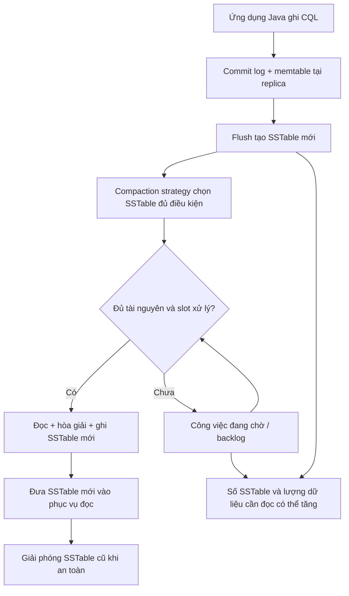
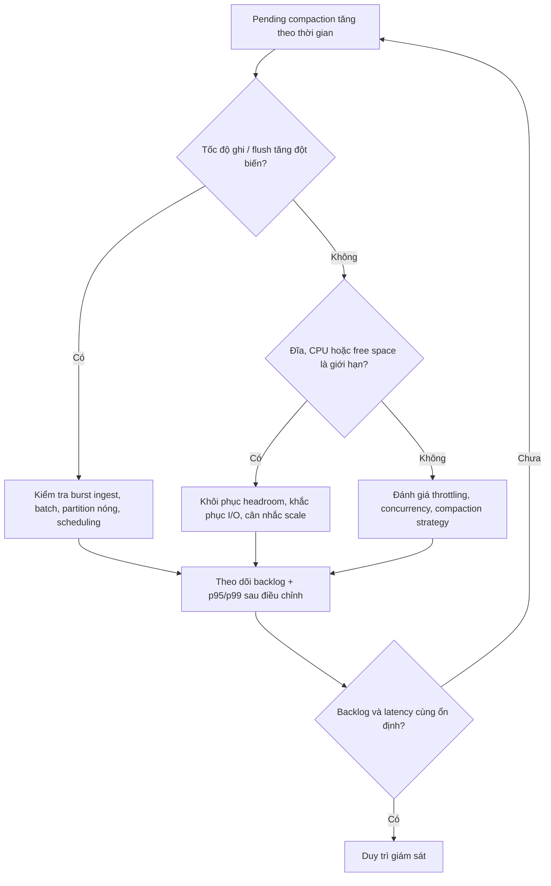

# Compaction backlog, tốc độ xử lý và ảnh hưởng độ trễ trong Apache Cassandra

## 1. Vì sao compaction backlog là vấn đề vận hành?

Apache Cassandra là cơ sở dữ liệu **wide-column phân tán**: bảng được thiết kế theo truy vấn, dữ liệu phân bố theo **partition key** và mỗi phân vùng được sao chép sang nhiều replica theo cấu hình replication. Trên mỗi replica, mutation mới được ghi vào commit log và memtable; khi memtable được **flush**, Cassandra tạo ra các **SSTable bất biến** trên đĩa.

Do SSTable không được chỉnh sửa tại chỗ, các lần cập nhật hoặc xóa sau đó có thể nằm ở những SSTable mới hơn. Một phép đọc có thể phải hòa giải thông tin từ **memtable và nhiều SSTable** để trả phiên bản có hiệu lực theo timestamp, TTL và tombstone.

**Compaction** là tác vụ nền đọc một tập SSTable, hợp nhất dữ liệu và ghi ra SSTable mới theo chiến lược compaction của bảng. Nó giúp kiểm soát số SSTable cần xét khi đọc, quản lý dung lượng lưu trữ và thu gom dữ liệu hết hiệu lực **khi đáp ứng điều kiện an toàn**.

**Compaction backlog** xuất hiện khi những công việc compaction đủ điều kiện xử lý được tạo ra nhanh hơn khả năng hoàn tất của node trong một khoảng thời gian. Nếu backlog kéo dài, node có thể phải giữ nhiều SSTable hơn, tăng I/O đọc và tiêu tốn thêm đĩa; ngược lại, chạy compaction quá mạnh có thể tranh chấp tài nguyên với truy vấn của ứng dụng Java.

Điều cần học không chỉ là “làm sao đưa pending tasks về 0”, mà là **giữ tốc độ compaction đủ theo kịp workload mà vẫn bảo vệ độ trễ và tính sẵn sàng**.

## 2. Dòng dữ liệu và nơi công việc tồn đọng hình thành



Một SSTable mới không nhất thiết lập tức tạo ra một tác vụ compaction. Tùy **Size-Tiered**, **Leveled**, **Time-Window** hoặc chiến lược khác, Cassandra chỉ chọn một số tập SSTable khi chúng thỏa điều kiện riêng. Ngay cả khi số pending tasks bằng 0, bảng vẫn có SSTable và vẫn có thể phát sinh công việc trong tương lai.

Các khái niệm cần phân biệt:

| Khái niệm | Ý nghĩa | Lưu ý |
| --- | --- | --- |
| **Flush** | Memtable → SSTable mới | Thường làm tăng số SSTable; không phải compaction |
| **Compaction task** | Công việc hợp nhất/viết lại một tập SSTable được chọn | Kích thước và chi phí mỗi task rất khác nhau |
| **Pending tasks** | Số công việc compaction ước tính/chờ chạy mà node báo cáo | Không phải số byte chính xác và không phải số SSTable |
| **Compaction throughput** | Lưu lượng xử lý compaction trong một khoảng thời gian | Cần biết cách đo và giới hạn I/O của node |
| **Backlog** | Công việc hợp lệ chưa xử lý xong đang tích tụ | Quan trọng là xu hướng kéo dài và tác động lên SLA |
| **Read amplification** | Một truy vấn phải kiểm tra nhiều cấu trúc/tệp hoặc đọc nhiều dữ liệu hơn cần trả | Bloom filter, index, cache và chiến lược compaction có thể giảm chi phí thực tế |
| **Write amplification** | Một lượng dữ liệu logic có thể phải được ghi lại nhiều lần bởi flush và compaction | Tăng tùy chiến lược, mức cập nhật và TTL |

## 3. Mô hình tốc độ tạo việc và tốc độ xử lý

Để lập luận về backlog, tạm biểu diễn khối lượng công việc bằng **một đơn vị tương đương thống nhất**, ví dụ GiB đầu vào compaction ước tính, hoặc một thước đo công việc riêng của hệ thống:

- `B(t)`: lượng backlog tại thời điểm `t`.
- `λ` (*arrival rate*): tốc độ công việc compaction mới trở nên đủ điều kiện, theo đơn vị công việc/giờ.
- `μ` (*service rate*): tốc độ node hoàn tất công việc, dùng **cùng đơn vị** với `λ`.

Trong mô hình đơn giản khi tốc độ gần như ổn định:

```text
B(t + Δt) ≈ max(0, B(t) + (λ - μ) × Δt)

Nếu λ > μ kéo dài  → backlog tăng.
Nếu λ ≈ μ          → backlog khó giảm.
Nếu λ < μ          → backlog có cơ hội giảm dần.
```

**Lưu ý quan trọng:** tốc độ ghi CQL của ứng dụng (`MiB/s`) **không thể tự động lấy làm `λ`**. Một byte dữ liệu ghi mới có thể tạo ra nhiều byte đọc/ghi lại qua các vòng compaction, và mỗi chiến lược có cách chọn SSTable khác nhau. Tương tự, throughput do `nodetool` báo cáo không thể đem trừ trực tiếp với tốc độ ingest khi hai chỉ số đo các đại lượng khác nhau.

### Ví dụ tính toán có kiểm soát

Giả sử hệ thống giám sát đã quy đổi backlog và hai tốc độ sang **cùng một thước đo công việc tương đương**:

| Đại lượng | Giá trị giả định |
| --- | --- |
| Backlog ban đầu `B` | 90 GiB-equivalent |
| Công việc mới `λ` | 20 GiB-equivalent/giờ |
| Công việc xử lý được `μ` | 35 GiB-equivalent/giờ |
| Tốc độ giảm backlog | `μ − λ = 15 GiB-equivalent/giờ` |
| Thời gian ước tính để hết backlog | `90 / 15 ≈ 6 giờ` |

Đây là **mô hình kế hoạch**, không phải lời hứa node sẽ xử lý xong sau 6 giờ. Nhiều tác vụ có kích thước không đồng đều, tốc độ ingest dao động, các đợt flush mới liên tục xuất hiện và compaction có thể cần ghi lại dữ liệu nhiều lần.

Nếu `λ` bất ngờ tăng lên `45 GiB-equivalent/giờ` còn `μ` vẫn là 35, backlog sẽ có xu hướng tăng khoảng 10 GiB-equivalent/giờ. Việc quan sát **xu hướng theo thời gian** hữu ích hơn một ảnh chụp “pending = 12”.

### Có nên dùng số lượng pending tasks để ước tính thời gian?

Không nên lấy “12 pending tasks × thời gian trung bình một task” một cách máy móc:

- Một task có thể xử lý vài MiB, task khác vài chục GiB.
- Chiến lược compaction có thể chia/chọn lại công việc khi SSTable mới xuất hiện.
- Số pending task là chỉ số ước lượng theo chính sách, không bảo đảm một hàng đợi cố định.
- Thời gian chạy phụ thuộc tốc độ đọc/ghi đĩa, nén, CPU, cache và mức cạnh tranh I/O.

Hãy theo dõi đồng thời **pending tasks, active compactions, bytes processed, tốc độ flush, số SSTable, dung lượng đĩa và độ trễ truy vấn**.

## 4. Backlog ảnh hưởng đến độ trễ đọc như thế nào?

Khi backlog kéo dài, một partition có thể xuất hiện trong nhiều SSTable. Cassandra vẫn dùng các cấu trúc như Bloom filter, partition index, key cache và thống kê để tránh đọc không cần thiết, nhưng việc duyệt nhiều nguồn có thể tăng chi phí.

Một truy vấn cụ thể có thể phải:

1. Kiểm tra memtable và các SSTable có thể chứa partition.
2. Tìm partition trong các tệp phù hợp.
3. Hợp nhất những phiên bản cell, timestamp, TTL và tombstone để xác định dữ liệu hiện hành.
4. Lấy đủ dữ liệu từ replica theo CL đọc; nếu dữ liệu replica khác nhau, một số đường đọc còn có thể phát sinh read repair.

Tác động thường rõ ở **p95/p99 latency**, nơi truy vấn chậm nhất chịu chi phí đọc đĩa hoặc phải hòa giải nhiều phiên bản:

| Hiện tượng | Cơ chế có thể gây ra | Kết quả người dùng thấy |
| --- | --- | --- |
| Nhiều SSTable liên quan một partition | Nhiều chỉ mục/tệp cần xét | Đọc chậm hơn, I/O rời rạc tăng |
| SSTable cũ chứa nhiều version/tombstone | Phải hòa giải và lọc dữ liệu hết hiệu lực | CPU, I/O và tail latency tăng |
| Compaction đang đọc/ghi khối lượng lớn | Tranh chấp băng thông đĩa và cache | Truy vấn foreground bị chậm ngay cả khi compaction đang giúp giảm backlog |
| Đĩa sắp đầy | Ít không gian cho SSTable đầu ra; thao tác nền có thể lỗi | Tính ổn định và khả năng tiếp tục ghi suy giảm |

**SSTable count không phải công thức trực tiếp của latency.** Một bảng có nhiều SSTable nhỏ ở các khoảng thời gian không giao nhau có thể rẻ hơn bảng có ít SSTable nhưng partition cực lớn, rất nhiều tombstone hoặc truy vấn không bám partition key. Cần kiểm tra mô hình truy vấn, thống kê “SSTables per read” và latency thực tế.

## 5. Backlog ảnh hưởng đến đường ghi ra sao?

Đường ghi Cassandra thường append commit log và cập nhật memtable, chưa phải compaction. Tuy nhiên, write throughput có thể bị ảnh hưởng gián tiếp:

- **Đĩa bận:** compaction đọc SSTable cũ và ghi SSTable mới, cạnh tranh IOPS/băng thông với commit log, flush và read path.
- **Flush chậm:** memtable khó giải phóng bộ nhớ; commit-log segment cũ không dễ thu hồi khi còn dữ liệu chưa flush.
- **Áp lực đĩa:** compaction cần không gian tạm cho SSTable đầu ra trước khi có thể bỏ file đầu vào; ít free space làm tăng nguy cơ lỗi.
- **CPU/GC:** giải nén, hòa giải dữ liệu và nén lại trong compaction có thể cạnh tranh với xử lý request.
- **Điều tiết tải:** nếu node không theo kịp hoạt động nền, độ trễ ghi có thể tăng do backpressure và tranh chấp tài nguyên.

Vì vậy, tăng tốc compaction **không phải lúc nào cũng làm độ trễ ghi giảm ngay**. Có lúc backlog đang giảm nhanh hơn nhưng p99 của `INSERT`/`UPDATE` lại xấu đi vì compaction chiếm phần lớn I/O.

### Ba giai đoạn thường thấy

```text
Giai đoạn A — Compaction theo kịp:
  Pending thấp/ổn định, SSTable count được kiểm soát,
  p95/p99 đọc ghi ổn định.

Giai đoạn B — Công việc mới đến nhanh hơn:
  Pending tăng qua nhiều lần đo, SSTable count/space tăng,
  p99 đọc có thể tăng dần.

Giai đoạn C — Cố tăng compaction quá mức:
  Pending có thể giảm, nhưng I/O đĩa và CPU cao,
  foreground read/write latency có thể tăng đột ngột.
```

Mục tiêu vận hành là tìm điểm cân bằng giữa **compaction debt** và **headroom cho foreground workload**.

## 6. Chiến lược compaction làm thay đổi backlog ra sao?

Chiến lược compaction quyết định **SSTable nào được chọn, khi nào được hợp nhất và mức độ ghi lại dữ liệu**. Do đó, hai bảng có cùng lưu lượng ghi logic nhưng áp lực compaction rất khác nhau.

| Chiến lược | Bài toán thường phù hợp | Đặc điểm liên quan backlog và độ trễ |
| --- | --- | --- |
| **Size-Tiered Compaction Strategy (STCS)** | Ghi nhiều, dữ liệu thay đổi, ưu tiên chi phí ghi tương đối thấp | Hợp nhất các SSTable có kích thước tương đương; có thể còn nhiều SSTable cần xét khi đọc, đợt compaction lớn có thể tiêu tốn I/O |
| **Leveled Compaction Strategy (LCS)** | Workload đọc nhạy độ trễ, cần giới hạn số SSTable chồng lấp theo level | Giảm read amplification trong nhiều trường hợp, nhưng thường tăng write amplification và công việc nền |
| **Time-Window Compaction Strategy (TWCS)** | Dữ liệu chuỗi thời gian/TTL có ghi gần theo thời gian | Gom theo các cửa sổ thời gian; hiệu quả khi ghi hầu như theo thứ tự thời gian và TTL tương đồng, kém thuận lợi nếu có backfill rất muộn |
| **Unified Compaction Strategy (UCS)** | Những bản Cassandra hỗ trợ, cần điều chỉnh giữa đọc/ghi/không gian | Tùy biến chính sách compaction; đặc tính và mặc định phụ thuộc phiên bản, nên đánh giá bằng tài liệu và thử nghiệm riêng |

Đừng coi đây là bảng xếp hạng tuyệt đối. Chiến lược “tốt nhất” phụ thuộc kiểu partition, ghi cập nhật hay append-only, TTL, xóa, yêu cầu đọc, dung lượng đĩa, phiên bản Cassandra và cấu hình cluster.

### Ví dụ TWCS cho dữ liệu cảm biến

Một ứng dụng Java ghi số đo theo thiết bị và ngày, truy vấn số đo mới nhất trong một ngày. Dùng bucket ngày giúp giới hạn kích thước partition:

```sql
-- Ví dụ chạy trên cluster có datacenter thực tế tên dc1.
CREATE KEYSPACE IF NOT EXISTS compaction_lab
WITH replication = {
    'class': 'NetworkTopologyStrategy',
    'dc1': 3
};

CREATE TABLE IF NOT EXISTS compaction_lab.readings_by_device_day (
    device_id text,
    bucket_day date,
    measured_at timestamp,
    temperature_c double,
    PRIMARY KEY ((device_id, bucket_day), measured_at)
) WITH CLUSTERING ORDER BY (measured_at DESC)
  AND default_time_to_live = 604800
  AND compaction = {
      'class': 'TimeWindowCompactionStrategy',
      'compaction_window_unit': 'DAYS',
      'compaction_window_size': '1'
  };
```

Giả định số đo được ghi gần với thời điểm đo, lưu trong 7 ngày. Dữ liệu trong các cửa sổ cũ ít bị sửa lại thì các SSTable đã đủ tuổi có cơ hội được dọn hiệu quả hơn. Nhưng:

- Ghi **backfill dữ liệu cũ** có thể làm SSTable ở nhiều cửa sổ trộn thời gian, tăng nguy cơ chồng lấp và làm giảm hiệu quả thu gom TTL.
- Nếu cùng partition liên tục được cập nhật ở nhiều thời điểm, đặc tính TWCS có thể kém hơn giả định.
- TTL hết hạn không đồng nghĩa SSTable sẽ bị xóa ngay. Tombstone, phạm vi thời gian, điều kiện an toàn và chính sách compaction vẫn có ảnh hưởng.
- Không tự giảm `gc_grace_seconds` chỉ để dọn file nhanh hơn; phải bảo đảm chiến lược repair và an toàn với replica chậm.

Với workload cập nhật dữ liệu cũ thường xuyên hoặc cần nhiều truy vấn đọc ngẫu nhiên, cần đánh giá STCS/LCS/UCS thay vì mặc định TWCS.

## 7. Quan sát backlog bằng `nodetool` và số liệu theo thời gian

Trên một **node Cassandra**, từ môi trường quản trị có quyền thích hợp:

```text
nodetool compactionstats
nodetool getcompactionthroughput
nodetool tablestats compaction_lab.readings_by_device_day
nodetool tablehistograms compaction_lab readings_by_device_day
```

Đây là các lệnh **quan sát**; không yêu cầu ứng dụng tự chạy trong luồng xử lý CQL. Tên và dạng thống kê có thể khác giữa các phiên bản Cassandra. Kiểm tra `nodetool help` của phiên bản đang vận hành nếu cần cú pháp chi tiết.

### Đọc `compactionstats` đúng cách

Đầu ra thường có:

- **Pending tasks:** số tác vụ compaction chưa hoàn tất theo cách tính của phiên bản/chiến lược.
- **Active compactions:** tác vụ đang chạy, bảng/keyspace liên quan, lượng đã xử lý và tổng lượng dự kiến.
- **Throughput:** tốc độ xử lý hoặc các số đo liên quan nếu phiên bản cung cấp.

Ví dụ **minh họa, không phải output cố định**:

```text
pending tasks: 18
active compactions: 2

Lần đo 10:00  pending=18
Lần đo 10:05  pending=27
Lần đo 10:10  pending=35
```

Ba ảnh chụp liên tiếp cho thấy backlog có xu hướng tăng. Nhưng chưa đủ để kết luận “compaction chậm vì CPU”. Có thể khối lượng ghi tăng đột biến, chiến lược vừa tạo một số task lớn, hoặc đĩa/nén/thiếu khoảng trống làm tốc độ giảm.

### Đọc các chỉ số liên quan

| Nguồn số liệu | Nên tìm gì? | Vì sao |
| --- | --- | --- |
| `nodetool compactionstats` | Pending, active, progress của compaction | Xem xu hướng công việc trên node |
| `nodetool getcompactionthroughput` | Ngưỡng thông lượng được cấu hình (nếu áp dụng cho phiên bản) | Biết compaction có thể đang bị điều tiết bởi cấu hình |
| `nodetool tablestats` | SSTable count, dung lượng dữ liệu, local read/write latency, memtable | Gắn backlog với từng bảng và tác động lên foreground |
| `nodetool tablehistograms` | Phân bố độ trễ và số SSTable liên quan mỗi lần đọc theo khả năng phiên bản | Tìm read amplification và tail latency |
| Metrics/JMX/monitoring | IOPS, throughput đĩa, queue depth, CPU, GC, p95/p99, flush, disk free | Tìm giới hạn tài nguyên thật |
| Application metrics | QPS, partition key nóng, kích thước batch, tỷ lệ timeout, request p99 | Đối chiếu backlog với truy vấn người dùng |

Đặc biệt, `pending tasks = 0` tại một thời điểm không bảo đảm cluster “hoàn toàn khỏe”. Một compaction lớn có thể đang chạy, nhiều SSTable có thể không đủ điều kiện hợp nhất ngay, hoặc ứng dụng đang tạo ra read amplification từ chính schema.

### Ghi dữ liệu mỗi 5 phút trong một khoảng quan sát

| Thời điểm | Pending tasks | SSTables | Disk util | CQL read p99 | CQL write p99 |
| --- | ---: | ---: | ---: | ---: | ---: |
| 10:00 | 8 | 46 | 55% | 32 ms | 18 ms |
| 10:05 | 17 | 54 | 74% | 45 ms | 21 ms |
| 10:10 | 31 | 63 | 91% | 88 ms | 35 ms |
| 10:15 | 42 | 71 | 95% | 130 ms | 71 ms |

Các số trên chỉ là **dữ liệu giả lập để học cách phân tích**. Nếu xuất hiện xu hướng tương tự ở production, cần điều tra đồng thời tốc độ ghi, compaction đang chạy, mức sử dụng I/O, SSTable count, read amplification và kiểu truy vấn. Tương quan không tự chứng minh nguyên nhân duy nhất.

## 8. Điều tiết compaction throughput: tăng hay giảm?

Cassandra có cấu hình hạn chế thông lượng compaction trên node; cách đặt và tên lệnh tương ứng phụ thuộc phiên bản. `nodetool getcompactionthroughput` giúp xem cấu hình hiện tại và `nodetool setcompactionthroughput` có thể thay đổi giới hạn trên các phiên bản hỗ trợ.

**Tăng throughput** có thể giúp giảm backlog khi:

- Đĩa và CPU còn khả năng xử lý.
- Giới hạn cấu hình hiện tại đang là nút thắt thực tế.
- Workload người dùng còn đủ I/O headroom.
- Có đủ dung lượng đĩa cho SSTable đầu ra tạm thời.

**Giảm throughput** có thể hợp lý khi compaction đang cạnh tranh với CQL reads/writes làm p99 vượt SLA, đặc biệt trong giờ cao điểm. Đổi lại backlog và số SSTable có thể tăng.

Không nên:

- Đặt giá trị cực cao chỉ để `pending tasks` tụt nhanh.
- Tắt điều tiết mà chưa kiểm tra sức chịu đựng của I/O và thời gian flush.
- Chỉ sửa một node rồi suy luận toàn cluster đã ổn.
- Giữ throughput thấp kéo dài khi ingest lớn hơn năng lực xử lý.

### Quy trình thử nghiệm thay đổi

1. **Ghi baseline:** pending tasks theo thời gian, tốc độ flush, disk util/latency, CPU, memory, SSTables/read và p95/p99 của request.
2. **Xác định giới hạn:** cấu hình throughput, tốc độ thiết bị lưu trữ, số compactor đồng thời, GC/CPU, free space, chiến lược và loại workload.
3. **Thay đổi nhỏ ở môi trường thử hoặc một phạm vi có kiểm soát:** điều chỉnh giới hạn hoặc mức song song phù hợp phiên bản, giữ khả năng quay lại cấu hình cũ.
4. **Đo đủ lâu:** theo dõi backlog giảm thực sự, đồng thời p95/p99 đọc ghi, flush backlog và lỗi I/O.
5. **Đánh giá kết quả:** nếu backlog giảm nhưng p99 ứng dụng vượt SLA, cấu hình chưa đạt mục tiêu.

Không mặc định kết luận “throughput = 64 MiB/s là tốt” cho mọi cluster. Ngưỡng hợp lý phụ thuộc I/O, workload, kích thước SSTable, nén và số lượng bảng chạy compaction trên cùng node.

## 9. Backlog không phải lúc nào cũng được giải quyết bằng tuning

Một quy trình xử lý đúng cần đi từ nguyên nhân:



### Các nguyên nhân điển hình

**1. Ingest tăng nhưng hạ tầng không tăng.** Nếu ứng dụng ingest dữ liệu nhanh hơn khả năng xử lý dài hạn, tăng compactor trên cùng đĩa đã bão hòa thường chỉ chuyển loại nghẽn. Cân nhắc batching hợp lý, phân tán partition key, giảm dữ liệu không cần lưu, thay đổi SLA ingest hoặc mở rộng dung lượng xử lý.

**2. Nhiều update/delete/tombstone trên khóa nóng.** Cassandra có thể phải giữ nhiều phiên bản và tombstone qua các SSTable; compaction nặng và đọc chậm. Xem lại mô hình wide-column, TTL, kích thước partition và thao tác theo truy vấn.

**3. Chiến lược compaction không hợp workload.** Ví dụ TWCS dùng cho dữ liệu time-series nhưng ứng dụng liên tục cập nhật dữ liệu rất cũ; số SSTable chồng lấp và vòng đời hết hạn có thể trở nên bất lợi.

**4. Đĩa chậm hoặc gần đầy.** Compaction phải ghi SSTable mới trước khi xóa đầu vào. Không gian làm việc hạn chế có thể chặn tiến trình; read/write latency cũng có thể tăng đột biến.

**5. Cấu hình giới hạn hoặc mức song song không phù hợp.** Throttling quá thấp khiến backlog tăng; compaction concurrency quá cao có thể làm I/O contention. Đây là bài toán cân đối trên từng node.

**6. Hoạt động nền khác tranh chấp tài nguyên.** Repair, streaming, backup/snapshot, flush và compaction cùng tiêu thụ I/O. Đừng tách một chỉ số pending ra khỏi lịch vận hành node.

## 10. Các thao tác cần tránh khi backlog cao

| Thao tác hấp tấp | Rủi ro | Lựa chọn an toàn hơn |
| --- | --- | --- |
| Chạy major compaction `nodetool compact` ngay trên mọi bảng/node | Đòi I/O và dung lượng lớn, có thể phá đặc tính tối ưu của TWCS/LCS và làm tail latency tệ hơn | Tìm nguyên nhân và lập kế hoạch compaction có kiểm soát khi thật sự cần |
| Xóa thủ công SSTable hoặc commit log để giải phóng đĩa | Mất dữ liệu, hỏng khả năng phục hồi và lệch replica | Tuân thủ công cụ bảo trì/khôi phục của Cassandra |
| Chuyển compaction strategy trực tiếp khi đang chịu tải lớn | Có thể gây giai đoạn tái tổ chức dữ liệu tốn tài nguyên | Benchmark, đánh giá không gian đĩa và rollout có kiểm soát |
| Giảm `gc_grace_seconds` để tombstone biến mất nhanh | Có thể dẫn đến dữ liệu xóa bị hồi sinh nếu replica chưa được đồng bộ an toàn | Tôn trọng chiến lược repair và vòng đời tombstone |
| Hạ consistency level khi thấy p99 xấu | Đổi ranh giới bảo đảm nhất quán đọc/ghi | Điều tra I/O, topology, backlog và đặt SLA nhất quán rõ ràng |
| Tăng throughput compaction không giới hạn | Giảm tài nguyên dành cho truy vấn foreground | Tăng từng bước có đo p95/p99 và free space |

Compaction **không thay thế repair**: nó hợp nhất SSTable trên **một replica**, trong khi anti-entropy repair đối chiếu dữ liệu **giữa các replica**. Một node có backlog bằng 0 vẫn có thể giữ dữ liệu cũ do bỏ lỡ mutation. Tương tự, compaction không thay thế backup.

## 11. Thực hành CQL: tạo tải đọc ghi có kiểm soát

### Chuẩn bị bảng thử

Dùng bảng `readings_by_device_day` đã tạo ở phần 6, với datacenter thực tế và replication factor phù hợp cluster thử nghiệm. Chọn CL nhất quán với số replica sẵn có; ví dụ khi ba replica ở DC địa phương đều hoạt động, dùng `LOCAL_QUORUM`:

```text
CONSISTENCY LOCAL_QUORUM;
```

Ghi một vài bản ghi:

```sql
INSERT INTO compaction_lab.readings_by_device_day
    (device_id, bucket_day, measured_at, temperature_c)
VALUES ('sensor-a', '2026-11-20', '2026-11-20 10:00:00+0000', 23.8);

INSERT INTO compaction_lab.readings_by_device_day
    (device_id, bucket_day, measured_at, temperature_c)
VALUES ('sensor-a', '2026-11-20', '2026-11-20 10:01:00+0000', 24.1);

SELECT measured_at, temperature_c
FROM compaction_lab.readings_by_device_day
WHERE device_id = 'sensor-a'
  AND bucket_day = '2026-11-20'
LIMIT 20;
```

Với vài bản ghi, bạn **không thể** tạo compaction backlog đáng kể; mục tiêu bước này chỉ là kiểm tra schema, partition key và CL trước khi dùng công cụ sinh tải trong **lab cô lập**.

### Thử nghiệm có số liệu

1. Đo baseline bằng `nodetool compactionstats`, `tablestats`, `tablehistograms` và metrics đĩa/ứng dụng.
2. Chạy workload ghi được kiểm soát, với nhiều thiết bị và các partition key phân bố đều; giữ nguyên query shape.
3. Ghi kết quả mỗi 5 phút: flush rate, pending tasks, số SSTable, disk util, CQL read/write p95/p99.
4. Ngừng workload và quan sát backlog giảm hay tiếp tục tăng.
5. Thay một yếu tố tại một thời điểm (ví dụ workload rate hoặc cấu hình đã phê duyệt ở lab), so sánh bằng cùng bảng đo.

Không cố tình làm đầy đĩa hoặc tạo hàng triệu tombstone trên cụm production. Bài kiểm thử compaction cần giới hạn data volume và giám sát disk free vì compaction phải giữ đầu vào và đầu ra trong lúc chạy.

## 12. Liên hệ với ứng dụng Java: đo latency có ngữ cảnh

Cassandra Java Driver 4.x cho phép đặt consistency level và dùng prepared statement. Ứng dụng không có trách nhiệm gọi compaction mỗi lần ghi; **compaction là cơ chế của node**.

```java
import java.time.LocalDate;

import com.datastax.oss.driver.api.core.CqlSession;
import com.datastax.oss.driver.api.core.DefaultConsistencyLevel;
import com.datastax.oss.driver.api.core.cql.BoundStatement;
import com.datastax.oss.driver.api.core.cql.PreparedStatement;
import com.datastax.oss.driver.api.core.cql.ResultSet;

public final class ReadingRepository {
    private final CqlSession session;
    private final PreparedStatement findLatest;

    public ReadingRepository(CqlSession session) {
        this.session = session;
        this.findLatest = session.prepare(
            "SELECT measured_at, temperature_c " +
            "FROM compaction_lab.readings_by_device_day " +
            "WHERE device_id = ? AND bucket_day = ? LIMIT 100"
        );
    }

    public ResultSet findLatest(String deviceId, LocalDate bucketDay) {
        BoundStatement statement = findLatest.bind(deviceId, bucketDay)
            .setConsistencyLevel(DefaultConsistencyLevel.LOCAL_QUORUM)
            .setPageSize(100);
        return session.execute(statement);
    }
}
```

Đo thời gian thực thi ở tầng ứng dụng cần bao gồm thời gian gọi và tiêu thụ kết quả tương ứng; với truy vấn phân trang, thời gian chỉ tới page đầu tiên không đại diện toàn bộ thời gian đọc các page. Theo dõi thêm retry/timeout của driver và phân biệt latency client với **local read latency** trên node.

Nếu p99 của API tăng cùng lúc pending compactions tăng, hãy đối chiếu **cùng khoảng thời gian** với số SSTable mỗi lần đọc và disk latency. Mối tương quan này là giả thuyết cần kiểm tra, không đủ để kết luận mọi request chậm đều do compaction.

### Phân biệt lỗi ứng dụng với tiến độ compaction

- Request CQL có thể timeout vì coordinator/replica chậm, mạng, GC hoặc CL không đạt; pending compaction chỉ là một tín hiệu.
- Replica có thể trả lỗi thiếu quorum khi node không sẵn sàng; không thể sửa bằng tăng compaction throughput.
- Việc chỉnh driver timeout quá cao có thể che đi đuôi độ trễ xấu; cần kiểm tra SLA và khả năng chịu tải trước.
- Đọc theo partition key và clustering range phù hợp thường hiệu quả hơn quét/filter rộng, ngay cả khi compaction đã hoàn tất.

## 13. Tình huống chẩn đoán

**Tình huống A — Backlog tăng nhưng p99 ổn định.** Pending tasks tăng trong một đợt ingest được dự kiến trước, nhưng disk util còn thấp và API p99 vẫn dưới SLA. Nên làm gì?

**Gợi ý:** Theo dõi xu hướng và thời gian backlog tự thoát sau đợt ghi; không bắt buộc thay throughput ngay. Kiểm tra liệu `λ` trở lại thấp hơn `μ` khi đợt ingest kết thúc.

**Tình huống B — Pending giảm nhưng p99 write tăng gấp đôi.** Vừa nâng compaction throughput, số pending giảm nhanh nhưng disk util gần 100%, request ghi chậm. Có thể kết luận tuning thành công?

**Gợi ý:** Chưa. Cần đánh giá song song SLA foreground. Giảm hoặc điều chỉnh lại mức throughput/concurrency dựa trên baseline và headroom.

**Tình huống C — Số SSTable cao nhưng đọc khá nhanh.** Bảng TWCS có nhiều file từ các ngày khác nhau, truy vấn chỉ đọc partition ngày hiện tại. Có nên ép major compaction ngay?

**Gợi ý:** Không. Số SSTable tuyệt đối chưa phản ánh chi phí cho query cụ thể. Hãy đo SSTables per read, latency và quy tắc time window trước; major compaction có thể bất lợi.

**Tình huống D — Compaction backlog sau restore.** Một node mới phục hồi đang chạy streaming, repair và compaction cùng lúc; pending tăng, disk free giảm. Cần ưu tiên gì?

**Gợi ý:** Kiểm tra sức khỏe node, free space, I/O tổng hợp, lịch streaming/repair và khả năng phục vụ request. Sắp lịch tác vụ nền để giảm cạnh tranh theo quy trình vận hành, thay vì chỉ tăng compaction throughput.

## 14. Checklist vận hành và ghi nhớ

- [ ] Hiểu cơ chế **flush → SSTable → compaction** và tính bất biến của SSTable.
- [ ] Phân biệt **pending tasks**, **active compactions**, **tốc độ xử lý** và **dung lượng SSTable**.
- [ ] Đánh giá xu hướng backlog theo thời gian; không kết luận chỉ từ một ảnh chụp.
- [ ] Không trừ trực tiếp tốc độ ingest CQL với tốc độ I/O compaction khi chúng khác đơn vị công việc.
- [ ] Theo dõi đồng thời `p95/p99` đọc ghi, disk util/latency, free space, memtable/flush và SSTables per read.
- [ ] Chọn chiến lược STCS/LCS/TWCS/UCS theo **workload và phiên bản**, không theo “mặc định tốt nhất”.
- [ ] Điều chỉnh throughput/concurrency từng bước và đánh giá tác động lên SLA trước khi rollout.
- [ ] Giữ repair, replication, backup và chính sách tombstone riêng biệt với compaction.
- [ ] Không dùng major compaction hoặc xóa file dữ liệu như cách khắc phục backlog tự phát.
- [ ] Thiết kế partition key và truy vấn Java/CQL hợp lý để giảm read amplification từ nguồn.

**Ghi nhớ:** **Compaction backlog** là một dạng “nợ xử lý nền”: khi công việc mới đến nhanh hơn khả năng compaction trong thời gian dài, SSTable có thể tích tụ và làm tăng read amplification, disk usage và p99 latency. Nhưng compaction chạy quá nhanh cũng tranh tài nguyên với đường đọc/ghi. Vận hành Cassandra hiệu quả đòi hỏi đo **cả tốc độ xử lý lẫn chất lượng phục vụ request**, sau đó điều chỉnh chiến lược, cấu hình và mô hình dữ liệu theo từng workload.
