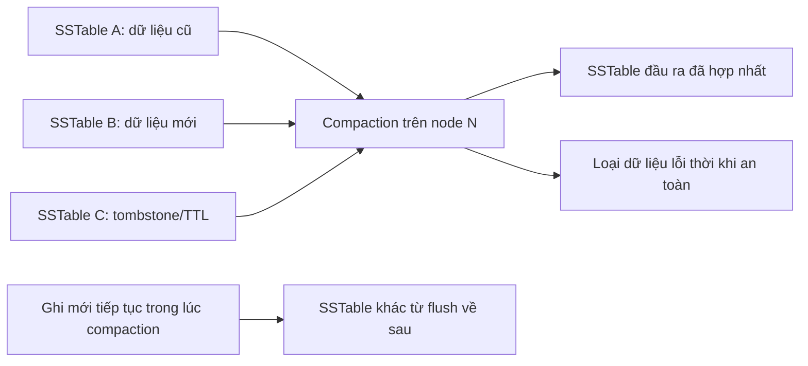
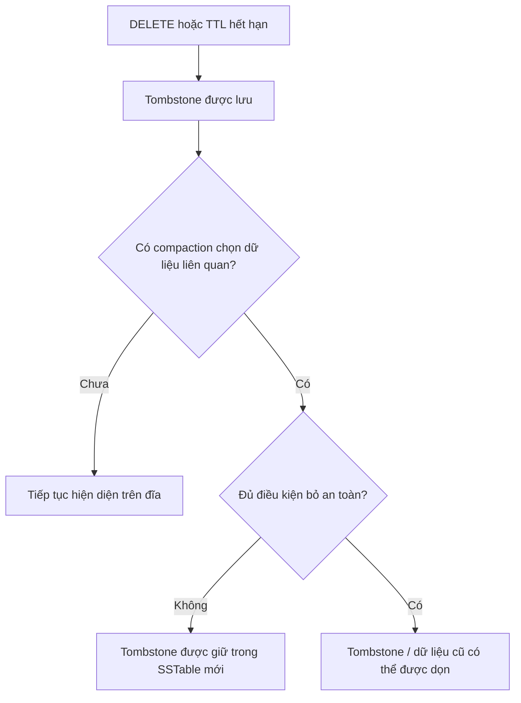

# Major compaction, thao tác thủ công và phạm vi tác động

## 1. Mục tiêu và ngữ cảnh

Trong Apache Cassandra, thao tác ghi trước hết cập nhật **commit log** và **memtable**; khi memtable được flush, dữ liệu trở thành **SSTable** bất biến trên đĩa. Các lần ghi mới, cập nhật, xóa và hết TTL có thể tạo thêm nhiều SSTable chứa phiên bản dữ liệu hoặc **tombstone**. Khi đọc một partition, Cassandra có thể phải xem và đối chiếu dữ liệu từ nhiều SSTable. **Compaction** là quá trình nền đọc một nhóm SSTable, hợp nhất các phiên bản cần thiết và ghi lại SSTable mới theo **compaction strategy** của bảng.

Ngoài compaction do hệ thống tự lên lịch, người vận hành có thể kích hoạt **major compaction** bằng `nodetool compact`. Đây là thao tác tốn tài nguyên, viết lại dữ liệu cục bộ trên đĩa; hiệu quả và hậu quả của nó thay đổi theo chiến lược compaction, phiên bản Cassandra, mức tải và trạng thái repair.

Bài thuộc chương **SSTable và compaction** của mô-đun `DATABASE_ENGINE_WIDE_COLUMN_CASSANDRA`. Người học sẽ kết nối kiến thức về mô hình wide-column, partition key, replication và consistency level với vận hành SSTable, tombstone, repair, xử lý lỗi và điều tra độ trễ của ứng dụng Java.

Sau bài này, bạn cần có khả năng:

1. Giải thích major compaction làm gì, khác compaction tự động và các công cụ repair/cleanup/flush như thế nào.
2. Xác định **phạm vi node – keyspace – bảng – nhóm SSTable** của một lần chạy thủ công.
3. Chọn hoặc tránh major compaction dựa trên STCS, LCS, TWCS hoặc chiến lược được phiên bản đang chạy hỗ trợ.
4. Ước lượng rủi ro về disk, I/O, CPU, độ trễ đọc/ghi và ảnh hưởng lên replica.
5. Thu số liệu trước/sau và kiểm chứng kết quả mà không hiểu nhầm “ít SSTable hơn” thành “toàn cluster đã nhất quán”.

## 2. Major compaction thực chất làm gì?

Compaction thông thường lấy một số SSTable được chiến lược lựa chọn, hợp nhất các bản ghi theo timestamp/tombstone, tạo SSTable mới rồi loại bỏ những SSTable đầu vào khi không còn được tham chiếu. Quá trình này **không thực hiện một lệnh UPDATE CQL mới** và không thay đổi thiết kế partition key.

**Major compaction** là yêu cầu thủ công nhằm compact một tập SSTable lớn hơn hoặc toàn bộ nhóm SSTable đủ điều kiện của bảng tại node đó. Với **SizeTieredCompactionStrategy (STCS)**, cách diễn giải thường thấy là cố hợp nhất SSTable hiện có thành một SSTable lớn. Tuy nhiên, **không được cam kết luôn chỉ còn đúng một file SSTable**:

- Cassandra có thể tách nhóm theo trạng thái **repaired/unrepaired/pending repair** và các ràng buộc nội bộ khác.
- Phiên bản, chiến lược compaction, kích thước SSTable hoặc tùy chọn **split output** có thể tạo nhiều SSTable đầu ra.
- Có ghi mới/flush xảy ra trong lúc công việc chạy, nên SSTable mới phát sinh không nhất thiết nằm trong tập đầu vào của compaction đang thực hiện.
- Một SSTable thực tế cũng gồm nhiều **component file** (data, index, statistics, v.v.); “một SSTable” không có nghĩa một file hệ điều hành.



Compaction có thể làm giảm số SSTable cần tra khi đọc, nhưng đồng thời gây **write amplification** vì phải đọc rồi ghi lại nhiều byte, dùng CPU để nén/giải nén và tranh I/O với request bình thường. Nó không phải cách “sắp xếp lại cả cluster” hay “ép tất cả replica đồng bộ”.

## 3. Phân biệt major compaction với các thao tác liên quan

| Thao tác | Mục đích trực tiếp | Phạm vi và giới hạn quan trọng |
| --- | --- | --- |
| **Automatic/minor compaction** | Chiến lược tự chọn nhóm SSTable để gộp thường xuyên | Từng node và từng bảng, theo lịch/budget công việc nền. |
| **`nodetool compact` / major compaction** | Yêu cầu compact thủ công một tập SSTable đủ điều kiện | **Node đang được điều khiển**, keyspace/bảng được chọn; không tự chạy trên mọi replica. |
| **`nodetool flush`** | Đẩy memtable thành SSTable | Có thể **tăng** số SSTable trước khi compaction; không tương đương major compaction. |
| **`nodetool repair`** | Đồng bộ dữ liệu giữa các replica theo phạm vi repair | Không thể thay bằng major compaction cục bộ. |
| **`nodetool cleanup`** | Dọn dữ liệu/token range node không còn sở hữu sau thay đổi topology | Không đơn thuần là gộp SSTable để tối ưu đọc. |
| **`nodetool garbagecollect`** | Cố gắng loại tombstone đủ điều kiện theo quy tắc an toàn | Có ý nghĩa khác major compaction; không dùng như cách bỏ qua điều kiện repair/gc grace. |
| **Snapshot/backup** | Giữ lại trạng thái dữ liệu để có thể khôi phục | Snapshot có thể giữ liên kết đến SSTable cũ và làm disk chưa được giải phóng sau compaction. |

**Không có tính chất transaction xuyên cluster:** khi chạy `nodetool compact`, ứng dụng vẫn có thể đọc/ghi vào bảng; coordinator vẫn dùng replication factor (RF) và consistency level (CL) thông thường. Nếu một replica bị chậm vì I/O của compaction, các truy vấn cần ACK/phản hồi từ replica đó có thể bị tăng độ trễ hoặc timeout dù RF và CL không đổi.

## 4. Phạm vi tác động: node trước, rồi keyspace và bảng

Lệnh điển hình:

```bash
# Chạy tại node cần compact:
nodetool compact demo_ks events_by_device

# Hoặc kết nối tới dịch vụ quản trị của node cụ thể:
nodetool -h cassandra-node-1 compact demo_ks events_by_device
```

Phân tích phạm vi của lệnh thứ hai:

1. **Node:** `cassandra-node-1` là node có dịch vụ quản trị mà `nodetool` kết nối. Compaction xảy ra trên **các SSTable lưu tại node đó**. Node này có thể sở hữu nhiều token range/vnode.
2. **Keyspace:** `demo_ks` chọn không gian dữ liệu. RF và placement vẫn do cấu hình keyspace quyết định; lệnh không thay đổi RF.
3. **Bảng:** `events_by_device` giới hạn tới SSTable của bảng được chỉ định. Lệnh **không** tự compact các bảng denormalized khác, secondary index hoặc materialized view như một giao dịch logic chung; những cấu trúc riêng có công việc lưu trữ của chúng.
4. **SSTable đủ điều kiện:** thực tế chia nhóm theo chiến lược và metadata như repaired/unrepaired; kết quả không nhất thiết gộp mọi file thành một.

**Một lệnh không bao phủ cả cluster.** Với RF = 3, chạy trên node A không làm node B và C tự compact vì chúng cùng chứa replica của partition. Muốn ảnh hưởng tới nhiều node phải lập kế hoạch thực hiện riêng trên các node đó, có theo dõi độ trễ và tài nguyên từng node.

Trước khi chạy, luôn xem cú pháp được **phiên bản đã triển khai** hỗ trợ:

```bash
nodetool help compact
nodetool status
```

Một số phiên bản có tùy chọn như `--split-output` hoặc `--user-defined`. `--split-output` có thể phân chia đầu ra theo cơ chế áp dụng, tránh một SSTable khổng lồ; `--user-defined` chỉ định tập SSTable đầu vào cụ thể và đòi hỏi hiểu rõ file/metadata. **Không sao chép tham số từ tài liệu của phiên bản khác.** Đặc biệt, tránh chạy `nodetool compact` **không có keyspace/bảng** nếu không chủ ý áp dụng phạm vi rộng mà trợ giúp của phiên bản mô tả.

### Ví dụ RF = 3 không có nghĩa compaction nhân ba

Giả sử partition của `customer_id='cust-42'` có ba natural replica A, B, C:

```text
                  Keyspace RF = 3
                      Partition P
                    /     |     \
             Replica A  Replica B  Replica C
                |          |          |
             SSTables    SSTables    SSTables
                |
         nodetool compact A
                |
      Chỉ SSTables trên A được viết lại
```

Compaction không sao chép SSTable đã compact từ A qua B/C và cũng không điều chỉnh trạng thái repair của dữ liệu ở B/C. Tập SSTable của mỗi replica có thể khác nhau do lịch flush, streaming, compaction và sự cố trước đó.

## 5. Major compaction dưới các compaction strategy

Một câu trả lời kiểu “major compaction luôn tốt vì ít SSTable hơn” là sai. **Chiến lược compaction** định nghĩa cách tạo và chọn SSTable, nên can thiệp thủ công phải được xét trong bối cảnh đó.

| Chiến lược | Đặc điểm | Điều cần cân nhắc trước major compaction |
| --- | --- | --- |
| **STCS — SizeTieredCompactionStrategy** | Gộp những SSTable có kích thước tương đương theo tier | Major có thể tạo SSTable rất lớn; các SSTable nhỏ phát sinh về sau khó khớp cùng tier, khiến cleanup phiên bản cũ/tombstone về lâu dài kém thuận lợi. |
| **LCS — LeveledCompactionStrategy** | SSTable được tổ chức theo level và các ràng buộc overlap/kích thước | Manual major có thể tốn I/O lớn và ảnh hưởng cân bằng level; chiến lược tự động thường là lựa chọn phù hợp hơn cho vận hành bình thường. Không giả định đầu ra giống STCS. |
| **TWCS — TimeWindowCompactionStrategy** | Nhóm dữ liệu theo cửa sổ thời gian, thường phục vụ dữ liệu TTL/chuỗi thời gian | Thao tác thủ công có thể phá giả định phân tách window hoặc làm khó bỏ cửa sổ đã hết hạn; tránh ép gộp các window tuổi khác nhau khi chưa hiểu semantics phiên bản và dữ liệu đến muộn. |
| **UCS — UnifiedCompactionStrategy** (trên phiên bản hỗ trợ) | Chiến lược tự cân bằng write/read/space amplification theo cấu hình | Không tự suy hành vi major từ STCS. Kiểm tra tài liệu và `nodetool help` đúng phiên bản, quan sát scheduler/nhóm SSTable. |

### 5.1. STCS: SSTable lớn sau major có thể thành gánh nặng

Ví dụ trên một node trước major: nhiều SSTable cỡ 100–300 MB. Major có thể tạo một output lớn vài GB nếu tất cả đủ điều kiện và đủ dung lượng đĩa. Khi hệ thống tiếp tục ghi, các SSTable mới nhỏ hơn rất nhiều; STCS thường ghép các SSTable cùng tier, nên output lớn cũ có thể không sớm tham gia compaction mới. Những dữ liệu bị cập nhật/xóa ở output lớn có thể phải chờ lâu hơn mới được dọn an toàn trong một compaction sau đó.

Hệ quả: **thống kê ngay sau major có thể đẹp hơn nhưng tuổi thọ của tombstone, read amplification và dung lượng về sau có thể xấu đi**. Đánh giá hiệu quả phải có giai đoạn quan sát sau khi workload ghi bình thường quay lại.

### 5.2. TWCS: giữ ý nghĩa của cửa sổ thời gian

TWCS hữu ích khi bảng ghi dữ liệu theo thời gian, nhiều giá trị có TTL tương tự và các cửa sổ cũ ít bị ghi lại. Một cửa sổ SSTable đã hết hạn có thể được bỏ khi đủ điều kiện an toàn. Nếu một thao tác/luồng ghi làm trộn dữ liệu từ nhiều khoảng thời gian khác nhau vào cùng SSTable, dữ liệu trẻ còn sống có thể giữ file chứa dữ liệu cũ, khiến việc dọn TTL kém hiệu quả.

Trước khi compact bảng TWCS, xem **cách chọn nhóm thực tế của version**, TTL, timestamp dữ liệu, dữ liệu đến muộn và phân bố time window. Không dùng major compaction làm bước “bảo trì định kỳ” trên mọi bảng có TTL.

### 5.3. LCS/UCS: tránh can thiệp scheduler khi chưa có bằng chứng

LCS và UCS tối ưu các mục tiêu khác nhau, thường với chi phí ghi và bố trí SSTable được điều khiển liên tục. Một yêu cầu gộp rất lớn có thể chiếm tài nguyên mà scheduler cần dùng để xử lý backlog thông thường. Hãy bắt đầu từ số liệu `SSTablesPerRead`, write/read latency, pending compactions và disk usage; chỉ thực hiện major nếu có giả thuyết cụ thể và đã xem tác động theo chiến lược hiện hành.

## 6. Tombstone và TTL: major không phải nút “xóa hết”

Cassandra ghi tombstone để thể hiện xóa dữ liệu hoặc hết TTL; một replica cần giữ thông tin xóa đủ lâu để tránh replica từng mất kết nối đưa dữ liệu cũ trở lại (**zombie data**). Compaction có thể loại tombstone và phiên bản đã bị che khuất **khi đủ điều kiện an toàn**, không chỉ vì người vận hành gọi `compact`.

Những điều kiện cần cân nhắc:

- **`gc_grace_seconds`:** khoảng thời gian bảo vệ tombstone theo chính sách của bảng; tombstone mới hơn ngưỡng này thường chưa đủ điều kiện bỏ.
- **SSTable chồng lấp và dữ liệu cũ:** phải xét liệu có dữ liệu cũ ngoài tập đầu vào có thể bị “sống lại” nếu loại tombstone sớm.
- **Repair và replica bị gián đoạn:** compaction cục bộ không chứng minh tất cả replica đã nhìn thấy xóa; lịch repair và đặc tính workload quyết định mức an toàn thực tế.
- **Phân nhóm repaired/unrepaired:** khi incremental repair/anti-compaction tách SSTable thành những nhóm khác nhau, compaction có thể không gộp chúng tùy ý, nên ngay cả major cũng có thể để lại nhiều output và tombstone.
- **TTL, kích thước partition và window:** một tombstone có thể tồn tại cho đến compaction phù hợp; TTL hết không đồng nghĩa dung lượng đĩa được hoàn trả lập tức.



Vì vậy một lệnh major có thể **không giảm dung lượng đáng kể** dù bảng chứa nhiều tombstone. Không tự hạ `gc_grace_seconds` hay bỏ qua repair để “ép” compaction xóa nhanh; thay đổi đó có thể ảnh hưởng tính đúng đắn dữ liệu.

## 7. Chi phí và rủi ro khi vận hành

| Nguồn chi phí | Vì sao tăng khi major compaction? | Dấu hiệu theo dõi |
| --- | --- | --- |
| **Disk free / temporary space** | Input SSTable còn cần thiết trong lúc tạo output; có thể cần không gian lớn cho dữ liệu viết lại | Dung lượng trống, tốc độ tăng file SSTable, cảnh báo thiếu đĩa. |
| **Disk throughput và latency** | Đọc nhiều SSTable và ghi output lớn cạnh tranh với foreground reads/writes | IOPS, throughput, disk await, p95/p99 CQL latency. |
| **CPU / nén / giải nén** | Merge, checksum và compression tiêu tốn CPU | CPU, compaction throughput, GC, request queue. |
| **Băng thông nội bộ node** | File I/O trên máy tăng; đồng thời có thể gây ảnh hưởng streaming/repair cùng máy | Compaction backlog, streaming hoạt động, pending tasks. |
| **Tính sẵn sàng ở CL cao** | Replica chậm có thể không phản hồi kịp đọc/ghi cần quorum hoặc ALL | Timeouts, Failures, Unavailables; latency theo DC. |
| **Snapshots/backups** | Snapshot có hard link hoặc bản sao giữ tham chiếu tới SSTable cũ | Disk usage không giảm tương ứng dù live SSTable count đã giảm. |

**Không dùng tỷ lệ dung lượng cứng như “luôn cần đúng 2 lần disk”.** Không gian bổ sung phụ thuộc compression, dữ liệu sống/tombstone, số SSTable đầu vào, output, snapshot và compaction chạy đồng thời. Tỷ lệ trống phải được đánh giá với số liệu thật trên node và chính sách dự phòng. Khi đĩa quá đầy, chạy major để “giải phóng ngay” thường nguy hiểm vì nó cần **ghi output trước khi xóa input**.

Một node đang compaction không nhất thiết bị đánh dấu `DOWN`; tuy nhiên nếu disk bão hòa, ứng dụng vẫn có thể gặp timeout đọc/ghi. Trên cluster có nhiều replica, nên **stagger** thao tác theo node/DC và chỉ tiếp tục khi metrics, workload và mức sẵn sàng cho CL đang dùng cho phép.

## 8. Quy trình vận hành: quan sát → quyết định → chạy → xác minh

### Bước 1 — Chỉ rõ mục tiêu và phạm vi

Xác định vấn đề thực tế: SSTable per read tăng, tombstone scan tăng, compaction bị tồn đọng, hay có yêu cầu bảo trì đặc biệt? Viết rõ **node**, **keyspace**, **table**, **compaction strategy**, **phiên bản Cassandra** và mục tiêu đo được. Không nhận “chạy major cho sạch dữ liệu” làm mục tiêu đủ cụ thể.

Xem schema/compaction settings bằng CQL:

```sql
SELECT keyspace_name, table_name, compaction, gc_grace_seconds
FROM system_schema.tables
WHERE keyspace_name = 'demo_ks'
  AND table_name = 'events_by_device';
```

Nếu có nhiều DC, xác nhận RF/CL thực tế và replica liên quan. Đánh giá tác động tới **toàn đường đọc/ghi** khi một node chịu I/O cao, dù compaction chỉ chạy tại node đó.

### Bước 2 — Chụp baseline của đúng node

```bash
nodetool status
nodetool compactionstats
nodetool tablestats demo_ks.events_by_device
nodetool tablehistograms demo_ks events_by_device
nodetool tpstats
```

**Chú ý cú pháp:** `nodetool tablestats` thường nhận `keyspace.table`, còn `tablehistograms` nhận keyspace và table như hai đối số theo phiên bản phổ biến. Trước khi sao chép vào runbook, xác nhận bằng `nodetool help tablestats`/`nodetool help tablehistograms` trên cluster.

Thu thêm JMX/monitoring: `LiveSSTableCount`, `SSTablesPerReadHistogram`, `ReadLatency`, `WriteLatency`, `TombstoneScannedHistogram`, compaction pending/bytes written và disk/CPU. Lấy **tốc độ, percentile và cửa sổ thời gian** thay vì so sánh counter tích lũy giữa các lần restart.

### Bước 3 — Kiểm tra điều kiện để thao tác

Trước khi chạy, bảo đảm:

- Còn dung lượng trống cho output với dư địa thực tế; xem snapshot có giữ file cũ không.
- Không có repair/streaming/compaction khổng lồ đang tranh đĩa; có kế hoạch tránh chồng tải.
- Node có sức khỏe phù hợp; cluster còn khả năng đáp ứng **CL của workload** nếu node này chậm.
- Chiến lược bảng không khiến major phản tác dụng (đặc biệt STCS sau một thời gian dài ghi tiếp hoặc bảng TWCS có TTL).
- Có baseline để đo lại, thời điểm thực hiện, kế hoạch quan sát và cách xử lý nếu lỗi.

Đối với workload quan trọng, xác nhận chính sách backup/snapshot/khôi phục. Snapshot có thể làm tăng yêu cầu disk, nên tính tác động khi tạo hoặc giữ snapshot.

### Bước 4 — Chạy thủ công đúng phạm vi

Chỉ khi đã cân nhắc phù hợp, thực hiện trên **một node đã chọn**:

```bash
nodetool -h cassandra-node-1 compact demo_ks events_by_device
```

Nếu đang trên chính node cần compact, có thể bỏ `-h cassandra-node-1`. **Không thực hiện đồng thời đại trà trên mọi node** chỉ vì RF = 3. Nếu một môi trường cho phép tùy chọn `--split-output`, xem đó là **một cách chạy thay thế có chủ đích** chứ không phải bước cần nối tiếp ngay sau major thông thường.

Theo dõi tiến trình/tài nguyên:

```bash
nodetool -h cassandra-node-1 compactionstats
nodetool -h cassandra-node-1 tablestats demo_ks.events_by_device
```

Kết quả `compactionstats` mô tả công việc đang chạy, pending và tiến độ ước lượng. Trạng thái “không còn compaction active” là một điều kiện cần để kết thúc giám sát, nhưng **chưa chứng minh** đạt mục tiêu về hiệu năng.

### Bước 5 — Nếu compaction gây ảnh hưởng nghiêm trọng

Đầu tiên xác định công việc nào đang chạy và nó tác động node nào. Tùy phiên bản, `nodetool` có cơ chế dừng compaction đang thực hiện (thường qua `nodetool stop`, có các giới hạn về loại task/ID); kiểm tra `nodetool help stop` và quy trình vận hành trước khi dùng. **Dừng compaction không phải rollback các mutation CQL**, cũng không bảo đảm trả ngay đĩa về trạng thái như trước. Đừng tắt tiến trình Cassandra hoặc xóa file SSTable thủ công để “dừng nhanh”.

Nếu chưa cần can thiệp, giảm các công việc cạnh tranh theo quy trình môi trường, giám sát disk/latency và để compaction hoàn tất. Cần phân biệt cảnh báo thiếu disk thật với chỉ số “pending” tăng tạm thời do backlog thông thường.

### Bước 6 — Đối chiếu sau khi hoàn tất

Lặp lại thống kê trên **cùng node**, bảng và khoảng thời gian đại diện. Kiểm tra ít nhất:

1. **Dữ liệu:** các truy vấn CQL theo partition key và kết quả nghiệp vụ vẫn đúng; không dùng `SELECT COUNT(*)` trên bảng khổng lồ làm bài kiểm tra.
2. **SSTable:** số lượng và kích thước live SSTable có đổi như kỳ vọng không? Có nhóm repaired/unrepaired hoặc SSTable mới từ flush không?
3. **Hiệu năng:** p95/p99 đọc/ghi, SSTables/read, tombstone scanned và disk I/O sau khi tải ổn định.
4. **Dung lượng:** disk free có tăng không? Có snapshot/hard link hoặc output lớn làm không thu hồi như dự tính?
5. **Cluster:** replica khác có còn khỏe, timeout/repair/streaming có thay đổi không? Major cục bộ **không chứng minh** replicas đã hội tụ.

Với STCS/TWCS, tiếp tục theo dõi sau khi workload ghi/TTL bình thường đã hoạt động lại. Hiệu quả ngay sau major có thể không phản ánh hành vi vài ngày sau.

## 9. Lab CQL và nodetool có thể lặp lại

Lab này nên chạy trên **cluster thử nghiệm**, không trên dữ liệu thật. Tạo một keyspace `lab_ks` có replication phù hợp trước (ví dụ theo topology địa phương). Sau đó tạo bảng STCS:

```sql
CREATE TABLE lab_ks.events_by_bucket (
    device_id text,
    bucket_day date,
    event_ts timestamp,
    event_id timeuuid,
    payload text,
    PRIMARY KEY ((device_id, bucket_day), event_ts, event_id)
) WITH compaction = {'class': 'SizeTieredCompactionStrategy'};
```

Ghi một số hàng (chạy nhiều lần với giá trị thời gian khác nhau) rồi flush **tại node đã nhận replica của partition**:

```sql
INSERT INTO lab_ks.events_by_bucket
    (device_id, bucket_day, event_ts, event_id, payload)
VALUES ('sensor-9', '2026-11-21', toTimestamp(now()), now(), 'A')
USING TTL 120;

INSERT INTO lab_ks.events_by_bucket
    (device_id, bucket_day, event_ts, event_id, payload)
VALUES ('sensor-9', '2026-11-21', toTimestamp(now()), now(), 'B')
USING TTL 120;

SELECT event_ts, event_id, payload
FROM lab_ks.events_by_bucket
WHERE device_id = 'sensor-9'
  AND bucket_day = '2026-11-21'
LIMIT 20;
```

```bash
# Trên node được chọn trong lab:
nodetool flush lab_ks events_by_bucket
nodetool tablestats lab_ks.events_by_bucket
nodetool compactionstats

# Chạy SAU khi đã đo baseline và bảo đảm đủ disk:
nodetool compact lab_ks events_by_bucket

# Quan sát lại:
nodetool compactionstats
nodetool tablestats lab_ks.events_by_bucket
```

**Cách diễn giải kết quả:** Một lần flush không nhất thiết tạo nhiều SSTable lớn; compaction tự động có thể chạy song song. Vì thế lab với vài hàng **không bảo đảm** trước/sau khác rõ rệt. Muốn thấy hiệu ứng, cần dữ liệu/flush đủ để tạo nhiều SSTable, giới hạn tài nguyên hợp lý và theo dõi logs/metrics; không nên tắt compaction toàn cluster để ép ra con số đẹp.

Sau TTL, dữ liệu có thể không còn trả về nhưng tombstone chưa đủ điều kiện loại bỏ. Với TTL 120 giây và `gc_grace_seconds` mặc định dài hơn, major không bảo đảm “xóa sạch” ngay. Bài tập yêu cầu người học trình bày **vì sao kết quả truy vấn, số SSTable và disk usage có thể thay đổi khác nhau**.

### Kỳ vọng thực hành

| Quan sát | Kết luận có thể đưa ra | Không được kết luận |
| --- | --- | --- |
| Live SSTable count giảm trên node A | Tập SSTable của bảng trên A đã được viết lại/gộp một phần. | Các node B/C cũng đã compact; dữ liệu đã repair. |
| Disk used giảm | Một số dữ liệu/SSTable cũ được dọn và không còn tham chiếu tương ứng. | Mọi tombstone đã được xóa; không còn nguy cơ đọc sai. |
| p95 local read giảm | Công việc đọc trên node/tập truy vấn đo có thể rẻ hơn. | Mọi truy vấn Java ở mọi DC đều nhanh hơn lâu dài. |
| p99 read tăng khi đang compact | I/O/CPU/queue có thể cạnh tranh foreground read. | Compaction chắc chắn là nguyên nhân duy nhất nếu chưa đối chiếu metrics và trace. |
| `nodetool compactionstats` báo không có task active | Task compaction tại thời điểm đo không còn chạy. | Kết quả nghiệp vụ, dung lượng, latency và repair đã được xác nhận. |

## 10. Ca vận hành: bảng TTL có nhiều tombstone và đọc chậm

**Tình huống giả định:** Bảng log theo ngày có `TimeWindowCompactionStrategy`, TTL 7 ngày và lượng ghi lớn. Ứng dụng Java nhận timeout khi đọc partition trong ngày hiện tại. `tablestats` cho thấy tombstone scan cao, compaction pending tăng và disk gần đầy. Một đề xuất xuất hiện: “chạy major compaction trên tất cả node để dọn tombstone”.

Phân tích theo thứ tự:

1. **Xác định workload:** truy vấn có chỉ rõ partition key (ví dụ thiết bị + ngày) không, có quét cả một khoảng quá rộng không, có `ALLOW FILTERING` không, số live/tombstone cell và độ trễ thực tế là bao nhiêu?
2. **Đối chiếu dữ liệu:** tombstone thuộc window nào? Có dữ liệu đến muộn hoặc cập nhật ghi vào window cũ không? TTL mới hết hay đã qua khoảng bảo vệ?
3. **Đánh giá strategy:** TWCS có cơ chế nhóm theo window; major thủ công có thể làm giảm lợi ích “bỏ cả window cũ” nếu dữ liệu trẻ và già bị trộn.
4. **Đánh giá disk:** node đã gần đầy; major có thể cần lượng disk bổ sung lớn trong lúc tạo output, nên rủi ro thiếu đĩa có thể cao hơn lợi ích trước mắt.
5. **Đánh giá replication/CL:** nếu tất cả replica cùng compaction lớn, read latency ở `LOCAL_QUORUM` có thể tăng cùng lúc. Chạy một node rồi quan sát là kế hoạch kiểm soát tải tốt hơn khi thật sự cần thao tác.
6. **Chọn biện pháp có căn cứ:** cân nhắc thiết kế partition/bucket, giới hạn range đọc, chính sách TTL và timestamp, compaction backlog, throughput/disk, repair và dữ liệu đến muộn. Major chỉ là **một lựa chọn đặc biệt**, không phải giải pháp mặc định.

Chỉ có metric “tombstone cao” không đủ chứng minh major sẽ giảm được tombstone; phải xác định **tombstone đủ điều kiện dọn, những SSTable nào được compact, và sau thao tác có còn đủ đĩa cho workload bình thường hay không**.

## 11. Liên hệ với ứng dụng Java và consistency

Khi Cassandra thực hiện major compaction trên một replica, Java Driver không cần đổi câu CQL:

```java
PreparedStatement find = session.prepare(
    "SELECT event_ts, event_id, payload " +
    "FROM lab_ks.events_by_bucket " +
    "WHERE device_id = ? AND bucket_day = ? LIMIT 20"
);

BoundStatement statement = find.bind(
    "sensor-9", LocalDate.of(2026, 11, 21)
).setConsistencyLevel(DefaultConsistencyLevel.LOCAL_QUORUM);

ResultSet result = session.execute(statement);
for (Row row : result) {
    // Xử lý kết quả theo thứ tự clustering.
}
```

Đoạn mã mang tính minh họa, giả sử driver 4.x, `session` và các imports đã có. Major compaction **không đổi RF/CL**, partition key, API CQL hay định dạng bản ghi. Tuy nhiên, ứng dụng có thể cảm nhận **tail latency tăng** do replica bận I/O. Nếu xảy ra timeout, xem request timeout, retry/speculative execution, trace và metrics; không suy rằng dữ liệu đã mất hoặc nên tăng CL để sửa độ trễ.

Với hệ thống production có yêu cầu nhất quán nghiêm ngặt, các phiên repair/compaction cần phối hợp lịch để tránh tạo quá nhiều công việc I/O đồng thời. **Compaction không chứng minh tính nhất quán giữa replica**: repair/anti-entropy là cơ chế khác, và chính sách repair phải được thiết kế độc lập.

## 12. Những sai lầm thường gặp

| Nhận định | Thực tế |
| --- | --- |
| “Chạy `nodetool compact` trên một node là compact toàn bộ RF = 3.” | Sai; chỉ SSTable cục bộ tại node được gọi, theo keyspace/bảng đã chọn. |
| “Major luôn để lại đúng một file.” | Sai; nhiều SSTable component, repaired groups, strategy, disk boundaries và flush mới có thể cho nhiều output. |
| “Major thay repair.” | Sai; compaction hợp nhất dữ liệu cục bộ, repair đối chiếu và đồng bộ giữa replica. |
| “Có nhiều tombstone thì chạy major xóa được hết.” | Sai; phải đủ điều kiện an toàn và tham gia compaction phù hợp. |
| “Major càng thường xuyên càng tăng hiệu năng.” | Sai; can thiệp nhiều có thể làm tăng write amplification và phá cân bằng tự động, đặc biệt STCS/TWCS. |
| “Chạy major trên đĩa gần đầy sẽ giải phóng ngay.” | Nguy hiểm; phải tạo output trước khi giải phóng input, snapshot có thể giữ file cũ. |
| “Compaction chạy xong nên cluster không còn timeout.” | Không suy ra; cần đo lại read/write latency, RF/CL, network, I/O, GC và các replica. |
| “Tắt compaction tự động là cách cố định trạng thái.” | Dễ tích tụ SSTable/tombstone và làm chậm đọc; phải có lý do và kế hoạch bật lại. |

## 13. Câu hỏi tự kiểm tra và tiêu chí hoàn thành

1. Keyspace RF = 3 gồm replica A/B/C. Bạn chạy `nodetool -h A compact ks tbl`. Replica nào đã được can thiệp trực tiếp? Vì sao B/C vẫn có số SSTable khác A?
2. Tại sao một major compaction trong STCS có thể làm giảm số SSTable hôm nay nhưng khó compact output rất lớn với SSTable nhỏ của các ghi mới trong vài tuần sau?
3. Vì sao không nên mặc định dùng major trên bảng TWCS có TTL và dữ liệu đến muộn?
4. Tombstone đã tồn tại 10 phút; `gc_grace_seconds` của bảng là nhiều ngày. Nếu chạy major, dữ liệu xóa có chắc được giải phóng khỏi disk không?
5. Khi disk còn rất ít trống, vì sao major có thể gây lỗi dù mục tiêu là giải phóng dung lượng?
6. Một truy vấn Java ở `LOCAL_QUORUM` timeout trong lúc node A compact. Bạn cần kiểm tra những metric và replica nào trước khi kết luận nguyên nhân?
7. Khi `nodetool compactionstats` không còn task active, phải so sánh những chỉ số nào để kết luận major có ích?

**Tiêu chí hoàn thành:** người học giải thích được ranh giới node/keyspace/table/SSTable, biết xem compaction strategy và repair state, có quy trình thu baseline – chạy một node – giám sát – đo lại, không nhầm compaction với repair và không dựa vào một chỉ số SSTable count để đánh giá hiệu quả.

## 14. Tài liệu tra cứu

- [Apache Cassandra Documentation](https://cassandra.apache.org/doc/stable/): kiến trúc lưu trữ, compaction strategies và thao tác vận hành theo phiên bản.
- [Apache Cassandra — nodetool compact](https://cassandra.apache.org/doc/stable/cassandra/managing/tools/nodetool/compact.html): cú pháp, phạm vi và các tùy chọn được hỗ trợ ở phiên bản tài liệu.
- [Apache Cassandra — nodetool compactionstats](https://cassandra.apache.org/doc/stable/cassandra/managing/tools/nodetool/compactionstats.html): trạng thái và tiến độ compaction.
- [Apache Cassandra — Storage Engine](https://cassandra.apache.org/doc/stable/cassandra/architecture/storage-engine.html): quan hệ memtable, SSTable và compaction.
- [Apache Cassandra — nodetool tablestats](https://cassandra.apache.org/doc/stable/cassandra/managing/tools/nodetool/tablestats.html): thống kê SSTable, tombstone và bảng.

**Kết luận:** Major compaction là **thao tác viết lại SSTable lớn trên node được chọn**, chịu ảnh hưởng bởi chiến lược compaction, metadata repair và trạng thái đĩa. Nó có thể giúp giảm công việc đọc trong một số hoàn cảnh, nhưng cũng có thể tăng I/O, tạo SSTable khó xử lý về sau hoặc làm gián đoạn độ trễ. Quyết định đúng dựa trên mục tiêu đo được, phạm vi chính xác, điều kiện an toàn và bằng chứng trước/sau.
