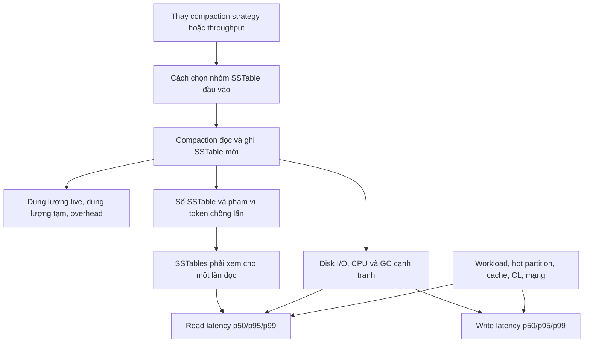
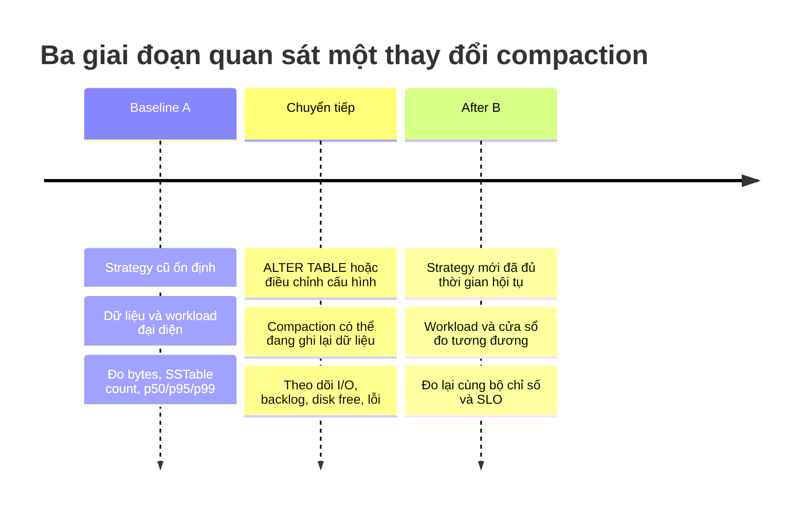

# Quan sát trước/sau thay đổi bằng dung lượng, SSTable count và độ trễ trong Apache Cassandra

## 1. Vì sao phải đo cả ba loại chỉ số?

Trong kiến trúc **wide-column** của **Apache Cassandra**, dữ liệu được ghi vào commit log và memtable, rồi được flush thành các **SSTable** bất biến. Nhiều SSTable có thể chứa các phiên bản khác nhau của cùng một partition. **Compaction** hợp nhất những SSTable đủ điều kiện, tổ chức lại dữ liệu theo chiến lược của bảng và có thể loại bỏ dữ liệu cũ hoặc tombstone khi an toàn.

Khi thay **compaction strategy**, điều chỉnh thông lượng compaction, thay cách ghi/TTL hoặc thay mô hình partition, người vận hành cần chứng minh kết quả bằng **số liệu trước và sau**, thay vì chỉ dựa vào việc câu lệnh `ALTER TABLE` chạy thành công.

Bài học thuộc chương **SSTable và compaction**, trong mô-đun `DATABASE_ENGINE_WIDE_COLUMN_CASSANDRA`: hiểu kiến trúc phân tán, thiết kế bảng theo truy vấn, mức nhất quán đọc/ghi, thực hành CQL, replication, compaction, repair, xử lý lỗi và ứng dụng Java.

Ba nhóm quan sát chính là:

| Nhóm | Câu hỏi cần trả lời | Điều chỉ số không tự chứng minh |
| --- | --- | --- |
| **Dung lượng** | Bảng và node đang chiếm bao nhiêu byte, có đủ chỗ cho compaction không? | Ít byte hơn không luôn đồng nghĩa đọc nhanh hơn hay dữ liệu an toàn hơn |
| **SSTable count** | Có bao nhiêu SSTable, bao nhiêu tệp thường bị chạm khi đọc? | Ít tệp hơn không luôn đồng nghĩa ít I/O hoặc p99 tốt hơn |
| **Độ trễ** | Người dùng/ứng dụng thấy read/write p50, p95, p99 thay đổi ra sao? | Latency thay đổi có thể do workload, cache, mạng, repair, GC hoặc consistency level |

**Mục tiêu:** biết chọn chỉ số tương ứng, đo đúng phạm vi, kiểm soát yếu tố gây nhiễu và rút ra kết luận có thể kiểm chứng. Compaction là tác vụ **cục bộ tại mỗi replica**; khi keyspace có RF lớn hơn một, từng node có thể đang ở các giai đoạn flush/compaction khác nhau. Do đó, số liệu phải phân tích **theo bảng, theo node và theo cửa sổ thời gian**.

## 2. Mô hình nhân quả: từ SSTable đến trải nghiệm truy vấn

Một thay đổi compaction có thể ảnh hưởng đến cả ba chỉ số, nhưng không theo cùng chiều:



Ba yếu tố cần hiểu trước khi quan sát:

1. **Read amplification:** một phép đọc có thể phải tra cứu nhiều SSTable/phiên bản. Chiến lược như **LeveledCompactionStrategy (LCS)** có thể giảm mức chồng lấn của SSTable dù **tổng số tệp tăng**, vì LCS thường dùng SSTable đích nhỏ và các level được tổ chức theo phạm vi token.
2. **Write amplification:** compaction đọc và viết lại dữ liệu; cấu hình giảm chi phí đọc có thể phải trả bằng I/O, CPU hoặc chi phí ghi tăng.
3. **Space amplification:** nhiều phiên bản, tombstone, tệp đầu vào/đầu ra trong khi compaction và snapshot có thể làm byte trên đĩa tăng trước khi giảm. Không xóa trực tiếp tệp SSTable để tạo chỗ trống.

Vì vậy, tiêu chí thành công phải được tuyên bố **trước khi thay đổi**. Chẳng hạn: “Giảm p99 đọc trên bảng `profile_by_user` dưới tải như cũ mà không làm p99 ghi vượt SLO, không gây thiếu dung lượng đĩa và không ảnh hưởng tính nhất quán dữ liệu”.

## 3. Trước tiên, định nghĩa chính xác “dung lượng”

“Dung lượng Cassandra” có nhiều phép đo và phạm vi khác nhau:

| Chỉ số | Phạm vi đo điển hình | Khi nào dùng? |
| --- | --- | --- |
| **Live SSTable disk space** trong `nodetool tablestats` | Byte của các SSTable còn sống thuộc một bảng trên **một node** | So hiệu quả lưu trữ của bảng tại cùng node |
| **Total SSTable disk space** trong `tablestats` | Tổng byte SSTable theo cách phiên bản đang chạy tính, có thể gồm tệp/snapshot không thuộc live set | Phân tích khoảng chênh so với live |
| **Disk used/free** qua hệ điều hành, ví dụ `df` | Toàn bộ filesystem/volume | Đánh giá dung lượng trống thực sự cho compaction |
| **SSTable count** trong `tablestats` | Số SSTable được tính cho bảng tại thời điểm đo trên node | Phân tích số tệp và xu hướng compaction |
| **Bytes logical của ứng dụng** | Payload/business records trước khi tính replication, compression, overhead | Đánh giá dữ liệu nghiệp vụ chứ không phải dung lượng vật lý |

**Không so trực tiếp** `Owns (effective)` của `nodetool status <keyspace>` với live SSTable GB của một bảng. Ownership là ước lượng phạm vi token theo replication, còn byte phụ thuộc kích thước partition và SSTable thực tế.

Ví dụ RF = 3 với 500 GiB dữ liệu logic **không có nghĩa** một node sẽ luôn có đúng 500 GiB hay cụm dùng đúng 1.500 GiB. Compression, tombstone, snapshot, số bản sao, phân phối partition và compaction khiến dung lượng vật lý khác ước lượng đơn giản. So sánh trước/sau nên dùng **cùng một phép đo** từ **cùng bộ node**.

### Điều kiện đo dung lượng công bằng

- Cùng bảng, cùng node, cùng kiểu số liệu live/total; thống nhất đơn vị `GiB` (2^30 byte) hoặc `GB` (10^9 byte), không trộn hai đơn vị.
- Cùng số lượng bản ghi logic và phân phối partition nếu đang đo **ảnh hưởng của strategy**, không đo cùng lúc việc TTL vừa hết hạn hay thay RF.
- Ghi riêng snapshot/backup và việc dọn tệp cũ; nếu số liệu `df` giảm nhưng `live SSTable bytes` không giảm, phải điều tra dữ liệu ngoài live SSTable.
- Luôn kiểm tra **free disk/headroom** khi thay chiến lược: quá trình chuyển tiếp có thể giữ tệp cũ và tệp mới đồng thời, làm dung lượng đạt đỉnh trước khi ổn định.
- Với nhiều node/DC, trình bày số liệu per-node rồi mới tính tổng; đừng lấy một node “đẹp” để đại diện toàn cụm.

## 4. SSTable count: nhìn số lượng lẫn phạm vi đọc

SSTable count dễ lấy và hữu ích để nhìn xu hướng, nhưng là chỉ số **sơ bộ**:

- **STCS (SizeTieredCompactionStrategy):** thường nhóm SSTable có kích thước tương tự; một vài tệp lớn có thể tồn tại lâu. Tổng số tệp thấp nhưng nhiều đời SSTable có thể chứa cùng partition.
- **LCS (LeveledCompactionStrategy):** sắp SSTable theo level; tệp tương đối nhỏ và các tệp ở cùng level cao hơn có phạm vi token không chồng lấn. **Số tệp tổng có thể tăng** trong khi một phép đọc cần xem ít tệp liên quan hơn.
- **TWCS (TimeWindowCompactionStrategy):** nhóm theo cửa sổ thời gian; số cửa sổ và việc dữ liệu tới muộn có thể làm tăng tệp/cửa sổ. Không thể kết luận một bảng TWCS “xấu” chỉ vì nhiều tệp thuộc nhiều cửa sổ.
- **UCS (UnifiedCompactionStrategy, bản hỗ trợ):** cấu trúc phụ thuộc tham số đánh đổi đọc/ghi/space; không gán một ngưỡng SSTable count chung cho mọi thiết lập.

**Chỉ số bổ sung bắt buộc khi đánh giá đọc:** **SSTables per read** hoặc histogram tương đương, cùng với read latency và tỷ lệ cache hit. Một bảng tăng từ 100 lên 250 SSTable sau khi chuyển LCS nhưng số SSTable chạm mỗi lượt đọc giảm từ khoảng 7 còn 2 là kịch bản hoàn toàn có thể xảy ra. Đây là ví dụ khái niệm, không phải số liệu bảo đảm bởi LCS.

Đo SSTable count liên tục: nó thường tăng sau flush rồi giảm sau một task compaction. **Một snapshot duy nhất tại thời điểm vừa flush có thể gây kết luận sai.** Cần nhiều mốc thời gian và ghi nhận lúc compaction đang chạy.

## 5. Độ trễ phải đo ở cả client và server

SLO ứng dụng quan tâm **thời gian cuối đến cuối**; metric Cassandra giải thích phần xử lý phía server. Hai loại cần đặt cạnh nhau:

| Chỉ số | Ý nghĩa | Chú ý |
| --- | --- | --- |
| **Client read/write p50** | Độ trễ trung vị của thao tác mà ứng dụng thấy | Có thể không đổi dù p99 tăng mạnh |
| **Client p95/p99/p99.9** | Độ trễ đuôi, quan trọng cho trải nghiệm và timeout | Cần đủ mẫu và tải tương đương |
| **Server read/write latency** theo bảng/node | Thời gian xử lý ở Cassandra | Không nhất thiết bao gồm mạng, queue và retry phía client |
| **SSTables per read** | Mức độ đụng nhiều SSTable khi đọc | Phải diễn giải theo cache, partition và kiểu truy vấn |
| **Timeout, retry, failure rate** | Tỷ lệ yêu cầu không hoàn tất như dự kiến | Chỉ đo request thành công có thể làm latency “đẹp giả” |
| **CPU, GC, disk I/O, network** | Nguồn gây nhiễu hoặc bottleneck | Đặc biệt quan trọng khi compaction đọc/ghi lớn |

Độ trễ p99 là giá trị mà khoảng 99% mẫu không vượt quá trong một cửa sổ đo. **p99 không phải độ trễ lớn nhất**, và p99 của hai tập mẫu không cộng/trừ tuyến tính. Khi gộp nhiều node hoặc nhiều khoảng thời gian, phải tính lại percentile từ histogram/mẫu gốc phù hợp, không lấy trung bình cộng các p99.

**Chú ý consistency:** cùng một câu `SELECT` ở `LOCAL_ONE` và `LOCAL_QUORUM` có chi phí khác nhau; tương tự, kích thước page, số hàng trả về, read repair, speculative execution và retry có thể đổi latency. Giữ các yếu tố này cố định nếu đang đánh giá riêng compaction. Đo riêng read và write vì chiến lược giảm read amplification có thể tăng write amplification.

## 6. Lập kế hoạch so sánh trước/sau theo ba giai đoạn

Mô hình đo tốt nhất là **A → chuyển tiếp → B ổn định**:



### Giai đoạn A — baseline

1. Ghi **phiên bản Cassandra**, topology node/DC/rack, replication factor, `system_schema.tables.compaction`, TTL và `gc_grace_seconds`.
2. Ghi quy mô và phân phối dữ liệu: số partition, kích thước partition, tần suất cập nhật/xóa, tỷ lệ khóa nóng, dung lượng table per-node.
3. Cố định workload: truy vấn đọc/ghi, request/s, tỷ lệ read:write, số client, concurrency, payload, phân trang, CL, vị trí Java client và retry policy.
4. Warm-up ứng dụng/connection/cache theo quy trình lặp lại được, **không tính warm-up vào thống kê chính**.
5. Thu **nhiều khoảng đo** đủ dài cho tail latency; lưu p50/p95/p99, throughput thành công, timeout/retry, CPU/disk/GC, live bytes, total bytes, SSTable count, compaction backlog.

### Giai đoạn chuyển tiếp — không đánh đồng với “sau”

1. Áp dụng đúng **một thay đổi** cần nghiên cứu, ví dụ chuyển `SizeTieredCompactionStrategy` → `LeveledCompactionStrategy` trên bảng thí nghiệm.
2. Ghi timestamp thay đổi, log, cấu hình mới, mọi sự kiện bootstrap/repair/snapshot/backup diễn ra đồng thời.
3. Quan sát compaction đang chạy và pending task. Trong giai đoạn này, có thể thấy số SSTable, disk usage, CPU và p99 **tăng trước khi giảm**.
4. Giữ free disk an toàn; không cưỡng ép major compaction ở production chỉ để kết thúc benchmark nhanh hơn. Trạng thái “công việc đang chạy” vẫn là số liệu hữu ích, nhưng phải ghi là **transient**.

### Giai đoạn B — kết quả khi ổn định

1. Xác nhận không còn compaction chuyển đổi chiến lược gây tải bất thường; backlog đã ổn định theo workload hoặc còn tồn tại ở mức giải thích được.
2. Lặp đúng cùng workload, CL, lượng dữ liệu logic, số client, concurrency, page size và khoảng đo đủ mẫu. Nếu TTL hoặc dung lượng logic thay đổi đáng kể giữa A/B, **ghi rõ** sự khác biệt và không quy toàn bộ hiệu ứng cho strategy.
3. So sánh theo **cùng node và cùng bảng**, báo thêm tổng hợp trong DC/cụm khi cần.
4. Xem cả p99 đọc **và** p99 ghi, số request thành công, timeout và dung lượng trống; xác nhận tính đúng của dữ liệu bằng truy vấn kiểm chứng phù hợp.
5. Nếu muốn chứng minh quan hệ nhân quả mạnh hơn, lặp trên staging với cùng dữ liệu/seed hoặc có nhóm đối chứng; tránh tùy tiện rollback chiến lược trên production chỉ để lấy biểu đồ đẹp.

Thời lượng mỗi giai đoạn phụ thuộc chu kỳ flush/compaction và workload; **không đặt quy tắc rằng chờ 10 phút là đã hội tụ**. Cụm có dữ liệu lớn có thể cần nhiều chu kỳ mới đủ đại diện.

## 7. Công cụ quan sát từ CQL, nodetool và hệ điều hành

### 7.1. Xác nhận compaction strategy trong schema

```sql
SELECT keyspace_name, table_name, compaction,
       default_time_to_live, gc_grace_seconds
FROM system_schema.tables
WHERE keyspace_name = 'lab_compaction'
  AND table_name = 'events_by_device_day';
```

`compaction` là map mô tả strategy/options của bảng. Một lệnh `ALTER TABLE` cập nhật metadata nhưng **không bảo đảm** ngay lập tức mọi SSTable cũ đã được viết lại theo cấu trúc mới.

### 7.2. Quan sát per-node

Chạy cùng bộ lệnh trên **mỗi node được so sánh**:

```bash
# Trạng thái node, token, DC, Load.
nodetool status lab_compaction

# Thống kê dung lượng và SSTable của đúng bảng.
nodetool tablestats lab_compaction.events_by_device_day

# Phân phối kích thước partition, read/write latency theo bảng.
nodetool tablehistograms lab_compaction events_by_device_day

# Task đang chạy/chờ và lịch sử compaction.
nodetool compactionstats
nodetool compactionhistory

# Hàng đợi/tác vụ server, hỗ trợ điều tra nghẽn.
nodetool tpstats
```

Nội dung và tên metric cụ thể trong `nodetool tablestats` thay đổi theo phiên bản. Tìm các trường có nghĩa tương ứng với **SSTable count**, **Space used (live/total)**, **SSTables per Read**, **Read latency** và **Write latency**. Cần ghi cả **đơn vị**, **phạm vi** và **cửa sổ/cumulative**: một số trị số là số đếm tích lũy, một số là phân phối hoặc trung bình quan sát tại thời điểm đó. Đừng lấy các trị số tích lũy trước/sau trừ nhau như hai sample độc lập mà không hiểu chúng có reset khi restart hay không.

`nodetool status` cho biết `Load` của cả node theo cách công cụ đo; **không thay thế** số byte của riêng một bảng. `compactionstats` phản ánh công việc đang chạy/đợi, còn `compactionhistory` hỗ trợ lần ngược lịch sử nhưng không phải bản đo latency của ứng dụng.

### 7.3. Disk free và snapshot

Trên node Linux, ví dụ:

```bash
# Đọc-only, thay đường dẫn bằng data directory của node.
df -h /var/lib/cassandra
```

So tổng disk usage với live SSTable bytes. Chênh lệch có thể đến từ snapshot, commit log, tệp khác của Cassandra, dữ liệu keyspace khác, temporary SSTable hoặc cấp phát filesystem. **Không xóa file SSTable bằng tay** để “cân” số liệu. Trước khi cleanup snapshot hay thay đổi retention, phải áp dụng chính sách backup/khôi phục đã có.

### 7.4. Lưu số liệu có thể tái hiện

Đối với mỗi cửa sổ đo, lưu:

```text
run_id, phase, timestamp_start, timestamp_end
cluster_version, table, node_id, dc, rack, replication
compaction_strategy, options, TTL, gc_grace_seconds
live_sstable_bytes, total_sstable_bytes, disk_free_bytes
sstable_count, sstables_per_read_p95, compaction_pending
client_read_p50_ms, client_read_p95_ms, client_read_p99_ms
client_write_p50_ms, client_write_p95_ms, client_write_p99_ms
read_rps, write_rps, timeout_rate, retry_rate
cpu_utilization, disk_iops, disk_throughput, gc_pause
data_version, client_version, consistency_level, page_size
```

Đây là **schema báo cáo gợi ý**, không phải bảng Cassandra cần tạo. Ghi raw histogram/timeseries bên cạnh bảng tóm tắt để sau này có thể tính lại percentile và tìm spike.

## 8. Thực hành CQL: chuyển STCS sang LCS trong lab

Thực hành trên keyspace/bảng thử nghiệm. `dc1` chỉ là tên DC minh họa; phải thay bằng topology thật, tránh chạy trực tiếp trong production.

```sql
CREATE KEYSPACE IF NOT EXISTS lab_compaction
WITH replication = {
    'class': 'NetworkTopologyStrategy',
    'dc1': '3'
};

CREATE TABLE IF NOT EXISTS lab_compaction.events_by_device_day (
    device_id text,
    event_day date,
    event_time timestamp,
    event_id uuid,
    payload text,
    PRIMARY KEY ((device_id, event_day), event_time, event_id)
) WITH CLUSTERING ORDER BY (event_time DESC, event_id ASC)
  AND compaction = {
      'class': 'SizeTieredCompactionStrategy'
  };

-- Đọc theo partition key đầy đủ, không quét toàn bảng.
SELECT event_time, event_id, payload
FROM lab_compaction.events_by_device_day
WHERE device_id = 'sensor-42'
  AND event_day = '2026-11-21'
LIMIT 100;
```

Để có bài thử có ý nghĩa, cần nạp dữ liệu đại diện qua nhiều lần flush hoặc đủ để compaction tạo tệp. **Một bảng chỉ chứa vài bản ghi không thể thể hiện rõ tác động của compaction.** Khi nạp dữ liệu hãy giữ partition key tương đối đa dạng, có tỷ lệ update/delete thực tế và không tạo partition khổng lồ ngoài chủ đích.

Sau khi hoàn thành baseline, áp dụng **một thay đổi**:

```sql
ALTER TABLE lab_compaction.events_by_device_day
WITH compaction = {
    'class': 'LeveledCompactionStrategy',
    'sstable_size_in_mb': '160'
};
```

`160` là tham số thí nghiệm, không phải khuyến nghị cho mọi cluster/đĩa. Kiểm tra các tùy chọn hợp lệ theo **phiên bản Cassandra**. Sau `ALTER TABLE`, theo dõi `compactionstats`, disk free và bảng `tablestats`; chỉ đánh giá B khi dữ liệu, lịch compaction và workload đã đạt trạng thái đủ ổn định để so sánh.

Không lặp đi lặp lại `ALTER TABLE` giữa các lượt đo, không ép compaction thủ công chỉ để giảm count và không đổi đồng thời RF/TTL/query/CL; nếu thay nhiều yếu tố, không còn biết yếu tố nào gây thay đổi.

## 9. Ví dụ bảng kết quả: SSTable count tăng nhưng đọc nhanh hơn

Giả sử bài thử chuyển STCS → LCS trên một bảng của một node, chạy **cùng lượng dữ liệu logic và workload**. Các số bên dưới là **số giả định để tập diễn giải**, không phải số đo của một cụm Cassandra thật.

| Chỉ số | Baseline A | Đang chuyển tiếp | After B ổn định |
| --- | ---: | ---: | ---: |
| Live SSTable space | 310 GiB | 326 GiB | 335 GiB |
| SSTable count | 110 | 265 | 190 |
| SSTables/read (p95) | 7 | 5 | 2 |
| Read p99 từ client | 90 ms | 128 ms | 52 ms |
| Write p99 từ client | 20 ms | 35 ms | 27 ms |
| Pending compactions | 0 | 48 | 0 |
| Free disk | 600 GiB | 410 GiB | 560 GiB |

Diễn giải:

- **Dung lượng live tăng:** `335 − 310 = 25 GiB`, tương đương khoảng **+8,1%**. Điều này không nhất thiết là lỗi; LCS có thể chọn đánh đổi không gian/ghi để giảm cost đọc.
- **SSTable count tăng:** `190 − 110 = 80` tệp (**+72,7%**). Không thể gọi kết quả là xấu nếu chỉ dựa vào count.
- **SSTables/read p95 giảm:** từ `7` còn `2`, tức giảm khoảng **71,4%**; phù hợp với mục tiêu giới hạn overlap đọc.
- **Read p99 giảm:** `(90 − 52) / 90 ≈ 42,2%`. Đây là kết quả tích cực nếu request mix, thông lượng, CL, cache và error rate thật sự tương đương.
- **Write p99 tăng:** `(27 − 20) / 20 = 35%`; phải so với SLO ghi và nguyên nhân I/O trước khi tuyên bố thay đổi thành công.
- **Trong chuyển tiếp**, read p99 128 ms và free disk giảm 190 GiB; đây là chi phí lúc tái tổ chức. Kế hoạch triển khai phải dự trù tải và dung lượng đỉnh chứ không chỉ kết quả after.

Chọn lựa cuối cùng tùy SLO: nếu ứng dụng cần p99 đọc ≤ 60 ms và p99 ghi ≤ 30 ms, minh họa sau đạt cả hai (với dữ liệu giả định), nhưng tăng chi phí đĩa. Nếu yêu cầu p99 ghi ≤ 22 ms, nó **không** đạt dù read cải thiện.

### Phân biệt các mẫu biến động

| Kết quả quan sát | Cách hiểu ban đầu | Kiểm tra tiếp |
| --- | --- | --- |
| Live bytes giảm, count giảm, read p99 giảm | Có thể do compaction loại dữ liệu cũ và giảm read amplification | TTL/DELETE, cùng workload, còn compaction backlog không |
| Count tăng, SSTables/read giảm, read p99 giảm | Có thể do tổ chức level cải thiện đọc | I/O write, CPU và dung lượng trống |
| Count giảm nhưng read p99 xấu hơn | Số tệp không phản ánh toàn bộ đọc | Partition lớn, disk seek, cache, CL, số row/query |
| Live bytes không đổi nhưng `df` giảm | Overhead ngoài live SSTable được thu hồi | Snapshot, tệp tạm, backup, commit log |
| Read p99 cải thiện nhưng timeout tăng | Thống kê các request thành công có thể gây thiên lệch | Tỷ lệ thất bại, retry và offered load |
| p99 xấu trong chuyển tiếp, tốt sau hội tụ | Compaction cạnh tranh CPU/disk trong lúc tái tổ chức | I/O headroom và khả năng chịu tác động khi rollout |
| Số node có xu hướng trái chiều | Phân phối partition/hot key hoặc tiến độ compaction khác nhau | Metrics từng node/DC, RF và repair |

## 10. Cách tính thay đổi và tránh lỗi thống kê

Với một số liệu cùng đơn vị và phạm vi:

```text
absolute_delta = after - before
relative_change_percent = 100 * (after - before) / before
latency_reduction_percent = 100 * (before - after) / before
```

Điều kiện: `before != 0` nếu chia tỷ lệ. Nếu ban đầu pending tasks bằng 0 thì không thể dùng phần trăm tăng/giảm thông thường. Với tổng dung lượng theo nhiều node, **cộng byte thô**, không cộng các tỷ lệ phần trăm; với latency tail, **không** lấy trung bình các p99.

### Những sai lầm dễ khiến báo cáo sai

1. **Khác tải:** giờ A có 2.000 RPS, giờ B có 500 RPS; p99 tốt hơn không chứng minh strategy tốt hơn.
2. **Khác dữ liệu:** TTL vừa hết hạn, cleanup xóa range hoặc số partition thay đổi; dung lượng giảm có thể không đến từ chiến lược.
3. **Khác read consistency:** `LOCAL_ONE` so với `LOCAL_QUORUM`; số replica tham gia khác nhau.
4. **Khác client:** số luồng, connection pool, retry, speculative execution, driver version, JVM/GC và vị trí mạng đã đổi.
5. **Đo sau chưa hội tụ:** compaction vẫn rewrite tệp cũ; các chỉ số phản ánh migration thay vì trạng thái ổn định.
6. **Gộp theo node sai:** một node hot làm p99 rất cao nhưng tổng bình quân che khuất. Dùng phân bố per-node/partition rồi mới tổng hợp.
7. **Bỏ request timeout khỏi thống kê:** chỉ giữ latency của request thành công làm p99 có vẻ tốt. Báo cả failure/timeout và offered load.
8. **Coordinated omission:** bộ phát tải closed-loop ngừng phát khi server chậm, khiến tail latency báo cáo thấp hơn tác động thật; ghi rõ phương pháp tải và dùng công cụ sửa hiện tượng này khi cần.
9. **Chỉ xem số SSTable:** số tệp tăng trong LCS không có nghĩa số SSTable *chạm cho mỗi đọc* tăng.
10. **Quên snapshot:** `df` đầy dù `live SSTable` có vẻ nhỏ. Cần phân biệt dữ liệu còn được tham chiếu và snapshot/backup.

Để so sánh đáng tin cậy, chạy nhiều lần có cùng seed/workload và trình bày **phân bố giữa các lượt**. Một điểm p99 đơn lẻ trong lúc cluster đang bảo trì không đủ để quyết định cấu hình dài hạn.

## 11. Đo từ ứng dụng Java Driver 4.x

Ứng dụng Java là nơi đo **trải nghiệm thực của client**, trong khi Cassandra đo các thành phần phía server. Mẫu dưới đây minh họa cách đo một truy vấn theo đầy đủ partition key. Giả sử `CqlSession session` đã được tạo, cấu hình đúng local DC; dùng Java 17+ cho text block.

```java
import com.datastax.oss.driver.api.core.DefaultConsistencyLevel;
import com.datastax.oss.driver.api.core.cql.BoundStatement;
import com.datastax.oss.driver.api.core.cql.PreparedStatement;
import com.datastax.oss.driver.api.core.cql.ResultSet;
import com.datastax.oss.driver.api.core.cql.Row;
import java.time.LocalDate;

PreparedStatement prepared = session.prepare("""
    SELECT event_time, event_id, payload
    FROM lab_compaction.events_by_device_day
    WHERE device_id = ? AND event_day = ?
    LIMIT 100
    """);

BoundStatement statement = prepared.boundStatementBuilder()
    .setString(0, "sensor-42")
    .setLocalDate(1, LocalDate.of(2026, 11, 21))
    .setConsistencyLevel(DefaultConsistencyLevel.LOCAL_QUORUM)
    .build();

long startNs = System.nanoTime();
try {
    ResultSet result = session.execute(statement);
    int rows = 0;
    for (Row ignored : result) {
        rows++;
    }
    long elapsedNs = System.nanoTime() - startNs;
    // Gửi elapsedNs, rows, run_id, stage, key đã ẩn danh vào histogram/log.
} catch (RuntimeException error) {
    long elapsedNs = System.nanoTime() - startNs;
    // Ghi timeout/error; không loại attempt thất bại khỏi báo cáo.
    throw error;
}
```

Ví dụ cố ý dùng `LIMIT 100` để tránh đọc không giới hạn, nhưng `for` có thể thực hiện fetch các trang khi kết quả đủ lớn. Với benchmark, phải cố định page size, số hàng, cách tiêu thụ kết quả và chính sách retry; nếu chỉ gọi `.one()` rồi dừng, đó là phép đo khác. Trong hệ thống nhiều client, nên dùng công cụ benchmark/driver metrics có histogram chính xác, ghi percentiles ở **cùng cửa sổ** với metrics `nodetool`/JMX; không tính p99 bằng vài request đơn lẻ.

Giữ **prepared statement** và query shape giống nhau giữa A/B. Khi cần đánh giá riêng compaction, không đổi CQL query, CL hay ứng dụng trong cùng bài thử. Khi latency xấu, đối chiếu client p99 với SSTables/read, CPU/disk/GC, compaction backlog và lỗi để biết bottleneck nằm ở đâu.

## 12. Giới hạn: dung lượng và độ trễ không chứng minh tính đúng dữ liệu

Compaction không phải repair. Nó hợp nhất các tệp **trên một node**, còn **repair** đối chiếu replica theo token range. Một cụm đọc nhanh, đĩa tiết kiệm vẫn có thể có replica mất đồng bộ, dữ liệu hết hạn hoặc vấn đề nhất quán nếu lịch repair/availability không đảm bảo.

- Với tombstone/TTL, dữ liệu chỉ được loại vật lý khi đáp ứng các điều kiện an toàn. **Không giảm `gc_grace_seconds` xuống 0 chỉ để giảm bytes** mà không đánh giá repair/replica offline và khả năng hồi sinh dữ liệu cũ.
- Sau khi đổi RF, thêm/bớt node hoặc chạy cleanup, không thể quy mọi biến động dung lượng cho compaction vì **tập replica/token trách nhiệm** đã thay đổi.
- Nếu thay mô hình partition key để khắc phục hot partition, cần thêm phép đo partition size và phân phối key; chiến lược compaction không tự chia một partition thành nhiều token.
- Đừng chạy `nodetool compact` (major compaction) trên bảng lớn hoặc bảng TWCS chỉ để ép SSTable count giảm; có thể tốn I/O/space và làm thay đổi đặc tính cửa sổ thời gian.
- Tính đúng nghiệp vụ phải được kiểm bằng truy vấn/checksum phù hợp, tình trạng replica, repair và backup/restore riêng; **ba nhóm chỉ số trong bài là bằng chứng vận hành và hiệu năng**, không phải phép chứng minh đầy đủ tính đúng.

## 13. Mẫu báo cáo trước/sau có thể dùng lại

```text
MỤC TIÊU:
  Thay đổi: STCS -> LCS trên lab_compaction.events_by_device_day
  Giả thuyết: giảm SSTables/read và p99 read ở mức tải đã ghi
  Ngưỡng chấp nhận: read p99 <= ...; write p99 <= ...;
                    timeout <= ...; min free disk >= ...

BỐI CẢNH:
  Cassandra version, node/DC/RF, partition key, TTL, repair state
  Query shape, CL, page size, client JVM/driver, retry/speculation
  Dataset version/seed, số partition, row/partition, hot-key distribution
  Offered RPS, concurrency, read:write mix, workload duration

BASELINE A:
  Per node: live_bytes, total_bytes, df_free, sstable_count
  Per node: sstables/read histogram, compaction backlog, disk I/O
  Client: read/write p50, p95, p99, throughput, timeout/retry

CHUYỂN TIẾP:
  ALTER timestamp, pending compactions, peak disk used,
  peak CPU/IO, p99 during migration, errors, node health

AFTER B ỔN ĐỊNH:
  Cùng metrics và phạm vi như A, số lần lặp, histogram raw
  So sánh tuyệt đối và %, kiểm tra SLO, giới hạn phép so sánh

KẾT LUẬN:
  Điều gì cải thiện/thoái lui? Trong điều kiện đo nào?
  Dữ liệu đủ để quy kết cho thay đổi chưa?
  Hành động giữ/cân chỉnh/rollback, người chịu trách nhiệm
```

### Khi nào kết luận “thành công”?

Chỉ kết luận thay đổi đạt yêu cầu khi **SLO nghiệp vụ**, dung lượng đỉnh và độ trễ cả đọc/ghi phù hợp, đồng thời quá trình đo đủ kiểm soát. Có thể chọn giữ LCS dù SSTable count và live bytes tăng vì p99 đọc giảm; cũng có thể từ chối vì write latency hoặc disk headroom không đạt SLO. Số liệu phải giải thích **trade-off** theo mục tiêu cụ thể, không chỉ có một con số tối ưu.

## 14. Câu hỏi thực hành và tự kiểm tra

1. Sau `ALTER TABLE` sang LCS, SSTable count từ 150 lên 280 nhưng SSTables/read p95 từ 8 xuống 2. Vì sao không thể nói thay đổi thất bại chỉ vì count tăng?
2. Bảng `tablestats` cho thấy live bytes không đổi, nhưng `df` của node tăng sử dụng 100 GiB. Những nguồn chiếm đĩa nào cần kiểm tra?
3. Nếu read p99 trước là 100 ms ở 5.000 RPS còn sau là 40 ms ở 700 RPS, có thể kết luận compaction cải thiện 60% không? Cần lặp thử thế nào?
4. Tại sao phải tách baseline, giai đoạn chuyển tiếp và trạng thái after ổn định?
5. Vì sao phải đo write p99 và timeout khi thay từ STCS sang LCS dù mục tiêu là tối ưu đọc?
6. Tại sao không lấy trung bình p99 của từng node để tạo “p99 toàn cụm”?
7. Một đợt cleanup sau scale-out làm dung lượng bảng giảm. Vì sao số liệu này không thể quy riêng cho strategy?
8. TTL hết hạn nhưng live bytes chưa giảm. Các điều kiện/tác vụ nào còn liên quan?
9. Khi ứng dụng Java chỉ đọc một row từ `ResultSet`, điều gì khác với việc duyệt toàn bộ page trong benchmark?
10. Trong một bản báo cáo production, những dữ liệu nào cần lưu để người khác tái lập kết luận?

**Ghi nhớ:** Để quan sát tác động compaction của Cassandra, hãy so **dung lượng live/total và free disk**, **SSTable count cùng SSTables-per-read**, **read/write latency từ client cùng metrics server**, trên **cùng bảng, cùng node và workload tương đương**. Đừng coi giai đoạn chuyển đổi là trạng thái đã ổn định, đừng dùng một chỉ số làm kết luận cuối cùng, và luôn diễn giải đánh đổi bằng SLO cụ thể.
