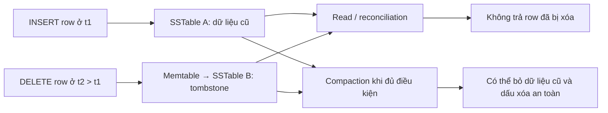
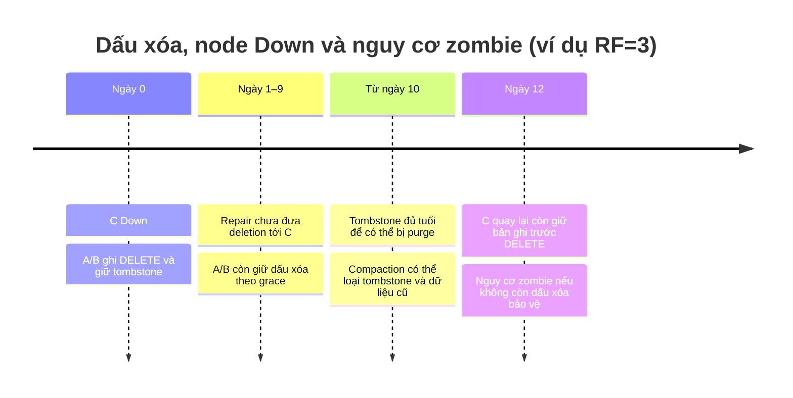

# Quan hệ giữa repair, nút ngừng hoạt động và thời gian giữ dấu xóa

> **Chương:** Tombstone và thu hồi  
> **Mô-đun:** `DATABASE_ENGINE_WIDE_COLUMN_CASSANDRA` — Apache Cassandra, cơ sở dữ liệu wide-column phân tán sử dụng mô hình dữ liệu theo truy vấn.  
> **Trọng tâm:** Vì sao xóa một hàng bằng CQL chưa có nghĩa mọi replica đều biết hàng đó đã bị xóa; `gc_grace_seconds`, repair và thời gian node ngừng hoạt động phối hợp để tránh dữ liệu “sống lại”.

Trong Apache Cassandra, lệnh `DELETE` hoặc một giá trị hết TTL không nhất thiết xóa ngay byte dữ liệu khỏi SSTable. Cassandra ghi một **tombstone** (dấu xóa) để các bản sao đối chiếu phiên bản dữ liệu. Nếu một node không nhận được dấu xóa vì đang ngừng hoạt động, node đó có thể giữ **giá trị cũ**. Dấu xóa cần còn tồn tại đủ lâu để thông tin xóa đến được node cũ trước khi bị compaction loại bỏ.

Đó là lý do ba hoạt động phải được xem cùng nhau:

1. **Replication và consistency level (CL):** quyết định replica nào nhận mutation và bao nhiêu ACK là đủ cho request thành công.
2. **Repair:** đồng bộ sai khác giữa các replica; giúp truyền dấu xóa còn tồn tại tới replica đã bỏ lỡ nó.
3. **Thời gian giữ dấu xóa và compaction:** đặt ra một khoảng bảo vệ trước khi tombstone được phép bị loại bỏ; không phải lịch tự động bảo đảm rằng tất cả node đều nhận được delete.

Sai lầm vận hành phổ biến là thấy `DELETE` trả về thành công ở `QUORUM`, chờ qua `gc_grace_seconds` rồi cho rằng dữ liệu an toàn. Quorum ACK, repair và garbage collection là **ba cơ chế khác nhau**. Một node trở lại sau thời gian quá dài vẫn có thể mang theo dữ liệu cũ.

## 1. Kết quả học tập

Hoàn thành bài này, bạn có thể:

- Phân biệt **xóa logic** khi đọc với **thu hồi vật lý** trong SSTable.
- Giải thích mối quan hệ giữa `gc_grace_seconds`, tình trạng node Down, hinted handoff, anti-entropy repair và compaction.
- Mô tả hiện tượng **zombie data** (dữ liệu đã xóa xuất hiện lại), điều kiện làm tăng rủi ro và cách tránh.
- Lập lịch repair có **biên an toàn** theo thời gian giữ tombstone và mức độ ngừng hoạt động thực tế.
- Đọc tình huống RF=3, CL=`LOCAL_QUORUM` và nhận biết vì sao “ghi thành công” không chứng minh mọi replica đã cập nhật.
- Thực hành CQL, quan sát node/repair/tombstone và xử lý tình huống node quay lại sau một thời gian dài.
- Tích hợp cách kiểm tra và retry an toàn trong ứng dụng Java.

## 2. Từ lệnh DELETE đến tombstone trong LSM-tree

### 2.1. Cassandra không sửa tại chỗ mọi SSTable cũ

Cassandra lưu dữ liệu ở memtable và **SSTable bất biến**. Một hàng có thể đã được flush vào SSTable A. Khi client xóa hàng, Cassandra ghi một mutation biểu diễn deletion vào đường ghi hiện hành (commit log, memtable), rồi flush thành SSTable khác.

Khi đọc, Cassandra hợp nhất các cell/row từ memtable và SSTable theo quy tắc timestamp và deletion. Một tombstone có timestamp phù hợp sẽ **che** dữ liệu cũ, làm hàng không còn xuất hiện trong `SELECT`, dù byte dữ liệu cũ có thể vẫn nằm trên đĩa.



Các dạng deletion thường gặp gồm **cell tombstone**, **row tombstone**, **partition tombstone**, **range tombstone** (xóa nhiều clustering rows) và expiry do **TTL**. Mỗi loại có phạm vi che dữ liệu khác nhau, nhưng đều liên quan đến quy tắc lưu tombstone và việc tránh dữ liệu cũ quay lại.

### 2.2. Xóa logic khác thu hồi vật lý

| Thời điểm | Đọc CQL | Tình trạng SSTable |
|---|---|---|
| Trước DELETE | Hàng được trả về nếu còn sống | Có bản dữ liệu |
| DELETE đã ghi vào replica được truy vấn | Thông thường không trả hàng, vì tombstone che giá trị cũ | Giá trị cũ và tombstone có thể cùng tồn tại |
| Sau một số lần compaction | Vẫn không trả hàng | Một số phiên bản cũ bị gộp hoặc loại |
| Sau khi tombstone **đủ điều kiện** loại và compaction xử lý | Không trả hàng nếu các replica đã được đồng bộ an toàn | Có thể giải phóng byte tương ứng |
| Một replica cũ quay lại trong điều kiện không an toàn | Có nguy cơ quan sát lại dữ liệu cũ | Replica cũ vẫn giữ giá trị trước DELETE |

**Không được suy từ “SELECT không trả hàng” rằng tombstone đã được thu hồi.** Một hàng có thể bị che trên đường đọc rất lâu trước khi byte được dọn khỏi SSTable.

### 2.3. Timestamp quyết định phép hợp nhất, không phải thời điểm nhận gói tin

Cassandra dùng timestamp của mutation/cell trong việc phân giải xung đột. Giả sử:

- `INSERT` ở timestamp `t1`.
- `DELETE` ở timestamp `t2`, với `t2 > t1`.

Khi cả hai hiện diện, tombstone ở `t2` che dữ liệu ở `t1`. Một bản sao đang offline không biết `t2` vẫn giữ bản dữ liệu `t1`. Nếu toàn bộ các dấu xóa liên quan bị loại khỏi những bản sao đang khỏe **trước khi bản sao cũ được đồng bộ**, bản ghi `t1` có thể được xem là dữ liệu hợp lệ khi node cũ quay lại.

Đây là cơ chế nền tảng gây ra **zombie data**, không phải việc Cassandra “không hiểu DELETE”.

## 3. Replication factor và consistency level không thay thế repair

Xét keyspace có **RF=3 trong datacenter `dc1`**. Với một partition cụ thể, ba replica đang giữ dữ liệu là A, B và C.

Giả sử C ngừng hoạt động. Ứng dụng gửi `DELETE` với CL `LOCAL_QUORUM`:

```text
                      DELETE row, LOCAL_QUORUM
  Client ────▶ Coordinator ────▶ A (Up) ── ACK
                      │
                      ├────────▶ B (Up) ── ACK
                      │
                      └────────▶ C (Down) ── Không nhận delete

               Client được ACK vì quorum 2/3 đạt.
               C vẫn có thể lưu bản ghi cũ.
```

Với ba full replicas trong local DC, quorum là:

\[
Q=\left\lfloor \frac{3}{2} \right\rfloor+1=2.
\]

**DELETE được ACK khi đạt quorum 2/3**; điều đó chứng minh điều kiện của request trong local DC đã thỏa, không có nghĩa C đã lưu dấu xóa. Sau khi C quay lại, cần cơ chế truyền mutation bỏ lỡ, hoặc repair đối chiếu trạng thái các replica.

Một số điểm quan trọng:

- `LOCAL_QUORUM` chỉ tính quorum trong local DC. Trong hệ đa datacenter, không được giả định mọi replica ở DC khác đã cập nhật.
- `ALL` yêu cầu thêm replica ACK nhưng không giải quyết mọi tình huống lỗi/race, và có thể làm write unavailable khi node Down.
- Hệ số RF quyết định số bản sao mong muốn; nó không cam kết các bản sao lúc nào cũng đồng bộ tuyệt đối.
- Khi node Up lại, nếu read có tiếp cận cả bản cũ và tombstone, cơ chế reconciliation có thể tiếp tục che dữ liệu cũ. **Nguy cơ chính xuất hiện khi dấu xóa đã bị loại trước khi replica cũ được sửa.**

### 3.1. Vì sao một lần đọc đúng không đủ?

Giả sử bạn thực hiện:

```sql
SELECT * FROM some_keyspace.some_table
WHERE partition_key = ...;
```

và nhận 0 hàng ở `LOCAL_QUORUM`. Điều đó chỉ quan sát kết quả **một đường đọc tại một thời điểm**. Nó không chứng minh replica C (hoặc replica ở DC khác) đã được repair. Cần đánh giá repair coverage, trạng thái node, failure history và cả quá trình compaction/purge; read-repair trên vài partition không thay cho repair đầy đủ trên tất cả token ranges.

## 4. `gc_grace_seconds` là gì?

`gc_grace_seconds` là **thuộc tính của bảng Cassandra**, biểu thị khoảng thời gian tối thiểu (theo giây, xét theo quy tắc garbage collection của phiên bản) mà tombstone phải vượt qua trước khi **có thể** được xem xét purge trong compaction.

Cấu hình phổ biến mặc định của Apache Cassandra là:

```text
gc_grace_seconds = 864000
                 = 10 × 24 × 60 × 60
                 = 10 ngày
```

**Kiểm tra giá trị thực tế trên bảng và phiên bản đang dùng.** Giá trị này có thể được cấu hình khác. Đừng xem 10 ngày là cam kết mọi cluster luôn dùng 10 ngày.

### 4.1. “Được phép purge” khác “chắc chắn bị purge”

Một tombstone **không tự biến mất đúng giây cuối cùng** của `gc_grace_seconds`. Việc loại bỏ còn phụ thuộc:

- Compaction có chạy trên các SSTable liên quan hay không.
- Tombstone có thể che dữ liệu cũ trong SSTable khác chưa được gộp hay không.
- Metadata, timestamp, các điều kiện an toàn và chính sách compaction của phiên bản.
- Tùy chọn/config giới hạn purge, ví dụ chính sách chỉ purge những tombstone đã được repair ở những bản Cassandra có hỗ trợ và được cấu hình phù hợp.
- Snapshot/hard link có giữ các block SSTable đã được thay không.

Vì vậy, `gc_grace_seconds` **không phải TTL** và cũng không phải một bộ đếm thời gian chủ động xóa file. Nó tạo một **khoảng bảo vệ** trước khi tombstone có thể bị thu hồi.

### 4.2. Tại sao không đặt `gc_grace_seconds = 0` để giảm dung lượng?

Với hệ thống có nhiều replica, một node có thể ngừng hoạt động hoặc mất mạng. Nếu tombstone bị compact mất trước khi node đó nhận deletion, node cũ trở lại có thể làm dữ liệu đã xóa xuất hiện lại.

Đặt giá trị rất nhỏ hoặc 0 để chữa tombstone warnings/disk pressure có thể **tăng nguy cơ dữ liệu zombie**. Chỉ đánh giá thay đổi sau khi hiểu toàn bộ điều kiện phiên bản, kiểu bảng, khả năng repair, thời gian ngừng hoạt động, cách truy cập và cơ chế bảo vệ dữ liệu. Với bảng production bình thường, giảm grace như một mẹo tối ưu đơn giản là không an toàn.

## 5. Timeline của dữ liệu zombie

Tình huống minh họa:

- Bảng có RF=3.
- `gc_grace_seconds = 864000` (10 ngày).
- Replica C Down khi A và B nhận `DELETE`.
- Không có hinted handoff giao thành công cho C.
- Repair giữa các replica chưa hoàn tất trước lúc tombstone trên các replica khỏe trở nên đủ điều kiện purge.

**Lưu ý:** Các mốc dưới đây chỉ là mô hình rủi ro. Cassandra không bắt buộc purge tombstone vào đúng ngày thứ 10; compaction có thể diễn ra muộn hơn và còn các điều kiện khác.



### 5.1. Điều kiện làm dữ liệu có thể “sống lại”

Để một zombie xuất hiện, thường cần chuỗi nguyên nhân:

1. Replica C **bỏ lỡ mutation xóa**.
2. C giữ phiên bản dữ liệu cũ.
3. Các replica khỏe **không còn giữ deletion marker đủ để che** dữ liệu cũ do purge/điều kiện lưu trữ.
4. C quay lại và trao đổi dữ liệu với các replica khác; giá trị cũ có thể được tái lan truyền qua read/repair hoặc các cơ chế đồng bộ.
5. Truy vấn sau đó có thể thấy hàng mà người dùng từng xóa.

**Node Down hơn grace không tự động tạo zombie.** Rủi ro phụ thuộc việc tombstone đã được purge hay chưa, C thực sự có bỏ lỡ delete không, và các điều kiện khác. Nhưng nó là **tín hiệu sự cố nghiêm trọng**, không được giải quyết bằng cách chỉ chạy một `SELECT` rồi cho node tiếp tục phục vụ.

### 5.2. Timeline an toàn hơn

Nếu C khôi phục ở ngày 3 và tất cả phạm vi dữ liệu liên quan được repair/đồng bộ khi tombstone vẫn còn, C có thể nhận được deletion marker và không còn bản stale có thể tự hồi sinh. Sau đó compaction có thể xử lý tombstone theo chính sách an toàn.

```text
Ngày 0     DELETE; C bỏ lỡ mutation
Ngày 3     C trở lại, nhận hints còn hiệu lực hoặc repair thành công
Ngày 4     Xác nhận coverage, các bản sao được đồng bộ
Ngày 10+   Tombstone có thể đủ điều kiện purge khi compaction thấy an toàn
```

Một cách nói dễ nhớ:

> **Repair phải hoàn tất kịp lúc để những replica đã bỏ lỡ deletion nhận được dấu xóa, trước khi các dấu xóa bảo vệ có thể bị loại.**

Đừng dùng “repair đã chạy” như bằng chứng. Chỉ **repair đã hoàn tất thành công và bao phủ đầy đủ range/replica cần thiết** mới có ý nghĩa về mặt phòng ngừa.

## 6. Repair bảo vệ tombstone như thế nào?

**Anti-entropy repair** so sánh dữ liệu giữa replica của các token ranges, phát hiện khác biệt và đồng bộ phần khác nhau. Khi một replica giữ tombstone còn replica khác giữ dữ liệu cũ, repair có thể truyền trạng thái deletion để replica cũ không còn coi dữ liệu đó là còn sống.

### 6.1. Repair không phải compaction

| Cơ chế | Phạm vi chính | Mục tiêu |
|---|---|---|
| **Compaction** | SSTable trên **một node** | Merge dữ liệu/tombstone, giảm file, thu hồi không gian khi đủ điều kiện |
| **Repair** | **Nhiều replica** của các token ranges | Đồng bộ sai khác dữ liệu giữa replica |
| **Hinted handoff** | Mutation được giữ/gửi lại cho replica tạm thời không sẵn sàng | Bù một phần ghi bỏ lỡ trong cửa sổ hints |
| **Read repair** | Replica tham gia một số đường đọc | Sửa một số khác biệt phát hiện khi đọc |
| **Streaming topology** | Node nhận/trả token ranges lúc bootstrap/replace/decommission | Đặt dữ liệu vào đúng replica theo topology mới |

Repair có thể tạo streaming và làm phát sinh SSTable/compaction sau đó, nhưng nhiệm vụ của repair là **khôi phục sự đồng nhất giữa replica**. Compaction đơn độc không phát hiện bản sao ở node khác đã bỏ lỡ delete.

### 6.2. Thời gian repair và biên an toàn

Đặt:

- `G`: `gc_grace_seconds` thực tế của bảng, tính bằng ngày trong bài toán.
- `D`: thời gian replica lâu nhất có thể không được cập nhật do down/mạng.
- `R`: thời gian từ lúc node có thể được sửa cho đến khi **repair bao phủ đầy đủ hoàn tất**.
- `M`: biên an toàn cho độ trễ, lỗi lập lịch, retries và độ lệch đồng hồ.

Một tiêu chuẩn vận hành mang tính **hướng dẫn thận trọng**:

\[
D + R + M < G
\]

Không phải “định lý bảo đảm” cho mọi phiên bản/topology: thời điểm tombstone từng row, compaction safety, repair mode, RF/DC và sự kiện lỗi khác đều quan trọng. Tuy nhiên, nếu chu kỳ ngừng hoạt động cùng thời gian repair thực tế **tiệm cận hoặc vượt** grace, thì không nên xem cấu hình là an toàn.

Ví dụ:

| Kịch bản | `G` | `D` | `R` | `M` | Đánh giá |
|---|---:|---:|---:|---:|---|
| Node down ngắn, repair nhanh | 10 ngày | 1 ngày | 2 ngày | 2 ngày | 5 < 10: còn biên dự phòng |
| Repair mất nhiều ngày | 10 ngày | 4 ngày | 4 ngày | 2 ngày | 10 = 10: không còn biên an toàn |
| Replica mất kết nối dài | 10 ngày | 12 ngày | 1 ngày | 1 ngày | 14 > 10: phải xử lý như rủi ro zombie |

Các số là **ví dụ giả định**, không phải khuyến cáo lịch repair mặc định cho mọi cluster.

### 6.3. Repair phải bao phủ đúng phạm vi

Một lịch repair hiệu quả cần xác minh:

- **Tất cả các token ranges liên quan** được repair theo policy của cụm.
- **Các replica cần thiết, trong các datacenter liên quan** đã được đồng bộ; không suy từ một lệnh trên một DC rằng mọi DC đã an toàn.
- Các phiên repair đã **kết thúc thành công**, không phải chỉ bắt đầu hoặc bị timeout một phần.
- Node mới/replica vừa hồi phục có đủ trạng thái để tham gia; nếu replica quá cũ, có thể cần thay/rebuild từ nguồn tin cậy thay vì repair thông thường.
- Cấu hình **incremental vs full repair**, bảng/keyspace, số node và lịch version-specific đã được đánh giá. Không tự cho rằng một chế độ repair chạy ở một node là toàn bộ bài toán.

**Không thể repair dữ liệu xóa đã bị mất dấu vết hoàn toàn.** Nếu dấu xóa cần thiết đã bị purge trên mọi nguồn khỏe, repair không có sự kiện deletion để đối chiếu và “chứng minh” bản stale nên bị xóa.

### 6.4. Repair có hoàn tất khi node vẫn Down không?

Nếu một replica cần thiết đang Down, **không được coi trạng thái repair là bao phủ đầy đủ** chỉ vì đã chạy lệnh. Tùy cách chọn phạm vi/đường repair, tác vụ có thể thất bại, bỏ dở hoặc chỉ đồng bộ tập node có thể tham gia. Khi node hồi phục phải kiểm tra coverage và chạy quy trình đồng bộ phù hợp trước khi nhận nó an toàn.

Theo dõi cả lịch **repair cuối cùng thành công** và **node Down lâu nhất**. Một dashboard chỉ có đèn xanh “repair job scheduled” sẽ bỏ sót các lần repair chạy rồi thất bại.

## 7. Hinted handoff, TTL và read repair: ích lợi và giới hạn

### 7.1. Hinted handoff có đủ không?

Khi replica C tạm không sẵn sàng, coordinator có thể ghi **hint** để giao lại mutation sau. Hint giúp phục hồi những ghi bỏ lỡ trong cửa sổ cấu hình và trạng thái cho phép.

Nhưng:

- Thời gian giữ hints được giới hạn bởi cấu hình như `max_hint_window` và các điều kiện thực thi của phiên bản.
- Hints có thể không được tạo/giao trong mọi trường hợp; việc tồn tại hints không chứng minh chúng đã được phát lại đầy đủ.
- Hints không thay thế repair toàn bộ token ranges và không được dùng để bảo đảm một node Down nhiều ngày đã cập nhật tất cả deletes.
- Nếu dữ liệu cũ đã “sống lại”, việc chỉ xem hàng đợi hints trống không chứng minh dữ liệu đã đúng.

**Hãy coi hints là cơ chế hỗ trợ hồi phục ngắn hạn, repair là cơ chế đối chiếu dài hạn.**

### 7.2. Read repair có ngăn được zombie không?

Read repair (theo ngữ nghĩa và cấu hình của phiên bản) có thể điều chỉnh một số khác biệt khi các replica tương ứng được đọc. Nhưng một bảng có hàng triệu partition sẽ có nhiều dữ liệu **không bao giờ được đọc trong thời gian grace**. Không thể kỳ vọng read repair chạm hết dữ liệu cũ, nhất là node bị Down không tham gia đọc.

### 7.3. TTL cũng tạo yêu cầu giữ trạng thái xóa

Một giá trị được ghi với `USING TTL` sẽ hết hạn logic khi đến thời điểm expiry. Trên lưu trữ, thông tin TTL/expiry và tombstone semantics giúp bản sao không phát lại giá trị hết hạn như dữ liệu sống.

Điểm khác với DELETE chủ động:

- TTL được gắn với dữ liệu khi ghi, theo semantics của cell; replica nhận dữ liệu mang thông tin expiry.
- DELETE là mutation mới; replica offline có thể bỏ lỡ hoàn toàn lệnh đó.
- Cả hai đều gây áp lực tombstone/compaction; cùng phải xét retention và khả năng purge an toàn.
- **Không thể suy rằng TTL giải quyết toàn bộ bài toán node Down.** Replica có thể bỏ lỡ các update hoặc delete khác sau khi ghi TTL; thiết kế vẫn cần repair và vận hành đúng.

## 8. Điều kiện thu hồi tombstone khi compaction

Để lấy lại dung lượng, Cassandra cần compaction hoặc cơ chế hợp lệ xử lý SSTable. Tuy vậy, việc tombstone quá tuổi grace mới là **một trong các điều kiện**.

### 8.1. Các lý do tombstone vẫn còn sau grace

1. **Không có compaction phù hợp:** tệp chưa được chọn làm input.
2. **Dữ liệu cũ nằm ở SSTable khác:** xóa tombstone đơn lẻ sẽ khiến bản ghi cũ bị lộ; engine phải xét an toàn chồng lấn dữ liệu.
3. **Dữ liệu chưa hết TTL toàn bộ:** với time-window workloads, SSTable vẫn chứa dữ liệu sống.
4. **Repair/option bảo vệ purge:** một số phiên bản có cơ chế ràng buộc tombstone được purge với trạng thái repair; phải kiểm tra cấu hình đang dùng.
5. **Snapshot giữ block:** SSTable đã bị thay trong dữ liệu active nhưng filesystem snapshot/hard link vẫn chiếm dung lượng.
6. **Disk/compaction backlog:** thiếu disk I/O hoặc không đủ chỗ output khiến compaction chậm hoặc lỗi.

### 8.2. Major compaction không phải nút “xóa ngay”

`nodetool compact` và các thao tác compaction thủ công có thể tạo lượng I/O lớn, cần chỗ trống tạm và thay đổi cách các SSTable được gộp. Chúng **không vượt qua các điều kiện bảo vệ tombstone**.

Không chạy major compaction hàng loạt trên production chỉ vì thấy dữ liệu đã DELETE mà đĩa chưa giảm; trước hết kiểm tra kích thước, snapshot, SSTable overlap, grace, repair coverage và free space.

### 8.3. Tối ưu không gian không được phá khả năng phục hồi

Một số chiến lược như **TimeWindowCompactionStrategy (TWCS)** có thể thuận lợi khi dữ liệu time-series gần như immutable, cùng TTL và có thể loại các SSTable đã hết hạn theo cửa sổ. Nhưng nếu hệ thống có node offline dài hạn, deletion/update muộn hoặc TTL không đều, vẫn cần cân nhắc an toàn repair và nguy cơ resurrection.

Không nên thay chiến lược compaction chỉ để lách `gc_grace_seconds`.

## 9. Các kịch bản thực tế và cách đánh giá

| Kịch bản | Dữ liệu trên replica | Vấn đề chính | Hành động hợp lý |
|---|---|---|---|
| C Down 15 phút, DELETE ở quorum | A/B có tombstone, C có thể stale | Missed mutation tạm thời | Kiểm tra hints và trạng thái C; repair theo lịch |
| C Down 3 ngày, grace 10 ngày | C có thể bỏ lỡ nhiều delete | Cần đồng bộ trước purge | Lập repair đầy đủ, xác nhận hoàn tất và biên an toàn |
| C Down 12 ngày, grace 10 ngày | Có nguy cơ không còn tombstone ở replica khỏe | Zombie nếu C tự gia nhập | Cách ly C, đánh giá replacement/rebuild từ replica tin cậy |
| Repair chạy nhưng fail ở 30% range | Một phần dữ liệu vẫn chưa đối chiếu | “Job đã chạy” chưa đủ | Sửa lỗi, chạy lại phần thiếu, ghi nhận coverage |
| DELETE quorum, DC khác mất kết nối | Local DC có tombstone, remote có thể stale | Grace tính theo tất cả replica cần bảo vệ | Kiểm tra repair/đồng bộ xuyên DC theo policy |
| Tombstone qua grace nhưng disk chưa giảm | File/tombstone còn tồn tại | Compaction/snapshot/overlap | Quan sát SSTable, compaction và disk; tránh giảm grace vội |
| Node cũ trở lại với disk nhiều tháng | Dữ liệu có thể mang timestamp cũ | Rủi ro lớn về correctness | Không cho phục vụ trực tiếp; thực hiện runbook thay/rebuild |

### 9.1. Node Down vượt grace: xử lý theo mức độ rủi ro

Nếu một replica trở lại sau thời gian ngừng hoạt động **dài hơn khoảng giữ tombstone**:

1. **Giữ node tách khỏi traffic cụm** trong lúc đánh giá. Không khởi động lại disk image cũ để node tự nhận vai trò như chưa có sự cố.
2. Xác định chính xác **thời gian Down**, bảng/keyspace có thể bị ảnh hưởng, grace của từng bảng, các lần DELETE/TTL và lịch repair thực sự thành công.
3. Kiểm tra các replica khỏe và backup; xác định nguồn dữ liệu tin cậy.
4. Cân nhắc **thay thế/rebootstrap/rebuild node từ replica khỏe** theo quy trình Cassandra đúng phiên bản và topology. Dữ liệu local cũ của node Down không nên được coi mặc nhiên là đáng tin.
5. Chạy xác minh/reconciliation và repair theo runbook sau khi phục hồi, quan sát tombstone và trạng thái dữ liệu.
6. Nếu nghi đã có resurrection, dùng backup/audit/log nghiệp vụ để xác định bản ghi cần xóa lại; repair thông thường không tự tái tạo “ý định xóa” đã mất.

Các bước trên là khung quyết định, **không phải chuỗi lệnh tự động áp lên một cụm production**. Quy trình thay node/host ID, IP và topology rất phụ thuộc phiên bản.

### 9.2. Thất bại khi repair sát thời hạn grace

Nếu repair chạy 7 ngày một lần còn grace là 10 ngày, một job kéo dài 3 ngày hoặc thất bại rồi retry có thể **xóa sạch biên an toàn**. Cần giám sát:

- Thời gian **hoàn tất** repair, không chỉ thời điểm scheduler bắt đầu.
- % token ranges/replicas thực sự đã bao phủ.
- Số giờ node Down lớn nhất và các DC bị phân vùng mạng.
- Số lần repair thất bại, backlog và thời gian cần để chạy lại.
- Mốc tombstone cũ nhất có nguy cơ bị purge trước khi repair hoàn tất.

Lịch định kỳ có thể tốt trên giấy nhưng không bảo vệ dữ liệu nếu tác vụ thường xuyên không hoàn thành.

## 10. Thực hành CQL trong cluster lab

### 10.1. Tạo bảng có RF và grace được biết rõ

**Chỉ chạy trong lab**. Ví dụ dùng một datacenter tên `dc1` với đủ node để đáp ứng RF=3:

```sql
CREATE KEYSPACE IF NOT EXISTS lab_delete
WITH replication = {
    'class': 'NetworkTopologyStrategy',
    'dc1': 3
};

CREATE TABLE IF NOT EXISTS lab_delete.events_by_account (
    account_id uuid,
    event_id timeuuid,
    occurred_at timestamp,
    payload text,
    PRIMARY KEY ((account_id), event_id)
) WITH CLUSTERING ORDER BY (event_id DESC)
  AND gc_grace_seconds = 864000;
```

Schema được thiết kế để truy vấn theo `account_id` (partition key); `event_id` là clustering column. Cassandra dùng partition key để tính token, chọn replica theo replication strategy. Vì thế cả hai hoạt động **DELETE** và **repair** đều liên hệ đến các token ranges chứa partition này.

### 10.2. Insert, đọc, xóa rồi đọc lại

```sql
CONSISTENCY LOCAL_QUORUM;

INSERT INTO lab_delete.events_by_account (
    account_id, event_id, occurred_at, payload
) VALUES (
    11111111-1111-1111-1111-111111111111,
    7c627d5a-a6b0-11ef-8ae8-0242ac120002,
    '2026-11-21 08:00:00+0000',
    'demo'
);

SELECT event_id, payload
FROM lab_delete.events_by_account
WHERE account_id = 11111111-1111-1111-1111-111111111111;

DELETE FROM lab_delete.events_by_account
WHERE account_id = 11111111-1111-1111-1111-111111111111
  AND event_id = 7c627d5a-a6b0-11ef-8ae8-0242ac120002;

SELECT event_id, payload
FROM lab_delete.events_by_account
WHERE account_id = 11111111-1111-1111-1111-111111111111;
```

Nếu xóa được xác nhận và các replica được đọc phản ánh deletion, kết quả `SELECT` cuối sẽ không có hàng tương ứng. Điều này **không chứng minh** mọi replica đã lưu tombstone hoặc đĩa đã được thu hồi. Kiểm chứng bằng các tín hiệu repair và node availability bên dưới.

Để xem thuộc tính đã tạo, có thể chạy trong `cqlsh`:

```sql
DESCRIBE TABLE lab_delete.events_by_account;
```

Đầu ra cần thể hiện `gc_grace_seconds` đúng giá trị cấu hình. Nếu một phiên bản/công cụ hiển thị thuộc tính khác, kiểm tra schema metadata tương ứng thay vì suy đoán.

### 10.3. Quan sát SSTable, compaction, node và repair

Các lệnh đọc/thống kê:

```bash
nodetool status
nodetool tablestats lab_delete.events_by_account
nodetool compactionstats
nodetool tpstats
```

Tìm thông tin:

- Node nào ở trạng thái `UN`, `DN` hoặc đang chuyển topology; kiểm tra DC/rack và replica cần thiết.
- SSTable count, tombstone histogram, droppable tombstone ratio và disk usage (nếu phiên bản hiển thị).
- Compaction pending/active, lỗi hoặc backlog.
- Log repair: token range, neighbor/participant, trạng thái thành công/thất bại, thời điểm hoàn tất.
- Cảnh báo tombstone/đọc chậm và các dấu hiệu timeout từ Java Driver.

Các chỉ số “droppable tombstone ratio” là **ước lượng đối với khả năng thu hồi**, không phải danh sách tombstone chắc chắn được purge ngay.

### 10.4. Chạy repair theo quy trình lab

Trên môi trường kiểm thử, một ví dụ lệnh **full repair** có thể là:

```bash
# Cú pháp và phạm vi phải kiểm tra với nodetool help của phiên bản đang chạy.
nodetool repair --full lab_delete events_by_account
```

Lệnh trên **không tự được xem là repair toàn cluster chỉ từ một lần chạy ở một node**. Với vnodes, datacenter và chính sách incremental/full repair, phải xác định lịch chạy/phạm vi đủ bao phủ, theo dõi kết quả và các node tham gia. Không dùng lệnh này như phương án “chữa zombie” sau khi tombstone đã purge.

> Không thử điều chỉnh grace xuống 0 hoặc làm node Down vượt 10 ngày trên production. Muốn kiểm chứng timing có thể dùng mô phỏng hoặc lab biệt lập và khôi phục dữ liệu bằng snapshot trước khi phá lỗi.

## 11. Kế hoạch fault injection để kiểm thử quan hệ ba yếu tố

Một bài kiểm thử có giá trị phải ghi rõ **mốc thời gian, replica nhận deletion và trạng thái tombstone khi repair**.

### 11.1. Bài thử an toàn trong lab nhiều node

Giả sử A/B/C là replica của cùng partition (RF=3):

1. Chuẩn bị dữ liệu theo CQL phần 10; xác nhận cả A/B/C Up, các replica đã đồng bộ trước thử nghiệm.
2. Cách ly C bằng công cụ lab, **ghi nhận mốc bắt đầu Down**; không sử dụng cách ly mạng trên production.
3. Xóa row ở `LOCAL_QUORUM` khi A/B Up, ghi nhận response, timestamp và log.
4. Xác minh ứng dụng có thể đọc 0 row nhưng C không nhất thiết biết delete; **không kết luận đã an toàn ở C**.
5. Đưa C trở lại **trước thời hạn grace**; kiểm tra hinted handoff và chạy repair trong phạm vi đủ theo runbook lab.
6. Đợi repair hoàn tất, đối chiếu row ở các đường đọc phù hợp và xác nhận C đã nhận deletion.
7. Kiểm tra compaction/tombstone metrics và ghi nhận thời gian bảo vệ còn lại.

Một bài thử khác có thể **mô phỏng** tình huống node Down lâu hơn grace trong môi trường cô lập. Mục tiêu là quan sát điều kiện có thể gây resurrection; không dùng kết quả như cớ để tự động xóa tombstone hoặc đưa node cũ về production.

### 11.2. Các assertion cần kiểm tra

| Khía cạnh | Assertion |
|---|---|
| Đường ghi | DELETE được ACK theo CL dự kiến; có log request ID/thời gian |
| Membership | Biết node nào Down và khi nào |
| Replica state | Node Down không được mặc định đã nhận tombstone |
| Repair | Coverage gồm đúng ranges/replicas/DC và kết thúc thành công |
| Read correctness | Không có hàng bị xóa trong kết quả sau đồng bộ |
| Long outage handling | Node vượt grace bị cách ly và phục hồi bằng quy trình an toàn |
| Disk reclamation | Chỉ kỳ vọng dọn khi compaction đủ điều kiện; không đặt deadline chính xác bằng grace |
| Monitoring | Có cảnh báo trước khi tuổi Down + repair backlog vượt safety margin |

### 11.3. Các tình huống lỗi phải diễn tập

- Repair job bị lỗi giữa chừng và không có ai phát hiện.
- Node Down đúng lúc DELETE đang ghi ở quorum.
- Hinted handoff quá cửa sổ giữ hints; node lên lại nhưng còn thiếu delete.
- Network partition giữa hai datacenter, trong khi chỉ đo repair tại local DC.
- Hệ thống có nhiều bảng với các giá trị `gc_grace_seconds` khác nhau; một bảng an toàn nhưng bảng khác đã sát hạn.
- Compaction làm đĩa giảm, rồi kiểm tra ứng dụng phát hiện dữ liệu đã xóa xuất hiện lại.
- Thay node hỏng từ nguồn khỏe thay vì dùng disk image cũ không còn đáng tin.

## 12. Java Driver: xác nhận DELETE đúng, nhưng không ngộ nhận về replica

Ứng dụng Java giao tiếp với Cassandra qua CQL và consistency level. Client **không cần tự viết tombstone**, nhưng phải ghi và xử lý timeout cẩn thận.

Ví dụ DataStax/Apache Cassandra Java Driver 4.x:

```java
import com.datastax.oss.driver.api.core.CqlSession;
import com.datastax.oss.driver.api.core.DefaultConsistencyLevel;
import com.datastax.oss.driver.api.core.cql.BoundStatement;
import com.datastax.oss.driver.api.core.cql.PreparedStatement;
import com.datastax.oss.driver.api.core.cql.ResultSet;
import java.net.InetSocketAddress;
import java.util.UUID;

public class DeleteEventExample {
    public static void main(String[] args) {
        UUID accountId =
            UUID.fromString("11111111-1111-1111-1111-111111111111");
        UUID eventId =
            UUID.fromString("7c627d5a-a6b0-11ef-8ae8-0242ac120002");

        try (CqlSession session = CqlSession.builder()
                .addContactPoint(new InetSocketAddress("127.0.0.1", 9042))
                .withLocalDatacenter("dc1")
                .build()) {
            PreparedStatement delete = session.prepare(
                "DELETE FROM lab_delete.events_by_account " +
                "WHERE account_id = ? AND event_id = ?"
            );
            BoundStatement deleteQuery = delete.bind(accountId, eventId)
                .setConsistencyLevel(DefaultConsistencyLevel.LOCAL_QUORUM);
            session.execute(deleteQuery);

            PreparedStatement select = session.prepare(
                "SELECT event_id FROM lab_delete.events_by_account " +
                "WHERE account_id = ? AND event_id = ?"
            );
            ResultSet result = session.execute(
                select.bind(accountId, eventId)
                    .setConsistencyLevel(DefaultConsistencyLevel.LOCAL_QUORUM)
            );

            System.out.println("Found after delete: " +
                               (result.one() != null));
        }
    }
}
```

Với RF=3 trong `dc1` và đủ replica khỏe, một DELETE thành công ở `LOCAL_QUORUM` cho biết **đường ghi đã thỏa quorum**, không phải một chứng chỉ repair hoàn tất.

### 12.1. Timeout không cho biết DELETE đã thất bại hay chưa

Nếu client timeout:

- Mutation có thể đã đến một hoặc nhiều replica.
- Một số replica có thể đã lưu deletion, nhưng client chưa nhận đủ ACK.
- Retry không giới hạn có thể tăng tải và tạo timestamp mới, tương tác với các write đồng thời.
- Với nghiệp vụ cần bảo đảm xóa, ghi request ID/audit, xác định retry/idempotency policy và có bước đối soát trạng thái nguồn.

Việc đọc 0 hàng sau retry chỉ là quan sát ứng dụng; vận hành cluster vẫn phải bảo đảm node Down được repair trước thời điểm tombstone có thể purge.

### 12.2. Thiết kế bảng theo truy vấn và TTL

Khi ứng dụng Java ghi nhiều bảng phục vụ nhiều kiểu truy vấn (ví dụ `events_by_account` và `events_by_type`), nó phải có cách cập nhật/xóa ở **từng bảng** đúng semantics. Tombstone và `gc_grace_seconds` áp dụng trên mỗi bảng, có thể khác nhau. Repair một bảng không chứng minh bảng dẫn xuất của ứng dụng được đồng bộ theo nghiệp vụ.

Nên có cơ chế audit/CDC hoặc job đối soát cho những view tự quản lý, ngoài repair Cassandra.

## 13. Runbook giám sát và ứng phó

### 13.1. Trước sự cố

1. Ghi lại `gc_grace_seconds` của các bảng quan trọng, RF theo DC, CL của ứng dụng và chiến lược repair.
2. Thiết lập lịch repair bảo đảm **hoàn tất trong grace với biên dự phòng**; cảnh báo khi job fail/partial hoặc vượt thời gian.
3. Theo dõi thời gian node Down liên tục và tuổi repair coverage gần nhất.
4. Có backup/snapshot và hướng dẫn node replacement/rebootstrap được kiểm chứng trên đúng Cassandra version.
5. Quan sát dung lượng đĩa, SSTable, tombstone, compaction backlog; tránh để compaction bị chặn vì disk-full.
6. Xác định owner phê duyệt thao tác thay node hoặc xử lý dữ liệu nhạy cảm; không tự đặt lại grace để “dọn đĩa”.

### 13.2. Khi node Down

1. Xác định node/host ID, thời điểm Down, phạm vi token ranges và datacenter.
2. Kiểm tra quorum còn đủ, error rate/timeout và ứng dụng có vẫn phát sinh DELETE/TTL hay không.
3. Ước lượng **thời gian còn lại trước ngưỡng grace** ở những bảng bị ảnh hưởng; tính cả thời gian repair và margin.
4. Nếu thời gian Down ngắn, phục hồi kết nối và hoàn tất repair/đối soát theo policy.
5. Nếu đã vượt hoặc sắp vượt grace, **không cho node cũ gia nhập tự động** mà không đánh giá; xem xét thay thế/rebuild từ replica khỏe.
6. Lưu log và mốc sự kiện để phục vụ điều tra nếu có nghi ngờ zombie.

### 13.3. Sau phục hồi

1. Xác nhận các replica cần thiết Up/Normal và topology đúng.
2. Xác nhận repair **thành công trong phạm vi yêu cầu** và không còn phần dang dở.
3. Đối chiếu mẫu các bản ghi được xóa, TTL, nhiều DC và các bảng dẫn xuất liên quan.
4. Theo dõi dữ liệu zombie hoặc sự kiện tái xuất hiện qua audit/report nghiệp vụ.
5. Quan sát compaction, disk headroom và tombstone statistics; không mong byte giảm chính xác theo mốc `gc_grace_seconds`.
6. Cập nhật lịch repair, ngưỡng cảnh báo và giả định về thời gian tối đa node được phép Down.

## 14. Bài tập tính toán và phân tích

### Bài 1 — Dòng thời gian

Bảng có `gc_grace_seconds = 864000`. C Down trong 4 ngày, repair sau khi C trở lại mất 3 ngày, dự phòng vận hành cần thêm 2 ngày. Hãy tính tổng `D + R + M` và so với `G`. Nếu một repair task thất bại và cần chạy lại 3 ngày nữa, điều gì thay đổi?

### Bài 2 — Vì sao QUORUM chưa đủ?

RF=3 trong `dc1`, A/B Up, C Down; client DELETE ở `LOCAL_QUORUM` và nhận thành công. Phát biểu nào đúng: (a) mọi replica đã xóa; (b) hai ACK trong local DC đủ để client thành công; (c) tombstone chắc chắn đã purge? Giải thích.

### Bài 3 — Zombie data

A/B đã từng chứa tombstone, C đã bỏ lỡ DELETE. A/B compact và purge tombstone sau grace; sau đó C quay lại. Vẽ chuỗi sự kiện có thể khiến dữ liệu cũ xuất hiện trở lại. Nếu A/B **vẫn còn tombstone**, kết luận về nguy cơ có khác không?

### Bài 4 — Hinted handoff và repair

Vì sao hàng đợi hints trống **không** chứng minh C đã nhận mọi delete? Những thông tin nào cần có để đánh giá repair coverage?

### Bài 5 — TTL và kích thước đĩa

Một bảng dùng TTL 7 ngày; sau ngày thứ 8, ứng dụng không đọc thấy dữ liệu cũ, nhưng disk usage gần như không giảm. Nêu ít nhất ba nguyên nhân không liên quan đến việc TTL “không chạy”.

### Bài 6 — Node quay lại quá muộn

Một node mất kết nối 15 ngày, nhiều bảng có grace 10 ngày, repair gần nhất trước khi node Down. Có nên bật node lên, chạy `nodetool repair` rồi kết luận an toàn? Đề xuất hướng điều tra và phục hồi.

### Gợi ý đáp án

1. `D + R + M = 4 + 3 + 2 = 9` ngày, nhỏ hơn 10 nhưng margin rất hẹp. Nếu repair cần thêm 3 ngày thì tổng thành 12, vượt grace: không còn đủ biên an toàn.
2. **(b)**. `LOCAL_QUORUM` chứng minh điều kiện ACK 2/3 ở local DC, không chứng minh C biết delete hoặc tombstone đã được dọn.
3. Nếu mọi dấu xóa đã bị loại, dữ liệu `t1` từ C không còn tombstone `t2` che và có thể lan lại. Nếu dấu xóa vẫn còn ở replica khỏe, khả năng đồng bộ deletion vẫn có thể tồn tại, nhưng cần xác minh thực tế chứ không mặc định an toàn.
4. Hints có cửa sổ và điều kiện giao, có thể thiếu hoặc chưa được áp. Cần trạng thái từng phiên repair, token ranges, replica/DC tham gia, thời điểm kết thúc và mọi lỗi.
5. Tombstone chưa đủ điều kiện purge, compaction chưa chạy/chưa chạm SSTable liên quan, SSTable trộn cả dữ liệu sống, snapshot giữ block, hoặc disk/compaction backlog.
6. **Không.** Giữ node cũ cách ly, xác định nguồn khỏe, log/backup/repair history và xem xét replacement/rebootstrap theo runbook đúng phiên bản; có thể cần đối soát nghiệp vụ nếu nghi đã có dữ liệu zombie.

## 15. Những điều cần ghi nhớ

- Cassandra ghi dấu xóa để biểu diễn `DELETE` và expiry; **xóa logic** thường xảy ra trước khi **thu hồi vật lý**.
- Với RF=3, DELETE ở `LOCAL_QUORUM` có thể thành công khi một replica Down; replica đó vẫn có thể giữ dữ liệu cũ.
- `gc_grace_seconds` là **khoảng bảo vệ tối thiểu trước khi tombstone có thể bị purge**, không phải cam kết nó biến mất sau đúng số giây hay tất cả replica đã được đồng bộ.
- **Repair phải thực sự hoàn tất kịp thời** và bao phủ đủ ranges/replicas/DC để truyền các deletion bỏ lỡ. Hints, read repair hay một lần SELECT thành công không thay thế đầy đủ anti-entropy repair.
- Nếu node offline vượt thời gian giữ tombstone, không để bản sao cũ quay lại vô điều kiện: có thể xảy ra **zombie data** khi tombstone bị purge và giá trị cũ được tái lan truyền.
- Compaction thu hồi file/tombstone khi đủ điều kiện; nó không tự sửa replica khác và không thể tái tạo ý định xóa đã biến mất.
- Thiết kế và vận hành bền vững cần kết hợp **schema theo truy vấn, RF/CL phù hợp, repair có biên an toàn, giám sát node Down, backup và runbook thay node**.
