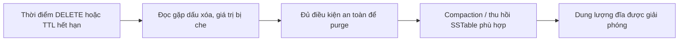
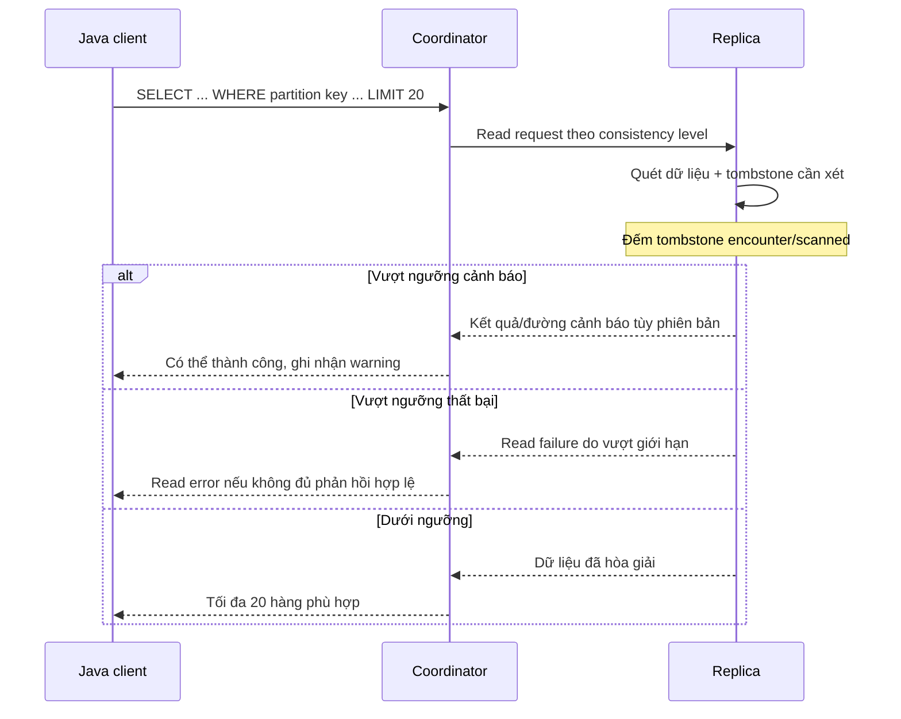

# Ngưỡng cảnh báo và thất bại khi đọc quá nhiều tombstone trong Apache Cassandra

## 1. Tại sao một truy vấn trả về ít hàng vẫn có thể thất bại?

Trong **Apache Cassandra**, lệnh `DELETE` thường không xóa dữ liệu ngay khỏi đĩa. Nó ghi một **tombstone** — dấu xóa có thông tin thời gian — để các replica biết giá trị cũ không còn hợp lệ. Dữ liệu có **TTL** cũng có thể trở thành dữ liệu hết hạn và được xử lý như tombstone trong đường đọc. Quá trình **compaction** về sau mới có cơ hội thu hồi dữ liệu đã hết hiệu lực khi thỏa điều kiện an toàn.

Giả sử một bảng có hàng triệu bản ghi cảm biến hết hạn. Ứng dụng yêu cầu:

```sql
SELECT event_time, payload
FROM iot_lab.events_by_device
WHERE device_id = 'sensor-42'
LIMIT 20;
```

Mặc dù client chỉ yêu cầu tối đa **20 hàng còn sống**, Cassandra có thể phải đi qua hàng chục nghìn hoặc hàng trăm nghìn dấu xóa/hết hạn trong quá trình tìm các hàng phù hợp. Số bản ghi **trả về** không phản ánh trực tiếp số mục **đã được quét**. Quá nhiều tombstone trong một lần đọc làm tăng CPU, I/O, độ trễ và có thể dẫn đến **cảnh báo** hoặc **lỗi đọc** khi vượt ngưỡng cấu hình.

Bài này thuộc chương **Tombstone và thu hồi** của mô-đun `DATABASE_ENGINE_WIDE_COLUMN_CASSANDRA`, liên hệ với kiến trúc phân tán, partition key, mô hình bảng theo truy vấn, CQL, replication, compaction, repair, vận hành sự cố và Java Driver. Trọng tâm là:

1. Hiểu `tombstone_warn_threshold` và `tombstone_failure_threshold`, và chúng đếm điều gì.
2. Biết vì sao `LIMIT`, TTL và một partition lớn có thể dẫn đến lỗi dù truy vấn có vẻ nhỏ.
3. Quan sát log, metrics, CQL và `nodetool` để khoanh vùng truy vấn/partition nóng.
4. Khắc phục bằng thiết kế truy vấn và vòng đời dữ liệu an toàn, **không** chỉ nâng ngưỡng để che lỗi.
5. Theo dõi phía ứng dụng Java, phân loại lỗi và kiểm chứng cải thiện theo SLO.

## 2. Tombstone xuất hiện và tồn tại thế nào?

### 2.1. Những nguồn tạo tombstone thường gặp

| Nguồn | Điều xảy ra về mặt logic | Lưu ý |
| --- | --- | --- |
| `DELETE` hàng/cột/partition | Tạo dấu xóa có timestamp để che dữ liệu cũ | Xóa nhiều hàng theo clustering range có thể tạo **range tombstone** |
| `USING TTL` hoặc `default_time_to_live` | Dữ liệu hết hạn sau thời gian cấu hình | TTL hết không đồng nghĩa lập tức giải phóng byte trên đĩa |
| Cập nhật kiểu collection, thao tác xóa phần tử | Có thể sinh tombstone tùy kiểu và thao tác | Các kiểu collection lớn và thay thế lặp nhiều lần thường đáng kiểm tra |
| Ghi `null` cho một cột trong ngữ cảnh CQL hỗ trợ | Thường mang ngữ nghĩa xóa giá trị | Phải phân biệt với việc không đưa cột vào statement |
| Xóa lặp theo batch/chu kỳ | Tích lũy dấu xóa ở vùng khóa thường đọc | Batch lớn không tự làm việc xóa rẻ hơn |

SSTable trong Cassandra là cấu trúc **bất biến**: một lệnh xóa không thể đi tới từng bản sao của giá trị cũ rồi sửa tại chỗ. Tombstone phải được lưu và truyền qua cơ chế đọc, ghi, repair để ngăn dữ liệu cũ từ replica chưa nhận được thao tác xóa “hồi sinh”.

### 2.2. Ba mốc không được nhầm



- **Bị xóa về mặt logic:** truy vấn đúng ngữ nghĩa không còn trả dữ liệu bị xóa.
- **Có thể thu hồi vật lý:** đã thỏa điều kiện thời gian và an toàn liên quan đến tombstone, SSTable khác, replica và chính sách repair.
- **Đã thu hồi vật lý:** compaction hoặc cơ chế thu hồi SSTable thực sự đã hoàn tất; dung lượng có thể còn bị snapshot/backup giữ lại.

`gc_grace_seconds` liên quan thời gian tối thiểu thường phải giữ dấu xóa trong các quy trình truyền thống để tránh dữ liệu zombie khi replica offline. Nó **không phải** “bộ hẹn giờ xóa file”, không có nghĩa cứ đúng mốc là byte biến mất. Các cơ chế an toàn thu hồi ở Cassandra phiên bản mới có thể có điều kiện bổ sung; luôn xác minh theo bản đang chạy.

## 3. Ngưỡng được áp dụng ở đâu trong đường đọc?

Cassandra đọc từ memtable và các SSTable có thể chứa partition/range yêu cầu; dữ liệu và tombstone được hòa giải theo timestamp/độ ưu tiên xóa. Khi một replica thực thi đường đọc, nó có thể phải quét nhiều tombstone dù số hàng sống trả về rất nhỏ.



Sơ đồ là **mô hình khái niệm**, không phải mọi pha giao thức/read repair của từng Cassandra release. Việc đếm và kiểm tra ngưỡng diễn ra trong quá trình xử lý đọc trên server/replica; kết quả cuối cùng tới client còn phụ thuộc version, replica, consistency level và khả năng thu thập đủ phản hồi.

### 3.1. Hai ngưỡng cần phân biệt

| Tên cấu hình thường gặp trong `cassandra.yaml` | Vai trò | Hành vi điển hình |
| --- | --- | --- |
| `tombstone_warn_threshold` | Mốc **cảnh báo** khi một đường đọc phải quét nhiều tombstone | Ghi warning server/client phù hợp; truy vấn **có thể vẫn thành công** |
| `tombstone_failure_threshold` | Mốc **ngừng/không chấp nhận** một phép đọc quét quá nhiều tombstone | Có thể phát sinh lỗi kiểu “too many tombstones” hoặc read failure |

Ở nhiều bản Cassandra 3.x/4.x, các giá trị tham chiếu thường thấy là **1.000** cho warning và **100.000** cho failure. Đây là **mốc minh họa lịch sử**, **không mặc định khẳng định cho phiên bản hoặc bản phân phối đang vận hành**. Hãy kiểm tra file cấu hình, tài liệu và tên khóa của release thực tế. Cơ chế đếm chi tiết (ví dụ tombstone cell, range marker, dữ liệu hết hạn) cũng có thể khác giữa các phiên bản; không tự quy đổi “100.000 tombstone” thành “100.000 câu DELETE”.

Ví dụ cấu hình để **đọc hiểu**, không phải hướng dẫn thay trực tiếp vào production:

```yaml
# Kiểm tra mặc định và tên option theo đúng phiên bản Cassandra.
tombstone_warn_threshold: 1000
tombstone_failure_threshold: 100000
```

Với hai giá trị này:

- Đường đọc quét ít hơn ngưỡng warning: thường không có cảnh báo riêng về số tombstone.
- Đường đọc quét vượt ngưỡng warning nhưng chưa đến mốc failure: có thể trả dữ liệu hợp lệ **kèm cảnh báo**; request chậm hoặc tốn tài nguyên vẫn cần được xử lý.
- Đường đọc vượt ngưỡng failure: Cassandra có thể chủ động **thất bại đọc** để ngăn truy vấn gây áp lực quá lớn lên node.

Kiểm tra ranh giới **`>` hay `>=`**, cách đếm, báo lỗi và cơ chế warning theo code/tài liệu đúng phiên bản; không dùng một ngưỡng như phép bảo đảm rằng truy vấn nằm ngay dưới ngưỡng sẽ nhanh và an toàn.

### 3.2. Đó là số lượng quét trong truy vấn, không phải tổng số tombstone của bảng

Hãy phân biệt:

| Chỉ số | Câu hỏi trả lời | Không nên suy ra |
| --- | --- | --- |
| Tombstone **được quét trong một read** | Một lần xử lý yêu cầu đã phải đi qua bao nhiêu dấu xóa? | Không phản ánh tổng dữ liệu đã xóa trên cả bảng |
| Tombstone **tồn tại trên đĩa** | Các SSTable đang giữ bao nhiêu dấu xóa/giá trị hết hạn? | Không có nghĩa mỗi truy vấn đều phải quét hết |
| Tombstone **đã purge** | Dấu xóa được loại vật lý nhờ compaction khi an toàn | Không nhất thiết giảm tỷ lệ lỗi đọc cho một truy vấn sai partition |
| Số **live rows trả về** | Ứng dụng nhận bao nhiêu hàng? | Không đại diện chi phí quét ở replica |

Một bảng chứa nhiều tombstone nhưng ứng dụng luôn đọc đúng một partition rất nhỏ có thể ít gặp warning. Ngược lại, một partition chứa nhiều dữ liệu đã hết hạn tại vùng thường đọc có thể gây cảnh báo dù tổng số tombstone toàn bảng không lớn.

## 4. Vì sao LIMIT hoặc paging không đảm bảo tránh ngưỡng?

Giả sử partition `sensor-42` chứa dữ liệu theo thời gian:

```text
Partition sensor-42, clustering theo event_time:
[expired][expired][expired] ... 80.000 mục ...
[deleted][deleted] ... 40.000 mục ...
[live][live] ... 20 mục ...
```

Một truy vấn `LIMIT 20` cần tìm đến **20 hàng sống** thỏa điều kiện. Nếu phần lớn mục nằm trước vùng dữ liệu sống đã bị xóa/hết hạn, engine vẫn có thể phải đi qua lượng tombstone rất lớn. Vài kết quả khác nhau:

| Cách viết | Điều giới hạn | Hạn chế |
| --- | --- | --- |
| `LIMIT 20` | Số hàng đáp ứng truy vấn được trả | Không giới hạn trực tiếp số tombstone cần xét |
| Paging/fetch size | Số hàng phân trang ở protocol/client | Không đảm bảo mỗi page chỉ quét số tombstone nhỏ |
| `WHERE` đủ partition key + clustering range hẹp | Giảm vùng dữ liệu cần tìm | Vẫn phải quét tombstone trong vùng tương ứng |
| Truy vấn qua nhiều partition hoặc `ALLOW FILTERING` | Có thể làm phạm vi quét rộng | Dễ khuếch đại chi phí, không phải cách chữa tombstone |
| `COUNT(*)` trên phạm vi lớn | Yêu cầu tính số lượng logic | Có thể quét nhiều dữ liệu/tombstone, thường không phù hợp OLTP |

**Thay đổi thứ tự clustering** hoặc lọc bằng clustering predicate chỉ hữu ích khi khớp cách ứng dụng thực sự truy vấn. Không thể dùng `ORDER BY` để thay tùy ý quy tắc phân vùng; Cassandra có giới hạn truy vấn theo partition và clustering key.

## 5. Một tình huống cụ thể: TTL trên partition không giới hạn

### 5.1. Thiết kế dễ gặp vấn đề

Ví dụ từ hệ thống lưu sự kiện:

```sql
-- Chạy trên keyspace lab; thay DC tương ứng với cluster của bạn.
CREATE KEYSPACE IF NOT EXISTS iot_lab
WITH replication = {
    'class': 'NetworkTopologyStrategy',
    'dc1': 3
};

CREATE TABLE IF NOT EXISTS iot_lab.events_by_device (
    device_id text,
    event_time timestamp,
    event_id uuid,
    payload text,
    PRIMARY KEY (device_id, event_time, event_id)
) WITH CLUSTERING ORDER BY (event_time DESC, event_id ASC)
  AND default_time_to_live = 604800;
```

TTL = **604.800 giây (7 ngày)**. Với schema này, **mọi sự kiện của cùng thiết bị** thuộc **một partition** vì `device_id` là partition key duy nhất. Một thiết bị phát dữ liệu liên tục trong nhiều tháng có thể tích lũy phạm vi lịch sử lớn, nhiều SSTable/phiên bản và dấu hết hạn. Dù TTL giới hạn số hàng **còn sống**, nó không tự bảo đảm partition vật lý nhỏ ngay lập tức.

Truy vấn có vẻ hợp lý nhưng nguy hiểm khi vùng mới nhất cũng chứa nhiều sự kiện hết hạn/xóa:

```sql
SELECT event_time, payload
FROM iot_lab.events_by_device
WHERE device_id = 'sensor-42'
LIMIT 20;
```

Ở giả định khác, nếu dữ liệu mới nhất luôn còn sống, truy vấn trên có thể trả nhanh. Bài học không phải “mọi `LIMIT` đều quét đến toàn bộ lịch sử”, mà là **cần đo đường đọc thực tế**. Nếu một ứng dụng thực hiện `SELECT` theo dải thời gian cũ hoặc xóa thường xuyên trong dải đang đọc, cùng partition đó dễ gây tombstone scan cao.

### 5.2. Minh họa ngưỡng bằng số giả định

Giả sử trên một replica, một lần đọc phải quét:

| Trường hợp | Tombstone đã quét | Live rows được trả | Kết quả có thể xảy ra với ngưỡng 1.000 / 100.000 |
| --- | ---: | ---: | --- |
| A | 120 | 20 | Dưới ngưỡng warning |
| B | 4.500 | 20 | Cảnh báo; có thể thành công |
| C | 125.000 | 3 | Lỗi đọc do vượt ngưỡng failure |

Các số là **giả định để giải thích**, không phải kết quả benchmark. Số quét tăng vì phân bố dữ liệu/tombstone, không chỉ vì lượng row trả về. Một read failure ở replica chưa chắc làm coordinator thất bại khi có nhiều replica và consistency level cho phép lấy đủ kết quả; ngược lại, tùy tình huống client có thể nhận lỗi mặc dù một replica khác có dữ liệu tốt. Vì thế phải xem **log theo node và mức consistency thực tế**.

## 6. Khắc phục từ mô hình bảng: chia partition theo ngày

Một cách tiếp cận cho sự kiện theo thời gian là bổ sung bucket ngày vào **partition key**:

```sql
CREATE TABLE IF NOT EXISTS iot_lab.events_by_device_day (
    device_id text,
    event_day date,
    event_time timestamp,
    event_id uuid,
    payload text,
    PRIMARY KEY ((device_id, event_day), event_time, event_id)
) WITH CLUSTERING ORDER BY (event_time DESC, event_id ASC)
  AND default_time_to_live = 604800
  AND compaction = {
      'class': 'TimeWindowCompactionStrategy',
      'compaction_window_unit': 'DAYS',
      'compaction_window_size': '1'
  };
```

Lúc này, `(device_id, event_day)` xác định partition. Truy vấn lấy sự kiện một ngày:

```sql
SELECT event_time, event_id, payload
FROM iot_lab.events_by_device_day
WHERE device_id = 'sensor-42'
  AND event_day = '2026-11-21'
  AND event_time >= '2026-11-21T08:00:00Z'
  AND event_time <  '2026-11-21T09:00:00Z'
LIMIT 100;
```

Điều kiện partition key đầy đủ và dải clustering `event_time` giảm phạm vi phải đọc. Nếu cần lấy nhiều ngày, ứng dụng **chủ động** thực hiện từng truy vấn partition theo ngày, gộp kết quả theo thứ tự mong muốn và áp giới hạn tải. Đừng cố giải quyết bằng `ALLOW FILTERING` trên toàn bộ bảng.

### Những điều phải cân nhắc trước khi chuyển schema

- **Kích thước partition:** nếu một thiết bị tạo hàng triệu sự kiện/ngày, bucket ngày vẫn có thể quá lớn; cần chia nhỏ theo giờ hoặc shard có kiểm soát, rồi xử lý fan-out đọc.
- **Đọc theo thời gian:** partition key mới đòi hỏi ứng dụng biết `event_day`; query theo `device_id` mà không có ngày sẽ không còn đúng.
- **TWCS không phải phép màu:** nó phù hợp dữ liệu chủ yếu append, TTL tương đồng, timestamp/lịch ghi hợp lý. Late arrivals, update dữ liệu cũ hoặc SSTable có nhiều thế hệ thời gian có thể làm giảm khả năng thu hồi tệp cũ.
- **Chuyển dữ liệu:** `CREATE TABLE` không tự di chuyển dữ liệu từ bảng cũ. Muốn migration phải có kế hoạch backfill, dual-write/cutover, tính nhất quán, kiểm thử và rollback.
- **TTL & repair:** vẫn phải có lịch repair hợp lệ và đủ disk headroom; không dùng bucket mới làm lý do tắt bảo vệ tombstone.

Với ứng dụng Java, batch nhiều sự kiện vào một partition khổng lồ hoặc ghi/xóa collection liên tục cũng có thể tạo đường đọc tốn kém; xem lại mô hình truy vấn và vòng đời dữ liệu trước khi chỉnh ngưỡng.

## 7. Chẩn đoán từ log, metrics và nodetool

### 7.1. Xác định truy vấn và replica nào quét nhiều tombstone

Khi nhận warning hoặc read failure:

1. Ghi **thời điểm, keyspace, table, CQL shape, consistency level, page size, timeout và số rows trả về**; giữ an toàn dữ liệu nhạy cảm.
2. Tìm log Cassandra tại **các replica liên quan** cùng khoảng thời gian. Cảnh báo thường nhắc số tombstone đã quét hoặc ngưỡng; thông điệp chính xác thay đổi theo release.
3. Tách lỗi **quá nhiều tombstone** khỏi timeout chung, unavailable replica, read repair, GC hoặc disk I/O bão hòa. Chỉ một stack trace `ReadFailure` chưa đủ chẩn đoán chắc chắn.
4. Đối chiếu log với **latency p95/p99**, GC, I/O, compaction backlog, partition size và thời điểm TTL/DELETE.
5. Ghi mẫu truy vấn và partition gặp lỗi; kiểm tra những partition không lỗi có cùng mô hình/TTL hay không.

Ví dụ thông báo **giả lập**, không phải định dạng cố định của Cassandra:

```text
WARN  ... Read scanned 8400 tombstones for
          iot_lab.events_by_device device_id=sensor-42
ERROR ... Tombstone read threshold exceeded: scanned=122000
```

Điều quan trọng là **giá trị quét**, **keyspace/table**, **câu truy vấn** và **node ghi log**. Không sao chép trực tiếp khóa thật, dữ liệu khách hàng hoặc nội dung request bí mật vào ticket công khai.

### 7.2. Lệnh quan sát đúng phạm vi

Chạy trên node được phép quan sát; các tên trường có thể khác giữa phiên bản Cassandra:

```bash
# Sức khỏe cluster và phân phối load.
nodetool status iot_lab

# SSTable count, dung lượng, latency và số tombstone/slice nếu phiên bản hỗ trợ.
nodetool tablestats iot_lab.events_by_device

# Phân phối kích thước partition và đọc/ghi; không phải histogram tombstone thay thế.
nodetool tablehistograms iot_lab events_by_device

# Độ trễ/queue và công việc compaction đang diễn ra.
nodetool compactionstats
nodetool tpstats
```

Các trường hữu ích trong `tablestats` ở nhiều phiên bản gồm **Average tombstones per slice (last five minutes)**, **Maximum tombstones per slice (last five minutes)**, **SSTable count**, **Space used (live)** và **Read latency**. Không đảm bảo mọi bản đều xuất đầy đủ hoặc cùng đơn vị; ghi rõ **phiên bản, tên field, khoảng thời gian, số mẫu**. Một metric trung bình thấp có thể che giấu một partition nóng có số tombstone quét rất cao; cần histogram/phân vị và log theo request.

Ở môi trường có JMX/Prometheus, tìm các metrics theo bảng như **TombstoneScannedHistogram** và **LiveScannedHistogram** (tên/đường dẫn JMX thay đổi theo release), cùng read latency, request failures và compaction. Chỉ số ở **server** không đồng nhất với latency đầu cuối từ Java client.

### 7.3. Tracing chọn lọc trong lab

Một truy vấn được tracing có thể giúp xem các bước đọc dữ liệu. Trên **cqlsh** trong môi trường lab:

```sql
TRACING ON;

SELECT event_time, payload
FROM iot_lab.events_by_device
WHERE device_id = 'sensor-42'
LIMIT 20;

TRACING OFF;
```

Tracing có overhead, có thể ghi nội dung truy vấn và thông tin phục vụ debug. **Không bật tracing đại trà dưới tải cao**. Tracing giúp quan sát hành vi query, nhưng không phải công cụ thay mọi log/metric; một lần trace tốt không phủ định việc p99 có spike hoặc lỗi chỉ xảy ra với một phân vùng khác.

## 8. Bốn nguyên nhân thường gây tombstone scan lớn

| Nguyên nhân | Mẫu triệu chứng | Bằng chứng cần tìm | Hướng xử lý |
| --- | --- | --- | --- |
| Partition rộng, dữ liệu hết hạn theo TTL | Scan một partition/cluster range lớn chậm, log tombstone nhiều | Kích thước partition, TTL, số SSTable, dải clustering | Chia partition theo thời gian/shard, hạn chế range |
| Xóa range hoặc nhiều row mỗi ngày | Sau job `DELETE`, cùng query trở nên chậm | Thời điểm job, range tombstone, số hàng xóa | Thiết kế vòng đời dữ liệu, xóa theo bucket/partition phù hợp |
| Truy vấn quét rộng/`ALLOW FILTERING` | p99 tăng theo quy mô bảng, số row trả về vẫn ít | Query shape, partition key thiếu, scan metrics | Thêm bảng phục vụ truy vấn đúng khóa, bỏ scan không kiểm soát |
| Tombstone chưa được purge vì compaction/repair | Đã hết TTL lâu nhưng SSTable vẫn giữ dấu xóa | `tablestats`, `compactionstats`, repair state, TTL/gc grace | Kiểm tra chiến lược compaction, an toàn purge, lịch repair |

Các nguyên nhân có thể đồng thời xuất hiện. Ví dụ job xóa hàng loạt tạo tombstone, query `COUNT(*)` quét rộng, trong khi compaction backlog cao do disk bão hòa. Nếu chỉ tăng `tombstone_failure_threshold`, có thể khiến truy vấn tiếp tục tiêu tốn tài nguyên lâu hơn và gây ảnh hưởng người dùng khác.

## 9. Cảnh báo so với lỗi đọc: tác động đến ứng dụng

Một **warning** nghĩa là server cho thấy đường đọc đắt; nó không nhất thiết gây exception ở client. Ngược lại, khi đạt điều kiện **read failure**, API có thể báo lỗi tùy vào phản hồi của replica và consistency level.

| Tình huống | Phản hồi CQL có thể gặp | Ứng dụng nên làm gì? |
| --- | --- | --- |
| Nhiều tombstone, dưới warning | Kết quả bình thường | Vẫn theo dõi p99, scan histogram, partition size |
| Trên warning, dưới failure | Kết quả vẫn có thể thành công; warning ở server/driver | Ghi lại cảnh báo, kiểm tra query/schema, ưu tiên sửa trước khi vượt failure |
| Replica vượt failure | Coordinator có thể trả read failure khi không đủ phản hồi hợp lệ | Giữ trace, phân loại lỗi; không retry vô hạn cùng query |
| Request timeout do I/O/GC | Timeout không nhất thiết do tombstone | Kiểm tra nguyên nhân, metrics, mạng, query và log |
| Chỉ một partition liên tục lỗi | Những request khác trên bảng vẫn thành công | Điều tra phân phối dữ liệu/key nóng, không chỉ average toàn bảng |

Đối với một request lỗi, tăng consistency level, giảm consistency level hay đổi coordinator **không phải biện pháp trị tombstone**. Chúng thay đổi mức đảm bảo và hành vi đọc; vấn đề chính là **khối lượng dữ liệu không hữu ích phải quét**.

### Có nên retry không?

Retry có thể hợp lý cho lỗi tạm thời khi đã biết giới hạn, nhưng đọc cùng một partition/range gây vượt ngưỡng tombstone thường **không tự khỏi** sau một lần retry. Hệ thống retry vô hạn hoặc đồng loạt có thể làm CPU/disk I/O tệ hơn. Thay vào đó:

1. Đặt giới hạn retry, backoff/jitter và circuit breaker phù hợp SLO.
2. Ghi rõ kết quả `read failure` hoặc `timeout`, không giả định “không có dữ liệu”.
3. Nếu sản phẩm cho phép, phân chia yêu cầu theo **khóa/range có nghĩa**, không tùy tiện bỏ qua các khoảng để trả kết quả thiếu mà không thông báo.
4. Sửa query và data model gốc; kiểm thử trên dữ liệu mô phỏng có mật độ tombstone tương tự production.

## 10. Mẫu Java Driver 4.x: đo và phân loại lỗi

Ví dụ dưới đây truy vấn partition theo ngày, cố định consistency level và thu thời gian đầu-cuối. Dùng Java 17+ cho text block; `CqlSession session` giả định đã được cấu hình với local DC và thông tin xác thực phù hợp.

```java
import com.datastax.oss.driver.api.core.DefaultConsistencyLevel;
import com.datastax.oss.driver.api.core.cql.BoundStatement;
import com.datastax.oss.driver.api.core.cql.PreparedStatement;
import com.datastax.oss.driver.api.core.cql.ResultSet;
import com.datastax.oss.driver.api.core.cql.Row;
import com.datastax.oss.driver.api.core.servererrors.ReadFailureException;
import com.datastax.oss.driver.api.core.servererrors.ReadTimeoutException;
import java.time.Instant;
import java.time.LocalDate;

PreparedStatement prepared = session.prepare("""
    SELECT event_time, event_id, payload
    FROM iot_lab.events_by_device_day
    WHERE device_id = ? AND event_day = ?
      AND event_time >= ? AND event_time < ?
    LIMIT 100
    """);

BoundStatement statement = prepared.boundStatementBuilder()
    .setString(0, "sensor-42")
    .setLocalDate(1, LocalDate.of(2026, 11, 21))
    .setInstant(2, Instant.parse("2026-11-21T08:00:00Z"))
    .setInstant(3, Instant.parse("2026-11-21T09:00:00Z"))
    .setConsistencyLevel(DefaultConsistencyLevel.LOCAL_QUORUM)
    .build();

long start = System.nanoTime();
try {
    ResultSet rs = session.execute(statement);
    int rows = 0;
    for (Row row : rs) {
        rows++;
    }
    long latencyNs = System.nanoTime() - start;
    // Ghi latency histogram, rows, table, shape, request-id, CL.
} catch (ReadFailureException error) {
    // Lỗi read failure: kiểm tra logs để phân biệt tombstone với nguyên nhân khác.
    long latencyNs = System.nanoTime() - start;
    // Ghi request-id, error type, coordinator, key đã ẩn danh, latencyNs.
    throw error;
} catch (ReadTimeoutException error) {
    long latencyNs = System.nanoTime() - start;
    // Timeout KHÔNG tự chứng minh vượt tombstone_failure_threshold.
    throw error;
}
```

Đo cả request thành công và thất bại; chú ý việc duyệt toàn bộ `ResultSet` có thể kích hoạt paging, làm thời gian đo khác với chỉ gọi `.one()`. Với số liệu production, kết hợp histogram của Java Driver, slow query logs, metrics Cassandra và mốc thời gian đã đồng bộ. Mẫu code là lõi minh họa, chưa bao gồm hàm main, vòng đời session, bảo mật PII hoặc nền tảng metrics.

**Lưu ý:** lớp lỗi cụ thể phụ thuộc đường phản hồi Cassandra/driver. Thấy `ReadFailureException` không đủ kết luận tombstone là nguyên nhân; phải ghép với server log/metrics. Không đưa mọi lỗi đọc vào cùng nhãn “tombstone failure”.

## 11. Tăng threshold: giải pháp cuối cùng có kiểm soát, không phải chữa nguyên nhân

Hai khóa cấu hình là **cơ chế tự vệ** của node. Tăng failure threshold có thể cho phép một phép đọc tiếp tục quét khối lượng lớn, đồng thời **khuếch đại độ trễ và tác động tài nguyên** trong một cụm đang có tải. Giảm ngưỡng quá mạnh lại có thể tạo lỗi cho truy vấn hợp lệ vốn đắt nhưng vẫn phù hợp SLO.

Quy trình xem xét thay đổi threshold, nếu thực sự cần:

1. **Chứng minh nguyên nhân:** thu log “scanned tombstones”, histogram và query shape; phân biệt cảnh báo do scan với lỗi hạ tầng khác.
2. **Sửa ưu tiên cao:** giảm phạm vi scan bằng partition/range hẹp; kiểm tra TTL, xóa dữ liệu, compaction backlog và repair. Đo lại trước khi quyết định đổi ngưỡng.
3. **Xác định rủi ro:** mô phỏng tải song song với các truy vấn nặng; ghi CPU, GC, disk I/O, p95/p99, timeout, free disk và áp lực replica.
4. **Nếu điều chỉnh:** chọn giá trị có luận cứ, giới hạn phạm vi/tải/cửa sổ bảo trì, áp dụng đồng nhất theo kế hoạch của **đúng phiên bản**. Kiểm tra yêu cầu restart hoặc dynamic reconfiguration của release đang chạy.
5. **Theo dõi và rollback:** đặt SLO và điều kiện rollback nếu tail latency, disk/CPU hoặc read failure của workload khác tăng; ghi lại cấu hình trước/sau.

**Không** khuyên tắt hẳn chốt bảo vệ hoặc tăng lên giá trị cực lớn để “hết lỗi”. Đó chỉ là chuyển một truy vấn nguy hiểm từ lỗi sớm sang yêu cầu tiêu thụ tài nguyên kéo dài. Mốc warning nên được xem là **tín hiệu sớm để điều tra**, không phải “nhiễu log” cần xóa bằng cách tăng tùy tiện.

## 12. Compaction, gc_grace_seconds và repair: cải thiện mà không tạo zombie

### 12.1. Vì sao compaction có thể giúp?

Khi các SSTable chứa bản ghi bị xóa/hết hạn được hợp nhất, engine có thể loại phiên bản cũ và tombstone **đủ điều kiện an toàn**, qua đó giảm dữ liệu phải quét. Tuy nhiên:

- Không phải mọi SSTable đều được chọn cùng lúc; chiến lược STCS, LCS, TWCS/UCS quyết định nhóm ưu tiên.
- Một tombstone có thể vẫn cần giữ vì SSTable khác không được gộp chứa dữ liệu bị che.
- Tệp repaired/unrepaired/pending repair có thể nằm ở các nhóm compaction khác nhau.
- Dung lượng chỉ được giải phóng khi tệp cũ không còn tham chiếu và các snapshot/backup liên quan được xử lý đúng chính sách.

Không chạy `nodetool compact` hay major compaction tùy tiện trên production với kỳ vọng “xóa sạch tombstone”. Thao tác lớn có thể tạo tải I/O, cần dung lượng tạm và, với bảng TWCS, có thể làm xấu cách tổ chức cửa sổ thời gian.

### 12.2. Vì sao không đặt gc_grace_seconds = 0 theo phản xạ?

Ví dụ hai replica A, B giữ giá trị cũ; B offline lúc A nhận DELETE. Nếu tombstone trên A bị purge quá sớm, B quay lại mang giá trị cũ mà không thấy dấu xóa để đối chiếu; đó là nguy cơ **zombie data**. Trong các mô hình cần repair định kỳ, chu kỳ repair và thời gian replica offline phải tương thích với khoảng giữ tombstone. Các chức năng an toàn mới có thể thay đổi điều kiện cụ thể, nhưng **không được suy đoán từ thông số đơn lẻ**.

Nếu muốn giảm thời gian giữ tombstone, cần đánh giá phiên bản Cassandra, cơ chế repair đầy đủ, trạng thái replica, compaction strategy và ngữ nghĩa xóa. Chỉ thay tham số sau khi có quy trình review, backup, đo lường và hiểu rủi ro.

### 12.3. TWCS hữu ích khi nào?

Với dữ liệu time-series chủ yếu append, TTL tương đồng và timestamp phù hợp, **TimeWindowCompactionStrategy** nhóm dữ liệu theo cửa sổ thời gian. Khi toàn bộ một SSTable thật sự hết hạn và đủ điều kiện, Cassandra có thể thu hồi tệp hiệu quả hơn. Nhưng TWCS không loại bỏ ngay mọi tombstone và không sửa được một truy vấn thiếu partition key. Ghi muộn, cập nhật dữ liệu cũ và timestamp trải nhiều cửa sổ có thể làm giảm lợi ích của TWCS.

## 13. Runbook khắc phục sự cố trong production

| Bước | Việc thực hiện | Bằng chứng cần lưu |
| --- | --- | --- |
| 1. Xác nhận | Tìm log warning/error cụ thể liên quan tombstone, ghi phiên bản và cấu hình hai ngưỡng | Timestamp, node, keyspace/table, scanned count |
| 2. Khoanh phạm vi | Nhóm lỗi theo query shape, partition key/hot key, clustering range, CL | Request-id, metrics, tỷ lệ affected requests |
| 3. Kiểm tra tài nguyên | Đối chiếu CPU, heap/GC, disk I/O, compaction backlog, read p99 | Timeseries theo node và DC |
| 4. Giảm áp lực | Giới hạn concurrency/retry của query xấu, dùng query đúng partition/range, kích hoạt fallback nếu sản phẩm cho phép | SLO, error rate và throughput sau giảm tải |
| 5. Sửa gốc | Đánh giá TTL/delete pattern, partition size, TWCS/compaction, data model và repair | Kế hoạch migration/test/rollback |
| 6. Kiểm chứng | Chạy lại cùng workload; so tombstone scanned, p95/p99, timeout, tài nguyên | Before/after, raw logs và metrics |

### Dấu hiệu cần ưu tiên hành động

- Warning lặp tăng nhanh trên một vài partition nóng, đặc biệt kèm p99 và CPU tăng.
- Lỗi read failure có thông điệp tombstone rõ ràng; request chỉ trả vài row nhưng replica quét hàng chục nghìn dấu xóa.
- Compaction backlog và số SSTable tăng, disk free giảm mạnh, query lỗi tăng theo thời gian.
- Một job xóa dữ liệu hoặc đổi TTL làm thay đổi đột ngột tỷ lệ cảnh báo.

### Những biện pháp không nên coi là khắc phục

- Tăng `LIMIT` hoặc dùng paging nhỏ để mong engine bỏ qua tombstone.
- Dùng `ALLOW FILTERING` hoặc `COUNT(*)` trên bảng lớn để “kiểm tra nhanh”.
- Retry vô hạn cùng query và xóa/khôi phục cùng một partition liên tục.
- Giảm consistency level mà không hiểu yêu cầu đọc của nghiệp vụ.
- Xóa file SSTable thủ công hoặc đặt `gc_grace_seconds = 0` để ép tombstone biến mất.
- Nâng failure threshold thật cao rồi tuyên bố lỗi đã được giải quyết.

## 14. Thực hành trong lab và tiêu chí đánh giá

**Lab đề xuất:**

1. Tạo bảng `events_by_device` và `events_by_device_day` như ví dụ, điều chỉnh `dc1` và RF cho cụm test; không thử trên dữ liệu khách hàng.
2. Viết bộ nạp test tạo số lượng sự kiện đủ lớn, một nhóm partition có TTL ngắn/xóa nhiều, một nhóm đối chứng còn nguyên dữ liệu. Ghi tổng số row trước khi hết hạn.
3. Sau thời điểm TTL hết hạn, chạy `SELECT` với cùng `LIMIT` nhưng thay phạm vi partition và clustering range. Đo client p50/p95/p99, rows returned, warnings/errors, server tombstone histogram và CPU.
4. So truy vấn trên partition dài với truy vấn bucket ngày; **giữ tải, consistency level, dữ liệu logic và môi trường tương đương** ở mức có thể. Phân tích vì sao số row trả về tương tự nhưng số mục quét khác.
5. Quan sát `nodetool tablestats`, `compactionstats` và log trước/sau khi compaction nền chạy. Đừng ép thao tác nặng chỉ để có biểu đồ; việc chưa purge phải được lý giải bằng thời gian/điều kiện an toàn.
6. Thử tăng offered load/concurrency có giới hạn trong lab để hiểu tác động warning/failure, không chỉnh threshold để tạo lỗi trên production.

**Mẫu bảng kết quả** (điền số đo thực tế, không dùng số mẫu giả lập làm kết quả):

| Cấu hình | Read p99 | Tombstones scanned p95/p99 | Warning/s | Read failure/s | CPU/disk |
| --- | --- | --- | --- | --- | --- |
| Partition dài + TTL, read rộng | … | … | … | … | … |
| Partition dài + clustering range hẹp | … | … | … | … | … |
| Partition theo ngày + time range | … | … | … | … | … |

Nếu histogram tombstone không xuất được phân vị như yêu cầu, ghi tên metric và cửa sổ thực tế, không tự bịa p95/p99. Một phương án khắc phục chỉ có ý nghĩa khi **giảm khối lượng tombstone bị quét hoặc tác động tới SLO**, chứ không chỉ làm biến mất thông báo warning.

## 15. Câu hỏi tự kiểm tra

1. Vì sao `SELECT ... LIMIT 20` vẫn có thể gặp `tombstone_failure_threshold`?
2. `tombstone_warn_threshold` và `tombstone_failure_threshold` khác nhau về mục đích và tác động tới client ra sao?
3. Trong bảng 100 triệu row, số tombstone toàn bảng lớn có đủ kết luận mọi truy vấn đều chậm hay không?
4. Sau khi TTL hết hạn, tại sao byte SSTable chưa chắc giảm và warning chưa chắc biến mất ngay?
5. Những nguyên nhân nào ngoài tombstone có thể tạo `ReadTimeoutException` hoặc `ReadFailureException`?
6. Vì sao đổi partition key từ `device_id` sang `(device_id, event_day)` có thể giúp giảm phạm vi quét?
7. Có nên đặt `gc_grace_seconds = 0` để loại tombstone nhanh? Điều kiện an toàn nào cần xét?
8. Vì sao TWCS có thể tốt cho time-series TTL nhưng kém hiệu quả nếu có dữ liệu tới muộn hoặc cập nhật lịch sử?
9. Khi một truy vấn bắt đầu vượt warning nhưng chưa failure, cần lưu những metrics/log gì để hành động trước?
10. Vì sao tăng failure threshold có thể biến một lỗi dễ nhận diện thành vấn đề tài nguyên lớn hơn?

## 16. Kết luận

**Ngưỡng cảnh báo/thất bại tombstone là giới hạn bảo vệ đường đọc của Cassandra**, gắn với **số tombstone mà replica phải quét để thực hiện yêu cầu**, không phải chỉ với số hàng trả về hoặc tổng số dấu xóa trong bảng. `tombstone_warn_threshold` là tín hiệu sớm cho truy vấn tốn kém; `tombstone_failure_threshold` có thể chặn phép đọc quá nặng. Cả hai cần được hiểu theo **phiên bản và cấu hình thực tế**.

Giải pháp bền vững là **mô hình partition/clustering theo truy vấn, phạm vi đọc đủ hẹp, TTL/delete phù hợp, compaction và repair an toàn**, kết hợp log/metrics và SLO từ ứng dụng Java. **Đừng coi nâng ngưỡng hoặc xóa tombstone sớm là phương án thay cho sửa đường đọc gây quá tải.**
