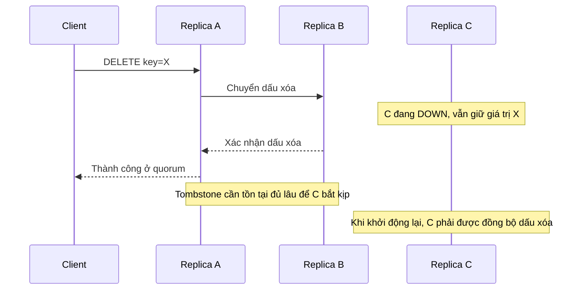
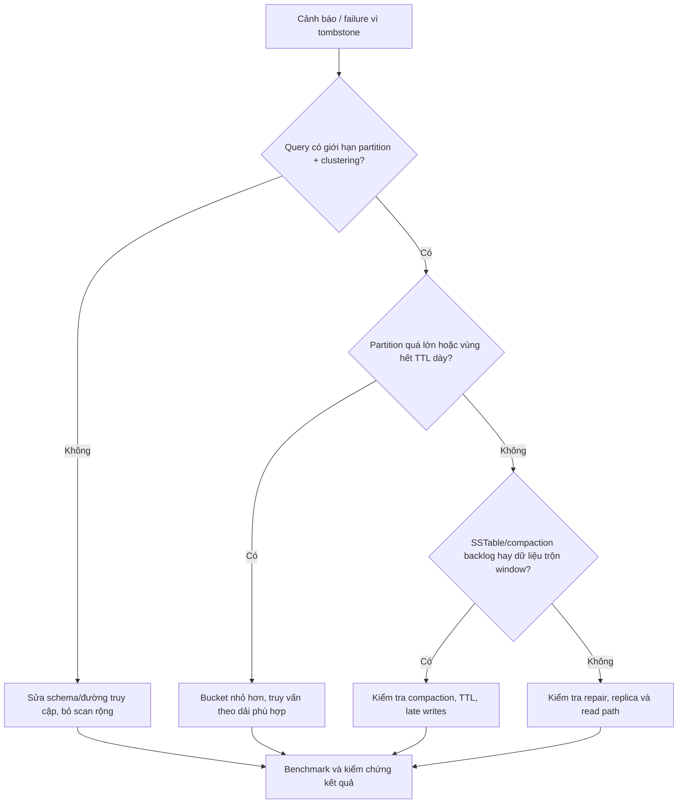

# Giới hạn điều chỉnh gc_grace hoặc ngưỡng đọc để xử lý triệu chứng

Một truy vấn Apache Cassandra có thể trả về rất ít hàng nhưng vẫn phải đi qua hàng nghìn hoặc hàng triệu **tombstone** (dấu xóa). Khi thấy cảnh báo tombstone hoặc lỗi truy vấn đọc bị từ chối, hai phản ứng hấp dẫn là **giảm `gc_grace_seconds`** để “xóa nhanh” và **tăng ngưỡng cảnh báo/thất bại khi đọc** để “cho truy vấn chạy tiếp”. Cả hai chỉ tác động đến một phần cơ chế, có thể che giấu lỗi thiết kế bảng và thậm chí làm dữ liệu đã xóa **xuất hiện trở lại** nếu đồng bộ replica không an toàn.

Bài thuộc chương **Tombstone và thu hồi** trong mô-đun **DATABASE_ENGINE_WIDE_COLUMN_CASSANDRA**. Trọng tâm là giới hạn của việc thay tham số như cách chữa triệu chứng, điều kiện an toàn khi thu hồi tombstone, cách chẩn đoán từ CQL và metrics, và giải pháp lâu dài qua **khóa phân vùng, thiết kế bảng theo truy vấn, TTL, compaction, repair, replication và ứng dụng Java**.

## 1. Mục tiêu học tập

Sau bài này, bạn có thể:

1. Giải thích tombstone phát sinh từ `DELETE`, TTL hết hạn và các thao tác thay thế dữ liệu; phân biệt **xóa logic** với **thu hồi vật lý**.
2. Phân tích vì sao tombstone phải được giữ một thời gian khi Cassandra sao chép dữ liệu bất đồng bộ qua nhiều replica.
3. Xác định những điều kiện để giảm `gc_grace_seconds` an toàn và cơ chế **zombie data** khi tombstone bị loại sớm.
4. Phân biệt `tombstone_warn_threshold` và `tombstone_failure_threshold` với các giải pháp thật sự giảm lượng dữ liệu được quét.
5. Sử dụng truy vấn CQL, `nodetool`, tracing và metrics để tìm partition/query gây quét tombstone.
6. Đề xuất sửa **schema, partitioning, đường truy vấn, TTL, chiến lược compaction và lịch repair** theo nguyên nhân.
7. Thiết kế thử nghiệm lab có đối chứng và checklist thay đổi cấu hình có tiêu chí đo/rollback rõ ràng.

## 2. Tombstone là gì và vì sao không thể xóa ngay?

Cassandra dùng mô hình ghi theo LSM: ghi mới vào memtable, flush thành SSTable bất biến. Khi cần xóa một hàng, một phần của partition hoặc một khoảng clustering key, Cassandra thường không tìm và xóa ngay mọi bản sao cũ trong tất cả SSTable/replica. Thay vào đó, nó ghi **tombstone** mang thông tin thời điểm xóa; đường đọc phối hợp giá trị và tombstone để không trả về dữ liệu đã bị xóa.

Tombstone cũng xuất hiện khi dữ liệu **TTL hết hạn**. Bản ghi hết hạn có thể không còn hiện trong SELECT từ thời điểm hết hiệu lực, nhưng phần dữ liệu vật lý và thông tin xóa vẫn có thể tồn tại trong SSTable cho tới khi đủ điều kiện được thu hồi.

| Khái niệm | Cách hiểu đúng |
| --- | --- |
| **Live cell/row** | Dữ liệu còn hiệu lực theo quy tắc timestamp, TTL và tombstone mà lượt đọc quan sát được. |
| **Tombstone** | Dấu xóa logic, có thể áp dụng cho cell, row, partition hoặc dải clustering key; dùng để che giá trị cũ. |
| **TTL expiration** | Thời điểm dữ liệu hết hiệu lực về mặt logic. Không có nghĩa dung lượng đĩa được thu hồi ngay. |
| **`gc_grace_seconds`** | Khoảng thời gian an toàn tối thiểu trong chính sách thu hồi tombstone thông thường; phải kết hợp tình trạng replica, repair và điều kiện compaction. |
| **Compaction** | Hợp nhất SSTable và có thể loại tombstone/dữ liệu đã che khi đủ điều kiện an toàn. |
| **Repair** | Đối chiếu dữ liệu giữa replica để chúng nhận được các mutation/xóa còn thiếu. |
| **Tombstone scan** | Công việc đường đọc làm khi duyệt các dấu xóa để xác định hàng còn sống. Có thể tốn kém dù kết quả SELECT ít hàng. |

Một DELETE tạo tombstone **không làm thu nhỏ SSTable tại chỗ**. Đồng thời, tombstone chưa đủ tuổi grace không nhất thiết bị *bỏ qua* trong truy vấn: nó vẫn được dùng để loại dữ liệu đã xóa khỏi kết quả. Vì vậy, giảm thời gian giữ tombstone không có tác dụng “ẩn tombstone khỏi SELECT ngay lập tức”.

### Ví dụ bảng theo thời gian

Ứng dụng ghi sự kiện của mỗi tenant và muốn lấy 100 sự kiện mới nhất:

```sql
CREATE KEYSPACE IF NOT EXISTS tombstone_lab
WITH replication = {
  'class': 'NetworkTopologyStrategy',
  'dc1': 3
}
AND durable_writes = true;

CREATE TABLE IF NOT EXISTS tombstone_lab.events_by_tenant_day (
  tenant_id text,
  event_day date,
  occurred_at timestamp,
  event_id uuid,
  payload text,
  PRIMARY KEY ((tenant_id, event_day), occurred_at, event_id)
) WITH CLUSTERING ORDER BY (occurred_at DESC, event_id DESC)
  AND default_time_to_live = 604800
  AND gc_grace_seconds = 864000
  AND compaction = {
    'class': 'TimeWindowCompactionStrategy',
    'compaction_window_unit': 'DAYS',
    'compaction_window_size': '1'
  };
```

Ví dụ dùng **dc1 có đủ ba nút** và RF = 3; đổi RF cho đúng môi trường lab nếu khác. TTL bảy ngày, grace mười ngày và window một ngày chỉ là **giá trị minh họa**, chưa phải thông số tối ưu. Tên `event_day` giúp định vị partition phục vụ truy vấn một tenant/ngày, nhưng với lưu lượng cực lớn vẫn cần bucket nhỏ hơn để tránh partition quá rộng. Chỉ sử dụng cấu hình này trong lab trước khi đánh giá TTL, late writes và repair của workload thực tế.

```sql
CONSISTENCY LOCAL_QUORUM;

INSERT INTO tombstone_lab.events_by_tenant_day
  (tenant_id, event_day, occurred_at, event_id, payload)
VALUES (
  'tenant-a', '2026-11-21', '2026-11-21T08:05:00+0000',
  11111111-1111-4111-8111-111111111111, 'temperature=37'
);

SELECT occurred_at, event_id, payload
FROM tombstone_lab.events_by_tenant_day
WHERE tenant_id = 'tenant-a'
  AND event_day = '2026-11-21'
LIMIT 100;
```

Ngày tháng chỉ nhằm minh họa một partition được truy vấn; TTL bắt đầu từ thời điểm **ghi thực tế**, không phải từ giá trị `event_day` do ứng dụng truyền. Để kiểm thử TTL trên dữ liệu mới trong lab, dùng ngày hiện hành của môi trường hoặc một bảng không đặt TTL mặc định rồi cấp TTL ngắn cho từng lệnh.

## 3. Tại sao tombstone còn cần thiết sau khi một replica đã xóa?

Giả sử ba replica A, B, C giữ cùng partition; consistency level `LOCAL_QUORUM` cho RF = 3 cần hai phản hồi trong DC cục bộ.



Đây là ví dụ logic, không phải mô tả cố định từng hop của giao thức mạng. **Replica C chưa nhận DELETE** vẫn có thể giữ giá trị cũ. Tombstone trên A/B phải còn trong hệ thống cho đến khi C bắt kịp qua **hinted handoff, repair hoặc cơ chế đồng bộ phù hợp**.

### Timeline hình thành zombie data

| Thời điểm | Replica A và B | Replica C | Điều cần hiểu |
| --- | --- | --- | --- |
| `t0` | Có giá trị X | Có X | Ba replica đồng thuận về dữ liệu ban đầu. |
| `t1` | Nhận DELETE X, giữ tombstone | Đang down, còn X | Quorum có thể xác nhận xóa, nhưng chưa phải tất cả replica. |
| `t2` | Hết grace; sau đó compaction **thật sự loại** tombstone | Vẫn down, còn X | Bằng chứng “X đã bị xóa” có thể mất trên A/B. |
| `t3` | Không còn dấu xóa để áp đảo X | C trở lại với X cũ | Repair/read path về sau có nguy cơ lan giá trị X trở lại. |

**Zombie data** là bản ghi từng bị xóa nhưng lại xuất hiện vì replica giữ bản cũ sau khi tombstone cần thiết đã được loại khỏi các replica khác. Grace hết hạn **chưa đủ** để khẳng định zombie sẽ xảy ra: còn phụ thuộc compaction, dữ liệu/metadata thực tế và tiến trình đồng bộ. Nhưng hạ grace làm **thu hẹp cửa sổ bảo vệ**, tăng khả năng xảy ra tình huống trên.

Hệ quả:

- RF cao không tự giải quyết nếu một replica có thể offline lâu hơn thời gian giữ tombstone.
- Một lần `nodetool status` thấy tất cả nút `UN` **không chứng minh** dấu xóa đã hội tụ.
- Hinted handoff có thời hạn và điều kiện; **không thể thay repair** trong lịch bảo vệ tombstone dài hạn.
- Repair thực hiện **sau khi dấu xóa đã bị loại ở mọi nguồn** có thể quá muộn để biết giá trị cũ cần xóa.

## 4. `gc_grace_seconds` thật sự kiểm soát điều gì?

`gc_grace_seconds` là cấu hình theo **bảng**, tính bằng giây, được dùng trong quyết định thời điểm tombstone có thể được loại khi compaction có đủ thông tin an toàn. Trong mô hình thông thường, tombstone cần vượt thời gian grace tính theo metadata xóa/expiry tương ứng; việc loại còn chịu điều kiện về overlap SSTable và chiến lược compaction.

```text
Lệnh DELETE hoặc dữ liệu TTL hết hạn
         ↓
Đã xóa logic: SELECT không trả dữ liệu cũ hợp lệ
         ↓
Tombstone còn trong memtable/SSTable để bảo vệ replica trễ
         ↓
Hết thời gian grace (điều kiện cần, không phải nút bấm xóa)
         ↓
Compaction/thu hồi xét các SSTable có liên quan và điều kiện an toàn
         ↓
Tombstone + dữ liệu đã bị che có thể được loại vật lý
```

### Các giới hạn thường bị hiểu sai

1. **Giảm grace không tự chạy compaction.** Nếu không có compaction phù hợp, tombstone vẫn nằm trong SSTable và truy vấn vẫn có thể quét qua nó.
2. **Đã hết grace chưa chắc được thu hồi.** File khác còn dữ liệu chồng lấn, bản ghi chưa hết hạn, cấu trúc level/window và yêu cầu giữ tombstone có thể cản việc loại.
3. **Giảm grace không thay đổi số hàng truy vấn phải kiểm tra ngay lập tức.** Partition lớn, `ALLOW FILTERING` hoặc quét dải clustering nhiều bản ghi đã hết TTL vẫn có thể gây warnings.
4. **Grace không tự sửa thiếu repair.** Nếu một replica vắng mặt trong thời gian dài và không nhận tombstone trước khi chúng bị dọn, rủi ro zombie tăng.
5. **Grace không đồng nghĩa retention.** TTL quyết định khi nào dữ liệu hết hiệu lực logic; grace/compaction ảnh hưởng khi nào chiếm dụng đĩa được thu hồi.
6. **Cùng một giá trị grace không phù hợp mọi hệ thống.** Cần biết thời gian outage tối đa, khả năng thực hiện repair, backup/restore, kiểu xóa và SLA.
7. **Grace không bảo đảm xóa bí mật vật lý đúng hạn.** Muốn đáp ứng yêu cầu xóa dữ liệu theo thời gian, cần quy trình xóa/bảo vệ bản backup và xác nhận storage lifecycle.

Giá trị thường thấy là **864000 giây (10 ngày)**, nhưng cần kiểm tra **Cassandra version và cấu hình thực tế của bảng**; không suy mặc định cho mọi bản phân phối hoặc dịch vụ managed. Hạ `gc_grace_seconds` xuống `0` là thay đổi nhạy cảm với tính đúng đắn ở cụm nhiều replica; không dùng như cách tối ưu mặc định cho bảng có DELETE/UPDATE hoặc replica có thể offline.

### Khi cân nhắc giảm grace, cần chứng cứ gì?

- **Bản đồ replica và miền lỗi**: RF, số DC/rack, cách chọn consistency cho đọc và ghi, thời gian node có thể mất liên lạc.
- **Lịch repair thực sự thành công**: không chỉ cấu hình lịch; có bằng chứng repair bao phủ dữ liệu cần thiết, trạng thái failed/pending, khoảng cách giữa hai lần thành công.
- **Thời gian outage và khôi phục**: trường hợp xấu nhất gồm phát hiện sự cố, thay node, bootstrap/rebuild và thời gian bắt kịp dữ liệu.
- **Kiểu dữ liệu/xóa**: TTL đồng nhất hay phân tán, DELETE thủ công, update cùng khóa, clock skew và backfill; snapshot/restore có thể đưa dữ liệu cũ vào hệ thống.
- **Khả năng đánh giá trước thay đổi**: thử nghiệm lab, runbook khôi phục, số liệu tombstone scans, bytes reclaimed, latency và cơ chế rollback.

Một bất biến cần bảo đảm là **mọi replica có thể quay lại phục vụ đều phải bắt kịp thông tin xóa trước khi các bản sao còn lại mất dấu xóa cần thiết**. Không nên biến nó thành công thức máy móc “grace = chu kỳ repair”: phải chừa biên cho job lỗi, node offline, streaming và thời gian thực thi.

## 5. Ngưỡng đọc tombstone: cảnh báo và chặn truy vấn

Cassandra có các cấu hình như **`tombstone_warn_threshold`** và **`tombstone_failure_threshold`** trong `cassandra.yaml`, với tên, phạm vi áp dụng và cách khởi động lại tùy phiên bản. Chúng giới hạn/cảnh báo lượng tombstone **được quét trong read path**, không điều khiển lúc dữ liệu được xóa khỏi SSTable.

| Tham số | Mục đích | Việc tăng nó **không** làm |
| --- | --- | --- |
| `tombstone_warn_threshold` | Phát cảnh báo khi một lượt đọc trên node phải xét quá nhiều tombstone. | Không làm giảm số tombstone, CPU/I/O, read amplification hay thời gian đọc. |
| `tombstone_failure_threshold` | Bảo vệ node bằng cách từ chối một lượt đọc quét tombstone quá mức. | Không sửa schema, dữ liệu hoặc consistency; chỉ cho phép truy vấn tốn tài nguyên đi xa hơn trước khi bị chặn. |

Một số bản Cassandra thường cấu hình **warning ở khoảng 1.000** và **failure ở khoảng 100.000 tombstone được quét**; đây là giá trị **tham khảo để hình dung**, không phải chuẩn bắt buộc. Cần đối chiếu phiên bản đang chạy, log thực tế và tài liệu cấu hình trước khi định nghĩa ngưỡng. Hệ thống có thể trả cảnh báo cho client/log, hoặc phát lỗi đọc liên quan tombstone/timeout; tên exception thay đổi theo driver và phiên bản.

### Vì sao tăng ngưỡng chưa chữa được bệnh?

Giả sử một truy vấn quét qua 150.000 tombstone để tìm được 5 hàng còn sống:

```text
Trước điều chỉnh:
    LIMIT 5 → quét 150.000 tombstone → vượt ngưỡng, đọc bị chặn.

Sau điều chỉnh failure threshold cao hơn:
    LIMIT 5 → vẫn phải quét 150.000 tombstone.
    Có thể trả 5 hàng nếu đủ CPU/I/O/time budget,
    nhưng cũng có thể timeout, tăng GC hoặc làm chậm truy vấn khác.
```

**`LIMIT 5` giới hạn hàng trả về**, không có nghĩa Cassandra chỉ kiểm tra năm mục dữ liệu. Query cần vượt qua các hàng đã bị xóa để tìm hàng sống. Tăng ngưỡng thất bại có thể thay lỗi “quét quá nhiều tombstone” bằng **read timeout**, tail latency cao hoặc áp lực tài nguyên chung.

### Hai cài đặt hoàn toàn độc lập

| Điều chỉnh | Tác động chính | Rủi ro nếu coi là fix lâu dài |
| --- | --- | --- |
| **Giảm `gc_grace_seconds`** | Cho phép một số tombstone đủ điều kiện loại sớm hơn **khi compaction phù hợp diễn ra**. | **Zombie/resurrection**, mất dấu xóa khi replica hồi phục muộn. |
| **Tăng warning threshold** | Ít cảnh báo được phát hơn. | Giảm khả năng phát hiện query/schema đang xấu đi. |
| **Tăng failure threshold** | Cho phép read quét qua nhiều tombstone hơn trước khi bị chặn. | CPU, I/O, GC, timeout, ảnh hưởng node/tenant khác; triệu chứng vẫn còn. |
| **Giảm TTL hoặc áp dụng DELETE hàng loạt** | Dữ liệu hết hạn logic sớm hơn hoặc tạo tombstone nhiều hơn. | Có thể **tăng** lượng tombstone bị quét trong giai đoạn chuyển tiếp. |
| **Ép major compaction** | Cố gắng gom SSTable thành file mới. | I/O và dung lượng tạm lớn, không đảm bảo drop tombstone an toàn; có thể làm xấu chiến lược TWCS. |

Nếu có tình huống khẩn cấp cần chỉnh ngưỡng để một số truy vấn quan trọng tiếp tục chạy, đây là **biện pháp giảm tác động ngắn hạn có giới hạn**, phải có đánh giá sức chịu tải, thay đổi được kiểm soát, đo p95/p99, thời điểm hết hiệu lực biện pháp và kế hoạch giải quyết gốc rễ. Tuyệt đối không nâng ngưỡng vô hạn hoặc tắt cảnh báo mà không có giám sát.

## 6. Vì sao chỉ một truy vấn có thể quét rất nhiều tombstone?

Tombstone scan phụ thuộc **đường truy cập dữ liệu** và tình trạng SSTable/memtable, không tỷ lệ đơn giản với số hàng trả về. Các nguyên nhân thường gặp:

| Nguyên nhân | Cơ chế | Dấu hiệu |
| --- | --- | --- |
| **Partition quá rộng** | Một partition tích nhiều dữ liệu theo thời gian; truy vấn phải đi qua dải có rất nhiều phần tử đã hết TTL. | Chỉ một tenant/key chậm, `LIMIT` nhỏ vẫn quét nhiều tombstone. |
| **TTL ngắn trên lượng ghi lớn** | Hàng hết hạn liên tục, trong khi compaction chưa thu hồi vật lý. | Read chậm nhất ở vùng timestamp cũ, tombstone scanned tăng sau các đợt expire. |
| **Xóa từng row/cell dày đặc** | Nhiều tombstone rải giữa hàng sống. | Scan cả dải clustering để lấy N hàng sống tốn nhiều I/O. |
| **DELETE theo range/partition** | Dấu xóa che một tập hàng lớn; vẫn cần phối hợp timestamp của dữ liệu ở file khác. | Truy vấn lặp lại vùng đã xóa, nhiều version trong SSTable. |
| **Query rộng / `ALLOW FILTERING`** | Predicate không định vị đủ partition/clustering, Cassandra phải kiểm tra nhiều dữ liệu trước khi lọc. | Số partition/quét vượt rất xa số kết quả. |
| **Compaction backlog / SSTable overlap** | Nhiều file có dữ liệu và tombstone chồng nhau; thu hồi chưa đủ điều kiện. | Pending compactions, nhiều SSTable scanned/read, disk I/O cao. |
| **TWCS bị trộn thời gian** | Late write, backfill, timestamp lạc thời gian hoặc TTL không đồng nhất làm SSTable không thể drop trọn window. | File quá hạn tồn tại dai dẳng; expired dữ liệu và live dữ liệu nằm chung file. |
| **Replica thiếu đồng bộ** | Tombstone phải được giữ trong khi repair chưa hoàn tất, hoặc khả năng thu hồi bị ràng buộc bởi trạng thái khác. | Lịch repair lỗi, node vừa quay lại sau outage. |

Một query SELECT thành công ở consistency thấp cũng có thể nhanh hơn query đọc qua replica khác do dữ liệu, SSTable và cache khác nhau. **Không suy rằng hạ consistency level là cách sửa tombstone**; cách đó thay cam kết nhất quán, trong khi nguồn tombstone vẫn tồn tại.

### Thiết kế truy vấn giúp giảm phạm vi đọc

Nếu ứng dụng thường chỉ lấy event trong một khoảng giờ, thay vì đọc toàn bộ dữ liệu một tenant:

```sql
SELECT occurred_at, event_id, payload
FROM tombstone_lab.events_by_tenant_day
WHERE tenant_id = 'tenant-a'
  AND event_day = '2026-11-21'
  AND occurred_at >= '2026-11-21T08:00:00+0000'
  AND occurred_at <  '2026-11-21T09:00:00+0000'
LIMIT 100;
```

Đây là truy vấn sử dụng **đủ partition key và khoảng clustering key**. Nếu nhu cầu chính là truy vấn theo giờ và mỗi ngày quá nhiều event, có thể thiết kế thêm `hour_bucket` vào partition key; khi cần báo cáo cả ngày, ứng dụng phải đọc/ghép nhiều bucket có giới hạn. **Compaction strategy không thay được phân vùng dữ liệu theo truy vấn.**

## 7. Quy trình chẩn đoán trước khi đụng cấu hình

Một lần cảnh báo tombstone nên được điều tra từ **truy vấn gây ra** rồi mới mở rộng sang bảng và node. Đừng bắt đầu bằng việc sửa `gc_grace_seconds` hay `cassandra.yaml`.

### Bước 1 — Thu chứng cứ từ lỗi ứng dụng

Ghi lại:

- CQL dạng mẫu đã bỏ thông tin nhạy cảm; partition key/bucket, khoảng clustering, `LIMIT`, `ALLOW FILTERING` và hướng đọc.
- Consistency level, page size, deadline, loại exception, warning message, thời điểm, coordinator/DC và số lần retry.
- Số hàng trả về, `p50/p95/p99`, RPS, tỉ lệ timeout và tỉ lệ query theo tenant/partition.
- Thời điểm mới xuất hiện vấn đề: sau thay TTL, DELETE/backfill, repair, thay schema hoặc tăng ingest?

Ứng dụng Java phải log **dạng truy vấn và kích thước/loại key**, tránh ghi nguyên dữ liệu khách hàng nhạy cảm.

### Bước 2 — Đọc cấu hình bảng thực tế

Trong `cqlsh`:

```sql
DESCRIBE TABLE tombstone_lab.events_by_tenant_day;
```

Đối chiếu `PRIMARY KEY`, `CLUSTERING ORDER`, `default_time_to_live`, `gc_grace_seconds` và `compaction`. Đồng thời kiểm tra RF/topology của keyspace và lịch repair. Đừng đoán TTL từ giá trị `event_day`: TTL tính từ lúc ghi.

### Bước 3 — Quan sát node và bảng

Các lệnh minh họa, chạy trên **node đang lưu replica liên quan** và trên nhiều node để so sánh:

```bash
nodetool status
nodetool tablestats tombstone_lab.events_by_tenant_day
nodetool tablehistograms tombstone_lab events_by_tenant_day
nodetool compactionstats
nodetool tpstats
```

Tùy Cassandra version, báo cáo có thể cung cấp tombstones scanned per read, live cells scanned, SSTable count, pending compactions và read/write latency. Nếu hệ thống có JMX/Prometheus, theo dõi phân phối **TombstoneScannedHistogram**, **LiveScannedHistogram**, read latency và số lượng SSTable được đọc theo tên bảng; chỉ số/tên chính xác phụ thuộc phiên bản và exporter.

Các số này là **đầu mối điều tra**, không chứng minh một query cụ thể chỉ bằng một giá trị trung bình. Những truy vấn hiếm nhưng gây scan cực lớn có thể bị che khi chỉ nhìn average.

### Bước 4 — Tracing một vài truy vấn đại diện

```sql
TRACING ON;

SELECT occurred_at, event_id, payload
FROM tombstone_lab.events_by_tenant_day
WHERE tenant_id = 'tenant-a'
  AND event_day = '2026-11-21'
LIMIT 100;

TRACING OFF;
```

Tracing có chi phí, chỉ bật có chọn lọc trong lab hoặc theo runbook giám sát. Đối chiếu cảnh báo tombstone, thời gian đọc, số rows/partition được xét và các replica tham gia; đừng kích hoạt tracing cho mọi request dưới tải cao.

### Bước 5 — Xác định bệnh gốc



Chỉ khi đã hiểu nguyên nhân và giới hạn dịch vụ, mới xem xét thay ngưỡng tạm thời hoặc `gc_grace_seconds` trong một kế hoạch độc lập có đánh giá an toàn dữ liệu.

## 8. Cách xử lý gốc rễ theo nhóm nguyên nhân

| Triệu chứng | Hướng xử lý ưu tiên | Vì sao hiệu quả hơn chỉnh ngưỡng |
| --- | --- | --- |
| SELECT dùng `ALLOW FILTERING` trên bảng sự kiện | Thiết kế bảng truy vấn theo đúng partition key hoặc thêm bảng đọc tương ứng. | Giảm lượng dữ liệu thực sự được scan. |
| Partition một tenant quá rộng, TTL ngắn | Partition theo ngày/giờ/shard theo lưu lượng, truy vấn range gần nhất. | Giới hạn số hàng/tombstone mỗi truy vấn. |
| Xóa hàng loạt bằng DELETE từng hàng | Xem lại retention bằng TTL có kế hoạch; tách bảng/bucket theo vòng đời; nếu có thể, bỏ hẳn bảng/bucket theo runbook khi dữ liệu không còn cần. | Tránh tạo lượng tombstone phân tán liên tục. |
| Bảng time-series append-only, TTL tương đồng | Đánh giá `TWCS` với window phù hợp và kiểm tra SSTable fully expired. | Có cơ hội thu hồi cả file sau khi đủ điều kiện, giảm rewrite. |
| TWCS có backfill/update quá khứ | Phân luồng backfill, đổi mô hình bảng/compaction, chuẩn hóa timestamp. | Giảm trộn dữ liệu hết hạn và còn sống trong SSTable. |
| Repair thất bại, replica offline lâu | Khôi phục replica, repair/rebuild theo quy trình trước khi cân nhắc giảm grace. | Đưa dấu xóa đến tất cả replica còn có thể phục vụ. |
| Quá nhiều SSTable/pending compaction | Kiểm tra tài nguyên disk/CPU, compaction strategy, backlog, SSTable overlap và lịch streaming/repair. | Xử lý khả năng thu hồi thực tế và read amplification. |
| Query lớn cần hiển thị dashboard mỗi giây | Bảng tổng hợp trước/bucket, pipeline idempotent hoặc hệ thống phân tích. | Tránh đọc lặp lại khối lượng dữ liệu lịch sử đã hết hạn. |

**Không lạm dụng `TRUNCATE` hay `DROP TABLE` như cách dọn tombstone**, vì đó là thay đổi phá hủy dữ liệu. Chỉ sử dụng nếu toàn bộ bảng/bucket đã đến hết vòng đời được nghiệp vụ xác nhận và có quy trình kiểm tra backup, replica, schema và quyền thực thi.

## 9. Checklist khi thật sự cần thay `gc_grace_seconds`

Thay grace là một quyết định **bảo toàn dữ liệu**, khác với tuning hiệu năng thông thường. Trước khi thay:

1. **Xác định mục tiêu:** cần giảm disk usage, tăng tốc SELECT, hay giảm cảnh báo? Nếu mục tiêu là SELECT nhanh hơn, giảm grace không bảo đảm đạt được.
2. **Rà phạm vi ảnh hưởng:** bảng/keyspace, RF trên mỗi DC, consistency đọc/ghi, các replica có thể rời cụm bao lâu, snapshot/restore.
3. **Đo repair thực tế:** thời điểm và phạm vi lần repair thành công gần nhất, các job thất bại, tỷ lệ dữ liệu chưa đồng bộ, tiến trình rebuild/streaming đang chạy.
4. **Kiểm tra kiểu xóa:** TTL đồng nhất hay không, explicit DELETE, update theo timestamp mới, thay `gc_grace_seconds` trước đây, late writes.
5. **Chọn biên an toàn:** thời gian grace cần **lớn hơn** cửa sổ hợp lý để mọi replica có thể bắt kịp xóa, bao gồm outage, phát hiện/khắc phục, repair và biên lỗi vận hành.
6. **Kiểm thử lab:** mô phỏng một replica vắng mặt trong các khoảng ngắn/dài, DELETE ở quorum, replay/repair, và kiểm tra zombie sau compaction với dữ liệu thử.
7. **Theo dõi trước/sau và kế hoạch rollback:** latency, tombstone scans, SSTable count, bytes reclaimed, repair completion và xác minh dữ liệu. Khôi phục giá trị cũ không tự dựng lại tombstone đã bị loại.

Ví dụ **chỉ minh họa cú pháp**, không khuyến nghị thay đổi production:

```sql
-- Đặt lại khoảng grace mười ngày trong bảng lab.
ALTER TABLE tombstone_lab.events_by_tenant_day
WITH gc_grace_seconds = 864000;
```

Đây là cấu hình cho **một bảng**; thay metadata không lập tức xóa/khôi phục tombstone. Khi giảm grace, điều đáng sợ là **dữ liệu/tombstone đã bị loại sau compaction không tự trở lại khi tăng grace lần nữa**. Rollback cấu hình không phải rollback mất mát dữ liệu; phải có kế hoạch repair/backup và xác minh.

### Những trường hợp cần thận trọng đặc biệt

- **RF lớn hơn 1 và replica có thể offline lâu:** không đặt grace quá ngắn so với năng lực repair/catch-up.
- **Sử dụng nhiều DC:** độ trễ mạng, failover, repair/streaming liên DC và outage riêng DC làm tăng độ phức tạp.
- **Bảng có DELETE tùy ý hoặc UPDATE giá trị cũ:** không giả định dữ liệu chỉ biến mất theo TTL đồng đều.
- **Dữ liệu được restore từ snapshot cũ:** có thể mang giá trị đã bị xóa ở cụm hiện tại; cần kế hoạch phục hồi không làm zombie.
- **Bảng dùng TWCS:** một số workload append-only/TTL đồng nhất có thể có thiết kế grace riêng được đánh giá, nhưng “TWCS” tự nó **không** cho phép đặt grace bằng 0 an toàn trong mọi hoàn cảnh.

## 10. Checklist khi phải điều chỉnh ngưỡng cảnh báo/thất bại

Nếu ngưỡng fail đang bảo vệ cụm trước một query tốn kém, nâng fail threshold cần giới hạn phạm vi, thời gian và tài nguyên:

| Kiểm tra | Cần biết trước khi đổi |
| --- | --- |
| **Vì sao query phải quét nhiều tombstone?** | CQL, partition, bucket, TTL, số hàng live và đã hết hạn. |
| **Lượng scan tồi nhất** | Max/p99 tombstone scanned, kích thước partition, concurrency và tỉ lệ retry. |
| **Tài nguyên node** | CPU, GC, heap, disk IOPS/latency, read thread saturation, compaction backlog. |
| **Phạm vi cấu hình** | Theo node/config, liệu cần áp dụng nhất quán toàn cụm và có restart hay dynamic reload theo phiên bản. |
| **Bảo vệ workload khác** | Rate limit, phân luồng truy vấn, timeout, circuit breaker ở ứng dụng. |
| **Kết thúc biện pháp tạm** | Người chịu trách nhiệm, deadline sửa query/schema, chỉ số để trả ngưỡng về mức bảo vệ. |

Ngưỡng warning là một **kênh quan sát**: nếu tăng ngưỡng mà không thay truy vấn, bạn chủ yếu làm ít nhìn thấy cảnh báo. Ngưỡng failure là **hàng rào bảo vệ**: tăng nó có thể mở rộng phạm vi scan trên server. Với read timeout sau điều chỉnh, không nên tiếp tục nâng ngưỡng theo phản xạ; hãy giảm phạm vi query và số lượt retry.

Không thể sửa lỗi tombstone bằng cách đổi `CONSISTENCY ONE` hay tăng timeout vô hạn. Mức nhất quán thấp hơn có thể thay replica phục vụ và nguy cơ đọc dữ liệu cũ; timeout dài hơn khiến tài nguyên bị chiếm lâu hơn. Bảo vệ correctness và tài nguyên quan trọng hơn việc một request đơn lẻ “chạy được” trong lab.

## 11. Lab: kiểm chứng thay query có tác dụng hơn thay ngưỡng

**Mục tiêu:** tạo dữ liệu nhỏ, quan sát tombstone sau DELETE/TTL, so sánh SELECT toàn partition và SELECT có dải clustering; không cần tạo hàng trăm nghìn tombstone để chạm failure threshold. Lab này *không* kiểm chứng tuyệt đối thời gian thu hồi vật lý hoặc zombie nếu thiếu kịch bản replica down/repair được thiết kế riêng.

### Bước 1 — Bảng lab không có TTL mặc định

```sql
CREATE TABLE IF NOT EXISTS tombstone_lab.events_for_probe (
  tenant_id text,
  bucket_day date,
  occurred_at timestamp,
  event_id uuid,
  payload text,
  PRIMARY KEY ((tenant_id, bucket_day), occurred_at, event_id)
) WITH CLUSTERING ORDER BY (occurred_at DESC, event_id DESC)
  AND gc_grace_seconds = 864000;
```

### Bước 2 — Tạo hàng có TTL và tạo tombstone tường minh

```sql
CONSISTENCY LOCAL_QUORUM;

-- Một hàng sống lâu hơn và một hàng thử TTL ngắn.
INSERT INTO tombstone_lab.events_for_probe
  (tenant_id, bucket_day, occurred_at, event_id, payload)
VALUES ('lab', '2026-11-21', '2026-11-21T08:00:00+0000',
        11111111-1111-4111-8111-111111111111, 'live');

INSERT INTO tombstone_lab.events_for_probe
  (tenant_id, bucket_day, occurred_at, event_id, payload)
VALUES ('lab', '2026-11-21', '2026-11-21T08:10:00+0000',
        22222222-2222-4222-8222-222222222222, 'short-ttl')
USING TTL 60;

INSERT INTO tombstone_lab.events_for_probe
  (tenant_id, bucket_day, occurred_at, event_id, payload)
VALUES ('lab', '2026-11-21', '2026-11-21T08:20:00+0000',
        33333333-3333-4333-8333-333333333333, 'delete-me');

DELETE FROM tombstone_lab.events_for_probe
WHERE tenant_id = 'lab'
  AND bucket_day = '2026-11-21'
  AND occurred_at = '2026-11-21T08:20:00+0000'
  AND event_id = 33333333-3333-4333-8333-333333333333;
```

Chờ TTL 60 giây thật sự trôi qua trên môi trường thực hành; giá trị `occurred_at` cố định chỉ là clustering key, không thay thời điểm TTL hết hiệu lực. Hàng `live` còn tồn tại, hàng `short-ttl` hết hạn logic, và hàng `delete-me` đã bị xóa. Không kỳ vọng disk space giảm ngay.

### Bước 3 — So sánh đường đọc

```sql
-- Đọc toàn partition.
SELECT occurred_at, event_id, payload
FROM tombstone_lab.events_for_probe
WHERE tenant_id = 'lab' AND bucket_day = '2026-11-21'
LIMIT 10;

-- Đọc vùng hẹp tránh hai thời điểm thử xóa/TTL.
SELECT occurred_at, event_id, payload
FROM tombstone_lab.events_for_probe
WHERE tenant_id = 'lab'
  AND bucket_day = '2026-11-21'
  AND occurred_at >= '2026-11-21T07:55:00+0000'
  AND occurred_at <  '2026-11-21T08:05:00+0000'
LIMIT 10;
```

Hai truy vấn có thể cùng trả một hàng `live`, nhưng đường đọc **có thể khác** vì truy vấn thứ hai chỉ phải xét vùng thời gian hẹp. Với ba hàng lab, chênh lệch latency sẽ nhỏ; mục đích là hiểu cơ chế, không tuyên bố benchmark hiệu năng từ bộ dữ liệu quá bé.

### Bước 4 — Ghi nhận quan sát

Thu tracing có chọn lọc, `nodetool tablestats`, histogram tombstone scanned, read latency và `nodetool compactionstats` trước/sau các pha. Để benchmark thực sự, tăng số hàng theo cấp độ trong **cụm lab**, giữ cùng schema/CL và đo nhiều lượt. Phân biệt trạng thái cache, SSTable count, compaction chạy nền và kết quả đọc từ các replica khác nhau.

### Bước 5 — Mô phỏng “giải pháp sai” trên giấy

Với cùng tập dữ liệu và truy vấn, giả sử tăng failure threshold từ 100.000 lên 1.000.000 hoặc giảm grace từ 10 ngày xuống 1 ngày:

| Giả định | Có giảm số tombstone phải duyệt ngay lúc đó? | Điều có thể xảy ra |
| --- | --- | --- |
| Tăng failure threshold | **Không** | Query được phép quét nhiều hơn trước khi bị chặn, nhưng có thể timeout/đẩy tải lên node. |
| Giảm gc grace | **Không ngay** | Chỉ sau compaction và khi đủ điều kiện, tombstone mới có thể bị loại; tăng nguy cơ zombie nếu replica trễ. |
| Giới hạn clustering range | **Có thể**, nếu bỏ qua vùng đã xóa | Cassandra truy cập phạm vi nhỏ hơn, thường giảm I/O và tombstone scanned. |
| Chia partition theo bucket nhỏ hơn | **Có thể**, nếu query định vị đúng bucket | Giảm số dữ liệu lịch sử phải tìm trong một partition; tăng công việc fan-out nếu query nhiều bucket. |

Tập trung vào **đo số dữ liệu quét và kết quả đúng**. Không khuyến khích thử giảm grace trên production để chờ một trường hợp zombie ngẫu nhiên.

## 12. Java driver: xử lý timeout và giới hạn phạm vi query

Trong ứng dụng Java, một SELECT làm đọc nhiều tombstone có thể ném timeout hoặc trả warning. Retry mù cùng query rộng làm tải tăng thêm, đặc biệt khi nhiều client cùng retry. Cách tốt hơn là thiết kế endpoint nhận một tenant, bucket và dải thời gian có giới hạn.

Ví dụ Java Driver 4.x; `CqlSession session` đã được cấu hình kết nối và local datacenter:

```java
import java.time.LocalDate;
import java.time.Instant;
import com.datastax.oss.driver.api.core.ConsistencyLevel;
import com.datastax.oss.driver.api.core.cql.BoundStatement;
import com.datastax.oss.driver.api.core.cql.PreparedStatement;
import com.datastax.oss.driver.api.core.cql.ResultSet;
import com.datastax.oss.driver.api.core.cql.Row;

PreparedStatement query = session.prepare(
    "SELECT occurred_at, event_id, payload " +
    "FROM tombstone_lab.events_by_tenant_day " +
    "WHERE tenant_id = ? AND event_day = ? " +
    "AND occurred_at >= ? AND occurred_at < ? LIMIT 100");

BoundStatement bound = query.bind(
        "tenant-a", LocalDate.of(2026, 11, 21),
        Instant.parse("2026-11-21T08:00:00Z"),
        Instant.parse("2026-11-21T09:00:00Z"))
    .setConsistencyLevel(ConsistencyLevel.LOCAL_QUORUM)
    .setPageSize(100);

ResultSet rows = session.execute(bound);
for (Row row : rows) {
    // Xử lý dữ liệu; theo dõi elapsed time và warning phù hợp driver.
}
```

Những điều cần nhớ:

- Prepared statement bảo đảm truyền giá trị đúng kiểu và cố định **partition key + clustering range**, không làm một bảng sai thiết kế tự biến thành query hiệu quả.
- `setPageSize(100)` điều chỉnh phân trang kết quả, **không** bảo đảm dưới 100 tombstone được đọc. Những hàng đã xóa không được tính như hàng sống trả về.
- Giới hạn truy vấn theo ngày/giờ giúp giảm nguồn scan; cần kiểm soát thêm số bucket và concurrency khi ghép nhiều kết quả.
- Khi có timeout, phân biệt lỗi do nghẽn I/O/compaction với lỗi quét tombstone; ghi metrics và dùng retry có giới hạn/backoff. Không gửi lại vô hạn cùng một truy vấn.
- `LOCAL_QUORUM` giữ lựa chọn nhất quán cục bộ, không thay đổi chỉ để che tình trạng đọc chậm.

Nếu endpoint cần báo cáo trên hàng triệu row nhiều ngày, cân nhắc **bảng tổng hợp trước** hoặc hệ thống phân tích, thay vì dùng Cassandra như công cụ quét lịch sử toàn bảng mỗi lần.

## 13. Vận hành compaction và thu hồi dữ liệu

Compaction strategy tác động đến khả năng tombstone được gộp và loại:

- **STCS** gom SSTable gần kích thước; một số tombstone có thể chờ lâu vì các file liên quan chưa được compact cùng nhau.
- **LCS** tổ chức file theo level, giảm overlap đọc trong level ổn định, nhưng chi phí ghi lại cao hơn; việc loại tombstone vẫn cần xét dữ liệu chồng lấn và an toàn.
- **TWCS** thường hữu ích với dữ liệu **append-only, TTL tương đồng và timestamp gần thứ tự ingest**; SSTable *fully expired* có thể được loại cả file khi đủ điều kiện, nhưng late writes, upserts, TTL khác nhau hoặc window bị trộn làm giảm lợi thế.

Việc quan sát SSTable đã fully expired hay chưa phải dựa trên metadata/metrics và hành vi compaction thực tế, không chỉ đếm ngày. Không dùng **major compaction** làm “nút xóa tombstone”: có thể tạo file rất lớn, tiêu thụ I/O và dung lượng tạm, hoặc làm xấu mô hình window. Hãy xác định đúng strategy, độ trễ compaction, snapshot giữ SSTable và yêu cầu an toàn repair trước.

## 14. Sai lầm thường gặp

| Nhận định | Vấn đề và cách sửa |
| --- | --- |
| “Giảm `gc_grace_seconds` là cách trực tiếp tăng tốc SELECT.” | Nó chỉ ảnh hưởng khả năng thu hồi khi compaction; trước đó SELECT vẫn phải scan dữ liệu. |
| “Grace hết hạn thì tombstone bị xóa ngay.” | Cần compaction và điều kiện an toàn liên quan SSTable/overlap; dung lượng có thể chưa giảm. |
| “Hạ grace bằng 0 là an toàn nếu DELETE thành công ở QUORUM.” | Một replica vắng mặt có thể giữ dữ liệu cũ; khi tombstone ở nguồn bị loại, zombie có thể xuất hiện. |
| “Tăng tombstone_failure_threshold làm query hiệu quả hơn.” | Query vẫn phải duyệt dữ liệu; tài nguyên bị tiêu thụ nhiều hơn trước khi chặn. |
| “Tăng warn threshold để hết cảnh báo là đã sửa xong.” | Chỉ giảm tín hiệu giám sát, không loại bỏ tombstone. |
| “LIMIT 10 thì tối đa đọc 10 hàng/tombstone.” | Phải bỏ qua nhiều hàng đã xóa để tìm đủ 10 hàng còn sống. |
| “Ghi TTL là data biến mất khỏi đĩa ngay khi hết hạn.” | TTL hết hiệu lực logic; SSTable/tombstone có thể còn giữ cho tới khi an toàn. |
| “Chỉ cần repair sau khi node up.” | Repair quá muộn sau khi nguồn đã loại tombstone có thể không còn đủ thông tin xóa. |
| “Compaction thay được repair.” | Compaction là tối ưu lưu trữ **cục bộ**; repair đồng bộ **giữa các replica**. |
| “Đổi consistency về ONE là đã sửa query chậm.” | Chỉ thay số replica phản hồi và rủi ro nhất quán; dữ liệu quét không biến mất. |
| “TWCS bảo đảm drop dữ liệu đúng khi TTL hết hạn.” | Còn ràng buộc gc grace, fully expired, dữ liệu trộn window, snapshot và lịch compaction. |
| “Trả lỗi tombstone nghĩa là dữ liệu đã bị hỏng.” | Thường là hàng rào bảo vệ đường đọc; vẫn cần điều tra query/schema và trạng thái replica. |

## 15. Bài tập tổng hợp

### Bài A — Tìm lỗi cấu hình tiềm ẩn

Cụm RF = 3 trải qua ba rack. Replica C có thể offline tối đa **12 ngày** trước khi được thay/rebuild. Dữ liệu có DELETE thủ công và UPDATE; lịch repair toàn diện đôi khi bị lỗi. Nhóm đề xuất giảm `gc_grace_seconds` từ 10 ngày xuống **1 ngày** vì SELECT chậm.

Hãy trả lời:

1. Vì sao đề xuất này không làm SELECT nhanh ngay?
2. Mô tả timeline tạo zombie nếu C bỏ lỡ một DELETE.
3. Các dữ liệu vận hành nào phải có trước khi có thể chọn grace khác?
4. Những sửa đổi query/schema/retention nào nên thử trước?

**Kỳ vọng:** chỉ ra sự không phù hợp giữa thời gian replica có thể thiếu dữ liệu xóa và thời gian dấu xóa được phép tồn tại; không tuyên bố “repair chạy mỗi tuần” nếu không có bằng chứng thành công.

### Bài B — Ngưỡng đọc và tác động tài nguyên

Một API cần trả 20 sự kiện mới nhất nhưng phải quét **180.000 tombstone**. Failure threshold hiện tại thấp hơn con số đó. Đội vận hành muốn tăng lên 500.000.

Tính toán đơn giản: số tombstone cần scan **vẫn là 180.000** sau thay đổi; chỉ thay chỗ chặn. Thiết kế hai phương án giảm số dữ liệu quét dựa trên partition bucket/range và một phương án tổng hợp trước. Nêu metrics để quyết định hiệu quả: `p95/p99`, TombstoneScannedHistogram, disk read, CPU/GC và timeout.

### Bài C — Phân biệt xóa logic và thu hồi

Bảng TWCS có TTL 7 ngày và grace 10 ngày; vào ngày thứ 8, SELECT không trả các sự kiện đầu tiên nhưng disk usage chưa giảm. Hãy liệt kê ít nhất **bốn nguyên nhân có thể** và cách kiểm tra:

- tombstone chưa hết grace;
- SSTable có live data/TTL khác hoặc window bị trộn;
- compaction chưa chạy/đang backlog;
- snapshot hoặc backup link vẫn giữ file trên đĩa;
- dữ liệu đã thu hồi nhưng một phần disk usage đến từ tệp khác.

Không suy luận “TWCS lỗi” nếu chưa biết cụm đang giữ lại SSTable vì điều kiện nào.

### Bài D — Đánh giá thay đổi cấu hình

Viết bản đề xuất một trang cho sự cố tombstone trong production, bao gồm **truy vấn bị ảnh hưởng**, số tombstone quét, tần suất, tác động RPS/p99, RF/repair/outage, giải pháp không đổi cấu hình, rủi ro nếu đổi grace/threshold, phương án giới hạn tạm thời, tiêu chí rollback và lịch đối soát dữ liệu sau thay đổi.

### Tiêu chí hoàn thành

Học viên đạt yêu cầu khi giải thích được: **(a)** tombstone bảo vệ correctness trước replica trễ như thế nào, **(b)** điều kiện vật lý để tombstone được dọn, **(c)** ngưỡng warning/failure kiểm soát đường đọc chứ không phải cleanup, và **(d)** một thay đổi schema/query/TTL/compaction/repair có thể đo được để giảm scan mà không phá tính đúng đắn của dữ liệu.

## 16. Câu hỏi tự kiểm tra

1. Vì sao một tombstone cần tồn tại ngay cả sau khi hai trong ba replica đã xác nhận DELETE?
2. Grace hết hạn có đồng nghĩa dữ liệu đã được xóa khỏi mọi SSTable và backup không?
3. Nếu hạ `gc_grace_seconds` rồi thấy disk giảm sau compaction, điều đó có chứng minh không có nguy cơ zombie không?
4. Tại sao tăng failure threshold có thể gây timeout hoặc tăng GC thay vì làm SELECT nhanh hơn?
5. Vì sao `LIMIT 10` không giới hạn được số tombstone scanned?
6. Khi nào TWCS có thể thu hồi SSTable fully expired và vì sao backfill/update làm điều đó khó hơn?
7. Muốn đánh giá có giảm được grace không, tại sao lịch repair **đã chạy thành công** quan trọng hơn lịch được lên kế hoạch?
8. Khi một API gặp lỗi tombstone, nên quan sát câu CQL, partition key, read latency và metrics gì trước khi sửa cấu hình?

## 17. Nguồn tham khảo để tự tra cứu theo phiên bản

- [Apache Cassandra — Tombstones](https://cassandra.apache.org/doc/latest/cassandra/managing/operating/compaction/tombstones.html): tombstone, grace và điều kiện loại bỏ khi compaction.
- [Apache Cassandra — Compaction](https://cassandra.apache.org/doc/latest/cassandra/managing/operating/compaction/overview.html): cơ chế SSTable, lựa chọn strategy, thu hồi dữ liệu.
- [Apache Cassandra — CQL DDL](https://cassandra.apache.org/doc/latest/cassandra/developing/cql/ddl.html): `WITH gc_grace_seconds`, TTL, schema và lựa chọn bảng.
- [Apache Cassandra — Repair](https://cassandra.apache.org/doc/latest/cassandra/managing/operating/repair.html): lý do cần repair kịp trước thời hạn giữ tombstone.
- [Apache Cassandra — cassandra.yaml](https://cassandra.apache.org/doc/latest/cassandra/managing/configuration/cass_yaml_file.html): các tham số warning/failure của tombstone theo bản triển khai.
- [Apache Cassandra — nodetool](https://cassandra.apache.org/doc/latest/cassandra/managing/tools/nodetool/nodetool.html): quan sát trạng thái bảng và compaction.

**Ghi nhớ:** `gc_grace_seconds` là **hàng rào bảo vệ dấu xóa trước replica đến muộn**, còn ngưỡng tombstone khi đọc là **hàng rào bảo vệ tài nguyên**. Hạ hàng rào thứ nhất có thể gây zombie; nâng hàng rào thứ hai có thể làm một truy vấn xấu chiếm nhiều tài nguyên hơn. Giải pháp bền vững bắt đầu từ việc đo truy vấn quét gì, thu hẹp partition và clustering range, thiết kế TTL/compaction phù hợp, giữ repair đáng tin cậy và chỉ thay tham số khi có bằng chứng rõ ràng về rủi ro và lợi ích.
