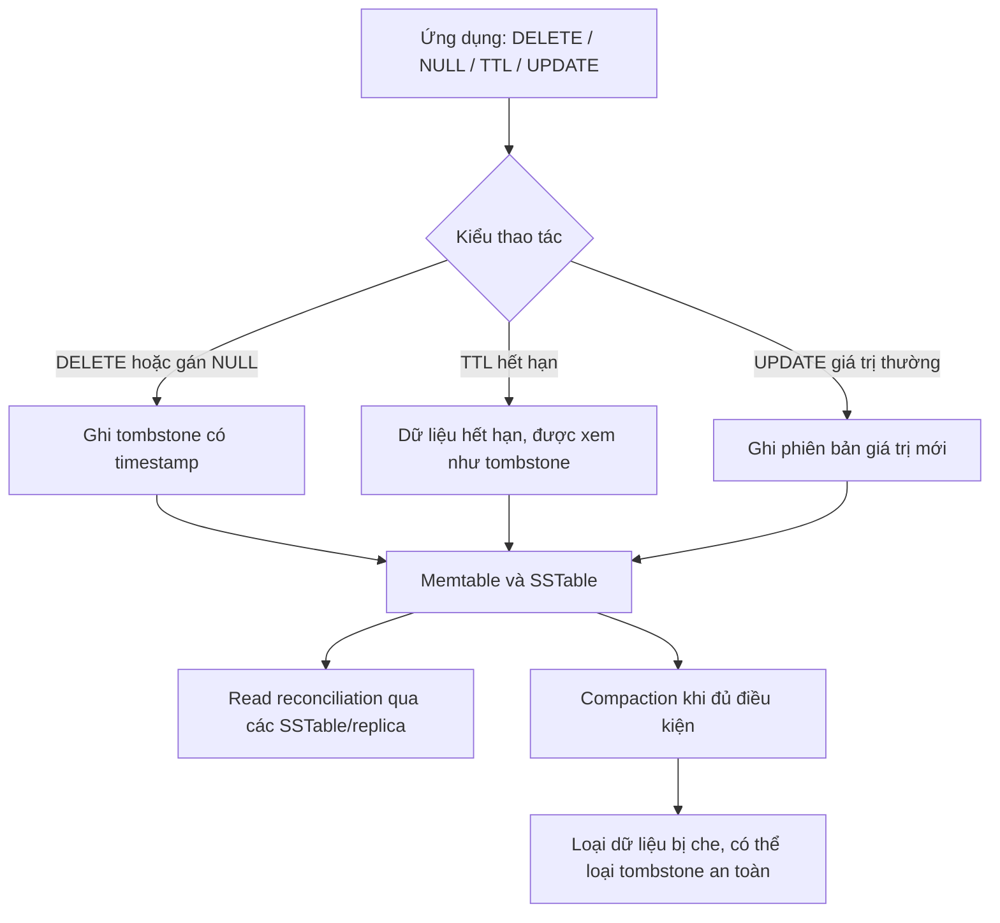
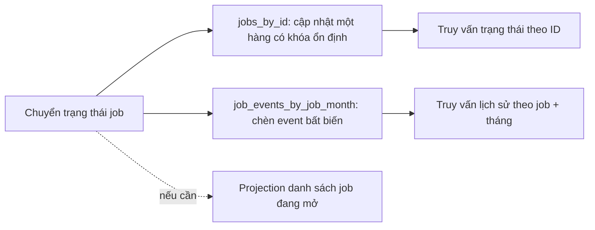
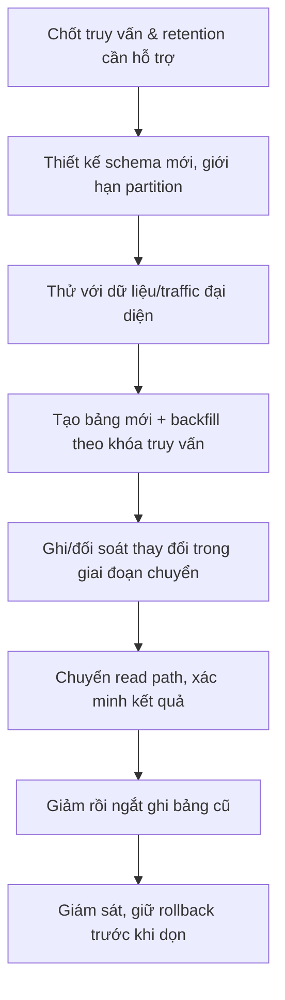

# Thiết kế lại mô hình dữ liệu nhằm giảm xóa/cập nhật gây áp lực

> **Chương:** Tombstone và thu hồi  
> **Học phần:** `DATABASE_ENGINE_WIDE_COLUMN_CASSANDRA` — Apache Cassandra

Trong Apache Cassandra, xóa dữ liệu không có nghĩa dữ liệu biến mất ngay khỏi ổ đĩa. Cassandra ghi một **tombstone** (dấu xóa có timestamp) để các replica, kể cả replica tạm thời không sẵn sàng, có thể nhận biết dữ liệu nào không được hiển thị nữa. Hết hạn **TTL** cũng tạo dữ liệu bị đánh dấu xóa. Các tombstone và nhiều phiên bản giá trị trong SSTable có thể tăng chi phí đọc, compaction và không gian đĩa, đặc biệt khi mô hình dữ liệu thường xuyên **xóa rồi chèn lại một hàng** mỗi lần trạng thái thay đổi.

Giải pháp bền vững thường nằm ở **thiết kế lại dữ liệu và truy vấn**, thay vì chỉ tăng giới hạn tombstone hay ép compaction. Bài học này hướng dẫn nhận diện nguồn phát sinh tombstone, chuyển những thao tác “di chuyển/xóa” thường xuyên sang trạng thái ổn định hoặc sự kiện bất biến khi phù hợp, chọn bucket và TTL có giới hạn, đồng thời vẫn giữ đúng yêu cầu về consistency, replication, repair và hành vi của ứng dụng Java.

Sau bài này, bạn có thể:

- Giải thích sự khác nhau giữa ghi đè giá trị, xóa bằng `DELETE`, gán `null` và TTL hết hạn.
- Nhìn vào truy vấn nghiệp vụ để phát hiện schema buộc phải xóa/insert liên tục.
- Thiết kế bảng theo truy vấn bằng mô hình state + event log, giảm churn và giới hạn độ lớn partition.
- Chọn chiến lược retention/TTL/compaction phù hợp; hiểu giới hạn của `gc_grace_seconds`.
- Đo hiệu quả trước/sau migration và xử lý đúng các lần ghi không rõ kết quả từ Java.

## 1. Vì sao nhiều thao tác xóa làm Cassandra chịu áp lực?

Đường ghi chuẩn trên replica đi qua **commit log** và **memtable**; memtable được flush thành **SSTable bất biến**. Cập nhật một cột thường ghi phiên bản mới có timestamp mới. Xóa một hàng, một cột hoặc một dải hàng ghi **tombstone** để che dữ liệu cũ khi đọc. Cassandra cần compaction để xử lý các phiên bản và thu hồi dữ liệu đủ điều kiện.



Cần phân biệt rất rõ:

| Thao tác | Có tạo tombstone trực tiếp? | Tác động đáng chú ý |
| --- | --- | --- |
| `DELETE FROM ... WHERE ...` | **Có**: tombstone mức cell, row, range hoặc partition tùy câu lệnh | Có thể làm truy vấn phải duyệt nhiều giá trị bị xóa. |
| `UPDATE t SET col = null WHERE ...` | **Có**: gán `null` là xóa cột trong CQL | Tạo marker xóa; không phải cách “cập nhật rỗng miễn phí”. |
| `INSERT/UPDATE ... USING TTL ...` | **Khi TTL hết hạn**, dữ liệu sẽ được coi như tombstone | Có churn định kỳ; trộn nhiều TTL trong cùng SSTable gây khó thu hồi. |
| `UPDATE t SET status = 'DONE' WHERE ...` | **Không nhất thiết** tạo tombstone: ghi phiên bản mới của cột | Vẫn có nhiều phiên bản, tăng write amplification và công việc compaction. |
| Thay toàn bộ collection không frozen hoặc loại phần tử khỏi collection | **Có thể** tạo tombstone cho dữ liệu collection bị thay/xóa | Collection lớn và thay đổi thường xuyên là nguồn áp lực. |
| Không xóa, chỉ đặt `is_deleted=true` | **Không tạo row tombstone chỉ vì bool này** | Dữ liệu cũ vẫn chiếm chỗ, đọc cần xử lý cờ; không giải quyết nhu cầu thu hồi vật lý. |

Một lỗi thiết kế phổ biến là tin rằng **mọi `UPDATE` đều tạo tombstone**. Điều đó không đúng. Tuy nhiên, cập nhật cùng cell hàng nghìn lần vẫn sinh nhiều phiên bản trong SSTable trước khi compaction dọn dẹp. Thiết kế tốt cần giảm **cả tombstone lẫn số lần ghi lại không cần thiết**.

### Tombstone và dữ liệu bị xóa tồn tại bao lâu?

`gc_grace_seconds` là khoảng thời gian bảo vệ để tombstone có cơ hội được lan truyền tới những replica từng bị gián đoạn. Giá trị mặc định thường là **864000 giây (10 ngày)**, nhưng cần kiểm tra thực tế trên từng bảng. Tombstone **chỉ trở nên đủ điều kiện** để thu hồi sau thời gian này; nó **không tự biến mất đúng giây thứ 864000**. Compaction còn phải chứng minh rằng việc bỏ tombstone không khiến dữ liệu cũ bị hiện lại, ví dụ khi dữ liệu bị che nằm ở SSTable khác.

Nếu một replica bỏ lỡ lệnh xóa, tombstone đã bị thu hồi quá sớm, replica đó có thể mang dữ liệu cũ quay lại cụm trong lúc phục hồi/repair. Hiện tượng này gọi là **zombie data**. Vì vậy, rút `gc_grace_seconds` về 0 để “dọn sạch tombstone” là một thay đổi nguy hiểm nếu chưa chứng minh được điều kiện an toàn của phiên bản, topology và quy trình repair.

**Nhớ:** replication và consistency level quyết định cách xác nhận và đọc dữ liệu; **repair** giúp replica trao đổi dữ liệu bị lỡ. Cả ba yếu tố đều liên quan đến việc thu hồi tombstone an toàn, nhưng không làm mô hình ghi/xóa quá nhiều trở nên hiệu quả.

## 2. Một mô hình có vấn đề: dùng trạng thái thay đổi làm partition key

Giả sử ứng dụng quản lý công việc hỗ trợ:

1. Tìm công việc theo `job_id`.
2. Chuyển trạng thái `PENDING → RUNNING → COMPLETED`.
3. Xem lịch sử chuyển trạng thái.
4. Lấy danh sách công việc đang mở để xử lý.

Nhóm ban đầu chỉ tạo bảng “danh sách theo trạng thái”:

```sql
-- Giả định keyspace app đã tồn tại và có replication phù hợp.
CREATE TABLE app.jobs_by_status (
    tenant_id text,
    status text,
    job_id uuid,
    title text,
    updated_at timestamp,
    PRIMARY KEY ((tenant_id, status), job_id)
);
```

Với bảng này, `status` là **một phần của partition key**. Không thể cập nhật `status` ngay trên cùng một hàng: thay đổi khóa chính đồng nghĩa **hàng khác**. Ứng dụng thường làm:

```sql
-- Ví dụ một job đổi trạng thái: xóa hàng PENDING cũ...
DELETE FROM app.jobs_by_status
WHERE tenant_id = 'shop-01'
  AND status = 'PENDING'
  AND job_id = 11111111-1111-1111-1111-111111111111;

-- ... rồi tạo hàng RUNNING mới.
INSERT INTO app.jobs_by_status (
    tenant_id, status, job_id, title, updated_at
) VALUES (
    'shop-01', 'RUNNING',
    11111111-1111-1111-1111-111111111111,
    'Đồng bộ hóa đơn', '2026-11-21T10:30:00Z'
);
```

Mỗi lần chuyển trạng thái tạo tombstone ở partition cũ và dữ liệu mới ở partition mới. Có ba hệ quả:

- **Churn:** một job chuyển trạng thái nhiều lần làm các partition theo trạng thái liên tục thêm/xóa.
- **Partition nóng/lớn:** mọi job `PENDING` của một tenant có thể rơi vào **một partition**, trong khi lượng job tăng không giới hạn.
- **Đồng bộ ứng dụng:** hai câu ghi ở hai partition không tự trở thành một giao dịch toàn cục đúng-một-lần. Lỗi giữa hai bước có thể để lại dữ liệu chỉ ở một phía.

`BATCH`, kể cả logged batch, không biến cập nhật xuyên nhiều partition thành transaction có isolation như RDBMS. Muốn đảm bảo tính duy nhất trạng thái và thứ tự chuyển, ứng dụng cần mô hình ghi/đọc cũng như cơ chế phối hợp phù hợp.

Một dấu hiệu tương tự là thiết kế khóa chính theo **trạng thái, vị trí sắp xếp hoặc thuộc tính hay đổi**: mỗi thay đổi buộc ứng dụng xóa một khóa cũ rồi chèn khóa mới. Hãy đưa thuộc tính bất ổn ra khỏi primary key **nếu truy vấn cho phép**, hoặc quản lý nó trong projection nhỏ, có vòng đời rõ ràng.

## 3. Thiết kế lại: state theo ID + lịch sử sự kiện bất biến

Với luồng “xem trạng thái của một job theo ID”, thiết kế lại thành bảng có khóa chính **ổn định**:

```sql
CREATE TABLE app.jobs_by_id (
    tenant_id text,
    job_id uuid,
    title text,
    status text,
    updated_at timestamp,
    PRIMARY KEY ((tenant_id, job_id))
);

INSERT INTO app.jobs_by_id (
    tenant_id, job_id, title, status, updated_at
) VALUES (
    'shop-01',
    11111111-1111-1111-1111-111111111111,
    'Đồng bộ hóa đơn',
    'PENDING',
    '2026-11-21T10:20:00Z'
);

-- Không cần DELETE/INSERT sang partition trạng thái mới.
UPDATE app.jobs_by_id
SET status = 'RUNNING', updated_at = '2026-11-21T10:30:00Z'
WHERE tenant_id = 'shop-01'
  AND job_id = 11111111-1111-1111-1111-111111111111;

SELECT status, updated_at FROM app.jobs_by_id
WHERE tenant_id = 'shop-01'
  AND job_id = 11111111-1111-1111-1111-111111111111;
```

Lợi ích: trạng thái thay đổi **bên trong một hàng có khóa ổn định**, giảm các tombstone do di chuyển giữa partition theo trạng thái. Giới hạn: `UPDATE` vẫn sinh các phiên bản mới, và nếu cần kiểm soát thứ tự cạnh tranh giữa nhiều worker, phải bổ sung cơ chế điều kiện/versioning phù hợp. Đừng xem một phép cập nhật không điều kiện là bảo đảm trạng thái “tiến tới trước”.

Nếu phải giữ **lịch sử** mà không liên tục ghi đè lên cùng một tập dữ liệu, dùng bảng append-only được tối ưu cho truy vấn “lịch sử của job theo tháng”:

```sql
CREATE TABLE app.job_events_by_job_month (
    tenant_id text,
    job_id uuid,
    event_month text,
    event_id timeuuid,
    new_status text,
    actor_id text,
    PRIMARY KEY ((tenant_id, job_id, event_month), event_id)
) WITH CLUSTERING ORDER BY (event_id DESC);

INSERT INTO app.job_events_by_job_month (
    tenant_id, job_id, event_month, event_id, new_status, actor_id
) VALUES (
    'shop-01',
    11111111-1111-1111-1111-111111111111,
    '2026-11',
    22222222-2222-1222-8222-222222222222,
    'RUNNING',
    'worker-17'
);

SELECT event_id, new_status, actor_id
FROM app.job_events_by_job_month
WHERE tenant_id = 'shop-01'
  AND job_id = 11111111-1111-1111-1111-111111111111
  AND event_month = '2026-11'
LIMIT 20;
```

`event_month` được tính ổn định từ thời điểm sự kiện (ví dụ `YYYY-MM`). Một event phát lại phải dùng **cùng `event_id` và partition key**, tránh chèn bản sao. Event log append-only không xóa/viết lại các hàng vì một chuyển trạng thái mới xuất hiện. Tháng giúp giới hạn số hàng trong một partition; với job có số event rất lớn có thể dùng bucket nhỏ hơn, chẳng hạn theo tuần/ngày. **Không dùng một bảng event bất biến nhưng partition không có giới hạn rồi cho rằng tự động an toàn.**



### Hai bảng trên có bảo đảm giao dịch tuyệt đối không?

**Không.** Cập nhật `jobs_by_id` và chèn `job_events_by_job_month` là hai thay đổi dữ liệu riêng; giữa chúng có thể có lỗi, timeout hoặc xung đột. Nếu cần một nguồn sự thật có thể tái dựng, hãy cân nhắc:

- Ghi **event bất biến** với ID bền vững làm sự kiện nguồn và xây dựng state/projection thông qua một consumer có khả năng xử lý phát lại.
- Thiết kế checkpoint/idempotency cho consumer, theo dõi độ trễ projection và đối soát từ event log.
- Khi nghiệp vụ cần **một chuyển trạng thái chỉ được chấp nhận nếu trạng thái cũ hợp lệ**, cân nhắc LWT/CAS trên một hàng state, ví dụ `UPDATE ... IF status = 'PENDING'`. LWT có chi phí hiệu năng; nó không làm hai bảng khác partition trở thành transaction nguyên tử.

Không cần lưu mọi sự kiện mãi mãi. Phải xác định retention của event history, yêu cầu audit, khôi phục và dung lượng trước khi chọn TTL.

## 4. Nhưng nghiệp vụ vẫn cần “liệt kê job đang mở” thì sao?

Chuyển từ `jobs_by_status` sang `jobs_by_id` cải thiện truy vấn theo ID, **nhưng không còn hỗ trợ trực tiếp** truy vấn “liệt kê mọi job `PENDING` của tenant”. Trong Cassandra, mô hình dữ liệu phải bắt đầu từ truy vấn; không được xóa một bảng projection mà vẫn kỳ vọng hiệu năng cũ cho truy vấn đó.

Các phương án:

| Nhu cầu thật | Lựa chọn | Đánh đổi |
| --- | --- | --- |
| Chỉ cần tình trạng của một job theo ID | Bảng state `jobs_by_id` | Truy vấn theo ID hiệu quả; không lấy danh sách mọi status. |
| Cần lịch sử chuyển trạng thái theo job | Append-only `job_events_by_job_month` | Thêm lưu trữ; không phải chỉ mục danh sách công việc. |
| Cần feed công việc đang mở theo ngày đến hạn | Projection `open_jobs_by_due_day`, bucket hợp lý; xóa khỏi projection **một lần** khi hoàn thành | Vẫn có tombstone ở projection nhưng ít churn hơn và partition có giới hạn. |
| Cần scheduler, giao việc, claim/retry, priority thường xuyên thay đổi | Cân nhắc hệ thống queue/scheduler chuyên dụng và lưu state trong Cassandra | Phải vận hành thêm thành phần và bảo đảm đồng bộ ở application. |
| Cần tra cứu linh hoạt theo nhiều thuộc tính | Xem xét chỉ mục được bản Cassandra hỗ trợ, hệ thống search hoặc mô hình materialized read riêng | Chi phí index, bảo trì và đặc tính consistency cần đánh giá. |

Ví dụ projection “công việc mở theo ngày hẹn, shard”:

```sql
CREATE TABLE app.open_jobs_by_due_day (
    tenant_id text,
    due_day date,
    shard smallint,
    due_at timestamp,
    job_id uuid,
    title text,
    PRIMARY KEY ((tenant_id, due_day, shard), due_at, job_id)
) WITH CLUSTERING ORDER BY (due_at ASC, job_id ASC);
```

Ứng dụng tính `shard` ổn định từ `job_id` để phân phối ghi, truy vấn tất cả shard của ngày cần xem rồi gộp kết quả. Hoàn thành job vẫn cần xóa hàng này, nhưng thiết kế đưa mục tiêu về **một lần xóa khi công việc rời danh sách đang mở** thay vì xóa rồi chèn lại ở mỗi bước chuyển trạng thái. Đối soát projection từ nguồn sự thật là cần thiết khi các ghi độc lập bị lỗi.

**Tombstone không phải “cấm tuyệt đối”.** Nếu truy vấn đòi hỏi loại bỏ một item và retention cho phép, tombstone là cơ chế đúng của Cassandra. Mục tiêu là giảm tạo/xuyên qua tombstone **không cần thiết**, giới hạn phạm vi dữ liệu mỗi truy vấn phải quét và giảm số ghi trên các khóa nóng.

## 5. Định nghĩa vòng đời dữ liệu trước khi bật TTL

TTL giúp dữ liệu tự hết hạn, nhưng **TTL hết hạn cũng tạo tombstone**. Vì thế, một bảng có TTL 30 ngày không đồng nghĩa “ngày 31 ổ đĩa tự giảm ngay”. Cassandra chỉ thu hồi dữ liệu khi quá trình compaction và các điều kiện an toàn cho phép.

Ba câu hỏi cần trả lời trước khi bật TTL:

1. **Cần giữ bao lâu?** Retention 7, 30 hay 365 ngày là yêu cầu nghiệp vụ và compliance, không phải thông số “thử cho nhanh”.
2. **Dữ liệu có còn bị cập nhật sau khi được ghi?** Tác vụ thay đổi TTL và cập nhật chồng lấn giữa các cửa sổ có thể giữ các phiên bản dữ liệu lâu hơn dự kiến.
3. **Sự kiện đến trễ nhiều không?** Dữ liệu rất cũ đi vào SSTable mới làm khó việc gom SSTable theo thời gian và thu hồi nguyên khối.

### Mô hình phù hợp hơn với TTL: event gần như bất biến, cùng chính sách hết hạn

Ví dụ một bảng sensor events chỉ cần lưu 30 ngày, được truy vấn theo thiết bị và ngày:

```sql
CREATE TABLE app.sensor_events_by_day (
    device_id text,
    event_day date,
    event_id timeuuid,
    reading double,
    PRIMARY KEY ((device_id, event_day), event_id)
) WITH default_time_to_live = 2592000
  AND compaction = {
    'class': 'TimeWindowCompactionStrategy',
    'compaction_window_unit': 'DAYS',
    'compaction_window_size': '1'
  };
```

Ở đây:

- `(device_id, event_day)` giới hạn partition theo ngày; nếu một thiết bị tạo quá nhiều dữ liệu/ngày, thêm shard/bucket ngắn hơn.
- `default_time_to_live = 2592000` tương đương 30 ngày; khi hết hạn vẫn có tombstone và thời gian grace liên quan.
- `TimeWindowCompactionStrategy` (**TWCS**) có thể thuận lợi cho dữ liệu chuỗi thời gian ít sửa và hết hạn có quy luật, vì giúp gom SSTable theo cửa sổ thời gian để thu hồi khi đã hết hạn **và an toàn**.
- Tránh trộn dữ liệu không TTL với dữ liệu TTL nhiều thời lượng khác nhau trong cùng bảng/SSTable khi muốn thu hồi nhanh. Các cập nhật chéo cửa sổ hoặc event đến quá trễ cũng làm hiệu quả TWCS giảm.
- Phiên bản Cassandra 5.0+ có **UCS**, được khuyến nghị cho phần lớn workload; lựa chọn giữa UCS và TWCS phải dựa vào bản triển khai, đặc trưng TTL/time series và thử tải, không phải chỉ đổi class khi chưa đo.

Nếu bảng này dùng để audit không được xóa trước thời hạn pháp lý, không nên mặc định TTL. Với TTL, việc retry chèn cùng khóa có thể làm thay đổi thời điểm hết hạn tùy chính sách ghi và timestamp; cần xác minh ngữ nghĩa retention khi sử dụng retries. Đặt `TTL` quá ngắn rồi liên tục “gia hạn” cùng cột có thể khiến dự báo dung lượng sai lệch.

### Những cách “giảm tombstone” gây phản tác dụng

| Cách làm dễ nghĩ tới | Vì sao có vấn đề? | Hướng thay thế |
| --- | --- | --- |
| `ALTER TABLE ... WITH gc_grace_seconds = 0` để dọn nhanh | Replica offline có thể mang dữ liệu xóa trở lại (**zombie**); điều kiện an toàn tùy phiên bản/quy trình repair. | Giữ grace phù hợp SLA phục hồi và repair; sửa mô hình tạo tombstone. |
| Tăng `tombstone_warn_threshold` và `tombstone_failure_threshold` | Chỉ làm giảm cảnh báo/thay ngưỡng lỗi, không xóa chi phí đọc. | Xác định partition/query tạo ra nhiều tombstone, giảm churn. |
| Chạy major compaction liên tục | I/O và dung lượng tạm cao; tombstone chưa đủ điều kiện vẫn không được xóa. | Theo dõi compaction, chọn strategy đúng, cân bằng tải. |
| Dùng `ALLOW FILTERING` để tìm item chưa bị xóa | Có thể phải quét rất nhiều dữ liệu không phù hợp và tombstone. | Tạo bảng truy vấn theo khóa/bucket hoặc projection có phạm vi hữu hạn. |
| “Soft delete” bằng cờ nhưng không có retention | Ít tombstone tức thời nhưng dữ liệu cũ ngày càng lớn; truy vấn phải lọc ở app. | Chỉ dùng nếu đã có chính sách dọn và read path rõ ràng. |
| Chuyển mọi event vào một partition duy nhất | Tránh cập nhật trạng thái nhưng tạo partition quá lớn/hot. | Bucket theo thời gian và/hoặc shard ổn định. |

## 6. Giảm áp lực từ collection và các thao tác cập nhật

Một số API có thói quen gửi lại **toàn bộ collection** mỗi khi người dùng thêm hoặc bớt một phần tử:

```sql
-- Ví dụ trạng thái collection hay thay đổi.
CREATE TABLE app.user_settings (
    tenant_id text,
    user_id uuid,
    pinned_items list<text>,
    PRIMARY KEY ((tenant_id, user_id))
);
```

Ghi đè hoặc xóa thành phần của collection không frozen có thể tạo tombstone; collection phình lớn làm một hàng chứa rất nhiều giá trị thay đổi. Nếu ứng dụng thường xuyên đánh dấu bật/tắt từng mục, một bảng quan hệ “một mục trên một hàng” có thể dễ kiểm soát hơn:

```sql
CREATE TABLE app.pins_by_user (
    tenant_id text,
    user_id uuid,
    item_id text,
    pinned_at timestamp,
    PRIMARY KEY ((tenant_id, user_id), item_id)
);

INSERT INTO app.pins_by_user (tenant_id, user_id, item_id, pinned_at)
VALUES (
    'shop-01',
    11111111-1111-1111-1111-111111111111,
    'item-25',
    '2026-11-21T10:30:00Z'
);

SELECT item_id FROM app.pins_by_user
WHERE tenant_id = 'shop-01'
  AND user_id = 11111111-1111-1111-1111-111111111111;
```

Khi **bỏ ghim**, vẫn cần `DELETE` row, nhưng không phải ghi lại cả collection của người dùng. Nếu lượng mục ghim/hủy ghim rất cao, xem xét ngữ nghĩa sản phẩm (ví dụ “lịch sử hành động” hay “trạng thái hiện tại”), giới hạn partition và đo tombstone theo truy vấn. Thay collection bằng row không tự loại bỏ tombstone, nhưng giúp kiểm soát kích thước và mức tác động của mỗi thay đổi.

### Cập nhật có điều kiện khi nhiều writer cạnh tranh

Nếu hai worker có thể chuyển cùng một job từ `PENDING` sang hai trạng thái khác nhau, ghi đè liên tiếp không đảm bảo chuyển trạng thái đúng ngữ nghĩa. Có thể dùng LWT cho **một hàng**:

```sql
UPDATE app.jobs_by_id
SET status = 'RUNNING',
    updated_at = '2026-11-21T10:30:00Z'
WHERE tenant_id = 'shop-01'
  AND job_id = 11111111-1111-1111-1111-111111111111
IF status = 'PENDING';
```

Kết quả có trường `[applied]` để caller biết điều kiện có thành công không khi phản hồi đến nơi. Nếu timeout, **kết quả vẫn có thể không rõ**, cần đọc/đối soát bằng ID và trạng thái mong đợi; không suy ra “thất bại” chỉ từ timeout. LWT có chi phí latency/đồng thuận, nên cân nhắc tính nhất quán mà nghiệp vụ thực sự cần.

## 7. Kế hoạch migration mô hình dữ liệu

Không có thao tác `ALTER TABLE` nào tự chuyển một bảng theo partition key thay đổi sang bảng thiết kế mới. Khi thay khóa chính và truy vấn, phải tạo **bảng mới**, chuyển dữ liệu và đổi luồng ghi/đọc có kiểm soát.



**Trước migration**

1. Ghi danh sách truy vấn thực tế: theo `job_id`, theo status, theo ngày, lịch sử của job, yêu cầu thứ tự và paging.
2. Đo kích thước partition, phân phối hot key, số status transition/job, xóa/TTL/collection change mỗi ngày và tuổi của dữ liệu.
3. Xác định chính sách retention, yêu cầu đúng-một-lần của event, cách đối soát khi mất phản hồi.
4. Chọn schema cho **từng truy vấn quan trọng**, tránh một bảng với partition key quá rộng để phục vụ mọi nhu cầu.
5. Xác minh backup, replication factor, consistency level và chu kỳ repair trước khi thay đổi lớn.

**Trong migration**

- Tạo bảng mới, giữ bảng cũ phục vụ ứng dụng cho đến khi sẵn sàng.
- Backfill dữ liệu theo phân vùng có kiểm soát lưu lượng, tránh `SELECT *` trên toàn cụm khi dữ liệu lớn. Chọn cách xác định checkpoint/tiến độ có thể tiếp tục sau lỗi.
- Nếu ứng dụng **dual-write**, nhớ rằng hai bảng không tự nhất quán nguyên tử; cần event ID, cơ chế bù/đối soát, theo dõi lag và lỗi.
- Nếu chuyển từ bảng cập nhật sang event log, cần xác định cách xuất trạng thái ban đầu và tiếp nhận sự kiện mới mà không bỏ sót hoặc xử lý trùng.
- Test race condition, timeout, replica down và retry trong môi trường staging có cấu hình replication, CL và dữ liệu gần thực tế.

**Sau migration**

- Chuyển dần các luồng đọc, đối chiếu trạng thái/projection và latency với bảng cũ.
- Theo dõi số tombstone được scan, số SSTable, compaction backlog, disk free, read p99 và write p99.
- Duy trì cửa sổ rollback có giám sát; chỉ dọn dữ liệu cũ khi đã xác nhận consumer không dùng nữa và chính sách retention cho phép.
- Việc xóa bảng cũ là thay đổi schema cần phê duyệt theo quy trình triển khai, **không** đồng nghĩa repair/backup trước đó tự trở nên vô dụng.

## 8. Đo xem thiết kế mới có thực sự giảm áp lực không

Một phép đo tốt phải phân biệt **tombstone tạo ra**, **tombstone đọc phải** và **I/O compaction**. Không đủ để nhìn “dung lượng giảm” trong vài phút đầu tiên.

| Tín hiệu | Đo bằng gì? | Cách đánh giá |
| --- | --- | --- |
| Tombstone per read | Metrics Cassandra theo table và tracing có chọn lọc; log cảnh báo tombstone | Tỷ lệ các truy vấn thường gặp phải quét nhiều tombstone có giảm không? |
| Read latency p95/p99 | Driver/server metrics, phân theo query và CL | Có tốt hơn dưới cùng lưu lượng và partition size không? |
| Write rate & mutation fanout | App metrics và số mutation per business event | Một lần chuyển trạng thái sinh ít DELETE/INSERT hơn chưa? |
| Pending compactions, I/O | `nodetool compactionstats`, storage metrics | Backlog và write amplification có giảm không? |
| Disk used và free space | `df -h`, dashboard theo volume | Sau nhiều chu kỳ compaction, dữ liệu cũ có được thu hồi hợp lý không? |
| Dung lượng/cảnh báo partition | `nodetool tablestats`, phân bố kích thước partition | Bucket mới có ngăn partition quá lớn và hot key không? |
| Replica health & repair | `nodetool status`, trạng thái repair/streaming | Có giữ được an toàn dữ liệu xóa trong cửa sổ grace không? |

Trên node vận hành, một số lệnh **đọc/quan sát**:

```bash
nodetool status
nodetool compactionstats
nodetool tablestats app.jobs_by_id
nodetool tablestats app.job_events_by_job_month
```

Trong `cqlsh` có thể dùng `TRACING ON;` để kiểm tra có chọn lọc một truy vấn nhỏ, `TRACING OFF;` sau khi đo. Tracing thường xuyên ở mức lưu lượng sản xuất có chi phí và có thể sinh thêm dữ liệu giám sát.

```sql
-- Chỉ truy vấn 1 job cụ thể; có thể bật tracing để quan sát.
SELECT status, updated_at
FROM app.jobs_by_id
WHERE tenant_id = 'shop-01'
  AND job_id = 11111111-1111-1111-1111-111111111111;

-- Truy vấn lịch sử trong đúng một tháng, giới hạn số hàng.
SELECT event_id, new_status
FROM app.job_events_by_job_month
WHERE tenant_id = 'shop-01'
  AND job_id = 11111111-1111-1111-1111-111111111111
  AND event_month = '2026-11'
LIMIT 20;
```

Các chỉ số, nhãn cảnh báo và tham số thực tế phụ thuộc **phiên bản Cassandra** và hệ thống monitoring. Không nên đặt mục tiêu “0 tombstone bằng mọi giá”: thay vào đó tối ưu số lượng tombstone mà **đường truy vấn nóng** phải duyệt, khả năng thu hồi an toàn và chi phí tổng thể của hệ thống.

## 9. Ứng dụng Java: giữ event ID ổn định và tránh phát lại thành nhiều hàng

Java Driver không làm thay đổi bản chất tombstone. Nhưng code ứng dụng quyết định liệu một event có bị xử lý hai lần, liệu mỗi trạng thái có tạo ra `DELETE`, và liệu retry có tạo thêm bản sao hay không.

Ví dụ Java Driver 4.x ghi một event bất biến vào bảng `job_events_by_job_month` (bảng này **chưa đặt TTL**). Caller phải giữ nguyên `eventId` khi gửi lại cùng sự kiện:

```java
import java.util.UUID;

import com.datastax.oss.driver.api.core.CqlSession;
import com.datastax.oss.driver.api.core.DefaultConsistencyLevel;
import com.datastax.oss.driver.api.core.cql.BoundStatement;
import com.datastax.oss.driver.api.core.cql.PreparedStatement;

public final class JobEventStore {
    private final CqlSession session;
    private final PreparedStatement insert;

    public JobEventStore(CqlSession session) {
        this.session = session;
        this.insert = session.prepare(
            "INSERT INTO app.job_events_by_job_month " +
            "(tenant_id, job_id, event_month, event_id, new_status, actor_id) " +
            "VALUES (?, ?, ?, ?, ?, ?)");
    }

    public void append(String tenantId, UUID jobId, String eventMonth,
                       UUID eventId, String newStatus, String actorId) {
        // eventId là timeuuid ổn định của event (UUID version 1);
        // eventMonth phải được tính từ thời điểm event, không phải lúc retry.
        BoundStatement stmt = insert.bind(
                tenantId, jobId, eventMonth, eventId, newStatus, actorId)
            .setConsistencyLevel(DefaultConsistencyLevel.LOCAL_QUORUM)
            .setIdempotent(true);

        session.execute(stmt);
    }
}
```

Trong ví dụ này, retry cùng `PRIMARY KEY` và cùng dữ liệu không tạo hàng mới; vì thế có thể khai báo statement là idempotent **khi hệ thống bảo đảm không đổi payload của cùng ID và không có xung đột timestamp/phiên bản nghiệp vụ**. Cần xem retry policy thật của driver; `setIdempotent(true)` không làm message broker bảo đảm exactly-once và cũng không tạo giao dịch xuyên hai bảng.

**Cảnh báo:** Nếu dùng TTL, mỗi lần ghi lại cần được kiểm tra về ảnh hưởng tới thời hạn hết hạn. Nếu thực hiện tăng counter, cập nhật tập hợp hoặc chuyển trạng thái có side effect, **không** đánh dấu idempotent chỉ để bật retry. Timeout sau khi gửi không chứng minh mutation chưa áp dụng; hãy ghi trạng thái chưa xác định và đối soát.

Trong hệ thống có hai luồng ghi `event` và `current_state`, lựa chọn một nguồn sự thật, đảm bảo cùng `event_id` xuyên retry, triển khai consumer có checkpoint và cơ chế rebuild projection. Khi cần kiểm soát chuyển trạng thái cạnh tranh, xử lý điều kiện tại điểm ghi chính; không dựa vào tính eventual consistency để suy ra thứ tự nghiệp vụ.

## 10. Bài tập vận dụng

**Câu 1.** Bảng `jobs_by_status` có partition key `(tenant_id, status)`. Mỗi công việc đi qua ba trạng thái, ứng dụng xóa hàng cũ rồi thêm hàng mới. Tại sao số tombstone tăng? Thiết kế nào giảm được các thao tác này nếu truy vấn chính là tìm trạng thái theo `job_id`?

**Câu 2.** Nhóm thay `DELETE` bằng `SET is_deleted = true` và thấy cảnh báo tombstone ít đi. Điều gì vẫn có thể xấu dần theo thời gian? Cần thêm chính sách gì?

**Câu 3.** Một bảng event có TTL 30 ngày; ngày thứ 31 dung lượng chưa giảm, thậm chí SSTable vẫn lớn. Hãy nêu ít nhất hai điều kiện/lý do trước khi kết luận compaction hỏng.

**Câu 4.** Tại sao không đặt `gc_grace_seconds = 0` chỉ vì có nhiều tombstone? Vai trò của repair và replica offline là gì?

**Câu 5.** Thiết kế mới dùng `jobs_by_id` cho trạng thái hiện tại, `job_events_by_job_month` cho lịch sử. Product yêu cầu “truy vấn tất cả job đang `PENDING` theo deadline”. Có thể chỉ dùng hai bảng đó mà đảm bảo truy vấn nhanh không? Đề xuất một lựa chọn và đánh đổi.

**Câu 6.** Một client Java gặp timeout khi ghi event, tự tạo `event_id` mới rồi retry. Dù dữ liệu cùng nội dung, chuyện gì xảy ra ở bảng append-only?

<details>
<summary>Gợi ý đáp án</summary>

1. Mỗi lần trạng thái thay đổi, khóa phân vùng thay đổi và ứng dụng `DELETE` hàng cũ. Dùng `jobs_by_id` với khóa ổn định để cập nhật cột `status`, và append event nếu cần lịch sử.
2. Dữ liệu vẫn tồn tại và tăng; truy vấn phải phân biệt cờ, chi phí lưu trữ và đọc không tự biến mất. Cần retention/archival và kế hoạch xóa/thu hồi có kiểm soát.
3. TTL hết hạn tạo tombstone, tombstone cần vượt grace và compaction an toàn; SSTable có thể chứa dữ liệu còn sống/chồng lấn; late writes/trộn TTL gây khó thu hồi nguyên SSTable.
4. Nếu replica offline bỏ lỡ xóa, tombstone thu hồi quá sớm có thể khiến dữ liệu cũ xuất hiện lại khi replica trở về. Repair và chu kỳ khôi phục cần phù hợp grace.
5. Không. Truy vấn theo status/deadline cần projection theo tenant, ngày, shard hoặc hệ queue/search phù hợp; projection vẫn có thể xóa nhưng giảm mức churn và có đối soát.
6. `event_id` mới tạo hàng mới; một nghiệp vụ có thể xuất hiện hai lần. Giữ cùng ID, key và payload qua tất cả lần phát lại.

</details>

## Ghi nhớ

- `DELETE`, gán `null` và TTL hết hạn tạo tombstone; **UPDATE giá trị thường không nhất thiết tạo tombstone**, nhưng vẫn tăng số phiên bản phải compact.
- Không đặt **thuộc tính thay đổi thường xuyên** vào primary key nếu mỗi thay đổi buộc phải xóa hàng cũ và chèn lại hàng mới.
- Thiết kế theo **truy vấn thật**: state theo khóa ổn định, event bất biến cho history, projection nhỏ theo ngày/shard khi cần danh sách có điều kiện.
- Append-only và TTL phải đi cùng **bucket có giới hạn, retention rõ ràng và xử lý event trùng**; không phải thuốc chữa mọi loại dữ liệu.
- Tombstone chỉ được thu hồi khi **đủ thời gian và điều kiện compaction an toàn**. Điều chỉnh `gc_grace_seconds` phải xét replica, repair và nguy cơ zombie.
- Đo read tombstone, compaction, disk I/O, p99, kích thước partition và khả năng đối soát trước khi kết luận thiết kế mới hiệu quả.

### Tài liệu tham khảo

- [Apache Cassandra — Tombstones](https://cassandra.apache.org/doc/stable/cassandra/managing/operating/compaction/tombstones.html)
- [Apache Cassandra — Compaction overview](https://cassandra.apache.org/doc/stable/cassandra/managing/operating/compaction/overview.html)
- [Apache Cassandra — Time Window Compaction Strategy](https://cassandra.apache.org/doc/stable/cassandra/managing/operating/compaction/twcs.html)
- [Apache Cassandra — CREATE TABLE và TTL](https://cassandra.apache.org/doc/stable/cassandra/reference/cql-commands/create-table.html)

