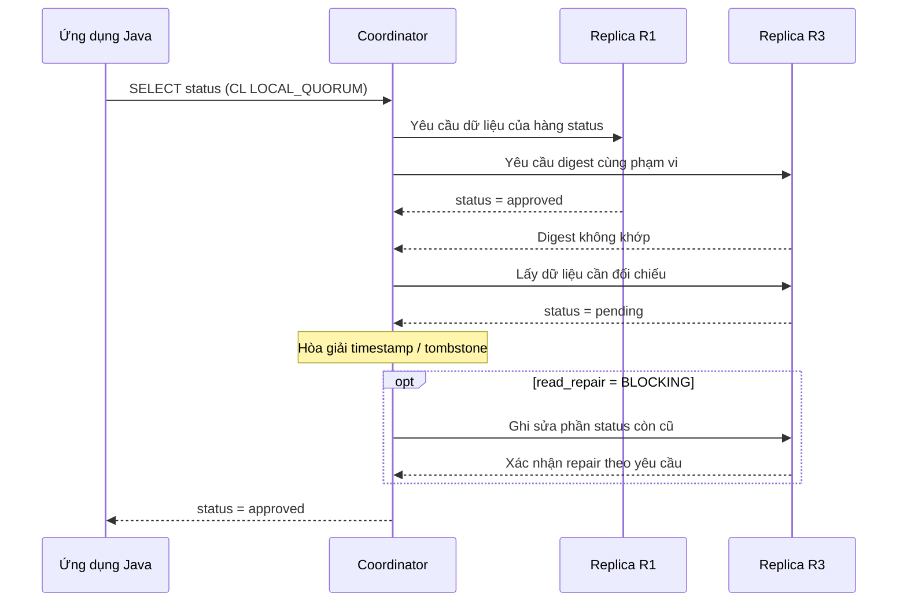

# Read repair và việc chỉ sửa phạm vi dữ liệu được đọc trong Cassandra

## 1. Vấn đề: đọc thấy bản ghi đúng chưa có nghĩa các replica đã đồng bộ

Trong Apache Cassandra, dữ liệu được phân phối theo **partition key** và sao chép đến nhiều **replica** tùy theo replication factor (RF). Mô hình **wide-column** cho phép một partition chứa nhiều hàng sắp xếp theo clustering key. Khi ứng dụng gửi lệnh CQL, coordinator chọn các replica phục vụ yêu cầu theo topology và **consistency level (CL)**. Các replica có thể tạm thời khác nhau vì lỗi mạng, node ngừng hoạt động, quá trình khôi phục hoặc ghi chưa đến tất cả bản sao.

**Read repair** là cơ chế phát hiện và có thể sửa dữ liệu khác nhau giữa các replica **trong quá trình đọc**. Phạm vi quan trọng nhất của nó là **phần dữ liệu truy vấn thực sự yêu cầu/được đối chiếu**, không mặc nhiên toàn bảng, toàn partition hay toàn cluster.

Ví dụ, bảng lưu trạng thái hồ sơ có hai hàng cùng partition:

```text
Partition: document_id = doc-1
  clustering row field_name = "status"    -> "approved"
  clustering row field_name = "reviewer"  -> "user-7"
```

Một lần đọc chỉ yêu cầu hàng `status` có thể kích hoạt sửa khác biệt của hàng đó. Nó **không tự bảo đảm** hàng `reviewer` cũng được sửa trên cùng replica, dù hai hàng có chung partition key.

Đây là giới hạn quan trọng khi học **đồng bộ bản sao**: read repair có ích cho tính nhất quán của truy vấn vừa chạy, nhưng Cassandra vẫn cần các cơ chế khác, đặc biệt **anti-entropy repair**, để xử lý dữ liệu không được đọc.

## 2. Vì sao các replica có thể lưu phiên bản khác nhau?

Giả sử keyspace có RF = 3 trong datacenter `dc1`, với ba replica R1, R2, R3. Ứng dụng cập nhật cùng một partition trong lúc mạng đến R3 gián đoạn:

| Replica | `status` | `reviewer` |
| --- | --- | --- |
| R1 | `approved` | `user-7` |
| R2 | `approved` | `user-7` |
| R3 | `pending` | `user-2` |

Nếu thao tác ghi được xác nhận ở CL `LOCAL_QUORUM` khi R1 và R2 trả lời, coordinator có thể báo thành công dù R3 chưa nhận mutation mới. Cassandra sử dụng những cơ chế như hinted handoff, đọc với reconciliation và repair để giảm khác biệt theo thời gian; **không phải tất cả bản sao đều lập tức giống nhau sau ACK**.

Lưu ý: dữ liệu Cassandra không được hòa giải bằng cách “bỏ phiếu giá trị đa số”. Với các cell thông thường, Cassandra xét timestamp, tombstone, TTL và các quy tắc hòa giải để tạo kết quả đúng theo những phiên bản đã quan sát.

### Một replica đọc dữ liệu từ đâu?

Trên từng replica, dữ liệu có thể nằm trong **memtable** và nhiều **SSTable bất biến**. Bloom filter, partition index, key cache và một số cấu trúc cache khác hỗ trợ tìm kiếm cục bộ. Việc đọc giá trị ở một node vẫn khác với việc **so sánh dữ liệu giữa các node**:

- **Đường đọc cục bộ:** tìm các phiên bản của partition/hàng trên một replica.
- **Reconciliation:** coordinator hòa giải các kết quả đã nhận từ những replica liên quan.
- **Read repair:** khi phát hiện khác biệt và chính sách bảng cho phép, coordinator gửi mutation sửa chữa cho replica cần cập nhật.

Flush và compaction trong một replica **không khiến replica đó tự lấy dữ liệu mới từ replica khác**. Chúng quản lý trạng thái lưu trữ cục bộ; read repair và anti-entropy repair giải quyết các phần khác nhau của bài toán đồng bộ.

## 3. Read repair hoạt động ra sao khi digest không khớp?

Đối với một lần đọc cần so sánh nhiều replica, coordinator có thể lấy **dữ liệu đầy đủ** từ một replica và **digest** (dấu tóm tắt dữ liệu) từ replica khác. Nếu digest không khớp, coordinator cần lấy thêm nội dung để tìm khác biệt và hòa giải.



Đây là mô hình học tập. Số replica được liên hệ, bước trao đổi thực tế, speculative reads và tối ưu hóa khác có thể thay đổi theo phiên bản và điều kiện cụm. **CL quy định số phản hồi cần thiết, không luôn tương đương với số replica duy nhất mà coordinator có thể liên hệ.**

Điều kiện để hiểu đúng sơ đồ:

1. Có **ít nhất hai kết quả cần so sánh**; đọc chỉ từ một replica thường không phát hiện khác biệt với replica khác.
2. Digest mismatch báo dữ liệu trong **phạm vi đọc** không trùng nhau; digest tự nó không cho biết giá trị nào mới hơn.
3. Coordinator phải **hòa giải dữ liệu**, bao gồm timestamp và tombstone, để quyết định sửa phần nào.
4. Khi chế độ `BLOCKING` được áp dụng, lần đọc chờ đủ xác nhận sửa chữa theo quy tắc Cassandra trước khi hoàn tất.
5. Phạm vi repair gắn với dữ liệu đã được truy vấn/đối chiếu; hàng, partition hoặc replica không tham gia **không mặc nhiên được sửa**.

Read repair có thể **không phát sinh** nếu các replica được liên hệ trả kết quả khớp nhau, dù một replica khác đang cũ. Vì vậy, một lần `SELECT` thành công không phải là “lệnh kiểm tra toàn bộ RF”.

## 4. Bốn ranh giới của phạm vi read repair

### 4.1. Ranh giới partition key

Một truy vấn theo `WHERE document_id = 'doc-1'` nhắm tới partition `doc-1`. Nó không yêu cầu Cassandra đối chiếu dữ liệu của `doc-2`, `doc-3` hoặc mọi partition cùng bảng.

```sql
SELECT field_name, value
FROM replica_lab.fields_by_document
WHERE document_id = 'doc-1';
```

Đọc `doc-1` không phải quét/repair bảng `fields_by_document`. Việc dùng partition key để định vị dữ liệu là đặc điểm của **thiết kế bảng theo truy vấn** trong Cassandra và đồng thời xác định phạm vi tối đa tự nhiên của lần đọc này.

### 4.2. Ranh giới clustering row và lát cắt

Với bảng có `PRIMARY KEY ((document_id), field_name)`, truy vấn chỉ hàng `status` là một lát cắt nhỏ của partition:

```sql
SELECT value
FROM replica_lab.fields_by_document
WHERE document_id = 'doc-1'
  AND field_name = 'status';
```

Read repair kích hoạt từ truy vấn này **không chứng minh** hàng `reviewer` hay những hàng clustering khác đã được kiểm tra. Trong cùng một partition, trạng thái của các hàng chưa đọc vẫn có thể khác nhau giữa replica.

Khi dùng `LIMIT`, điều kiện clustering range hoặc phân trang, còn phải phân biệt giữa **toàn bộ partition** và **lượng dữ liệu thật sự được lấy để phục vụ yêu cầu**. Đừng suy luận rằng một truy vấn có `WHERE partition_key = ?` sẽ luôn duyệt hết mọi hàng nếu ứng dụng chỉ nhận vài hàng đầu tiên.

### 4.3. Ranh giới cột và dữ liệu được đối chiếu

Một truy vấn chỉ lấy `value` khác với `SELECT *` ở lượng thông tin nó yêu cầu:

```sql
SELECT value
FROM replica_lab.fields_by_document
WHERE document_id = 'doc-1'
  AND field_name = 'status';
```

Không nên suy ra mọi cột khác trong schema đều được đồng bộ chỉ vì một cột đã đọc thấy đúng. **Chi tiết cấp cell/cột mà quá trình repair thực sự gửi phụ thuộc giao thức và phiên bản**, nhưng nguyên tắc vận hành an toàn vẫn là: chỉ khẳng định dữ liệu nằm trong phạm vi truy vấn, không khẳng định toàn row/table đã sạch chênh lệch.

Cũng cần nhớ **tombstone và trường hợp “không tìm thấy hàng”** là một phần của dữ liệu logic. Một kết quả rỗng không tự chứng minh mọi replica đều không có bản ghi; khi các replica cung cấp thông tin khác nhau, coordinator vẫn cần hòa giải theo semantics của Cassandra.

### 4.4. Ranh giới replica và datacenter

Nếu `RF = 3` trong một DC, `LOCAL_QUORUM` yêu cầu **hai** xác nhận trong DC đó. Điều này **không** bắt buộc coordinator phải đọc và sửa mọi replica trong DC. Replica nằm ngoài tập được liên hệ vẫn có thể giữ giá trị cũ.

Trong cụm nhiều DC dùng `NetworkTopologyStrategy`, các local quorum ở hai DC khác nhau có thể không giao nhau. Đọc `LOCAL_QUORUM` từ `dc1` không đồng nghĩa mọi replica tại `dc2` đều được repair.

| Ranh giới | Ví dụ truy vấn/cấu hình | Điều không được suy ra |
| --- | --- | --- |
| Partition | `WHERE document_id = 'doc-1'` | Tất cả document khác đã đồng bộ |
| Clustering row | `AND field_name = 'status'` | Hàng `reviewer` cùng partition đã được sửa |
| Phạm vi trang/kết quả | `LIMIT 10` hoặc truy vấn phân trang | Tất cả dữ liệu ngoài phần đã xét đều được đối chiếu |
| Replica/DC | `LOCAL_QUORUM` tại `dc1` | Tất cả replica `dc1` và `dc2` đã được cập nhật |

## 5. Thí nghiệm tư duy: sửa một hàng, hàng còn lại vẫn cũ

Giả sử ba replica của partition `doc-1` đang ở trạng thái:

```text
                  status              reviewer
R1                approved            user-7
R2                pending             user-2
R3                pending             user-2
```

R1 có thay đổi mới, R2/R3 chưa theo kịp, chẳng hạn do một lần ghi CL thấp đã tới R1 trước. Lần đọc `LOCAL_QUORUM` liên hệ R1 và R2, phát hiện chênh lệch của hàng `status`:

```sql
SELECT value
FROM replica_lab.fields_by_document
WHERE document_id = 'doc-1'
  AND field_name = 'status';
```

Giả sử trong phạm vi đó, `approved` có timestamp thắng; `read_repair = 'BLOCKING'` sửa giá trị `status` ở R2. Trạng thái sau lần đọc **có thể** là:

```text
                  status              reviewer
R1                approved            user-7
R2                approved            user-2    <-- hàng này chưa được đọc
R3                pending             user-2    <-- replica này chưa tham gia
```

Hệ quả:

- Client vừa đọc `status` có thể nhận giá trị đúng theo kết quả hòa giải và CL của truy vấn.
- R2 mới được sửa `status`, không tự nhận `reviewer = user-7`.
- R3 vẫn có thể cũ ở cả hai hàng.
- Một truy vấn chỉ đọc `reviewer` về sau có thể phải hòa giải/repair riêng, hoặc vẫn thấy giá trị cũ nếu đọc CL thấp từ replica cũ.

**Đây là minh họa giả định có sự chênh lệch**, không phải khẳng định mỗi lần chạy `SELECT` sẽ tạo ra trạng thái này. Khi các replica đều giống nhau, read repair không cần ghi ngược lại.

### Mối liên hệ với partition-level write atomicity

Nếu `status` và `reviewer` được ghi **cùng một mutation/batch trên một partition**, cơ chế ghi Cassandra có thể duy trì tính nguyên tử theo partition đối với mutation đó. Nhưng read repair chỉ phần `status` trên replica cũ có thể làm dữ liệu vật lý ở replica này trở thành **trộn trạng thái cũ/mới** giữa hai clustering row.

Đó là đánh đổi được tài liệu Cassandra nêu giữa **monotonic quorum reads** và **partition-level write atomicity** khi chọn chính sách read repair ở Cassandra 4.x. Không nên diễn giải hiện tượng như một giao dịch ACID đa partition.

## 6. `BLOCKING` và `NONE`: mức bảo đảm và giá phải trả

Các bản Cassandra 4.x/5.x hỗ trợ tùy chọn bảng `read_repair` với hai lựa chọn chính:

| Chính sách | Khi có khác biệt giữa replica | Điều thường được ưu tiên |
| --- | --- | --- |
| `BLOCKING` | Có thể gửi mutation sửa và chờ đủ xác nhận liên quan trước khi trả kết quả | Hỗ trợ **monotonic quorum reads** trong phạm vi CL/quorum phù hợp |
| `NONE` | Vẫn hòa giải dữ liệu đã thu thập để trả kết quả, nhưng **không ghi sửa ngược lại trong đường đọc** | Tránh read repair từng phần làm tổn hại **partition-level write atomicity** |

`BLOCKING` là mặc định của Cassandra 4.x theo tài liệu; phải xác minh phiên bản thực tế nếu vận hành bản khác. Cassandra 3.x có các thiết lập và cơ chế read repair khác; không sao chép tùy chọn 4.x sang 3.x mà không kiểm tra.

Các điểm dễ nhầm:

1. `BLOCKING` **không có nghĩa chờ tất cả replica trong cluster** được đồng bộ; coordinator chờ các sửa chữa liên quan theo cơ chế và CL.
2. `NONE` **không có nghĩa chọn bừa replica đầu tiên** khi các dữ liệu đã thu thập mâu thuẫn; read reconciliation vẫn cần xảy ra.
3. `NONE` **không vô hiệu hóa anti-entropy repair**, và `BLOCKING` **không thay thế anti-entropy repair**.
4. Nếu chưa phát hiện mismatch, `BLOCKING` không buộc Cassandra ghi repair.
5. Read repair không biến ghi thông thường thành **compare-and-set**; với tranh chấp cập nhật có điều kiện, cần cân nhắc **LWT (`IF ...`)**.

### Tại sao `BLOCKING` hỗ trợ monotonic quorum reads?

Với RF = 3 trong một DC, quorum có 2 replica. Hai quorum bất kỳ **giao nhau ở ít nhất một replica**. Khi một lần đọc quorum quan sát giá trị mới và blocking read repair hoàn tất để duy trì dữ liệu cần thiết trên quorum tương ứng, lần đọc quorum tiếp theo trong cùng phạm vi có cơ sở không quay lại giá trị cũ chỉ do chọn cặp replica khác.

Tuy nhiên, phải giữ đúng các điều kiện suy luận: cùng tập replica/CL, cùng dữ liệu được đọc, không có ghi/xóa mới, timestamp/TTL phù hợp và không suy rộng qua các local quorum độc lập tại nhiều DC.

**Monotonic quorum reads khác linearizability**, khác read-your-writes ở mọi mức CL, và không tạo tính nguyên tử cho các thao tác trên nhiều partition.

## 7. Khi nào một lần đọc KHÔNG sửa được replica cũ?

| Tình huống | Vì sao read repair có thể không xảy ra? | Điều nên làm |
| --- | --- | --- |
| Đọc `ONE`/`LOCAL_ONE` từ một replica | Có thể không có digest từ replica thứ hai để phát hiện mismatch | Chọn CL đọc theo yêu cầu nhất quán |
| Đọc quorum nhưng các replica được chọn đều có cùng bản cũ | Không phát hiện khác biệt với replica mới nằm ngoài tập đọc | Xem lại CL ghi/đọc và phạm vi replica; không coi lần đọc là repair toàn cluster |
| Truy vấn chỉ lấy một clustering row | Hàng khác không nằm trong phạm vi cần đối chiếu | Đừng suy diễn toàn partition; dùng repair vận hành cho đồng bộ rộng |
| Câu lệnh chỉ lấy một số kết quả bằng `LIMIT`/paging | Phần chưa được truy vấn chưa chắc được kiểm tra | Hiểu đúng query shape; tránh quét vô ích chỉ để repair |
| Bảng cấu hình `read_repair = 'NONE'` | Coordinator không gửi write-back read repair trong đường đọc | Duy trì lịch anti-entropy repair |
| Replica ở DC khác không tham gia | Local quorum chỉ yêu cầu phản hồi tại DC địa phương | Phối hợp replication và repair xuyên DC phù hợp |
| Không có ứng dụng đọc tới partition | Không có cơ hội khởi động read repair cho dữ liệu đó | Cần anti-entropy repair định kỳ |

Ví dụ: nếu R1 và R2 đều cũ nhưng R3 mới, một lần đọc `LOCAL_QUORUM` sử dụng R1 + R2 có thể không phát hiện mismatch. Quy tắc `R + W > RF` chỉ giúp lập luận giao nhau giữa **các quorum thích hợp khi ghi/đọc hoàn tất**, không bảo đảm phát hiện một mutation mới chỉ được ghi tại một replica bằng CL thấp.

## 8. Read repair khác anti-entropy repair và hinted handoff

Read repair là **sửa chữa cơ hội** trên đường đọc. Cassandra còn những cơ chế đồng bộ bản sao khác:

| Cơ chế | Khi kích hoạt | Phạm vi tác động | Giới hạn chính |
| --- | --- | --- | --- |
| **Read repair** | Đọc phát hiện mismatch, bảng cho phép sửa | Dữ liệu được truy vấn và replica liên quan | Dữ liệu chưa đọc có thể vẫn lệch |
| **Hinted handoff** | Coordinator lưu hint cho replica tạm vắng khi điều kiện cho phép, gửi lại khi replica hồi phục | Những mutation có hint còn được giữ | Hint có giới hạn thời gian/dung lượng; không đảm bảo bù mọi thiếu sót |
| **Anti-entropy repair** | Theo lịch/chủ động chạy công cụ repair | Token range và replica được chọn trong keyspace/bảng | Tốn mạng, CPU, I/O; phải có lịch phù hợp |
| **Replication** | Định nghĩa nơi lưu các bản sao khi đọc/ghi | Replica được phân công cho partition | Có RF không có nghĩa luôn đồng bộ tức thời |
| **Compaction** | Tác vụ nền theo chiến lược của bảng | SSTable trên từng replica | Không lấy dữ liệu từ replica khác để bù mutation bị thiếu |

Trong anti-entropy repair, Cassandra so sánh dữ liệu giữa các replica trên phạm vi được chọn, thường thông qua cấu trúc so sánh như **Merkle tree** và cơ chế streaming dữ liệu cần đồng bộ. Repair có thể bao phủ **dữ liệu không hề được ứng dụng đọc**, nên nó đóng vai trò bổ sung thiết yếu cho read repair.

Một ví dụ vận hành thường thấy là dùng `nodetool repair` theo **lịch bảo trì phù hợp topology**, với tùy chọn phạm vi và incremental/full tùy phiên bản/quy trình. Không chạy bừa trên mọi node cùng lúc nếu chưa xem khối lượng dữ liệu, CPU, đĩa, băng thông và trạng thái cụm.

### Tombstone, TTL và nguy cơ dữ liệu đã xóa xuất hiện lại

Read repair phải hiểu **tombstone**, timestamp, TTL khi hòa giải. Nếu một replica bỏ lỡ thao tác xóa rồi không được repair kịp trong những điều kiện nhất định, việc tombstone bị thu gom có thể cho phép dữ liệu cũ trở lại (*zombie data*). Đó là lý do phải thiết kế lịch anti-entropy repair và `gc_grace_seconds` cẩn thận.

Không nên “sửa” nguy cơ zombie bằng cách ép `SELECT` từng partition hoặc giảm `gc_grace_seconds` tùy tiện. Read repair chỉ có phạm vi của các truy vấn thực sự được phục vụ; muốn quản lý tính nhất quán của toàn bộ dữ liệu cần quy trình repair và chính sách xóa phù hợp.

## 9. Thực hành CQL: cùng partition, chỉ truy vấn một hàng

Ví dụ sau phù hợp một **cluster test** Apache Cassandra 4.x/5.x với datacenter tên `dc1` và ba replica sẵn sàng. Trong môi trường của bạn, thay tên DC/RF theo topology thật; trên một node đơn, RF = 3 với CL `LOCAL_QUORUM` có thể không đủ replica để thực hành.

### Bước 1: Tạo keyspace và bảng

```sql
CREATE KEYSPACE IF NOT EXISTS replica_lab
WITH replication = {
  'class': 'NetworkTopologyStrategy',
  'dc1': 3
};

CREATE TABLE IF NOT EXISTS replica_lab.fields_by_document (
    document_id text,
    field_name text,
    value text,
    PRIMARY KEY ((document_id), field_name)
) WITH read_repair = 'BLOCKING';
```

Partition key là `document_id`; mỗi giá trị `field_name` là một clustering row. Schema này dùng để **quan sát ranh giới giữa các hàng trong một partition**. Với ứng dụng thực, cần kiểm tra kích thước partition và truy vấn phổ biến trước khi chọn mô hình lưu trữ này.

### Bước 2: Ghi hai hàng cùng partition

```sql
BEGIN BATCH
  INSERT INTO replica_lab.fields_by_document
    (document_id, field_name, value)
  VALUES ('doc-1', 'status', 'approved');

  INSERT INTO replica_lab.fields_by_document
    (document_id, field_name, value)
  VALUES ('doc-1', 'reviewer', 'user-7');
APPLY BATCH;
```

Batch này ghi hai hàng thuộc **cùng một partition**; không nên dùng batch như công cụ gom mọi ghi độc lập từ hàng nghìn partition để tối ưu throughput.

### Bước 3: So sánh hai kiểu đọc

Trong `cqlsh`:

```text
CONSISTENCY LOCAL_QUORUM;
TRACING ON;
```

Đọc chỉ một hàng:

```sql
SELECT field_name, value
FROM replica_lab.fields_by_document
WHERE document_id = 'doc-1'
  AND field_name = 'status';
```

Đọc các hàng trong partition:

```sql
SELECT field_name, value
FROM replica_lab.fields_by_document
WHERE document_id = 'doc-1';
```

Tắt trace khi hoàn thành:

```text
TRACING OFF;
```

Truy vấn thứ nhất chỉ yêu cầu `status`, truy vấn thứ hai có phạm vi lớn hơn. **Không thể tạo digest mismatch một cách chắc chắn** chỉ bằng cách chạy hai truy vấn trên cluster khỏe. Nếu trace không có read repair, đó có thể đơn giản là replica đã nhất quán.

### Bước 4: Xem hoặc thử chính sách trên cluster test

```text
DESCRIBE TABLE replica_lab.fields_by_document;
```

Nếu phiên bản Cassandra hỗ trợ, có thể thử chuyển sang `NONE` trong **lab**:

```sql
ALTER TABLE replica_lab.fields_by_document
WITH read_repair = 'NONE';

-- Sau bài thử, đưa về BLOCKING nếu đó là chính sách đã chọn:
ALTER TABLE replica_lab.fields_by_document
WITH read_repair = 'BLOCKING';
```

Chuyển chính sách có ý nghĩa về tính nhất quán, không nên làm tùy tiện trên production. Để kiểm chứng thực sự phạm vi repair khi replica lệch, cần công cụ fault injection/cụm test cô lập có kiểm soát, khôi phục node đúng quy trình và ghi lại các replica được liên hệ. **Không xóa thủ công SSTable hay commit log** để ép tạo mismatch.

### Bước 5: Đối chiếu kết quả cần quan sát

| Điều kiểm tra | Kỳ vọng |
| --- | --- |
| `SELECT status` ở cluster đồng bộ | Trả dữ liệu, thường không có write-back repair |
| `SELECT status` khi replica lệch và đọc thấy mismatch | Hòa giải dữ liệu; với `BLOCKING` có thể sửa phạm vi đã đọc |
| `SELECT reviewer` sau khi chỉ repair `status` | Không có bảo đảm đã được repair từ truy vấn trước |
| `SELECT` ở `LOCAL_ONE` | Có thể nhận giá trị từ một replica mà không so sánh với replica khác |
| Chạy anti-entropy repair đã cấu hình đúng | Có thể đối chiếu phạm vi lớn hơn dữ liệu mà ứng dụng đã đọc |

## 10. Java Driver 4.x: query shape quyết định phần dữ liệu được yêu cầu

Với Java Driver 4.x, ứng dụng chọn khóa phân vùng, clustering row và CL của câu lệnh. Ứng dụng **không gọi API read repair trực tiếp** khi thực hiện `SELECT`; Cassandra tự xử lý read reconciliation và chính sách `read_repair` của bảng.

```java
import java.util.Optional;

import com.datastax.oss.driver.api.core.CqlSession;
import com.datastax.oss.driver.api.core.DefaultConsistencyLevel;
import com.datastax.oss.driver.api.core.cql.BoundStatement;
import com.datastax.oss.driver.api.core.cql.PreparedStatement;
import com.datastax.oss.driver.api.core.cql.Row;

public final class DocumentFieldRepository {
    private final CqlSession session;
    private final PreparedStatement selectField;

    public DocumentFieldRepository(CqlSession session) {
        this.session = session;
        this.selectField = session.prepare(
            "SELECT value FROM replica_lab.fields_by_document " +
            "WHERE document_id = ? AND field_name = ?"
        );
    }

    public Optional<String> findField(String documentId, String fieldName) {
        BoundStatement statement = selectField.bind(documentId, fieldName)
            .setConsistencyLevel(DefaultConsistencyLevel.LOCAL_QUORUM);

        Row row = session.execute(statement).one();
        if (row == null || row.isNull("value")) {
            return Optional.empty();
        }
        return Optional.of(row.getString("value"));
    }
}
```

Gọi `findField("doc-1", "status")` yêu cầu đúng clustering row `status`. Việc dùng `LOCAL_QUORUM` và bảng `BLOCKING` không biến lời gọi thành thao tác đồng bộ cả partition `doc-1`. Nếu nghiệp vụ cần đọc `reviewer`, ứng dụng cần truy vấn phần dữ liệu đó theo thiết kế của mình.

### Đọc chậm không luôn do read repair

Khi driver gặp timeout, cần kiểm tra thêm:

- Replica hoặc coordinator bị quá tải, mạng giữa các node chậm.
- CL yêu cầu nhiều replica hơn số replica đang phản hồi.
- Partition quá lớn, nhiều SSTable/tombstone, cache miss hoặc compaction backlog.
- Có digest mismatch và read repair thực sự kéo dài đường đọc.

Không nên hạ `LOCAL_QUORUM` thành `LOCAL_ONE` chỉ để che timeout nếu nghiệp vụ phụ thuộc bảo đảm quorum. Điều chỉnh CL làm thay đổi cách phát hiện/quan sát chênh lệch replica.

## 11. Chẩn đoán: xác minh phạm vi đã được sửa

Để điều tra một tình huống replica lệch, hãy thu thập bối cảnh **trước** khi khẳng định nguyên nhân:

1. **Topology:** tên DC, RF, số replica sẵn sàng và trạng thái của node.
2. **Query shape:** partition key, clustering predicates, `LIMIT`, pagination, những cột được yêu cầu.
3. **CL đọc/ghi:** `ONE`, `LOCAL_ONE`, `LOCAL_QUORUM`, `QUORUM`, v.v.
4. **Chính sách bảng:** `BLOCKING` hay `NONE`, phiên bản Cassandra và các thay đổi schema gần đây.
5. **Quan sát thực tế:** trace chọn lọc, logs, read latency, digest mismatch/read-repair metrics (tên metric có thể khác theo phiên bản).
6. **Bối cảnh lỗi:** replica từng offline bao lâu, hinted handoff có khả dụng không, lịch anti-entropy repair, tombstone và TTL.

```text
nodetool status
nodetool tablestats replica_lab.fields_by_document
```

Các lệnh quan sát trên cung cấp thông tin node/bảng nhưng **không tự chứng minh một row đã được read-repair**. Trace `cqlsh` giúp quan sát một số bước của yêu cầu nhưng cũng không phải phép kiểm chứng toàn bộ RF; tracing có chi phí và nên bật có mục đích.

Các câu hỏi kiểm tra hữu ích:

| Câu hỏi | Vì sao cần hỏi? |
| --- | --- |
| Lần đọc có liên hệ ít nhất hai replica có dữ liệu khác nhau không? | Không nhìn thấy mismatch thì không có cơ sở khởi động sửa chênh lệch |
| Truy vấn đọc chính xác hàng/lát cắt nào? | Read repair không được suy rộng sang hàng chưa đọc |
| Replica nào thực sự tham gia đối chiếu/sửa? | Replica khác có thể còn lỗi thời |
| Dùng `BLOCKING` hay `NONE`? | Quyết định có write-back repair trong đường đọc hay không |
| Lần ghi trước đã thành công ở CL nào? | Xác định khả năng đọc quorum giao nhau với replica đã nhận ghi |
| Có repair vận hành sau sự cố không? | Giải thích vì sao dữ liệu không được đọc có thể còn lệch |

## 12. Tình huống tự đánh giá

**Tình huống A — Đọc một hàng nhưng kỳ vọng cả partition mới.** R1 đã có `status = approved` và `reviewer = user-7`; R2/R3 đều có dữ liệu cũ. Truy vấn `LOCAL_QUORUM` chỉ đọc `status` và coordinator thấy R1 khác R2. Sau khi `BLOCKING` hoàn tất, có thể kết luận `reviewer` trên R2 cũng đã được sửa không?

**Đáp án:** Không. Repair có thể chỉ sửa phần `status` thuộc truy vấn; `reviewer` còn ở ngoài phạm vi đã đối chiếu.

**Tình huống B — Không tìm thấy mismatch.** R1/R2 cũ, R3 mới; truy vấn quorum chọn R1 và R2. Có bảo đảm sửa R1/R2 không?

**Đáp án:** Không. Hai replica được chọn có thể cung cấp cùng dữ liệu cũ nên coordinator không phát hiện sai khác. Cần xem CL ghi trước đó, cách chọn replica và repair vận hành.

**Tình huống C — Hai datacenter.** Mỗi DC có RF = 3, ứng dụng DC1 dùng `LOCAL_QUORUM` và `BLOCKING`. Liệu một lần đọc tại DC1 có bảo đảm dữ liệu DC2 đã đồng bộ không?

**Đáp án:** Không. Local quorum của DC1 không bao phủ DC2. Thiết kế replication và chiến lược repair giữa các DC phải được đánh giá riêng.

**Tình huống D — Dữ liệu cũ không bao giờ được truy vấn.** Một partition hiếm khi đọc vẫn lệch sau sự cố dài ngày. Có nên trông chờ read repair tự động sửa nó?

**Đáp án:** Không. Cần anti-entropy repair với phạm vi và lịch phù hợp, kết hợp giám sát hinted handoff/replica và chính sách tombstone.

**Tình huống E — Bật `NONE` để giảm độ trễ.** Sau khi chuyển từ `BLOCKING` sang `NONE`, ứng dụng đo được ít write-back repair trong đường đọc. Có nghĩa kết quả đọc không còn được hòa giải?

**Đáp án:** Không. Cassandra vẫn hòa giải các phiên bản đã thu thập khi cần trả kết quả; `NONE` chỉ bỏ phần ghi sửa ngược lại trên đường đọc, đồng thời thay đổi một số bảo đảm read consistency.

## 13. Checklist khi thiết kế hệ thống Java với Cassandra

- [ ] Xác định **partition key**, clustering key và truy vấn thực tế trước khi lập luận về phạm vi repair.
- [ ] Phân biệt **giá trị đã được hòa giải để trả về** với **giá trị đã ghi sửa lên replica**.
- [ ] Không suy ra read repair một clustering row đã sửa **mọi hàng cùng partition**.
- [ ] Không suy ra `LIMIT`, paging hoặc projection đồng nghĩa với quét/repair toàn bảng.
- [ ] Biết CL đọc/ghi và phạm vi DC; không cho rằng `LOCAL_QUORUM` ở một DC tự đồng bộ DC khác.
- [ ] Hiểu đánh đổi giữa `BLOCKING` và `NONE` trong Cassandra 4.x/5.x.
- [ ] Duy trì **anti-entropy repair** cho các token range cần thiết, kể cả dữ liệu không được đọc.
- [ ] Xử lý tombstone, TTL và `gc_grace_seconds` an toàn để hạn chế nguy cơ dữ liệu xóa hồi sinh.
- [ ] Dùng tracing/metrics có chọn lọc, điều tra replica và query shape trước khi thay CL hoặc cấu hình.
- [ ] Không nhầm read repair với compaction, backup hay LWT chống cập nhật tranh chấp.

**Ghi nhớ:** Read repair có phạm vi **gắn chặt với dữ liệu mà lần đọc thực sự đối chiếu và những replica tham gia**. Một `SELECT` trả đúng giá trị chỉ cho biết điều gì đã được quan sát/hoàn tất theo CL và chính sách bảng; nó **không chứng minh mọi hàng, mọi partition hay mọi replica đã đồng bộ**. Để quản lý toàn bộ dữ liệu phân tán của Cassandra, cần phối hợp thiết kế bảng theo truy vấn, consistency level, replication, read repair, hinted handoff và lịch anti-entropy repair.
