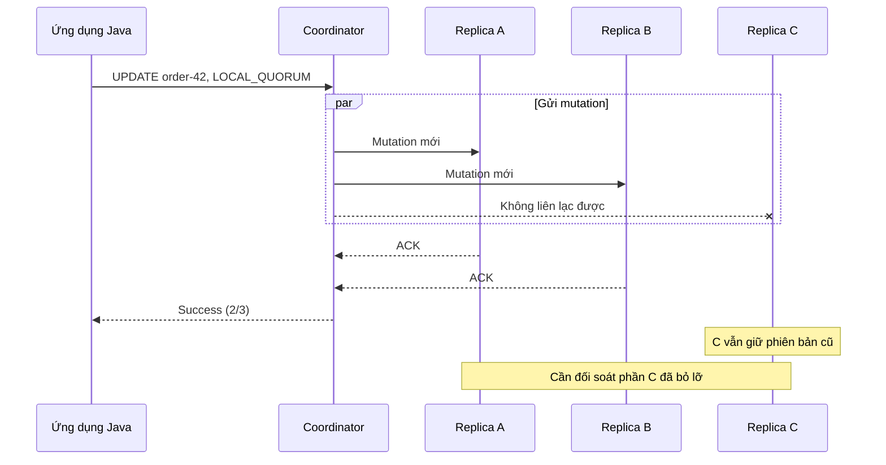
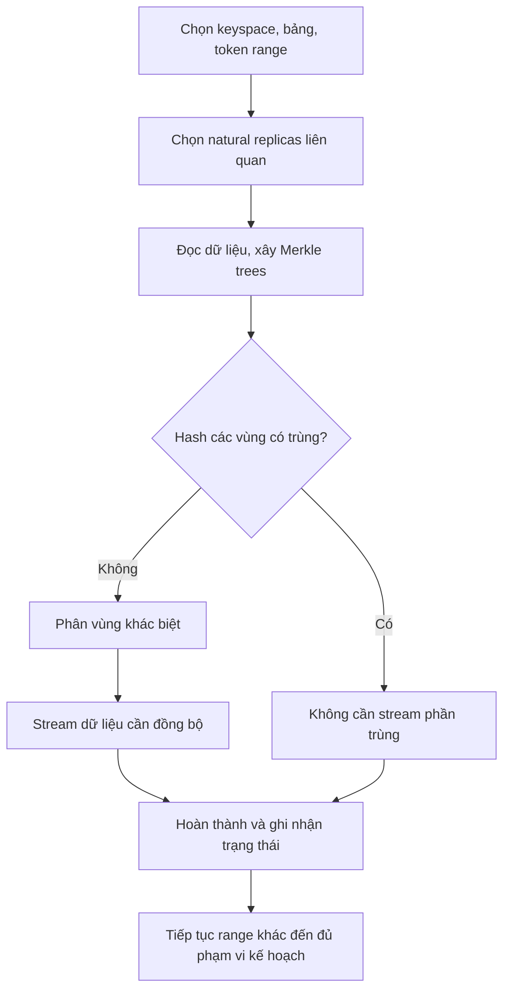

# Background repair/anti-entropy và nhu cầu đối soát chủ động

## 1. Vì sao các replica cần được đối soát?

Apache Cassandra là cơ sở dữ liệu **wide-column phân tán**: partition key xác định token và tập **natural replicas** theo replication strategy của keyspace. Trong một lần ghi, coordinator chỉ cần số phản hồi phù hợp **consistency level (CL)** của request để trả thành công. Với replication factor (RF) bằng 3 và write CL = `LOCAL_QUORUM` trong một data center (DC), hai replica xác nhận đã đủ; replica thứ ba có thể đang ngắt mạng, quá tải hoặc chưa nhận mutation.

Điều này giúp Cassandra tiếp tục phục vụ ứng dụng khi một phần cluster gặp sự cố, nhưng tạo ra nhu cầu **đồng bộ bản sao** sau sự cố. Một replica có thể bỏ lỡ thao tác `INSERT`, `UPDATE`, `DELETE` hoặc tombstone do TTL. Các replica còn lại có thể có dữ liệu mới hơn. Đối soát là việc phát hiện sai khác trên những token range mà các node cùng chịu trách nhiệm, rồi chuyển phần dữ liệu còn thiếu để các bản sao hội tụ.

Bài thuộc chương **Đồng bộ bản sao**, trong mô-đun `DATABASE_ENGINE_WIDE_COLUMN_CASSANDRA`. Kiến thức liên hệ trực tiếp đến partition key, mô hình theo truy vấn, mức nhất quán đọc/ghi, CQL, compaction, repair, khôi phục lỗi và độ tin cậy khi ứng dụng Java truy cập Cassandra.

Mục tiêu thực hành:

1. Phân biệt các cơ chế hội tụ **hinted handoff**, **read repair**, **anti-entropy repair** và **compaction**.
2. Giải thích repair kiểm tra token range bằng **Merkle tree** và streaming sai khác như thế nào.
3. Hiểu **background repair** là một công việc có lịch/điều phối; nhận biết sự khác nhau giữa các phiên bản Cassandra có và chưa có Auto Repair.
4. Xác định nhu cầu **đối soát chủ động định kỳ**, nhất là trước khi tombstone có thể bị thu gom.
5. Chọn phạm vi và kiểu repair phù hợp, kiểm tra kết quả, tránh nhầm hoàn tất một lệnh trên một node với đã repair toàn cluster.

## 2. Một tình huống phân kỳ bản sao

Giả sử keyspace `shop_ks` dùng `NetworkTopologyStrategy` với RF = 3 tại `dc1`. Ba replica của partition có khóa `order-42` là A, B và C.



Sau đó C khởi động lại. Không thể kết luận rằng C đã cập nhật chỉ vì:

- A và B đã ACK cho client;
- `nodetool status` hiển thị C ở trạng thái `UN` (Up/Normal);
- một truy vấn đọc ở `LOCAL_QUORUM` trả giá trị mới;
- quá trình compaction trên C chạy bình thường.

Đọc quorum có thể lấy phản hồi từ A/B và chưa chạm vào mọi partition trên C. Một replica **đang sống** không đồng nghĩa nó đã nhận **toàn bộ mutation** bị lỡ trong thời gian ngừng hoạt động.

### Một lần đọc trả đúng chưa đủ để tuyên bố đã hội tụ

| Thao tác | Kết quả quan sát được | Kết luận đúng |
| --- | --- | --- |
| `SELECT` tại CL = `ONE` trả giá trị cũ | Có thể request đã đọc replica chưa được cập nhật hoặc có vấn đề khác cần kiểm tra | Chưa có cơ sở nói mọi replica đều sai. |
| `SELECT` tại `LOCAL_QUORUM` trả giá trị mới | Truy vấn đó đã thỏa CL và tìm được dữ liệu được trả về theo cơ chế đọc | Không chứng minh tất cả replica và tất cả partition đồng bộ. |
| C chuyển từ `DN` sang `UN` | Node đã kết nối lại theo góc nhìn gossip | Không xác nhận hint đã phát hết hay repair đã hoàn tất. |
| `nodetool repair` của một phạm vi báo thành công | Phạm vi/tập dữ liệu đó đã hoàn tất quy trình repair được yêu cầu | Không nhất thiết bao phủ toàn cluster, toàn bảng hoặc dữ liệu không thuộc phạm vi. |

## 3. Các cơ chế hội tụ: cơ hội và giới hạn

| Cơ chế | Khi nào xảy ra? | Giúp được gì? | Giới hạn cần nhớ |
| --- | --- | --- | --- |
| **Hinted handoff** | Coordinator có thể giữ hint cho replica tạm không nhận ghi rồi phát lại khi node phục hồi | Khôi phục nhanh nhiều mutation bị lỡ trong outage ngắn | **Best effort**, giới hạn thời gian/cấu hình; hint có thể thiếu, thất lạc hoặc hết hạn. |
| **Read repair** | Trong đường đọc, khi dữ liệu các replica được liên hệ không đồng nhất và cơ chế của phiên bản/CL cho phép | Có thể sửa sai khác được phát hiện khi **đọc các partition đó** | Không quét các khóa không ai đọc; hành vi cụ thể khác theo phiên bản. |
| **Anti-entropy repair** | Một công việc repair chủ động được người vận hành, công cụ lập lịch hoặc Auto Repair khởi chạy | Đối chiếu dữ liệu trên **token range** và đồng bộ sai khác giữa các replica liên quan | Tốn disk/network/CPU; phải bao phủ đủ phạm vi, node và lịch. |
| **Compaction** | Scheduler compaction của từng node hoặc thao tác compaction thủ công | Hợp nhất SSTable cục bộ, giảm phiên bản/tombstone khi an toàn | **Không trao đổi dữ liệu giữa replica**, nên không thay cho repair. |

Repair là công cụ **anti-entropy**: so sánh dữ liệu hiện có của nhiều replica để phát hiện bất đồng rồi streaming chênh lệch. Read repair và hinted handoff có thể làm giảm độ lệch, nhưng **không thể dùng riêng chúng để bảo đảm mọi khóa, kể cả khóa lạnh không được truy cập, đã được đối soát**.

## 4. Anti-entropy repair hoạt động ra sao?

Ở mức khái niệm, một phiên repair gồm những bước sau:

1. **Xác định phạm vi:** keyspace, bảng, token range và những node giữ replica cho vùng dữ liệu cần đối soát.
2. **Chuẩn bị dữ liệu:** Cassandra xác định tập SSTable/partition cần kiểm tra theo loại repair, phiên bản và metadata repaired/unrepaired.
3. **Xây Merkle tree:** mỗi bên tạo cấu trúc phân cấp các hash đại diện cho dữ liệu theo phạm vi token. Hai cây cho phép tìm những vùng có khả năng khác nhau mà không phải chuyển toàn bộ dữ liệu để so từng hàng qua mạng.
4. **Đối chiếu:** các hash tương ứng được so sánh; vùng trùng có thể được bỏ qua, vùng khác được xác định để đồng bộ.
5. **Streaming sai khác:** các replica trao đổi dữ liệu cần thiết theo quy trình repair; SSTable và metadata liên quan có thể được cập nhật/viết lại.
6. **Ghi nhận trạng thái:** phiên repair có thể thành công, thất bại hoặc bị hủy; cần kiểm tra **phạm vi đã xử lý**, không chỉ nhìn một thông báo tổng.



**Merkle tree không phải bản sao đầy đủ của bảng**; nó dùng hash để khoanh vùng sai khác. Repair có thể tiêu thụ nhiều tài nguyên do phải quét dữ liệu, xây cây, streaming và đôi khi **anti-compaction**. Một lần repair thành công không phải lệnh SQL transaction toàn cluster và không khóa toàn bộ bảng chống ghi mới.

### Partition key và RF quyết định replica cần đối chiếu

Với bảng khai báo `PRIMARY KEY ((customer_id), order_id)`, partition key chỉ là `customer_id`. Dữ liệu của partition được đặt theo token, rồi replication strategy chọn các replica. Repair có thể phải đối chiếu A/B/C nếu cả ba là replica của token range liên quan, kể cả khi ứng dụng Java chỉ kết nối tới node A để đọc. Nếu keyspace có nhiều DC, kế hoạch repair còn phải xét **đủ DC và replica tham gia** thay vì suy toàn bộ từ node được chạy lệnh.

## 5. “Background repair” có tự động xảy ra không?

Từ **background** có thể gây hiểu nhầm. Nó mô tả công việc chạy ở tầng vận hành, ngoài luồng request CQL trực tiếp, **không tự động có nghĩa mọi cluster Cassandra đã được bật lịch repair đầy đủ**.

### Với Cassandra đời trước hoặc cluster chưa bật Auto Repair

Anti-entropy repair **cần được lên lịch chủ động** bằng `nodetool repair`, hệ thống vận hành hoặc công cụ điều phối như Cassandra Reaper. Việc node liên tục compaction, hinted handoff hoạt động hay ứng dụng đọc đều không thay thế lịch đối soát đó. Một cluster không có lịch repair vẫn có thể chạy ổn trong thời gian ngắn rồi tích lũy chênh lệch lâu dài khi có outage.

### Với phiên bản có Auto Repair

Apache Cassandra có **Auto Repair** theo CEP-37: cơ chế điều phối repair tích hợp được giới thiệu trong nhánh Cassandra 6.0 và backport vào **Cassandra 5.0.8**. Tài liệu phiên bản 5.0.8 mô tả việc phải kích hoạt JVM property `-Dcassandra.autorepair.enable=true` **trước khi khởi động** để tạo schema cần thiết, sau đó còn phải bật scheduler trong `cassandra.yaml` hoặc qua cơ chế quản trị hỗ trợ. Bước bật property này có tác động đến schema và được tài liệu mô tả **không thể đơn giản hoàn tác**; không làm trên production chỉ để thử bài lab.

Khi dùng Auto Repair, hệ thống có thể:

- Điều phối các lịch **incremental**, **full** và **preview repaired**.
- Chia nhỏ token range để giới hạn lượng dữ liệu trong một lần repair, điều tiết số job song song và tự retry một số lỗi.
- Theo dõi lịch sử, ví dụ dữ liệu trong `system_distributed.auto_repair_history` khi phiên bản/tính năng hỗ trợ.
- Cung cấp công cụ như `nodetool autorepairstatus -t incremental` trên phiên bản phù hợp.

**Không được suy Auto Repair đang bật chỉ từ số phiên bản.** Các nhánh Cassandra có điều kiện hỗ trợ và mặc định cấu hình khác nhau; với 5.0.8, riêng việc có tính năng chưa đồng nghĩa scheduler đang chạy. Trước khi thêm cron hoặc Reaper, xác nhận version, trạng thái lịch hiện có và phạm vi được bao phủ để tránh **hai hệ thống cùng chạy repair chồng lấn**.

| Môi trường | Câu hỏi xác minh | Hành động phù hợp |
| --- | --- | --- |
| Cassandra không có Auto Repair tích hợp | Có cron/automation/Reaper và nhật ký thành công gần nhất cho từng node/range không? | Thiết lập lịch repair phù hợp, theo dõi thất bại và các phạm vi bỏ sót. |
| Cassandra hỗ trợ Auto Repair nhưng chưa kích hoạt | Có cấu hình, lịch và trạng thái scheduler hay chưa? | Thiết kế phương án bật theo tài liệu đúng version; đánh giá tác động nâng cấp/cấu hình. |
| Cassandra có Auto Repair đang chạy | Các loại full/incremental, interval, coverage, failed ranges và trạng thái job thế nào? | Giám sát và đối soát coverage; tránh tạo lịch repair thủ công trùng lặp. |

## 6. Full repair và incremental repair

Hai chế độ có vai trò bổ sung:

| Thuộc tính | **Incremental repair** | **Full repair** |
| --- | --- | --- |
| Dữ liệu kiểm tra | Phần dữ liệu **chưa được đánh dấu repaired** từ các chu kỳ incremental trước | Toàn bộ dữ liệu thuộc phạm vi repair được chỉ định, kể cả dữ liệu đã đánh dấu repaired. |
| Chi phí khi chạy đều đặn | Thường thấp hơn vì tập dữ liệu mới/chưa repaired nhỏ hơn | Thường tốn I/O, CPU, network và thời gian hơn trên cùng phạm vi. |
| Metadata/SSTable | Có thể đánh dấu dữ liệu repaired và dùng **anti-compaction** để tách repaired/unrepaired SSTables | Không thay thế quy trình đánh dấu repaired của incremental repair. |
| Hạn chế | Nếu dữ liệu đã repaired về sau bị hỏng/mất ở một replica, incremental tiếp theo có thể bỏ qua tập đó | Phù hợp đối soát lại cả dữ liệu cũ, nhưng cần giới hạn phạm vi và kiểm soát tải. |
| Nhu cầu vận hành | Lịch lặp đều đặn, bao phủ dữ liệu mới và tránh backlog | Lịch định kỳ thưa hơn hoặc repair có chủ đích khi cần xác minh/khôi phục tập dữ liệu cũ. |

Trong các bản Cassandra hiện đại, `nodetool repair` thường chạy **incremental mặc định**; `nodetool repair --full` yêu cầu full repair. Hãy kiểm tra `nodetool help repair` trên đúng phiên bản trước khi xây runbook. **Không chạy full rồi incremental liên tiếp theo phản xạ**: cần hiểu trạng thái repaired/unrepaired, lịch đang có và tài nguyên.

Một chu kỳ incremental đầu tiên trên cluster đã hoạt động lâu có thể phải đọc lượng lớn dữ liệu **chưa từng được đánh dấu repaired**. Nó có thể gây anti-compaction và phát sinh I/O/dung lượng đĩa đáng kể; không được dự tính chi phí chỉ dựa vào lượng ghi của một giờ gần nhất.

## 7. Vì sao phải đối soát chủ động trước khi tombstone hết thời gian bảo vệ?

Cassandra đánh dấu dữ liệu đã xóa bằng **tombstone**. Tombstone phải được truyền/nhìn thấy ở các replica có thể còn giữ dữ liệu cũ. Sau thời gian **`gc_grace_seconds`** và khi đáp ứng các điều kiện an toàn của compaction, tombstone có thể được dọn khỏi các SSTable. Nếu một replica vắng mặt quá lâu, chưa nhận tombstone và dữ liệu xóa đã mất dấu trên các replica khỏe, dữ liệu cũ có thể được gửi trở lại trong một lần đọc/repair/streaming về sau — hiện tượng **zombie data**.

```text
Ngày 0: A/B/C đều có order-42 = "ACTIVE"
Ngày 1: C ngừng hoạt động; DELETE/TTL tạo tombstone trên A và B
Ngày 2: Ghi/đọc vẫn có thể thành công tại CL phù hợp trên A/B
...
Sau gc grace và compaction đủ điều kiện:
        A/B có thể không còn tombstone dùng để bác bỏ dữ liệu cũ
Ngày N: C quay lại mang bản ghi cũ
Rủi ro: dữ liệu cũ có thể xuất hiện lại nếu không được đối soát đúng lúc
```

Đó là lý do kế hoạch repair cần:

- **Bao phủ mọi token range, bảng và replica** chịu trách nhiệm, bao gồm các DC liên quan.
- Có chu kỳ repair **ngắn hơn thời gian bảo vệ tombstone**, với dư địa cho outage, repair thất bại, backlog và bảo trì. Không dùng lịch “đúng bằng `gc_grace_seconds`” vì chỉ cần trễ một job đã tạo khoảng rủi ro.
- Theo dõi **thời điểm lần repair thành công cuối cùng theo phạm vi**, không chỉ theo thời điểm cron đã khởi động.
- Xử lý node down dài ngày, thay node, tăng RF, thay topology và dữ liệu đã repaired từ lâu bằng kế hoạch phù hợp, có thể cần full repair/kiểm tra bổ sung.

**Ví dụ:** nếu `gc_grace_seconds = 864000` (10 ngày), một lịch sửa sai khác **đủ coverage** thường phải hoàn tất nhanh hơn nhiều so với 10 ngày; chọn chu kỳ thực tế dựa trên tải, dung lượng, thời gian repair và khả năng thất bại. Không tự ý giảm `gc_grace_seconds` để tiết kiệm tombstone, vì có thể làm tăng nguy cơ dữ liệu sống lại. TTL hết hạn cũng có ngữ nghĩa xóa; cần tính đến đường lan truyền tombstone và tính đúng đắn của ứng dụng.

## 8. RF, CL và repair giải quyết các mục tiêu khác nhau

Giả sử RF = 3 tại `dc1`:

| Cấu hình / hiện tượng | Điều gì được bảo đảm ở request đó? | Điều gì vẫn cần repair? |
| --- | --- | --- |
| Ghi `ONE` trả success | Một replica đã xác nhận theo write path | Hai replica còn lại có thể chưa nhận dữ liệu. |
| Ghi `LOCAL_QUORUM` trả success | Hai replica địa phương đã ACK | Replica thứ ba có thể còn cũ. |
| Đọc `LOCAL_QUORUM` trả giá trị mới | Phản hồi đọc thỏa ngưỡng local quorum và quy tắc reconciliation | Các partition không được đọc vẫn có thể lệch; dữ liệu cũ trên replica khác vẫn cần đối soát. |
| Node C phục hồi và phát hết hint có sẵn | Những mutation được hint và phát thành công đã được chuyển | Mutation không được hint, hint thất lạc/hết hạn và phạm vi không được đọc có thể còn lệch. |
| Compaction giảm SSTable trên A | Chi phí đọc cục bộ có thể giảm | B/C không tự nhận dữ liệu thiếu từ A. |

Quy tắc trực giác `R + W > RF` cho quorum đọc/ghi cùng phạm vi giúp các tập replica **giao nhau** trong nhiều trường hợp, nhưng **không thay cho repair chống lệch dữ liệu lâu dài**. Với multi-DC, `LOCAL_QUORUM` ở hai DC khác nhau không tạo giao nhau bắt buộc; cần kế hoạch repair và consistency đúng nhu cầu nghiệp vụ.

## 9. Phạm vi một lệnh `nodetool repair`

Các lệnh sau **chỉ minh họa cú pháp**. Trên cluster đang chạy thật, một lần repair có thể tốn nhiều CPU, disk I/O và network. Dùng keyspace/table thử nghiệm và đọc trợ giúp đúng phiên bản trước khi thực thi.

```bash
# Xác minh cú pháp và phiên bản công cụ trước khi lên lịch:
nodetool help repair
nodetool status

# Repair một bảng/keyspace trên các range do node này xử lý:
nodetool repair repair_lab_ks orders_by_id

# Full repair của bảng trên phạm vi do node nhận lệnh xử lý:
nodetool repair --full repair_lab_ks orders_by_id

# Giới hạn vào primary token ranges của node (theo tài liệu phiên bản):
nodetool repair -pr repair_lab_ks orders_by_id
```

**Giới hạn phạm vi đặc biệt quan trọng:**

1. Lệnh được gọi **trên một node** và khởi tạo repair cho các range thuộc phạm vi nó xử lý. Nó liên hệ replica liên quan để so sánh/stream; **không có nghĩa mọi range của mọi bảng trong cluster đã được repair**.
2. Chỉ định `repair_lab_ks orders_by_id` giúp giới hạn **keyspace/table**. Không chạy lệnh không đối số trên cluster lớn trừ khi thật sự định xử lý phạm vi đó.
3. `-pr`/`--partitioner-range` giới hạn các **primary ranges** của node. Để bao phủ toàn cluster theo phương án này, phải chạy các node/những DC thích hợp theo runbook và kiểm tra tránh bỏ sót range; không chỉ chạy một node rồi tuyên bố xong.
4. Các tùy chọn giới hạn DC, host, token range, số job, preview hoặc validate thay đổi phạm vi/cách chạy. **Một lần repair với bộ lọc hẹp chỉ bảo đảm cho bộ lọc hẹp**; kiểm tra cách hoạt động theo phiên bản.
5. Repair **không thay đổi RF**, không tạo bảng mới, không thay partition key hoặc tự sửa các giả định về truy vấn Java.

Muốn đánh giá chênh lệch trước khi truyền dữ liệu, một số phiên bản hỗ trợ:

```bash
# Chỉ ước lượng lượng streaming; không thực hiện đồng bộ:
nodetool repair --preview --full repair_lab_ks orders_by_id

# Kiểm tra tập repaired data; không streaming để sửa:
nodetool repair --validate repair_lab_ks orders_by_id
```

Các chế độ `--preview` và `--validate` **không đồng nghĩa repair đã sửa dữ liệu**. Preview/validate có semantics khác nhau theo phạm vi và loại dữ liệu (ví dụ validate nhóm đã repaired); chúng cũng tốn tài nguyên. Xác nhận tùy chọn có thực trên version đang vận hành.

## 10. Lập lịch background repair có kiểm soát

Một lịch anti-entropy hữu dụng cần cụ thể hơn việc đặt một dòng cron `nodetool repair`.

| Thành phần kế hoạch | Cần xác định |
| --- | --- |
| **Coverage** | Những keyspace/table/token range/DC nào, có bỏ sót data center hoặc bảng mới không? |
| **Kiểu repair** | Incremental hay full, khi nào phải kiểm tra lại tập repaired data? |
| **Chu kỳ** | Bao lâu một lần một range được repair **thành công**? Có margin với `gc_grace_seconds`? |
| **Điều phối** | Chạy tối đa bao nhiêu node/range đồng thời; tránh chồng với streaming, backup, compaction lớn? |
| **Khả năng phục hồi** | Job lỗi, node down, upgrade, thay topology: retry thế nào, ai nhận cảnh báo, có checkpoint/tiếp tục không? |
| **Tài nguyên** | Disk free, network throughput, CPU/GC, pending compactions, số SSTable, streaming backlog. |
| **Bằng chứng** | Lịch sử, log, elapsed time, token range hoàn tất/thất bại, alert khi quá thời hạn. |

**Ví dụ lịch khởi điểm:** Một cluster có `gc_grace_seconds` mặc định 10 ngày có thể đặt repair incremental đều đặn theo ngày và full repair định kỳ thưa hơn, rồi điều chỉnh theo kích thước, thời gian chạy, lượng dữ liệu thay đổi và khả năng chịu tải. Lịch đó **không phải ngưỡng bắt buộc cho mọi cluster**; chất lượng vận hành được đo ở **coverage và thời gian hoàn tất**, không phải số lần lên lịch trên bảng điều khiển.

### Khi có Auto Repair tích hợp

Chỉ sau khi xác nhận tính năng và quyền thay đổi cấu hình trên version tương ứng, người vận hành có thể kiểm tra lịch, khoảng cách tối thiểu giữa những phiên repair, số job song song, loại repair và lịch sử lỗi bằng công cụ/metadata dành riêng cho Auto Repair. Ví dụ lệnh đọc trạng thái trên version hỗ trợ:

```bash
nodetool autorepairstatus -t incremental
nodetool autorepairstatus -t full
```

**Không** chạy các lệnh trên nếu môi trường không có tính năng; không suy lệnh `autorepairstatus` là phổ biến ở mọi nhánh Cassandra. Đừng kích hoạt một scheduler mới nếu trước đó cluster đã có lịch Reaper/cron đang hoạt động mà chưa thiết kế chuyển đổi.

## 11. Quan sát và xác minh kết quả repair

Trước và trong khi repair, thu ít nhất những thông tin sau trên các node liên quan:

```bash
nodetool status
nodetool netstats
nodetool tpstats
nodetool compactionstats
nodetool tablestats repair_lab_ks.orders_by_id
```

- `status` cho biết node đang Up/Down, Joining/Leaving/Normal theo góc nhìn quản trị; nó **không** là thống kê nhất quán replica.
- `netstats` cho biết tình trạng streaming/giao tiếp dữ liệu; cần đối chiếu logs và phiên repair cụ thể.
- `tpstats` giúp phát hiện hàng đợi/tải; một số version hiển thị pool/tác vụ repair.
- `compactionstats`, `tablestats` và metrics disk giúp thấy áp lực I/O, SSTable và anti-compaction khi repair gia tăng.
- **Logs, repair session ID, trạng thái thành công/thất bại, số range hoàn tất và lịch sử job** mới giúp quyết định phạm vi có thực sự được xử lý.

> Một counter số repair task `Completed` **không** chứng minh tất cả replica/tables trong cluster đã repair. Cần có bản ghi **range × table × DC × thời gian** và bằng chứng những job lỗi đã được chạy lại.

Các chỉ số hữu ích khi đối chiếu hậu quả:

| Nhóm chỉ số | Diễn giải |
| --- | --- |
| Repair duration, failed sessions, ranges completed | Xem lịch có chạy và **bao phủ đủ phạm vi** theo kế hoạch không. |
| Bytes streamed / pending streaming | Bao nhiêu dữ liệu được chuyển; số byte bằng 0 có thể là đã đồng bộ **trong phạm vi đã kiểm tra**, không phải trên mọi bảng. |
| Pending compactions, disk free, SSTable count | Repair/anti-compaction có đang gây tải hoặc cần không gian bổ sung không. |
| Read/write p95–p99 latency, timeouts, retries | Repair nền có làm ảnh hưởng ứng dụng không; so sánh cùng mức tải và CL. |
| Hints pending và các lỗi gossip/network | Xem môi trường có nhiều outage kéo dài hoặc khả năng bỏ lỡ mutation không. |
| Repair history / preview repaired | Xác nhận lịch mới nhất, những phạm vi có sai khác; xem tính năng theo phiên bản. |

Trong ứng dụng Java, lỗi đọc/ghi hoặc dữ liệu nhìn thấy khác nhau ở `ONE` và `LOCAL_QUORUM` có thể là tín hiệu cần điều tra, **không đủ để quyết định repair toàn cluster ngay lập tức**. Phải đối chiếu CL, timestamps, TTL, consistency của client, logs và chính xác partition key trước khi quy lỗi cho replica desynchronization.

## 12. Lab có thể tái hiện trên cluster thử nghiệm

**Môi trường:** Cassandra lab một DC có đủ node cho RF = 3, với data center ví dụ tên `dc1`. Nếu topology khác, thay tên DC/RF. Không tạo outage hoặc chạy repair toàn keyspace trên production để mô phỏng.

### 12.1. Tạo bảng có khóa phân vùng rõ ràng

```sql
CREATE KEYSPACE repair_lab_ks
WITH replication = {'class': 'NetworkTopologyStrategy', 'dc1': '3'}
AND durable_writes = true;

CREATE TABLE repair_lab_ks.orders_by_id (
    customer_id text,
    order_id uuid,
    state text,
    updated_at timestamp,
    PRIMARY KEY ((customer_id), order_id)
) WITH gc_grace_seconds = 864000;

INSERT INTO repair_lab_ks.orders_by_id
    (customer_id, order_id, state, updated_at)
VALUES
    ('cust-42', 11111111-2222-3333-4444-555555555555,
     'CREATED', toTimestamp(now()));
```

Partition key là `customer_id`, clustering key là `order_id`. Có thể chạy:

```sql
CONSISTENCY LOCAL_QUORUM

SELECT customer_id, order_id, state
FROM repair_lab_ks.orders_by_id
WHERE customer_id = 'cust-42'
  AND order_id = 11111111-2222-3333-4444-555555555555;
```

Trên lab ba node, xem danh sách replicas:

```bash
nodetool status
nodetool getendpoints repair_lab_ks orders_by_id cust-42
```

`getendpoints` chỉ cho biết **natural replicas theo metadata** của node đang được hỏi, không chứng minh từng replica đã có một bản ghi cụ thể.

### 12.2. Đo trước/sau một repair được chọn

1. Ghi lại thời điểm, Cassandra version, keyspace, table, RF/CL, danh sách node/replica, trạng thái và lịch repair đang bật.
2. Thu baseline bằng `nodetool tablestats`, `netstats`, log và thời gian đọc CQL trên một tập partition có kiểm soát.
3. Trên một node được chọn và sau khi kiểm tra disk/network, chạy **một loại repair phù hợp mục đích** (chẳng hạn full repair của riêng bảng lab). Ghi lại session ID và kết quả.
4. Kiểm tra có range lỗi, job dừng hoặc streaming chưa hoàn tất không. Lặp lại các metric, thời gian đọc và kết quả truy vấn.
5. Giải thích vì sao repair từ một node **chưa** là kế hoạch toàn cluster; để có coverage cần thực hiện theo token range/host/DC còn thiếu.

Không bắt buộc phá hỏng node để tạo sai khác. Một lab khỏe có thể streaming **0 byte** vì các replica vốn đã đồng bộ, nhưng vẫn đủ để tập đọc logs, phạm vi và chi phí. Nếu muốn mô phỏng outage thực, chỉ làm trong cluster thử nghiệm có quy trình khôi phục đã chuẩn bị.

### 12.3. Quan sát tác động nghiệp vụ từ Java

Đoạn Java Driver 4.x sau minh họa một **đọc đã xác định partition key**; giả sử đã có `session` và import tương ứng:

```java
PreparedStatement ps = session.prepare(
    "SELECT state, updated_at FROM repair_lab_ks.orders_by_id " +
    "WHERE customer_id = ? AND order_id = ?"
);

BoundStatement query = ps.bind(
    "cust-42",
    UUID.fromString("11111111-2222-3333-4444-555555555555")
).setConsistencyLevel(DefaultConsistencyLevel.LOCAL_QUORUM);

long startNs = System.nanoTime();
Row row = session.execute(query).one();
long latencyMs = (System.nanoTime() - startNs) / 1_000_000;

System.out.println("latencyMs=" + latencyMs);
System.out.println("state=" + (row == null ? "<missing>" : row.getString("state")));
```

Trong lúc repair, p95/p99 và timeout của driver có thể thay đổi vì repair tiêu thụ disk/network. Tối ưu bảo trì không được chỉ đo “repair xong chưa”, mà phải cân bằng **đủ coverage, chi phí, độ trễ và tính đúng đắn dữ liệu**. CL = `LOCAL_QUORUM` không biến mỗi truy vấn Java thành một lần anti-entropy quét toàn bảng.

## 13. Quy trình xử lý các tình huống khó

| Tình huống | Phân tích cần làm | Hướng xử lý |
| --- | --- | --- |
| Node C down vài giờ, sau đó Up | Hints đã phát đủ chưa? Mất mutation nào? Lần repair thành công cuối là khi nào? | Chạy/đợi repair theo lịch và phạm vi phù hợp, giám sát streaming; không chỉ dựa vào `UN`. |
| Node down vượt quá khoảng `gc_grace_seconds` | Tombstone có thể đã bị loại ở replica còn sống, dữ liệu cũ có nguy cơ hồi sinh | Xử lý theo runbook khôi phục/thay node và kiểm tra dữ liệu; không đưa node cũ vào bình thường rồi coi mọi thứ an toàn. |
| Lịch repair thường xuyên nhưng vẫn thiếu range | Cron chỉ chạy một node hoặc lọc một DC/bảng | Kiểm kê range × host × DC, bù các khoảng thiếu và theo dõi completion. |
| Incremental báo xong nhưng nghi hỏng dữ liệu cũ | Phần repaired đã được bỏ qua trong lần incremental sau | Cân nhắc full repair và các chế độ preview/validate nếu version hỗ trợ. |
| Repair gây timeout hoặc disk gần đầy | Streaming/anti-compaction tranh tài nguyên; còn bao nhiêu disk, chạy mấy job song song? | Giảm song song/đổi lịch hoặc giới hạn phạm vi theo quy trình, kiểm tra tính sẵn sàng của workload. |
| Một DC không liên lạc được | CL `LOCAL_*` vẫn có thể phục vụ ở DC còn sống, nhưng dữ liệu xuyên DC có thể lệch | Kiểm tra replication strategy và lịch đối soát cho tất cả DC liên quan. |
| Mới tăng RF | Replica mới chưa chắc có đầy đủ dữ liệu lịch sử | Lập kế hoạch full repair/streaming thích hợp cho topology mới; không coi `ALTER KEYSPACE` là thao tác sao chép đầy đủ. |

**Tránh sửa dữ liệu thủ công bằng cách “copy SSTable” không có quy trình tương thích.** SSTable chịu ràng buộc version, token range, repaired metadata và schema; dùng công cụ quản trị/streaming/repair được hỗ trợ của đúng phiên bản.

## 14. Những ngộ nhận cần loại bỏ

| Nhận định | Kết luận đúng |
| --- | --- |
| “Cassandra eventual consistency nên tự sửa hết dữ liệu nền.” | **Không đủ cơ sở.** Hints/read repair là best effort; anti-entropy cần lịch phù hợp hoặc Auto Repair đã bật và được theo dõi. |
| “`LOCAL_QUORUM` đã thành công nên cả ba replica giống nhau.” | **Sai.** Chỉ cần đủ ACK theo ngưỡng, không đòi tất cả replica xác nhận. |
| “Node `UN` nghĩa là đã nhận đủ dữ liệu trong outage.” | **Sai.** Trạng thái sống không nói lên độ hội tụ dữ liệu. |
| “Compaction làm tương đương repair.” | **Sai.** Compaction gộp SSTable cục bộ; repair so sánh và chuyển dữ liệu giữa replica. |
| “Mở Auto Repair ở bản mới là xong.” | **Sai.** Phải xác minh tính năng được bật, có lịch, job chạy thành công và không bỏ sót range/table/DC. |
| “Incremental repair kiểm lại toàn bộ dữ liệu cũ mỗi lần.” | **Sai.** Thường tập trung vào dữ liệu chưa repaired từ các chu kỳ trước. |
| “`--preview` hoặc `--validate` đã khắc phục sai khác.” | **Sai.** Các chế độ đó kiểm tra/ước lượng chứ không streaming để sửa. |
| “Repair kết thúc ở một node là xong toàn cluster.” | **Sai.** Phải xét phạm vi token range, node và DC theo kế hoạch. |
| “Tombstone hết `gc_grace_seconds` là an toàn để xóa trong mọi tình huống.” | **Sai.** Replica từng bỏ lỡ thao tác xóa vẫn có thể giữ dữ liệu cũ; lịch repair và các điều kiện compaction quyết định rủi ro. |

## 15. Tự kiểm tra

1. RF = 3, ghi `LOCAL_QUORUM` thành công khi C đang down. Khi C trở lại `UN`, tại sao vẫn cần đối soát?
2. Vì sao read repair không bảo đảm sửa được partition không có request đọc trong nhiều tháng?
3. Merkle tree giúp giảm việc chuyển dữ liệu khi repair bằng cách nào? Khi nào streaming xảy ra?
4. Tại sao phải biết cluster đang có Auto Repair tích hợp hay Reaper/cron trước khi tạo lịch mới?
5. Phân biệt một incremental repair thành công với full repair khi một phần dữ liệu **đã repaired trước đây** bị sai.
6. Với `gc_grace_seconds` 10 ngày, điều gì xảy ra nếu node giữ dữ liệu cũ bị cô lập lâu hơn thời hạn này và tombstone đã bị dọn? Vì sao lịch repair cần dư địa?
7. Nếu chạy `nodetool repair -pr repair_lab_ks orders_by_id` trên một node, điều gì phải kiểm tra trước khi báo “repair toàn cluster hoàn tất”?
8. Sau một repair streaming 0 byte, có thể kết luận toàn cluster không có chênh lệch không? Giải thích phạm vi của bằng chứng.

**Tiêu chí hoàn thành bài:** Người học mô tả được đường hội tụ giữa các replica, phân biệt cơ chế tự phát và chủ động, hiểu full/incremental/Auto Repair theo phiên bản, xác định phạm vi vận hành và có kế hoạch **repair đủ coverage trước nguy cơ tombstone mất hiệu lực**, với số liệu xác minh thay vì chỉ nhìn trạng thái node.

## 16. Tài liệu tra cứu

- [Apache Cassandra — Repair](https://cassandra.apache.org/doc/stable/cassandra/managing/operating/repair.html): Merkle tree, full/incremental, `nodetool repair`, phạm vi primary range và lịch vận hành.
- [Apache Cassandra — Hints](https://cassandra.apache.org/doc/stable/cassandra/managing/operating/hints.html): hinted handoff và giới hạn best effort của việc phát mutation bị lỡ.
- [Apache Cassandra — Auto Repair](https://cassandra.apache.org/doc/stable/cassandra/managing/operating/auto_repair.html): CEP-37, điều kiện khả dụng từ 5.0.8/6.0, scheduler, cấu hình và theo dõi.
- [Apache Cassandra — nodetool repair](https://cassandra.apache.org/doc/stable/cassandra/managing/tools/nodetool/repair.html): cú pháp thực tế của các tùy chọn repair theo phiên bản.
- [Apache Cassandra — Storage Engine](https://cassandra.apache.org/doc/stable/cassandra/architecture/storage-engine.html): memtable, SSTable, compaction và dữ liệu xóa.

**Kết luận thực hành:** RF và CL giúp Cassandra tiếp tục hoạt động giữa sự cố, nhưng có thể để lại replica lỡ mutation. Hinted handoff, read repair và compaction đều có vai trò riêng; **anti-entropy repair có phạm vi, lịch và bằng chứng hoàn tất** mới là cơ chế chủ động để phát hiện và sửa sai khác trên các token range ít được đọc. Với Cassandra có Auto Repair, hãy xác minh scheduler thực sự bật và đủ coverage; với môi trường khác, phải có lịch do người vận hành điều phối. Repair kịp thời là một phần quan trọng để tránh dữ liệu cũ xuất hiện trở lại khi tombstone đã bị dọn.
