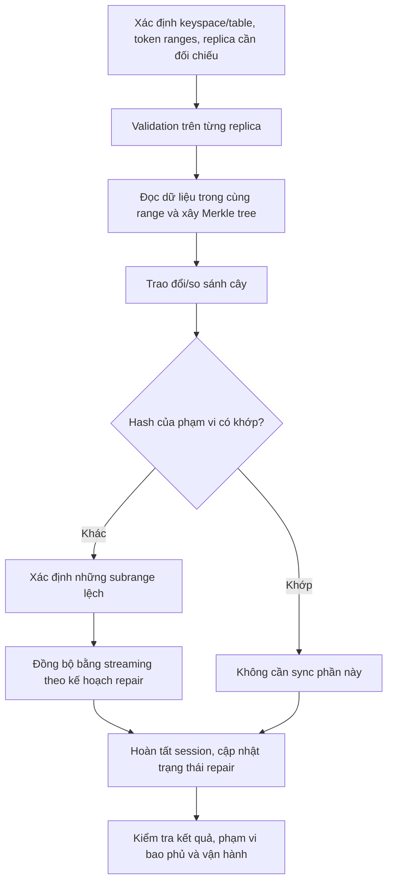

# Merkle tree và so sánh dữ liệu trên cùng khoảng token

> **Chương:** Đồng bộ bản sao  
> **Mô-đun:** `DATABASE_ENGINE_WIDE_COLUMN_CASSANDRA` — Apache Cassandra, cơ sở dữ liệu wide-column phân tán.  
> **Trọng tâm:** Hiểu cách anti-entropy repair xây dựng, đối chiếu Merkle tree trên **cùng token range**, xác định vùng sai khác và truyền dữ liệu giữa các replica.

Trong Cassandra, một partition được xác định bởi **partition key** và được ánh xạ thành **token** qua partitioner. Dựa trên replication strategy và RF (replication factor), cùng partition có thể có nhiều bản sao ở các node khác nhau. Đọc/ghi ở một consistency level (CL) như `LOCAL_QUORUM` không bảo đảm mọi replica luôn có đúng cùng trạng thái tại mọi thời điểm: node có thể Down, mạng có thể phân vùng, một replica có thể bỏ lỡ mutation hoặc chưa nhận được tombstone.

Cassandra sử dụng **anti-entropy repair** để tìm sai khác giữa các replica và đồng bộ lại dữ liệu. Một công cụ cốt lõi của quá trình này là **Merkle tree**: cấu trúc cây băm cho phép so sánh hai tập dữ liệu bằng cách so băm ở các nhánh, chỉ đi sâu vào những vùng có khác biệt, thay vì truyền toàn bộ dữ liệu để so từng hàng qua mạng.

Điểm quan trọng nhất: **hai cây phải đại diện cho cùng một khoảng token và cùng phạm vi dữ liệu có thể so sánh**. So root hash của hai tập token khác nhau không giúp kết luận dữ liệu đồng nhất hay không.

## 1. Mục tiêu học tập

Sau bài học, bạn có thể:

1. Giải thích partition key → token → token range → tập replica cần được so sánh.
2. Mô tả cấu tạo cây Merkle, hash ở lá và hash cha, cách phát hiện vùng sai khác.
3. Phân biệt bước **validation (xây cây)**, **comparison (so cây)** và **synchronization (stream dữ liệu)** trong repair.
4. Hiểu giới hạn của Merkle tree: hash cho biết **vùng có thể khác nhau**, không trực tiếp chỉ ra “row X phải được copy từ A sang B” trong mọi trường hợp.
5. Lựa chọn và giám sát `nodetool repair` theo policy, phân biệt full và incremental repair, đọc kết quả thành công/thất bại.
6. Liên hệ repair với consistency level, tombstone, `gc_grace_seconds`, compaction, streaming, khả năng node Down và ứng dụng Java.
7. Tạo bài kiểm thử nhiều replica, có fault injection và bằng chứng repair thật sự hoàn tất.

## 2. Ôn lại token và quyền sở hữu replica

### 2.1. Partition key được băm thành token

Giả sử ta lưu các sự kiện tài khoản:

```sql
CREATE KEYSPACE IF NOT EXISTS lab_sync
WITH replication = {
  'class': 'NetworkTopologyStrategy',
  'dc1': 3
};

CREATE TABLE IF NOT EXISTS lab_sync.events_by_account (
    account_id uuid,
    event_time timestamp,
    event_id timeuuid,
    event_type text,
    payload text,
    PRIMARY KEY ((account_id), event_time, event_id)
) WITH CLUSTERING ORDER BY (event_time DESC, event_id DESC);
```

**Điều kiện lab:** datacenter `dc1` có đủ ba replica thích hợp cho RF=3. Phải đổi keyspace/topology theo thực tế nếu lab khác. Trong bảng:

- `account_id` là **partition key**, quyết định token của toàn bộ partition.
- `event_time` và `event_id` là clustering columns, giúp sắp xếp dữ liệu **bên trong** partition.
- Mọi hàng cùng `account_id` chia sẻ token, ngay cả khi có nhiều thời điểm hay event.
- Partitioner thông dụng là `Murmur3Partitioner`; thuật toán và cách lưu token phải phù hợp cấu hình cụm.

Một token range thường ký hiệu `(t_left, t_right]`, nghĩa là không chứa token biên trái và có chứa biên phải. Token ring là vòng tròn; range có thể đi qua điểm cuối miền token. Với **vnodes**, mỗi node có nhiều token, vì vậy nó có thể chịu trách nhiệm nhiều khoảng rời nhau.

### 2.2. Cùng token range nghĩa là gì?

Giả sử hai node A và B cùng là replica của một range R = `(100, 200]` trong một keyspace (con số minh họa, không phải token thực của bảng).

| Partition | Token minh họa | Có thuộc R? |
|---|---:|---|
| `account_1` | 108 | Có |
| `account_2` | 165 | Có |
| `account_3` | 210 | Không |
| `account_4` | 200 | Có |
| `account_5` | 100 | Không |

Để so đúng R, cả A lẫn B cần dựng biểu diễn cho **các partition có token thuộc (100, 200]**, dưới **cùng keyspace/table và quy tắc so sánh tương ứng**. Nếu A dựng cây cho `(100,200]` còn B dựng cho `(150,250]`, root hash khác không đủ nói A và B sai dữ liệu; hai cây đang nói về hai phạm vi khác nhau.

Khi một keyspace có nhiều DC, **NetworkTopologyStrategy** chọn replica theo RF của từng DC/rack. Chỉ so những node **cùng là replica cho phạm vi đã được xác định**; không phải cứ hai node trong cụm là phải chứa mọi partition giống nhau.

### 2.3. Ví dụ vì sao hai replica lệch nhau

Một kịch bản điển hình với RF=3, A/B/C giữ R:

1. C tạm Down.
2. Client gửi `INSERT` hoặc `DELETE` ở CL `LOCAL_QUORUM`; A và B xác nhận đủ hai ACK.
3. C chưa nhận mutation.
4. C quay lại và có thể chứa phiên bản cũ.
5. Repair được dùng để phát hiện và đồng bộ phần sai khác.

Hinted handoff có thể chuyển một số mutation bị bỏ lỡ trong giới hạn cấu hình, nhưng **không thay thế repair**. Read repair chỉ tác động những dữ liệu/phạm vi được đọc trong điều kiện cụ thể, không bảo đảm toàn bộ token range được đối chiếu.

## 3. Merkle tree là gì?

**Merkle tree** là cây mà mỗi nút đại diện cho một hash của dữ liệu bên dưới. Lá đại diện cho một tập con dữ liệu; hash của nút cha được tính từ hash các nhánh con (hoặc từ phép tổ hợp xác định tương đương).

### 3.1. Cây minh họa cho một range

Giả sử R = `(100,200]` được chia thành bốn subrange:

- `R1 = (100,125]`
- `R2 = (125,150]`
- `R3 = (150,175]`
- `R4 = (175,200]`

Hai replica có cùng dữ liệu ở R1, R2, R4 nhưng B thiếu một update ở R3.

```text
       Replica A                            Replica B
       Root hA                              Root hB
          / \                                  / \
       h12  h34                            h12   h34'
       / \  / \                             / \   / \
      h1 h2 h3 h4                         h1 h2  h3' h4
            ^                                     ^
         Range R3                              Range R3

  Root khác → so các nhánh
  h12 bằng nhau → không cần đi sâu R1, R2
  h34 khác      → đi sâu R3, R4
  h3 khác       → chỉ R3 có sai khác cần đồng bộ
```

Ví dụ này **đơn giản hóa** cấu trúc và cách phân hoạch. Cassandra có thể dùng độ sâu cây, cách chia token range và hash nội bộ theo phiên bản/khối lượng dữ liệu; lá không bắt buộc tương ứng với **một row** hay một token duy nhất.

### 3.2. Tại sao việc so hash tiết kiệm dữ liệu?

Nếu một replica chứa hàng triệu partition, truyền toàn bộ bản ghi sang node khác chỉ để kiểm tra khác biệt sẽ tốn băng thông. Merkle tree cho phép:

1. So hash gốc của một phạm vi.
2. Nếu bằng nhau, theo giả định hash hoạt động đúng và không va chạm đáng kể, có thể coi phạm vi **khớp theo fingerprint**.
3. Nếu khác, so hai nhánh con để khoanh vùng.
4. Lặp lại đến các vùng lá cần đồng bộ.

Nhờ vậy **metadata so sánh** nhỏ hơn nhiều so với toàn bộ dữ liệu gốc trong những trường hợp phần lớn dữ liệu giống nhau. Chi phí dựng cây vẫn phải **đọc và băm dữ liệu** tại các replica; Merkle tree không làm quá trình validation trở thành miễn phí.

### 3.3. “Hash bằng nhau” không đồng nghĩa với cam kết tuyệt đối

Merkle tree là kỹ thuật dùng hash để kiểm chứng trạng thái theo phạm vi:

- Có xác suất va chạm hash cực nhỏ về mặt lý thuyết; thuật toán không phải bằng chứng logic tuyệt đối.
- Hai cây chỉ nên so khi phạm vi, thời điểm/kiểu dữ liệu, schema và trạng thái repair cho phép.
- Nếu dữ liệu thay đổi **trong lúc** validator đọc SSTable, việc tạo cây có thể đại diện cho các ảnh chụp quan sát khác nhau trong một khoảng thời gian.
- Root khớp **không chứng minh** ứng dụng chưa từng mất ghi, vì mọi replica có thể cùng thiếu một mutation mà không còn nguồn nào giữ nó.
- Repair thành công không thay thế kiểm chứng nghiệp vụ, backup, audit log hay chính sách CDC.

## 4. Hash lá và hash cha được hiểu như thế nào?

### 4.1. Mô hình toán học đơn giản

Giả sử `H(x)` là một hàm băm nhất quán, `||` biểu thị phép ghép chuỗi byte theo thứ tự xác định. Với bốn lá:

\[
h_1=H(D_{R1}),\quad h_2=H(D_{R2}),\quad h_3=H(D_{R3}),\quad h_4=H(D_{R4})
\]

\[
h_{12}=H(h_1 \mathbin{||} h_2),\quad
h_{34}=H(h_3 \mathbin{||} h_4)
\]

\[
h_{\mathrm{root}}=H(h_{12}\mathbin{||}h_{34})
\]

`D_Ri` là biểu diễn dữ liệu trong subrange Ri. Đây là **mô hình giáo khoa**, không phải bản sao chính xác thuật toán byte-level và mọi phương thức hash của từng phiên bản Cassandra.

Trong thực tế, thứ tự token/partition, metadata version/timestamp, tombstone và logic serialize quyết định dữ liệu nào được tính vào fingerprint. Khi repair, Cassandra dùng cơ chế validation nội bộ được chuẩn hóa cho các node tương thích.

### 4.2. Điều gì khiến hash khác?

| Trường hợp ở range R3 | Có thể làm fingerprint khác? | Vì sao |
|---|---|---|
| B thiếu một partition mà A có | Có | Tập dữ liệu trong range không giống |
| B thiếu một cell cập nhật | Có | Giá trị hoặc metadata khác |
| A có tombstone, B có dữ liệu cũ | Có | Deletion marker là một phần trạng thái cần đồng bộ |
| B có cùng giá trị nhưng timestamp khác | Có thể | Metadata liên quan reconciliation có thể khác |
| A/B chỉ khác đường dẫn vật lý của SSTable | Không phải mục tiêu so sánh | Repair so dữ liệu logic/sổ trạng thái, không so tên file |
| Hai node chứa partition ở các token range khác nhau | Không so bằng cây của R | Cần khớp phạm vi trước |
| Cả A và B cùng thiếu một update | Có thể hash giống | Repair không biết mutation đã mất hoàn toàn |

Hash của một lá khác cho biết **subrange bị bất đồng**; để sửa, cơ chế synchronization mới thực hiện truyền/đối chiếu dữ liệu chi tiết và áp dụng reconciliation phù hợp.

### 4.3. Độ sâu cây và độ chính xác vùng khác biệt

Nếu một lá bao phủ phạm vi lớn, chỉ một partition lệch cũng khiến lá đó bị đánh dấu khác; hệ thống có thể phải thực hiện streaming/sync cho **vùng rộng hơn lượng row thực sự lệch**.

Nếu cây được chia sâu hơn, vùng sai khác có thể nhỏ hơn, nhưng có thêm chi phí bộ nhớ, hashing, trao đổi cấu trúc cây và giới hạn triển khai.

Đánh đổi tổng quát:

| Cây | Ưu điểm | Chi phí/rủi ro |
|---|---|---|
| Ít lá, phạm vi lá rộng | Nhẹ hơn về metadata so sánh | Một sai khác nhỏ có thể mở rộng phạm vi sync |
| Nhiều lá, phạm vi nhỏ | Khoanh vùng khác biệt chi tiết hơn | Thêm bộ nhớ/CPU/metadata |
| Cây cho nhiều vnodes/ranges | Theo đúng phân bố replica | Nhiều phiên validation và kế hoạch stream |

Độ sâu/độ chính xác Merkle tree thực tế do Cassandra/phiên bản và chiến lược repair quyết định; không thể điều chỉnh bằng việc thay đổi partition key của một table đã có dữ liệu.

## 5. Ba pha của anti-entropy repair

Một repair có thể xem theo chuỗi **validation → comparison → synchronization**. Các lớp điều phối/session, tên metric và tối ưu chi tiết khác nhau giữa phiên bản Cassandra.



### 5.1. Pha 1 — Validation: xây cây từ dữ liệu replica

Một repair coordinator điều phối các bên tham gia cho các ranges thích hợp. Các replica được yêu cầu tạo thông tin xác thực **Merkle tree** cho cùng phạm vi.

Trong quá trình validation, Cassandra cần đọc dữ liệu đang lưu, kể cả thông tin liên quan version/tombstone, thường qua logic **validation compaction**/scan SSTables thích hợp. Chi phí gồm:

- Đọc đĩa và cache, tranh băng thông với truy vấn.
- CPU để hash dữ liệu, xử lý partition/version.
- Bộ nhớ và network metadata cho tree/session.
- Thời gian kéo dài nếu table rất lớn hoặc node đang chịu compaction/backlog.

**Repair không phải một câu `SELECT *` CQL**. Nó hoạt động ở lớp lưu trữ, theo token ranges và topology replica.

### 5.2. Pha 2 — Comparison: so các cây

Coordinator hoặc các đối tượng điều phối repair trao đổi fingerprint/cây và so những nhánh tương ứng:

- Root bằng: vùng được coi là không cần đồng bộ qua kết quả validation đó.
- Root khác: đi sâu đến những nhánh/lá có mismatch.
- Kết quả là **danh sách phạm vi cần sync**, không nhất thiết là danh sách hàng đã được xác định đúng/sai tuyệt đối.

So sánh phải diễn ra giữa các replica liên quan **trên cùng token interval và table**. Trong cụm có vnodes và nhiều replica, một repair có thể gồm rất nhiều validation/comparison sessions.

### 5.3. Pha 3 — Synchronization: stream dữ liệu cần thiết

Khi phát hiện mismatch, Cassandra lập kế hoạch truyền dữ liệu (thường qua cơ chế **streaming**) giữa các replica cho subrange đã xác định. Sau khi nhận, replica dùng semantics của Cassandra để hợp nhất giá trị, timestamp và tombstone.

Các giới hạn phải nhớ:

- Một mismatch có thể dẫn tới truyền nhiều byte hơn kích thước một row bị khác vì **độ hạt của vùng so sánh/streaming**.
- Nếu cả hai replica đều có version khác nhau, không nên mô tả hướng sync giản đơn là “node đúng chép đè node sai”; reconciliation dựa trên metadata và quy tắc thắng xung đột.
- Nếu data đã bị mất ở **mọi replica** (ví dụ không còn bản mutation mới nào), Merkle tree không tự tạo lại dữ liệu.
- Nếu node tham gia Down hoặc stream bị lỗi, repair chưa hoàn tất; không được đánh dấu “đã đồng bộ” chỉ vì đã so tree.

## 6. Ví dụ A/B/C lệch một partition ở cùng token range

Giả định R = `(100,200]`, cả A, B, C đều là replica của R theo RF=3 trong `dc1`. Bảng sự kiện có partition `account_id = X` với token thuộc R.

### 6.1. Trạng thái trước repair

| Partition trong R | Replica A | Replica B | Replica C |
|---|---|---|---|
| X (token 120) | event#1, event#2 | event#1, event#2 | **chỉ event#1** |
| Y (token 140) | event#3 | event#3 | event#3 |
| Z (token 180) | event#4 | event#4 | event#4 |

Có thể xảy ra vì C đã Down khi ghi `event#2` được ACK ở A/B.

- Cây của A và B cho R khớp nhau.
- Cây của C khác ở vùng chứa token 120.
- Nếu token 120 nằm trong leaf `R1=(100,125]`, mismatch xuất hiện ở R1.
- Streaming/reconciliation đưa dữ liệu cần thiết đến C.
- Khi hoàn tất, tất cả ba replica có thể có cùng trạng thái event#1 và event#2.

**Không cần cả ba node gửi toàn bộ bảng sang C.** Các bước đối chiếu và sync giới hạn theo token range và các cặp replica cần thiết. Nhưng chi phí thực phụ thuộc cách chọn nguồn, kích thước leaves và phạm vi session.

### 6.2. Mismatch do tombstone quan trọng hơn mismatch do INSERT

Giả sử A/B đã nhận `DELETE event#1`, còn C không nhận:

| Replica | Trạng thái |
|---|---|
| A | Tombstone che event#1 |
| B | Tombstone che event#1 |
| C | Bản sống cũ của event#1 |

Khi A/B còn tombstone, repair có thể phát hiện mismatch rồi truyền deletion/reconcile để C không còn giữ một version có thể “sống lại”.

Nếu tombstone bị purge trước khi C nhận được delete và **không còn bất kỳ replica khỏe nào giữ dấu xóa cần thiết**, repair không thể suy luận ý định xóa từ khoảng trống. C có nguy cơ đưa event#1 cũ trở lại cluster (**zombie data**).

Do đó **Merkle tree có ích vì nó phát hiện khác biệt hiện tại**, nhưng nó **không thay thế việc giữ tombstone đủ lâu và chạy repair đúng hạn**.

## 7. Repair, CL và tính nhất quán được hiểu riêng

### 7.1. Quorum write không có nghĩa mọi replica đồng bộ

Với RF=3 trong một DC, CL `LOCAL_QUORUM` thường cần hai full replicas ACK. Nếu C Down, A/B đủ ACK cho request ghi; C có thể giữ dữ liệu cũ.

Một đọc `LOCAL_QUORUM` có thể trả kết quả hợp lệ ở thời điểm đó nhưng chưa xác nhận tất cả token ranges của C đã đồng bộ. **Read repair theo đường đọc không thể thay anti-entropy repair của toàn bảng.**

### 7.2. Bảng so sánh cơ chế

| Cơ chế | Vấn đề giải quyết | Không bảo đảm |
|---|---|---|
| **Write CL** | Đủ số replica ACK mutation cho request | Mọi replica nhận mọi mutation |
| **Read CL** | Đủ số replica tham gia/đáp ứng đọc theo CL | Mọi partition toàn cluster đều đồng nhất |
| **Hinted handoff** | Gửi lại một số mutation bỏ lỡ cho node tạm Down | Đồng bộ đầy đủ nếu node Down lâu hoặc hint không tồn tại |
| **Read repair** | Sửa một số bất đồng phát hiện khi đọc | Quét hết mọi range |
| **Anti-entropy repair + Merkle tree** | Đối chiếu và đồng bộ replica trên ranges được repair | Phục hồi mutation đã mất ở tất cả nơi; giải quyết sai mô hình nghiệp vụ |
| **Compaction** | Hợp nhất SSTable cục bộ, có thể thu hồi tombstone | Đồng bộ tự động giữa các node |
| **Bootstrap/replace streaming** | Đưa dữ liệu tới node theo topology | Bảo đảm dữ liệu nguồn đã nhất quán trước đó |

Chọn CL theo yêu cầu nghiệp vụ và topology; **lịch repair là trách nhiệm vận hành riêng**. Tăng CL không làm Merkle tree mất vai trò.

### 7.3. Repair làm tăng tải tạm thời

Trong lúc repair:

- Validation đọc SSTable mạnh, có thể ảnh hưởng throughput/latency.
- Streaming dùng network, disk read/write và CPU.
- SSTable mới hoặc thay đổi trạng thái repaired/unrepaired có thể kéo theo compaction.
- Repair đồng thời với bootstrap, replace, snapshot hoặc compact lớn có thể tranh tài nguyên.
- Ứng dụng Java có thể thấy p95/p99 tăng, timeout nhiều hơn.

Vì thế lên lịch repair phải xét nhu cầu tài nguyên, **không chỉ tần suất theo `gc_grace_seconds`**.

## 8. Full repair và incremental repair

Các nhánh Cassandra hiện đại hỗ trợ chế độ **full** và **incremental** với hành vi quản lý SSTable repaired/unrepaired khác nhau. Chi tiết khác nhau theo Cassandra version và bản phân phối.

### 8.1. Full repair

Một **full repair** xét dữ liệu cần đối chiếu trong phạm vi được chọn, bao gồm cả dữ liệu đã được đánh dấu repaired theo cơ chế của phiên bản. Nó hữu ích khi cần đối chiếu sâu một phạm vi hoặc xác minh sau sự cố.

Ví dụ cú pháp theo `nodetool` thường thấy:

```bash
# Chỉ chạy khi đã có kế hoạch repair trên cluster lab.
nodetool repair --full lab_sync events_by_account
```

**Một lần chạy lệnh ở một node không mặc nhiên bao phủ toàn cluster**, nhất là khi có vnodes, nhiều datacenter hoặc đã giới hạn primary ranges. Phải biết node nào là coordinator, ranges nào được xử lý, replica nào tham gia và job có thành công không.

### 8.2. Incremental repair

**Incremental repair** nhằm chỉ xử lý các SSTable/phần dữ liệu chưa được đánh dấu repaired, giảm công việc lặp lại trong những lần sau. Với các phiên bản hỗ trợ, nó có thể dùng **anti-compaction** để phân tách/đánh dấu repaired state sau khi repair thành công.

Điều cần hiểu:

- “Incremental” **không có nghĩa** so Merkle tree một cách khác hoàn toàn; vẫn dùng đối chiếu dữ liệu và đồng bộ những phạm vi liên quan.
- Đánh dấu repaired chỉ có ý nghĩa khi các bước repair cần thiết thực sự hoàn tất theo semantics phiên bản.
- Lịch incremental sai phạm vi, lỗi giữa chừng hoặc tồn tại repaired data không được đối chiếu lại có thể khiến người vận hành đánh giá quá cao độ tin cậy.
- Full repair định kỳ có thể cần thiết trong một số chính sách/vấn đề vận hành, nhưng không có chu kỳ chung đúng cho mọi cụm.

**Trước khi chọn chế độ repair**, kiểm tra tài liệu bản Cassandra đang chạy, biến thể full/transient replication (nếu có), datacenter và lịch repair đã thiết kế. Không coi `--full` là công tắc “sửa mọi dữ liệu ở mọi nơi” nếu phạm vi chạy chưa đủ.

### 8.3. Repair phải chạy trước khi tombstone bị mất tác dụng bảo vệ

Một bảng có `gc_grace_seconds` đặt ra thời gian tối thiểu trước khi tombstone đủ điều kiện bị thu hồi trong compaction; **không phải thời điểm được bảo đảm sẽ bị purge**.

Nếu replica C Down, bỏ lỡ delete, và repair không đưa deletion tới C trước khi tombstone bị purge trên các nguồn khỏe, zombie data có thể xuất hiện.

Định hướng lập lịch thận trọng:

\[
T_{\mathrm{down}}+T_{\mathrm{repair}}+T_{\mathrm{margin}}<T_{\mathrm{grace}}
\]

Đây là **nguyên tắc lập ngân sách thời gian**, không phải bằng chứng toán học bảo đảm an toàn cho mọi topology. Repair phải **hoàn tất**, không chỉ được scheduler kích hoạt. Cần theo dõi node Down lâu nhất, repair coverage và biên dự phòng. Node Down vượt grace có thể phải **cách ly và thay/rebootstrap từ nguồn tin cậy** theo runbook thay vì cho dữ liệu local cũ tự tham gia.

## 9. Điểm khó thực tế: “cùng khoảng token” trong cụm có vnodes

### 9.1. Vì sao không so A và B trên toàn bộ ổ đĩa?

A và B có thể chỉ trùng nhau ở một số token ranges. Các range ngoài phần giao:

- A có dữ liệu mà B **không có trách nhiệm lưu**.
- B có dữ liệu mà A **không có trách nhiệm lưu**.
- So hash toàn bộ SSTables trên A với toàn bộ SSTables trên B sẽ tạo ra mismatch có thể **hoàn toàn hợp lệ**.

Cassandra xác định phạm vi repair dựa trên replica placement, keyspace strategy, ring metadata và cách chọn repair. Các validation trees được dùng cho những phạm vi có thể so sánh.

### 9.2. Ring thay đổi khi bootstrap/decommission/replace

Token ownership có thể thay đổi khi node gia nhập/rút/thay. Trong giai đoạn topology chuyển tiếp:

- Dữ liệu đang được streaming giữa các node.
- Một replica mới có thể chưa nhận đầy đủ range mà nó sắp sở hữu.
- Repair song song có thể tăng tải và tương tác với kế hoạch membership.

Hãy xác nhận topology ổn định, streaming đã hoàn tất và **đúng phạm vi ranges/replica tại thời điểm repair** trước khi chạy các job lớn, trừ trường hợp quy trình khôi phục của phiên bản yêu cầu rõ.

### 9.3. Nhiều datacenter và rack

Ví dụ keyspace có:

```sql
-- Ví dụ schema cho cụm nhiều DC; chỉ hợp lệ nếu DC đã tồn tại.
CREATE KEYSPACE IF NOT EXISTS lab_geo
WITH replication = {
    'class': 'NetworkTopologyStrategy',
    'dc1': 3,
    'dc2': 3
};
```

Một repair chỉ giới hạn `dc1` **không mặc nhiên đồng bộ hết replica của `dc2`**. Cần chính sách repair có coverage tương ứng, xét chi phí băng thông liên DC và cấu hình repair của phiên bản. Rack-aware placement cũng ảnh hưởng tập replica thực tế.

Nếu cụm dùng **transient replication** hoặc các cơ chế mới, khái niệm full/transient replica còn tác động tới vai trò repair; phải dựa vào tài liệu của bản đang chạy thay vì giả định mọi replica đều giống nhau.

## 10. Quy trình lab CQL: tạo lệch và xác minh repair

Bài lab cần cluster Cassandra nhiều node có cấu hình phù hợp và **được phép gây lỗi**. Không thực hiện node isolation hay thao tác sửa chữa thử nghiệm trên production.

### 10.1. Chuẩn bị dữ liệu và CL

Với bảng `lab_sync.events_by_account` phần 2:

```sql
CONSISTENCY LOCAL_QUORUM;

INSERT INTO lab_sync.events_by_account (
    account_id, event_time, event_id, event_type, payload
) VALUES (
    11111111-1111-1111-1111-111111111111,
    '2026-11-21 08:00:00+0000',
    7c627d5a-a6b0-11ef-8ae8-0242ac120002,
    'created',
    'v1'
);

SELECT event_time, event_id, event_type, payload
FROM lab_sync.events_by_account
WHERE account_id = 11111111-1111-1111-1111-111111111111;
```

Mục tiêu là có một partition đại diện. Với dữ liệu lớn hơn, tạo **nhiều account_id** để phân bố trên nhiều token ranges; một account_id đơn lẻ chỉ kiểm tra rất ít phạm vi.

### 10.2. Giả lập một replica bỏ lỡ ghi

Trong **lab**:

1. Xác định replica thực sự của `account_id` thông qua công cụ topology phù hợp phiên bản/keyspace; không tự suy từ tên A/B/C. Ghi lại token và range của partition.
2. Cách ly một replica C, xác nhận nó Down và A/B còn đủ quorum.
3. Gửi một mutation mới từ `cqlsh`:

```sql
CONSISTENCY LOCAL_QUORUM;

INSERT INTO lab_sync.events_by_account (
    account_id, event_time, event_id, event_type, payload
) VALUES (
    11111111-1111-1111-1111-111111111111,
    '2026-11-21 09:00:00+0000',
    8c627d5a-a6b0-11ef-8ae8-0242ac120002,
    'updated',
    'v2'
);
```

4. Khôi phục C. **Hinted handoff có thể đã đưa mutation đến C**, vì vậy không bảo đảm còn mismatch. Nếu muốn nghiên cứu riêng repair, thiết kế fault injection kiểm soát việc nhận hints trên lab và xác minh thực tế, không sửa cấu hình production để cố tạo sai lệch.
5. Thu metrics/log trước repair và sau repair; không mặc định hai cây chắc chắn sẽ khác nếu mutation đã được tự đồng bộ.

### 10.3. Quan sát phạm vi và repair

Một số lệnh `nodetool` thường dùng:

```bash
nodetool status
nodetool describecluster
nodetool describering lab_sync
nodetool compactionstats
nodetool tpstats
nodetool netstats

# Ví dụ chạy full repair theo runbook lab:
nodetool repair --full lab_sync events_by_account
```

**Lưu ý cú pháp:** `describering`, `repair` và cách chọn datacenter/ranges có thể thay đổi theo phiên bản; dùng `nodetool help <command>` trước khi áp dụng. Chỉ kiểm tra `netstats` không đủ: cần log repair session, validation, mismatches/streaming và **kết quả hoàn tất**.

### 10.4. Đánh giá kết quả

Kiểm tra các yếu tố sau:

| Bằng chứng | Ý nghĩa | Điều **không** chứng minh |
|---|---|---|
| `nodetool status` đều `UN` | Node Up và Normal | Mọi replica đã có dữ liệu giống nhau |
| Validation tree được xây xong | Đã quét/so hash phạm vi tương ứng | Các node đã đồng bộ xong |
| Có mismatch ở một range | Fingerprint của phạm vi lệch | Chính xác một row nào hỏng |
| Streaming hoàn tất | Dữ liệu cần thiết theo kế hoạch đã được chuyển | Mọi range ngoài session đều đúng |
| Repair session success | Job đó hoàn tất theo semantics công cụ | Cả cluster đã được repair nếu job chạy một phần |
| `SELECT` ở `LOCAL_QUORUM` trả dữ liệu | Truy vấn mẫu trả kết quả hợp lệ | Tất cả replica/tables/ranges đều giống nhau |
| Monitor không còn repair error | Không quan sát thấy lỗi hiện tại | Trước đó không từng bỏ lỡ mutations |

Đối với dữ liệu quan trọng, thiết lập đối soát giữa nguồn nghiệp vụ và bảng Cassandra, cũng như bảo trì backup/audit.

## 11. Khi có tombstone, TTL và dữ liệu đồng thời

### 11.1. Tombstone cũng phải được hash và đồng bộ

Nếu A có tombstone còn B giữ giá trị cũ, hai trạng thái dữ liệu không tương đương. Repair phải xử lý deletion metadata để không “copy bản cũ từ B qua A” theo nghĩa làm sống lại dữ liệu đã xóa.

**Không chạy repair quá muộn** sau khi tombstone đã bị purge trên mọi replica khỏe; lúc này cây có thể báo khác nhưng hệ thống không còn bằng chứng xóa để reconcile đúng ý định nghiệp vụ.

### 11.2. TTL và compaction

TTL khiến dữ liệu hết hạn logic; tombstone/expiry metadata và compaction chi phối thời điểm đĩa được giải phóng. Repair có thể gặp:

- Dữ liệu vừa hết hạn ở một bên.
- SSTables đang compact.
- Khác biệt về thời điểm nhìn nhận các mutation mới/expiry.
- Replicas ngừng hoạt động quá lâu.

Cần giữ đồng hồ các node chính xác và giám sát repair/compaction. Không giải thích mọi mismatch bằng “bug Merkle tree”; có thể có dữ liệu biến đổi khi validation, node down hoặc hỏng session.

### 11.3. Concurrent updates

Nếu hai client cập nhật cùng cell bằng timestamps khác nhau, “bản mới nhất” theo Cassandra được quyết định bởi **timestamp và reconciliation**, không đơn giản là request đến node sau. Kết quả repair phải phù hợp semantics đó.

Trong thời gian repair còn có thể tiếp tục phát sinh write; việc so hai Merkle trees không đóng băng toàn bộ cluster để tạo một transaction snapshot toàn cục. Một đợt repair thành công không bảo đảm tất cả các write **đồng thời sau mốc validation** đã được kiểm tra bởi cùng cây.

## 12. Giám sát tài nguyên và lỗi repair

### 12.1. Những metric cần theo dõi

| Nhóm | Dữ liệu nên thu | Cảnh báo |
|---|---|---|
| Phạm vi | Keyspace/table, token ranges, replica/DC | Session bỏ sót, repair sai keyspace |
| Validation | Thời gian build tree, CPU, disk read, errors | Validation chậm bất thường |
| Comparison | Mismatch ranges, số session | Số vùng lệch tăng đột biến |
| Streaming | Bytes sent/received, peer, active streams | Timeout, stream abort |
| Repair progress | Completed/failed/pending sessions, lịch sử | Job dở dang nhưng dashboard báo xanh |
| Node health | Up/Down/Joining/Leaving, GC, disk, network | Nút nguồn/đích Down |
| Compaction | Pending compactions, I/O backlog | Đọc/ghi client p99 tăng |
| Tombstone/grace | Tuổi node Down, grace per table, lịch repair | Node Down + repair lag sát grace |
| Java client | p95/p99, timeout, unavailable, retries | Retry storm trong lúc repair |

Các tên JMX/Prometheus cụ thể khác nhau giữa Cassandra version và exporter. Tập trung vào **ý nghĩa đo và kết quả cuối của từng session**; đừng copy tên metric từ một bản phân phối khác mà không kiểm tra.

### 12.2. Trường hợp validation xong nhưng repair vẫn thất bại

Có thể xảy ra chuỗi:

```text
Validation trên A: PASS
Validation trên B: PASS
Comparison: R3 khác
Streaming B → A: FAILED (network / disk / peer Down)
Repair job: FAILED hoặc chưa completed
```

Kết luận đúng: **Merkle tree đã phát hiện bất đồng nhưng chưa khôi phục replica**. Cần sửa mạng/đĩa/node, chạy lại quy trình repair theo trạng thái phiên bản và xác minh hoàn tất. Không đánh dấu thành công từ một dòng log “Merkle tree built”.

### 12.3. Không cố chạy vô hạn nhiều repair cùng lúc

Chạy quá nhiều repair jobs cạnh tranh disk/network có thể khiến việc đồng bộ **chậm hơn**, làm p99 client xấu đi và tăng rủi ro chạm hạn tombstone. Xác định concurrency, băng thông, số ranges, node/DC, backlog theo tài liệu phiên bản; thực hiện theo lịch có điều phối.

Các thao tác thay topology, full compaction, snapshot lớn và repair đều có thể cạnh tranh tài nguyên. Cần ưu tiên sự sẵn sàng của replica trước khi tăng mức song song.

## 13. Liên hệ ứng dụng Java

Ứng dụng Java tương tác qua CQL/driver, không tự gửi Merkle trees hay điều phối repair. Driver biết topology, token metadata và consistency level cho truy vấn, nhưng **không bảo đảm dữ liệu trên mọi replica giống nhau chỉ vì một `SELECT` thành công**.

Ví dụ Java Driver 4.x:

```java
import com.datastax.oss.driver.api.core.CqlSession;
import com.datastax.oss.driver.api.core.DefaultConsistencyLevel;
import com.datastax.oss.driver.api.core.cql.BoundStatement;
import com.datastax.oss.driver.api.core.cql.PreparedStatement;
import com.datastax.oss.driver.api.core.cql.ResultSet;
import java.net.InetSocketAddress;
import java.util.UUID;

public class AccountEventsReader {
    public static void main(String[] args) {
        UUID accountId = UUID.fromString(
            "11111111-1111-1111-1111-111111111111");

        try (CqlSession session = CqlSession.builder()
                .addContactPoint(new InetSocketAddress("127.0.0.1", 9042))
                .withLocalDatacenter("dc1")
                .build()) {
            PreparedStatement select = session.prepare(
                "SELECT event_time, event_id, event_type " +
                "FROM lab_sync.events_by_account " +
                "WHERE account_id = ? LIMIT 50");

            BoundStatement query = select.bind(accountId)
                .setConsistencyLevel(DefaultConsistencyLevel.LOCAL_QUORUM)
                .setPageSize(50);

            ResultSet rows = session.execute(query);
            rows.forEach(row ->
                System.out.println(row.getString("event_type")));
        }
    }
}
```

Trong hệ thống thực:

- Dùng **partition key đúng** để token-aware routing giúp truy vấn chạm replica thích hợp.
- Thiết lập CL theo yêu cầu nghiệp vụ và DC, không mặc định `ALL` giải quyết mọi sai khác.
- Quan sát timeout/unavailable và retry policy trong lúc repair tiêu tốn tài nguyên.
- Với thao tác ghi/đổi trạng thái có side effects, phân biệt **timeout không biết kết quả** với xác nhận chắc chắn mutation chưa được áp dụng; thiết kế idempotency phù hợp.
- Không cho Java API thực hiện `nodetool repair` khi gặp lỗi SELECT; repair là tác vụ quản trị có kế hoạch.
- Đối soát ứng dụng có thể phát hiện sai lệch nghiệp vụ mà repair không nhận biết khi mọi replica cùng chứa dữ liệu sai.

## 14. Kịch bản xử lý sự cố

### Kịch bản A — Repair chạy xong nhưng `SELECT` ở một client vẫn thiếu dòng

Kiểm tra đúng keyspace/table/token range, phạm vi replica/DC được repair và liệu mutation có thực sự tồn tại ở replica nào khi repair chạy. Nếu ghi đã mất trên mọi bản sao, cây băm không tự phục hồi. Kiểm tra timestamp, TTL, tombstone và khả năng client đang truy vấn partition key khác mong đợi.

### Kịch bản B — Không thấy streaming nào sau repair

Không có stream **có thể hợp lệ** nếu Merkle trees khớp cho các ranges được so. Nhưng cũng có thể repair đã **không chạy/không hoàn tất** hoặc chọn phạm vi sai. Kiểm tra log validation/comparison, exit status và coverage trước khi kết luận.

### Kịch bản C — Dung lượng mạng tăng mạnh dù chỉ một row khác

Sai khác ở Merkle leaf có phạm vi subrange; streaming thực tế không nhất thiết bằng đúng số byte của row đó. Nhiều vnodes, dữ liệu lớn, độ hạt tree và repair mode có thể tăng volume. Xem histogram stream bytes và ranges theo session.

### Kịch bản D — Node C Down 12 ngày, tombstone grace 10 ngày

Đây là rủi ro zombie nếu C bỏ lỡ delete và tombstones ở replica khỏe đã purge. Không đưa C trở lại như một node hoàn toàn đáng tin chỉ bằng cách chạy repair; giữ nó cách ly, kiểm tra backup/nguồn dữ liệu tin cậy và cân nhắc replacement/rebootstrap theo runbook.

### Kịch bản E — Full repair một node xong, dashboard hiển thị “cluster healthy”

Healthy status không bảo đảm mọi vnode/range/DC đều repair. Kiểm tra chiến lược chạy toàn cluster, primary ranges, bảng, node peers và lịch sử thành công; chỉ xác nhận coverage sau khi tổng hợp tất cả session yêu cầu.

### Kịch bản F — Repair chạy cùng lúc với bootstrap node mới

Topology đang chuyển đổi, streaming cạnh tranh disk/network và replica assignment có thể biến đổi. Theo dõi tính tương thích theo phiên bản, ưu tiên hoàn tất membership/streaming theo runbook rồi repair các phạm vi cần thiết ở topology ổn định.

## 15. Checklist thao tác repair an toàn

**Trước repair**

- [ ] Xác định chính xác Cassandra version, keyspace/table, DC và RF.
- [ ] Ghi nhận topology, token ownership/vnodes, node Down và các lỗi gần đây.
- [ ] Hiểu mục tiêu: đối soát lệch dữ liệu, repair theo lịch hay khôi phục node.
- [ ] Chọn phạm vi/strategy full–incremental phù hợp với runbook.
- [ ] Đánh giá `gc_grace_seconds`, tuổi node Down, repair coverage gần nhất và biên an toàn.
- [ ] Bảo đảm disk headroom, network, CPU và trạng thái compaction đủ cho job.
- [ ] Chuẩn bị metrics/log, tiêu chí thành công và phương án khi repair fail.

**Trong repair**

- [ ] Quan sát validation, comparison, streaming và final session status.
- [ ] Ghi nhận range/replica tham gia, node Down và retry/failures.
- [ ] Giám sát p95/p99 client, I/O, pending compaction, network saturation.
- [ ] Không đánh dấu hoàn tất nếu validation xong nhưng streaming chưa thành công.

**Sau repair**

- [ ] Xác nhận mọi session yêu cầu thành công trong phạm vi mong muốn.
- [ ] Xác minh các node cần thiết Up/Normal, không có pending errors.
- [ ] Đối chiếu CQL mẫu, trong đó có update/delete/tombstone và partition từng bị lỗi.
- [ ] Ghi lại thời điểm repair hoàn tất và ranges/DC đã bao phủ.
- [ ] Kiểm tra lịch tiếp theo trước hạn tombstone và cập nhật runbook nếu có thất bại.
- [ ] Duy trì backup/audit; repair không bảo vệ khỏi lỗi nghiệp vụ đã nhân bản trên mọi replica.

## 16. Bài tập tự kiểm tra

**Bài 1 — Phạm vi so sánh.** A lưu replica của `(0,100]` và `(200,300]`, B lưu `(0,100]` và `(100,200]`. Có thể so Merkle root toàn ổ A/B để suy ra chúng bị lệch không? Phải xác định phạm vi nào trước?

**Bài 2 — Cây bốn lá.** Hai cây có h1, h2, h4 giống nhau nhưng h3 khác nhau. Nếu root khác, mô tả cách xác định nhánh h3 mà không truyền nội dung toàn bộ bốn subrange.

**Bài 3 — Quorum write.** Trong RF=3, A/B nhận mutation, C Down. Client ghi `LOCAL_QUORUM` thành công. Vì sao phải repair C dù một lần `SELECT` sau đó cũng trả kết quả mới?

**Bài 4 — Dữ liệu zombie.** B giữ dữ liệu cũ, A có tombstone. Khi nào repair có thể truyền deletion? Khi nào không còn đủ bằng chứng deletion để cứu trạng thái?

**Bài 5 — Phân biệt validation với synchronization.** Log ghi “Merkle trees built” và “mismatch found”, nhưng repair stream bị lỗi. Có thể đánh dấu repair thành công chưa?

**Bài 6 — Phạm vi nhiều DC.** Keyspace RF=3 ở `dc1` và RF=3 ở `dc2`. Một job chỉ xét replica ở `dc1` có chứng minh toàn bộ `dc2` đồng nhất không?

**Bài 7 — Incremental repair.** Vì sao “incremental repair success” trên một phạm vi không có nghĩa tất cả repaired/unrepaired SSTables trên mọi node/partition trong cluster đã được kiểm chứng?

**Bài 8 — Merkle root giống nhau.** Hai replicas có root giống nhau, nhưng app khẳng định mất một ghi từ hai ngày trước. Liệt kê ít nhất hai khả năng cần kiểm tra.

### Gợi ý trả lời

1. Không. Phạm vi chung là `(0,100]`; các range khác không cùng trách nhiệm.
2. Root khác → xác định nhánh cha chứa h3 → so hai lá của nhánh → vùng h3 bị đánh dấu cần sync.
3. CL chỉ đòi hai ACK; C có thể giữ version cũ. Một read không quét mọi token range hoặc mọi replica.
4. Khi tombstone còn được lưu và tham gia repair; nếu nó đã bị purge khỏi mọi nguồn còn tin cậy, repair không thể tự suy ra ý định xóa.
5. Chưa. Phát hiện khác biệt không đồng nghĩa streaming và session đã hoàn tất.
6. Không. Phải có repair coverage phù hợp với replica ở cả hai DC.
7. Job chỉ xét phạm vi/chế độ được chọn; repaired state và coverage phụ thuộc phiên bản, không đồng nhất với chứng chỉ toàn cluster.
8. Cả hai cùng thiếu mutation; đang so sai range/table; write đã timeout không được ghi ở nơi nào; dữ liệu đã hết TTL, bị tombstone che hoặc thuộc token khác; cần dựa vào audit/backup.

## 17. Ghi nhớ

- **Merkle tree là công cụ băm để xác định vùng khác biệt của dữ liệu trên cùng token range.** Hai cây so sánh phải đại diện cho phạm vi và dữ liệu tương ứng của các replica liên quan.
- **Validation** đọc dữ liệu và dựng cây; **comparison** tìm nhánh lệch; **synchronization** truyền và hợp nhất dữ liệu. Chỉ hoàn thành cả luồng theo đúng session mới có ý nghĩa repair.
- Lá Merkle có thể đại diện cho một **subrange**, không nhất thiết một row; mismatch có thể dẫn tới truyền nhiều dữ liệu hơn một mutation lệch.
- **Read/write CL, hinted handoff, read repair, anti-entropy repair và compaction giải quyết những việc khác nhau.** Không cơ chế riêng lẻ nào bảo đảm mọi replica luôn đồng nhất.
- **Tombstone phải còn đủ lâu để repair đưa delete tới replica bỏ lỡ.** Node Down quá hạn grace có thể cần thay/rebootstrap an toàn thay vì khởi động dữ liệu cũ.
- Full/incremental repair, multi-DC, vnodes, topology changes và streaming cần kế hoạch **phạm vi, tài nguyên và xác nhận kết quả** theo đúng phiên bản Cassandra.
- Ứng dụng Java cần thiết kế partition key, CL và retry phù hợp; Merkle tree và repair thuộc trách nhiệm vận hành cluster, không phải lời gọi CQL từ client.
