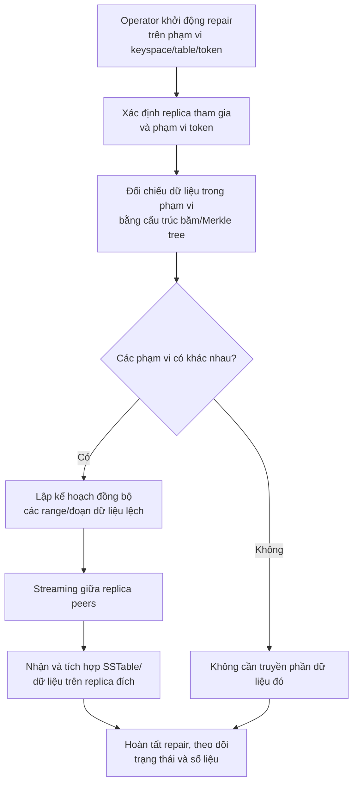
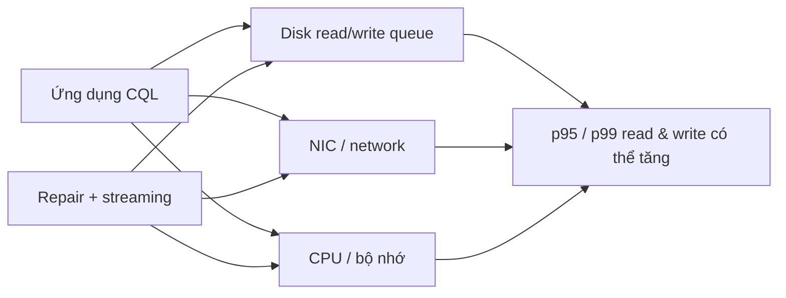
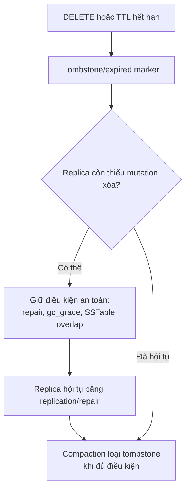

# Streaming dữ liệu cần bù và chi phí mạng/đĩa

**Chương:** Đồng bộ bản sao  
**Module:** `DATABASE_ENGINE_WIDE_COLUMN_CASSANDRA` — Apache Cassandra

Apache Cassandra phân phối các partition theo token và lưu nhiều **replica** tùy replication factor (RF). Một lần ghi được coordinator xác nhận ở consistency level đã chọn không nhất thiết có mặt trên **mọi replica** ngay thời điểm trả lời. Nếu một node mất kết nối, thay đổi token ownership, thêm node hoặc cần đồng bộ lại sau lỗi, Cassandra có thể phải **stream dữ liệu** giữa các node để đưa các bản sao về trạng thái phù hợp.

Trong phạm vi module này, chúng ta học kiến trúc phân tán và mô hình wide-column của Cassandra, partition key, thiết kế bảng theo truy vấn, mức nhất quán đọc/ghi, replication, compaction, repair, xử lý lỗi và kết nối Java. Bài này đi sâu vào câu hỏi vận hành: **dữ liệu nào cần bù, khi nào Cassandra sử dụng streaming, và khối lượng truyền ảnh hưởng mạng, đĩa, độ trễ ứng dụng như thế nào?**

Streaming không phải một lệnh CQL do ứng dụng gọi khi đọc một hàng. Đây là cơ chế vận hành giữa các node, được nhiều quy trình như **repair**, **bootstrap**, **rebuild** và thay đổi topology sử dụng. Không nên đánh đồng streaming với commit log, hinted handoff hoặc query đọc thông thường.

## 1. Kết quả học tập

Sau bài này, bạn có thể:

1. Phân biệt **dữ liệu thiếu ở replica** với **dữ liệu không tồn tại về mặt logic**.
2. Giải thích vai trò của replication factor, consistency level, hinted handoff, read repair và anti-entropy repair.
3. Mô tả quy trình so sánh phạm vi dữ liệu, xác định sai lệch và truyền phần dữ liệu cần bù qua streaming.
4. Phân biệt streaming do **repair** với streaming do **bootstrap/rebuild/decommission**.
5. Ước lượng chi phí truyền mạng, đọc/ghi đĩa, dung lượng trống, cạnh tranh I/O và tác động tới p95/p99.
6. Thử nghiệm ba replica với một node vắng mặt, đọc trạng thái và quan sát `nodetool netstats` trong quá trình repair.
7. Lập lịch repair/streaming, theo dõi tiến độ, xử lý lỗi và tránh gây áp lực lên cluster.
8. Hiểu tại sao compaction, tombstone, TTL và `gc_grace_seconds` có liên hệ với khả năng đồng bộ đúng.

> **Phạm vi:** Ví dụ hướng tới Apache Cassandra 4.1/5.x, đặc biệt topology một datacenter có ba node. Tùy phiên bản và bản phân phối, chi tiết giao thức streaming, cách tính tiến độ, tính năng zero-copy, tham số throttle và cú pháp tùy chọn `nodetool` có thể khác. Kiểm tra `nodetool help` và tài liệu đúng phiên bản trước khi áp dụng ngoài phòng lab.

## 2. Tại sao cần bù dữ liệu khi đã có replication?

Giả sử một keyspace dùng `NetworkTopologyStrategy` với RF = 3 trong cùng một datacenter:

```text
Partition: sku-001

Replica A: stock = 15, version = 2
Replica B: stock = 15, version = 2
Replica C: stock = 20, version = 1   (đã bỏ lỡ lần cập nhật)

W = LOCAL_QUORUM: cần 2 replica ghi thành công trong DC
R = LOCAL_QUORUM: cần 2 replica đáp ứng cho một lần đọc trong DC
```

Hai replica A, B có thể đã nhận một mutation mới; replica C bị ngắt kết nối và vẫn chứa giá trị cũ. Nếu client đã ghi thành công ở `LOCAL_QUORUM`, hệ thống đáp ứng **mức nhất quán được yêu cầu**, chứ chưa hứa mọi replica sẽ hội tụ tức thì.

Khi C hoạt động lại, Cassandra có thể bù dữ liệu bằng các cơ chế khác nhau. Nếu hinted handoff đã phát đầy đủ các mutation bị bỏ lỡ, lần repair tiếp theo có thể **không còn sai lệch** và không cần stream dữ liệu. Nếu hints đã hết khả năng lưu/chuyển hoặc node bỏ lỡ dữ liệu trong một thời gian dài, anti-entropy repair có thể phát hiện và đồng bộ các phần khác nhau.

### 2.1. Bảng phân biệt cơ chế

| Cơ chế | Khi nào xảy ra | Điều cơ chế làm | Không được suy ra |
| --- | --- | --- | --- |
| **Replication** | Mỗi mutation bình thường | Ghi đến các replica theo topology và CL | Một ACK ở quorum không đồng nghĩa mọi replica đã có dữ liệu mới. |
| **Hinted handoff** | Một replica tạm không nhận ghi, nếu hints được tạo và giữ | Node khác lưu hint và chuyển lại sau | Hints không phải bản sao lâu dài hay thay thế repair định kỳ. |
| **Read repair** | Một số lần đọc phát hiện sai lệch trong phạm vi dữ liệu được đọc | Có thể sửa dữ liệu giữa các replica tham gia đọc, theo phiên bản và cấu hình | Không đảm bảo quét và sửa mọi partition chưa từng được đọc. |
| **Anti-entropy repair** | Quy trình vận hành chủ động | So sánh phạm vi dữ liệu và đồng bộ sai lệch giữa replica | Không phải cách tự động biến mọi write thành transaction. |
| **Streaming** | Bước truyền dữ liệu của repair, bootstrap, rebuild hoặc thay đổi topology | Chuyển dữ liệu/SSTable components hoặc sections giữa các node | Không khẳng định trước số byte truyền chỉ từ số hàng logic bị thiếu. |
| **Compaction** | Công việc nền trên từng replica | Hợp nhất SSTable, xử lý phiên bản/tombstone theo điều kiện an toàn | Không tự so sánh và sửa dữ liệu giữa các node khác nhau. |

**Tính nhất quán của một truy vấn** và **mức độ đồng bộ vật lý của các replica** là hai câu hỏi riêng. Ở RF=3, `LOCAL_QUORUM` vẫn có thể trả giá trị hợp lệ từ hai replica hiện hành khi replica thứ ba đang chậm; `ONE` có thể gặp replica cũ. Việc client đọc thành công không bảo đảm trên đĩa của cả ba node đã chứa mutation mới.

## 3. Quy trình repair dẫn tới streaming dữ liệu cần bù

Một lần anti-entropy repair thường được hiểu theo các giai đoạn sau. Trình tự và các thành phần cụ thể tùy phiên bản, nhưng ý nghĩa tổng thể là:



### 3.1. Phạm vi token và replica

Cassandra dùng partitioner ánh xạ partition key sang token. Với bảng `inventory_by_sku`, các khóa `sku-001`, `sku-002` có thể nằm ở những token khác nhau. Replica set của token phụ thuộc replication strategy, topology, snitch và ownership.

Một node chạy repair phối hợp với các replica liên quan tới phạm vi mà nó sửa. Nó không nhất thiết chỉ đọc/ghi dữ liệu của cùng một partition hay cùng một SSTable. Việc “repair một table” không có nghĩa “chép toàn bộ table từ node A sang node B”.

**Lưu ý:** Mỗi datacenter có thể có RF riêng. Khi có nhiều datacenter, phạm vi repair và lưu lượng liên DC cần được lên kế hoạch chủ động. Tránh nhận định rằng một lần sửa trên một node tự hoàn thành mọi phạm vi token và mọi datacenter của toàn cluster.

### 3.2. Đối chiếu bằng Merkle tree không phải so từng hàng qua mạng

Cassandra có thể xây dựng cấu trúc băm Merkle tree cho các token range để tìm phạm vi sai khác. Nếu phần băm tương ứng khác nhau, hệ thống lên kế hoạch đồng bộ dữ liệu liên quan.

Ưu điểm là **không cần gửi mọi hàng dưới dạng câu SELECT để so sánh một-một**. Tuy nhiên:

- Node vẫn phải đọc dữ liệu cần thiết để xây dựng/đối chiếu cấu trúc phục vụ repair.
- Mức chi tiết của phân vùng băm và cách stream có thể khiến lượng dữ liệu chuyển **lớn hơn nhiều** một vài cell đã thay đổi.
- Có thể không phát sinh stream nếu những replica được so sánh thực sự đã hội tụ.
- Repair là công việc phân tán; node tham gia phải đủ khỏe, có network và disk headroom.

Ví dụ, chỉ một số hàng khác nhau không có nghĩa chắc chắn chỉ vài kilobyte được truyền. Lượng stream thực tế phụ thuộc cách chia phạm vi, cấu trúc SSTable, số replica, phiên bản và trạng thái dữ liệu.

### 3.3. Streaming chuyển dữ liệu như thế nào?

Khi có sai lệch, các peers tổ chức **stream sessions**. Node gửi đọc dữ liệu cần chuyển; node nhận ghi dữ liệu tới lưu trữ và tích hợp vào read path. Với các phiên bản/đường đi hỗ trợ, **zero-copy streaming** có thể giảm việc giải mã/tuần tự hóa lại dữ liệu; điều đó không đồng nghĩa băng thông, CPU hoặc I/O đĩa bằng không.

Phân biệt ba lượng:

- **Logical difference:** các hàng/cell/tombstone thực sự khác giữa các replica.
- **Transferred bytes:** byte giao thức truyền qua mạng cho các stream; có thể gồm SSTable sections, metadata và overhead.
- **Disk I/O:** byte đọc từ đĩa nguồn và byte ghi ở đích, cộng thêm hoạt động phụ do compaction, cache và filesystem.

Ba lượng **không nhất thiết bằng nhau**. Do đó đánh giá repair phải dựa vào thống kê stream và metrics, không chỉ số hàng ứng dụng suy đoán.

## 4. Repair streaming khác bootstrap/rebuild thế nào?

Cùng sử dụng giao thức streaming nhưng mục tiêu và khối lượng dữ liệu khác nhau.

| Tình huống | Mục tiêu | Khối lượng truyền có thể phụ thuộc |
| --- | --- | --- |
| **Repair** | Sửa dữ liệu lệch giữa các replica cho các range liên quan | Sai lệch thực tế, phạm vi repair, thuật toán đối chiếu và định dạng SSTable |
| **Bootstrap** khi thêm node | Đưa dữ liệu thuộc ownership mới sang node gia nhập | Token ranges được node mới nhận, RF, dữ liệu hiện tại và topology |
| **Rebuild** | Tái tạo dữ liệu node theo phạm vi/datacenter nguồn được chỉ định | Dữ liệu phải tái nhận, trạng thái node, nguồn và cách tiến hành |
| **Replace node** | Thay một replica lỗi bằng node mới | Dữ liệu của replica cần phục hồi, topology và dữ liệu sẵn có ở các peers |
| **Decommission / thay đổi topology** | Chuyển trách nhiệm lưu trữ khi node rời hoặc quyền sở hữu token đổi | Phạm vi ownership thay đổi, dữ liệu các peer cần nhận |
| **Hinted handoff** | Bù các mutation trong giai đoạn node không nhận ghi | Số mutation có hints còn hiệu lực; **khác** giao thức stream SSTable của repair |

Ví dụ, **thêm node** có thể stream lượng dữ liệu lớn dù không có dữ liệu “sai” giữa các replica trước đó. Ngược lại, repair trên cluster khỏe có thể dành nhiều I/O để kiểm tra nhưng **không phải truyền nhiều byte**.

Các thao tác thay đổi topology có điều kiện riêng về rack, snitch, token, seed và khả năng bootstrap. Bài này tập trung cách đọc chi phí streaming, không hướng dẫn wipe data directory hoặc thay node một cách tùy tiện.

## 5. Mô hình tính chi phí mạng, đĩa và thời gian

### 5.1. Băng thông mạng

Gọi:

- `B_wire`: tổng byte thực sự được chuyển qua các kết nối streaming trong giai đoạn quan sát.
- `V_net`: thông lượng mạng **hữu hiệu** dành cho streaming sau khi trừ tải ứng dụng, giới hạn kết nối và overhead.
- `T_net`: thời gian tối thiểu do mạng chi phối.

Ta có ước lượng:

\[
T_{\mathrm{net}} \gtrsim \frac{B_{\mathrm{wire}}}{V_{\mathrm{net}}}
\]

Công thức này không phải dự đoán tổng thời gian hoàn thành: việc đối chiếu dữ liệu, lập kế hoạch, chờ tài nguyên, đọc/ghi đĩa và đồng thời nhiều sessions còn tạo độ trễ. Cần xét **từng link/nút nghẽn**: cộng toàn bộ throughput của cluster rồi chia tổng bytes có thể che một node nguồn yếu hoặc đường mạng liên DC chậm.

**Ví dụ lập kế hoạch (giả định):** cần chuyển tổng cộng 60 GiB qua đường nghẽn có thông lượng hữu hiệu 75 MiB/s. Giới hạn riêng do truyền mạng khoảng:

\[
\frac{60 \times 1024\ \mathrm{MiB}}{75\ \mathrm{MiB/s}}
=819{,}2\ \mathrm{s}\ \approx 13{,}7\ \mathrm{phút}
\]

Đó mới là **mốc lý tưởng theo mạng**, chưa cộng thời gian đối chiếu, tải từ client, disk I/O, retry và tail latency. Khi có nhiều luồng song song, quan trọng là tổng lưu lượng đi qua **link chung**, không phải chỉ tốc độ một session.

### 5.2. I/O đĩa và dung lượng trống

Ở replica gửi, repair có thể cần **đọc để so sánh** và **đọc dữ liệu để stream**. Ở replica nhận, dữ liệu phải được **ghi xuống đĩa**; sau đó compaction hoặc xử lý phụ có thể phát sinh ghi lại.

Với:

- `B_read`: byte đọc thực tế ở nguồn và các node tham gia đối chiếu.
- `B_write`: byte được ghi thực tế ở đích và do hoạt động phụ.
- `V_read`, `V_write`: thông lượng đĩa hữu hiệu khi đang chia sẻ tải.

Có thể dùng mốc thô:

\[
T_{\mathrm{I/O}} \gtrsim
\max\left(\frac{B_{\mathrm{read}}}{V_{\mathrm{read}}},
          \frac{B_{\mathrm{write}}}{V_{\mathrm{write}}}\right)
\]

Thời gian thực tế có thể lớn hơn vì số thao tác ngẫu nhiên, I/O wait, queue depth, compaction, memtable flush và các bottleneck khác. **Không** cộng/trừ hai công thức một cách máy móc để tuyên bố thời gian repair; đo các giai đoạn và đường nghẽn.

Về dung lượng:

- Đích phải có chỗ cho dữ liệu stream sẽ nhận, cộng dung lượng tạm và các tệp có thể đồng tồn tại trong compaction.
- Nguồn cũng có thể cần headroom để compaction chạy an toàn trong lúc đang truyền.
- Snapshot, backup cục bộ, SSTable cũ chưa được giải phóng và các bảng khác đều dùng cùng volume.
- Cần theo dõi **disk free trên từng node**, không chỉ phần trăm disk chung của cluster.

Ví dụ một node còn 40 GiB trống trong khi dự kiến sẽ nhận 60 GiB dữ liệu là **không đủ điều kiện an toàn** ngay cả trước khi tính chi phí tạm thời. Không có hệ số “luôn cần gấp đôi” áp dụng cho mọi trường hợp: lập ngân sách theo lượng nhận, kiểu compaction, mức ghi đồng thời và yêu cầu dự phòng cụ thể.

### 5.3. Vì sao repair có thể làm p99 ứng dụng tăng?

Khi repair/streaming diễn ra cùng các truy vấn ứng dụng, các nguồn lực bị chia sẻ:



Ngay cả khi network còn trống, disk read queue dài có thể làm truy vấn chậm. Ngược lại, ổ đĩa khỏe nhưng link giữa datacenter bị bão hòa vẫn khiến repair kéo dài. Khi đo phải nhìn đồng thời **băng thông, đĩa, CPU, compaction backlog, latency client** và stream progress.

## 6. Thiết lập lab ba node, RF=3

Chỉ dùng cluster thử nghiệm. Giả sử bạn có ba container Cassandra được đặt tên `cassandra1`, `cassandra2`, `cassandra3` trong cùng datacenter `datacenter1`. Nếu chạy Cassandra theo cách khác, thay lệnh container bằng lệnh tương đương trên node thật.

### 6.1. Xác nhận topology

Trên terminal của máy chạy Docker:

```bash
docker exec cassandra1 nodetool status
docker exec cassandra2 nodetool status
docker exec cassandra3 nodetool status
docker exec -it cassandra1 cqlsh
```

Trong `cqlsh`:

```sql
SELECT data_center, release_version FROM system.local;
```

Chỉ tiếp tục khi cả ba node ở trạng thái `UN` (Up/Normal) và cùng datacenter dự kiến. Nếu `data_center` không phải `datacenter1`, sửa tên trong `CREATE KEYSPACE` bên dưới cho đúng. RF=3 trên ba node là cấu hình dễ quan sát quorum trong lab; không phải khuyến nghị tự động cho production.

### 6.2. Tạo bảng ghi phục vụ thí nghiệm

```sql
CREATE KEYSPACE IF NOT EXISTS lab_replica_stream
WITH replication = {
  'class': 'NetworkTopologyStrategy',
  'datacenter1': 3
}
AND durable_writes = true;

CREATE TABLE IF NOT EXISTS lab_replica_stream.inventory_by_sku (
    sku text PRIMARY KEY,
    stock int,
    version bigint,
    updated_at timestamp
);
```

Ở bảng này:

- `sku` là partition key. Mỗi SKU tạo một partition logic.
- `stock`, `version` là giá trị nghiệp vụ và phiên bản **do ứng dụng quản lý**. Trường `version` không tự tạo transaction hoặc CAS.
- `updated_at` là trường thời gian quan sát, **không** thay thế timestamp nội bộ quyết định cách Cassandra reconcile cell.
- RF=3 giúp cả ba node là replica cho mỗi partition trong một DC ba node, nếu topology được cấu hình như giả định.

Ghi dữ liệu ban đầu:

```sql
CONSISTENCY LOCAL_QUORUM

INSERT INTO lab_replica_stream.inventory_by_sku
    (sku, stock, version, updated_at)
VALUES ('sku-001', 20, 1, '2026-11-21T02:00:00Z');

INSERT INTO lab_replica_stream.inventory_by_sku
    (sku, stock, version, updated_at)
VALUES ('sku-002', 40, 1, '2026-11-21T02:00:00Z');

INSERT INTO lab_replica_stream.inventory_by_sku
    (sku, stock, version, updated_at)
VALUES ('sku-003', 60, 1, '2026-11-21T02:00:00Z');

SELECT sku, stock, version, updated_at
FROM lab_replica_stream.inventory_by_sku
WHERE sku = 'sku-001';
```

CQL trên tạo ít dữ liệu, phù hợp học đường đi và kết quả logic nhưng **không** đủ tạo một stream kéo dài để nhìn được tốc độ. Muốn benchmark throughput phải dùng một tập dữ liệu đáng kể và tải có kiểm soát.

## 7. Thực nghiệm một replica bỏ lỡ mutation

### 7.1. Gây sự cố khi hai replica còn sống

Dừng riêng node thứ ba trong lab:

```bash
docker stop cassandra3
docker exec cassandra1 nodetool status
```

Chờ cluster ghi nhận node `cassandra3` không khả dụng. Mở `cqlsh` trên node còn sống (ví dụ `cassandra1`), dùng `LOCAL_QUORUM`:

```sql
CONSISTENCY LOCAL_QUORUM

UPDATE lab_replica_stream.inventory_by_sku
SET stock = 15, version = 2, updated_at = '2026-11-21T02:05:00Z'
WHERE sku = 'sku-001';

UPDATE lab_replica_stream.inventory_by_sku
SET stock = 35, version = 2, updated_at = '2026-11-21T02:05:00Z'
WHERE sku = 'sku-002';

SELECT sku, stock, version
FROM lab_replica_stream.inventory_by_sku
WHERE sku = 'sku-001';
```

Với RF=3 trong một DC, có thể nhận ACK ở `LOCAL_QUORUM` nếu **hai replica còn sống** đáp ứng. Ghi lại phản hồi thực tế, kể cả timeout hoặc unavailable; không giả định success trước khi nhìn kết quả.

Khi node 3 đang tắt:

```sql
CONSISTENCY ALL

-- Thử đọc ở ALL khi chỉ còn hai replica:
SELECT sku, stock, version
FROM lab_replica_stream.inventory_by_sku
WHERE sku = 'sku-001';
```

Đọc ở `ALL` thường bị từ chối vì thiếu một replica đáp ứng. **Lỗi này không có nghĩa dữ liệu đã bị mất.** Nó cho thấy không đạt mức availability cho CL yêu cầu tại thời điểm đó.

### 7.2. Khôi phục node và đánh giá kết quả

Trên terminal:

```bash
docker start cassandra3
docker exec cassandra1 nodetool status
docker exec cassandra3 nodetool status
```

Đợi node 3 trở về trạng thái `UN`. Hints có thể đã được phát lại khi node quay về, giúp các replica hội tụ **trước khi repair**. Tốc độ và việc hints tồn tại phụ thuộc cấu hình và thời gian downtime.

Đọc lại từng khóa ở `LOCAL_QUORUM`:

```sql
CONSISTENCY LOCAL_QUORUM

SELECT sku, stock, version
FROM lab_replica_stream.inventory_by_sku
WHERE sku = 'sku-001';

SELECT sku, stock, version
FROM lab_replica_stream.inventory_by_sku
WHERE sku = 'sku-002';
```

Kỳ vọng trạng thái logic sau hai UPDATE đã được ACK: `sku-001.stock = 15`, `sku-002.stock = 35` và `version = 2`, nếu không có ghi cạnh tranh. Dù truy vấn trả đúng, **không thể kết luận từng replica trên đĩa đều đã hội tụ** từ hai câu SELECT này.

> **Quan trọng:** `cqlsh` nối tới `cassandra3` vẫn sử dụng node đó làm coordinator và có thể đọc replica khác theo cơ chế điều phối; nó **không** phải công cụ ép đọc thẳng SSTable địa phương của node 3. Nếu cần bằng chứng về một replica vật lý cụ thể, dùng diagnostics/tracing và công cụ SSTable thích hợp cho phiên bản đang chạy.

## 8. Quan sát repair và streaming thực tế

### 8.1. Đặt hai terminal để thấy tiến độ

Khi toàn bộ node đã khỏe, ở **terminal A** thực hiện repair full cho bảng lab từ node hồi phục:

```bash
docker exec cassandra3 nodetool repair --full lab_replica_stream inventory_by_sku
```

Trong **terminal B**, khi terminal A chưa hoàn tất, quan sát:

```bash
docker exec cassandra3 nodetool netstats
docker exec cassandra1 nodetool netstats
docker exec cassandra2 nodetool netstats

docker exec cassandra3 nodetool compactionstats
docker exec cassandra3 nodetool tablestats lab_replica_stream.inventory_by_sku
```

Cú pháp `--full` ví dụ cho dòng Cassandra hỗ trợ lựa chọn này. Kiểm tra `nodetool help repair` của đúng phiên bản; full và incremental repair có khác biệt về phạm vi dữ liệu được xét và metadata repaired/unrepaired. Lệnh này là **thao tác quản trị có tác động tới I/O**, chỉ chạy trên cluster lab ở bài này.

`nodetool netstats` có thể hiển thị sessions nhận/gửi, các files/sections và tiến độ truyền khi streaming đang hoạt động. Không có stream đang chạy cũng là kết quả hợp lệ nếu repair không tìm thấy khác biệt hoặc dữ liệu đã được bù bằng hints. Lệnh repair trên bộ dữ liệu chỉ vài hàng thường kết thúc nhanh tới mức terminal B không kịp quan sát.

### 8.2. “Repair đã chạy” không đồng nghĩa “đã stream byte”

Một thí nghiệm có thể có ba kết quả:

| Kết quả | Giải thích khả dĩ | Cách xác minh tiếp |
| --- | --- | --- |
| Repair hoàn tất, `netstats` không thấy stream | Hints đã bù, replica đồng nhất, hoặc stream kết thúc trước lúc quan sát | Kiểm tra repair log, metrics theo khoảng và trạng thái sau repair. |
| Có stream sent/received | Có dữ liệu/range cần truyền trong tiến trình quan sát | Ghi node nguồn/đích, bytes, thời gian, throughput, disk usage. |
| Repair thất bại hoặc treo lâu | Node/network không ổn, I/O quá tải, thiếu tài nguyên hoặc lỗi khác | Giữ log và thông báo lỗi; kiểm tra health, compaction, disk/network trước khi retry. |

Không tự tuyên bố “đã tái hiện streaming” chỉ vì chạy thành công `nodetool repair`. Với lab quá nhỏ, cần tạo data volume lớn hơn hoặc dùng bài kiểm tra **bootstrap node mới** được chuẩn bị riêng nếu mục tiêu là có luồng stream kéo dài, nhưng vẫn phải bảo đảm đủ tài nguyên.

### 8.3. Nếu cần định lượng streaming lớn

Trong một cluster thử nghiệm **tách biệt**, có thể thêm node mới bằng quy trình bootstrap được cấu hình đúng topology/RF. Khi node mới nhận token ranges, Cassandra sẽ phải chuyển dữ liệu mà node đó cần sở hữu. Đo `netstats` trên các node nguồn và node đích, tổng dữ liệu nhận, throughput, read/write latency và disk free.

Không xóa thư mục dữ liệu của node đang hoạt động để cố ép streaming: hành vi này có thể làm mất trạng thái/token identity và gây gián đoạn cluster. Việc thay node phải theo quy trình `replace/rebuild/bootstrap` đúng phiên bản và triển khai.

## 9. Tính nhất quán sau repair: quan sát gì, kết luận gì?

### 9.1. Read quorum giúp đọc đúng nhưng không phải audit replica

Với RF=3 trong một DC:

| Read CL | Yêu cầu phản hồi | Điều cần lưu ý |
| --- | --- | --- |
| `ONE` | Một replica | Có thể gặp dữ liệu cũ nếu replica được chọn chưa hội tụ. |
| `LOCAL_QUORUM` | Hai replica trong DC | Khi ghép với write quorum và không có ghi cạnh tranh, thường giúp quan sát mutation đã ACK. |
| `ALL` | Cả ba replica | Khó đạt khi một replica lỗi/chậm; không có nghĩa dữ liệu logic mất. |

Không coi read `ALL` thành công là một bài kiểm thử đầy đủ cho mọi partition trong keyspace. Một vài truy vấn chỉ kiểm chứng các khóa đã đọc. Repair/streaming phải đánh giá theo **range**, table, datacenter, replicas và số liệu vận hành.

### 9.2. Repair không thay quy tắc giải quyết xung đột

Khi hai replica có giá trị khác, Cassandra reconcile các mutation theo timestamp của cell cùng các quy tắc tombstone. Repair giúp các replica nhận mutation cần thiết; nó **không** biết giá trị nào là “đúng theo nghiệp vụ” nếu ứng dụng gửi timestamp sai, có ghi cạnh tranh hoặc cập nhật trái logic.

Ví dụ một mutation với timestamp tương lai có thể thắng mutation mới hơn theo thời gian nghiệp vụ, gây cảm giác “repair đã làm hỏng dữ liệu”. Nguyên nhân nằm ở cách ghi và timestamp; streaming chỉ lan truyền trạng thái được Cassandra xem là hợp lệ.

Để truy vết, lưu `request ID`, khóa, giá trị, CL, client timestamp (nếu tự đặt), loại lỗi và thời điểm. Không tự sửa dữ liệu bằng những lệnh ghi đè tùy tiện trong khi chưa hiểu thứ tự timestamp.

## 10. Full repair, incremental repair và anti-compaction

Cassandra có khái niệm SSTable **repaired** và **unrepaired** trong quy trình incremental repair; tùy phiên bản còn có metadata/state liên quan đến pending repair. Cơ chế **anti-compaction** có thể tách/đánh dấu SSTable để quản lý phần dữ liệu đã qua incremental repair.

| Hình thức | Ý tưởng | Chi phí cần cân nhắc |
| --- | --- | --- |
| **Full repair** | Đối chiếu toàn bộ dữ liệu trong phạm vi được chọn, kể cả dữ liệu đã được đánh dấu repaired theo logic phiên bản | Có thể phải đọc/đối chiếu lượng lớn dữ liệu; dùng có kế hoạch. |
| **Incremental repair** | Tập trung vào dữ liệu chưa được sửa theo cơ chế incremental của phiên bản; quản lý trạng thái repaired/unrepaired | Cần hiểu lịch chạy, pending sessions, anti-compaction và tác động lên disk/compaction. |
| **Repair một phần phạm vi** | Chỉ sửa một token range, datacenter, bảng hoặc primary ranges phù hợp với lựa chọn lệnh | Có thể bỏ sót phạm vi nếu tưởng một lần gọi đã bao trùm toàn cluster. |

**Không** suy ra “incremental repair chỉ gửi các cell mới” hoặc “full repair chắc chắn stream toàn bộ bảng”. Cả hai vẫn cần bước đối chiếu và chỉ stream dữ liệu mà tiến trình xác định cần đồng bộ, với chi phí thực tế phụ thuộc triển khai.

Khi lên lịch vận hành:

- Xác định rõ bạn đang sửa **keyspace, table, ranges, datacenter và node nào**.
- Xem phiên bản hiện tại quy định default repair mode thế nào; không dựa vào câu lệnh từ bản Cassandra khác.
- Không chạy nhiều repair lớn đồng thời mà không có đánh giá I/O, network và mức độ cạnh tranh.
- Sau repair, xem logs/trạng thái job để xác định thành công thực sự; mất kết nối terminal không đủ chứng minh job thất bại hay thành công.

## 11. Tombstone, TTL và rủi ro resurrect dữ liệu

Giả sử replica A, B đã nhận lệnh `DELETE` hoặc TTL hết hạn, nhưng replica C đang offline vẫn còn giá trị cũ. Cassandra cần duy trì thông tin xóa đủ lâu để tránh “dữ liệu cũ sống lại” khi C quay về.



`gc_grace_seconds` là một phần điều kiện để tombstone có thời gian lan tới replica bị bỏ lỡ. **Không** được giảm grace chỉ để làm giảm disk usage nếu thời gian repair và chính sách xử lý node offline không bảo đảm an toàn. Một replica cũ quay về sau khi tombstone bị loại bỏ có thể gây dữ liệu xuất hiện lại.

Tương tự, TTL là **hết hiệu lực logic**; không đồng nghĩa SSTable được xóa ngay đúng lúc TTL kết thúc. Compaction dọn dữ liệu hết hạn theo các điều kiện liên quan và thời điểm phù hợp.

**Repair, streaming và compaction giải quyết những việc khác nhau:**

- Repair so sánh replica, phát hiện và khắc phục sai lệch.
- Streaming truyền dữ liệu để đạt trạng thái replica phù hợp.
- Compaction tổ chức và dọn dữ liệu trong SSTable của từng replica.

Nếu một node đã vắng mặt quá lâu, cần quy trình phục hồi/replace đúng phiên bản và đánh giá tình trạng tombstone thay vì cho nó tự join rồi giả định mọi dữ liệu sẽ chính xác.

## 12. Giới hạn tốc độ và lập lịch an toàn

Streaming dùng mạng chung với truy vấn CQL và có thể tranh I/O với compaction. Cassandra cung cấp cơ chế cấu hình throughput/rate limit tùy phiên bản; quan sát cấu hình hiện tại trước khi quyết định.

Trên máy có `nodetool`:

```bash
nodetool help getstreamthroughput
nodetool help setstreamthroughput
nodetool help getinterdcstreamthroughput
nodetool help setinterdcstreamthroughput
```

Các lệnh quản lý liên DC có thể không có ở một số phiên bản hoặc có tên/đơn vị/option khác. **Không** điền một giá trị throttle chỉ vì thấy ví dụ trên blog; cần kiểm tra đơn vị (MiB/s, Mb/s hoặc cách biểu diễn mà phiên bản sử dụng), thực tế thông lượng mỗi node và tổng các luồng.

Cách lập lịch:

1. Thu thập baseline tải ứng dụng, p95/p99, CPU, disk I/O wait, network saturation và compaction backlog.
2. Ước lượng khối lượng dữ liệu có thể stream và những node sẽ vừa gửi vừa nhận.
3. Chọn cửa sổ có tải thấp; tránh chạy nhiều repair/bootstrap lớn trên cùng peer hoặc link bị nghẽn.
4. Đặt throttle dựa trên tốc độ hữu hiệu có thể dành cho streaming, để lại tài nguyên cho client traffic.
5. Theo dõi tiến độ `netstats` và các metric hạ tầng trong suốt quá trình. Khi p99 ứng dụng xấu đi, điều chỉnh theo runbook/phiên bản.
6. Xác nhận repair hoàn tất và không còn lỗi trước khi kết thúc sự kiện vận hành.

**Không dừng/kill tiến trình hoặc ép flush/compaction tùy tiện** để khắc phục stream chậm. Một thay đổi thiếu kiểm soát có thể làm job phải làm lại và tăng thêm I/O.

## 13. Nhật ký đo lường chi phí streaming

Một báo cáo hữu ích phải liên hệ **lượng dữ liệu truyền** với **tác động ứng dụng**:

| Trường cần lưu | Ví dụ nội dung (không phải kết quả đo thật) |
| --- | --- |
| Sự kiện | Repair bảng `inventory_by_sku` sau node3 downtime |
| Topology | 3 node, 1 DC, RF=3 |
| Range/table | `lab_replica_stream.inventory_by_sku`, phạm vi chọn khi repair |
| CL đọc/ghi ứng dụng | LOCAL_QUORUM/LOCAL_QUORUM |
| Node gửi/nhận | cassandra1 → cassandra3 (nếu thực tế có session) |
| Tổng bytes stream | *Đo từ netstats/metrics/log* |
| Read/write I/O | *Đo từ node metrics* |
| Disk free min | *Đo trên từng node, đặc biệt node nhận* |
| Pending compactions | *Trước / trong / sau* |
| Read p95/p99 | *Trước / trong / sau* |
| Tổng thời gian job | *Từ timestamps log/giám sát* |
| Kết quả | Hoàn tất / thất bại / phải tiếp tục xử lý |

Đừng điền số byte tưởng tượng vào kết quả đo. Nếu không quan sát được `netstats` vì job quá ngắn, ghi đúng “không quan sát được active stream” và dùng log/metric có độ phân giải phù hợp để xác minh.

### 13.1. Một bảng kết quả có ý nghĩa

| Quan sát | Diễn giải đúng | Việc tiếp theo |
| --- | --- | --- |
| Repair xong rất nhanh, 0 byte stream | Có thể replicas đã hội tụ; hoặc dataset quá nhỏ/đã được hints bù | Kiểm tra health, logs và đừng ép truyền giả tạo. |
| Tốc độ mạng thấp, disk read 100% | Disk có thể là nút nghẽn | Kiểm tra I/O wait, read queue, compaction load. |
| Source gửi nhanh, destination disk gần đầy | Nguy cơ stream/compaction thất bại do thiếu headroom | Dừng kế hoạch mở rộng tiếp, xử lý capacity theo runbook. |
| Bytes nhận lớn hơn số cell khác | Stream diễn ra theo phạm vi/tệp, có overhead | Đọc cơ chế phiên bản và số lượng sections/files. |
| Client đọc ở ONE khác LOCAL_QUORUM | Có thể một replica còn cũ hoặc có cạnh tranh ghi | Đối chiếu thời điểm, CL, repair/hints; tránh kết luận từ một lần đọc. |
| p99 tăng khi repair dù network còn dư | Cạnh tranh disk/CPU/compaction | Điều chỉnh scheduling/throttle và xác định bottleneck. |
| Repair báo lỗi giữa chừng | Đồng bộ chưa hoàn tất cho phạm vi dự kiến | Giữ logs/job ID, kiểm tra node và tiếp tục theo runbook. |

## 14. Ví dụ Java: đối soát kết quả logic, không điều khiển streaming

Ứng dụng Java Driver 4.x có thể kiểm tra trạng thái dữ liệu ở consistency level xác định, nhưng API CQL thông thường **không** thay thế tác vụ quản trị repair/streaming.

Ví dụ đọc hai SKU sau khi node phục hồi và repair đã được vận hành:

```java
import com.datastax.oss.driver.api.core.CqlSession;
import com.datastax.oss.driver.api.core.DefaultConsistencyLevel;
import com.datastax.oss.driver.api.core.cql.PreparedStatement;
import com.datastax.oss.driver.api.core.cql.Row;

import java.util.List;

public final class ReplicaReadCheck {
    public static void verify(CqlSession session) {
        PreparedStatement read = session.prepare(
            "SELECT sku, stock, version " +
            "FROM lab_replica_stream.inventory_by_sku " +
            "WHERE sku = ?"
        );

        for (String sku : List.of("sku-001", "sku-002")) {
            try {
                Row row = session.execute(
                    read.bind(sku)
                        .setConsistencyLevel(
                            DefaultConsistencyLevel.LOCAL_QUORUM)
                ).one();

                if (row == null) {
                    System.out.println(sku + ": no row returned");
                    continue;
                }

                System.out.println(
                    row.getString("sku") +
                    " stock=" + row.getInt("stock") +
                    " version=" + row.getLong("version")
                );
            } catch (RuntimeException ex) {
                // Đây là lỗi request, không phải bằng chứng hàng vắng mặt.
                System.err.println(sku + ": read error: " + ex);
            }
        }
    }
}
```

Ở lab, nếu hai UPDATE được ACK và không có ghi cạnh tranh, dự kiến:

```text
sku-001 stock=15 version=2
sku-002 stock=35 version=2
```

Đây là **bằng chứng đọc logic ở CL đã chọn**, không phải audit nội dung trên mọi replica. Để xác minh byte streaming và trạng thái hội tụ ở cấp hệ thống, ứng dụng vận hành cần kết hợp log repair, `nodetool netstats`, các metric và trạng thái replica.

Nếu ứng dụng có retry sau `WriteTimeoutException`, hãy làm rõ thao tác idempotent. Ghi `stock = 15` cùng khóa có thể được gửi lại theo quy tắc nghiệp vụ phù hợp; phép `stock = stock + 1` không phải câu CQL UPDATE số nguyên thông thường và counter có semantics retry riêng. **Không suy đoán rằng repair/streaming tự bù được lỗi nghiệp vụ do client gửi nhiều lần**.

## 15. Tình huống chẩn đoán thực tế

### Trường hợp A — Node lên lại, nhưng query QUORUM thấy dữ liệu đúng trong khi netstats không có stream

Điều này có thể hoàn toàn bình thường: coordinator đã ghi đủ hai replica từ trước, node hồi phục nhận hints hoặc repair không tìm thấy khác biệt. Một lần SELECT đúng ở quorum không chứng minh node thứ ba đã hội tụ; mặt khác, `netstats` không hiện stream không chứng minh repair chưa chạy. Đánh giá bằng dữ liệu log/metric theo thời gian.

### Trường hợp B — Streaming rất chậm khi bootstrap node mới

Có thể node nguồn vừa phục vụ truy vấn, vừa compact và vừa stream; node đích vừa ghi dữ liệu vừa xây dựng cấu trúc liên quan. Đường mạng liên DC hoặc cross-rack có thể làm nghẽn thêm. Kiểm tra giới hạn throughput, I/O và trạng thái từng node trước khi tăng rate. Nếu tăng tốc vượt khả năng disk, việc truyền nhanh hơn có thể làm p99 ứng dụng tăng và job thiếu ổn định.

### Trường hợp C — Node thiếu dung lượng khi nhận dữ liệu

Đã có dự báo lượng dữ liệu nhưng không tính SSTable cũ, compaction output, snapshot và tốc độ ingest mới. Cần kiểm kê disk thực tế, giảm tải/lập lịch lại hoặc bổ sung capacity theo quy trình; không xóa SSTable thủ công. Repair cần đủ dung lượng cho dữ liệu và metadata hiện hữu.

### Trường hợp D — Đã repair nhưng giá trị nghiệp vụ vẫn “sai”

Nếu ứng dụng ghi giá trị cũ với **write timestamp lớn hơn** giá trị mới, Cassandra có thể xem mutation cũ là thắng. Repair làm replicas hội tụ theo semantics Cassandra chứ không đoán ý định nghiệp vụ. Kiểm tra timestamp, ghi cạnh tranh, TTL/tombstone, điều kiện idempotency và dữ liệu nguồn trước khi ghi sửa.

### Trường hợp E — Thấy tombstone nhiều, muốn giảm gc_grace để stream nhẹ hơn

Giảm grace có thể làm tombstone được dọn trước khi một replica cũ nhận thông tin xóa, tăng nguy cơ resurrection. Đây không phải lựa chọn mặc định để giảm lượng stream. Hãy xử lý lịch repair, sự vắng mặt của node, TTL/compaction và retention policy theo thiết kế an toàn.

### Trường hợp F — Nhiều datacenter, chi phí egress cao

Streaming liên DC có thể tác động tiền băng thông, độ trễ và mạng WAN. Đánh giá RF từng DC, vị trí nguồn/đích, loại repair phù hợp với topology, băng thông liên DC và kế hoạch vận hành. Không dùng kết quả của một cluster một DC làm dự đoán chi phí WAN.

## 16. Bài tập suy luận và checklist thực hành

### Bài tập

1. Với RF=3, W=`LOCAL_QUORUM`, một replica dừng khi ghi: khi client nhận success, những dữ liệu nào có thể đang khác giữa các replica?
2. Khi node hồi phục, tại sao `hinted handoff` có thể khiến repair không cần stream dữ liệu? Tại sao vẫn cần chính sách repair?
3. Khi chỉ một cell khác nhau, tại sao lượng truyền có thể nhiều hơn số byte của cell đó?
4. Phân biệt streaming do `repair` và do `bootstrap`: một cluster nhất quán có thể cần bootstrap streaming không?
5. Một lần `SELECT` ở `LOCAL_QUORUM` trả đúng có đủ chứng minh cả ba replica trên đĩa có cùng SSTable không?
6. Nếu 60 GiB được chuyển qua link hiệu dụng 75 MiB/s, mốc thời gian tối thiểu theo băng thông là bao nhiêu? Các yếu tố nào khiến tổng thời gian dài hơn?
7. Khi disk I/O nguồn ở gần giới hạn nhưng NIC vẫn còn dư, tăng streaming throughput có chắc rút ngắn job không?
8. Nếu sửa bản ghi bị xóa bằng cách xóa tombstone quá sớm, replica cũ có thể tạo nguy cơ gì khi quay lại?
9. Incremental repair khác full repair ở đâu? Vì sao không nên suy rằng incremental luôn truyền ít byte hơn trong **mọi lần chạy**?
10. Nếu app viết `stock = 15` rồi fail trước khi nhận response, repair có nhiệm vụ tự quyết định liệu giá trị 15 đúng theo nghiệp vụ hay không?
11. Vì sao nhìn `cqlsh` kết nối tới một replica không chứng minh dữ liệu vật lý node đó đã hội tụ?
12. Với hai datacenter, đâu là những yếu tố bổ sung khi ước lượng chi phí streaming và lên lịch repair?

### Checklist trước khi chạy repair/streaming trên hệ thống đang phục vụ người dùng

- [ ] Xác nhận mục tiêu: **repair dữ liệu lệch** hay **đổi ownership/khôi phục node**.
- [ ] Kiểm tra topology, datacenter, rack, replication factor, token ownership và node health.
- [ ] Xác định rõ keyspace, table, ranges, kiểu repair và phạm vi datacenter.
- [ ] Đọc `nodetool help repair` và tài liệu **đúng phiên bản**, đặc biệt với `--full`/incremental và giới hạn throughput.
- [ ] Đo baseline p95/p99 đọc/ghi, I/O đĩa, CPU, mạng, compaction backlog và dung lượng trống mỗi node.
- [ ] Ước lượng bytes cần nhận và phần headroom dành cho SSTable/compaction đang tồn tại.
- [ ] Chọn lịch ít tải và tránh quá nhiều repair/bootstrap đồng thời cùng peers/link.
- [ ] Theo dõi `nodetool netstats`, logs, bytes sent/received, throughput và latency client.
- [ ] Phân biệt **job không stream vì đã đồng nhất** với **job không chạy hoặc thất bại**.
- [ ] Không ép flush/compaction hoặc giảm `gc_grace_seconds` để “làm sạch” ngay.
- [ ] Sau job, xác minh báo cáo thành công và đối chiếu logic bằng truy vấn CL phù hợp; khi cần audit physical replica phải dùng diagnostics chuyên dụng.
- [ ] Ghi nhận phạm vi đã repair, thời điểm, kết quả, số liệu tài nguyên và lịch chạy tiếp theo.

**Ghi nhớ:** **Streaming là cơ chế truyền dữ liệu giữa các replica**, có thể phát sinh khi repair nhận ra sai lệch hoặc khi topology yêu cầu chuyển dữ liệu. **Số hàng khác nhau không quyết định trực tiếp số byte truyền**, và truyền xong cũng chưa đủ để đánh giá chi phí nếu chưa đo read/write I/O, dung lượng trống, compaction và p99. Phân biệt hints, repair, streaming và consistency level sẽ giúp bạn bù dữ liệu đúng mà vẫn kiểm soát được tải mạng và đĩa.

