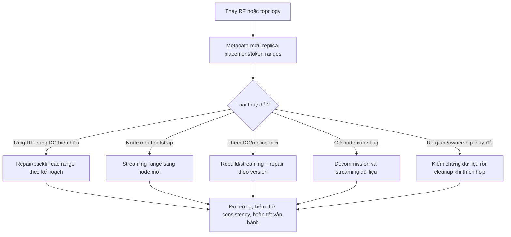
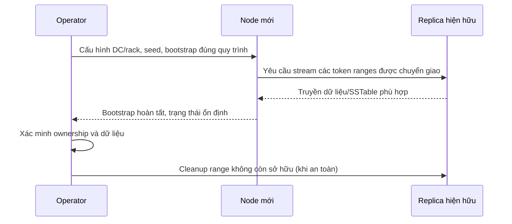
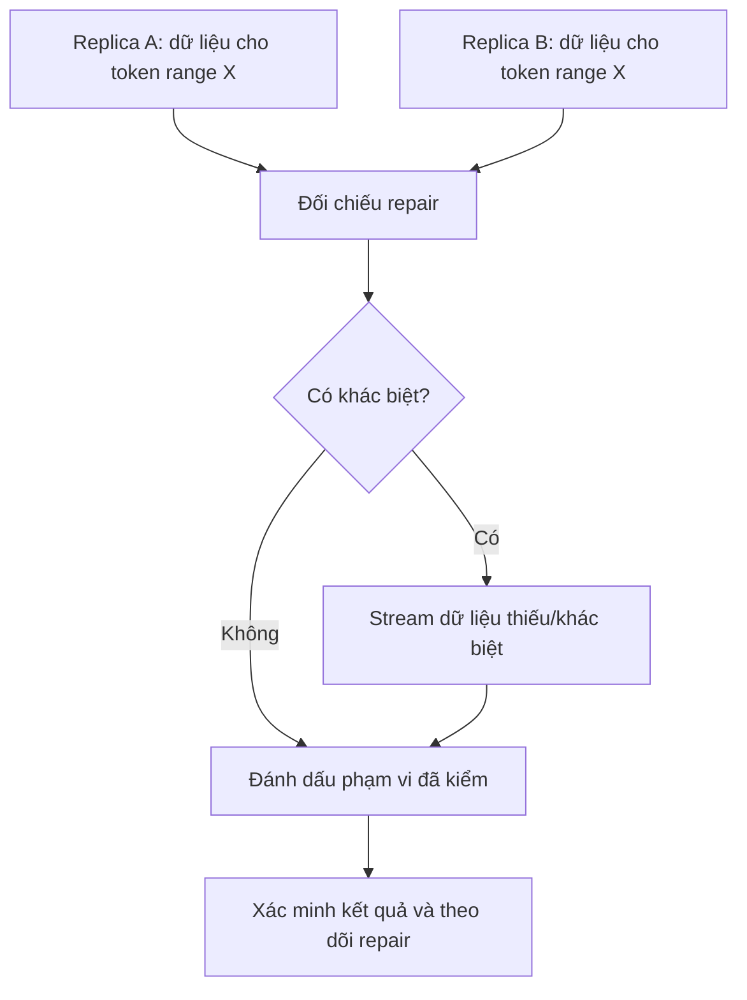

# Thay đổi replication factor hoặc topology và yêu cầu đồng bộ dữ liệu trong Apache Cassandra

## 1. Tại sao sửa RF hoặc thêm node không chỉ là thay một con số?

Trong **Apache Cassandra**, dữ liệu của một partition được đặt trên một tập **replica** theo token, topology (data center/rack) và **replication strategy** của keyspace. Mỗi replica lưu dữ liệu trong commit log, memtable và SSTable riêng; các replica không tự động trở thành bản sao byte-for-byte giống nhau ngay tại mọi thời điểm. Cassandra là hệ thống phân tán có mức nhất quán đọc/ghi được chọn theo từng request, còn **repair** và **streaming** giúp đưa dữ liệu lịch sử đến đúng replica và đối soát những khác biệt.

Vì vậy:

- **Thay replication factor (RF)** thay đổi số replica *được kỳ vọng sở hữu* một token range trong keyspace.
- **Thay topology** (thêm, thay thế, gỡ node, thêm data center) có thể thay đổi *node nào* sở hữu token range đó.
- **Cập nhật schema/topology không đồng nghĩa toàn bộ dữ liệu cũ đã được truyền, đối soát và an toàn để đọc** trên các replica mới.

Bài thuộc chương **Đồng bộ bản sao** của mô-đun `DATABASE_ENGINE_WIDE_COLUMN_CASSANDRA`, trong phạm vi kiến trúc wide-column, partition key, thiết kế bảng theo truy vấn, consistency level, CQL, replication, compaction, repair, xử lý sự cố và ứng dụng Java. Trọng tâm ở đây là cách lập kế hoạch **di chuyển dữ liệu, repair, cleanup và kiểm chứng** khi RF hoặc topology thay đổi.

### Mục tiêu

Sau bài này, người học có thể:

1. Giải thích sự khác nhau giữa **ownership**, **placement**, **RF**, **streaming**, **repair** và **cleanup**.
2. Lập kế hoạch tăng/giảm RF trong một DC và đánh giá tác động lên `LOCAL_QUORUM`.
3. Phân biệt quy trình **bootstrap node**, **decommission/removenode**, **replacement** và **thêm DC**.
4. Biết bước nào phân phối dữ liệu lịch sử, bước nào chỉ thay metadata, và cách xác minh dữ liệu đã đồng bộ.
5. Vận hành theo nguyên tắc giữ an toàn dữ liệu, đủ disk headroom, hạn chế ảnh hưởng ứng dụng Java và có phương án rollback.

## 2. Những khái niệm cần phân biệt

| Khái niệm | Ý nghĩa | Không nên nhầm với |
| --- | --- | --- |
| **RF (replication factor)** | Số bản sao Cassandra muốn bố trí cho mỗi token range trong một DC/keyspace theo strategy | Số node trong cả cụm; số bản sao đang thực sự có đủ lịch sử |
| **Token ownership / replica placement** | Token range nào có những node chịu trách nhiệm giữ dữ liệu | Byte trên đĩa; trạng thái các replica đã hội tụ |
| **Bootstrap / streaming** | Truyền các phạm vi dữ liệu cần thiết khi node mới tham gia hoặc topology thay đổi | Repair toàn bộ mọi khác biệt lịch sử |
| **Repair (anti-entropy)** | So sánh trạng thái replica theo phạm vi token và truyền dữ liệu thiếu/khác biệt | Compaction cục bộ hoặc chỉ đổi schema |
| **Cleanup** | Loại dữ liệu node không còn trách nhiệm giữ sau thay đổi ownership hợp lệ | Lệnh bắt buộc chạy ngay khi mới chỉnh RF |
| **Compaction** | Hợp nhất SSTable trên một node, có thể thu hồi dữ liệu đủ điều kiện | Đồng bộ dữ liệu giữa các node |
| **Hinted handoff** | Hỗ trợ chuyển các ghi bị lỡ cho replica tạm vắng mặt trong giới hạn cấu hình | Cơ chế bảo đảm backfill toàn bộ sau RF/topology change |
| **Read repair** | Điều chỉnh khác biệt phát hiện trong những đường đọc có cơ chế phù hợp | Lịch repair thay thế cho toàn bộ token range |

**Replication không tạo ra consistency level cố định.** Một keyspace RF = 3 vẫn có thể nhận truy vấn ở `ONE`, `LOCAL_QUORUM` hoặc các mức khác; RF quyết định tập replica và yêu cầu quorum, còn CL quyết định số/loại phản hồi cần có để hoàn tất một request.

### Placement được xác định như thế nào?

Giả sử keyspace dùng `NetworkTopologyStrategy`:

```sql
CREATE KEYSPACE inventory
WITH replication = {
    'class': 'NetworkTopologyStrategy',
    'dc1': 3,
    'dc2': 2
};
```

Với cấu hình minh họa này, Cassandra cố gắng đặt **ba replica ở dc1** và **hai replica ở dc2** cho mỗi token range, tuân theo topology/rack và khả năng của cụm. Mỗi partition key được partitioner ánh xạ thành token; không phải mỗi node đều giữ toàn bộ partition.

Yêu cầu tối thiểu để vận hành có ý nghĩa là phải có **đủ node phù hợp trong từng DC**, topology/snitch chính xác và kế hoạch rack/fault-domain. Việc cấu hình RF lớn hơn số node hữu dụng trong DC không làm Cassandra tạo ra replica vật lý từ không khí. Phải kiểm tra phiên bản Cassandra và lỗi placement/availability thực tế thay vì dựa vào lệnh `ALTER KEYSPACE` thành công.

## 3. Hai quá trình khác nhau: thay đổi metadata và chuyển dữ liệu



Hai ví dụ minh họa:

1. Tăng RF `dc1: 2 → 3` **không nhất thiết có thay đổi token ring**. Cassandra cập nhật quy tắc chọn replica thứ ba, nhưng node trở thành replica mới có thể **thiếu các ghi đã có từ trước**. Cần một công việc **backfill/repair** phù hợp để trao các dữ liệu lịch sử đến replica mới.
2. Thêm một node vào DC với RF giữ nguyên làm thay đổi phân bố range theo token. **Bootstrap/streaming** chuyển dữ liệu cho node mới; sau khi ownership ổn định, các node cũ có thể phải **cleanup** phần range không còn sở hữu.

Không có một lệnh áp dụng cho **mọi** tình huống. Phải phân loại thay đổi trước khi chọn `repair`, `rebuild`, `decommission`, `removenode` hay `cleanup`.

## 4. RF ảnh hưởng đến quorum và khả năng chịu lỗi

Với `NetworkTopologyStrategy`, trong **một DC**, quorum thường là:

```text
LOCAL_QUORUM_required = floor(RF_of_local_DC / 2) + 1
```

| RF trong local DC | Phản hồi cần cho `LOCAL_QUORUM` | Số replica có thể tạm không phản hồi khi tất cả replica khác khỏe |
| ---: | ---: | ---: |
| 1 | 1 | 0 |
| 2 | 2 | 0 |
| 3 | 2 | 1 |
| 4 | 3 | 1 |
| 5 | 3 | 2 |

Ví dụ giảm RF từ **3 xuống 2** sẽ đổi yêu cầu `LOCAL_QUORUM` từ **2/3** thành **2/2**. Dù ít bản sao hơn và tốn ít dung lượng mục tiêu hơn, workload dùng `LOCAL_QUORUM` có thể **mất khả năng phục vụ khi một replica trong local DC không sẵn sàng**. Đó là một thay đổi **availability**, không chỉ tiết kiệm ổ đĩa.

**Chú ý khi nhiều DC:**

- `LOCAL_QUORUM` tính quorum **trong DC cục bộ** mà coordinator/driver định tuyến đến.
- `QUORUM` theo quorum của tập replica liên quan toàn bộ topology, có thể phụ thuộc giao tiếp liên DC.
- `EACH_QUORUM` dành cho trường hợp ghi phù hợp với replication strategy, đặt yêu cầu theo từng DC; không được xem là đồng nghĩa `LOCAL_QUORUM`.
- Nếu ứng dụng đổi local DC, yêu cầu quorum và độ trễ có thể thay đổi dù CQL không đổi.

Không chuyển consistency level trong quá trình di chuyển chỉ để làm biểu đồ p99 đẹp hơn mà chưa đánh giá dữ liệu lịch sử đã được backfill, yêu cầu nghiệp vụ và khả năng chịu lỗi. **CL cũng không tự tạo dữ liệu cũ trên replica mới.**

## 5. Trước khi thay RF/topology: checklist tối thiểu

Mọi thao tác topology nên có **change ticket**, phạm vi keyspace, kế hoạch backup/khôi phục, thời điểm bắt đầu/kết thúc, người thực hiện và điều kiện rollback.

| Nhóm kiểm tra | Cần xác nhận |
| --- | --- |
| **Cluster health** | Các node cần tham gia đều khỏe (`UN`), không có node mất liên lạc/chưa hoàn tất bootstrap/removal |
| **Schema và topology** | Cassandra version, `NetworkTopologyStrategy`, RF theo DC, datacenter/rack từ snitch, token ring, schema agreement |
| **Lịch bảo trì** | Không có repair, topology change, snapshot lớn, major compaction hoặc streaming khác cạnh tranh tài nguyên bất thường |
| **Dung lượng** | Dữ liệu dự kiến truyền, free disk và đỉnh không gian tạm trên cả nguồn/đích |
| **Mạng** | Bandwidth và độ trễ nội DC/liên DC, đường truyền đủ ổn định cho streaming/repair |
| **Tính nhất quán** | Lịch repair gần nhất, replica có bị offline quá lâu không, TTL/`gc_grace_seconds` và tombstone risk |
| **Workload** | Read/write CL, client local DC, QPS, p95/p99, timeout, driver timeout/retry policy |
| **Chứng cứ dữ liệu** | Bộ partition key/hàng kiểm chứng được ghi **trước** thay đổi và mẫu được ghi **trong/sau** thay đổi |

Cần ghi rõ phiên bản vì tham số `nodetool`, chiến lược repair và hành vi streaming/rebuild có thể khác. Các câu lệnh dưới đây minh họa **runbook có giám sát**, không phải script an toàn để paste trực tiếp vào cụm sản xuất.

## 6. Tăng RF trong một DC: vì sao phải backfill dữ liệu cũ?

### 6.1. Thí nghiệm RF 2 → 3

Giả sử có ít nhất ba node khỏe trong `dc1` và một keyspace lab. **Không** chạy ví dụ này nếu DC chỉ có hai node, hoặc tên DC không phải `dc1`.

```sql
CREATE KEYSPACE IF NOT EXISTS rf_lab
WITH replication = {
    'class': 'NetworkTopologyStrategy',
    'dc1': 2
};

CREATE TABLE IF NOT EXISTS rf_lab.orders_by_id (
    order_id uuid PRIMARY KEY,
    status text,
    updated_at timestamp
);

INSERT INTO rf_lab.orders_by_id (order_id, status, updated_at)
VALUES (
    11111111-1111-1111-1111-111111111111,
    'CREATED',
    '2026-11-21T00:00:00Z'
);
```

Đây là **dữ liệu lịch sử** tạo khi RF = 2. Sau đó thay metadata:

```sql
ALTER KEYSPACE rf_lab
WITH replication = {
    'class': 'NetworkTopologyStrategy',
    'dc1': 3
};
```

Sau `ALTER KEYSPACE`, quy tắc replica placement của keyspace là RF = 3, nhưng không thể kết luận node thứ ba đã có mọi phiên bản của hàng `orders_by_id` từ trước. Nền tảng **không tự backfill toàn bộ dữ liệu cũ chỉ nhờ cập nhật RF**; cần thực hiện một kế hoạch đồng bộ range sau khi schema agreement.

### 6.2. Repair đầy đủ cho dữ liệu lịch sử

Một lựa chọn phổ biến sau **tăng RF** là chạy **full anti-entropy repair** có kiểm soát trên keyspace/token ranges bị ảnh hưởng:

```bash
# Minh họa trên node được chỉ định trong kế hoạch;
# một lệnh tại một node không mặc nhiên bao phủ toàn bộ cluster.
nodetool repair -full rf_lab
```

**Điểm quan trọng:** phải lên lịch repair **phủ đủ mọi token range** cần được backfill. Khi dùng `-pr` hoặc chia công việc theo node/range, một lần chạy trên một node **không đồng nghĩa** đã repair toàn bộ keyspace. Có thể lập lịch primary ranges trên từng node với quy trình và hỗ trợ phiên bản phù hợp, nhưng phải kiểm tra coverage, trạng thái repair đang chạy và báo cáo hoàn tất.

- **Full repair** đối chiếu dữ liệu theo phạm vi, không chỉ những SSTable được đánh dấu unrepaired.
- **Incremental repair** có trạng thái repaired/unrepaired và ngữ nghĩa riêng; không mặc định chạy một repair incremental là đủ để bổ sung mọi bản ghi lịch sử sau khi RF đổi.
- Repair **không phải compaction**. Nó có thể truyền dữ liệu còn thiếu qua streaming và làm phát sinh I/O/compaction sau đó.
- Khi RF tăng mà hệ thống đang có ghi, phải kiểm soát giai đoạn chuyển tiếp, truy vấn/ghi mới và độ nhất quán. Không gọi trạng thái “đã đồng bộ” chỉ vì `ALTER KEYSPACE` hoàn tất.

### 6.3. Kiểm chứng sau tăng RF

1. Xác nhận `system_schema.keyspaces` phản ánh RF mới, tất cả node nhất trí schema.
2. Xem `nodetool status rf_lab` và thông tin endpoints/token ranges nếu phiên bản hỗ trợ.
3. Xác nhận tiến trình repair/full range đã **hoàn tất**, không còn lỗi/bị bỏ sót token range.
4. Đọc/đối chiếu bộ dữ liệu đã ghi **trước khi tăng RF** và bộ dữ liệu ghi sau đó bằng đường truy cập/CL đại diện.
5. Theo dõi dung lượng replica và read/write errors/latency; các node mới nhận thêm data có thể tăng disk used không đều theo token.
6. Chỉ tuyên bố hoàn thành sau khi những bất biến về **data coverage**, availability, repair và SLA đều đạt.

**Không dựa duy nhất vào một lệnh `SELECT` ở `LOCAL_QUORUM`.** Một kết quả đúng có thể do các replica cũ trả lời; nó chưa chứng minh replica mới **riêng lẻ** đã nhận đủ dữ liệu lịch sử.

## 7. Giảm RF: phải đánh giá mất khả năng chịu lỗi và dọn dữ liệu an toàn

Giả sử giảm RF trong `dc1` từ 3 xuống 2:

```sql
ALTER KEYSPACE rf_lab
WITH replication = {
    'class': 'NetworkTopologyStrategy',
    'dc1': 2
};
```

Việc này thay đổi replica placement mục tiêu; **không đồng nghĩa dữ liệu dư trên node được xóa tức thì**. Một số node có thể vẫn giữ SSTable chứa range không còn thuộc trách nhiệm cho keyspace.

**Runbook khái niệm:**

1. Xác nhận lý do giảm RF, số node trong DC, SLO, consistency level và khả năng chịu lỗi mới. Với RF = 2, `LOCAL_QUORUM` cần 2 replica — có thể không chịu được một replica lỗi.
2. Đảm bảo dữ liệu đang cần giữ hiện diện trên **các replica còn được chọn**; xử lý repair/đồng bộ cần thiết **trước khi loại dữ liệu cũ**. Bảo đảm có backup/restore đã thử nghiệm.
3. Thay RF trong schema; chờ schema agreement, quan sát routing và hoạt động ứng dụng trong thời gian chuyển tiếp.
4. Sau khi placement ổn định và đã xác minh an toàn, cân nhắc `nodetool cleanup <keyspace>` trên các node có dữ liệu không còn thuộc trách nhiệm, **theo hướng dẫn phiên bản và kế hoạch phù hợp**. Cleanup trên node không còn sở hữu range giúp thu hồi dữ liệu thừa; nó **không** sửa dữ liệu thiếu trên các replica cần giữ.
5. Theo dõi bytes/disk space, tombstone/repair trạng thái và p99/timeout; không xóa SSTable thủ công để “đạt RF = 2”.

Việc cleanup có thể tốn nhiều disk I/O và thời gian; sau khi giảm RF, không nhất thiết thấy tổng dung lượng giảm ngay. Nếu một node bị lỗi hoặc data placement còn chưa ổn định, **hoãn cleanup**, vì xóa sớm có thể làm mất một trong những bản sao duy nhất còn chứa dữ liệu lịch sử.

## 8. Thêm node trong DC hiện hữu: bootstrap, streaming, cleanup

Khác với tăng RF, **thêm node** làm thay đổi số node chia sẻ token ranges trong ring. Với vnode, mỗi node có thể sở hữu nhiều token range; Cassandra dùng partitioner và thông tin topology để xác định các replica mới.



Quy trình cấp cao:

1. **Chuẩn bị:** node mới phải có cấu hình cluster name, snitch/DC/rack, seed/contact, phần cứng và network phù hợp. Quy trình bootstrap có thể thay đổi theo phiên bản, số lượng token và kiểu cấp token; không dùng token tùy ý mà không xét placement.
2. **Bootstrap:** node mới stream dữ liệu các range mà nó sẽ chịu trách nhiệm, từ các replica hiện có. Theo dõi `nodetool netstats` và log của node mới/nguồn stream.
3. **Hoàn tất:** chờ node chuyển về trạng thái sẵn sàng phù hợp, schema agreement, dữ liệu đã được stream đầy đủ; kiểm thử đọc/ghi và endpoint placement.
4. **Cleanup:** sau khi thêm node thành công, chạy `nodetool cleanup` trên những node cũ cần bỏ range chúng không còn sở hữu, theo lịch phù hợp.
5. **Repair tiếp theo:** duy trì lịch repair và đánh giá các lần ghi bị lỡ/sự cố trong khoảng chuyển đổi; bootstrap **không thay** mọi nhu cầu anti-entropy dài hạn.

**Không tắt hoặc nâng nhiều node cùng lúc** mà không có quy trình tăng/giảm topology được hỗ trợ. Streaming có thể cạnh tranh bandwidth, disk và CPU với request ứng dụng, nên p99/timeout tăng trong quá trình bootstrap là rủi ro phải dự trù.

## 9. Gỡ hoặc thay thế node: decommission khác removenode

| Tình huống | Hướng xử lý khái niệm | Rủi ro cần chú ý |
| --- | --- | --- |
| Node **còn sống**, rút khỏi cluster theo kế hoạch | `nodetool decommission` và theo dõi truyền trách nhiệm dữ liệu | Đảm bảo những node còn lại có chỗ chứa và nhận stream trước khi kết thúc |
| Node **mất vĩnh viễn**, không thể decommission | `nodetool removenode` theo thủ tục cho node chết | Không làm bừa nếu node có thể quay lại; nguy cơ thay đổi membership và mất dữ liệu khi RF/replica khác không đủ |
| Node lỗi cần **thay thế** đúng vai trò/địa chỉ | Quy trình replace node của **phiên bản** đang chạy và streaming dữ liệu | Không cho node cũ và node replacement cùng gia nhập với danh tính mâu thuẫn |
| Node dự định đưa lại sau ngừng lâu | Đánh giá reset/rebuild/replace và dữ liệu stale theo chính sách | Hints có giới hạn; tombstone/repair có thể làm “đưa máy cũ lên lại” không an toàn |

Ví dụ lệnh minh họa tên chức năng:

```bash
# Chỉ chạy trong maintenance plan cho node còn sống được gỡ:
nodetool decommission

# Khi node chết vĩnh viễn, dùng ID node và thủ tục version-specific:
# nodetool removenode <host-id>
```

Hai thao tác này **không hoán đổi tùy ý**. Decommission làm việc với node còn phục vụ để bàn giao range; removenode xử lý membership khi node mục tiêu đã chết. Replacement thường cần cấu hình khởi động dành riêng và có thể cần giữ identity/địa chỉ logic theo phiên bản. Luôn thực hiện đúng hướng dẫn của bản Cassandra đang chạy, ưu tiên có backup và thực hành trong staging.

Với RF nhỏ, removal/replacement có thể khiến một token range còn **không đủ nguồn dữ liệu hợp lệ** để phục hồi đầy đủ. Nếu nghi ngờ mất nguồn duy nhất của một phần dữ liệu, không nên tuyên bố “streaming thành công thì không mất dữ liệu”; cần kiểm tra replica khác, backup và giới hạn phục hồi.

## 10. Thêm data center: rebuild/backfill trước khi chuyển traffic

Thêm một **DC mới** khác thêm node vào DC cũ. Ở `NetworkTopologyStrategy`, keyspace có **RF riêng cho từng DC**. Một DC mới với các node khỏe chưa chắc có bất kỳ bản ghi lịch sử nào của keyspace đang chạy từ trước.

Giả sử trước đây chỉ có `dc1:3` và hệ thống muốn có `dc2:3` để đọc cục bộ trong DC thứ hai:

```sql
-- Trước thay đổi (minh họa):
-- {'class':'NetworkTopologyStrategy','dc1':3}

ALTER KEYSPACE rf_lab
WITH replication = {
    'class': 'NetworkTopologyStrategy',
    'dc1': 3,
    'dc2': 3
};
```

**Không được lập tức cho client mới đọc `LOCAL_ONE` hay `LOCAL_QUORUM` ở dc2 và giả định dữ liệu lịch sử đã có.** Việc `ALTER KEYSPACE` không tự đưa mọi dòng dữ liệu cũ tới DC mới.

### Luồng vận hành minh họa

1. Tạo DC mới với tên DC/rack đúng, cấu hình seed/snitch/network theo topology và bản Cassandra. Xác nhận token/membership, trạng thái node và không có lỗi schema.
2. Cập nhật replication map của **tất cả keyspace cần mở rộng**, không chỉ một keyspace nghiệp vụ nếu ứng dụng còn dùng bảng khác.
3. Dùng **`nodetool rebuild <source_dc>`** (cú pháp/điều kiện cụ thể tùy phiên bản) trên các node của DC mới **khi phù hợp với thủ tục add-DC** để stream dữ liệu lịch sử từ DC nguồn, hoặc áp dụng quy trình streaming/repair chính thức tương ứng. Không mặc định bước bootstrap thông thường đã backfill trọn vẹn mọi keyspace mới tăng RF.
4. Theo dõi `nodetool netstats`, số byte truyền, lỗi stream, compaction và disk free; chỉ đánh dấu hoàn tất khi data coverage theo keyspace/range được xác minh.
5. Hoàn thành repair/full reconciliation nếu kế hoạch phiên bản yêu cầu, đặc biệt khi có node từng offline hoặc dữ liệu cũ phân kỳ.
6. **Sau khi backfill và validation:** cấu hình Java driver local DC phù hợp cho các ứng dụng chạy ở dc2, thử `LOCAL_QUORUM` và chuyển traffic từng đợt với giám sát.

Trong giai đoạn chưa backfill, **tạm thời không coi dc2 là vùng đọc phục vụ production**. Một phản hồi thành công ở một DC không chứng minh các replica của DC kia đã đầy đủ. Sự an toàn cần được xác minh theo dữ liệu thực và đường truy cập của từng ứng dụng.

### Ngược lại, gỡ DC

Khi rút DC khỏi topology, cần di chuyển traffic/client, kiểm tra keyspace RF ở DC còn lại, đảm bảo chúng có dữ liệu lịch sử và đủ tài nguyên, sau đó thực hiện thủ tục membership/DC removal phù hợp. Không xóa ngay DC khỏi cấu hình replication khi ứng dụng vẫn cần đọc/ghi trong DC đó; không dọn dữ liệu trước khi có kế hoạch hồi phục.

## 11. Repair, streaming, hinted handoff và read repair: thứ tự ưu tiên

Một câu hỏi vận hành hay gặp: “Đã bật hinted handoff rồi thì có cần repair sau khi đổi RF không?”. Câu trả lời là **vẫn cần một kế hoạch đồng bộ phù hợp**.

### 11.1. Hinted handoff có phạm vi hạn chế

Hints thường được coordinator giữ tạm khi một replica đã là đích ghi nhưng đang không sẵn sàng, sau đó chuyển lại trong điều kiện hệ thống/cấu hình cho phép. Nó có giới hạn thời gian, dung lượng và môi trường. **Replica mới được bổ sung do tăng RF** không nhất thiết từng là đích ghi cho dữ liệu cũ, nên không có cơ sở giả định hints chứa lịch sử cần bổ sung.

### 11.2. Read repair không phủ toàn bộ bảng

Read repair hoặc các cơ chế điều chỉnh trên đường đọc có thể sửa khác biệt **trong những phần dữ liệu đã đọc** theo phiên bản/CL. Nó không bảo đảm toàn bộ token range đã được quét hoặc những partition chưa từng đọc cũng đã hội tụ.

### 11.3. Anti-entropy repair

Repair đối chiếu các replica có trách nhiệm cho những token ranges được chọn (thường với Merkle-tree hoặc cơ chế tương ứng) và stream phần dữ liệu thiếu/khác biệt. Repair có thể là full hoặc incremental, với ràng buộc repaired/unrepaired/pending-repair SSTable trong những phiên bản hỗ trợ.



**Repair không chạy “một lần rồi quên”.** Các ghi vẫn có thể bị lỡ khi node/đường mạng gặp lỗi, và tombstone cần được phân phối trước khi được purge an toàn. Lịch repair định kỳ là một phần của vận hành Cassandra; chi tiết phụ thuộc `gc_grace_seconds`, phiên bản và quy trình đồng bộ được chọn.

## 12. Kiểm tra dữ liệu sau thay đổi: không chỉ xem node UN

Các tín hiệu khỏe cần được **kết hợp**, không thay thế lẫn nhau:

| Kiểm tra | Công cụ/cách đo | Ý nghĩa | Giới hạn |
| --- | --- | --- | --- |
| Membership và DC | `nodetool status` | Node đã gia nhập/chuyển trạng thái, DC và load | `UN` không chứng minh dữ liệu lịch sử đầy đủ |
| Schema agreement | `nodetool describecluster` và truy vấn schema | Các node biết RF/strategy mới | Đồng bộ metadata không phải backfill |
| Replica placement | `nodetool getendpoints` (nếu hỗ trợ), token/ring inspection | Xác nhận endpoint dự kiến cho khóa mẫu | Endpoint có trách nhiệm chưa chắc đã có mọi record |
| Stream progress | `nodetool netstats` và server logs | Theo dõi truyền dữ liệu range | Task “không còn chạy” chưa chứng minh không có stream thất bại |
| Repair coverage | Repair logs/metrics và lịch theo token range | Những range nào được đối chiếu, lỗi nào phát sinh | Chỉ một task thành công có thể chưa bao phủ hết |
| Disk và SSTable | `nodetool tablestats`, filesystem free space | Data đang được tạo/lưu trên node mới | Byte không cho biết chính xác mọi partition đã đồng bộ |
| Đọc/ghi nghiệp vụ | CQL/Java kiểm tra trước–trong–sau chuyển đổi | Xác minh các record quan trọng và SLO | Mẫu đọc hữu hạn chưa chứng minh toàn bộ phạm vi |

Ví dụ các lệnh **quan sát**:

```bash
nodetool status rf_lab
nodetool describecluster
nodetool netstats
nodetool tablestats rf_lab.orders_by_id
nodetool compactionstats

# Cú pháp getendpoints phụ thuộc version và kiểu partition key.
# Với bảng có khóa đơn, ví dụ:
nodetool getendpoints rf_lab orders_by_id 11111111-1111-1111-1111-111111111111
```

Xác nhận replication map:

```sql
SELECT keyspace_name, replication
FROM system_schema.keyspaces
WHERE keyspace_name = 'rf_lab';
```

Đừng suy ra “RF = 3 nên mọi node sẽ có đủ dữ liệu”. Việc lưu ba bản sao mục tiêu và dữ liệu từng bản sao đã được **backfill/repair** là hai điều cần kiểm chứng độc lập.

### Cấu trúc bằng chứng cho một đợt topology change

```text
change_id / window / người thực hiện
Cassandra version, RF trước/sau theo DC, node/rack trước/sau
token ranges / số node / membership status
source và destination streaming, bytes streamed, task failures
repair strategy: full hay incremental, coverage từng range, kết quả
keyspace/table, số partition/key mẫu lịch sử được kiểm chứng
read/write CL, p50/p95/p99, timeout/error rate, throughput
disk free per node, compaction backlog, network utilization
metadata/schema agreement, ứng dụng local DC, thời điểm cutover
rollback criteria và vị trí backup/restore
```

## 13. Java Driver: tránh đọc DC mới trước khi backfill

Java Driver 4.x hỗ trợ cấu hình **local datacenter**. Trong một cluster nhiều DC, driver phải biết DC mà ứng dụng nên sử dụng để thực hiện truy vấn cục bộ. Với `LOCAL_QUORUM`, đó là yếu tố liên quan trực tiếp đến phạm vi replica cần phản hồi.

Mẫu Java 17+ (giả sử ứng dụng đã cấu hình session, credentials và local DC đúng quy trình):

```java
import com.datastax.oss.driver.api.core.CqlSession;
import com.datastax.oss.driver.api.core.DefaultConsistencyLevel;
import com.datastax.oss.driver.api.core.cql.BoundStatement;
import com.datastax.oss.driver.api.core.cql.PreparedStatement;
import com.datastax.oss.driver.api.core.cql.Row;
import java.util.UUID;

// Chỉ bắt đầu đọc qua session local DC=dc2 sau khi
// đã hoàn tất backfill/repair và được xác nhận mở traffic cho dc2.
PreparedStatement query = session.prepare("""
    SELECT status, updated_at
    FROM rf_lab.orders_by_id
    WHERE order_id = ?
    """);

BoundStatement request = query.boundStatementBuilder()
    .setUuid(0, UUID.fromString("11111111-1111-1111-1111-111111111111"))
    .setConsistencyLevel(DefaultConsistencyLevel.LOCAL_QUORUM)
    .build();

long startNs = System.nanoTime();
try {
    Row row = session.execute(request).one();
    long latencyNs = System.nanoTime() - startNs;
    // Theo dõi kết quả row/null, local DC, CL và latency.
    // Đối chiếu với dữ liệu kỳ vọng từ lịch sử đã kiểm.
} catch (RuntimeException error) {
    long latencyNs = System.nanoTime() - startNs;
    // Ghi timeout/unavailable/read failure riêng và alert theo SLO.
    throw error;
}
```

**Code trên không tự thực hiện repair.** Nó chỉ chứng minh đường truy cập ứng dụng hoạt động với sample key, không đảm bảo mọi token range đã hội tụ. Với nhiều DC, chuẩn bị các **session/config riêng** cho môi trường chạy ở mỗi DC theo cách driver hỗ trợ, tránh chuyển local DC tùy tiện giữa các request và tránh ghi đè cấu hình đang chạy mà không có kiểm thử.

### Điều nên giám sát khi chuyển traffic

- p95/p99 read/write latency và error rate **theo DC**, không chỉ tổng cụm.
- `Unavailable` hoặc timeout khi quorum của DC mới chưa đủ; trường hợp kết quả `null` không mong đợi đối với khóa lịch sử.
- Throughput và retry/spurious failure khi streaming đang chiếm network/disk.
- Độ trễ do mạng liên DC nếu ứng dụng vẫn truy vấn chéo DC trái dự định.
- Kiểm tra row data/timestamp/TTL, **không chỉ đếm bản ghi**, vì tombstone và phiên bản cũ có thể gây khác biệt về nội dung.

**Không tăng retry vô hạn để che giai đoạn dữ liệu chưa backfill.** Một DC chưa đủ lịch sử không thể được sửa bằng retry thông thường từ cùng đường đọc.

## 14. Các lỗi vận hành thường gặp

| Triệu chứng | Giả thuyết ban đầu | Kiểm tra và xử lý |
| --- | --- | --- |
| `ALTER KEYSPACE` thành công nhưng record cũ “mất” ở replica mới | RF/schema đổi nhưng chưa backfill | Kiểm tra repair coverage, streaming, sample keys và endpoints |
| Node mới `UN` nhưng disk/row khác kỳ vọng | Bootstrap chưa chuyển đúng dữ liệu hoặc partition distribution lệch | `netstats`, logs, keyspace RF, token placement, repair |
| DC mới đọc `null` cho dữ liệu lịch sử | Đã chuyển traffic trước `rebuild`/repair hoàn tất | Rút traffic, hoàn tất backfill, xác minh lại |
| RF giảm, `LOCAL_QUORUM` bắt đầu unavailable khi một node lỗi | RF 2 yêu cầu 2/2 thay vì RF 3 cần 2/3 | Đánh giá lại RF/availability và capacity |
| Disk free giảm mạnh khi streaming | SSTable mới, compaction, tệp tạm, dữ liệu trùng tạm thời | Tính headroom, giới hạn streaming theo bản phù hợp |
| Dữ liệu cũ xuất hiện lại sau repair | Tombstone purge sớm, replica offline quá lâu, lịch repair thiếu | Điều tra zombie risk, backup, gc grace và topology history |
| Cleanup làm mất khả năng phục hồi | Chạy trước khi placement/repair ổn định | Dừng thay đổi khác, kiểm tra nguồn replica còn lại, backup |
| Repair chạy rất lâu hoặc lỗi | Disk/network bão hòa, nhiều range, node bất ổn, timeout | Thu metrics, chia/lập lịch range, xử lý node health |
| Driver đọc/ghi sai DC | Local DC/contact points/routing policy không đúng | Kiểm tra cấu hình session, topology mà driver khám phá |

Một kết quả “thành công” nên gồm **đủ dữ liệu lịch sử trên các replica mới**, read/write SLO và khả năng chịu lỗi dự kiến. Chỉ kiểm tra `nodetool status` thấy tất cả node `UN` là chưa đủ.

## 15. Quy trình triển khai có khả năng rollback

### Giai đoạn A — baseline và bảo vệ dữ liệu

1. Chốt phạm vi thay đổi: keyspace, RF hiện tại, RF mục tiêu, các DC/node/rack, partition/token ranges bị ảnh hưởng.
2. Kiểm tra sức khỏe cluster, backup/restore, repair gần nhất và sự kiện tombstone có thể gây zombie nếu đồng bộ chưa đủ.
3. Ghi metrics: disk free, CPU, GC, network, read/write p95/p99, unavailable/timeout, hinted handoff/replay nếu dùng.
4. Chọn bộ khóa dữ liệu lịch sử + dữ liệu mới cho kiểm thử; lưu expected values, timestamp, TTL và kết quả CL hiện tại.

### Giai đoạn B — thay đổi và đồng bộ

1. Thực hiện đúng thao tác: `ALTER KEYSPACE`, bootstrap, decommission, rebuild hoặc replacement **theo loại thay đổi**.
2. Theo dõi task streaming/repair, bandwidth, compaction, disk free, node membership và lỗi mạng.
3. Không chuyển traffic DC mới hoặc chạy cleanup xóa dữ liệu **trước** khi điều kiện xác minh được đáp ứng.
4. Nếu có lỗi, **dừng mở rộng phạm vi** thay đổi; giữ dữ liệu nguồn và backup, tránh “rollback” bằng cách xóa SSTable hoặc thay RF qua lại liên tục.

### Giai đoạn C — kiểm chứng và hoàn tất

1. Xác minh schema agreement, RF/token placement mục tiêu, nguồn/đích data streaming và repair coverage.
2. Kiểm tra lịch sử dữ liệu đại diện, truy vấn theo CL thực dùng ở mỗi DC, p99/error rate và khả năng chịu một node lỗi nếu thiết kế yêu cầu.
3. Chỉ sau đó mới chạy cleanup ở các node cần thiết, chuyển toàn bộ traffic và cập nhật runbook/monitoring.
4. Ghi kết quả thực tế, điểm chưa xác minh, vị trí backup và các hành động tiếp theo của lịch repair định kỳ.

**Rollback không phải lệnh `ALTER KEYSPACE` ngược là đủ.** Nếu đã cleanup hoặc decommission, dữ liệu cũ có thể không còn sẵn trên cùng node; một rollback thực sự có thể cần **streaming/repair/restore**, công suất đĩa và thời gian bảo trì. Hãy lập kế hoạch phục hồi *trước* bước xóa dữ liệu hoặc tháo node.

## 16. Tình huống luyện tập

### Tình huống A: tăng RF nhưng dữ liệu cũ thiếu

Cluster ba node ở `dc1` đang chạy keyspace RF = 2. Sau khi chuyển RF = 3, tất cả node đều `UN`. Một nhóm khóa tạo từ tuần trước có dấu hiệu vắng mặt khi kiểm tra trên một replica mới. Hãy trả lời:

1. Vì sao `ALTER KEYSPACE` vẫn có thể thành công?
2. Có thể dựa vào một `SELECT` ở `LOCAL_QUORUM` để chứng minh replica mới đã đầy đủ không?
3. Cần làm full repair/streaming theo phạm vi nào, ghi lại bằng chứng gì?
4. Khi nào có thể đánh dấu đã hoàn tất và đưa cụm trở lại điều kiện vận hành bình thường?

### Tình huống B: giảm RF làm đứt availability

Đang có RF = 3, `LOCAL_QUORUM` cần hai phản hồi. Sau giảm RF = 2, một replica trong local DC mất mạng và nhiều request bị unavailable:

1. Vì sao thao tác tiết kiệm dung lượng lại làm giảm khả năng chịu lỗi?
2. Hãy so RF 3 (2/3) và RF 2 (2/2), phân biệt đọc/ghi với từng CL.
3. Có nên ngay lập tức giảm CL thành `ONE` để “khắc phục”? Rủi ro consistency là gì?
4. Nếu định quay lại RF = 3, vì sao còn cần kế hoạch đồng bộ dữ liệu?

### Tình huống C: thêm DC rồi vội chuyển người dùng

DC2 gồm ba node mới, keyspace đã sửa thành `{'dc1': 3, 'dc2': 3}`. Ứng dụng Java chạy ở DC2 dùng `LOCAL_QUORUM` nhưng truy vấn khóa cũ trả kết quả bất thường:

1. Những công đoạn `rebuild`/streaming/repair và kiểm chứng nào có thể chưa hoàn tất?
2. Tại sao trạng thái `UN` và replication map đúng chưa đủ?
3. Làm thế nào xác minh data coverage, driver local DC và p99 trước khi canary traffic?

## 17. Câu hỏi tự kiểm tra

1. Tại sao tăng RF không nhất thiết làm tất cả dữ liệu lịch sử lập tức xuất hiện trên replica bổ sung?
2. Bootstrap node khác gì với việc tăng RF trong cùng số node?
3. Khi nào dùng `decommission`, khi nào dùng `removenode`, và tại sao không hoán đổi tùy ý?
4. Hinted handoff, read repair và anti-entropy repair khác nhau thế nào về phạm vi dữ liệu?
5. Vì sao `nodetool cleanup` phải đứng **sau** kiểm chứng placement và data coverage?
6. RF = 2 và RF = 3 ảnh hưởng thế nào tới `LOCAL_QUORUM` và khả năng chịu node lỗi?
7. Tại sao một node trả về kết quả đúng ở `LOCAL_ONE` không chứng minh toàn bộ DC đã đồng bộ?
8. Trước khi chuyển Java client sang DC mới, cần xác minh những dữ liệu và chỉ số nào?
9. Tại sao giảm `gc_grace_seconds` để “xóa tombstone nhanh” có thể tăng rủi ro khi node offline lâu?
10. Khi RF/topology change thất bại giữa chừng, vì sao không nên liên tục `ALTER` ngược mà không có kế hoạch phục hồi?

## 18. Kết luận

**Thay RF hoặc topology là thay đổi trách nhiệm lưu bản sao, không chỉ sửa schema.** Tăng RF cần **đồng bộ dữ liệu lịch sử** cho replica mới; thêm node cần **bootstrap/streaming**; thêm DC cần **backfill/rebuild và xác minh** trước khi phục vụ đọc; giảm RF/gỡ node cần cân nhắc **khả năng chịu lỗi và cleanup sau khi an toàn**. Repair định kỳ, tombstone/TTL, replication strategy, consistency level và routing của Java driver đều ảnh hưởng tới tính đúng trong quá trình chuyển đổi.

Một runbook đủ tốt phải trả lời được bốn câu hỏi: **Ai phải giữ dữ liệu sau thay đổi? Dữ liệu cũ đã tới đó bằng cơ chế nào? Kiểm chứng bằng bằng chứng gì? Nếu có lỗi, phục hồi từ đâu?** Chỉ khi cả bốn đã được xử lý, một thay đổi RF/topology mới thực sự hoàn tất về mặt vận hành.
