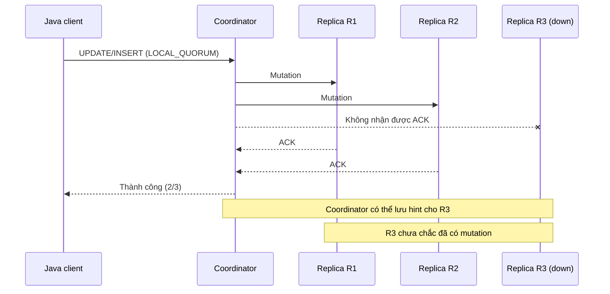
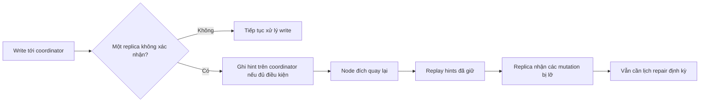
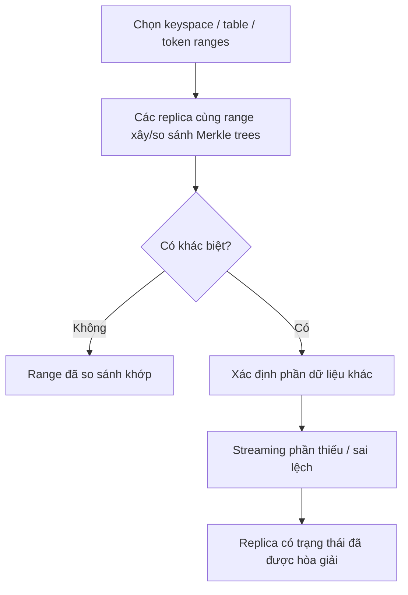
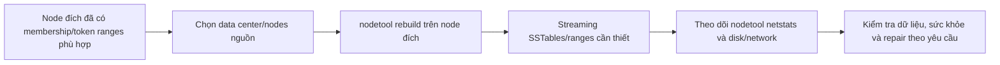

# Repair, replay hint và rebuild giải quyết các bài toán khác nhau

> **Chương:** Đồng bộ bản sao  
> **Học phần:** `DATABASE_ENGINE_WIDE_COLUMN_CASSANDRA` — Apache Cassandra

Apache Cassandra lưu dữ liệu theo mô hình *wide-column phân tán*: khóa phân vùng quyết định token, chiến lược replication xác định các replica sở hữu token range và **consistency level** quyết định cần bao nhiêu phản hồi cho mỗi yêu cầu đọc/ghi. Khi một replica tạm thời mất kết nối, các replica khác vẫn có thể nhận mutation; do đó, sau khi node quay lại, dữ liệu của chúng có thể **không hoàn toàn giống nhau**.

Ba cơ chế thường bị gọi chung là “đồng bộ lại dữ liệu” thực ra xử lý các bài toán khác nhau:

- **Replay hint / hinted handoff:** gửi tới replica đã phục hồi những mutation mà coordinator **đã giữ lại tạm thời** khi replica vắng mặt.
- **Anti-entropy repair:** **so sánh** dữ liệu giữa các replica cùng sở hữu token range rồi đồng bộ phần khác nhau. Đây là cơ chế vận hành cần có ngay cả khi hints hoạt động.
- **Rebuild:** **stream dữ liệu quy mô lớn từ các node nguồn tới một node đích**, thường cho bài toán nạp lại dữ liệu thuộc các token range mà node đích cần sở hữu, chẳng hạn lấy dữ liệu từ data center nguồn.

Một lệnh `nodetool rebuild` không tương đương `nodetool repair`; `resumehandoff` cũng không thể tạo ra mutation đã bị bỏ lỡ ngoài cửa sổ lưu hint. Dùng nhầm cơ chế có thể tiêu tốn I/O, kéo dài thời gian sự cố mà vẫn không đạt mục tiêu đồng bộ.

Sau bài này, bạn có thể phân biệt cơ chế, điều kiện, mức độ bảo đảm và chi phí của từng lựa chọn; đọc các chỉ số phục hồi; viết CQL/Java để quan sát tác động của RF và CL; và lập một runbook khi node mất kết nối hoặc cần nạp lại dữ liệu.

## 1. Vì sao các replica có thể khác nhau?

Xét keyspace có **Replication Factor (RF) = 3** trong data center `dc1`. Với `LOCAL_QUORUM`, coordinator cần **2 trong 3** replica tại data center đó xác nhận một write. Nếu replica R3 tạm thời ngừng hoạt động, R1 và R2 vẫn có thể xác nhận thành công cho client.



Những điều cần hiểu chính xác:

1. **Write success theo CL** không chứng minh rằng tất cả replica đã ghi xong. Nó chỉ chứng minh điều kiện xác nhận đã đạt theo giao thức đang dùng.
2. R3 **không mất quyền sở hữu token range** chỉ vì tạm thời down. Khi quay lại, nó cần bắt kịp những mutation đã bỏ lỡ.
3. Chọn `QUORUM`, `LOCAL_QUORUM` hay `ONE` tác động đến cách ứng dụng nhận phản hồi và xác suất thấy dữ liệu mới, nhưng không thay thế lịch repair.
4. Read repair (khi đọc những partition liên quan và điều kiện kích hoạt được thỏa) có thể khắc phục một phần sai lệch **được truy vấn**; nó không quét hệ thống để thay thế anti-entropy repair toàn bộ token range.
5. Nếu ứng dụng bị write timeout, **không thể mặc định mutation chắc chắn chưa được ghi**. Một số replica có thể đã nhận; retry phép toán không idempotent như tăng counter có thể gây sai lệch nghiệp vụ.

## 2. So sánh nhanh ba cơ chế

| Tiêu chí | Hinted handoff / replay hint | Anti-entropy repair | Rebuild |
| --- | --- | --- | --- |
| **Câu hỏi chính** | “Node này đã bỏ lỡ những mutation nào mà coordinator còn giữ?” | “Những replica cùng token range hiện khác nhau ở đâu?” | “Node này cần lấy lại dữ liệu cho các range của mình từ nguồn nào?” |
| **Nguồn dữ liệu** | File hint lưu ở coordinator đã nhận mutation | Dữ liệu trên các replica sở hữu range, so sánh qua Merkle tree và stream phần khác biệt | SSTable/dữ liệu được streaming từ node nguồn tới node đích |
| **Kích hoạt** | Tự động sau node phục hồi nếu hint tồn tại và handoff được bật | Công việc vận hành được chạy/lập lịch (thường qua `nodetool repair`) | Thao tác vận hành trên **node đích**, ví dụ `nodetool rebuild` |
| **Phạm vi** | Mutation đã được ghi nhớ, trong các giới hạn tạo/lưu/phát hint | Token ranges/bảng được repair, full hoặc incremental | Dữ liệu thuộc range/khóa cần stream vào node đích |
| **Bảo đảm** | **Best effort**, không phải bản đối soát hoàn chỉnh | Đối soát sai lệch dữ liệu giữa các replica tham gia repair | Nạp dữ liệu từ nguồn được chọn, **không phải phép so sánh chống sai lệch toàn cụm** |
| **Chi phí chính** | Disk giữ hints; mạng, CPU, I/O khi replay | Merkle tree, scan/compaction phụ trợ, streaming, mạng và disk I/O | Streaming dung lượng lớn, mạng, disk của cả nguồn lẫn đích |
| **Không giải quyết** | Mutation không còn hint, sai lệch trước thời gian node down | Tự khôi phục file/disk bị hỏng không có nguồn hợp lệ; thay cho backup | Tự phát hiện mọi sai lệch giữa các replica nguồn hoặc sửa dữ liệu nghiệp vụ bị nhập sai |

**Một cách phân loại hữu ích:** hint replay **phát lại bản ghi đã giữ**, repair **đối chiếu và hòa giải những gì replica đang có**, rebuild **chuyển phần dữ liệu node đích cần từ node khác**. Cả ba đều có thể dùng streaming hoặc truyền mutation qua mạng, nhưng mục tiêu và đường dữ liệu khác nhau.

## 3. Hinted handoff: nhanh sau downtime ngắn, nhưng có giới hạn

### 3.1. Hints hình thành và được replay như thế nào?

Khi coordinator phát mutation nhưng một replica chưa nhận được, nó có thể lưu **hint** cho replica đó. Hint chứa thông tin đích, mutation và timestamp gốc, được giữ tạm tại nơi lưu hints của coordinator. Khi node đích phục hồi, coordinator phát các hints còn tồn; node đích áp dụng chúng, sau đó các file hint đã được xác nhận phát thành công được dọn dẹp theo cơ chế của Cassandra.



Những ranh giới quan trọng:

- Hints **được bật mặc định** trong cấu hình phổ biến, nhưng có thể bị tắt theo node hoặc theo data center. Không suy từ việc node đã lên là “chắc chắn sẽ có hints”.
- `max_hint_window` hạn chế **khoảng downtime mà coordinator tiếp tục tạo hints** cho endpoint đã down; trong tài liệu Cassandra 5.0, mặc định thường là **3 giờ**. Nó **không phải** lời hứa rằng “mọi mutation trong 3 giờ đều chắc chắn có hint” hay “mọi hint tồn tại đúng 3 giờ rồi xóa”.
- Hints là **best effort**: coordinator có thể không tạo/lưu được vì điều kiện write, lưu trữ, cấu hình, giới hạn cửa sổ hay sự cố khác.
- Hints mang timestamp gốc, nên phát lại mutation thông thường không tự biến nó thành bản cập nhật mới hơn các giá trị đã được ghi sau đó. Tuy nhiên điều này **không đồng nghĩa các phép cộng counter từ phía ứng dụng trở thành idempotent** khi client chủ động gửi trùng yêu cầu.
- Nếu dữ liệu sai lệch từ trước, hoặc node down lâu hơn khả năng ghi hints, replay những gì còn lại vẫn **không thể chứng minh các replica giống nhau**.

### 3.2. Khi downtime vượt cửa sổ hint

Giả sử R3 down 5 giờ và cấu hình `max_hint_window` mặc định là 3 giờ:

- Trong giai đoạn cho phép, coordinator có thể ghi hints cho những mutation R3 bỏ lỡ.
- Sau khi endpoint vượt giới hạn downtime, coordinator **ngừng tạo hints mới** cho endpoint đó. Những mutation tiếp theo có thể không còn bản hint để phát lại.
- R3 trở lại và nhận được một phần hints còn giữ, nhưng các khoảng thiếu không có hint vẫn tồn tại.
- **Anti-entropy repair** là cách so sánh và đồng bộ dữ liệu trên những token range liên quan; không thể chỉ chờ “replay hoàn tất” rồi tuyên bố node đã nhất quán.

Đừng tự tăng `max_hint_window` thật lớn như cách thay repair: việc giữ và replay thêm hints tốn dung lượng và I/O; nếu đĩa coordinator gần đầy, lựa chọn đó còn có thể gây sự cố mới.

### 3.3. Những lệnh quan sát và điều khiển hints

Ví dụ các lệnh kiểm tra phổ biến, thực hiện trên node cần quan sát:

```bash
nodetool status
nodetool statushandoff
nodetool getmaxhintwindow
nodetool netstats
```

`statushandoff` cho biết trạng thái lưu hints **cho các ghi tương lai trên node hiện tại**, không chứng nhận rằng đã phát hết các hint đang tồn. `getmaxhintwindow` được bổ sung từ Cassandra 4.0; hãy kiểm tra phiên bản trước khi chạy. `netstats` cho biết hoạt động truyền dữ liệu và các thống kê mạng liên quan, nhưng dashboard metrics về **HintsService / HintedHandOffManager** vẫn cần thiết để xem số hints tạo/đang phát/bị bỏ.

Nếu việc chuyển hints đã bị **tạm dừng có chủ đích**, có lệnh:

```bash
# THAO TÁC VẬN HÀNH: chỉ chạy khi đã xác minh cần tiếp tục delivery.
nodetool resumehandoff
```

`resumehandoff` chỉ **tiếp tục quá trình phát những hints hiện có**; nó không tạo hints mới cho khoảng thời gian đã mất. Không nhầm nó với `nodetool replaybatchlog`: batchlog replay là cơ chế phục hồi batch, **khác hoàn toàn** với hinted handoff. Cũng không dùng `truncatehints` để “xử lý backlog”: thao tác đó xóa hints và có thể xóa cơ hội phục hồi các write bị lỡ.

## 4. Anti-entropy repair: đối soát sai lệch theo token range

### 4.1. Cơ chế

Repair dùng việc so sánh dữ liệu giữa các replica cùng sở hữu **token ranges**. Cassandra có thể dùng **Merkle trees** (cây hash) để phát hiện phần dữ liệu khác biệt, rồi stream những khác biệt cần thiết giữa các node.



Repair **khác replay hints** ở chỗ không cần biết trước “những mutation cụ thể nào đã bị lỡ”; nó xét dữ liệu hiện có ở replica. Vì vậy, repair bao phủ các sai lệch do downtime dài, mất hints, lịch sử ghi thiếu hoặc các tình huống khác mà hinted handoff không xử lý hết.

Các giới hạn cần nhớ:

- Repair chỉ đối soát **dữ liệu còn có trên các replica tham gia**. Nó không thể tự phục hồi một giá trị đã biến mất khỏi *tất cả* replica và không thay thế bản sao lưu.
- Repair tốn CPU, mạng, đĩa và thời gian; không nên chạy ồ ạt trên mọi node ngay khi đang gặp disk full, streaming error hoặc compaction backlog nặng.
- Nếu tombstone đã bị thu hồi trước khi một replica thiếu dữ liệu xóa được đối soát, dữ liệu cũ trên replica đó có thể xuất hiện trở lại (**zombie data**). Cần vận hành repair trong khung phù hợp `gc_grace_seconds` và khả năng các replica vắng mặt.
- Repair không tự sửa lỗi thiết kế partition key, duplicate event từ Java client, dữ liệu bị ghi sai theo nghiệp vụ hay consistency level không phù hợp.

### 4.2. Incremental và full repair

| Kiểu | Phạm vi | Khi nào cân nhắc |
| --- | --- | --- |
| **Incremental repair** | Tập SSTable/dữ liệu chưa được đánh dấu repaired kể từ các lần incremental repair trước; những lần sau có thể tập trung vào phần mới | Vận hành thường xuyên khi lịch incremental ổn định; mặc định của `nodetool repair` trên các bản Cassandra hiện đại |
| **Full repair** | Xét toàn bộ dữ liệu trong token ranges/bảng được chọn, bao gồm cả phần đã đánh dấu repaired | Kiểm tra/đối soát tổng thể theo lịch; phục hồi sau sự cố nghiêm trọng, mất dữ liệu hoặc thay đổi replication cần rà soát rộng |

Ví dụ cú pháp, **chỉ mang tính minh họa**, yêu cầu quyền vận hành và phải chạy trong kế hoạch bảo trì:

```bash
# Incremental repair (mặc định trên các bản Cassandra hiện đại):
nodetool repair -pr telemetry sensor_events_by_day

# Full repair phạm vi primary token ranges của node đang chạy:
nodetool repair --full -pr telemetry sensor_events_by_day

# Preview lượng dữ liệu dự kiến cần trao đổi, không stream sửa:
nodetool repair --preview --full -pr telemetry sensor_events_by_day
```

- `-pr` chỉ repair **primary token ranges của node thực thi**, tránh lặp công việc dư thừa. Để bao phủ **toàn cụm**, lịch sửa chữa phải chạy trên đầy đủ node/data center theo chiến lược range coverage; chạy trên một node **không tự sửa toàn cluster**.
- Full repair xem cả dữ liệu đã đánh dấu repaired; incremental repair có cơ chế quản lý trạng thái đã repair và có thể liên quan đến *anticompaction* cùng yêu cầu dung lượng/I/O phụ trợ.
- Preview giúp ước lượng streaming nhưng bản thân việc xây/so sánh cây hash vẫn tốn tài nguyên; không phải kiểm tra “miễn phí”.
- Với phiên bản Cassandra, topology và công cụ quản lý khác nhau, các option, lịch trình và hành vi chi tiết có thể khác. Kiểm tra `nodetool help repair` trên **đúng binary** trước khi áp dụng.

### 4.3. Repair và `gc_grace_seconds`

Tombstone được giữ nhằm ngăn dữ liệu đã xóa sống lại trên replica vừa quay về. `gc_grace_seconds` là **khoảng bảo vệ** trước khi tombstone có thể được loại bỏ khi compaction đáp ứng điều kiện, **không phải timer tự xóa** vào đúng thời điểm.

Nếu một node offline lâu hơn cả cửa sổ hints và thời gian bảo vệ tombstone, rủi ro zombie data tăng. Điều này dẫn đến yêu cầu vận hành: **lịch repair phải hoàn tất bao phủ các replica và token range cần thiết đủ thường xuyên trong cửa sổ grace**, có tính cả thời gian dự phòng cho downtime, lỗi repair và nhiều data center. Với bảng có dữ liệu quan trọng, phải rà soát thiết kế TTL, tombstone và chính sách repair cùng nhau.

**Ví dụ:** `gc_grace_seconds` là 10 ngày không có nghĩa “repair 10 ngày một lần vào bất kỳ thời điểm nào cũng an toàn”; lịch phải có dư địa để hoàn thành trước khi grace hết hạn và không để node vắng mặt quá lâu mà vẫn bỏ sót.

## 5. Rebuild: lấy lại dữ liệu cho node đích bằng streaming

`nodetool rebuild` yêu cầu **node đang chạy lệnh** lấy dữ liệu bằng streaming từ những node khác, tương tự cơ chế nạp dữ liệu trong bootstrap. Mục tiêu thường gặp là **nạp dữ liệu từ data center nguồn** cho một node ở data center mới hoặc đã có cấu hình token phù hợp nhưng cần lấy lại dữ liệu.



**Điểm khác với repair:**

- Rebuild **chủ động nạp dữ liệu cho node đích** từ nguồn, không bắt đầu từ bước Merkle tree so sánh mọi replica để chứng minh đồng bộ.
- Nó có thể truyền **khối lượng lớn**, kể cả khi chỉ một phần dữ liệu thực sự thiếu; yêu cầu nguồn tin cậy, dung lượng đích và băng thông.
- Khi nguồn đang thiếu/sai lệch hoặc dữ liệu thay đổi trong suốt quá trình stream, rebuild **không chứng minh replica đã nhất quán hoàn toàn sau cùng**. Có thể cần repair/kiểm tra bổ sung.
- Không tự coi rebuild là **cách thay node chết**: node replacement cần thủ tục membership/token/host identity thích hợp và streaming trong quá trình replacement. Tương tự, thêm node mới thường dùng **bootstrap** theo quy trình topology change. Dùng `rebuild` đơn lẻ không giải quyết các bước này.

### 5.1. Ví dụ dùng rebuild

Kịch bản: cụm có data center nguồn `dc1`, đang khởi tạo node có token phù hợp ở data center `dc2` theo runbook topology riêng. Sau khi node đích ở trạng thái cho phép rebuild, quản trị viên muốn nạp một keyspace từ `dc1`:

```bash
# THAO TÁC VẬN HÀNH: chạy trên NODE ĐÍCH,
# chỉ sau khi kiểm tra replication, membership, disk space và source DC.
nodetool rebuild --keyspace telemetry dc1

# Quan sát quá trình streaming:
nodetool netstats
nodetool status
```

Ví dụ option được đối chiếu với lệnh Cassandra 5.0. Một số bản `nodetool rebuild` có thể dùng data center nguồn mặc định hoặc hỗ trợ tham số chọn token/source khác nhau; đọc `nodetool help rebuild` trên phiên bản chạy thật.

**Không chạy chỉ vì một node bị down 10 phút.** Trong tình huống downtime ngắn và dữ liệu trên disk còn nguyên, đưa node quay lại khỏe mạnh rồi để hinted handoff hoạt động, sau đó dùng repair theo chính sách thông thường phù hợp hơn.

### 5.2. Khi nào phải dùng quy trình replace/bootstrap?

- **Thêm node mới để tăng capacity:** bootstrap là đường đưa node mới vào token ring và stream dữ liệu cần sở hữu; có thể cần cleanup trên các node mất quyền sở hữu range sau thay đổi.
- **Node mất ổ đĩa hoặc mất hẳn máy:** dùng quy trình **replace dead node** với cấu hình đúng phiên bản và host/token identity; streaming dữ liệu là một phần của replacement. Theo tài liệu topology changes, trong một số trường hợp node thay thế còn có thể cần **repair** sau khi replacement hoàn tất, nhất là nếu downtime vượt `max_hint_window`.
- **Data center mới có node gia nhập nhưng cần nạp dữ liệu:** rebuild từ data center nguồn được chọn khi đã hoàn tất bước topology/membership phù hợp.

Không gộp ba tình huống này thành một câu “chạy rebuild là xong”.

## 6. Chọn cơ chế theo tình huống sự cố

| Tình huống thực tế | Hướng xử lý trước | Vì sao |
| --- | --- | --- |
| Một replica restart 20 phút, trở lại với dữ liệu trên disk nguyên vẹn | Theo dõi **replay hints** và sức khỏe; tiếp tục lịch repair | Hints có khả năng chứa phần mutation mới bị lỡ, downtime ngắn. |
| Replica offline 5 giờ, mặc định hint window 3 giờ | Phục hồi node; replay những hints còn có; **repair** token ranges liên quan | Có khoảng ghi đã vượt cửa sổ tạo hints nên không thể dựa chỉ vào hints. |
| Replica online nhưng dữ liệu không giống những replica khác dù hints đã xong | **Repair** và điều tra nguồn sai lệch | Hints không so sánh toàn bộ tập dữ liệu; repair mới phát hiện diff theo range. |
| Mất hoàn toàn ổ đĩa trên một node cũ | **Replace/restore node** theo runbook, streaming; đánh giá repair sau | Node không còn data và có thể cần quy trình membership/identity. |
| Xây thêm data center, node đích có token/config phù hợp nhưng chưa có dữ liệu | **Rebuild từ source DC** theo kế hoạch | Bài toán nạp hàng loạt range vào node đích. |
| Tăng RF trên keyspace đã có dữ liệu | Thay đổi cấu hình theo runbook rồi **full repair** để đưa dữ liệu tới replica mới, hoặc phương án topology phù hợp | Các replica mới cần dữ liệu đã tồn tại, chỉ đợi hints không đủ. |
| Đọc một partition cụ thể thấy giá trị cũ | Kiểm tra CL/replica, có thể read repair với dữ liệu được đọc; **repair** nếu sai lệch rộng | Một lần đọc không đối soát mọi token range. |
| Tombstone sắp hết grace, lịch repair bỏ sót nhiều node | Khẩn trương đánh giá lịch **full/incremental repair** và khả năng phục hồi | Nguy cơ dữ liệu đã xóa sống lại trên replica chưa nhận tombstone. |
| Disk đầy hoặc I/O bị nghẽn nặng | Ưu tiên ổn định storage trước khi thúc streaming/repair | Cả repair và rebuild đều tăng I/O, có thể làm sự cố nghiêm trọng hơn. |

### Một ví dụ quyết định đầy đủ

Giả sử ứng dụng bán hàng ghi event đơn hàng:

1. Một replica down, hai replica còn lại xác nhận `LOCAL_QUORUM` thành công.
2. Sau khi node trở lại trong cửa sổ hints, bạn thấy backlog hints đang được phát.
3. Vẫn cần **monitor** backlog, write/read latency và hoàn thành lịch repair đã thống nhất; hint replay không chứng minh toàn bộ dữ liệu đã đồng bộ.
4. Nếu node down vượt cửa sổ hoặc xuất hiện dữ liệu lệch, chạy repair **được điều phối theo phạm vi** phù hợp.
5. Nếu node đã mất disk, không chờ replay hints lên node trống mà phải thực hiện quy trình replacement/restoration; tránh tự xóa file để ép rebuild.

## 7. CQL và ứng dụng Java: consistency level không thay thế repair

### 7.1. Ví dụ bảng được thiết kế theo truy vấn

Giả định data center thực sự tên `dc1` và ba node đủ điều kiện đặt RF=3; các câu DDL sau **dành cho môi trường học tập**, không thay trực tiếp keyspace production:

```sql
CREATE KEYSPACE IF NOT EXISTS telemetry
WITH replication = {
    'class': 'NetworkTopologyStrategy',
    'dc1': '3'
};

CREATE TABLE IF NOT EXISTS telemetry.sensor_events_by_day (
    sensor_id text,
    event_day date,
    event_id uuid,
    reading double,
    PRIMARY KEY ((sensor_id, event_day), event_id)
);

INSERT INTO telemetry.sensor_events_by_day
    (sensor_id, event_day, event_id, reading)
VALUES ('sensor-07', '2026-11-21',
        11111111-1111-4111-8111-111111111111, 23.5);

SELECT event_id, reading
FROM telemetry.sensor_events_by_day
WHERE sensor_id = 'sensor-07'
  AND event_day = '2026-11-21';
```

Khóa phân vùng `(sensor_id, event_day)` phân nhóm dữ liệu theo thiết bị và ngày. Nếu một sensor tạo quá nhiều event mỗi ngày, bổ sung bucket/shard vào partition key là bài toán **data modeling** độc lập với replication, hints, repair hay rebuild.

Trong `cqlsh`, bạn có thể chọn CL cho những truy vấn theo thử nghiệm:

```sql
-- Đây là lệnh cqlsh, không phải một câu CQL DDL/DML.
CONSISTENCY LOCAL_QUORUM;
```

Với RF=3 chỉ trong `dc1`, `LOCAL_QUORUM` cần hai ACK ở `dc1`. Điều này giúp ghi/đọc có khả năng hoạt động khi một replica tạm thời down, nhưng việc một lần write thành công vẫn **không chứng minh mọi replica đã có dữ liệu**.

### 7.2. Java Driver 4.x và phản hồi không xác định

```java
import java.time.LocalDate;
import java.util.UUID;

import com.datastax.oss.driver.api.core.CqlSession;
import com.datastax.oss.driver.api.core.DefaultConsistencyLevel;
import com.datastax.oss.driver.api.core.cql.BoundStatement;
import com.datastax.oss.driver.api.core.cql.PreparedStatement;

public final class SensorEventWriter {
    private final CqlSession session;
    private final PreparedStatement insertEvent;

    public SensorEventWriter(CqlSession session) {
        this.session = session;
        this.insertEvent = session.prepare(
            "INSERT INTO telemetry.sensor_events_by_day " +
            "(sensor_id, event_day, event_id, reading) VALUES (?, ?, ?, ?)");
    }

    public void write(String sensorId, LocalDate day,
                      UUID eventId, double reading) {
        // eventId phải được giữ nguyên cho cùng event qua các lần retry.
        BoundStatement statement = insertEvent.bind(
                sensorId, day, eventId, reading)
            .setConsistencyLevel(DefaultConsistencyLevel.LOCAL_QUORUM)
            .setIdempotent(true);

        session.execute(statement);
    }
}
```

Ở ví dụ này, `setIdempotent(true)` chỉ hợp lý khi ứng dụng đảm bảo **cùng khóa và payload bất biến** cho một event và không phụ thuộc vào việc thay đổi timestamp/TTL mỗi lần retry. Với nghiệp vụ cần thời hạn lưu trữ hoặc thứ tự update cố định, nên dùng timestamp ghi xác định hoặc cơ chế khử trùng/đối soát chuyên biệt. Không tự gắn `true` cho counter, phép cộng/trừ hay thao tác có side effect.

Nếu `session.execute` timeout, application **không biết chắc** mutation được áp dụng ở những replica nào. Cassandra có thể sinh hints cho write bị timeout trong một số điều kiện, nhưng app vẫn phải xử lý **outcome chưa xác định** theo nghiệp vụ. Tăng mức consistency hoặc chờ replay hints **không** thay thế idempotency của API/message broker.

### 7.3. Thử nghiệm trong môi trường riêng

Để học cơ chế, có thể dựng **cụm test** RF=3 trong một data center và:

1. Ghi dữ liệu với `LOCAL_QUORUM` khi đủ ba replica.
2. Tắt có kiểm soát một replica, ghi một số event có `event_id` ổn định.
3. Bật replica, quan sát metrics hinted handoff và dữ liệu đọc tại các CL phù hợp.
4. So sánh với tình huống replica down **vượt hint window**, chạy repair scoped trong môi trường test và ghi lại lượng streaming.
5. Thử bootstrap/rebuild trên một node **test riêng** khi đã hoàn tất thiết kế topology, quan sát `nodetool netstats`.

Không áp dụng các bước tắt node, chuyển CL hay thao tác repair/rebuild trực tiếp lên production chỉ để “chứng minh” behavior.

## 8. Runbook quan sát và phục hồi

### Trước khi chọn hành động

1. **Xác định sự cố:** node nào down, bao lâu, dữ liệu trên đĩa còn không, node có thay host ID/token không, data center nào bị ảnh hưởng.
2. **Kiểm tra replication và CL:** RF theo data center, ứng dụng đọc/ghi với mức nào, có đủ replica khỏe để tiếp tục phục vụ không.
3. **Đánh giá cửa sổ hints:** hints có bật không, `max_hint_window` thực tế, có metric hints được tạo/bỏ qua và backlog delivery không.
4. **Kiểm tra tài nguyên:** disk free, I/O, CPU, memtable/compaction backlog, network streaming; ước lượng tác động nếu chạy repair/rebuild.
5. **Xem nguy cơ tombstone:** `gc_grace_seconds` theo bảng và lần repair thành công gần nhất trên các range liên quan.
6. **Chốt mục tiêu:** muốn phát mutation bị lỡ, muốn so sánh replicas hay muốn nạp lại dữ liệu node đích?

### Lệnh kiểm tra, không thay đổi dữ liệu

```bash
nodetool version
nodetool status
nodetool describecluster
nodetool statushandoff
nodetool netstats
nodetool compactionstats
nodetool tpstats
```

Nên kết hợp các nhóm metrics:

| Nhóm | Nên theo dõi | Ý nghĩa |
| --- | --- | --- |
| Hints | Hints tạo, không lưu, tồn đọng, phát thành công/thất bại, thời gian delivery | Đánh giá phần replay đang bắt kịp đến đâu; không phải chứng nhận dữ liệu đã đồng bộ hết |
| Repair | Range/table được repair, job thất bại, streaming bytes, tiến độ theo node/DC | Kiểm tra lịch repair thực sự bao phủ cluster |
| Rebuild/streaming | `nodetool netstats`, disk read/write, network throughput, source node load | Phát hiện streaming nghẽn/chưa hoàn tất |
| Sức khỏe cụm | `UN/DN`, request latency/timeouts, hinted handoff errors | Đo tác động tới dịch vụ trong và sau phục hồi |
| Tombstone | Tuổi repair, `gc_grace_seconds`, cảnh báo tombstone, TTL | Đánh giá nguy cơ zombie nếu node offline lâu |

**Không được thay một chỉ số bằng chỉ số khác:** `nodetool status` hiển thị `UN` chỉ nói node Up/Normal theo góc nhìn quản trị; không xác nhận “hints đã hết”, “repair đã hoàn thành” hoặc “SSTable đã được rebuild đầy đủ”.

### Sau khi thao tác

- Xác nhận quá trình cần thiết đã kết thúc mà không lỗi, bằng log và metrics chứ không chỉ exit code một lần.
- Kiểm tra consistency của một tập truy vấn đại diện theo đúng partition key, trong khi nhớ rằng kiểm tra mẫu không thay thế anti-entropy repair.
- Đảm bảo lịch repair tiếp tục hoạt động và bao phủ đầy đủ range/replica theo SLA. Khả năng repair có thể bị ảnh hưởng khi node tiếp tục down.
- Nếu dữ liệu nguồn không còn ở bất kỳ replica nào, đánh giá **backup/restore**. Cả repair, replay hint và rebuild đều không tạo lại dữ liệu không còn nguồn hợp lệ.
- Ghi nhận nguyên nhân gốc: downtime, bị thiếu hints, storage issue, network issue, giới hạn vận hành hoặc chính sách CL không phù hợp.

## 9. Các lỗi hiểu nhầm cần tránh

| Hiểu nhầm | Sự thật |
| --- | --- |
| “Node lên là sẽ tự đồng bộ hoàn toàn.” | Node có thể replay những hints còn có, nhưng vẫn cần repair định kỳ hoặc repair sự cố. |
| “Hint replay và repair là hai tên của một việc.” | Hints gửi mutation đã giữ; repair so sánh dữ liệu replica và stream phần khác. |
| “Hết `max_hint_window` thì hints cũ bị xóa hết.” | Tham số giới hạn khoảng downtime **tạo hints mới**; không nên suy ra cơ chế xóa toàn bộ backlog đúng tại mốc này. |
| “Chạy `resumehandoff` là ép replica nhận mọi write đã thiếu.” | Chỉ tiếp tục delivery đang dừng; không tạo được hints đã không lưu. |
| “Rebuild thay repair cho mọi replica.” | Rebuild nạp dữ liệu vào node đích; nó không làm phép kiểm chứng đối soát toàn cụm. |
| “Chạy `nodetool repair` trên một node là sửa cả cụm.” | Repair bao phủ token range được lệnh đó xử lý; cần lịch chạy đủ node/DC hoặc range coverage. |
| “`LOCAL_QUORUM` làm dữ liệu luôn giống nhau ở RF=3.” | Nó xác nhận khi đủ hai replica đồng ý/ACK theo giao thức; một replica có thể chưa bắt kịp. |
| “Chạy `replaybatchlog` để phát lại hints.” | Batchlog replay và hinted handoff là hai cơ chế khác nhau. |
| “Thay disk xong chỉ cần restart.” | Khi mất dữ liệu/membership, phải cân nhắc replace/restore/bootstrap/rebuild theo topology rồi đối soát. |
| “Repair khắc phục dữ liệu nghiệp vụ bị ghi trùng.” | Repair đồng bộ dữ liệu Cassandra; không phân biệt event ID/logic nghiệp vụ đúng hay sai. |

## 10. Bài tập tự kiểm tra

**Câu 1.** RF=3 trong `dc1`, write `LOCAL_QUORUM` thành công khi R3 đang down. Có thể kết luận R3 đã có dữ liệu chưa? Nếu R3 quay lại sau 20 phút, cơ chế nào thường giúp nó bắt kịp nhanh?

**Câu 2.** R3 down 6 giờ với `max_hint_window` 3 giờ. Sau khi replay toàn bộ hints đang có, kỹ sư định tuyên bố dữ liệu đồng bộ. Sai ở đâu và cần thêm điều gì?

**Câu 3.** Một node được khởi tạo trong `dc2`, cần nạp dữ liệu từ `dc1` cho keyspace `telemetry`; node có membership/token ranges đúng theo kế hoạch. Nên chọn repair, replay hint hay rebuild?

**Câu 4.** Một node cũ mất cả data disk và phải thay bằng phần cứng mới. Có nên chạy `nodetool rebuild` như thao tác duy nhất trước khi đưa máy mới vào ring không?

**Câu 5.** Tại sao `gc_grace_seconds`, tombstone và chu kỳ repair cần được lên kế hoạch cùng nhau?

**Câu 6.** Một ứng dụng Java tăng counter `+1` bị write timeout. Có nên retry tự động vì hệ thống “đã có hinted handoff” không?

<details>
<summary>Gợi ý đáp án</summary>

1. **Không**. Hai replica khỏe đủ làm write thành công; R3 có thể chưa nhận mutation. Khi quay lại sớm, **hint replay** thường giúp bắt kịp những mutation coordinator đã ghi nhớ; vẫn có lịch repair.
2. Hints không được tạo mãi sau khi node down quá cửa sổ; phần mutation không có hint vẫn có thể thiếu. Cần **anti-entropy repair** đúng phạm vi và quan sát kết quả.
3. **Rebuild** từ `dc1` trên node đích ở `dc2`, sau khi xác minh mọi điều kiện topology, nguồn và dung lượng. Theo dõi streaming và đánh giá repair sau đó.
4. **Không**. Node replacement cần quy trình token/membership/host identity và streaming đúng phiên bản; repair có thể cần nếu bỏ lỡ ghi trong khoảng thay thế.
5. Tombstone cần lan tới những replica từng offline trước khi bị thu hồi an toàn. Nếu quá lâu không repair, dữ liệu cũ có thể hồi sinh từ replica còn bản cũ.
6. **Không**. Timeout không chắc write thất bại; counter update không idempotent. Hinted handoff không khử trùng những request ứng dụng tự gửi lặp.

</details>

## Ghi nhớ

- **Replay hint:** phát những mutation đã lưu tạm, tự động và nhanh trong downtime ngắn; **best effort**, có cửa sổ tạo hints.
- **Repair:** so sánh các replica qua token ranges và stream khác biệt; là nền tảng đối soát định kỳ, liên quan trực tiếp đến `gc_grace_seconds` và tombstone.
- **Rebuild:** streaming dữ liệu cần thiết từ nguồn đến **node đích**; phù hợp bài toán nạp lại dữ liệu theo topology, không đồng nghĩa replace/bootstrap hay repair.
- **RF và CL** quyết định replica và điều kiện phản hồi; không bảo đảm mọi replica đã đồng bộ sau mỗi write thành công.
- Trong sự cố, phải hỏi **node còn dữ liệu không, mất bao lâu, hints còn không, phạm vi sai lệch là gì, topology có đổi không** rồi mới chọn hành động.
- Monitor cả hints, repair, streaming, read/write latency và sức khỏe cụm; nếu không còn bản nguồn hợp lệ, cần **backup/restore**, không có lệnh nào trong ba cơ chế tự tạo dữ liệu từ hư không.

### Tài liệu chính thức

- [Apache Cassandra 5.0 — Hints và hinted handoff](https://cassandra.apache.org/doc/stable/cassandra/managing/operating/hints.html)
- [Apache Cassandra 5.0 — Repair](https://cassandra.apache.org/doc/stable/cassandra/managing/operating/repair.html)
- [Apache Cassandra 5.0 — nodetool rebuild](https://cassandra.apache.org/doc/latest/cassandra/managing/tools/nodetool/rebuild.html)
- [Apache Cassandra — Thay đổi topology, bootstrap và replace](https://cassandra.apache.org/doc/latest/cassandra/managing/operating/topo_changes.html)
- [Apache Cassandra — Streaming architecture](https://cassandra.apache.org/doc/stable/cassandra/architecture/streaming.html)
- [Apache Cassandra — Cassandra metrics](https://cassandra.apache.org/doc/stable/cassandra/managing/operating/metrics.html)

