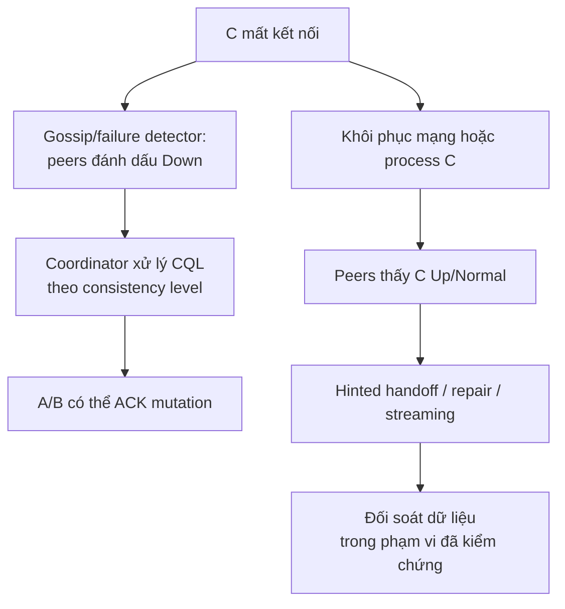

# Thiết kế kịch bản mất kết nối rồi tái gia nhập cụm

**Chương:** Đồng bộ bản sao  
**Module:** `DATABASE_ENGINE_WIDE_COLUMN_CASSANDRA` — Apache Cassandra

Cassandra phân phối partition qua nhiều node và duy trì nhiều replica theo replication factor (RF). Khi một node mất kết nối, coordinator vẫn có thể xác nhận yêu cầu ở consistency level (CL) phù hợp dù replica đó chưa nhận mutation. Điều khó hơn xuất hiện lúc node **tái gia nhập**: trạng thái `UN` trong `nodetool status` cho biết node hoạt động và được xem là thành viên bình thường, **không chứng minh** toàn bộ mutation bị bỏ lỡ đã được bù.

Bài này nằm trong nội dung tìm hiểu kiến trúc phân tán và mô hình wide-column Cassandra, khóa phân vùng, thiết kế bảng theo truy vấn, mức nhất quán đọc ghi, CQL, replication, compaction, repair, xử lý lỗi và kết nối từ ứng dụng Java. Chủ đề là **thiết kế một kịch bản lỗi có thể lặp lại**, với baseline, fault injection, đo phản hồi, khôi phục liên lạc, kiểm tra hội tụ và đánh giá tác động.

> Chỉ thực hành trên cụm thử nghiệm riêng, có quyền quản trị và có cách hoàn tác fault injection. Không dừng/cô lập node, đổi topology, xóa dữ liệu hay sửa cấu hình mạng của cluster production chỉ để làm bài.

## 1. Mục tiêu học tập

Sau bài này, bạn có thể:

1. Phân biệt **network partition**, **node/process outage** và việc thay đổi thành viên ring như bootstrap/decommission/replace.
2. Dự đoán hành vi của `ONE`, `LOCAL_QUORUM` và `ALL` khi một trong ba replica không đáp ứng.
3. Thiết kế thí nghiệm có **baseline đã được xác nhận**, mutation riêng cho từng lượt và bảng ghi nhận kết quả.
4. Quan sát mốc Down → Up trong failure detector và tách việc node đã `UN` khỏi việc dữ liệu đã hội tụ.
5. Giải thích hinted handoff, read repair, anti-entropy repair và streaming trong quá trình phục hồi.
6. Đọc kết quả CQL, `nodetool status`, `netstats` và logs mà không kết luận vượt quá bằng chứng.
7. Xử lý khác biệt giữa thành công, `Unavailable`, timeout và **unknown write outcome**.
8. Đề xuất quy trình ứng phó nếu node mất kết nối lâu, hints không còn hoặc có dữ liệu xóa/TTL.
9. Xây dựng kiểm tra sau phục hồi bằng Java Driver và ghi nhận giới hạn của cách đối soát này.

**Giả thuyết chính:** với RF=3 trong một datacenter, node C bị cô lập thì hai node A/B còn khỏe vẫn có thể xác nhận ghi `LOCAL_QUORUM`. Sau khi C quay lại, các bản sao có thể hội tụ nhờ hinted handoff hoặc repair, nhưng độ trễ và lượng dữ liệu bù không cố định.

## 2. Ba loại sự cố thường bị gọi chung là “node mất kết nối”

| Sự kiện | Quá trình thực tế | Điều xảy ra với thành viên ring | Phương án khôi phục |
| --- | --- | --- | --- |
| Network partition | Node vẫn chạy, nhưng giao tiếp với các peer bị chặn, có thể theo một chiều hoặc hai chiều | Peer có thể đánh dấu node Down; token ownership không tự biến mất | Mở mạng, kiểm tra gossip, hints, repair nếu cần |
| Process/host outage | Process Cassandra hoặc host ngừng hoạt động | Peer đánh dấu Down sau giai đoạn phát hiện; node vẫn là thành viên dự kiến | Khởi động **cùng node**, giữ host identity và dữ liệu |
| Bootstrap / decommission / replace | Cố ý gia nhập mới, rời ring hoặc thay replica cũ | Token ownership/topology có thể thay đổi | Theo quy trình topology và streaming tương ứng |

Trong bài, **tái gia nhập** nghĩa là **cùng node C** quay lại sau network/process outage, với token metadata và dữ liệu cũ được giữ nguyên. Không dùng `replace_address`, `nodetool join`, xóa data directory hoặc tái tạo container với identity khác như cách “khôi phục nhanh”.

Failure detector có thể mất một khoảng để phát hiện node mất liên lạc; lỗi truy vấn trong khoảng chuyển tiếp có thể là timeout, không nhất thiết `Unavailable`. Khi peer đánh dấu C Down, điều đó là kết luận về **khả năng liên lạc**, không phải kết luận dữ liệu của C đã bị xóa.

### Hai trục cần ghi chép độc lập



Mốc `UN` và mốc hoàn tất bù dữ liệu **không giống nhau**. Hints đôi khi hoàn tất rất nhanh, repair có thể không cần truyền byte nào; bản vẽ chỉ thể hiện các giai đoạn logic, không ấn định thứ tự nội bộ của mọi phiên bản Cassandra.

## 3. Topology và ma trận consistency level

Ví dụ lab dùng:

- `cassandra1` = A, `cassandra2` = B, `cassandra3` = C.
- Một datacenter có tên giả định `datacenter1`.
- Keyspace sử dụng `NetworkTopologyStrategy`, RF=3 trong DC này.
- Coordinator để chạy CQL ở A, không chọn C đang bị cô lập.
- Ba node cùng Up/Normal trước thí nghiệm và không có writer khác cùng sửa các khóa thử.

Với RF=3 trong một DC, `LOCAL_QUORUM` yêu cầu hai replica phản hồi. `ONE` cần một, `ALL` cần ba.

| Tình trạng replica | `ONE` | `LOCAL_QUORUM` | `ALL` |
| --- | --- | --- | --- |
| A/B/C đều đáp ứng | Có thể thành công | Có thể thành công | Có thể thành công |
| C không đáp ứng, A/B khỏe | Có thể thành công | Có thể thành công nếu A/B đáp ứng kịp | Không đủ ba replica |
| B/C không đáp ứng, A khỏe | Có thể thành công | Không đủ hai replica | Không đủ ba replica |
| Không replica nào đáp ứng | Không khả dụng | Không khả dụng | Không khả dụng |

Các ô “có thể” quan trọng: CPU/GC/đĩa/network quá tải, coordinator lỗi hoặc failure detector chưa cập nhật vẫn gây timeout. Không biến bảng này thành cam kết rằng mọi lần chạy đều trả success hay cùng một loại exception.

### Phân biệt ACK và trạng thái vật lý

Nếu A/B xác nhận mutation ở `LOCAL_QUORUM` trong khi C bị tách mạng, client có thể nhận success. A/B đã đáp ứng điều kiện CL; C có thể còn giá trị cũ. `R + W > RF` ở cùng phạm vi replica giúp tăng tính nhất quán khi đọc/ghi quorum và không có ghi cạnh tranh, nhưng **không** phải transaction chung giữa mọi replica, cũng không bảo đảm đọc tại `ONE` luôn lấy bản mới.

## 4. Kế hoạch thí nghiệm và định danh mỗi lượt

Mỗi lượt tạo một `run_id` riêng; ví dụ `r01` dùng:

```text
test_key A = probe013-r01-a
test_key B = probe013-r01-b
test_key control = probe013-r01-control
baseline revision = 1
revision ghi trong sự cố = 2
```

Lượt sau đổi `r01` thành `r02` trong toàn bộ các lệnh và nhật ký. Không dùng lại khóa cũ, vì dữ liệu đã ghi từ lượt trước có thể che mất kết quả.

Đặt **điều kiện chấp nhận baseline** trước khi gây lỗi: cả ba node `UN`, datacenter/RF đúng, các mutation baseline ACK ở `ALL` và không có writer cạnh tranh. Nếu bất kỳ điều kiện nào sai, sửa lab và bắt đầu lượt mới, không cố tiếp tục rồi kết luận.

### Tối thiểu phải ghi lại

| Mốc | Việc làm | Dữ liệu thu thập |
| --- | --- | --- |
| T0 | Kiểm tra node và ghi baseline | Version, topology, RF, CL, ACK, giá trị |
| T1 | Cắt kết nối C | Loại fault, thời điểm, cấu hình, peer thấy Down |
| T2 | Ghi ở `LOCAL_QUORUM` | Phản hồi từng request, timeout, thời gian |
| T3 | Thử đọc ở `ALL` | `Unavailable`/timeout hoặc kết quả thực tế |
| T4 | Khôi phục C | Thời điểm mở mạng/start và C trở lại `UN` |
| T5 | Đọc từng khóa tại `ONE`/`LOCAL_QUORUM` | Giá trị, CL, request lỗi hay thành công |
| T6 | Theo dõi hints/repair | Logs, repair status, streaming bytes nếu có |
| T7 | Đối soát sau phục hồi | Kết luận logic và phạm vi chưa được kiểm chứng |

Không điền “revision 2” vào cột **thực tế** chỉ vì đó là dự đoán. Khi không quan sát được, ghi rõ “không quan sát được” và lý do.

## 5. Chuẩn bị cụm Cassandra ba node

Ví dụ dùng Docker host có container `cassandra1`/`cassandra2`/`cassandra3`. Với Kubernetes hay VMs, thay các lệnh tương đương, không dùng nguyên lệnh Docker.

```bash
docker exec cassandra1 nodetool status
docker exec cassandra2 nodetool status
docker exec cassandra3 nodetool status
docker exec -it cassandra1 cqlsh
```

Trong `cqlsh`:

```sql
SELECT data_center, release_version FROM system.local;
```

Đảm bảo tên datacenter đúng. Nếu khác `datacenter1`, sửa phần khai báo replication bên dưới cho phù hợp. RF=3 chỉ có ý nghĩa trong bài nếu thực sự có đủ ba node replica trong cùng datacenter.

Tạo schema lab:

```sql
CREATE KEYSPACE IF NOT EXISTS lab_rejoin
WITH replication = {
    'class': 'NetworkTopologyStrategy',
    'datacenter1': 3
}
AND durable_writes = true;

CREATE TABLE IF NOT EXISTS lab_rejoin.probe_state_by_key (
    test_key text PRIMARY KEY,
    revision int,
    payload text,
    updated_at timestamp
);
```

`test_key` là partition key. `revision` là số phiên bản do ứng dụng ghi để đối chiếu; nó không tự tạo CAS/transaction. `updated_at` chỉ giúp nhật ký học tập; Cassandra giải quyết xung đột mutation theo timestamp nội bộ của cell cùng quy tắc tombstone.

### Baseline có ACK từ tất cả replica

Vì cả ba node đang khỏe, ghi baseline tại `ALL`:

```sql
CONSISTENCY ALL

INSERT INTO lab_rejoin.probe_state_by_key
    (test_key, revision, payload, updated_at)
VALUES ('probe013-r01-a', 1, 'before-fault', '2026-11-21T00:00:00Z');

INSERT INTO lab_rejoin.probe_state_by_key
    (test_key, revision, payload, updated_at)
VALUES ('probe013-r01-b', 1, 'before-fault', '2026-11-21T00:00:00Z');

INSERT INTO lab_rejoin.probe_state_by_key
    (test_key, revision, payload, updated_at)
VALUES ('probe013-r01-control', 1, 'untouched', '2026-11-21T00:00:00Z');

SELECT test_key, revision, payload
FROM lab_rejoin.probe_state_by_key
WHERE test_key = 'probe013-r01-a';
```

Chỉ tiếp tục nếu **cả ba INSERT** trả ACK thành công tại `ALL`. Nếu có timeout, không tự tuyên bố mọi replica đã lưu baseline chỉ vì SELECT sau đó thấy revision 1; ghi sự cố và dùng bộ khóa mới. Mục đích là biết C đã có trạng thái trước fault.

## 6. Tạo sự cố mạng rồi xác minh peer đã phát hiện Down

Có hai phương án thử. **Chỉ chọn một phương án cho một lượt**, đồng thời ghi tên nó để tránh nhập nhằng.

### 6.1. Phương án A: cô lập egress của C bằng `tc netem` (có điều kiện)

Nếu container chạy trên Linux, có `iproute2/tc` và quyền `NET_ADMIN`, có thể làm mất toàn bộ lưu lượng gửi ra từ C. Do C không thể đáp ứng peers, nó trở thành một mô hình network isolation. Phương án này **không** tắt process.

Kiểm tra trước khi sửa:

```bash
docker exec cassandra3 ip -br link
docker exec cassandra3 tc qdisc show dev eth0
```

**Chỉ dùng `eth0` nếu đã xác nhận đó là interface thực sự phục vụ traffic Cassandra**; nếu đang có network policy/qdisc quan trọng thì không đè lên. Chuẩn bị cả lệnh hoàn tác trước khi cô lập:

```bash
# Trong lab dùng eth0, tc và NET_ADMIN:
docker exec cassandra3 tc qdisc add dev eth0 root netem loss 100%

# Quan sát từ peer khỏe A, không hỏi trạng thái qua C:
docker exec cassandra1 nodetool status
```

Khi được áp dụng đúng, C vẫn chạy nhưng không trả lời peers qua đường mạng đã bị tác động. Failure detector có thể cần một khoảng thời gian trước khi đánh dấu C `DN`; **không ấn định một số giây tuyệt đối**.

Lệnh hoàn tác ở phần 8:

```bash
docker exec cassandra3 tc qdisc del dev eth0 root
```

Lệnh `docker exec` thực hiện qua container runtime trên Docker host, nên có thể sử dụng ngay cả khi traffic Cassandra giữa các container bị mất. Nếu thiếu `tc`/quyền hoặc địa chỉ mạng quá phức tạp, **bỏ qua phương án A** và dùng B. Không cấp quyền thêm cho container production để thử.

### 6.2. Phương án B: dừng process/node để đối chứng availability

Nếu lab không hỗ trợ cô lập network:

```bash
docker stop cassandra3
docker exec cassandra1 nodetool status
```

Đây là **process outage**, không phải network partition đúng nghĩa. Nó vẫn cho phép thực hành quorum và rejoin, nhưng báo cáo phải gọi đúng tên. Lệnh khôi phục ở phần 8:

```bash
docker start cassandra3
```

Không dùng `docker rm`, `docker compose down -v`, xóa volume/data directory hoặc reset host ID. Những thao tác đó biến bài kiểm tra “cùng node quay lại” thành tình huống thay thế/bootstrap khác.

### 6.3. Xác nhận fault injection có tác dụng

Trước khi gửi mutation, ghi:

- Thời điểm thực hiện fault và phương án A/B.
- Trạng thái C nhìn từ `nodetool status` trên A/B.
- A/B còn `UN`, coordinator A còn nhận CQL.
- Nếu là phương án A, đã xác nhận traffic Cassandra bị chặn trên interface đúng. Một lệnh `tc` success chưa tự chứng minh peers không có đường mạng khác.

## 7. Ghi trong giai đoạn C không đáp ứng

Tại `cqlsh` trên A (đợi khi peers xem C Down):

```sql
CONSISTENCY LOCAL_QUORUM

UPDATE lab_rejoin.probe_state_by_key
SET revision = 2,
    payload = 'written-while-c-isolated',
    updated_at = '2026-11-21T00:05:00Z'
WHERE test_key = 'probe013-r01-a';

UPDATE lab_rejoin.probe_state_by_key
SET revision = 2,
    payload = 'written-while-c-isolated',
    updated_at = '2026-11-21T00:05:00Z'
WHERE test_key = 'probe013-r01-b';

SELECT test_key, revision, payload
FROM lab_rejoin.probe_state_by_key
WHERE test_key = 'probe013-r01-a';
```

Nếu A và B đáp ứng, hai UPDATE có thể ACK ở `LOCAL_QUORUM` dù C vẫn mang revision 1. Nhưng nếu timeout, `Unavailable` hoặc đứt kết nối, **không** kết luận rằng UPDATE hoàn toàn chưa được áp dụng. Đó có thể là **unknown outcome**: yêu cầu đến coordinator, được thực hiện một phần/đủ nhưng phản hồi tới client thất bại.

Kiểm tra khả năng truy vấn khi cần cả ba replica:

```sql
CONSISTENCY ALL

SELECT test_key, revision, payload
FROM lab_rejoin.probe_state_by_key
WHERE test_key = 'probe013-r01-a';
```

Trong thời gian C thực sự không đáp ứng, `ALL` thường gặp `Unavailable` hoặc timeout. Lỗi này thể hiện **không đáp ứng được CL**, không có nghĩa dữ liệu đã mất. Đừng tự động gửi lại nhiều lần hoặc tăng CL với những UPDATE mới, vì nó làm mờ trạng thái và số lần mutation.

## 8. Khôi phục C và đọc sau khi tái gia nhập

### 8.1. Hoàn tác đúng loại fault

Nếu đã dùng `tc`, trên Docker host:

```bash
docker exec cassandra3 tc qdisc del dev eth0 root
```

Nếu đã dùng `docker stop`:

```bash
docker start cassandra3
```

Không chạy cả hai nếu chưa từng áp dụng tương ứng. Nếu `qdisc del` không tìm thấy policy, kiểm tra thực trạng interface trước khi can thiệp tiếp; không xóa tất cả thiết lập network do bên khác quản lý.

Quan sát peers:

```bash
docker exec cassandra1 nodetool status
docker exec cassandra2 nodetool status
docker exec cassandra3 nodetool status
```

Ghi mốc C quay lại `UN`. Đây là **mốc availability/cluster membership**, chưa phải mốc data convergence. Khi không trở lại `UN`, kiểm tra mạng, log khởi động, cấu hình seed/listen address, host ID/token, disk và schema agreement; không thay token hay xóa dữ liệu để ép node vào ring.

### 8.2. Đọc từng khóa và ghi CL

Trên A:

```sql
CONSISTENCY LOCAL_QUORUM

SELECT test_key, revision, payload
FROM lab_rejoin.probe_state_by_key
WHERE test_key = 'probe013-r01-a';

SELECT test_key, revision, payload
FROM lab_rejoin.probe_state_by_key
WHERE test_key = 'probe013-r01-b';

SELECT test_key, revision, payload
FROM lab_rejoin.probe_state_by_key
WHERE test_key = 'probe013-r01-control';

CONSISTENCY ONE

SELECT test_key, revision, payload
FROM lab_rejoin.probe_state_by_key
WHERE test_key = 'probe013-r01-a';
```

Nếu hai UPDATE đã được ACK và không có writer cạnh tranh, **kỳ vọng logic** A/B có revision 2, control vẫn revision 1. Đọc `ONE` có khả năng trả dữ liệu cũ khi coordinator chọn replica chưa hội tụ, nhưng không bắt buộc xảy ra. Đọc `ONE` thấy revision 2 cũng **không chứng minh** node C đã có bản mới: coordinator có thể lấy dữ liệu từ A/B.

Kết nối `cqlsh` trực tiếp vào C **không phải** cách ép SELECT đọc riêng SSTable của C. C vẫn là coordinator có thể truy vấn replica khác. Muốn kiểm tra replica vật lý phải dùng diagnostics/tracing/SSTable tool hoặc phương pháp được phiên bản hỗ trợ.

### 8.3. Vì sao `UN` vẫn có thể thiếu dữ liệu?

Sau network outage:

- C có thể đã vào gossip và chấp nhận request nhưng chưa nhận mutation bỏ lỡ.
- Hints có thể đang phát lại hoặc đã xong trước khi bạn kịp đo.
- Repair theo token range có thể chưa chạy; dữ liệu thiếu ngoài ba khóa đang đọc chưa được kiểm chứng.
- Đọc `LOCAL_QUORUM` thường đủ từ hai replica hiện hành, nên không phát hiện mọi bản sao còn cũ.

Phân biệt **node recovered** với **data reconciled in scope** trong mọi báo cáo.

## 9. Hinted handoff, read repair và anti-entropy repair

| Cơ chế | Mục đích | Giới hạn quan trọng |
| --- | --- | --- |
| Hinted handoff | Lưu tạm mutation cho replica không đáp ứng rồi phát khi nó quay lại | Có cửa sổ thời gian/cấu hình và giới hạn tài nguyên; không thay repair định kỳ |
| Read repair | Sửa sai lệch phát hiện trong một số read và phạm vi được đọc, tùy phiên bản/cấu hình | Không quét mọi partition trong keyspace |
| Anti-entropy repair | Đối chiếu các replica liên quan trên token ranges, bù dữ liệu khác | Cần tài nguyên mạng, CPU, đĩa và phạm vi/lịch chạy phù hợp |
| Streaming | Truyền dữ liệu giữa nodes trong repair, bootstrap, rebuild hoặc thay đổi topology | Không thể suy byte truyền chỉ từ số cell logic khác nhau |

### 9.1. Hints có thể khiến repair không cần stream

Nếu thời gian C vắng ngắn và hints được lưu/phát thành công, C có thể nhận revision 2 rất sớm sau khi tái gia nhập. Repair tiếp theo vẫn có thể đọc/đối chiếu phạm vi nhưng **không gửi byte stream nào** vì các replica đã hội tụ. Đây là kết quả hợp lệ, không phải lỗi thí nghiệm.

Nếu node vắng quá khả năng giữ hints, một số mutation có thể không được phát lại qua hints. Cần anti-entropy repair hoặc cơ chế phục hồi theo phiên bản. Không xem “hints pending = 0” như chứng nhận toàn bộ range đồng nhất.

### 9.2. Chạy repair có kiểm soát trong lab

Khi cả ba node khỏe:

```bash
docker exec cassandra3 nodetool help repair

# Ví dụ full repair đúng bảng thử, nếu phiên bản hỗ trợ --full:
docker exec cassandra3 nodetool repair --full lab_rejoin probe_state_by_key
```

Tại terminal khác, khi repair đang diễn ra:

```bash
docker exec cassandra3 nodetool netstats
docker exec cassandra1 nodetool netstats
docker exec cassandra2 nodetool netstats

docker exec cassandra3 nodetool compactionstats
docker exec cassandra3 nodetool tablestats lab_rejoin.probe_state_by_key
```

Ghi lệnh đã chạy, phạm vi, thời gian bắt đầu/kết thúc, kết quả thành công/thất bại, repair log, bytes sent/received nếu có và tình trạng cluster. Bộ dữ liệu ba hàng có thể khiến repair kết thúc quá nhanh để bắt được stream đang hoạt động; `netstats` rỗng ở một thời điểm không đủ kết luận repair chưa từng stream.

**Full repair trên một node cho một bảng không có nghĩa toàn bộ cluster, mọi datacenter, mọi token range và mọi table đã được repair.** Phạm vi cần được xác minh theo replication topology, phiên bản và lịch repair.

### 9.3. Bằng chứng mạnh yếu khác nhau

| Bằng chứng | Kết luận hợp lý | Chưa thể kết luận |
| --- | --- | --- |
| C trở thành `UN` | C hiện được xem Up/Normal | C đã có mọi mutation |
| SELECT `ONE` trả revision 2 | Một read lấy được revision 2 | Mọi replica đã giống nhau |
| SELECT `LOCAL_QUORUM` trả revision 2 | Giá trị logic ở quorum đã thấy | Tất cả SSTable trên C đã được đồng bộ |
| Hints được phát | Cơ chế phát hints có hoạt động | Mọi phạm vi lịch sử đều đã bù |
| Repair báo thành công cho bảng/range | Anti-entropy hoàn tất theo phạm vi chọn | Toàn cluster đã hoàn tất nếu phạm vi không bao phủ |
| Chẩn đoán replica-specific | Bằng chứng cụ thể hơn về một replica/range | Mọi dữ liệu và mọi thời điểm tương lai là như nhau |

Đọc ở `ALL` cũng không tự thay thế kiểm kê toàn bộ replica: chỉ kiểm tra khóa được đọc và có thể kích hoạt hành vi sửa sai lệch tùy phiên bản.

## 10. Sự cố dài, tombstone và rủi ro resurrection

### 10.1. Node vắng quá cửa sổ hint

Nếu node C mất kết nối lâu, hints có thể không được lưu đầy đủ. Trong một cluster disposable riêng, thử nhiều lượt với downtime khác nhau, theo dõi hint metrics và repair results, thay vì mặc định mọi lỗi ngắn/dài đều tự hồi phục.

Không giảm thời gian giữ hints hoặc cấu hình repair của production để “ép” hiện tượng. Khi node ở ngoài giới hạn thời gian bảo vệ tombstone an toàn, cần quy trình đánh giá và phục hồi node theo phiên bản, có thể phải rebuild/replace; **không** chỉ restart rồi cho rằng mọi dữ liệu đều chính xác.

### 10.2. DELETE/TTL trong thời gian C không đáp ứng

Tombstone ghi nhận việc dữ liệu bị xóa hoặc TTL hết hạn. Nếu C bỏ lỡ tombstone, rồi những replica khác dọn thông tin xóa quá sớm, giá trị cũ trên C có thể xuất hiện trở lại khi C kết nối.

Thử riêng trên khóa mới, có baseline `ALL` khi cluster khỏe:

```sql
CONSISTENCY ALL

INSERT INTO lab_rejoin.probe_state_by_key
    (test_key, revision, payload, updated_at)
VALUES ('probe013-r02-delete', 1, 'must-disappear',
        '2026-11-21T01:00:00Z');

-- Cô lập C trong lượt r02, sau đó gửi:
CONSISTENCY LOCAL_QUORUM

DELETE FROM lab_rejoin.probe_state_by_key
WHERE test_key = 'probe013-r02-delete';
```

Sau khi phục hồi, đọc đúng khóa, xem logs/hints và repair theo phạm vi. **Không xem một lần SELECT trả rỗng là bằng chứng mọi replica đã có tombstone**. Việc dọn tombstone phụ thuộc `gc_grace_seconds`, repair, overlap SSTable và quy tắc compaction. Không hạ grace hay chạy unsafe compaction để tạo bài thử nhanh vì có thể làm dữ liệu cũ sống lại.

### 10.3. Compaction không thay replica repair

- **Compaction:** hợp nhất SSTable/phiên bản/tombstone trong từng replica.
- **Hinted handoff:** phát mutation đã lưu tạm cho replica bỏ lỡ.
- **Repair:** so sánh và bù dữ liệu giữa các replicas.
- **Streaming:** vận chuyển dữ liệu khi repair/bootstrapping/rebuilding cần.
- **Consistency level:** điều kiện bao nhiêu replica phải phản hồi CQL.

Tăng compaction throughput không tự đồng bộ replica. Repair cũng không tự biết giá trị nào “đúng theo nghiệp vụ” nếu ứng dụng gửi timestamp sai hoặc có ghi cạnh tranh.

## 11. Biến thể test và phạm vi rủi ro

| Mã | Fault | Request khi fault | Điều muốn kiểm chứng |
| --- | --- | --- | --- |
| F1 | C Down, A/B khỏe | Write `LOCAL_QUORUM` | A/B có thể ACK dù C bỏ lỡ ghi |
| F2 | C Down | Read/write `ALL` | Không đủ ba replica; outcome write có thể không rõ |
| F3 | B/C Down, chỉ A khỏe | `LOCAL_QUORUM` | Không còn đủ hai replica |
| F4 | C bị chặn outbound, process vẫn chạy | Write trên A | Mất mạng khác process shutdown, có failure-detection delay |
| F5 | C chỉ vắng ngắn | Write rồi khôi phục | Hints có thể bù trước repair |
| F6 | C vắng dài/không đủ hints | Write rồi khôi phục | Cần repair/recovery theo phiên bản |
| F7 | C vắng khi DELETE | Tombstone ở A/B | Rủi ro resurrection nếu tombstone bị loại quá sớm |
| F8 | Fault trong lúc A đang xử lý request | Timeout/connection lost | Không thể kết luận write rollback |
| F9 | Mất link giữa datacenters | Các CL nội DC/liên DC | Availability và traffic liên DC khác lab 1 DC |

Không thực hiện tất cả biến thể cùng lúc. F3/F6/F7/F8/F9 cần cluster disposable, runbook riêng và nhiều số liệu hơn. Một bài test với `docker stop` chứng minh hành vi availability khi node tắt, **không chứng minh** mọi trường hợp network partition một chiều.

## 12. Quan sát tác động phục hồi đến hiệu năng

Khi C quay lại, nó có thể vừa nhận hints/stream, vừa phục vụ client request và compaction. Đo ít nhất:

| Chỉ số | Lý do đo |
| --- | --- |
| `nodetool status` / schema agreement | Node và topology đã ổn định đến đâu |
| Hint metrics/logs | Có phát lại mutation bỏ lỡ hay không |
| `nodetool netstats` / stream bytes | Có session truyền dữ liệu và lượng truyền quan sát được |
| Disk free / write I/O / read I/O wait | Có đủ headroom và tài nguyên khi nhận dữ liệu |
| CPU/GC và compaction backlog | Có tranh chấp với read/write path không |
| Read/write p95, p99, error rate | Mức tác động đến ứng dụng |
| Repair logs/result | Phạm vi và kết quả đối soát đã thực hiện |

Một vài mutation không bảo đảm có stream dài đủ để quan sát. Để benchmark, cần khối lượng dữ liệu lớn hơn và điều kiện tốc độ ghi/đọc kiểm soát chặt; không gán kết quả 3 hàng cho dung lượng hàng trăm GiB.

Nếu phải chuyển `B` byte với thông lượng thực hữu hiệu `V` byte/giây, giới hạn do đường truyền khoảng:

\[
T_{\mathrm{network}} \gtrsim \frac{B}{V}
\]

Ví dụ **giả định**: 20 GiB qua đường hữu hiệu 80 MiB/s có mốc khoảng `20 × 1024 / 80 = 256` giây; tổng thời gian phục hồi thường dài hơn do so sánh dữ liệu, đọc/ghi đĩa, compaction, overhead và competing traffic. Không xem con số giả định là thời gian đã đo.

## 13. Java Driver: kiểm tra phản hồi và đối soát sau rejoin

Ví dụ dùng Java Driver 4.x. Việc thử fault injection được thực hiện từ môi trường quản trị; client chỉ ghi/đọc CQL. Với bài lab, chủ động không bật auto retry để phân biệt số request thực tế và lỗi.

```java
import com.datastax.oss.driver.api.core.CqlSession;
import com.datastax.oss.driver.api.core.DefaultConsistencyLevel;
import com.datastax.oss.driver.api.core.cql.PreparedStatement;
import com.datastax.oss.driver.api.core.cql.Row;

public final class RejoinProbe {
    public static void writeDuringFault(CqlSession session, String runId) {
        String key = "probe013-" + runId + "-a";
        PreparedStatement write = session.prepare(
            "UPDATE lab_rejoin.probe_state_by_key " +
            "SET revision = ?, payload = ? WHERE test_key = ?"
        );

        try {
            session.execute(
                write.bind(2, "written-while-c-isolated", key)
                    .setConsistencyLevel(
                        DefaultConsistencyLevel.LOCAL_QUORUM)
                    .setIdempotent(false)
            );
            System.out.println(key + " WRITE_ACK");
        } catch (RuntimeException ex) {
            System.err.println(key + " UNKNOWN_WRITE_OUTCOME: " + ex);
            // Ghi log và kiểm tra lại theo runbook, không retry mù.
        }
    }

    public static void readAfterRejoin(CqlSession session, String runId) {
        PreparedStatement read = session.prepare(
            "SELECT test_key, revision, payload " +
            "FROM lab_rejoin.probe_state_by_key WHERE test_key = ?"
        );

        for (String suffix : new String[]{"a", "b", "control"}) {
            String key = "probe013-" + runId + "-" + suffix;
            try {
                Row row = session.execute(
                    read.bind(key).setConsistencyLevel(
                        DefaultConsistencyLevel.LOCAL_QUORUM)
                ).one();

                System.out.println(key + " -> " +
                    (row == null ? "ABSENT" :
                        "revision=" + row.getInt("revision") +
                        ", payload=" + row.getString("payload")));
            } catch (RuntimeException ex) {
                System.err.println(key + " READ_ERROR: " + ex);
            }
        }
    }
}
```

Trong lab này, nếu bạn chỉ gọi `writeDuringFault` một lần cho khóa A, không được mặc định khóa B cũng thay đổi; mã CQL ở mục 7 thể hiện hai UPDATE riêng. Nếu read lỗi thì code in `READ_ERROR`, **không** đánh đồng lỗi read với hàng vắng mặt.

Thao tác UPDATE cùng khóa/cùng giá trị có thể được thiết kế để retry có kiểm soát khi không có writer cạnh tranh. Với counter, thao tác cộng dồn hoặc cập nhật có timestamp phức tạp, retry sau unknown outcome đòi quy trình khác. Driver/application retry có thể làm thay đổi kết quả phép thử nên phải được ghi nhận.

## 14. Chẩn đoán khi kết quả khác kỳ vọng

### C không chuyển sang Down dù đã dùng netem

Xem lại interface, quyền, qdisc, đường mạng khác và độ trễ failure detector. `tc qdisc add` trả success chỉ xác nhận kernel nhận cấu hình trên interface được chọn, không chứng minh mọi đường tới peers đã bị chặn.

### C đã `UN` nhưng đọc `ONE` vẫn thấy revision 1

Có thể một replica vẫn cũ, hints chưa phát hoặc xuất hiện ghi cạnh tranh/timestamp khác. Ghi lại CL, thời gian, hints, logs, repair; tránh gửi bù tùy tiện trước khi hiểu nguyên nhân.

### Đọc quorum đúng, repair không stream

Bình thường nếu hints đã bù hoặc peers đã hội tụ. Điều đó không có nghĩa repair định kỳ không cần thiết hoặc mọi bảng khác đã được sửa.

### Baseline `ALL` timeout

Lượt không đạt điều kiện đầu vào; bắt đầu lượt mới sau khi cluster khỏe. Một SELECT đúng sau timeout không thay cho baseline đã ACK ở `ALL`.

### C không quay lại `UN`

Kiểm tra network policy, log Cassandra, disk, IP/seed config, host identity/token metadata. Nếu đã mất dữ liệu hoặc đổi identity, đây có thể là **replace/rebuild** thay vì rejoin cùng node.

### Repair làm p99 và disk I/O tăng

Kiểm tra `netstats`, pending compactions, network throughput, disk queue và tải ứng dụng. Điều chỉnh lịch/throughput theo runbook, không ép xóa SSTable, reset cluster hay tăng bandwidth vô hạn.

### DELETE đã ACK nhưng dữ liệu xuất hiện lại

Giữ logs/snapshot phục vụ điều tra, đánh giá tombstone, `gc_grace_seconds`, lịch repair và thời gian node vắng. Không giảm grace để “sửa nhanh”; phải xác định dữ liệu và replica nào chưa nhận xóa.

## 15. Tiêu chí hoàn thành một lượt thử

Một lượt kiểm thử đủ bằng chứng khi:

- [ ] RF/CL/DC đã xác minh; tất cả node `UN` và baseline ghi `ALL` thành công.
- [ ] Fault được ghi đúng loại (network isolation hoặc process outage), có mốc C Down nhìn từ A/B.
- [ ] Mọi request trong giai đoạn fault có log success/timeout/unavailable/connection error và timestamp.
- [ ] Đã quan sát `ALL` không đáp ứng khi C không khả dụng, không nhầm với mất dữ liệu.
- [ ] Fault được hoàn tác, C trở lại `UN` với identity/token cũ.
- [ ] Đọc khóa A/B/control ở CL rõ ràng sau rejoin; không đánh đồng đọc quorum với audit vật lý toàn bộ replica.
- [ ] Hints và repair được xem xét; ghi phạm vi repair, kết quả job và stream bytes nếu quan sát được.
- [ ] Có số liệu node health, disk/network và client latency tương ứng.
- [ ] Nếu có DELETE/TTL, chính sách tombstone/grace/repair đã được đánh giá riêng.
- [ ] Đã ghi những phạm vi **chưa** kiểm chứng, không tuyên bố toàn cluster đồng nhất từ ba khóa thử.

**Một node trở lại `UN` chỉ chứng minh bước khôi phục thành viên.** Trạng thái dữ liệu và việc hội tụ trên các replica cần được đánh giá riêng, với phạm vi và bằng chứng rõ ràng.

## 16. Câu hỏi tự kiểm tra

1. Với RF=3 và `LOCAL_QUORUM`, tại sao A/B có thể ACK mutation khi C Down?
2. Vì sao timeout không cho biết chắc mutation đã bị rollback?
3. Cần loại lỗi và mốc thời gian nào trong timeline T0–T7?
4. `docker stop` và `tc netem loss 100%` khác nhau ra sao trong ý nghĩa thí nghiệm?
5. Vì sao phải ghi baseline ở `ALL` trước khi cô lập C?
6. C đã `UN` và SELECT quorum trả revision 2: còn điều gì chưa được chứng minh?
7. Vì sao kết nối `cqlsh` vào C không đồng nghĩa đọc trực tiếp đĩa của C?
8. Khi nào hinted handoff có thể làm repair không cần stream byte nào?
9. Nếu C Down lâu hơn thời gian hints còn lưu, cần bổ sung quy trình gì?
10. Khi một replica bỏ lỡ DELETE, rủi ro nào xuất hiện nếu tombstone bị loại quá sớm?
11. Full repair cho một bảng trên một node có bao trùm toàn cluster không?
12. Nếu B/C cùng Down, write `LOCAL_QUORUM` có còn khả dụng không?
13. Cần đo chỉ số mạng/đĩa nào để biết thời điểm tái gia nhập ảnh hưởng p99?
14. Khi rejoin cùng node thất bại do mất host identity, có thể dùng quy trình nào thay thế?
15. Thiết kế thêm một lượt thử mới có khóa riêng để phân biệt network isolation một chiều với node shutdown.

**Ghi nhớ:** Kịch bản mất kết nối rồi tái gia nhập Cassandra phải tách ba câu hỏi: **quorum cho phép client tiếp tục làm gì**, **failure detector/gossip thấy node ở trạng thái nào**, và **hints/repair/streaming đã bù dữ liệu trong phạm vi nào**. Node quay lại ring là bước đầu phục hồi, không phải chứng nhận mọi replica đã đồng nhất.

