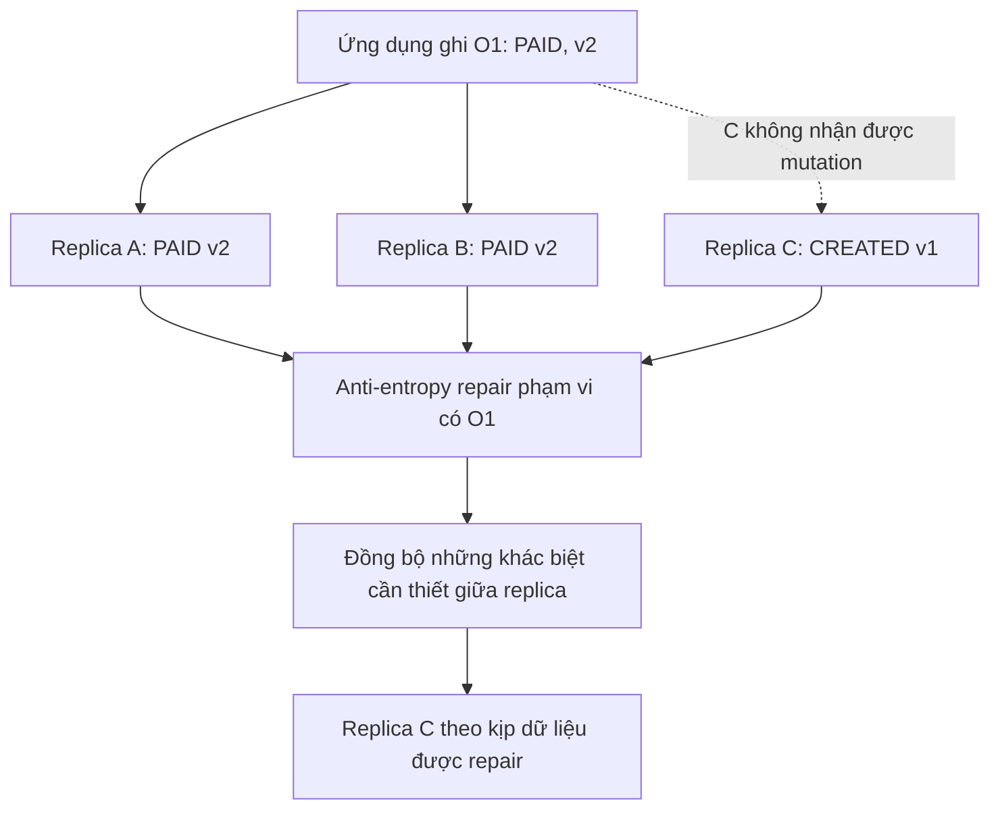
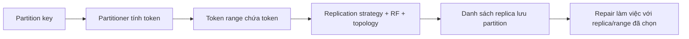
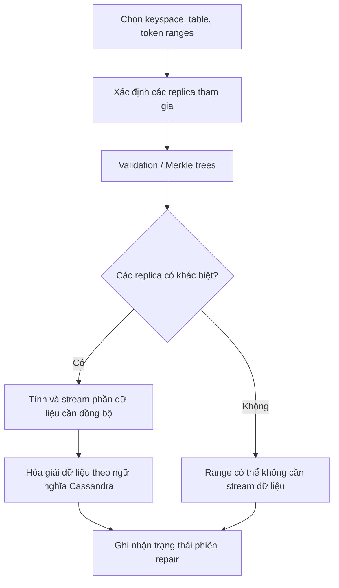
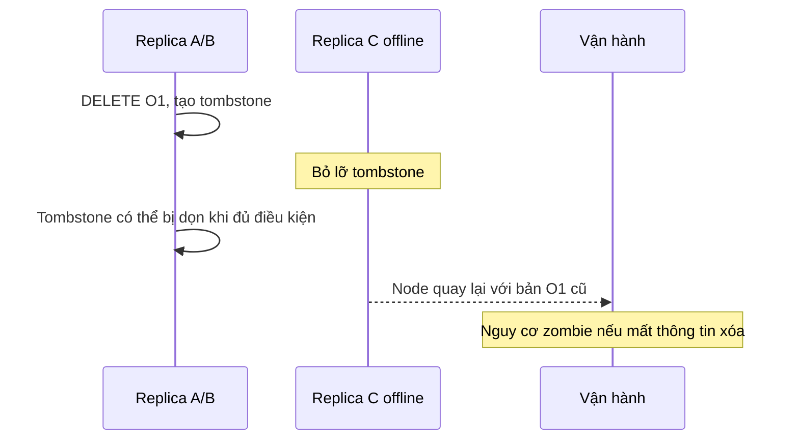

# Mục tiêu repair và phạm vi token/bảng/keyspace trong Apache Cassandra

## Mục tiêu học tập

Trong module Apache Cassandra, chương **Repair** tập trung vào việc làm cho các **replica của cùng một dữ liệu** đồng bộ trở lại sau những giai đoạn ghi bị bỏ lỡ, node ngắt kết nối hoặc những sai lệch tích lũy theo thời gian. Bài này trả lời hai câu hỏi quan trọng:

1. **Vì sao phải chạy repair nếu cluster vẫn đọc/ghi được?**
2. **Một lần repair thực sự xử lý phần dữ liệu nào khi giới hạn theo token range, bảng hoặc keyspace?**

Sau bài học, bạn có thể:

- Giải thích mục tiêu của *anti-entropy repair*, sự khác nhau với **replication**, **hinted handoff**, **read repair**, **compaction** và đối soát dữ liệu nghiệp vụ giữa nhiều bảng.
- Hiểu quan hệ giữa **partition key → token → token range → tập replica** và vai trò của replication factor, datacenter, vnodes trong phạm vi repair.
- Phân biệt phạm vi **keyspace**, **table**, **token range**, **primary range** và ảnh hưởng khi phối hợp chúng.
- Đọc và giải thích các lệnh `nodetool repair` có giới hạn phạm vi; hiểu rằng lệnh trên **một node không mặc nhiên repair toàn bộ cluster**.
- Đề xuất kế hoạch repair an toàn, theo dõi trạng thái/lỗi và nhận diện rủi ro tombstone, `gc_grace_seconds`, node vắng mặt kéo dài.
- Dùng CQL và Java Driver để kiểm tra dữ liệu mẫu, nhưng không nhầm việc truy vấn dữ liệu với một lần anti-entropy repair đầy đủ.

## 1. Mục tiêu: các replica của cùng phân vùng phải hội tụ

Cassandra là cơ sở dữ liệu phân tán theo mô hình **wide-column**. Một hàng được định tuyến từ **partition key** qua thuật toán partitioner để tạo **token**; keyspace cùng chiến lược replication quyết định những node nào lưu replica cho token tương ứng.

Giả sử keyspace `shop` sử dụng `NetworkTopologyStrategy` với replication factor (RF) bằng 3 trong datacenter `dc1`. Một phân vùng có khóa `order_id = O1` có thể tồn tại trên ba replica A, B và C.

Tại thời điểm ban đầu, mọi replica đều chứa:

```text
O1, status = CREATED, version = 1
```

Sau khi cập nhật đơn sang `PAID`:

- A và B đã nhận mutation, chứa `status = PAID, version = 2`;
- C bị ngắt kết nối nên vẫn chứa `status = CREATED, version = 1`;
- giao dịch ghi với một consistency level thích hợp có thể đã trả thành công dù C chưa theo kịp.

Nếu C quay lại, không thể chỉ nhìn trạng thái cluster `UN` (*Up/Normal*) rồi kết luận dữ liệu trên C đã giống A và B. **Repair** là một cơ chế để kiểm tra và sửa sai lệch giữa các replica đối với những token range và bảng được chọn.



Mục tiêu của repair gồm:

1. **Phát hiện bất đồng:** xác định các phần dữ liệu của cùng token range không khớp giữa các replica tham gia.
2. **Hội tụ dữ liệu:** trao đổi/cập nhật những phần khác biệt theo ngữ nghĩa lưu trữ của Cassandra để các bản sao cùng có trạng thái phù hợp.
3. **Giữ an toàn xóa:** hỗ trợ việc các replica nhận tombstone và xử lý xóa nhất quán, tránh rủi ro dữ liệu cũ xuất hiện trở lại khi dấu xóa đã bị dọn không đúng thời điểm.
4. **Duy trì khả năng khôi phục và độ tin cậy:** sau lỗi node hoặc mạng, dữ liệu không chỉ “đủ replica để trả lời truy vấn” mà còn được kiểm tra trên các replica cần thiết.

**Giới hạn quan trọng:** repair không tạo ra dữ liệu từ hư không. Nếu tất cả bản sao cùng mất một dữ liệu hoặc không còn bản hợp lệ nào, cần xem xét sao lưu/khôi phục và nguyên nhân mất dữ liệu. Repair cũng không bảo đảm ứng dụng đã thực hiện đúng mọi bất biến nghiệp vụ.

## 2. Repair khác gì các cơ chế khác trong Cassandra?

| Cơ chế | Mục đích chính | Có quét/đối chiếu rộng trên token range không? | Không thay thế được điều gì? |
| --- | --- | --- | --- |
| **Replication** | Phân phối mutation đến các replica theo RF/topology | Không phải quá trình so sánh định kỳ | Repair khi replica bỏ lỡ ghi |
| **Hinted handoff** | Giữ và phát lại một số mutation cho replica tạm vắng mặt trong phạm vi cấu hình | Không đối chiếu toàn bộ dữ liệu | Repair khi vắng mặt quá lâu, hints thiếu/hết hạn |
| **Read repair** | Sửa một số sai lệch được phát hiện trên đường đọc, tùy phiên bản/cấu hình | Không bảo đảm chạm mọi partition | Anti-entropy repair bao phủ dữ liệu không được đọc |
| **Anti-entropy repair** | So sánh và đồng bộ dữ liệu giữa những replica cho phạm vi được chọn | Có, trong phạm vi token/bảng đã chỉ định | Đối soát quan hệ nghiệp vụ giữa hai bảng logic |
| **Compaction** | Hợp nhất SSTable, giảm phiên bản lưu trữ và dọn tombstone khi an toàn | Không so sánh dữ liệu với node khác theo mặc định | Repair giữa các replica |
| **Application reconciliation** | So bảng nguồn nghiệp vụ với bảng đọc dẫn xuất hoặc hệ thống khác | Theo quy tắc ứng dụng | Thay thế repair giữa các replica của cùng bảng |

Ví dụ, ứng dụng lưu hai bảng `orders_by_id` và `orders_by_customer_month`. Nếu `orders_by_id` có trạng thái `PAID` còn bảng danh sách vẫn `CREATED`, nguyên nhân có thể là **ứng dụng chưa chiếu thay đổi sang bảng danh sách**. Repair cả hai bảng **không tự biến** trạng thái của bảng thứ hai thành `PAID`. Nó chỉ đồng bộ từng bảng trên những replica tham gia.

Ngược lại, nếu cùng một hàng trong `orders_by_id` khác nhau giữa A và C, đó là đúng loại sai lệch mà anti-entropy repair hướng tới.

### LOCAL_QUORUM có thay repair không?

Với RF = 3 trong một datacenter, `LOCAL_QUORUM` thường yêu cầu sự xác nhận của 2 trong 3 replica. Sự giao nhau giữa quorum đọc và ghi giúp cải thiện tính nhất quán khi các tiền đề được đáp ứng, **nhưng replica thứ ba vẫn có thể bỏ lỡ mutation**. Những phân vùng ít được truy cập có thể không kích hoạt cơ chế sửa trên đường đọc.

Do đó, **quorum không có nghĩa mọi replica đã được xác minh**. Lập lịch repair phù hợp vẫn là một phần của vận hành Cassandra.

## 3. Token: đơn vị định tuyến, không phải số thứ tự hàng

Để hiểu phạm vi repair, trước hết phải phân biệt khóa CQL và token.

Giả sử bảng:

```sql
CREATE TABLE orders_by_id (
    order_id uuid PRIMARY KEY,
    customer_id uuid,
    status text,
    total_amount decimal,
    updated_at timestamp
);
```

Ở đây, `order_id` là partition key. Partitioner biến khóa này thành token; trong các triển khai dùng **Murmur3Partitioner**, token thuộc không gian số nguyên 64-bit có dấu. Các token không biểu diễn thứ tự tạo đơn, ID tăng dần hoặc khoảng ngày tháng.

Với bảng khác:

```sql
CREATE TABLE orders_by_customer_month (
    customer_id uuid,
    order_month date,
    ordered_at timestamp,
    order_id uuid,
    status text,
    total_amount decimal,
    PRIMARY KEY ((customer_id, order_month), ordered_at, order_id)
) WITH CLUSTERING ORDER BY (ordered_at DESC, order_id ASC);
```

Partition key là **cặp `(customer_id, order_month)`**, không chỉ một cột. Vì vậy token của bảng này được tính từ **toàn bộ khóa phân vùng ghép**.

Trong CQL, có thể quan sát token cho một hàng được chọn:

```sql
-- Chạy trong keyspace đã có hai bảng ở ví dụ.
SELECT order_id, token(order_id) AS partition_token, status
FROM orders_by_id
WHERE order_id = 11111111-1111-4111-8111-111111111111;

SELECT customer_id, order_month,
       token(customer_id, order_month) AS partition_token
FROM orders_by_customer_month
WHERE customer_id = 22222222-2222-4222-8222-222222222222
  AND order_month = '2026-11-01'
LIMIT 1;
```

Nếu hàng không tồn tại, `SELECT` sẽ không trả kết quả; truy vấn trên không tạo dữ liệu. Kết quả token phụ thuộc partitioner/khóa thực tế, **không nên tự đoán token từ UUID**.

### Token range và ownership

Trên vòng token (ring), các node được phân các đoạn không gian token. Một đoạn thường được mô tả bởi **start token** và **end token**, có quy tắc biên và khả năng **wrap-around** khi đi qua điểm đầu/cuối vòng.



Nhiều cluster dùng **vnodes**: mỗi node có nhiều token/range thay vì một đoạn liên tục duy nhất. Vì vậy “repair node A” không đơn giản là “repair một khoảng số cố định”. Phạm vi thực sự gồm những range mà A có trách nhiệm lưu theo metadata ring, với các replica liên quan của mỗi range.

**Đặc biệt:** cùng một token nhưng keyspace có replication strategy/RF khác nhau có thể có **tập replica khác nhau**. Không xác định một token range cần repair mà bỏ qua **keyspace và topology**.

## 4. Ba chiều phạm vi: token range, bảng, keyspace

Một lệnh `nodetool repair` được hiểu theo **giao của các điều kiện lựa chọn**:

- **Dữ liệu thuộc keyspace nào?**
- **Bảng nào trong keyspace đó?**
- **Token range nào được đưa vào repair trên node điều phối?**

Ngoài ra còn có phạm vi **datacenter/host tham gia**, loại repair (*incremental/full*), trạng thái node và phiên bản Cassandra, nhưng bài này tập trung vào ba chiều trên.

### 4.1. Phạm vi keyspace

Nếu chỉ định keyspace `shop`, repair làm việc với **các bảng được chọn trong `shop`**, không chuyển sang keyspace nghiệp vụ khác như `billing`.

Ví dụ một keyspace có:

- `shop.orders_by_id`;
- `shop.orders_by_customer_month`;
- `shop.inventory_by_sku`.

Chạy repair trong `shop` không đồng nghĩa repair mọi keyspace của cluster. Nếu không chỉ định bảng, phạm vi bảng trong keyspace thường rộng hơn (các bảng phù hợp với lệnh/phiên bản), nên cần kiểm tra trước khi thực hiện trên production.

**Keyspace quyết định thêm một yếu tố quan trọng:** replication factor và chiến lược `NetworkTopologyStrategy`, từ đó xác định replica nào phải cùng so sánh dữ liệu.

### 4.2. Phạm vi bảng (table)

Chỉ định `shop.orders_by_id` cho phép tập trung vào **một bảng**. Cách này hữu ích khi:

- Một bảng vừa trải qua lỗi hoặc có replica chậm.
- Cần chia lịch bảo trì theo nhóm bảng để kiểm soát thời gian và tải.
- Một số bảng lớn cần cửa sổ repair riêng.

Tuy nhiên, nếu keyspace chứa cả `orders_by_customer_month` và bảng này cũng có replica sai lệch, **repair riêng `orders_by_id` không sửa bảng đó**. Bảng đọc đã bị sai do lỗi fan-out của ứng dụng vẫn đòi hỏi **application reconciliation** ngay cả khi replica của từng bảng đã khớp.

### 4.3. Phạm vi token range

Chỉ định start/end token giới hạn **những phân vùng có token nằm trong phạm vi được chọn**, sau khi kết hợp với những range thuộc trách nhiệm node và lựa chọn khác của lệnh.

Repair theo token hữu ích khi:

- Chia công việc lớn thành các phần có thể quản lý.
- Làm lại một đoạn có lỗi mà không lập tức chạy lại tất cả.
- Theo dõi tiến độ và điều tiết công việc theo phân vùng token.

Token range **không tương đương** khoảng `order_id`, `created_at` hoặc `customer_id`. Hai UUID gần nhau về dạng chữ có thể nằm ở hai range xa nhau. Không thể nói “repair đơn hàng của tháng 11” chỉ bằng token range nếu partition key không mã hóa tháng theo cách tương ứng; ngay cả khóa ghép có tháng, hash token vẫn không phân vùng liên tiếp theo tháng.

### 4.4. Ma trận phạm vi kết hợp

| Lệnh dự kiến | Keyspace | Bảng | Token | Kết quả về mặt lựa chọn |
| --- | --- | --- | --- | --- |
| Repair `shop` trên node A | `shop` | Những bảng được lệnh bao phủ | Các range A tham gia theo chế độ đã chọn | Không phải tự động toàn bộ cluster |
| Repair `shop.orders_by_id` trên A | `shop` | Chỉ `orders_by_id` | Những range được chọn trên A | Các bảng khác không được sửa |
| Repair `shop` kèm `-pr` trên A | `shop` | Những bảng phù hợp | **Primary ranges** của A | Chỉ một phần của toàn vòng |
| Repair `orders_by_id` kèm start/end token | `shop` | `orders_by_id` | Giao với đoạn token yêu cầu | Chỉ phân vùng trong phạm vi giao |
| Repair keyspace khác `billing` | `billing` | Bảng trong `billing` | Theo node/chế độ | Không tác động dữ liệu `shop` |

**Lỗi phổ biến:** chạy `nodetool repair -pr shop` trên **một node**, thấy lệnh thành công rồi báo “toàn bộ `shop` đã được repair”. Với `-pr`, node đó chỉ bao phủ primary ranges của mình. Muốn phủ toàn vòng, phải có lịch phù hợp trên **mọi node cần thiết**, có tính đến topology/DC và thay đổi membership.

## 5. Quy trình anti-entropy repair diễn ra thế nào?

Ở mức khái niệm, anti-entropy repair trên các range được chọn có những giai đoạn:

1. **Xác định phạm vi và các replica liên quan:** keyspace, bảng và token range được đưa vào phiên repair; coordinator phối hợp những node cần thiết theo replication/topology.
2. **Validation:** các replica kiểm tra dữ liệu trong phạm vi tương ứng, thường dùng cấu trúc **Merkle tree** để biểu diễn và so sánh nội dung dữ liệu.
3. **Đối chiếu sự khác biệt:** các nhánh/range có digest không khớp được xác định là cần xử lý.
4. **Streaming / synchronization:** dữ liệu cần thiết được truyền và hòa giải để những replica liên quan hội tụ.
5. **Kết thúc và ghi nhận trạng thái:** phiên repair báo thành công/thất bại; chế độ incremental có thêm ngữ nghĩa đánh dấu repaired/pending cho dữ liệu được xử lý.



Các chi tiết của quá trình validation, streaming, trạng thái repair, cách tính Merkle tree và dữ liệu `repaired` thay đổi theo phiên bản Cassandra và chế độ chạy. **Không dựa vào sơ đồ để khẳng định repair tạo snapshot giao dịch hoặc luôn truyền chính xác những hàng thay đổi ở mức tối ưu lý tưởng.**

### Repair không đồng nghĩa đọc lại mọi hàng qua Java

Ứng dụng Java có thể `SELECT` một số hàng và so sánh với nguồn nghiệp vụ, nhưng nó không có khả năng mặc định kiểm chứng tất cả replica của mọi token range qua CQL bình thường. Anti-entropy repair là **công việc vận hành cluster**, thường được gọi qua `nodetool` hoặc công cụ quản lý repair tương thích, không phải một câu `SELECT` hay `UPDATE` đơn giản.

## 6. Thực hành phạm vi bằng nodetool

**Các lệnh dưới đây để học cú pháp và ý nghĩa phạm vi, không phải chỉ dẫn chạy hàng loạt ngay trên production.** Trước khi dùng, xác nhận phiên bản Cassandra, help của `nodetool`, topology, replication factor, dung lượng trống và cửa sổ bảo trì.

```bash
# Kiểm tra help theo phiên bản Cassandra đang vận hành.
nodetool help repair

# Kiểm tra tình trạng các node trước khi lập lịch.
nodetool status

# Xem ring/token và thông tin ownership cho keyspace shop.
nodetool ring shop
```

### 6.1. Repair trong phạm vi keyspace

```bash
# Repair các bảng trong keyspace shop theo phạm vi node/chế độ tương ứng.
nodetool repair shop
```

Lệnh được gọi trên **một node**; việc hoàn tất không đủ để suy ra **mọi token range trên toàn cluster** đều đã được repair. Phải hiểu những range được chọn và cách công cụ/đội vận hành phân phối công việc.

### 6.2. Repair một bảng cụ thể

```bash
# Chỉ tập trung vào bảng orders_by_id trong keyspace shop.
nodetool repair shop orders_by_id
```

Khi sửa lỗi phân tán của một bảng quan trọng, đây là phạm vi thường dễ đánh giá hơn keyspace có nhiều bảng rất lớn. Tuy nhiên, một bảng danh sách khác trong cùng keyspace **không tự được repair** khi chỉ gọi lệnh này.

### 6.3. Repair primary ranges bằng -pr

```bash
# Chỉ repair các primary token ranges của node đang chạy lệnh.
nodetool repair -pr shop orders_by_id
```

`-pr` là lựa chọn **primary range**. Khi lên lịch **chạy trên từng node cần thiết**, có thể giảm việc một range được repair lặp lại không cần thiết trong toàn vòng. Nhưng chỉ chạy trên một node nghĩa là **chỉ bao phủ primary ranges của node ấy**.

Lên lịch trên nhiều node cần tính tới cluster vnodes, datacenter, topology hiện tại và tránh để mọi node cùng khởi động phiên repair nặng không kiểm soát. Trong một số phiên bản/tổ hợp tùy chọn, phạm vi repair giữa datacenter/host và primary range có quy tắc riêng; hãy kiểm tra `nodetool help repair` và kế hoạch vận hành tương ứng.

### 6.4. Giới hạn start/end token

Một số phiên bản `nodetool repair` cung cấp tùy chọn `-st` (start token) và `-et` (end token), hoặc dạng tên dài tương ứng.

```bash
# CHỈ MINH HỌA: hai token này là số giả định, không phù hợp
# để chạy trên cluster thật nếu chưa đối chiếu ring/topology.
nodetool repair -st 100000000000 -et 200000000000 shop orders_by_id
```

**Không lấy hai token trên làm giá trị mặc định**. Cần xác định range từ metadata ring, biết cách xử lý biên và wrap-around, kiểm tra loại partitioner và khả năng áp dụng tùy chọn trong phiên bản đang dùng. Một đoạn token tùy ý cũng có thể giao rất ít hoặc không giao với những range mà node hiện tại tham gia; khi đó lệnh không đạt mục tiêu định sẵn.

### 6.5. Repair nhiều bảng và các tùy chọn nâng cao

Khi muốn repair keyspace có nhiều bảng, có thể chỉ định các tên bảng theo cú pháp phiên bản cung cấp, ví dụ:

```bash
# Ví dụ khi phiên bản cho phép chỉ định danh sách bảng:
nodetool repair shop orders_by_id orders_by_customer_month

# Full repair, khi cú pháp chế độ này được hỗ trợ:
nodetool repair -full shop orders_by_id
```

Lưu ý:

- Tùy chọn, mặc định incremental/full và khả năng phối hợp các cờ **có thể thay đổi theo phiên bản**.
- Một lệnh repair không nên được diễn giải là “đã xử lý cả keyspace trên mọi node” nếu chưa có thông tin về phạm vi và tiến độ.
- Những tùy chọn chỉ giới hạn datacenter/host cần được dùng theo topology, RF và quy trình của đội vận hành; không tùy tiện loại replica khỏi kế hoạch mà vẫn coi toàn cluster đã được kiểm tra.
- Với cluster lớn, nên dùng công cụ lập lịch/chia token ranges có khả năng tiếp tục công việc, tránh chạy các phiên trùng lặp hoặc vô tình bỏ quên range.

## 7. Full repair và incremental repair không phải “phạm vi token”

Ngoài ba chiều phạm vi, Cassandra còn có **chế độ repair**:

- **Full repair**: nhằm kiểm tra và đồng bộ dữ liệu trong phạm vi được yêu cầu mà không chỉ giới hạn vào tập dữ liệu chưa được đánh dấu repaired theo cơ chế incremental.
- **Incremental repair**: sử dụng metadata/trạng thái `repaired` để tối ưu việc lặp lại trên một số dữ liệu đã được sửa, theo ngữ nghĩa phiên bản Cassandra. Các phiên repair có thể liên quan tới `repaired`, `unrepaired` hoặc `pending repair` SSTables.

**Hai lựa chọn này không thay thế câu hỏi “keyspace nào, bảng nào, token range nào?”** Một full repair chỉ áp dụng cho một bảng trên một node vẫn không tự bao phủ mọi bảng và mọi range trong cluster.

| Chiều lựa chọn | Ví dụ | Câu hỏi được trả lời |
| --- | --- | --- |
| Keyspace | `shop` | Dữ liệu thuộc không gian tên/replication policy nào? |
| Table | `orders_by_id` | Bảng nào được validation/sync? |
| Token | Primary ranges, một khoảng start/end | Những phân vùng nào nằm trong phạm vi? |
| Kiểu repair | Full hoặc incremental | Tập dữ liệu và trạng thái repaired nào được xử lý theo cơ chế phiên bản? |
| Topology/DC | Replica/dc liên quan | Những node nào cần phối hợp để đạt mục tiêu nhất quán? |

**Không trộn full và incremental tùy tiện** khi chưa hiểu trạng thái SSTable, phiên bản Cassandra và quy trình hiện hành. Một số hành vi, cờ mặc định và trường hợp phục hồi repair thất bại khác nhau giữa Cassandra 3.x, 4.x và những phiên bản tiếp theo. Vì vậy, trong production phải dựa trên tài liệu/`nodetool help` của chính bản đang chạy.

## 8. Phạm vi trên một node không phải toàn cluster

Giả sử cluster có các node A, B, C, D, E, F, RF = 3, tất cả trong cùng một datacenter và dùng vnodes.

Một cách nghĩ sai:

> “Tôi đăng nhập node A và chạy `nodetool repair shop`; vậy tất cả replica của `shop` đều đúng.”

Cách nghĩ đúng:

- Node A tham gia những **token range mà A là một replica**, không phải toàn bộ token range của các node khác.
- Khi repair một range, các **replica liên quan** cho range ấy được phối hợp, nhưng một lần chạy trên A không mặc nhiên chạm đến những range mà A không có vai trò.
- `-pr` giảm phạm vi trên A về **primary ranges** của A; nó càng không có nghĩa “repair toàn keyspace”.
- Nếu lập lịch primary-range repair, phải bảo đảm **tổng hợp các phiên chạy trên những node cần thiết phủ toàn bộ range theo kế hoạch**, có ghi nhận range đã hoàn tất và lỗi.
- Vnodes tạo nhiều range trên từng node, nên tiến độ phải kiểm soát theo phạm vi chứ không chỉ đếm “đã chạy trên mấy máy”.

### Ví dụ phạm vi trực quan

Giả sử một ring được chia thành bốn nhóm primary range khái niệm R1–R4. Trong minh họa này, mỗi nhóm có một node chịu trách nhiệm primary; các replica khác nhau do RF và topology quyết định.

| Primary range | Node primary giả định | Nếu chỉ gọi `-pr` tại A? |
| --- | --- | --- |
| R1 | A | Có thể được chọn |
| R2 | B | Không |
| R3 | C | Không |
| R4 | D | Không |

Thực tế Cassandra có thể dùng rất nhiều vnodes và danh sách primary range dài hơn. Bảng trên chỉ giải thích **bao phủ phạm vi**, không phải sơ đồ ownership chính xác của một cluster 4-node.

Với nhiều datacenter, kế hoạch còn cần phân biệt replica trong DC1/DC2, tính năng giới hạn DC nếu dùng và yêu cầu repair trên từng vùng. **Không suy từ RF của một datacenter sang RF của toàn cluster**.

## 9. Tombstone, gc_grace_seconds và nguy cơ dữ liệu sống lại

Đối với xóa, repair không chỉ liên quan tới “trạng thái cập nhật mới hơn”.

### Tình huống nguy hiểm

1. Replica A và B nhận lệnh `DELETE` cho hàng O1 và có **tombstone**.
2. Replica C bị offline nên vẫn giữ O1 cũ.
3. Tombstone trên A/B đến thời điểm đủ điều kiện bị loại bỏ bởi compaction theo chính sách.
4. C quay lại sau khoảng vắng mặt quá dài, vẫn chứa dữ liệu cũ.
5. Nếu không còn bằng chứng xóa phù hợp để hòa giải, O1 có nguy cơ **xuất hiện trở lại** (*zombie data*).



`gc_grace_seconds` là một yếu tố quan trọng trong thời gian giữ tombstone, nhưng **không phải đồng hồ hẹn “chắc chắn xóa khỏi đĩa”**: việc dọn còn phụ thuộc compaction và các điều kiện an toàn. Chiến lược vận hành phải bảo đảm repair thành công với tần suất phù hợp, tránh replica offline vượt phạm vi an toàn được thiết kế.

Nếu node đã vắng mặt vượt quá thời hạn an toàn cho tombstone, **không mặc định chỉ khởi động lại rồi chạy một repair là đủ**; cần đánh giá quy trình thay thế/rebuild/khôi phục và các bước tránh zombie phù hợp phiên bản, chính sách dữ liệu và trạng thái thực tế.

### Không nhầm repair với thao tác “đẩy dữ liệu còn lại sang node mới”

Repair hữu ích cho việc so sánh/sửa dữ liệu giữa replica phù hợp. Trường hợp thay node, thêm datacenter hoặc node mất toàn bộ dữ liệu có thể cần quy trình **bootstrap/rebuild/replace/restore** chuyên biệt. Repair không phải một cách thay thế phổ quát cho sao lưu hoặc phục hồi mất dữ liệu.

## 10. Chuẩn bị kế hoạch repair có kiểm soát

### 10.1. Kiểm tra đầu vào trước khi chạy

1. **Phiên bản và topology:** ghi rõ Cassandra version, partitioner, DC, rack, vnodes, số node và node đang Down/Leaving/Joining.
2. **Replication:** đọc đúng replication strategy/RF của từng keyspace cần sửa; tránh giả định keyspace nào cũng RF = 3.
3. **Phạm vi:** danh sách keyspace, bảng, token ranges, chế độ `-pr` hay range cụ thể, DC tham gia và node khởi chạy.
4. **Tính đầy đủ:** kế hoạch tổng hợp phải chứng minh không bỏ quên range hoặc bảng bắt buộc; phạm vi partial chỉ là partial.
5. **Sự cố đang tồn tại:** node vắng mặt lâu, giai đoạn di chuyển dữ liệu, đĩa sắp đầy, lỗi mạng, lỗi stream, compaction backlog.
6. **Năng lực cluster:** băng thông, disk I/O, CPU, dung lượng trống và ảnh hưởng tới p95/p99 latency đọc/ghi.
7. **Dữ liệu xóa:** thời gian offline so với chính sách tombstone, độ trễ repair gần nhất, khả năng phải xử lý sự cố zombie riêng.
8. **Khả năng rollback/khôi phục:** backup/snapshot theo chính sách và người có trách nhiệm nếu repair gặp lỗi.

Không chạy một lệnh `nodetool repair` nặng trên mọi node cùng lúc chỉ để “cho nhanh”. Nó có thể tạo ra nhiều công việc validation/streaming chồng lấn, tăng tải đĩa và mạng, khiến latency ứng dụng xấu đi.

### 10.2. Runbook thực hành một bảng

Ví dụ cần repair `shop.orders_by_id`:

**Bước A — Quan sát:**

```bash
nodetool status
nodetool ring shop
nodetool help repair
```

**Bước B — Xác nhận phạm vi:** chọn repair bảng `orders_by_id` theo primary ranges; lập danh sách các node phải chạy, phiên bản, trạng thái DC và lịch tránh chồng chéo.

**Bước C — Thực hiện trên node được chọn trong kế hoạch:**

```bash
# Chạy trên TỪNG node nằm trong lịch đã kiểm tra;
# lệnh này chỉ thể hiện một phiên làm việc trên một node.
nodetool repair -pr shop orders_by_id
```

**Bước D — Giám sát:** theo dõi session repair, validation, stream, lỗi timeout và ảnh hưởng lên cụm; ghi lại node/range/bảng/giờ bắt đầu-kết thúc cùng kết quả.

**Bước E — Tiếp tục coverage:** chỉ chạy phiên tiếp theo theo lịch; tổng hợp phạm vi đã hoàn thành trước khi tuyên bố bảng này đã được sửa trên toàn ring.

**Bước F — Xác minh:** kiểm tra log/metrics và tiến độ phạm vi; với sự cố cụ thể, có thể kiểm tra đọc dữ liệu mẫu nhưng **một vài câu SELECT không chứng minh mọi replica/range đều khớp**.

### 10.3. Các công cụ quan sát vận hành

Một số lệnh hữu ích, với tính sẵn có và cách trình bày tùy phiên bản:

```bash
# Node nào đang sống, đang tham gia ring?
nodetool status

# Có hoạt động streaming dữ liệu hay không?
nodetool netstats

# Tình trạng compaction, có backlog?
nodetool compactionstats

# Tình trạng các thread pool / dropped messages khi điều tra tải:
nodetool tpstats
```

Ngoài lệnh CLI, cần xem **log repair**, thông tin JMX/metrics từ hệ thống giám sát và cảnh báo disk/network. Không coi việc `nodetool netstats` hiện không còn stream là bằng chứng toàn bộ phiên repair đã hoàn tất thành công; một phiên có thể thất bại ở validation, bị hủy hoặc chỉ chạy một phần phạm vi.

## 11. Những lỗi vận hành thường gặp

| Sai lầm | Hệ quả | Cách tránh |
| --- | --- | --- |
| Chạy `nodetool repair shop` trên một node rồi báo xong toàn cluster | Các range không thuộc node đó có thể chưa được repair | Lập lịch coverage theo node/token ranges |
| Chạy `-pr` trên một node duy nhất | Chỉ primary ranges của node ấy được chọn | Chạy trên những node cần thiết theo kế hoạch toàn ring |
| Nhầm `-pr` là “chỉ repair một replica” | Hiểu sai vai trò của các replica tham gia repair một range | Phân biệt **range được chọn** với **số replica được so sánh** |
| Repair một bảng rồi tin mọi bảng trong keyspace đã đúng | Các bảng khác chưa được kiểm tra | Chọn danh sách bảng/keyspace rõ ràng |
| Chọn token theo ID hoặc ngày tạo | Bỏ sai phân vùng cần xử lý | Hiểu partitioner và đọc ring/token metadata |
| Nhầm `LOCAL_QUORUM` hoặc hints là đủ | Replica vắng lâu/partition ít đọc vẫn có thể sai lệch | Duy trì lịch anti-entropy repair |
| Đặt `gc_grace_seconds` quá ngắn so với khả năng repair | Nguy cơ zombie data sau xóa | Thiết kế bảo đảm vòng đời tombstone/repair |
| Dùng full/incremental tùy tiện mà không xem phiên bản | Hiệu năng và trạng thái repair khó dự đoán | Có runbook riêng theo Cassandra version |
| Chạy nhiều repair lớn chồng lên nhau | Validation, streaming, I/O và latency tăng | Giới hạn concurrency, đo tài nguyên |
| Dùng repair để sửa bảng danh sách chưa cập nhật từ nguồn | Bản logic vẫn sai dù replica cùng bảng đã khớp | Application reconciliation từ nguồn |
| Thấy vài hàng đọc giống nhau rồi kết luận cả cluster đúng | Không kiểm tra được những range/partition còn lại | Đối chiếu logs, sessions và coverage |
| RF = 1 nhưng mong repair tạo thêm dữ liệu đã mất | Không có replica khác để khôi phục | Kiểm tra RF/topology, backup và quy trình restore |

## 12. Java Driver: kiểm tra mẫu có giới hạn, không giả làm repair

Java Driver 4.x hữu ích cho việc theo dõi **kết quả nghiệp vụ quan sát qua CQL**, nhưng ứng dụng không nên coi một vài truy vấn là thay thế cho anti-entropy repair.

Ví dụ lấy trạng thái một đơn ở `LOCAL_QUORUM`:

```java
import com.datastax.oss.driver.api.core.CqlSession;
import com.datastax.oss.driver.api.core.DefaultConsistencyLevel;
import com.datastax.oss.driver.api.core.cql.BoundStatement;
import com.datastax.oss.driver.api.core.cql.PreparedStatement;
import com.datastax.oss.driver.api.core.cql.Row;

import java.math.BigDecimal;
import java.util.UUID;

public final class OrderReadProbe {
    public record OrderState(UUID id, String status, BigDecimal total) {}

    private final CqlSession session;
    private final PreparedStatement selectById;

    public OrderReadProbe(CqlSession session) {
        this.session = session;
        this.selectById = session.prepare(
            "SELECT order_id, status, total_amount " +
            "FROM shop.orders_by_id WHERE order_id = ?");
    }

    public OrderState read(UUID orderId) {
        BoundStatement statement = selectById.bind(orderId)
            .setConsistencyLevel(DefaultConsistencyLevel.LOCAL_QUORUM);

        Row row = session.execute(statement).one();
        if (row == null) {
            return null; // Bản ghi không hiện diện qua truy vấn này.
        }

        return new OrderState(
            row.getUuid("order_id"),
            row.getString("status"),
            row.getBigDecimal("total_amount")
        );
    }
}
```

**Giới hạn của ví dụ:**

- `LOCAL_QUORUM` yêu cầu keyspace có RF/topology phù hợp; nếu không đáp ứng, truy vấn có thể thất bại hoặc không có ý nghĩa như dự kiến.
- Một hàng có kết quả hợp lệ không chứng minh mọi replica lưu cùng dữ liệu; Cassandra có thể chọn replica khác nhau hoặc sửa một số sai lệch khi đọc tùy cơ chế/phiên bản.
- Nếu `shop.orders_by_customer_month` vẫn chứa trạng thái khác, Java có thể so sánh hai đường đọc, nhưng đó là **đối soát logic giữa bảng**, không phải anti-entropy repair.
- Khi cluster có sự cố, ứng dụng nên ghi nhận timeout, consistency level, request tracing theo chính sách và thời điểm đọc; không tự chuyển sang `CONSISTENCY ONE` rồi khẳng định dữ liệu đã đúng chỉ vì truy vấn thành công.
- Để vận hành repair, sử dụng `nodetool` hoặc hệ thống quản lý repair được phê duyệt; không thực hiện quét mọi partition bằng một endpoint Java thông thường.

## 13. Bài thực hành

### Bài A: Chọn phạm vi repair

Giả sử cluster có sáu node A–F, RF = 3, một datacenter, dùng vnodes. Keyspace `shop` có ba bảng:

- `orders_by_id`;
- `orders_by_customer_month`;
- `inventory_by_sku`.

Trong một sự cố mạng, node C bỏ lỡ một số ghi vào `orders_by_id`; đồng thời có một bug ứng dụng khiến `orders_by_customer_month` không nhận một số cập nhật, nhưng mọi replica của bảng danh sách đều đồng thuận về giá trị cũ đó.

Hãy trả lời:

1. Repair `shop.orders_by_id` có thể giúp vấn đề nào? Có sửa được bug thiếu cập nhật ở bảng danh sách không?
2. Nếu chỉ chạy `nodetool repair -pr shop orders_by_id` trên node A, điều gì chưa thể kết luận về các token range khác?
3. Nếu dùng `nodetool repair shop` trên node A, phạm vi bảng thay đổi thế nào so với lệnh chỉ tên `orders_by_id`?
4. Nếu muốn khôi phục một token range nghi vấn, cần lấy start/end token từ đâu? Tại sao không dùng khoảng ngày tạo đơn?
5. Những metric/log nào cần kiểm tra trước khi thông báo repair hoàn tất?

**Gợi ý đáp án:** repair cùng bảng giúp các replica hội tụ trong phạm vi được chọn; bug cập nhật bảng dẫn xuất cần sửa bằng ứng dụng. `-pr` trên A không bao phủ primary ranges của B–F. Repair `shop` có phạm vi bảng rộng hơn nhưng vẫn phụ thuộc phạm vi token của node chạy. Token phải lấy từ metadata ring/partitioner; cần đối chiếu log/session, lỗi và coverage.

### Bài B: Phạm vi và tombstone

Sản phẩm P1 đã bị xóa lúc replica C offline lâu. A/B đã có tombstone. C quay lại sau khoảng vắng mặt vượt thời hạn mà đội vận hành dự kiến giữ tombstone và thực hiện repair.

1. Vì sao đây là tình huống có nguy cơ dữ liệu cũ xuất hiện trở lại?
2. Repair **một bảng** có giúp các bản ghi thuộc **bảng khác** không?
3. Nếu tombstone cần thiết đã bị dọn trước khi C trở lại, có thể hứa rằng một lần repair chắc chắn phục hồi trạng thái xóa không?
4. Cần điều tra những gì: thời gian offline, `gc_grace_seconds`, lịch repair, compaction, SSTable, backup và cách node được đưa trở lại?

**Gợi ý:** tombstone là bằng chứng xóa cần được lan tới replica đã bỏ lỡ. Khi nó mất trước khi replica cũ được xử lý, repair không có bảo đảm tự suy ra “đã từng xóa”. Cần quy trình khôi phục/thay thế an toàn thay vì tự tin chạy lại một lệnh.

### Bài C: Thiết kế lịch coverage

Giả sử một keyspace có 12 bảng, trong đó hai bảng rất lớn và nhận tải ghi cao. Đội vận hành phải hoàn tất repair theo chu kỳ phù hợp với chính sách tombstone.

1. Bạn chia lịch theo bảng hay token range, hay kết hợp cả hai? Vì sao?
2. Cách nào giúp chứng minh **mọi primary range trên toàn ring** đã được bao phủ?
3. Trong thời điểm peak, bạn giới hạn concurrency, I/O, network và mức độ ảnh hưởng tới p99 truy vấn thế nào?
4. Những điều kiện nào khiến bạn tạm dừng repair hoặc chuyển sang điều tra node thay vì tiếp tục?
5. Nếu một phiên chỉ thành công một phần, checkpoint cần ghi lại những chi tiết nào để có thể chạy bù?

**Gợi ý:** ghi rõ keyspace, danh sách bảng, node/DC, token range, chế độ repair, thời điểm, kết quả và cảnh báo. Theo dõi những range/bảng **chưa hoàn tất**, không chỉ lưu một cờ “đã chạy repair trên node A”. Tránh đồng thời quá nhiều tác vụ validation/streaming; áp dụng quy trình phù hợp phiên bản và tài nguyên cụm.

## Tổng kết

**Mục tiêu của anti-entropy repair** trong Apache Cassandra là giúp **các replica của cùng dữ liệu** hội tụ trên những phạm vi được chọn, đặc biệt sau khi node bỏ lỡ mutation hoặc khi hệ thống có nguy cơ sai lệch/tombstone bị dọn không an toàn. Repair khác với replication, read repair, hinted handoff, compaction và đối soát nghiệp vụ giữa các bảng dẫn xuất.

Để hiểu một lần repair đã làm được gì, luôn xác định **keyspace nào, bảng nào, token ranges nào, node/datacenter nào và kiểu repair nào**. Partition key quyết định token; replication strategy và RF quyết định replica; vnodes làm phạm vi của một node gồm nhiều range. `nodetool repair -pr` trên một node chỉ xử lý primary ranges của node đó, không tự đồng bộ toàn cluster. Repair đúng còn cần **lịch coverage, kiểm tra trạng thái, theo dõi hiệu năng, xử lý thất bại, chính sách tombstone/compaction và cách khôi phục node vắng mặt lâu**. Khi một bảng đọc sai vì ứng dụng chưa fan-out, hãy dùng **application reconciliation**, không kỳ vọng replica repair sửa được quy tắc nghiệp vụ.
