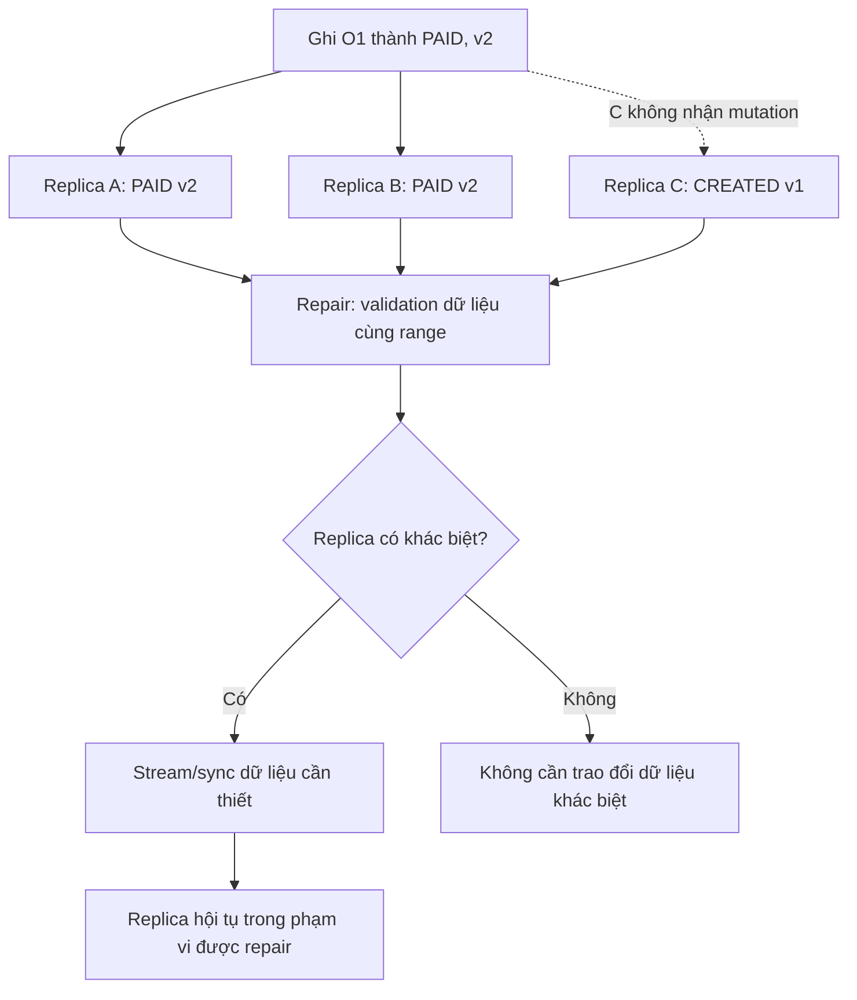
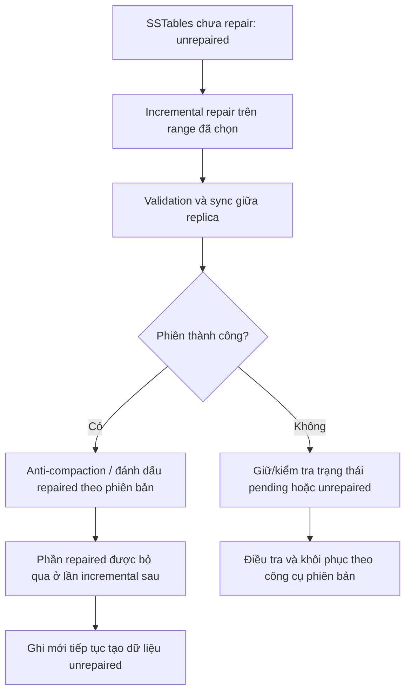
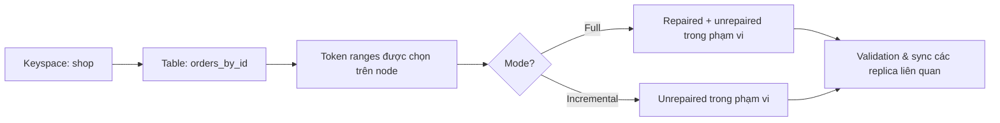
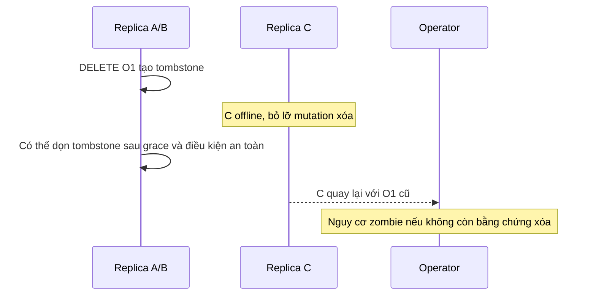

# Full repair so với incremental repair trong Apache Cassandra

## Mục tiêu học tập

Trong chương **Repair** của Apache Cassandra, hai chế độ **full repair** và **incremental repair** đều nhằm đồng bộ dữ liệu giữa những replica có trách nhiệm lưu cùng token range. Tuy nhiên, chúng **khác nhau về tập dữ liệu cần kiểm tra, trạng thái SSTable sau khi chạy, chi phí và chiến lược lập lịch**.

Sau bài học, bạn có thể:

1. Giải thích cơ chế *anti-entropy repair* và vì sao replication, `LOCAL_QUORUM`, hinted handoff hay read repair không tự thay thế repair định kỳ.
2. Mô tả các trạng thái **repaired**, **unrepaired** và, ở các phiên bản có cơ chế tương ứng, **pending repair**; hiểu vai trò của **anti-compaction** sau incremental repair.
3. So sánh full và incremental repair theo phạm vi dữ liệu, tải I/O, thời gian, khả năng bao phủ dữ liệu cũ và chi phí vận hành.
4. Đọc cú pháp `nodetool repair`, chọn đúng **keyspace/table/token ranges** và tránh lầm tưởng chạy một node là đã hoàn tất toàn cluster.
5. Thiết kế lịch repair dựa trên **replication factor**, topology/datacenter, thời gian node offline, chính sách tombstone và `gc_grace_seconds`.
6. Xử lý các tình huống repair bị lỗi, node được phục hồi từ snapshot, dữ liệu `pending repair` còn sót và các lần chạy trùng phạm vi.
7. Phân biệt kiểm tra bằng CQL/Java với chứng cứ một phiên anti-entropy repair đã thành công.

> **Phạm vi phiên bản:** Cassandra thay đổi đáng kể cách quản lý incremental repair qua nhiều phiên bản, đặc biệt từ các bản 3.x sang 4.x và các bản sau. Những mô tả cơ chế dưới đây giúp xây dựng mô hình tư duy; trước khi chạy lệnh thật, phải kiểm tra `nodetool help repair`, tài liệu đúng phiên bản/phân phối và chính sách cụm đang dùng. Không mặc định cùng một cờ hay giá trị mặc định hoạt động giống nhau ở mọi môi trường.

## 1. Bối cảnh: vì sao replica có thể khác nhau dù lệnh ghi thành công?

Cassandra là cơ sở dữ liệu phân tán theo mô hình **wide-column**. **Partition key** được partitioner biến thành **token**; kết hợp token với replication strategy và replication factor (RF), hệ thống xác định các node chịu trách nhiệm lưu bản sao của phân vùng.

Giả sử keyspace `shop` dùng `NetworkTopologyStrategy` và có RF = 3 trong datacenter `dc1`. Với phân vùng chứa đơn hàng O1, ba replica giả định là A, B và C.

```text
Ban đầu:
  A: order O1 -> status = CREATED, version = 1
  B: order O1 -> status = CREATED, version = 1
  C: order O1 -> status = CREATED, version = 1

Trong lúc C mất kết nối, ứng dụng cập nhật:
  A: order O1 -> status = PAID, version = 2
  B: order O1 -> status = PAID, version = 2
  C: order O1 -> status = CREATED, version = 1
```

Nếu ghi ở `LOCAL_QUORUM` được xác nhận bởi 2/3 replica phù hợp, ứng dụng có thể đã nhận thành công trong khi C còn chậm. Khi C trở lại trạng thái `UN` (*Up/Normal*), việc node đã hoạt động **không chứng minh** mọi dữ liệu trên node đã hội tụ.

**Anti-entropy repair** sẽ so sánh những phiên bản lưu trữ dữ liệu trong phạm vi các replica liên quan của token range được chỉ định và đồng bộ những khác biệt theo ngữ nghĩa Cassandra.



### Những gì repair làm và không làm

Repair hướng tới sự phù hợp **giữa các replica của cùng bảng và phạm vi token**, không kiểm tra quy tắc nghiệp vụ xuyên nhiều bảng.

| Cơ chế | Giúp giải quyết | Không tự bảo đảm |
| --- | --- | --- |
| Replication | Lưu nhiều bản sao và định tuyến các ghi | Mọi replica luôn nhận đúng lúc mọi mutation |
| Hinted handoff | Phát lại một số ghi bị lỡ trong giới hạn giữ hints | Phục hồi mọi sai lệch, nhất là sau khi vắng mặt lâu |
| Read repair | Sửa một số sai lệch được thấy trên đường đọc, tùy phiên bản/cấu hình | Quét tất cả partition, kể cả partition hiếm khi đọc |
| Anti-entropy repair | Đối chiếu và đồng bộ các replica trong phạm vi yêu cầu | Kiểm chứng phép JOIN nghiệp vụ, sự kiện bị mất giữa hai bảng logic |
| Compaction | Hợp nhất SSTable, loại bỏ dữ liệu/tombstone khi đủ điều kiện | So sánh dữ liệu giữa các node thay cho repair |
| Application reconciliation | So bảng nguồn chuẩn với bảng dẫn xuất theo quy tắc ứng dụng | Thay thế việc sửa dữ liệu của các replica cùng bảng |

Nếu `orders_by_id.status` đã là `PAID` còn `orders_by_customer_month.status` vẫn `CREATED` trên **tất cả** replica của bảng danh sách, chạy full repair cả hai bảng vẫn không biết rằng ứng dụng phải đồng bộ trạng thái giữa chúng. Đây là lỗi **fan-out/projection** cần đối soát ở tầng ứng dụng.

## 2. Nền tảng lưu trữ: memtable, SSTable và trạng thái repaired

Để hiểu full/incremental, cần biết Cassandra lưu dữ liệu thế nào.

Một mutation được tiếp nhận vào commit log/memtable theo quy trình ghi. Dữ liệu trong memtable sẽ được flush thành **SSTable** bất biến; nhiều SSTable có thể chứa các phiên bản hoặc tombstone khác nhau của cùng dữ liệu. Compaction hợp nhất SSTable theo chiến lược đã chọn.

Cơ chế repair dùng metadata của SSTable để phân biệt một số tập dữ liệu:

- **Unrepaired:** dữ liệu/SSTable chưa được đánh dấu hoàn thành incremental repair phù hợp. Các ghi mới thường thuộc tập chưa sửa này.
- **Repaired:** SSTable hoặc phần dữ liệu đã được đưa qua quy trình incremental repair thành công và được đánh dấu tương ứng; đây là **trạng thái kỹ thuật của dữ liệu**, không phải “đã hoàn toàn đúng với nghiệp vụ”.
- **Pending repair:** một số phiên bản Cassandra dùng trạng thái tạm cho SSTable tham gia phiên incremental repair đang xử lý; nếu phiên dừng lỗi, cần quy trình kiểm tra và giải quyết trạng thái còn treo.

Lưu ý rằng một bảng có thể có **cả dữ liệu repaired lẫn unrepaired** cùng lúc. Không nên nói “bảng này repaired rồi” như một thuộc tính vĩnh viễn của toàn bảng: sau khi một lần repair hoàn tất, các cập nhật mới vẫn xuất hiện và những token range khác có thể chưa được xử lý.

### Anti-compaction dùng để làm gì?

Trong incremental repair, Cassandra có thể cần tách những SSTable tham gia thành các phần phù hợp với phạm vi được repair, rồi đánh dấu trạng thái repaired sau khi phiên thành công. Quy trình ấy được gọi là **anti-compaction**.

Khác với compaction thông thường (gộp file để phục vụ đọc/lưu trữ), anti-compaction gắn với việc **phân chia/đánh dấu dữ liệu theo trạng thái repair**. Nó có chi phí I/O, đĩa, metadata và có thể ảnh hưởng tới bố cục SSTable/compaction về sau.



**Không nhầm:** anti-compaction không phải là “thay thế repair” và repaired flag không phải một ràng buộc xác minh ứng dụng. Những thao tác sửa dữ liệu từ nguồn, replay sự kiện hoặc so hai bảng logic là công việc khác.

## 3. Full repair là gì?

**Full repair** yêu cầu anti-entropy repair kiểm tra dữ liệu thuộc **phạm vi keyspace/bảng/token đã chọn**, bao gồm cả phần **đã được đánh dấu repaired** lẫn **unrepaired** theo mô hình repair tương ứng.

Về bản chất:

1. Chọn phạm vi repair và xác định các replica chịu trách nhiệm.
2. Validation/so sánh dữ liệu trong phạm vi, thường dùng Merkle trees và những bước điều phối phù hợp với phiên bản.
3. Đồng bộ những khác biệt cần thiết giữa các replica tham gia.
4. Ghi nhận trạng thái hoàn tất/thất bại của phiên full repair.

Full repair **không biến toàn bộ cụm thành một snapshot nguyên tử**, và không mặc nhiên repair các range, bảng, keyspace ngoài lựa chọn.

### Full repair quan tâm dữ liệu gì?

Giả sử trong cùng một range đã tồn tại:

- Nhóm **H:** các bản ghi cũ nằm ở những SSTable repaired từ chu kỳ trước.
- Nhóm **N:** các ghi mới chưa được incremental repair, nằm ở unrepaired SSTable.

Một full repair trong range đã chọn hướng tới **cả H và N**, không chỉ N. Điều này có ích khi cần đánh giá lại một phần dữ liệu đã từng được đánh dấu repaired nhưng nay có dấu hiệu không còn khớp, ví dụ sau một sự cố khôi phục hoặc thay đổi topology phải được xử lý theo runbook.

**Điểm quan trọng:** Full repair thông thường **không đánh dấu toàn bộ SSTable unrepaired thành repaired theo cơ chế incremental** chỉ vì phiên full vừa thành công. Nếu chiến lược vận hành dựa vào trạng thái repaired/unrepaired cho incremental repair, phải hiểu tác động này.

### Những lúc cần cân nhắc full repair

- Nghi ngờ **sai lệch trong dữ liệu đã được đánh dấu repaired**, không chỉ các ghi mới.
- Có quy trình **khôi phục/restore** khiến metadata hoặc lịch sử incremental repair không còn đáng tin cậy; cần xác minh lại phạm vi thực tế.
- Điều tra một sự cố khó giải thích mà incremental repair chạy thành công nhưng dữ liệu được quan sát vẫn đáng ngờ.
- Thực hiện **kiểm toán định kỳ theo chính sách**, sau khi đã ước lượng được tải kiểm tra toàn bộ.
- Cần sửa chữa phạm vi cụ thể mà chạy incremental không còn phù hợp theo trạng thái cluster/phiên bản; phải quyết định dựa trên tình trạng phiên repair trước đó, không chỉ dựa trên suy đoán.

Đừng mặc định full repair “sửa mọi mất mát”. Nếu không còn replica chứa dữ liệu hợp lệ, repair không có nguồn để dựng lại dữ liệu đã mất; cần backup/restore phù hợp. Nếu tombstone xóa đã bị dọn trước khi replica cũ quay lại, full repair không tự biết lịch sử xóa của ứng dụng.

## 4. Incremental repair là gì?

**Incremental repair** tập trung vào dữ liệu **chưa được đánh dấu repaired** trong phạm vi được chọn, nhằm tránh phải kiểm tra lại toàn bộ phần dữ liệu cũ đã được repair trong các chu kỳ trước.

Ở mức khái niệm, một chu kỳ incremental repair:

1. Xác định keyspace, bảng, token ranges và các replica cần tham gia.
2. Chọn những dữ liệu/SSTable thuộc phần **unrepaired** phù hợp phạm vi.
3. Validation và đồng bộ giữa replica theo cơ chế phiên bản.
4. Khi hoàn tất thành công, thực hiện các bước **finalization/anti-compaction/đánh dấu repaired** nếu phiên bản và trường hợp yêu cầu.
5. Những ghi mới về sau vẫn tạo dữ liệu chưa repair cho chu kỳ tiếp theo.

Incremental repair có thể giảm công việc cần lặp lại khi **phần lớn dữ liệu cũ không đổi** và repair được chạy thường xuyên, hoàn tất ổn định. Tuy nhiên, nó vẫn tiêu thụ CPU, I/O, network và dung lượng trong các bước validation, streaming và anti-compaction; không phải “repair miễn phí”.

### Incremental repair có bỏ qua dữ liệu sai không?

Một lần incremental repair thường không xem lại toàn bộ **repaired data**. Khi metadata repaired đúng và hệ thống hoạt động theo kỳ vọng, đây là tối ưu có chủ đích. Nhưng nếu dữ liệu được đánh dấu repaired **không thực sự đồng bộ** do một sự cố/phục hồi bất thường, những lần incremental sau có thể không đủ để đánh giá lại tập ấy. Full repair một phạm vi phù hợp có thể là công cụ bổ sung khi có nghi vấn.

Mặt khác, đừng kết luận “incremental luôn bỏ sót mọi cập nhật cho hàng cũ”. Một hàng thuộc SSTable repaired có thể được cập nhật **bằng mutation mới**; mutation đó thường đi vào phần dữ liệu mới chưa repaired và sẽ được xử lý theo cơ chế incremental. Phải phân biệt **hàng nghiệp vụ** với **dữ liệu ở SSTable được đánh dấu repaired**.

### Khi incremental repair cần được giám sát đặc biệt

- Số lượng/tuổi **unrepaired SSTables** tăng vì chu kỳ không hoàn tất.
- Anti-compaction/compaction tạo áp lực đĩa hoặc chia dữ liệu thành nhiều file.
- Một phiên thất bại để lại trạng thái `pending repair` hoặc session cần xử lý.
- Chạy repair chồng lấn không kiểm soát khiến các phiên tranh giành tài nguyên/range.
- Token range hoặc bảng bị bỏ quên khỏi lịch nên không còn được repair đều.
- Node vắng mặt quá lâu dẫn đến dữ liệu/tombstone không an toàn, vượt phạm vi chỉ khởi động lại một incremental repair thông thường.

## 5. Bảng so sánh full và incremental repair

| Tiêu chí | Full repair | Incremental repair |
| --- | --- | --- |
| **Tập dữ liệu cần xét** | Dữ liệu của phạm vi đã chọn, gồm repaired và unrepaired | Chủ yếu phần **unrepaired** theo metadata repair |
| **Mục tiêu vận hành** | Kiểm tra lại phạm vi đầy đủ | Tối ưu chu kỳ lặp lại trên dữ liệu mới/chưa sửa |
| **Tác động tới repaired state** | Thông thường không đánh dấu unrepaired thành repaired như incremental | Có cơ chế finalization/anti-compaction, đánh dấu repaired sau thành công |
| **Validation** | Có thể lớn nếu phạm vi chứa nhiều dữ liệu lịch sử | Có thể ít hơn khi unrepaired chiếm tỷ lệ nhỏ |
| **Streaming khác biệt** | Tùy khác biệt thực tế giữa replica | Tùy khác biệt của phần dữ liệu tham gia |
| **Disk I/O, CPU, network** | Thường cao hơn khi phải xét nhiều dữ liệu cũ | Có thể thấp hơn, nhưng thêm chi phí anti-compaction/metadata |
| **Áp lực SSTable/compaction** | Từ validation, streaming và các hoạt động sau đó | Ngoài validation/streaming còn có phân chia SSTable theo trạng thái |
| **Rủi ro khi thiếu coverage** | Full trên một node/range không giúp range bị bỏ sót | Incremental trên một node/range cũng không giúp range bị bỏ sót |
| **Rủi ro repaired data bất thường** | Có khả năng kiểm tra lại phần ấy trong phạm vi chọn | Có thể không kiểm tra lại phần đã được đánh dấu repaired |
| **Chiến lược định kỳ** | Có thể dùng theo chính sách, nhưng cần ngân sách I/O | Thường dùng cho chu kỳ định kỳ nếu phiên bản/cụm hỗ trợ tốt và vận hành ổn định |
| **Sau lỗi khó phân tích** | Cân nhắc theo hướng dẫn phiên bản và phạm vi cụ thể | Cần xử lý state/session còn treo, không chỉ retry vô hạn |
| **Tính đúng nghiệp vụ liên bảng** | Không kiểm tra các bảng dẫn xuất với nguồn | Cũng không |

Không thể xếp “full luôn tốt hơn” hoặc “incremental luôn nhanh hơn” trong mọi tình huống. Khi phần lớn SSTable còn unrepaired, incremental có thể làm gần bằng lượng công việc của full nhưng thêm overhead quản lý trạng thái. Khi dữ liệu mới rất ít so với lịch sử, incremental có thể tiết kiệm validation đáng kể.

### Ví dụ định lượng về khối lượng validation

Giả sử một phạm vi token trên các replica có tổng **1 TiB dữ liệu được xét** theo cách đo nội bộ của bạn; trong đó khoảng **950 GiB** thuộc repaired state và **74 GiB** thuộc unrepaired state.

- Một full repair có thể phải validation **một phần rất lớn của 1 TiB**.
- Một incremental repair trong cùng phạm vi có thể tập trung phần **unrepaired khoảng 74 GiB**, cộng overhead và các dữ kiện cần thiết theo phiên bản.

Hai con số trên chỉ để hình dung tỷ lệ; **không thể suy tuyến tính** thành thời gian chạy hoặc lưu lượng stream. Repair thường validation dữ liệu tại replica, nhưng **stream dữ liệu khi có khác biệt**, không phải stream toàn bộ số byte đã quét. Số SSTable, trạng thái compaction, concurrency, Merkle tree, hotspot và đường truyền giữa node có thể làm chi phí thực tế khác xa tỷ lệ byte.

## 6. Phạm vi keyspace, bảng, token range độc lập với chế độ repair

Việc chọn **full hay incremental** không trả lời câu hỏi **repair dữ liệu ở đâu**.

Một lệnh repair có các chiều lựa chọn:

- **Keyspace:** dữ liệu thuộc không gian tên và replication policy nào.
- **Table:** một bảng hay tập bảng nào.
- **Token ranges:** những phân vùng có token nằm trong phạm vi được chọn, xét cùng các range node sở hữu.
- **Node/datacenter/replica:** những thành viên cần phối hợp theo topology.
- **Mode:** full hay incremental.



**Đặc biệt:** Cassandra dùng partition key để tính token. Token không phải ngày tạo, số thứ tự hay khoảng UUID liên tiếp. Một bảng có partition key ghép `(customer_id, order_month)` có token tính từ **cả hai** trường.

Với **vnodes**, một node có nhiều token ranges. Với `-pr` (*primary range*), lệnh chọn **primary ranges của node chạy lệnh**, không có nghĩa chỉ cần một node là hoàn tất toàn ring.

### CQL minh họa partition key và token

```sql
-- Giả sử đã chọn keyspace shop.
CREATE TABLE orders_by_id (
    order_id uuid PRIMARY KEY,
    customer_id uuid,
    status text,
    total_amount decimal,
    updated_at timestamp
);

CREATE TABLE orders_by_customer_month (
    customer_id uuid,
    order_month date,
    ordered_at timestamp,
    order_id uuid,
    status text,
    total_amount decimal,
    PRIMARY KEY ((customer_id, order_month), ordered_at, order_id)
) WITH CLUSTERING ORDER BY (ordered_at DESC, order_id ASC);

-- Xem token đối với các hàng có khóa cụ thể.
SELECT order_id, token(order_id) AS partition_token
FROM orders_by_id
WHERE order_id = 11111111-1111-4111-8111-111111111111;

SELECT customer_id, order_month,
       token(customer_id, order_month) AS partition_token
FROM orders_by_customer_month
WHERE customer_id = 22222222-2222-4222-8222-222222222222
  AND order_month = '2026-11-01';
```

Nếu các hàng chưa tồn tại, `SELECT` không trả kết quả; đó không phải lỗi của token function. Token do partitioner quyết định, không tự suy được từ UUID.

### Vì sao giới hạn bảng lại quan trọng?

Một keyspace có thể chứa bảng nhỏ và bảng rất lớn. Nếu chỉ bảng `orders_by_id` có vấn đề, repair riêng bảng có thể giúp hạn chế tải và thời gian; nhưng repair thành công bảng ấy không đảm bảo `orders_by_customer_month` đã được repair hoặc dữ liệu nghiệp vụ giữa hai bảng đã khớp.

Nếu một dòng trong bảng danh sách bị bỏ sót do ứng dụng chưa ghi, repair ở cả hai bảng **vẫn không tạo lại dòng đó** từ bảng nguồn chuẩn. Cần **application reconciliation**, không phải thay full bằng incremental hoặc ngược lại.

## 7. Lệnh nodetool: chọn rõ chế độ trước khi chạy

**Cảnh báo vận hành:** lệnh bên dưới minh họa cú pháp thường thấy ở các bản Cassandra sử dụng `nodetool repair`. Mặc định incremental/full, cờ tùy chọn và các chế độ repair có thể khác theo phiên bản/phân phối. Không đưa trực tiếp vào production khi chưa xác minh:

```bash
nodetool help repair
nodetool status
nodetool ring shop
```

### 7.1. Full repair một keyspace và một bảng

```bash
# Full repair trong phạm vi bảng và token range của node được gọi.
nodetool repair -full shop orders_by_id
```

Có thể dùng dạng tên dài `--full` nếu phiên bản xác nhận hỗ trợ. Full ở đây có nghĩa **full theo tập dữ liệu được kiểm tra**, không phải full theo nghĩa tự động toàn cluster.

### 7.2. Incremental repair

```bash
# Một số phiên bản Cassandra hiện đại mặc định incremental.
# KIỂM TRA help/default trước khi dùng lệnh này trong production:
nodetool repair shop orders_by_id
```

Nếu phiên bản hỗ trợ cờ chỉ rõ incremental (chẳng hạn `-inc` / `--inc`), có thể dùng sau khi xác minh help và quy định vận hành. **Không suy ra** chế độ chỉ từ lệnh `repair` không có cờ khi chưa kiểm tra phiên bản và công cụ.

### 7.3. Chế độ và primary range là hai lựa chọn khác nhau

```bash
# Primary ranges, chế độ mặc định theo phiên bản:
nodetool repair -pr shop orders_by_id

# Minh họa full repair trên primary ranges nếu bản chạy hỗ trợ
# kết hợp các tùy chọn này theo cú pháp shown in help:
nodetool repair -full -pr shop orders_by_id
```

Để bao phủ toàn vòng bằng primary-range repair, cần **lập lịch trên những node cần thiết và xác minh coverage**. Không chạy `-pr` trên node A rồi kết luận tất cả primary ranges của node B/C/D đã được xử lý.

### 7.4. Giới hạn start/end token

Trong những phiên bản có hỗ trợ `-st` và `-et`:

```bash
# Các token dưới đây HOÀN TOÀN GIẢ ĐỊNH.
# Không dùng làm giá trị thật nếu chưa đọc ring/topology.
nodetool repair -full -st 100000000000 -et 200000000000 shop orders_by_id
```

Lệnh chỉ xử lý những token range giao với phạm vi được yêu cầu và những range node/replica liên quan tham gia. Phải xét wrap-around của ring và các giới hạn tổ hợp cờ theo phiên bản.

### 7.5. Tại sao không chạy hàng loạt trên tất cả node?

Khởi động nhiều phiên repair trên toàn cluster cùng lúc dễ gây chồng lấn validation, streaming, CPU và I/O, nhất là khi mỗi node có nhiều vnodes. Nếu muốn lập lịch theo node/range, nên dùng cơ chế điều phối có thể ghi nhận range/table đã hoàn tất và có giới hạn concurrent repairs.

**Không đánh đồng:** một lệnh exit code 0 trên node A có nghĩa phiên đó được báo hoàn tất theo phạm vi đã chọn, không chứng minh toàn cluster đã được quét, không có dữ liệu bị mất, hoặc mọi bảng logic đã cùng giá trị nghiệp vụ.

## 8. Full và incremental trong một chu kỳ vận hành

Một cluster nhiều dữ liệu cũ ít đổi nhưng vẫn ghi mới mỗi ngày có thể cân nhắc chiến lược repair định kỳ dựa trên incremental, kết hợp full ở những thời điểm/trường hợp được phép và đã định lượng tải.

### Chu kỳ minh họa

| Thời điểm | Hoạt động | Lý do |
| --- | --- | --- |
| Đầu chu kỳ | Kiểm tra topology, RF, repair backlog, tombstone và trạng thái node | Không chạy khi cluster đang không đủ điều kiện |
| Hằng ngày hoặc theo kỳ *đã tính* | Incremental repair theo bảng/token ranges với lịch không chồng lấn | Xử lý dữ liệu mới chưa repaired trong phạm vi được chọn |
| Khi có bất thường | Điều tra pending repair, lỗi stream/validation, repaired/unrepaired backlog | Tránh để các phiên lỗi lặp vô hạn |
| Khi nghi dữ liệu repaired sai | Full repair trên phạm vi được xác định sau đánh giá | Kiểm tra lại cả phần đã đánh dấu repaired |
| Sau khôi phục node/restore | Theo runbook phục hồi và phiên bản; có thể phải rebuild/replace/full repair | Metadata repaired và token ownership có thể không còn tương ứng |
| Kết thúc chu kỳ | Tổng hợp coverage cho từng keyspace/table/range và kết quả thành công | Chứng minh không bỏ sót những đoạn vòng |

**Không coi lịch “mỗi ngày incremental, mỗi tháng full” là khuyến nghị chung.** Tần suất thực tế phải dựa trên khối lượng dữ liệu, tỷ lệ thay đổi, thời gian chạy đã đo, yêu cầu tombstone/grace, mức độ chịu tải và phiên bản Cassandra.

### Bài toán capacity đơn giản

Giả sử:

- Tổng dữ liệu được quản lý trong phạm vi là rất lớn.
- Mỗi ngày tạo thêm hoặc thay đổi 2% dữ liệu của range, gần đúng theo byte ở unrepaired SSTables.
- Mỗi tuần có cửa sổ bảo trì giới hạn và dữ liệu xóa cần được lan tới replica trong thời gian an toàn.

Incremental có thể giảm validation lặp khi phần lớn dữ liệu repaired vẫn ổn, nhưng chưa đủ để khẳng định chi phí chỉ bằng 2% full: compaction, tombstone, SSTable fragmentation và cách ghi thực tế có thể làm dữ liệu unrepaired nhiều hơn 2%. Nên đo **bytes validated, bytes streamed, thời gian, SSTable counts và disk I/O**.

Khi tăng tần suất incremental quá mức, nhiều phiên khởi động nhỏ cũng có overhead cố định và dễ chồng lấn. Khi giảm tần suất quá nhiều, unrepaired backlog tăng và rủi ro về xóa/replica vắng mặt trở nên đáng chú ý.

## 9. Tombstone và gc_grace_seconds: vì sao lịch repair là vấn đề an toàn dữ liệu?

Trong Cassandra, `DELETE` và nhiều trường hợp hết TTL tạo **tombstone**. Tombstone là thông tin cần được truyền đến replica để dữ liệu cũ không tự xuất hiện lại. Compaction có thể loại tombstone khi điều kiện an toàn cho phép, nhưng **`gc_grace_seconds` không phải thời điểm xóa vật lý bảo đảm chính xác**.

### Ví dụ zombie data

1. A và B nhận lệnh xóa hàng O1; trên A/B có tombstone.
2. C đang offline và giữ phiên bản dữ liệu O1 cũ.
3. C không nhận tombstone trong khoảng cần thiết.
4. Theo thời gian và điều kiện compaction, tombstone ở A/B có thể bị dọn.
5. C trở lại với dữ liệu cũ; vì thông tin xóa cần thiết không còn, O1 có nguy cơ xuất hiện lại.



### Full có an toàn hơn incremental trước zombie không?

Không có câu trả lời độc lập khỏi phạm vi và trạng thái repair:

- Nếu tombstone nằm trong **unrepaired data** và một incremental repair bao phủ đúng token/range, table và replica liên quan trước khi dấu xóa bị dọn, nó có thể giúp hội tụ dữ liệu.
- Nếu tombstone hoặc dữ liệu liên quan thuộc phần đã được đánh dấu repaired nhưng trạng thái vẫn sai do tình huống bất thường, full repair có thể kiểm tra lại phạm vi rộng hơn.
- Nếu tombstone **đã mất ở mọi replica thích hợp** và bản cũ còn trên node khác, cả full lẫn incremental đều **không thể suy ra chắc chắn rằng ứng dụng từng xóa hàng ấy**.

Vì vậy, điều kiện an toàn quan trọng hơn tên chế độ là **mọi replica bắt buộc được repair thành công trong chu kỳ phù hợp trước khi tombstone cần thiết có thể bị loại bỏ**, kèm quy trình xử lý node offline quá lâu. Với tình huống node đã offline vượt phạm vi an toàn, cần xem xét replace/rebuild/restore thích hợp thay vì chỉ cho node quay lại rồi tin một lần repair sẽ giải quyết hết.

**Không hạ `gc_grace_seconds` tùy tiện** để giảm tombstone; sự thay đổi đó phải dựa trên chiến lược replica/repair, thời gian offline tối đa, topology và hướng dẫn phù hợp phiên bản.

## 10. Khi incremental repair thất bại

Không chỉ nhìn vào lệnh `repair` bị timeout rồi chạy lại ngay. Incremental repair có thể liên quan đến metadata trạng thái `pending repair`, phiên giao dịch hoặc anti-compaction đang dở (tùy phiên bản). Cần phân biệt:

| Tình huống | Rủi ro | Hành động có kiểm soát |
| --- | --- | --- |
| Validation timeout | Không đủ thông tin để kết luận range đã đồng bộ | Ghi lại range/bảng/node, điều tra tải, retry đúng phạm vi theo runbook |
| Streaming lỗi/đứt mạng | Các replica có thể chưa nhận đủ dữ liệu cần thiết | Xác minh trạng thái phiên, khôi phục network/disk trước khi thử lại |
| Session incremental lỗi trong giai đoạn finalize | Có thể còn dữ liệu ở trạng thái pending hoặc chưa được đánh dấu repaired | Xem log và công cụ quản trị repair đúng phiên bản, không tự sửa metadata SSTable |
| Node Down/Joining/Leaving | Tập replica và ownership có thể thay đổi | Dừng/đánh giá lịch repair theo topology ổn định |
| Disk gần đầy/compaction backlog | Anti-compaction/stream gây thêm áp lực tài nguyên | Giảm tải, xử lý dung lượng trước khi khởi động lại |
| Repair chồng nhau | Tốn nhiều I/O, khó biết phạm vi đã được xác minh | Điều phối các phiên không chồng lấn, quản lý lịch theo bảng/range |
| Data restored từ snapshot cũ | Repaired metadata có thể không phản ánh hiện trạng cluster | Chạy quy trình recovery, đánh giá full repair/replace theo phiên bản |
| Sự cố kéo dài quá tombstone grace | Rủi ro zombie nếu chỉ khởi động node trở lại | Điều tra retention, repair history, rebuild/restore/replace |

### Runbook điều tra phiên incremental bất thường

1. **Không kết luận đã hoàn tất** khi chỉ thấy một số range thành công. Ghi rõ bảng, node, datacenter, range và ID phiên.
2. Kiểm tra kết quả command, log repair, lỗi validation/streaming/anti-compaction, tiến độ và các node thiếu dữ liệu.
3. Kiểm tra phiên bản và chức năng quản lý session repair tương ứng, ví dụ công cụ quản trị repair nếu phiên bản hỗ trợ. Tránh sửa file SSTable/metadata bằng tay.
4. Đối chiếu disk free, compaction backlog, network, JVM/GC và những tác vụ repair khác đang chạy.
5. Xác định phần phạm vi **chưa thành công**, sửa nguyên nhân rồi chạy bù với chế độ và phạm vi được kiểm soát.
6. Khi có nghi ngờ về repaired state, cân nhắc **full repair phạm vi thích hợp** trong kế hoạch vận hành, không dùng nó như nút “reset an toàn tuyệt đối”.
7. Tổng hợp kết quả và cập nhật lịch/sự kiện cảnh báo để không bỏ sót các token range về sau.

## 11. Lập lịch repair để bảo đảm coverage

Một runbook tốt phải trả lời chính xác: **những token range nào của những bảng/keyspace đã được repair thành công, và những replica cần thiết nào tham gia?**

### 11.1. Không đo coverage bằng “số node đã chạy lệnh”

Với RF = 3 và vnodes, mỗi node thường sở hữu nhiều đoạn token. Một lần repair trên node A có thể cần phối hợp A với các replica khác của từng range A sở hữu, nhưng không tự chạm tới những range mà A không liên quan.

`-pr` giới hạn một lần chạy trên A về **primary ranges của A**, không phải “chỉ so A với chính nó”. Nếu chọn lịch primary range, phải bao phủ mọi primary range bằng các phiên chạy trên **những node cần thiết**, và không bỏ qua sự thay đổi token ownership khi cluster có thay node hoặc thay topology.

### 11.2. Hợp đồng coverage theo bảng/range

Có thể quản lý một bản ghi lịch bảo trì như sau (chỉ minh họa dữ liệu vận hành):

| Keyspace | Bảng | Nhóm token | Node khởi chạy | Mode | Trạng thái |
| --- | --- | --- | --- | --- | --- |
| `shop` | `orders_by_id` | R1 | A | Incremental | Đã xác nhận thành công |
| `shop` | `orders_by_id` | R2 | B | Incremental | Đang chờ xử lý |
| `shop` | `orders_by_customer_month` | R1 | A | Full | Hoàn tất, có log |
| `shop` | `orders_by_customer_month` | R2 | B | Full | Lỗi stream, cần chạy bù |

Các nhãn R1/R2 tượng trưng cho những range có thực trong metadata ring; **không phải token tùy ý cố định cho mọi cluster**. Kế hoạch phải tính tới replication per DC và các tổ hợp cờ hợp lệ cho phiên bản.

### 11.3. Những chỉ số nên giám sát

- Thời gian kể từ **lần repair thành công gần nhất** của từng table/range, không chỉ lần repair khởi chạy.
- Tổng bytes validated, bytes streamed, số khác biệt/repair sessions failed theo node và bảng.
- Số lượng, dung lượng và tuổi **unrepaired SSTables**, khi công cụ/phiên bản cung cấp.
- Trạng thái **pending repair**, backlog anti-compaction hoặc compaction khi khả dụng.
- Disk free, disk IOPS, network throughput, CPU, GC pause và timeout trong giờ repair.
- P95/p99 latency đọc/ghi và dropped messages để bảo vệ workload ứng dụng.
- Node downtime so với chính sách tombstone và trạng thái repair trong datacenter có liên quan.

**Ngưỡng cảnh báo phải dựa trên dữ liệu thực tế**, ví dụ thời gian chạy lâu hơn ngưỡng trong cùng phạm vi, unrepaired backlog tăng qua nhiều chu kỳ, hoặc một range liên tục bị bỏ sót.

## 12. Một ví dụ CQL và Java Driver để quan sát, không thay thế repair

Một ứng dụng Java có thể truy vấn dữ liệu mẫu để xác minh đường đọc sau khi sửa cluster. Nó **không** tự kiểm tra mọi replica hay sửa trạng thái SSTable repaired/unrepaired.

### Tạo dữ liệu mẫu

Giả sử đã có keyspace `shop` với RF phù hợp:

```sql
USE shop;

INSERT INTO orders_by_id (
    order_id, customer_id, status, total_amount, updated_at
) VALUES (
    11111111-1111-4111-8111-111111111111,
    22222222-2222-4222-8222-222222222222,
    'CREATED', 250000.00, '2026-11-21T01:00:00Z'
);

UPDATE orders_by_id
SET status = 'PAID', updated_at = '2026-11-21T01:03:00Z'
WHERE order_id = 11111111-1111-4111-8111-111111111111;
```

Đọc theo khóa:

```sql
SELECT order_id, status, total_amount
FROM orders_by_id
WHERE order_id = 11111111-1111-4111-8111-111111111111;
```

### Java Driver 4.x: đọc mẫu với LOCAL_QUORUM

```java
import com.datastax.oss.driver.api.core.CqlSession;
import com.datastax.oss.driver.api.core.DefaultConsistencyLevel;
import com.datastax.oss.driver.api.core.cql.PreparedStatement;
import com.datastax.oss.driver.api.core.cql.Row;

import java.math.BigDecimal;
import java.util.UUID;

public final class OrderRepairReadProbe {
    public record State(UUID id, String status, BigDecimal total) {}

    private final CqlSession session;
    private final PreparedStatement select;

    public OrderRepairReadProbe(CqlSession session) {
        this.session = session;
        this.select = session.prepare(
            "SELECT order_id, status, total_amount " +
            "FROM shop.orders_by_id WHERE order_id = ?");
    }

    public State read(UUID orderId) {
        Row row = session.execute(
            select.bind(orderId)
                .setConsistencyLevel(DefaultConsistencyLevel.LOCAL_QUORUM)
        ).one();

        if (row == null) {
            return null;
        }
        return new State(
            row.getUuid("order_id"),
            row.getString("status"),
            row.getBigDecimal("total_amount")
        );
    }
}
```

**Những giới hạn bắt buộc nhớ:**

- `LOCAL_QUORUM` chỉ hoạt động với RF/topology thích hợp và những replica đang đáp ứng yêu cầu; truy vấn có thể thất bại khi cluster thiếu replica.
- Đọc thấy `PAID` không chứng minh mọi replica đều đã có `PAID`. Một vài truy vấn `SELECT` không bao phủ toàn bộ token ranges.
- Cassandra driver không đưa ra API CQL thông thường để “chuyển toàn bộ SSTables sang repaired state”; đó là công việc của công cụ vận hành repair.
- Nếu bảng danh sách khác bị sai do ứng dụng quên cập nhật, cả full lẫn incremental repair của `orders_by_id` không khắc phục được phép chiếu nghiệp vụ.
- Mã Java là ví dụ read probe, không tự tạo `CqlSession`, không kiểm tra trạng thái repair session và không thay thế log/metrics của `nodetool`.

## 13. Bài tập: chọn chế độ và lập kế hoạch repair

### Tình huống A — Phần lớn dữ liệu đã repaired

Keyspace `shop` có một bảng lịch sử đơn lớn. Trong phạm vi dự định repair:

- 900 GiB ở những SSTable đã được đánh dấu repaired.
- 100 GiB dữ liệu unrepaired mới phát sinh.
- Không có báo cáo sai lệch trên dữ liệu cũ, cluster có lịch repair ổn định.

**Câu hỏi:**

1. Nếu chỉ xét volume validation, chế độ nào có thể ít việc hơn?
2. Vì sao incremental vẫn cần anti-compaction/metadata và không chắc chạy chỉ mất 10% thời gian của full?
3. Nếu một replica phục hồi từ snapshot cũ chứa dữ liệu repaired đáng ngờ, có nên tiếp tục giả định incremental đủ không?
4. Những số liệu nào cần đo để quyết định chuyển sang full repair trong một phạm vi?

**Gợi ý:** incremental có thể tiết kiệm việc đọc lại phần dữ liệu repaired, nhưng hiệu năng còn phụ thuộc số SSTable, phân vùng nóng, stream khác biệt và trạng thái session. Khi repaired metadata không đáng tin, cần điều tra và cân nhắc full/restore theo runbook; không phán quyết chỉ dựa trên tỉ lệ 900/100.

### Tình huống B — Repair một node có đủ không?

Cluster có sáu node A–F, RF = 3, một DC, dùng vnodes. Operator chạy:

```bash
nodetool repair -pr shop orders_by_id
```

trên node A và nhận kết quả thành công.

**Câu hỏi:**

1. Những range nào được chọn trên node A?
2. Kết quả này có chứng minh mọi token range của `orders_by_id` đã được repair không?
3. Nếu đổi cờ sang `-full -pr`, phạm vi token có tự mở rộng ra toàn vòng không?
4. Cách theo dõi coverage cho tất cả node và bảng còn thiếu là gì?
5. Khi `orders_by_customer_month` sai vì fan-out của ứng dụng, liệu full repair trên bảng đó có tự cập nhật dữ liệu từ `orders_by_id`?

**Gợi ý:** `-pr` vẫn chọn primary ranges của node A; `-full` chỉ đổi tập dữ liệu repair trong **phạm vi đó**. Cần lịch trên các node/range còn lại và đối soát ứng dụng cho bảng dẫn xuất.

### Tình huống C — Tombstone và node offline lâu

Replica C offline vượt thời gian mà đội vận hành thiết kế cho tombstone. Các replica còn lại đã xóa một số hàng và compaction có thể đã dọn thông tin xóa.

**Câu hỏi:**

1. Nguy cơ zombie data đến từ đâu?
2. Full repair có tự tái tạo được tombstone đã mất không?
3. Incremental repair có thể bỏ qua phần repaired liên quan theo trạng thái như thế nào?
4. Cần xem những hồ sơ nào trước khi đưa C vào phục vụ?
5. Khi nào nên cân nhắc replace/rebuild/restore thay vì chỉ khởi chạy repair?

**Gợi ý:** cả hai chế độ đều không thể “biết” rằng hàng từng bị xóa nếu không còn dữ kiện để hòa giải. Xác định grace, lịch repair thành công, thời gian vắng mặt, topology và chính sách khôi phục trước khi quyết định.

### Tình huống D — Incremental failure và pending repair

Một phiên incremental bị ngắt khi đang xử lý SSTable. Monitoring báo một số session/range chưa hoàn tất; cluster đồng thời có compaction backlog và đĩa ít chỗ trống.

Hãy lập một runbook ngắn trả lời:

1. Dừng hoặc giới hạn những công việc nào trước?
2. Thu thập log, session ID, bảng, node, phạm vi và metrics ra sao?
3. Vì sao không nên sửa trạng thái SSTable bằng tay hoặc retry nhiều phiên chồng lấn?
4. Làm sao xác định phạm vi cần chạy bù, và khi nào nên xem xét full repair?
5. Cần báo cáo những điều kiện nào mới có thể nói một chu kỳ repair đã hoàn thành?

**Gợi ý:** ưu tiên tính an toàn của dữ liệu và tài nguyên; dùng công cụ quản trị phiên repair đúng phiên bản, theo dõi range/table đã thành công thực sự. Chỉ đánh dấu chu kỳ hoàn tất khi coverage, các replica cần thiết và lỗi còn tồn tại đều đã được đánh giá.

## Tổng kết

**Full repair** và **incremental repair** có cùng mục tiêu nền tảng: giúp các **replica của cùng bảng và token range** hội tụ. Chúng khác nhau ở **tập dữ liệu được xét** và **trạng thái SSTable sau repair**: full có thể kiểm tra cả phần repaired lẫn unrepaired trong phạm vi yêu cầu, còn incremental tập trung phần unrepaired, thường đi kèm cơ chế anti-compaction/đánh dấu repaired theo phiên bản.

Không thể chọn chế độ chỉ từ mong muốn “nhanh nhất” hoặc “an toàn nhất”. Quyết định phải xét **khối lượng dữ liệu đã repaired/chưa repaired, repaired-state có đáng tin cậy không, phiên bản Cassandra, RF/topology, phạm vi keyspace/bảng/token, tải validation/streaming, thời gian node offline, tombstone và khả năng vận hành khi phiên repair lỗi**. `-pr` và token ranges quyết định **bao phủ ở đâu**; full/incremental quyết định **kiểm tra tập dữ liệu nào** trong phạm vi đó. Dù dùng chế độ nào, cần ghi nhận coverage và kết quả thành công, theo dõi tác động lên cụm, có runbook phục hồi và không nhầm **replica repair** với **đối soát nghiệp vụ giữa các bảng dẫn xuất**.
