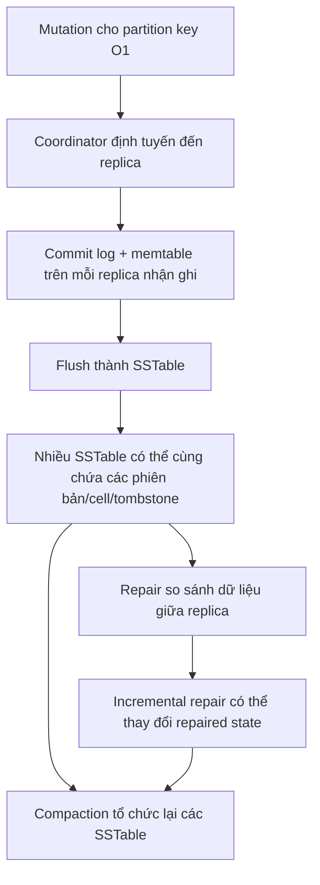
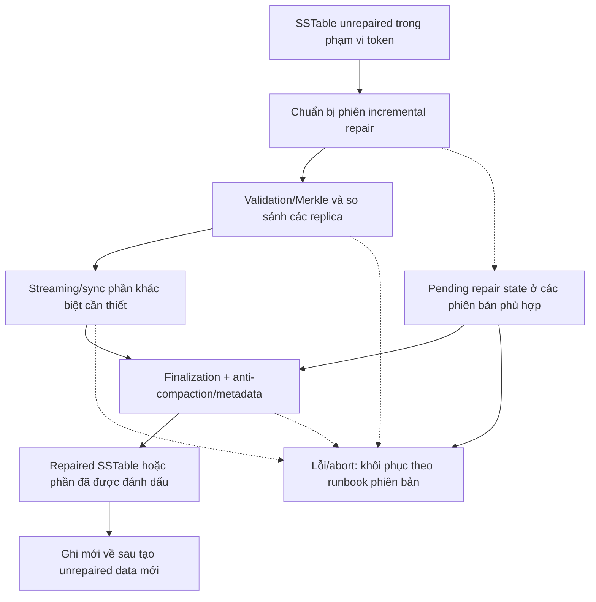
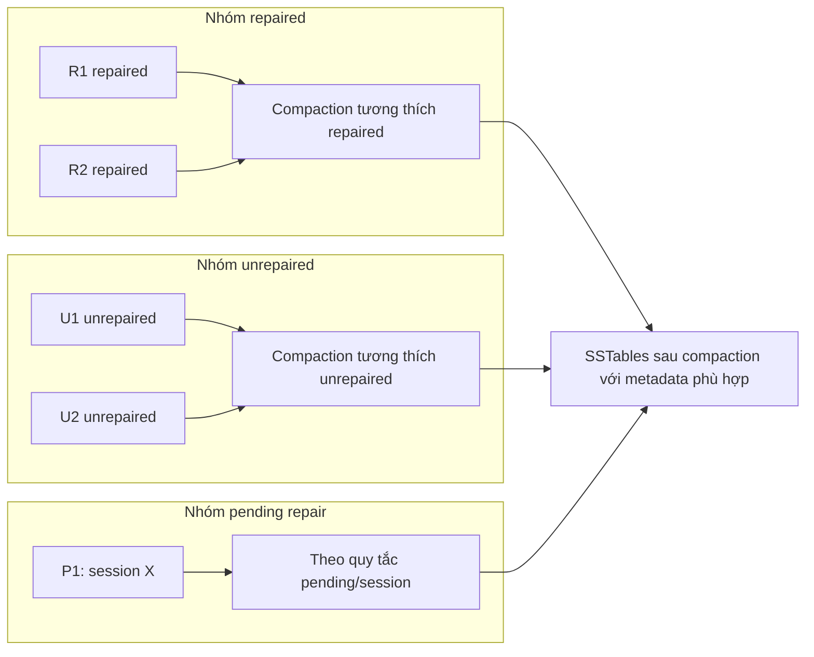
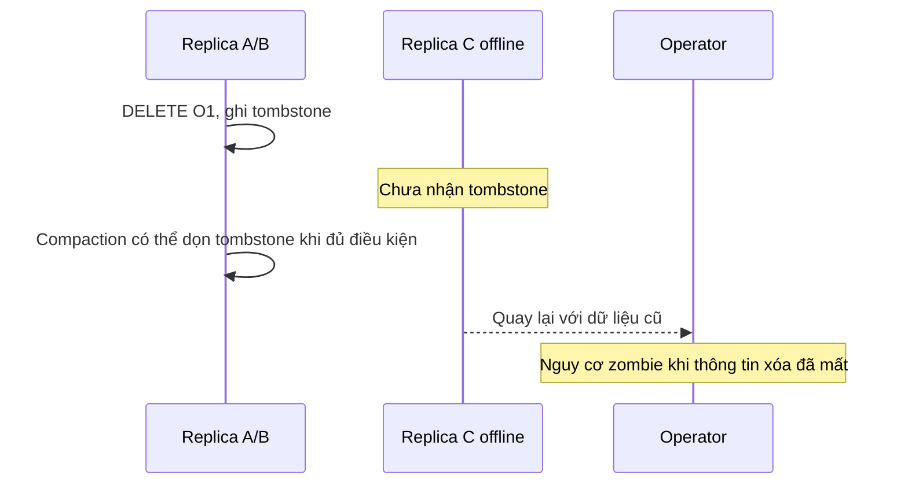

# Trạng thái repaired/unrepaired và quan hệ với compaction trong Apache Cassandra

## Mục tiêu học tập

Trong Apache Cassandra, **anti-entropy repair** không chỉ là một lần so sánh replica. Đặc biệt khi dùng **incremental repair**, hệ thống còn theo dõi những SSTable nào đã tham gia một phiên repair hoàn tất, những SSTable nào chưa được kiểm tra và, ở các phiên bản có cơ chế tương ứng, những SSTable đang thuộc một phiên repair chưa kết thúc. Các trạng thái ấy ảnh hưởng trực tiếp đến cách **compaction** lựa chọn file để hợp nhất, lượng dữ liệu phải kiểm tra ở các lần repair tiếp theo và khả năng vận hành khi một phiên repair thất bại.

Sau bài học, bạn có thể:

1. Giải thích khác biệt giữa **repaired**, **unrepaired**, **pending repair** ở mức metadata SSTable, không nhầm với trạng thái nghiệp vụ của hàng hoặc việc tất cả replica đã đồng bộ mãi mãi.
2. Mô tả đường đi **mutation → memtable → SSTable unrepaired → incremental repair → anti-compaction/finalization → repaired**.
3. Hiểu vì sao compaction thường phải tôn trọng ranh giới các nhóm repaired/unrepaired/pending, và hệ quả đối với số SSTable, read amplification, dung lượng đĩa và tốc độ compaction.
4. Phân biệt tác động của **full repair** và **incremental repair** lên metadata repaired của SSTable.
5. Phân tích rủi ro **tombstone, gc_grace_seconds, zombie data**, cùng giới hạn của replication, hinted handoff và read repair.
6. Dùng CQL, các lệnh vận hành Cassandra và ví dụ Java Driver để minh họa dữ liệu và theo dõi kết quả, nhưng không nhầm một câu SELECT với bằng chứng repair toàn bộ replica.
7. Xây dựng runbook đo lường, xử lý pending repair và lập lịch repair phù hợp với compaction của cluster.

> **Lưu ý phiên bản:** Cơ chế trạng thái sửa chữa và quản lý phiên incremental thay đổi giữa các nhánh Cassandra, đặc biệt từ 3.x sang 4.x/5.x và giữa các bản phân phối. Tên metadata, luồng finalization, những cờ `nodetool`, việc phơi bày metric và khả năng xử lý phiên dở dang phải được xác nhận bằng **tài liệu và công cụ của đúng phiên bản đang chạy**. Ví dụ trong bài thể hiện mô hình vận hành, không phải lệnh buộc dùng nguyên xi trên production.

## 1. Từ partition key đến nhiều bản sao và nhiều SSTable

Cassandra là hệ cơ sở dữ liệu **wide-column phân tán**. Ứng dụng đọc/ghi theo **partition key**; partitioner tính token, sau đó keyspace replication strategy và replication factor (RF) xác định tập replica lưu phân vùng ấy.

Giả sử keyspace `shop` được cấu hình **NetworkTopologyStrategy**, RF = 3 trong datacenter `dc1`. Với phân vùng đơn hàng O1, các replica giả định là A, B, C. Khi C mất kết nối, A và B có thể nhận một mutation mới trong khi C vẫn giữ phiên bản cũ:

| Replica | Dữ liệu ban đầu | Sau ghi khi C offline |
| --- | --- | --- |
| A | `CREATED` | `PAID` |
| B | `CREATED` | `PAID` |
| C | `CREATED` | `CREATED` |

Ở consistency level `LOCAL_QUORUM`, một thao tác ghi có thể được xác nhận bởi 2/3 replica thích hợp mà không buộc C đã nhận mutation. Khi C hoạt động lại, **status UN** chỉ cho biết trạng thái thành viên/ring, không chứng minh C đã có đủ các mutation.

Một mutation mới của Cassandra thường đi qua commit log/memtable trước khi được **flush** thành SSTable bất biến:



Do SSTable là **bất biến** và có thể chứa dữ liệu ở nhiều token ranges, một bảng không chỉ có “một file chứa toàn bộ dữ liệu”. Hệ thống thường đọc/hòa giải thông tin từ nhiều SSTable; compaction giảm những file và phiên bản cần xét theo chiến lược đã cấu hình.

**Cần phân biệt ba cấp:**

- **Cấp hàng/partition:** khóa `order_id` và các cell trong dữ liệu ứng dụng.
- **Cấp replica:** những node lưu bản sao cho token range.
- **Cấp SSTable/repair metadata:** những file hay phần file đã được đưa qua một chu kỳ incremental repair nhất định.

Thuộc tính `repaired` chủ yếu thuộc cấp thứ ba. Nó **không có nghĩa** một đơn hàng nghiệp vụ ở trạng thái “đã được sửa”, hay mọi bản ghi mới hơn thuộc partition ấy đều đã repaired.

## 2. Các trạng thái repaired, unrepaired, pending repair

### 2.1. Unrepaired: dữ liệu chưa được đánh dấu hoàn tất incremental repair

Một SSTable hoặc phần dữ liệu được coi là **unrepaired** khi chưa được đánh dấu đã qua chu kỳ incremental repair thành công theo cơ chế hiện hành.

- SSTable mới sinh từ một lần flush thông thường thường thuộc nhóm **unrepaired**.
- Một bảng vừa repair xong vẫn tiếp tục nhận mutation mới, do đó **lại có unrepaired data**.
- Một hàng logic có thể có phiên bản cũ trong SSTable repaired và mutation mới trong SSTable unrepaired.
- Không nên kết luận rằng unrepaired đồng nghĩa bản dữ liệu chắc chắn sai. Đó là **trạng thái chưa được xác nhận** theo cơ chế incremental repair, chứ không phải kết quả kiểm tra từng hàng.

### 2.2. Repaired: dữ liệu đã được đánh dấu theo kết quả incremental repair

Một SSTable có metadata cho biết dữ liệu của nó đã được đưa qua **một quá trình incremental repair hoàn tất phù hợp phạm vi**, thường được mô tả bằng mốc `repairedAt` hoặc thuộc tính tương đương.

- `repairedAt` là metadata phục vụ repair/compaction, **không phải timestamp cập nhật nghiệp vụ**.
- SSTable repaired có thể vẫn bị tác động bởi compaction và mutation mới của cùng partition ở file khác.
- Những lần incremental repair kế tiếp thường tập trung **unrepaired data** thay vì validation lại phần repaired đã được công nhận.
- Metadata repaired là một quyết định kỹ thuật dựa trên lịch sử repair. Nó không phải bằng chứng rằng dữ liệu sẽ không bao giờ sai lệch sau sự cố, restore, lỗi phần mềm hoặc thay đổi topology.

### 2.3. Pending repair: dữ liệu thuộc phiên incremental đang xử lý

Trong các phiên bản có mô hình **consistent incremental repair**, SSTable có thể được gắn với một **repair session** đang tiến hành, thường thông qua metadata định danh phiên `pendingRepair` hoặc cơ chế tương đương.

Trạng thái này biểu diễn rằng một phần dữ liệu đang chờ kết quả finalization; nó **không đồng nghĩa repaired** và cũng không nên bị một operator tự đổi metadata bằng tay. Khi phiên repair thành công, hệ thống có thể hoàn tất việc đánh dấu repaired; nếu thất bại hoặc bị hủy, cơ chế cleanup/finalization phù hợp phiên bản sẽ quyết định dữ liệu quay về trạng thái nào.

| Trạng thái | Ý nghĩa vận hành | Nguồn tạo trạng thái | Điều cần tránh |
| --- | --- | --- | --- |
| **Unrepaired** | Chưa được đánh dấu hoàn tất incremental | Flush, ghi mới, dữ liệu chưa qua chu kỳ hợp lệ | Coi unrepaired luôn là dữ liệu sai |
| **Pending** | Dữ liệu đang gắn với phiên incremental chưa kết thúc | Giai đoạn chuẩn bị/anti-compaction/finalization tùy phiên bản | Tự sửa file metadata, chạy nhiều repair chồng lấn |
| **Repaired** | Được đánh dấu thuộc tập đã incremental repair thành công | Hoàn tất phiên và ghi nhận metadata | Coi đây là bảo đảm bất biến vĩnh viễn của toàn partition |

### 2.4. Metadata là theo SSTable, không phải một cột CQL

Sơ đồ khái niệm:

```text
Partition O1:
  SSTable S1 (repaired)   : status = CREATED, phiên bản/cell cũ
  SSTable S2 (unrepaired) : status = PAID, mutation mới
  SSTable S3 (pending)    : dữ liệu thuộc phiên repair đang hoàn tất

SELECT O1:
  Cassandra hòa giải các cell/phiên bản được phép nhìn thấy
  qua dữ liệu trên replica theo quy tắc lưu trữ/consistency.

Không có câu:
  SELECT * FROM ... WHERE repaired = true
để lọc trạng thái SSTable này như một cột nghiệp vụ.
```

Trong ví dụ, **một partition có thể xuất hiện ở nhiều nhóm**. Khi hệ thống đọc O1, Cassandra không chỉ chọn một nhóm `repaired` rồi bỏ qua mutation mới. Nó phải dựng kết quả đúng theo timestamp, tombstone và quy tắc lưu trữ.

## 3. Incremental repair đưa dữ liệu qua những trạng thái nào?

Một lần incremental repair có thể được nhìn như một **state machine** cho phạm vi dữ liệu được chọn.



**Trình tự chi tiết của các pha và thời điểm anti-compaction khác nhau theo phiên bản**. Sơ đồ chỉ thể hiện quan hệ giữa việc validation/synchronization và trạng thái được đánh dấu sau kết quả cuối cùng; không dùng nó để khẳng định mọi phiên bản đều anti-compact đúng ở bước D.

### 3.1. Chọn dữ liệu chưa repaired

Các replica cùng tham gia cho một tập token ranges phù hợp với keyspace, RF và topology. Incremental repair dựa vào metadata để giới hạn tập dữ liệu chưa được đánh dấu repaired theo cơ chế của phiên bản.

Phạm vi vẫn phải xác định:

- **Keyspace**: replication policy của dữ liệu đang repair.
- **Table**: bảng nào cần validation/sync.
- **Token ranges**: những phân vùng nào được chọn.
- **Replica/datacenter**: những node nào phải tham gia để đạt mục tiêu của phạm vi.
- **Mode**: incremental, không phải full.

Không có chuyện chỉ vì incremental mà tự động repair toàn cluster hay toàn keyspace khi lệnh chỉ giới hạn một bảng/range.

### 3.2. Validation và synchronization

Các replica so sánh dữ liệu trong phạm vi bằng cơ chế anti-entropy, thường sử dụng Merkle trees và hoạt động validation. Những range khác biệt có thể cần streaming/sync dữ liệu giữa replica.

**Validation bytes không phải streaming bytes**:

- Validation có thể phải đọc một lượng dữ liệu đáng kể để xác minh.
- Streaming truyền dữ liệu cần hòa giải khi có khác biệt, không mặc nhiên truyền toàn bộ dữ liệu được quét.
- Một phiên repair có thể mất nhiều I/O/CPU dù số bytes stream nhỏ.

### 3.3. Anti-compaction và ghi nhận repaired state

Vì một SSTable bất biến có thể chứa dữ liệu trong **cả phạm vi vừa repair và phạm vi chưa repair**, Cassandra cần tổ chức lại file/metadata để trạng thái repaired phản ánh phần dữ liệu phù hợp.

**Anti-compaction** là quá trình tách/viết lại hoặc phân chia dữ liệu SSTable theo phạm vi và trạng thái repair, tùy triển khai phiên bản. Ví dụ minh họa:

```text
Trước:
  SSTable X (unrepaired)
    token ranges: [R1] [R2] [R3]

Chỉ R1 và R2 thuộc phiên incremental hoàn tất.

Sau khi tổ chức lại:
  SSTable X_repaired   : các phần thuộc R1, R2 (repaired)
  SSTable X_unrepaired : phần thuộc R3 (unrepaired)

Không được gắn toàn bộ X thành repaired chỉ vì R1/R2 thành công.
```

Đây là lý do incremental repair không chỉ cần **tính toán khác biệt giữa replica**, mà còn cần tài nguyên đĩa, I/O và metadata để duy trì trạng thái đã repaired.

### 3.4. Chế độ incremental thất bại giữa chừng

Khi validation, streaming hoặc finalization thất bại:

- Không được coi các token ranges chưa hoàn thành là repaired chỉ vì một phần phiên chạy thành công.
- Có thể xuất hiện pending repair state hoặc session cần xử lý theo quy trình quản trị đúng phiên bản.
- Không tự sửa `repairedAt`, `pendingRepair` hay các file SSTable để “ép hoàn tất”.
- Phải thu thập session ID, danh sách replica, keyspace/table/range, log validation/streaming/anti-compaction và tình trạng tài nguyên.
- Nếu nghi dữ liệu repaired có thể sai, **full repair phạm vi được xác định** là một lựa chọn cần đánh giá, chứ không phải lệnh cứu dữ liệu an toàn tuyệt đối.

## 4. Full repair liên quan đến repaired/unrepaired ra sao?

**Full repair** hướng tới kiểm tra dữ liệu của **phạm vi được chọn**, không chỉ phần unrepaired. Điều này bao gồm phần đã được gắn repaired và phần chưa repaired, theo cơ chế của phiên bản đang chạy.

Ví dụ trong một range:

| Nhóm | Dung lượng minh họa | Incremental thường xét | Full xét |
| --- | ---: | --- | --- |
| SSTable repaired từ các chu kỳ trước | 900 GiB | Thường không validation lại | Có |
| SSTable unrepaired mới phát sinh | 100 GiB | Có | Có |
| Pending repair của phiên lỗi | Phụ thuộc phiên | Cần giải quyết trạng thái theo phiên bản | Không nên bỏ qua tình trạng pending khi lập kế hoạch |
| Bảng hoặc range ngoài lựa chọn | Không thuộc phạm vi | Không | Không |

**Điểm then chốt:** full repair không có nghĩa toàn bộ cluster. Nó là **full theo tập dữ liệu trong phạm vi keyspace/table/token ranges được chọn**. Nếu gọi trên một node, việc bao phủ toàn ring còn cần lịch theo node/range và topology.

Một lần full repair thông thường **không chuyển toàn bộ SSTable unrepaired thành repaired theo cơ chế incremental**. Vì vậy khi lập lịch cả hai chế độ, đừng giả định chỉ cần chạy một lần full là làm “sạch” toàn bộ unrepaired state cho các lần incremental sau.

### Vì sao có thể cần full khi đã incremental đều đặn?

Incremental tối ưu bằng cách không kiểm tra lại dữ liệu đã repaired. Nếu một sự cố hoặc restore khiến phần đã được gắn repaired không còn đáng tin cậy, chạy incremental thêm lần nữa có thể **không đủ để xét lại tập dữ liệu ấy**. Full repair theo phạm vi phù hợp là một trong những công cụ kiểm tra/sửa; vẫn phải xác minh nguồn dữ liệu hợp lệ còn tồn tại và cách xử lý tombstone.

Full thường tốn validation nhiều hơn nếu phần lớn dữ liệu đã repaired, nhưng không nên tính thời gian chỉ từ phần trăm byte. Đĩa, mạng, trạng thái compaction, số file, Merkle validation và số khác biệt thực tế đều có ảnh hưởng.

## 5. Compaction phải tôn trọng repaired state

### 5.1. Vì sao không thể tùy ý gộp mọi SSTable?

Giả sử có hai SSTable của cùng bảng:

- `S1` được đánh dấu **repaired** do đã qua một chu kỳ incremental.
- `S2` là **unrepaired** do vừa được flush.

Nếu compaction bình thường gộp S1 và S2 thành một SSTable rồi gắn repaired, dữ liệu mới từ S2 có thể bị **đánh dấu như đã repair dù chưa thực sự được đưa qua quy trình đó**.

Ngược lại, nếu luôn gắn unrepaired, một phần dữ liệu cũ từng được repair có thể bị yêu cầu validation lại không cần thiết, làm giảm lợi ích incremental.

Vì vậy ở các mô hình Cassandra dùng metadata repaired/unrepaired, **compaction thường tách lựa chọn SSTable theo nhóm trạng thái tương thích**. Những SSTable pending còn có ràng buộc theo session phù hợp để tránh ghép dữ liệu của các phiên repair khác nhau một cách sai ngữ nghĩa.



**Sơ đồ khái niệm:** chiến lược compaction và cấu trúc grouping thực tế thay đổi theo phiên bản; không kết luận rằng mọi nhóm được hợp nhất vào đúng một file đầu ra, hoặc một file pending ở bất kỳ phiên nào có thể compaction với mọi file pending khác.

### 5.2. Hệ quả: repaired và unrepaired tồn tại song song lâu dài

Khi ứng dụng ghi liên tục:

1. Một chu kỳ incremental đánh dấu dữ liệu hiện có thành repaired.
2. Ứng dụng tiếp tục ghi, sinh thêm SSTable unrepaired.
3. Compaction tổ chức các file **trong những nhóm trạng thái thích hợp**.
4. Chu kỳ incremental sau lại xử lý phần unrepaired.
5. Nếu repair bị chậm/lỗi, unrepaired SSTables có thể tích tụ, pending state có thể tồn tại, và công việc compaction vẫn phải xử lý theo ranh giới trạng thái.

Điều này có thể làm giảm khả năng gộp file so với một tập SSTable không cần tách repaired state, và làm tăng số file mà đường đọc có thể phải xét.

### 5.3. Read amplification và dung lượng đĩa

Không nên khẳng định “có repaired/unrepaired là mọi truy vấn đều chậm”. Tác động còn tùy Bloom filters, partition index, cache, compaction strategy, mức độ trùng khóa và pattern truy vấn.

Tuy nhiên, có những cơ chế gây chi phí:

| Nguồn chi phí | Vì sao xảy ra | Điều nên đo |
| --- | --- | --- |
| **Nhiều nhóm SSTable** | Không phải file repaired và unrepaired nào cũng có thể compaction chung | SSTable count, số file trên đường đọc |
| **Anti-compaction** | Chia/viết lại dữ liệu để giữ repair state | I/O, disk free, bytes rewritten, thời gian |
| **Pending repair kéo dài** | File có thể bị hạn chế compaction theo session | Pending SSTables, compaction backlog |
| **Dữ liệu cùng partition ở nhiều nhóm** | Mutation mới nằm ở unrepaired, phiên bản cũ ở repaired | Read latency p95/p99, tombstone scans |
| **Repair quá thưa** | Unrepaired backlog lớn, lần sau validation nhiều | Unrepaired bytes/age, repair duration |
| **Repair quá dày/chồng nhau** | Overhead cố định, validation/anti-compaction lặp | CPU, I/O, concurrent sessions |
| **Streaming sau mismatch** | Replica cần truyền dữ liệu để hội tụ | Network throughput, streamed bytes |

Đặc biệt, **không nên gọi thủ công major compaction chỉ để cố làm giảm số SSTable** khi chưa đánh giá ảnh hưởng lên disk, tombstone, repair state và chiến lược compaction. Trên một số workload, major compaction tốn rất nhiều I/O và có thể làm tình trạng latency/dung lượng xấu đi.

## 6. Các chiến lược compaction và trạng thái repair

Cassandra hỗ trợ các compaction strategy khác nhau. Chiến lược quyết định cách chọn SSTable để compaction theo kích thước, level, cửa sổ thời gian hoặc tiêu chí khác; **repair state là một chiều ràng buộc bổ sung** trong những phiên bản có cơ chế repaired/unrepaired/pending tương ứng.

### 6.1. SizeTieredCompactionStrategy (STCS)

STCS thường nhóm SSTable theo kích thước tương đối để gộp. Khi repaired/unrepaired được tách, mỗi nhóm trạng thái có tập ứng viên compaction riêng, dẫn tới tình huống:

- Repaired SSTables có thể chưa đủ số lượng/điều kiện để gộp.
- Unrepaired SSTables khác kích cỡ cũng chờ nhóm phù hợp.
- Tổng số file trên bảng có thể cao hơn dự kiến từ một chuỗi compaction tưởng tượng không có ranh giới repair state.

Việc này không mặc nhiên là lỗi; cần nhìn kết hợp compaction backlog, số SSTable và độ trễ đọc.

### 6.2. LeveledCompactionStrategy (LCS)

LCS tổ chức SSTable theo nhiều level để giới hạn overlap trong những điều kiện vận hành tương ứng. Khi tồn tại repaired/unrepaired, sự phân nhóm có thể tạo **nhiều tập compaction riêng** thay vì một chuỗi level thống nhất cho toàn bộ dữ liệu.

Vì vậy những kỳ vọng như “LCS luôn chỉ cần đọc một số file cố định” phải được kiểm chứng trong cụm có incremental repair thực tế. Tỷ lệ sửa, số SSTable mỗi nhóm và cách dữ liệu partition trùng nhau ảnh hưởng read amplification.

### 6.3. TimeWindowCompactionStrategy (TWCS)

TWCS thường được cân nhắc cho dữ liệu time-series, TTL và pattern ghi theo thời gian. Nó tổ chức SSTable theo cửa sổ thời gian thay vì chỉ theo kích thước.

Kết hợp TWCS với repaired state cần đánh giá:

- Các cửa sổ thời gian có dữ liệu repaired/unrepaired lẫn nhau.
- Dữ liệu **đến muộn** hoặc cập nhật lại dữ liệu cũ có thể làm tăng sự phân tán SSTable.
- TTL/tombstone cần được giữ và xử lý an toàn, không tự động biến mất chỉ vì cửa sổ compaction kết thúc.
- Lịch repair phải đáp ứng vòng đời xóa và khả năng một replica bỏ lỡ tombstone.

Không có chiến lược compaction nào “tự giải quyết repair” hay tự bảo đảm mọi node đã đồng bộ.

### 6.4. Khi đổi compaction strategy

Đổi STCS, LCS hoặc TWCS là quyết định vận hành riêng; không dùng nó như cách sửa nhanh metadata repaired/pending bị lỗi. Một thay đổi strategy có thể kéo theo compaction lớn, thay đổi số SSTable/độ trễ và dung lượng. Cần thiết kế thử nghiệm, cửa sổ bảo trì và quan sát impact thay vì điều chỉnh chỉ vì thấy `unrepaired`.

## 7. Ví dụ từng bước: một partition đi qua nhiều chu kỳ

Giả sử `shop.orders_by_id` có partition O1, RF=3. Tại thời điểm ban đầu, mọi replica đều có mutation v1.

### Giai đoạn A — Ghi mới và flush

```text
Replica A:
  SSTable A1 (unrepaired): O1 = CREATED, v1
Replica B:
  SSTable B1 (unrepaired): O1 = CREATED, v1
Replica C:
  SSTable C1 (unrepaired): O1 = CREATED, v1
```

Trạng thái unrepaired **không nói rằng dữ liệu v1 đang khác nhau**. Có thể ba replica đã hoàn toàn giống nhau nhưng chưa được incremental repair trên range tương ứng.

### Giai đoạn B — Incremental repair R1 hoàn tất

```text
Replica A:
  SSTable A1r (repaired): O1 = CREATED, v1
Replica B:
  SSTable B1r (repaired): O1 = CREATED, v1
Replica C:
  SSTable C1r (repaired): O1 = CREATED, v1
```

Các tên A1r/B1r/C1r chỉ là mô hình ký hiệu, không phải tên file thật. Trong cụm có nhiều token range, một SSTable có thể cần anti-compaction tách thành phần repaired và phần unrepaired.

### Giai đoạn C — Ghi v2 khi replica C offline

```text
Replica A:
  A1r (repaired)  : O1 = CREATED, v1
  A2  (unrepaired): O1 = PAID, v2
Replica B:
  B1r (repaired)  : O1 = CREATED, v1
  B2  (unrepaired): O1 = PAID, v2
Replica C:
  C1r (repaired)  : O1 = CREATED, v1
  (chưa có v2)
```

Một incremental repair tiếp theo, khi C đã có mặt và tham gia phạm vi, có thể kiểm tra phần unrepaired chứa v2 và đồng bộ mutation cần thiết cho replica C. Phần v1 ở repaired SSTables không nhất thiết bị validation lại.

### Giai đoạn D — Compaction sau nhiều mutation

Nếu sau đó ứng dụng cập nhật `shipping_address` hoặc một cột khác của O1:

- Mutation mới có thể nằm trong unrepaired SSTable.
- Những file repaired chứa các cell cũ vẫn có thể tồn tại.
- Đường đọc hòa giải dữ liệu từ các nguồn SSTable liên quan, không dựa riêng vào repaired flag.
- Compaction có thể gộp các SSTable trong nhóm phù hợp để giảm số file, nhưng không tự biến unrepaired data thành repaired.

**Kết luận của ví dụ:** trạng thái repaired là **lịch sử kiểm chứng của dữ liệu được tổ chức trên đĩa**, không phải một khóa logic của O1. Bài toán cùng một partition hiện diện ở nhiều nhóm làm rõ vì sao repair và compaction ảnh hưởng lẫn nhau.

## 8. CQL thực hành: ghi, sửa, xóa và quan sát dữ liệu

Ví dụ sau dùng keyspace `shop` đã tồn tại và replication phù hợp. Nếu dùng cluster mới để thử nghiệm, hãy cấu hình datacenter/RF dựa trên tên datacenter thực tế; không sao chép một tên `dc1` tùy ý vào production.

```sql
USE shop;

CREATE TABLE orders_by_id (
    order_id uuid PRIMARY KEY,
    customer_id uuid,
    status text,
    total_amount decimal,
    updated_at timestamp
);
```

Tạo đơn, sửa và xóa:

```sql
INSERT INTO orders_by_id (
    order_id, customer_id, status, total_amount, updated_at
) VALUES (
    11111111-1111-4111-8111-111111111111,
    22222222-2222-4222-8222-222222222222,
    'CREATED', 250000.00, '2026-11-21T01:00:00Z'
);

UPDATE orders_by_id
SET status = 'PAID', updated_at = '2026-11-21T01:05:00Z'
WHERE order_id = 11111111-1111-4111-8111-111111111111;

SELECT order_id, customer_id, status, updated_at
FROM orders_by_id
WHERE order_id = 11111111-1111-4111-8111-111111111111;

-- Chỉ chạy DELETE khi đang cố ý thử nghiệm vòng đời tombstone.
DELETE FROM orders_by_id
WHERE order_id = 11111111-1111-4111-8111-111111111111;
```

### CQL cho dữ liệu TTL

Một bảng `events_by_device_day` có thể áp dụng TTL cho sự kiện tạm thời:

```sql
CREATE TABLE events_by_device_day (
    device_id uuid,
    event_day date,
    occurred_at timestamp,
    event_id uuid,
    payload text,
    PRIMARY KEY ((device_id, event_day), occurred_at, event_id)
) WITH CLUSTERING ORDER BY (occurred_at DESC, event_id ASC);

INSERT INTO events_by_device_day (
    device_id, event_day, occurred_at, event_id, payload
) VALUES (
    33333333-3333-4333-8333-333333333333,
    '2026-11-21', '2026-11-21T02:00:00Z',
    44444444-4444-4444-8444-444444444444,
    'sensor=23'
) USING TTL 86400;
```

TTL làm dữ liệu hết hạn theo thời gian và tạo tombstone theo ngữ nghĩa lưu trữ, **không tự kích hoạt một phiên repair**. Khi tính chính sách xóa, cần xem liệu những replica có thể offline quá lâu, tombstone cần được truyền thế nào và chiến lược compaction có xử lý các cửa sổ TTL phù hợp không.

### Quan sát token và trạng thái nghiệp vụ

```sql
-- Token của phân vùng phụ thuộc partitioner.
SELECT token(order_id) AS partition_token, status
FROM orders_by_id
WHERE order_id = 11111111-1111-4111-8111-111111111111;
```

Nếu đã xóa O1, truy vấn có thể không trả hàng. **Không có câu SELECT CQL trực tiếp** để biết O1 nằm trong SSTable repaired/unrepaired nào. Muốn quan sát metadata file và repair state, cần công cụ vận hành/inspection ở tầng node được phiên bản hỗ trợ.

## 9. Runbook quan sát repair state và compaction

**Đây là runbook quan sát để học, không phải chuỗi lệnh nên chạy đồng thời trên production.** Những bước có thể gây tải như repair, flush, major compaction hay thao tác lên SSTable phải được đội vận hành phê duyệt và kiểm tra phiên bản.

### 9.1. Kiểm tra topology, trạng thái node và các chỉ số

```bash
# Lệnh quan sát tương đối phổ biến; kiểm tra help theo phiên bản.
nodetool status
nodetool ring shop
nodetool tablestats shop.orders_by_id
nodetool compactionstats
nodetool netstats
nodetool tpstats
```

Các công cụ này giúp nhận diện:

- Những node hiện đang Down, Joining, Leaving, có thể không thích hợp cho repair thông thường.
- Keyspace/bảng nào đang có nhiều SSTable, lượng dữ liệu lớn hoặc tải đọc/ghi tăng.
- Compaction backlog, hoạt động streaming và áp lực thread pool.
- Những triệu chứng như disk I/O, read latency, dropped messages tăng khi repair chạy.

**Chú ý:** `nodetool tablestats` hay `compactionstats` không mặc nhiên hiển thị toàn bộ breakdown repaired/unrepaired/pending ở tất cả phiên bản. Nếu công cụ không hỗ trợ, đừng tự suy con số repaired từ kích thước bảng.

### 9.2. Kiểm tra chính xác tùy chọn repair của phiên bản

```bash
nodetool help repair

# Một số phiên bản có công cụ quản lý phiên repair:
# Kiểm tra tính sẵn có trước khi dùng, không giả định lệnh có mặt.
nodetool help repair_admin
```

Tùy phiên bản/phân phối, có thể có thêm thông tin về repair sessions, pending repair hoặc SSTable repair metadata qua log, metrics/JMX và công cụ inspection. Với công cụ đọc metadata SSTable, hãy tuân thủ hướng dẫn an toàn của phiên bản, sử dụng snapshot/offline nếu cần; **không sửa metadata SSTable thủ công**.

### 9.3. Chạy một phiên incremental có phạm vi rõ ràng

```bash
# Chỉ minh họa phạm vi một bảng trên primary ranges
# của node chạy lệnh; chế độ mặc định phụ thuộc phiên bản.
nodetool repair -pr shop orders_by_id
```

Nếu phiên bản hỗ trợ cờ xác định incremental, kiểm tra `nodetool help repair` rồi dùng theo runbook. Lệnh repair trên một node **không tự bao phủ mọi token range của toàn cluster**. Với `-pr`, cần lập lịch phù hợp trên những node cần thiết để bao phủ primary ranges của ring.

### 9.4. Full repair khi cần kiểm tra lại repaired data

```bash
# Minh họa full repair trên bảng và phạm vi node được chọn.
nodetool repair -full shop orders_by_id
```

Full repair giúp đưa cả repaired data trong phạm vi vào validation, nhưng:

- Không tự sửa dữ liệu nghiệp vụ ở một bảng dẫn xuất khác.
- Không khôi phục được dữ liệu/tombstone đã mất ở tất cả replica.
- Thông thường không đổi toàn bộ unrepaired SSTables thành repaired như incremental.
- Vẫn phải đo validation, stream, I/O và kết quả của phạm vi được chọn.

### 9.5. Những điều tuyệt đối không tự làm khi thấy pending state

- Không xóa các file pending SSTable để “thông compaction”.
- Không tự sửa giá trị `repairedAt` hoặc `pendingRepair`.
- Không chạy nhiều repair chồng lấn cùng phạm vi trong khi session trước chưa rõ trạng thái.
- Không bắt buộc compaction toàn bảng khi đĩa đang cạn để mong sửa metadata.
- Không kết luận thành công chỉ vì `netstats` hiện không còn stream.

Khi có pending state kéo dài, phải xác định **session ID**, replica liên quan, phiên bản, log lỗi và phương pháp quản trị được hỗ trợ trước khi can thiệp.

## 10. Tombstone, repaired state và nguy cơ zombie data

Cassandra dùng **tombstone** để biểu diễn việc xóa và việc nhiều dữ liệu hết TTL. Tombstone cần được các replica nhận biết để dữ liệu cũ không “hồi sinh” sau khi một node vắng mặt.

### Tình huống một replica bỏ lỡ lệnh xóa

1. Replica A và B nhận `DELETE O1`, ghi tombstone.
2. C offline nên vẫn còn O1 cũ.
3. A và B tiếp tục compaction; sau khi đáp ứng những điều kiện cần thiết, tombstone có thể bị loại bỏ.
4. C quay lại với giá trị O1 cũ.
5. Nếu tombstone cần thiết không còn nơi nào để hòa giải, O1 có nguy cơ tái xuất hiện (*zombie data*).



### `gc_grace_seconds` không phải “nút dọn tombstone đúng giờ”

`gc_grace_seconds` góp phần xác định khoảng thời gian giữ tombstone để replica vắng mặt có cơ hội được đồng bộ. Việc dọn vật lý còn phụ thuộc compaction, các SSTable liên quan và quy tắc an toàn. Không nên giảm grace chỉ vì muốn ít tombstone hơn khi không chắc repair có thể hoàn tất với tần suất và phạm vi phù hợp.

**Đã repaired không có nghĩa mọi lần xóa sau đó đều an toàn mãi mãi.** Nếu data cũ ở SSTable repaired nhưng mutation xóa mới nằm trong SSTable unrepaired, vẫn cần lịch repair và quản lý tombstone. Một chu kỳ incremental có thể giúp truyền dữ liệu chưa repaired trong phạm vi; full repair có thể kiểm tra lại repaired data khi đáng ngờ. Nhưng nếu bằng chứng xóa đã bị dọn ở mọi replica phù hợp, **không chế độ nào tự suy ra lịch sử xóa bị mất**.

### Compaction, trạng thái repaired và tombstone purge

Vì compaction có thể phải giữ ranh giới repaired/unrepaired/pending, một tombstone và dữ liệu cũ liên quan có thể không nằm trong cùng nhóm file dễ gộp. Điều này có thể làm **số tombstone/phiên bản tồn tại lâu hơn** so với kỳ vọng đơn giản “gộp hết SSTable rồi xóa”.

Việc được phép purge tombstone phụ thuộc thuật toán và những SSTable có khả năng chứa dữ liệu bị che, metadata, thời gian grace và cấu hình/phiên bản. **Không khẳng định** rằng chỉ cần `repaired = true` là tombstone sẽ bị purge ngay, hoặc rằng repaired flag tự bảo vệ trước mọi zombie.

Nếu node offline vượt khoảng an toàn đã thiết kế, cần áp dụng quy trình **replace/rebuild/restore** phù hợp trước khi cho nó tham gia lại; không coi một lần incremental repair sau khi node quay về là bảo đảm đầy đủ.

## 11. Chọn lịch repair tương thích compaction

Một lịch hiệu quả phải cân bằng **tốc độ sinh unrepaired data**, khả năng của cluster, thời gian validation/streaming/anti-compaction và yêu cầu an toàn xóa.

### 11.1. Repair quá thưa

Khi không repair trong thời gian dài:

- Unrepaired SSTables tích tụ.
- Lần incremental tiếp theo có thể validation một lượng dữ liệu rất lớn.
- Nếu node offline và hệ thống thường xuyên xóa dữ liệu, nguy cơ không truyền tombstone đúng thời hạn tăng.
- Tồn tại nhiều nhóm dữ liệu có thể làm compaction/read amplification khó dự đoán.

### 11.2. Repair quá dày hoặc chồng lấn

Khi repair liên tục với nhiều phiên ngắn:

- Phát sinh overhead điều phối/validation/anti-compaction lặp lại.
- Dữ liệu mới chưa đáng kể vẫn có thể tạo nhiều phiên với chi phí khởi tạo.
- Các phiên cạnh tranh disk/network và có thể đẩy compaction backlog lên cao.
- Pending state và tình huống xử lý lỗi khó quản lý hơn nếu không có scheduler.

### 11.3. Một mô hình cân bằng

| Dữ kiện | Câu hỏi |
| --- | --- |
| Dữ liệu unrepaired phát sinh mỗi ngày | Bao nhiêu GiB, bao nhiêu SSTable, tập trung ở bảng/range nào? |
| Phần repaired ổn định | Có đáng tránh validation lại bằng incremental không? |
| Anti-compaction | Mất bao lâu, cần bao nhiêu dung lượng trống? |
| Compaction backlog | Có đủ thời gian để compaction xử lý sau chu kỳ repair không? |
| Node downtime | Một node có thể vắng mặt tối đa bao lâu? |
| Tombstone/TTL | Grace và tốc độ xóa có tương thích thời gian repair coverage không? |
| Topology/vnodes | Có bảo đảm mọi token range, DC và bảng được bao phủ không? |
| SLO đọc/ghi | Repair làm p95/p99 latency tăng bao nhiêu trong cửa sổ bảo trì? |

Không có công thức “mỗi ngày incremental, mỗi tuần full” đúng cho mọi cụm. Chu kỳ phải được **đo và kiểm chứng** trong môi trường có RF, topology, dữ liệu và workload thực.

### 11.4. Full và incremental trong cùng chương trình vận hành

Một chiến lược có thể sử dụng incremental cho những chu kỳ thường xuyên nhằm xử lý unrepaired data, và full repair trên phạm vi cần xác minh khi có dấu hiệu sai lệch repaired state hoặc sau quy trình khôi phục yêu cầu. Phải hiểu tác động tới metadata và lưu ý **không trộn chế độ tùy tiện trong một phiên lỗi chưa được giải quyết**.

Không gọi full như phương tiện “xóa pending repair nhanh nhất”; lỗi session và metadata cần được kiểm tra theo phiên bản. Cũng không dùng incremental như cớ bỏ qua các lỗi đã được xác định ở repaired SSTables.

## 12. Java Driver: kiểm tra dữ liệu qua CQL, không giả lập repaired state

Một ứng dụng Java dùng **Apache Cassandra Java Driver 4.x** có thể kiểm tra trạng thái đơn ở mức nhất quán phù hợp. Điều đó giúp xác minh đường đọc nghiệp vụ sau khi vận hành repair, **không cho biết SSTable trên từng node đang repaired/unrepaired**.

```java
import com.datastax.oss.driver.api.core.CqlSession;
import com.datastax.oss.driver.api.core.DefaultConsistencyLevel;
import com.datastax.oss.driver.api.core.cql.BoundStatement;
import com.datastax.oss.driver.api.core.cql.PreparedStatement;
import com.datastax.oss.driver.api.core.cql.Row;

import java.math.BigDecimal;
import java.util.UUID;

public final class OrderReplicaReadProbe {
    public record State(UUID orderId, String status, BigDecimal total) {}

    private final CqlSession session;
    private final PreparedStatement byId;

    public OrderReplicaReadProbe(CqlSession session) {
        this.session = session;
        this.byId = session.prepare(
            "SELECT order_id, status, total_amount " +
            "FROM shop.orders_by_id WHERE order_id = ?");
    }

    public State readAtLocalQuorum(UUID orderId) {
        BoundStatement query = byId.bind(orderId)
            .setConsistencyLevel(DefaultConsistencyLevel.LOCAL_QUORUM);
        Row row = session.execute(query).one();

        if (row == null) {
            return null;
        }
        return new State(
            row.getUuid("order_id"),
            row.getString("status"),
            row.getBigDecimal("total_amount")
        );
    }
}
```

**Giới hạn của phép thử:**

- `LOCAL_QUORUM` phải được dùng với RF và topology phù hợp; thiếu replica có thể dẫn đến lỗi.
- Đọc đúng một hàng không chứng minh mọi replica của bảng đều có dữ liệu khớp.
- CQL không cung cấp API thông thường để ứng dụng tự đánh dấu `repairedAt` cho SSTable.
- Khi `orders_by_customer_month` khác `orders_by_id` về trạng thái nghiệp vụ, đó có thể là **lỗi đồng bộ bảng dẫn xuất**, không phải vấn đề được giải quyết bằng compaction/repaired flag.
- Dùng `nodetool`, metrics/log, công cụ SSTable inspection được phê duyệt để xem phạm vi repair; dùng Java cho dữ liệu ứng dụng, không dùng Java để “sửa” metadata lưu trữ.

## 13. Runbook xử lý cụm có quá nhiều unrepaired hoặc pending SSTable

Một trường hợp thực tế: sau sự cố mạng và đĩa đầy, monitoring báo unrepaired backlog tăng, một vài phiên incremental dở dang và p99 đọc tăng sau các đợt compaction.

### Bước 1 — Đóng băng quyết định nguy hiểm

Không khởi động hàng loạt repair mới hoặc major compaction chỉ để “giảm file”. Dừng các tác vụ chồng lấn đang gây quá tải theo quy trình cho phép; giữ log và session ID của phiên lỗi.

### Bước 2 — Xác định phạm vi thật

Thu thập:

- Cassandra version và strategy compaction của từng bảng.
- Keyspace, RF, DC, danh sách token ranges của những phiên đã chạy.
- Bảng/range nào đã repaired thành công, bảng nào chưa.
- Có pending repair sessions nào còn tồn tại; công cụ quản lý hỗ trợ gì.
- Node Down/Joining/Leaving, disk free, streaming/compaction backlog.
- Khoảng thời gian node vắng mặt so với chính sách tombstone/grace.

### Bước 3 — Tách nguyên nhân

| Triệu chứng | Khả năng cần xem xét | Hướng điều tra |
| --- | --- | --- |
| Unrepaired bytes tăng đều | Chu kỳ repair chậm hơn tốc độ ghi | Lịch repair, throughput, range bị bỏ sót |
| Pending SSTables không giảm sau lỗi | Phiên repair cần finalize/abort/cleanup | Session ID, log và lệnh hỗ trợ đúng phiên bản |
| Nhiều file, read latency tăng | Nhóm compaction bị phân mảnh, backlog hoặc workload hot | SSTable stats, compaction strategy, cache/IO |
| Streaming lỗi | Network/disk/replica không đủ điều kiện | Netstats, logs, topology, dung lượng |
| Repaired data bị nghi sai | Restore/membership/sự cố repair trước đó | Đánh giá full repair phạm vi phù hợp |
| Zombie sau node offline lâu | Tombstone bị bỏ lỡ hoặc dọn trước khi hội tụ | Grace, repair lịch sử, replace/restore quy trình |

### Bước 4 — Khắc phục có kiểm soát

Khôi phục khả năng lưu trữ, mạng và trạng thái node, xử lý repair sessions tồn đọng bằng **công cụ đúng phiên bản**, rồi thực hiện những phiên repair còn thiếu theo lịch/nhóm token có thể giám sát. Đo ảnh hưởng p95/p99, anti-compaction và compaction backlog, không tối ưu số SSTable đơn lẻ.

### Bước 5 — Xác minh hoàn tất

Chỉ báo thành công khi:

- Các phiên repair cần thiết được xác nhận hoàn tất với **keyspace/table/range/replica coverage** rõ ràng.
- Không còn pending/error session chưa được giải quyết theo runbook.
- Unrepaired backlog trở lại mức được chấp nhận hoặc có kế hoạch xử lý theo thời hạn.
- Compaction backlog, disk free và latency ổn định.
- Rủi ro tombstone/offline dài ngày được đánh giá riêng.
- Không có giả định sai rằng một vài `SELECT` hợp lệ chứng minh toàn cluster đã hội tụ.

## 14. Bài thực hành và câu hỏi tình huống

### Tình huống A — Cùng một partition xuất hiện ở repaired và unrepaired SSTable

Đơn O1 ở phiên bản 1 trước khi incremental repair, sau đó cập nhật phiên bản 2.

1. Vì sao dữ liệu v1 có thể nằm trong repaired SSTable, trong khi v2 nằm ở unrepaired SSTable?
2. Nếu đọc O1, Cassandra có chỉ đọc repaired SSTable hay phải hòa giải các nguồn dữ liệu liên quan?
3. Một incremental repair mới nên tập trung phần dữ liệu nào? Một full repair xét phần nào?
4. Khi compaction làm việc, vì sao không thể đơn giản gộp bất kỳ hai SSTable khác repaired state rồi đánh dấu kết quả là repaired?

**Gợi ý:** repaired là metadata của tập dữ liệu/SSTable theo chu kỳ repair. Mutation mới không kế thừa repaired flag của mutation cũ; full và incremental chọn tập dữ liệu khác nhau trong cùng token range.

### Tình huống B — Anti-compaction trên một số token range

Một SSTable unrepaired chứa dữ liệu thuộc R1, R2, R3. Chỉ R1/R2 được đưa qua incremental repair thành công.

1. Phần nào có thể được đánh dấu repaired?
2. Vai trò của anti-compaction là gì?
3. Nếu gắn toàn bộ SSTable thành repaired, vấn đề gì có thể xảy ra ở R3?
4. Những chỉ số nào cần theo dõi khi anti-compaction diễn ra trên bảng lớn?

**Gợi ý:** trạng thái repaired cần phù hợp phạm vi token thực sự đã qua repair. Tách/viết lại dữ liệu có chi phí I/O và disk free; không được bỏ qua dữ liệu R3 chưa repair.

### Tình huống C — Pending repair sau một phiên lỗi

Một phiên incremental dừng ở pha finalization. Monitoring thấy nhóm pending không được compaction như những nhóm khác.

1. `Pending` có đồng nghĩa repaired hay không?
2. Vì sao chạy nhiều incremental repair mới cùng phạm vi có thể làm khó điều tra?
3. Cần thu thập những metadata nào (session ID, range, replica, error, version)?
4. Vì sao không sửa `pendingRepair` hay `repairedAt` bằng tay?
5. Khi nào cần cân nhắc full repair và khi nào phải xử lý chính phiên còn treo trước?

**Gợi ý:** pending gắn với trạng thái phiên repair; xử lý bằng công cụ được hỗ trợ của đúng phiên bản, không dùng full repair như cách xóa session thất bại.

### Tình huống D — TTL, compaction và nguy cơ zombie

Một bảng sự kiện có TTL một ngày, trong khi một replica có thể offline nhiều ngày.

1. TTL tạo ra loại dữ liệu xóa nào trong Cassandra?
2. `gc_grace_seconds` có tự bảo đảm tombstone chỉ được dọn đúng một thời điểm cố định không?
3. Nếu dữ liệu cũ và tombstone nằm trong các nhóm SSTable khác repaired state, read/compaction có thể chịu ảnh hưởng nào?
4. Incremental repair có bảo đảm phục hồi một tombstone đã bị mất ở mọi replica không?
5. Điều kiện nào khiến quy trình thay node/rebuild phù hợp hơn chỉ chạy lại repair?

**Gợi ý:** TTL/tombstone, repaired metadata và compaction là ba cơ chế liên quan nhưng không thay thế nhau. Chỉ những thông tin xóa còn tồn tại ở replica phù hợp mới có cơ sở để đồng bộ; cần chính sách offline và repair an toàn.

### Tình huống E — Lựa chọn lịch repair

Một cụm có:

- 90% dung lượng SSTable repaired theo báo cáo có sẵn.
- 10% unrepaired, tăng nhanh trong giờ cao điểm.
- Một số bảng TWCS có TTL lớn, một số bảng LCS có nhiều truy vấn đọc ngẫu nhiên.
- Khung bảo trì chỉ đủ chạy các phiên giới hạn range.

Hãy đề xuất:

1. Cách chia token range, keyspace/bảng và node để không bỏ sót coverage.
2. Khi nào dùng incremental và khi nào cần full trong phạm vi đáng ngờ?
3. Các chỉ số disk/I/O/CPU/p95/p99 và SSTable backlog cần so sánh trước/sau.
4. Hành động khi unrepaired backlog tăng dù số phiên repair mỗi ngày không giảm.
5. Cách kiểm tra rằng một phiên hoàn thành **đúng phạm vi và chế độ** thay vì chỉ nhìn lệnh exit code 0.

**Gợi ý:** 90% repaired có thể khiến incremental đáng cân nhắc về validation, nhưng không chứng minh nó nhanh hơn đúng 9 lần. Tần suất và concurrency phải dựa trên tốc độ ghi, anti-compaction, compaction strategy, độ trễ ứng dụng và deadline tombstone.

## 15. Những hiểu nhầm cần tránh

| Hiểu nhầm | Cách hiểu đúng |
| --- | --- |
| “SSTable repaired nghĩa là dữ liệu không bao giờ sai nữa.” | Repaired là metadata của chu kỳ repair; còn sự cố/restore/ghi mới. |
| “Một partition đã repaired thì mọi mutation mới của nó cũng repaired.” | Mutation mới có thể nằm trong unrepaired SSTable khác. |
| “Incremental luôn chỉ tốn vài phần trăm của full.” | Phụ thuộc unrepaired bytes, overhead, khác biệt cần stream, compaction và topology. |
| “Full repair sẽ tự gắn mọi SSTable thành repaired.” | Full thường không tạo metadata repaired như incremental. |
| “Compaction nào cũng gộp repaired với unrepaired được.” | Ranh giới repair state thường hạn chế cách chọn SSTable tương thích. |
| “Pending repair là lỗi file, chỉ cần xóa SSTable.” | Pending gắn với session; phải xử lý bằng quy trình đúng phiên bản. |
| “Đặt gc_grace_seconds = 0 thì an toàn và hết tombstone.” | Có nguy cơ zombie nếu replica bỏ lỡ xóa; compaction cũng có điều kiện riêng. |
| “LOCAL_QUORUM thay cho repair định kỳ.” | Một replica có thể bỏ lỡ mutation dù quorum đã trả thành công. |
| “Chạy repair -pr trên một node là full ring.” | Chỉ các primary ranges thuộc node ấy được chọn. |
| “Bảng đọc sai so với bảng nguồn thì sửa bằng Cassandra repair.” | Đó thường là **application reconciliation**, không phải replica repair. |
| “Số SSTable giảm là đủ chứng minh repair thành công.” | Phải kiểm tra kết quả phiên, phạm vi và replica, không chỉ số file. |

## Tổng kết

Trong Cassandra, **repaired/unrepaired/pending** là trạng thái kỹ thuật liên quan đến **SSTable và phiên incremental repair**, không phải nhãn đúng/sai của một hàng nghiệp vụ. **Incremental repair** tập trung phần dữ liệu chưa được đánh dấu repaired và, theo cơ chế phiên bản, sử dụng **anti-compaction/finalization** để quản lý repaired state. **Full repair** kiểm tra lại tập dữ liệu rộng hơn trong phạm vi đã chọn, kể cả repaired data, nhưng không mặc định làm mọi SSTable thành repaired.

Các trạng thái ấy có quan hệ chặt chẽ với **compaction**: file thường phải được gộp theo nhóm metadata tương thích, khiến số SSTable, read amplification, anti-compaction I/O và thời gian xử lý tombstone trở thành các chỉ số quan trọng. Khi repair thất bại và còn pending session, phải điều tra theo phiên bản thay vì xóa/sửa SSTable bằng tay. Khi node vắng mặt lâu, cần cân nhắc `gc_grace_seconds`, tombstone và rủi ro dữ liệu sống lại.

Một lịch vận hành có trách nhiệm phải giải thích được **bảng/keyspace/token range nào đã được repair, replica nào tham gia, dữ liệu repaired/unrepaired còn bao nhiêu, compaction có theo kịp và người dùng có chịu tăng độ trễ hay không**. Mục tiêu cuối cùng là replica hội tụ một cách **có thể đo lường, có thể phục hồi và phù hợp tài nguyên cụm**, không chỉ là làm cho một lệnh `nodetool repair` trả về thành công.
