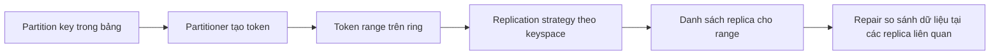
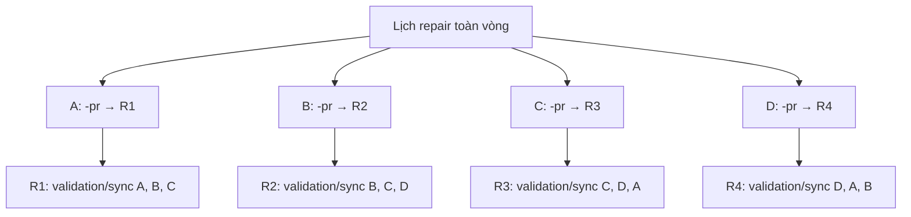
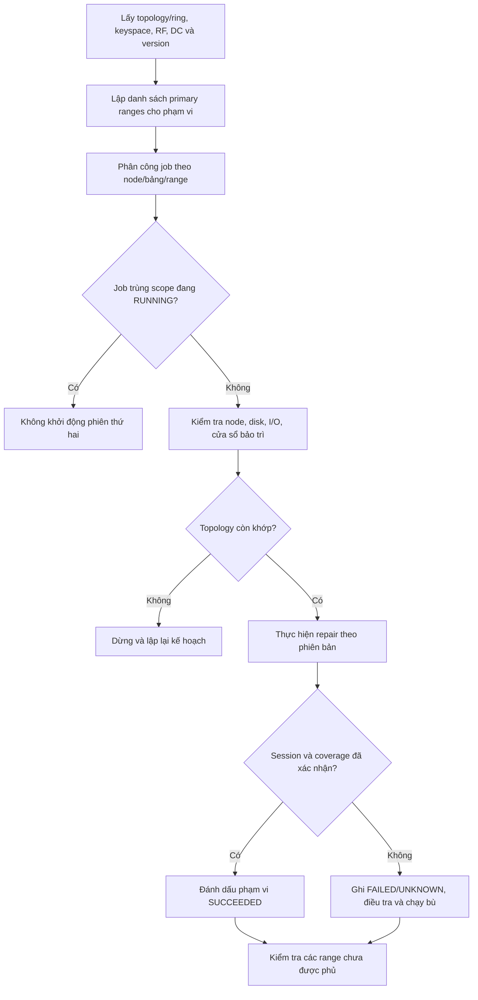
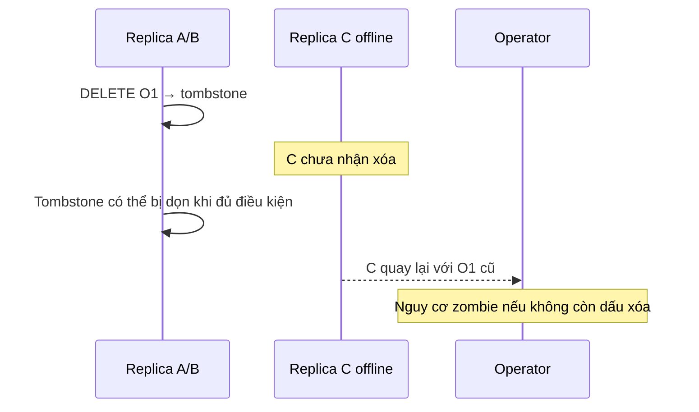

# Primary range repair và tránh thực hiện trùng không cần thiết trong Apache Cassandra

## Mục tiêu học tập

Apache Cassandra phân phối dữ liệu bằng **partition key**, **token**, **replication strategy** và **replication factor (RF)**. Vì một token range thường có nhiều replica, nếu mỗi node đều yêu cầu repair mọi range mà nó lưu, cùng một range có thể được đưa vào những phiên repair khác nhau nhiều lần. **Primary range repair** dùng lựa chọn `-pr` của `nodetool repair` nhằm thu hẹp phần range do *mỗi node khởi chạy lệnh* chịu trách nhiệm điều phối, từ đó hỗ trợ một lịch repair có ít phạm vi trùng nhau hơn.

Sau bài học, bạn có thể:

1. Phân biệt **primary range** với **toàn bộ range mà node lưu bản sao**, và phân biệt **node điều phối repair** với **các replica tham gia validation/sync**.
2. Giải thích cách `-pr` giúp tránh kiểm tra lặp trên cùng những token range khi lập lịch qua nhiều node; không nhầm `-pr` với “repair một replica”.
3. Lập bảng coverage đơn giản từ một ring RF = 3, sau đó mở rộng tư duy cho **vnodes**, nhiều bảng/keyspace và nhiều datacenter.
4. Đọc lệnh `nodetool repair -pr`, kiểm soát việc kết hợp `-full`, phạm vi keyspace/table và các lựa chọn token/DC tùy phiên bản.
5. Xây dựng lịch repair có **checkpoint, chống phiên chồng lấn, phát hiện range bị bỏ sót và xử lý node Down/thay đổi topology**.
6. Đo validation, streaming, I/O và độ trễ ứng dụng để xác nhận việc tránh trùng mang lại lợi ích thật, đồng thời bảo vệ chính sách tombstone/`gc_grace_seconds`.
7. Dùng CQL và Java Driver để minh họa partition key/token và phép đọc kiểm chứng có giới hạn, nhưng không nhầm CQL với anti-entropy repair.

> **Phạm vi phiên bản:** Các phiên bản/phân phối Cassandra có thể khác nhau về tùy chọn repair, mặc định full/incremental, phạm vi datacenter và cơ chế quản lý session. Những ví dụ `nodetool` dưới đây cần được đối chiếu với `nodetool help repair` của cluster thật trước khi thực hiện. Không chạy các phiên repair lớn chỉ vì một lệnh mẫu trông hợp lệ.

## 1. Vì sao repair có thể bị thực hiện trùng?

Giả sử keyspace `shop` có `NetworkTopologyStrategy`, RF = 3 trong datacenter `dc1`. Phân vùng đơn hàng `O1` được lưu ở ba node A, B, C.

Một mutation cập nhật `status = PAID` có thể được A/B nhận, trong khi C đang offline vẫn giữ `status = CREATED`. **Anti-entropy repair** so sánh dữ liệu ở những replica chịu trách nhiệm cùng token range và đồng bộ khác biệt, thường thông qua validation/Merkle trees và streaming khi cần.

Vấn đề xuất hiện khi vận hành nhiều node:

- Node A lưu bản sao của nhiều range.
- Node B cũng lưu một phần những range đó.
- Node C cũng vậy.
- Nếu chạy `nodetool repair shop` trên A, B rồi C với phạm vi mặc định bao gồm những range mà mỗi node có liên quan, một số range **có thể được repair lại** ở lần chạy kế tiếp dù vừa có phiên khác xử lý.

Lặp lại không có nghĩa các lệnh đều sai. Nhưng validation tốn CPU/đọc SSTable, coordinator và các replica phải tham gia phiên, và khi có chênh lệch còn có streaming cùng chi phí mạng/đĩa. Việc đặt lịch thiếu kiểm soát có thể gây **read/write latency tăng, compaction backlog, disk I/O cao** trong khi không tăng coverage tương ứng.

**Mục tiêu của `-pr` là giảm phạm vi được chọn lặp lại giữa những node chạy lịch**, không phải giảm RF từ 3 xuống 1 hay chỉ sửa bản sao trên node primary.

### Một câu hỏi phải hỏi trước khi lên lịch

“Chúng ta muốn mỗi **range logic** được xử lý đủ một lần theo kế hoạch, hay chỉ muốn chạy một lệnh trên mỗi **máy**?”

Hai mục tiêu không tương đương. Một máy có nhiều range; một range có nhiều replica; ở cụm dùng vnodes còn có thể có nhiều đoạn token nhỏ trên mỗi node.

## 2. Partition key → token → range → các replica

Khi CQL định nghĩa khóa chính, phần **partition key** quyết định cách Cassandra định tuyến hàng tới token và tập replica.

```sql
-- Giả sử keyspace shop đã tồn tại.
USE shop;

CREATE TABLE orders_by_id (
    order_id uuid PRIMARY KEY,
    customer_id uuid,
    status text,
    total_amount decimal,
    updated_at timestamp
);

CREATE TABLE orders_by_customer_month (
    customer_id uuid,
    order_month date,
    ordered_at timestamp,
    order_id uuid,
    status text,
    total_amount decimal,
    PRIMARY KEY ((customer_id, order_month), ordered_at, order_id)
) WITH CLUSTERING ORDER BY (ordered_at DESC, order_id ASC);
```

Ở `orders_by_id`, partition key là `order_id`. Ở `orders_by_customer_month`, partition key là **cả cặp `(customer_id, order_month)`**; `ordered_at` và `order_id` chỉ dùng làm clustering columns.

Với partitioner thường gặp là **Murmur3Partitioner**, khóa phân vùng được băm thành token trong không gian số nguyên 64-bit có dấu. **Token không mang nghĩa thời gian, thứ tự UUID hoặc giá trị nghiệp vụ**.



Một token range thường được biểu diễn bằng biên trái và biên phải theo quy ước vòng token, thường hiểu là **(start, end]**. Khi biên đi qua điểm cuối không gian token, range có thể **wrap around**. Đừng tự chia range bằng khoảng số mà không xét vòng, ownership và partitioner thật.

### Token quan sát được bằng CQL

```sql
-- Chỉ trả về token nếu hàng đang được truy vấn tồn tại.
SELECT order_id, token(order_id) AS partition_token
FROM orders_by_id
WHERE order_id = 11111111-1111-4111-8111-111111111111;

SELECT customer_id, order_month,
       token(customer_id, order_month) AS partition_token
FROM orders_by_customer_month
WHERE customer_id = 22222222-2222-4222-8222-222222222222
  AND order_month = '2026-11-01'
LIMIT 1;
```

Nếu muốn biết token của một khóa ngay cả khi không có hàng, có thể xây dựng bài thực hành với một hàng mẫu đã tạo trước, hoặc dùng thông tin partitioner/driver theo cách phù hợp. Không nên đoán token từ chuỗi UUID rồi lập lịch repair dựa trên con số đoán đó.

### Vì sao phạm vi repair còn phụ thuộc keyspace?

Cùng một token có thể có tập replica khác nhau giữa hai keyspace vì RF hoặc replication strategy khác nhau. Ví dụ `shop` có RF = 3 còn `analytics` có RF = 2, thì phạm vi phối hợp repair của chúng **không thể suy ra chỉ từ token**. Hãy ghi nhận **keyspace + table + token range + topology** cho mỗi công việc.

## 3. Primary range là gì và khác replica-owned range thế nào?

Ở mức khái niệm, một token range có một **primary owner/primary replica** theo cách sắp xếp ring và replication strategy, cùng các replica bổ sung để đạt RF. Khi một node chạy repair thông thường trên các range mà nó lưu, phạm vi đó có thể bao gồm **những range nó là replica thứ hai/thứ ba**.

Khi chạy `nodetool repair -pr`, lựa chọn primary range giới hạn **những range được node ấy khởi phát repair** theo ngữ nghĩa `-pr` của Cassandra và topology. Đây là công cụ để chia vòng token ra những nhiệm vụ ít trùng lặp hơn khi lên lịch.

| Khái niệm | Ý nghĩa | Hiểu sai cần tránh |
| --- | --- | --- |
| **Primary range của node A** | Các range mà A giữ vai trò primary theo ring/topology liên quan | “Chỉ dữ liệu A được so sánh” |
| **Replica-owned ranges của A** | Tất cả range mà A lưu dữ liệu do replication | “Mọi range này đều có primary là A” |
| **Node điều phối** | Node nhận lệnh và tổ chức phiên repair cho phạm vi chọn | “Coordinator là replica duy nhất tham gia” |
| **Replica tham gia** | Những node cần validation/sync cho range được chọn | “`-pr` bỏ qua replica thứ hai/thứ ba” |
| **Coverage toàn ring** | Hợp của các range được hoàn tất trong lịch, đủ cho phạm vi đích | “Có một command thành công là đủ” |

**Điểm then chốt:** `-pr` thay đổi **phần range được yêu cầu sửa khi gọi lệnh trên một node**. Khi phạm vi chứa một range và cần so sánh các replica của range ấy, repair vẫn có thể phải phối hợp **nhiều replica**, theo replication policy và tùy chọn repair.

### Ví dụ ring đơn giản với bốn node, RF = 3

Để dễ hình dung, giả sử có **một DC, một token/node** và bốn vùng ring R1–R4. Đây là mô hình học tập, không phải metadata của một cluster thực có vnodes.

| Range logic | Node primary giả định | Các replica giả định (RF = 3) |
| --- | --- | --- |
| **R1** | A | A, B, C |
| **R2** | B | B, C, D |
| **R3** | C | C, D, A |
| **R4** | D | D, A, B |

Nếu chạy repair **mọi replica-owned range** trên từng node:

| Node chạy lệnh | Những range node lưu replica |
| --- | --- |
| A | R1, R3, R4 |
| B | R1, R2, R4 |
| C | R1, R2, R3 |
| D | R2, R3, R4 |

Như vậy, nếu mỗi node đều quét toàn bộ những range nó lưu trong lịch riêng, **mỗi R có thể xuất hiện ba lần**. Có bốn range logic nhưng lịch chứa tổng cộng 4 × 3 = **12 lượt chọn range**. Đây là phép đếm khái niệm, không phải số file được streamed, không phải số phiên repair chính xác do nội bộ Cassandra tạo ra.

Nếu thay bằng một lịch **primary range**:

| Node chạy `-pr` | Range được phân công theo ví dụ |
| --- | --- |
| A | R1 |
| B | R2 |
| C | R3 |
| D | R4 |

Lịch chỉ còn **bốn lượt chọn range logic**. Trong phiên xử lý R1 từ A, các replica **B và C vẫn liên quan**; không phải R1 chỉ được so sánh trên A.



Không được suy ra rằng chi phí thực sẽ giảm chính xác **3 lần**. Với incremental repair, các phiên chạy lại có thể chỉ thấy ít dữ liệu unrepaired; với full repair, validation trên dữ liệu lớn có thể chiếm ưu thế. Chi phí còn phụ thuộc số SSTable, mức sai lệch, streaming, vnodes và phiên bản.

## 4. Vnodes làm bài toán coverage phức tạp hơn ra sao?

Phần lớn cụm Cassandra không có một token duy nhất trên mỗi node mà dùng **virtual nodes (vnodes)**. Một node có thể giữ nhiều token, tương ứng nhiều đoạn range rải trên ring.

Ví dụ node A có các primary ranges `R1, R9, R17` và đồng thời lưu replica của nhiều range do B/C/D làm primary. Khi dùng `-pr` trên A, phạm vi bao gồm **tập các primary ranges thích hợp của A**, không phải một đoạn token liên tiếp có thể mô tả bằng một con số start/end đơn giản.

Các hệ quả vận hành:

1. **Một command có thể chứa nhiều range.** Thống kê “repair A thành công” chưa thay thế được thông tin những range/bảng thực sự đã hoàn tất khi xảy ra lỗi giữa chừng.
2. **Ownership thay đổi khi topology thay đổi.** Bootstrap, decommission, replace, move hoặc đổi token có thể làm range trước đây thuộc A nay có primary khác.
3. **Keyspace quyết định replica set.** Không áp cùng một giả định RF/replica cho các keyspace khác nhau.
4. **Độ lớn range không đồng đều về dữ liệu.** Token chia phân bố hash, nhưng một range có thể có nhiều SSTable, tombstone hoặc workload nóng hơn range khác.
5. **Lịch theo DC cần hiểu cách chọn primary.** Ở nhiều DC và `NetworkTopologyStrategy`, phạm vi primary và những node tham gia phụ thuộc replication/topology cùng các tùy chọn giới hạn DC; không sao chép lịch từ single-DC sang multi-DC mà không xác minh.

Vì vậy, bộ điều phối repair nên quản lý **một ảnh chụp topology/ring và kỳ lập lịch cụ thể**, rồi xác minh các node/range trước khi chạy. Không hard-code token ranges từ vài tháng trước.

## 5. Khi nào `-pr` giảm trùng, và khi nào vẫn còn chi phí lặp?

### Trùng ở cấp điều phối range

Nếu từng node tự chạy full repair cho mọi range nó lưu, những range có RF > 1 thường được chọn lặp qua các node. Primary-range scheduling giảm sự trùng ấy **nếu lịch bao phủ đúng mỗi primary range trong phạm vi và không tạo phiên khác đè lên**.

### Chi phí không biến mất

Một range với RF = 3 vẫn có thể cần ba replica tham gia validation/sync, dù coordinator chỉ là node primary. Không thể lấy 12 → 4 lượt chọn range trong bảng minh họa rồi nói “số bytes cần kiểm tra giảm từ ba bản sao xuống một bản sao”. Việc so sánh các replica vẫn là mục tiêu repair.

### Những trường hợp vẫn có sự lặp

- Hai scheduler/đội vận hành cùng khởi chạy `-pr` trên một node hoặc cùng kỳ mà không có khóa điều phối.
- Một phiên `-pr` đang chạy trong khi tác vụ repair khác cũng chọn range đó bằng `-st`/`-et` hoặc cách chọn mặc định.
- Lịch chạy lại nhiều lần trong cửa sổ ngắn mà không biết phiên trước đã thành công.
- Topology thay đổi giữa lúc tạo job và lúc chạy; hai owner khác nhau trong hai ảnh ring có thể cùng đưa một range vào lịch.
- Nhiều datacenter với các lựa chọn repair scope không nhất quán, làm phần so sánh giữa những replica/DC bị lặp hoặc bị bỏ sót.
- Hai keyspace khác nhau có range số học giống nhau; **đây không phải cùng đơn vị dữ liệu**, nên không được “khử trùng” giữa keyspace khác nhau.

**Mục tiêu chính xác là tránh repair trùng không cần thiết**, không phải cấm mọi lần lặp. Có trường hợp cần chạy lại vì phiên trước thất bại, trạng thái không chắc chắn hoặc cần **full repair** để kiểm tra dữ liệu đã repaired.

## 6. Lệnh `nodetool repair -pr` và phạm vi lựa chọn

Các lệnh dưới đây minh họa cách suy luận scope. **Không thực thi đồng thời trên production** nếu chưa có runbook, kiểm tra cluster và giới hạn tải.

### 6.1. Kiểm tra phiên bản, ring và trạng thái cluster

```bash
# Kiểm tra cú pháp và mặc định repair của phiên bản thực tế.
nodetool help repair

# Kiểm tra node Up/Down, DC, trạng thái ring.
nodetool status

# Kiểm tra thông tin ring/range liên quan tới keyspace shop.
nodetool ring shop

# Tình trạng hoạt động streaming/compaction khi cần đánh giá tải.
nodetool netstats
nodetool compactionstats
```

Lệnh `nodetool ring shop` hỗ trợ quan sát token/ring, nhưng cách hiển thị ownership có thể khó diễn giải ở cluster nhiều vnodes. Phải kết hợp replication strategy, RF, DC/rack và metadata thực tế; đừng suy coverage chỉ từ phần trăm ownership in ra trên một node.

### 6.2. Primary-range repair cho một bảng

```bash
# Chạy trên MỘT node đã được phân công trong lịch.
# Chỉ chọn primary ranges của node ấy cho bảng orders_by_id.
nodetool repair -pr shop orders_by_id
```

Nếu muốn phủ toàn bộ `shop.orders_by_id` trên ring, bạn phải có lịch cho **những node cần thiết** theo topology và xác minh tất cả primary ranges đích đã thành công. Thành công trên node A **không** đồng nghĩa primary ranges của B/C/D cũng được xử lý.

### 6.3. Primary-range repair cho một keyspace

```bash
# Phạm vi bảng rộng hơn nhưng vẫn là primary ranges của node chạy.
nodetool repair -pr shop
```

Khác với lệnh chỉ một bảng, lệnh này có thể bao phủ nhiều bảng trong `shop` theo ngữ nghĩa của phiên bản. Cần kiểm tra số lượng bảng và kích thước từng bảng; một keyspace có bảng rất lớn có thể biến một cửa sổ bảo trì ngắn thành công việc kéo dài.

### 6.4. Full repair trên primary ranges

```bash
# Full = chọn tập dữ liệu cần validation;
# -pr = chọn phạm vi token do node này điều phối.
nodetool repair -full -pr shop orders_by_id
```

Hai tùy chọn giải quyết **hai chiều khác nhau**:

- `-full`: trong những phiên bản có hỗ trợ, yêu cầu repair toàn bộ dữ liệu phù hợp với phạm vi đã chọn, kể cả repaired/unrepaired theo cơ chế phiên bản.
- `-pr`: giới hạn phạm vi token thành primary ranges của node điều phối.

Không hiểu lệnh này là “full repair toàn cluster”. Nếu một số phiên bản hạn chế tổ hợp cờ hoặc thay mặc định incremental/full, phải làm theo `nodetool help repair` tương ứng.

### 6.5. Repair theo start/end token là phương án khác, không mặc định tương đương `-pr`

Một số phiên bản hỗ trợ `-st`/`-et` để chỉ định biên token:

```bash
# CHỈ MINH HỌA; token không lấy từ cluster thật.
# Lệnh này không có -pr: giới hạn theo start/end cụ thể.
nodetool repair -full -st 100000000000 -et 200000000000 \
  shop orders_by_id
```

Khi chọn token range thủ công phải xác định partitioner, biên, wrap-around, node có thể điều phối và các replica liên quan. **Không kết hợp `-pr` với `-st`/`-et` hoặc các lựa chọn DC/host nếu help của phiên bản không xác nhận ngữ nghĩa và tính tương thích.**

### 6.6. Bảng tóm tắt

| Cách gọi minh họa | Phạm vi bảng | Phạm vi token | Điều không được suy ra |
| --- | --- | --- | --- |
| `repair shop orders_by_id` | Một bảng | Các range thuộc phạm vi mặc định của node/chế độ | Đã phủ toàn ring |
| `repair -pr shop orders_by_id` | Một bảng | Primary ranges của node | Chỉ kiểm tra dữ liệu của một replica |
| `repair -pr shop` | Các bảng được lựa chọn của keyspace | Primary ranges của node | Đã repair mọi keyspace |
| `repair -full -pr shop orders_by_id` | Một bảng | Primary ranges của node | Full ring vì có cờ `-full` |
| `repair -st … -et … shop orders_by_id` | Một bảng | Phạm vi token thủ công | Bao phủ mọi replica/range ngoài khoảng |

## 7. Full, incremental và tác động của repair lặp

**Primary-range scheduling không thay thế việc chọn chế độ repair.**

### Incremental repair

Incremental repair thường tập trung dữ liệu **chưa được đánh dấu repaired** trong phạm vi chọn, rồi quản lý trạng thái SSTable repaired/unrepaired và có thể cả pending repair. Các lần repair lặp có thể không validation lại toàn bộ repaired data, nhưng vẫn có chi phí điều phối, validation phần unrepaired và metadata.

Nếu hai phiên incremental chồng lên cùng range/bảng, chúng có thể tranh chấp tài nguyên và có những hạn chế phiên đang hoạt động. Do đó **không nên cố tình chạy trùng** chỉ vì nghĩ rằng incremental sẽ “không tốn thêm gì”.

### Full repair

Full repair xét dữ liệu trong phạm vi rộng hơn, thường gồm cả phần đã được đánh dấu repaired, và có thể tốn validation/I/O đáng kể. Chạy full repair cùng range trên ba node trong ví dụ RF = 3 có nguy cơ thực hiện lặp nhiều công việc; đây là tình huống mà lịch primary ranges có thể giúp tiết kiệm.

Nhưng full repair trên primary ranges của một node vẫn cần lịch phủ hết các primary ranges khác. Nó cũng không tự đánh dấu mọi SSTable unrepaired thành repaired theo cách của incremental.

### Một phép ước lượng không được lạm dụng

Giả sử một ring có 100 primary ranges, RF = 3, dữ liệu phân bố tương đối đều:

- Lịch quét mọi replica-owned range ở từng node có thể chứa xấp xỉ **300 lượt chọn range**.
- Lịch primary-range hợp lý có thể giảm xuống xấp xỉ **100 lượt chọn range**.

Đây là phép ước lượng **số lần một range được đưa vào lịch**, không phải dự đoán CPU, byte validation, byte stream hoặc thời gian chạy. Thời gian còn phụ thuộc kích thước range, SSTable, sai khác replica, chống chồng lấn, compaction, mạng và phiên bản Cassandra.

## 8. Lập lịch có coverage để không bỏ range

Một lịch repair có trách nhiệm phải chứng minh được **những range nào đã hoàn tất trên những bảng/keyspace nào**, không chỉ “đã SSH vào tất cả node”.

### 8.1. Định nghĩa đơn vị công việc

Một bản ghi lịch tối thiểu có thể chứa:

| Trường | Ý nghĩa |
| --- | --- |
| `cluster_id`, `ring_epoch` | Cluster và ảnh chụp topology/token ownership mà lịch dựa trên |
| `datacenter_scope` | DC/replica scope thực tế của phiên repair |
| `keyspace`, `table` | Đúng bảng cần được kiểm tra |
| `range_start`, `range_end` hoặc `range_id` | Token range logic, với quy ước biên/wrap-around |
| `primary_coordinator` | Node được phân công khởi chạy `-pr` hoặc cơ chế sửa thích hợp |
| `repair_mode` | Full hay incremental theo phiên bản |
| `state` | PLANNED, RUNNING, SUCCEEDED, FAILED, RETRY_REQUIRED |
| `started_at`, `finished_at` | Thời gian và deadline |
| `session_id`/`command_id`, `attempt` | Truy vết session thực thi và số lần thử |
| `validated_bytes`, `streamed_bytes`, `error` | Dữ liệu vận hành và lý do thất bại |

Một lệnh `-pr` có thể bao phủ **nhiều range trong một lần**, nên lịch cần liên kết kết quả command với tập range mong đợi. Với lỗi giữa chừng, đừng tự giả định toàn bộ range đều đã thành công nếu chỉ một phần đã được xác nhận.

### 8.2. Ba điều kiện coverage

Cho mỗi tập dữ liệu đích, cần kiểm chứng:

1. **Không bỏ sót:** hợp của các range thành công phải bao phủ toàn bộ token ranges cần repair.
2. **Không trùng không cần thiết:** một range không có nhiều phiên active chồng nhau ở cùng mode/scope trừ khi có lý do được ghi nhận.
3. **Đúng phiên bản ring:** token ownership/DC/RF tại thời điểm thực thi khớp kế hoạch, hoặc có quy trình đánh giá lại nếu đã đổi.

Biểu diễn khái niệm:

\[
R_{\mathrm{target}}
\subseteq
\bigcup_{j \in \mathrm{SUCCEEDED}} R_j
\]

Và khi lập lịch tối ưu, những phần giao giữa các `R_j` đang chạy cùng lúc nên được giới hạn theo chính sách. Đừng biến yêu cầu “không lặp” thành một công thức cứng ngăn **chạy bù hợp lệ** sau lỗi.

### 8.3. Quy trình scheduler đề xuất



Một số thao tác quan trọng:

- Chỉ có **một scheduler/điều phối có thẩm quyền** hoặc có cơ chế lock/lease thích hợp. Lock chỉ ở một instance mà không hỗ trợ failover chưa đủ bảo đảm.
- Lấy topology thật **trước khi** lập lịch, không sao chép danh sách token cũ.
- Tách job theo bảng hoặc nhóm bảng nếu giúp điều tiết tải.
- Giới hạn số phiên validation/streaming đồng thời dựa trên khả năng từng node, rack và DC.
- Chỉ đánh dấu `SUCCEEDED` sau khi phiên báo thành công và đối chiếu phạm vi, không chỉ vì lệnh không còn chạy.
- Nếu token membership thay đổi, dừng những job có scope không còn phù hợp và xác định lại coverage.

### 8.4. Ví dụ danh sách kế hoạch cho ring bốn node

| Keyspace | Table | Range | Coordinator | Mode | Kết quả |
| --- | --- | --- | --- | --- | --- |
| `shop` | `orders_by_id` | R1 | A | Full | SUCCEEDED |
| `shop` | `orders_by_id` | R2 | B | Full | SUCCEEDED |
| `shop` | `orders_by_id` | R3 | C | Full | FAILED |
| `shop` | `orders_by_id` | R4 | D | Full | PLANNED |

Không được tuyên bố bảng đã repair xong vì **hai trên bốn job thành công**. Trong trường hợp này, R3 cần điều tra/chạy bù; R4 còn chưa chạy. Đồng thời, nếu keyspace `shop` có bảng khác, coverage của `orders_by_id` không thay thế coverage bảng ấy.

## 9. Nhiều datacenter và NetworkTopologyStrategy

Với Cassandra đa DC, keyspace có thể khai báo RF riêng cho từng datacenter. Một token range có thể có nhiều replica trong `dc1` và nhiều replica trong `dc2`, với vai trò/routing phù hợp.

Đây là lý do **không nên rập khuôn** lịch single-DC:

- `LOCAL_QUORUM` của ứng dụng chỉ yêu cầu replica trong DC cục bộ theo RF ở DC đó; không có nghĩa mọi replica ở DC khác đã nhận mỗi mutation.
- Các cờ repair giới hạn datacenter/host hoặc local repair có thể thay đổi **tập replica tham gia**. Nếu muốn so sánh liên DC, không được chỉ chạy local mà tuyên bố dữ liệu hai DC đã hội tụ.
- Primary range được chọn theo cách metadata/replica placement và tùy chọn repair hiểu trong **phiên bản triển khai**. Một mô hình “mỗi range chỉ một owner toàn cầu” ở ví dụ đơn giản không thể dùng nguyên xi để suy coverage đa DC.
- Repair qua WAN có chi phí băng thông, độ trễ và nguy cơ ảnh hưởng ứng dụng; việc giới hạn vào một DC có thể là quyết định cần thiết, nhưng phải ghi rõ **bảo đảm nào không được kiểm tra**.
- Khi thay node, mở thêm DC hoặc thay RF, cần kế hoạch dữ liệu/streaming/repair đặc thù, không chỉ gọi `-pr` theo danh sách node cũ.

Với production, hãy lập một **ma trận keyspace × DC × replica scope × token range × mode** từ topology thực, kiểm tra các tùy chọn repair được hỗ trợ rồi mới chọn lịch. Điều quan trọng là **đích nhất quán cần đạt** và bằng chứng coverage, không phải số lần chạy `nodetool`.

## 10. Khi node primary vắng mặt hoặc topology thay đổi

### 10.1. Node được phân công primary đang Down

Giả sử R3 được phân công cho node C, nhưng C bị offline.

**Không** chuyển ngay job R3 thành “đã hoàn thành” chỉ vì A/D (những replica khác) vẫn đọc được dữ liệu. C đang có thể là replica bỏ lỡ ghi, và khi C trở lại nó cần quy trình hội tụ theo chính sách.

Các hướng xử lý:

1. Đánh dấu job `BLOCKED/RETRY_REQUIRED`, ghi rõ thời điểm Down và phạm vi R3.
2. Điều tra nguyên nhân; nếu node còn có thể khôi phục an toàn, xử lý cluster health trước rồi tiếp tục repair.
3. Nếu cần điều phối từ node khác, xem xét **repair giới hạn token range** hoặc quy trình chuyên biệt được phiên bản hỗ trợ, nhưng phải xác minh node mới có thể xử lý đúng replica set và phạm vi. `-pr` trên A **không tự đổi primary range của C thành primary range của A**.
4. Nếu C offline quá lâu, đánh giá riêng nguy cơ tombstone/zombie và quy trình replace/rebuild/restore, không mặc định một lần repair là đủ.
5. Sau khi topology thay đổi, **lập lại danh sách coverage**; bản kế hoạch cũ có thể không còn đúng.

### 10.2. Thay node hoặc thay RF

Từ ring ban đầu R1–R4, khi node E được thêm hoặc C bị thay, Cassandra có thể chia lại ownership và replica placement. Một command `-pr` trên A tại thời điểm cũ không bảo đảm tương ứng chính xác với primary ranges hiện hành.

Một bản kế hoạch có `ring_epoch`/topology version có thể giúp kiểm tra sự thay đổi:

- Nếu topology còn ổn định, tiếp tục theo lịch.
- Nếu khác, đối chiếu range đã thành công, tái phân hoạch nhiệm vụ theo metadata mới.
- Với bootstrap/decommission/rebuild, dùng runbook dữ liệu chuyên biệt theo phiên bản; **repair không thay thế mọi thao tác chuyển dữ liệu**.

### 10.3. Phiên repair thất bại giữa chừng

Một phiên repair có thể thất bại ở validation, streaming hoặc finalization. Đặc biệt với incremental repair, có thể có `pending repair` và metadata SSTable chưa được xử lý xong.

Đừng xử lý bằng cách chạy cùng lệnh liên tục trên nhiều node. Hãy:

1. Ghi lệnh, mode, keyspace, table, token ranges, session ID và những node tham gia.
2. Đọc log/metrics xác định giai đoạn lỗi, dung lượng đĩa, mạng và compaction.
3. Phân biệt phần phạm vi **đã xác nhận thành công** với phần còn `FAILED/UNKNOWN`.
4. Giải quyết session/pending state bằng công cụ được phiên bản hỗ trợ; không tự sửa SSTable metadata.
5. Chạy bù đúng phạm vi, không vì một lần lỗi mà lặp toàn ring nếu không cần thiết và chưa đánh giá.

## 11. Tombstone và thời hạn repair an toàn

Cassandra dùng **tombstone** để biểu diễn xóa hàng/cell/partition và dữ liệu hết TTL. Tombstone cần tồn tại và được các replica nhận biết đủ lâu để một replica từng bỏ lỡ lệnh xóa không đưa dữ liệu cũ trở lại.

Tình huống:

1. A và B đã nhận `DELETE O1`, C offline.
2. A/B giữ tombstone, C còn bản O1 cũ.
3. Nếu tombstone trên A/B bị dọn bởi compaction sau những điều kiện thời gian/an toàn mà C vẫn chưa được xử lý, C có thể quay lại với bản O1 cũ.
4. Khi thông tin xóa cần thiết đã mất, O1 có nguy cơ **zombie data**.



`gc_grace_seconds` là một thành phần trong chính sách giữ tombstone. Nó **không** phải lời hứa “sẽ xóa vật lý đúng thời điểm T”: việc purge còn phụ thuộc SSTable, compaction và các điều kiện khác. Không tự hạ grace để giảm số tombstone khi repair chưa đủ tin cậy.

### Primary-range scheduling và tombstone

Nếu dùng lịch `-pr` nhưng quên primary range R3, thì **các replica của R3 có thể không được đồng bộ trong chu kỳ**. Nguy cơ không được chữa bằng việc R1/R2 đã repair đi repair lại. Vì vậy giảm trùng chỉ có giá trị khi **coverage đầy đủ** và hoàn tất đủ thường xuyên so với chính sách an toàn của dữ liệu xóa.

Khi node vắng mặt vượt khoảng an toàn của tombstone, không mặc định cho nó tham gia lại và chạy repair một lần; cần cân nhắc quy trình replace/rebuild/restore và kiểm tra khả năng còn đủ bằng chứng xóa theo phiên bản/cluster thực tế.

## 12. Chi phí vận hành: tránh trùng nhưng không giảm coverage

Một kế hoạch tốt phải giảm **work không tạo thêm giá trị**, đồng thời giữ an toàn và chất lượng ứng dụng.

### Những chỉ số quan trọng

| Nhóm | Metric hoặc thông tin | Cách sử dụng |
| --- | --- | --- |
| Coverage | Tỷ lệ keyspace/table/token ranges đã `SUCCEEDED` | Phát hiện phần chưa repair |
| Redundancy | Số job trùng scope và khoảng thời gian chồng lấn | Phát hiện scheduler/lệnh ngoài kế hoạch |
| Repair duration | Thời gian từng command/range/bảng | Ước lượng cửa sổ bảo trì |
| Validation | Bytes validated, thời gian xây/so sánh Merkle trees | Tìm range/bảng tốn I/O |
| Streaming | Bytes streamed, throughput, lỗi mạng | Đo sai lệch và băng thông |
| SSTables | Repaired/unrepaired/pending khi phiên bản hỗ trợ | Phân tích incremental và pending |
| Cluster health | Disk free, compaction backlog, dropped messages | Đánh giá khả năng chịu repair |
| Ứng dụng | Read/write latency p95/p99, timeout, error rate | Bảo vệ trải nghiệm người dùng |
| Tombstone | Tuổi lần repair thành công so với chính sách grace | Cảnh báo rủi ro node bỏ lỡ xóa |
| Topology | Epoch/thay đổi node, RF, datacenter | Vô hiệu hóa kế hoạch cũ khi cần |

### Không suy chi phí chỉ từ số phiên

Giả sử lịch không dùng `-pr` có 12 lượt chọn range và lịch `-pr` có 4 trong mô hình bốn node. Nếu validation trên mỗi lần repair tiêu thụ I/O lớn, lịch mới **có thể tiết kiệm đáng kể**. Nhưng nếu có nhiều range rất nhỏ, nhiều dữ liệu đã repaired và ít phần unrepaired, phần giảm thực tế có thể thấp hơn; đồng thời các replica vẫn phải tham gia xử lý range được chọn.

Hãy so sánh trên **cùng tập dữ liệu và phạm vi coverage**, trong cửa sổ tải tương đương, không kết luận chỉ từ việc số lệnh ít hơn. Cần so p95/p99 latency, tổng bytes validated, bytes streamed, disk/network, thời gian và số lỗi.

### Cơ chế tránh chạy trùng

- Dùng **một nơi phân công có thẩm quyền** và khóa công việc phù hợp với `cluster/ring_epoch/keyspace/table/repair_scope/mode`.
- Khóa có **lease/fencing** khi có nhiều scheduler hoặc failover; lock vĩnh viễn không tự xử lý worker chết.
- Không khởi chạy hai job chồng range khi không có chủ đích, kể cả trên hai node khác nhau.
- Duy trì nhật ký phiên, tránh coi “timeout từ công cụ điều phối” tương đương “repair chắc chắn chưa chạy”.
- Khi phạm vi đã thành công trong kỳ, đừng phát lại chỉ vì một node mới được thêm vào danh sách nếu ownership thực tế không thay đổi; khi có đổi topology, tính lại đúng.
- Có chính sách chạy bù và giới hạn retry để không biến lỗi tạm thời thành bão validation/streaming.

## 13. Java Driver: quan sát hàng, không giả làm scheduler repair

CQL và Java Driver có thể giúp xác minh đường đọc ứng dụng và kiểm tra partition key. Nhưng **không có câu SELECT CQL thông thường** thay được việc so sánh dữ liệu ở mọi replica trong một token range; anti-entropy repair thuộc công cụ vận hành cluster.

### 13.1. Dữ liệu thử nghiệm bằng CQL

```sql
USE shop;

INSERT INTO orders_by_id (
    order_id, customer_id, status, total_amount, updated_at
) VALUES (
    11111111-1111-4111-8111-111111111111,
    22222222-2222-4222-8222-222222222222,
    'CREATED', 250000.00, '2026-11-21T01:00:00Z'
);

UPDATE orders_by_id
SET status = 'PAID', updated_at = '2026-11-21T01:05:00Z'
WHERE order_id = 11111111-1111-4111-8111-111111111111;
```

Một câu đọc có khóa phân vùng rõ ràng:

```sql
SELECT order_id, status, total_amount
FROM orders_by_id
WHERE order_id = 11111111-1111-4111-8111-111111111111;
```

### 13.2. Java Driver 4.x: read probe cho một partition

```java
import com.datastax.oss.driver.api.core.CqlSession;
import com.datastax.oss.driver.api.core.DefaultConsistencyLevel;
import com.datastax.oss.driver.api.core.cql.PreparedStatement;
import com.datastax.oss.driver.api.core.cql.Row;

import java.math.BigDecimal;
import java.util.UUID;

public final class OrderReplicaProbe {
    public record OrderState(UUID orderId, String status, BigDecimal total) {}

    private final CqlSession session;
    private final PreparedStatement select;

    public OrderReplicaProbe(CqlSession session) {
        this.session = session;
        this.select = session.prepare(
            "SELECT order_id, status, total_amount " +
            "FROM shop.orders_by_id WHERE order_id = ?");
    }

    public OrderState readAtLocalQuorum(UUID orderId) {
        Row row = session.execute(
            select.bind(orderId)
                .setConsistencyLevel(DefaultConsistencyLevel.LOCAL_QUORUM)
        ).one();

        if (row == null) {
            return null;
        }
        return new OrderState(
            row.getUuid("order_id"),
            row.getString("status"),
            row.getBigDecimal("total_amount")
        );
    }
}
```

- Với RF/topology phù hợp, `LOCAL_QUORUM` cho phép đọc từ một quorum cục bộ; nếu không có đủ replica khả dụng, truy vấn có thể lỗi.
- Đọc một hàng ở quorum **không chứng minh** toàn bộ các replica/range đã repair. Cassandra có thể phục vụ một truy vấn bằng tập replica khác nhau hoặc thực hiện sửa trên đường đọc tùy cấu hình/phiên bản.
- Driver không tự đánh dấu SSTable repaired, không thay `nodetool repair` và không kiểm chứng coverage `-pr`.
- Một bảng đọc dẫn xuất sai so với nguồn vì ứng dụng quên fan-out cần **application reconciliation**, không phải chạy `-pr` cho tới khi hai bảng có cùng dữ liệu nghiệp vụ.

### 13.3. Java 17: kiểm tra kế hoạch coverage sau khi đã thu thập metadata

Để minh họa việc **xác nhận đủ range**, đoạn mã độc lập bên dưới kiểm tra một danh sách `rangeId` đã được định nghĩa từ metadata ring và kết quả session do hệ thống điều phối thu thập. Nó **không tự đọc token topology hay chạy repair**:

```java
import java.util.List;
import java.util.Map;
import java.util.Set;
import java.util.stream.Collectors;

public final class RepairCoverageCheck {
    public record JobResult(
        String keyspace,
        String table,
        String rangeId,
        String ringEpoch,
        String status
    ) {}

    // expectedRanges lấy từ snapshot topology đúng epoch
    // và đúng keyspace/table/datacenter scope.
    public static Set<String> missing(
            String keyspace,
            String table,
            String ringEpoch,
            Set<String> expectedRanges,
            List<JobResult> results) {

        Set<String> completed = results.stream()
            .filter(j -> j.keyspace().equals(keyspace))
            .filter(j -> j.table().equals(table))
            .filter(j -> j.ringEpoch().equals(ringEpoch))
            .filter(j -> "SUCCEEDED".equals(j.status()))
            .map(JobResult::rangeId)
            .collect(Collectors.toSet());

        return expectedRanges.stream()
            .filter(range -> !completed.contains(range))
            .collect(Collectors.toSet());
    }

    public static void main(String[] args) {
        Set<String> expected = Set.of("R1", "R2", "R3", "R4");
        List<JobResult> rows = List.of(
            new JobResult("shop", "orders_by_id", "R1", "e42", "SUCCEEDED"),
            new JobResult("shop", "orders_by_id", "R2", "e42", "SUCCEEDED"),
            new JobResult("shop", "orders_by_id", "R3", "e42", "FAILED"),
            new JobResult("shop", "orders_by_id", "R4", "e42", "PLANNED")
        );
        System.out.println(missing(
            "shop", "orders_by_id", "e42", expected, rows));
        // [R3, R4] theo thứ tự xuất của Set (không bảo đảm thứ tự).
    }
}
```

Ví dụ này chỉ minh họa **so sánh tập range danh nghĩa**. Với production, một command `-pr` có thể bao phủ nhiều đoạn, các biên token có thể khác nhau giữa các epoch, kết quả thành công có thể cần xác nhận theo session/replica scope. Đừng chuyển một dòng `SUCCEEDED` thành bằng chứng bao phủ đầy đủ khi công cụ không cung cấp kết quả ở độ phân giải range cần thiết. Ngoài ra, tập range kỳ vọng phải được tạo từ **metadata đúng phiên bản ring**, không tự hard-code `R1–R4`.

## 14. Runbook triển khai lịch primary-range repair

### Bước 1 — Lập phạm vi và tiền điều kiện

Ghi lại:

- Cassandra version, phân phối, partitioner, vnodes và topology.
- Keyspace/table cần repair; RF, strategy và DC/rack.
- Những node `UN`, những node Down/Joining/Leaving, node được thay gần đây.
- Chế độ full/incremental và những cờ có hỗ trợ.
- Dung lượng đĩa trống, compaction backlog, mạng, p95/p99 read/write latency.
- Thời gian offline của replica so với tombstone grace và lịch repair thành công gần nhất.

### Bước 2 — Thiết kế coverage

Tạo các công việc primary-range cho mỗi bảng/keyspace ở phạm vi cần xử lý, gắn ring epoch, coordinator và replication/DC scope. Kiểm tra **không bỏ sót, không trùng không cần thiết**.

### Bước 3 — Kiểm tra command trên cụm thật

```bash
nodetool help repair
nodetool status
nodetool ring shop
```

Dựa trên phiên bản, chọn lệnh một bảng trên một node, ví dụ:

```bash
# Chỉ thực hiện sau khi đánh giá tiền điều kiện và phân công.
nodetool repair -pr shop orders_by_id
```

### Bước 4 — Điều tiết và giám sát

- Giới hạn số repair đồng thời sao cho không nhiều phiên tranh cùng replica/rack.
- Theo dõi validation/streaming, compaction, disk/network, timeout và p95/p99 ứng dụng.
- Ghi session, scope, thời điểm, exit status và những lỗi xuất hiện.
- Nếu cụm bị quá tải, ưu tiên ổn định; không nhân đôi phiên repair chỉ để tăng số command chạy.

### Bước 5 — Xử lý lỗi và đối chiếu coverage

Từ kết quả từng job, xác định range chưa được xử lý. Nếu coordinator Down hoặc topology đổi, lập lại kế hoạch theo metadata mới; nếu phiên incremental bị lỗi, giải quyết pending state theo công cụ được hỗ trợ trước khi khởi động thêm. Chỉ chạy bù đúng phạm vi được xác nhận chưa hoàn tất.

### Bước 6 — Kết thúc chu kỳ

Báo cáo **coverage theo keyspace/table/range/DC/mode**, những lần retry, tổng bytes validated/streamed và ảnh hưởng ứng dụng. So với lịch sửa cần thiết trước khi `gc_grace_seconds` trở thành rủi ro cho replica từng bỏ lỡ xóa. Chỉ đánh dấu kỳ hoàn thành nếu không còn khoảng hở cần xử lý.

## 15. Sai lầm thường gặp

| Sai lầm | Hệ quả | Cách tránh |
| --- | --- | --- |
| “`-pr` repair đúng một replica.” | Không hiểu mục tiêu đối chiếu nhiều bản sao | Phân biệt coordinator/range selection với replica tham gia |
| “Chạy `-pr` trên A là xong cluster.” | Primary ranges của node khác chưa được làm | Có lịch phủ toàn bộ ring |
| “Chạy tất cả node theo lịch là đủ, không cần log range.” | Lỗi nửa chừng hoặc topology thay đổi có thể làm thiếu coverage | Ghi scope, session và trạng thái từng phần |
| “Full repair + `-pr` nghĩa là full cluster.” | Chỉ kiểm tra toàn dữ liệu thuộc primary ranges của node | Hiểu `-full` khác `-pr` |
| “Đã chạy incremental thì lặp lại không tốn gì.” | Tăng overhead/anti-compaction hoặc tranh chấp | Giới hạn job trùng, quản lý pending |
| “Lấy token bằng khoảng thời gian đơn hàng.” | Chọn sai phạm vi và bỏ dữ liệu | Tính token từ partition key/partitioner |
| “RF = 3 nghĩa là chỉ có ba range trên ring.” | Nhầm số replica với số token ranges | Kiểm tra tokens/vnodes và ownership |
| “DC1 có quorum nghĩa DC2 đã đồng bộ.” | Bỏ qua cross-DC divergence | Định nghĩa DC/replica scope đúng |
| “Node primary Down thì chạy `-pr` trên node khác để sửa range cũ.” | `-pr` trên node khác chọn primary ranges của chính nó | Có runbook theo token range/recovery/topology |
| “Thấy `nodetool` hết chạy là mọi range đều thành công.” | Không phát hiện phiên aborted/partial | Kiểm tra log, session và coverage |
| “Hạ `gc_grace_seconds` để rút thời gian repair.” | Có nguy cơ zombie do tombstone bị dọn sớm | Dựa trên khả năng repair và thời gian offline |
| “Repair sửa bảng danh sách chưa nhận fan-out.” | Dữ liệu nghiệp vụ vẫn sai | Dùng đối soát ứng dụng |

## 16. Bài thực hành và câu hỏi tình huống

### Tình huống A — Tính số lần range xuất hiện trong lịch

Cluster một DC có bốn node A–D, RF = 3, một token/node như mô hình ở mục 3. Có bốn range R1–R4 và replica set:

- R1: A, B, C;
- R2: B, C, D;
- R3: C, D, A;
- R4: D, A, B.

**Yêu cầu:**

1. Liệt kê các range mà mỗi node là replica.
2. Nếu mọi node tự chạy repair trên mọi range nó sở hữu, tổng số lượt chọn range là bao nhiêu?
3. Nếu mỗi node chỉ chạy `-pr`, tổng số lượt chọn range theo mô hình là bao nhiêu?
4. Có thể kết luận bytes streamed giảm chính xác theo tỷ lệ 12/4 không? Vì sao?
5. Với repair R1 do A điều phối, B và C có cần liên quan không?

**Gợi ý:** tổng lượt chọn theo mô hình là 12 so với 4; replica của R1 không biến mất khi dùng `-pr`. Chi phí thực phụ thuộc validation, streaming sai khác và chế độ full/incremental.

### Tình huống B — Vnodes và scheduler

Một cluster có 24 node và mỗi node có nhiều vnodes. Job planner lấy danh sách ring lúc 8:00, nhưng tới 9:00 có một node bị replace và token ownership thay đổi.

**Yêu cầu:**

1. Tại sao kế hoạch `-pr` trước thay node không còn đáng tin?
2. Nên lưu những dữ kiện nào để phát hiện topology khác?
3. Các job đã chạy thành công trước đó có thể được dùng thế nào khi tính lại coverage?
4. Làm sao tránh hai scheduler cùng chạy phạm vi overlap?
5. Tại sao không thể coi “mỗi node chạy lệnh một lần” là kiểm tra coverage đủ?

**Gợi ý:** lập snapshot ring theo epoch, đối chiếu lại range và owner, kiểm soát locks/leases, chỉ công nhận kết quả đúng phạm vi đã xác thực.

### Tình huống C — Nhiều datacenter

Keyspace `shop` dùng `NetworkTopologyStrategy` với RF riêng tại `dc1` và `dc2`. Đội vận hành chỉ chạy những phiên repair giới hạn trong `dc1` vì muốn tiết kiệm băng thông WAN.

**Yêu cầu:**

1. Họ có thể kết luận gì về replica nội bộ `dc1`?
2. Có thể kết luận `dc2` đã hội tụ với `dc1` không?
3. Nếu áp dụng `-pr`, có thể bê nguyên bảng primary của single-DC sang không?
4. Metadata nào và tùy chọn repair nào phải được xác minh cho mục tiêu cross-DC?
5. Thế nào là một báo cáo đúng về phạm vi đã repair?

**Gợi ý:** phạm vi datacenter/host thay đổi replica tham gia; phải mô tả bảo đảm đúng theo scope đã chọn, không tuyên bố toàn hệ thống khi chỉ chạy local.

### Tình huống D — Repair bị lỗi và primary đang Down

Node C là primary của R3 trong lịch, bị mất kết nối. Những replica khác vẫn phục vụ nhiều truy vấn ở `LOCAL_QUORUM`. Một phiên incremental trước đó báo lỗi stream và có pending state.

**Yêu cầu:**

1. Có thể đánh dấu R3 thành `SUCCEEDED` vì quorum vẫn đọc được không?
2. Vì sao `-pr` trên A không tự repair primary R3 của C?
3. Trường hợp nào cần đánh giá token-range repair từ node khác hoặc thay node?
4. Vì sao phải xử lý pending session trước khi chạy nhiều repair chồng lấn?
5. Nếu C đã offline lâu hơn khoảng grace được thiết kế, phải điều tra điều gì trước khi đưa C trở lại?

**Gợi ý:** quorum không chứng minh mọi replica đồng bộ; một job lỗi phải được lưu và khôi phục đúng phạm vi. Tombstone/replace/rebuild cần được đánh giá khi node vắng mặt lâu.

### Tình huống E — So sánh hiệu quả trước/sau `-pr`

Đội vận hành trước đây chạy full repair trên mọi replica-owned ranges của từng node. Sau đó chuyển sang lịch primary ranges và báo rằng “tăng hiệu quả gấp ba” vì số lượt chọn range giảm từ 300 xuống 100.

**Yêu cầu:**

1. Có thể công nhận ngay kết luận ấy không?
2. Cần so sánh những metric nào để đo chi phí thực?
3. Một phiên incremental có thể ít công việc hơn full vì đâu?
4. Nếu `-pr` làm mất một số range do lịch thiếu node, hiệu quả có thực sự tăng không?
5. SLO nào của ứng dụng cần được theo dõi trong cửa sổ repair?

**Gợi ý:** số lượt range trong lịch là một chỉ số coverage/overlap, không tương đương thời gian, byte validation hay stream. Chỉ so kết quả khi phạm vi cuối cùng được bao phủ đầy đủ.

## Tổng kết

**Primary range repair** dùng `nodetool repair -pr` để giới hạn các token ranges mà một node khởi phát repair, giúp thiết kế lịch **giảm trùng lặp giữa những node có cùng dữ liệu được replication**. Nó **không có nghĩa repair một replica duy nhất**: những replica cần thiết vẫn tham gia validation và synchronization cho mỗi range được chọn.

Muốn dùng `-pr` an toàn, phải phân biệt **primary-owned ranges** với **replica-owned ranges**, dựa trên partitioner, vnodes, keyspace RF, topology và phạm vi DC thực tế. Một lần `-pr` thành công trên node A không bao phủ primary ranges của mọi node khác. Khi full/incremental, token ranges và keyspace/table được kết hợp, mỗi tùy chọn kiểm soát một chiều khác nhau của công việc.

Lợi ích thực tế chỉ được chứng minh nếu **coverage đầy đủ, không có phiên chồng lấn không cần thiết, không bỏ sót sau topology change, có lịch chạy bù khi lỗi và kết quả được đo bằng validation/streaming/I/O cùng p95/p99 latency ứng dụng**. Với dữ liệu xóa, coverage còn liên quan tới **tombstone, `gc_grace_seconds` và nguy cơ zombie**. Repair vẫn là cơ chế giữa replica; khi hai bảng logic sai lệch do fan-out, cần đối soát nghiệp vụ riêng thay vì lặp lại repair cùng range.
