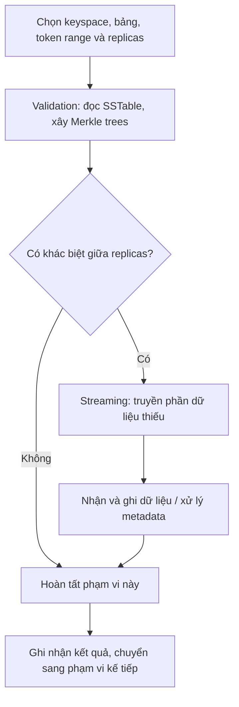

# Điều tiết mạng, CPU, đĩa và mức đồng thời khi repair

## 1. Vì sao repair cần một ngân sách tài nguyên?

Apache Cassandra lưu nhiều bản sao của mỗi partition theo **replication factor (RF)** và replication strategy của keyspace. Khi ứng dụng ghi ở consistency level (CL) không yêu cầu tất cả replica xác nhận, một số replica có thể bỏ lỡ mutation trong thời gian lỗi mạng hoặc node ngừng hoạt động. **Anti-entropy repair** đối chiếu dữ liệu theo token range giữa các natural replica, phát hiện khác biệt và truyền dữ liệu cần thiết để đưa chúng về trạng thái hội tụ.

Repair không nằm trong đường thực thi của từng lệnh `INSERT`/`SELECT` thông thường, nhưng **dùng chung CPU, bộ nhớ, đĩa và mạng** với các request ấy. Chạy quá nhanh có thể khiến dịch vụ Java tăng p95/p99 latency, timeout hoặc mất khả năng đáp ứng CL; chạy quá chậm lại làm các token range lâu không được đối soát, tăng rủi ro khi tombstone được dọn sau thời gian bảo vệ.

Bài thuộc chương **Repair** của mô-đun `DATABASE_ENGINE_WIDE_COLUMN_CASSANDRA`. Phạm vi liên kết kiến trúc phân tán/wide-column, partition key, replication và read/write consistency với CQL, compaction, xử lý sự cố và kết nối từ ứng dụng Java.

Sau bài, người học cần:

1. Giải thích **pha validation** (đọc dữ liệu, xây Merkle tree) và **pha streaming** gây tải khác nhau thế nào.
2. Phân biệt ba nút điều tiết: **throughput streaming**, **throughput compaction/validation**, **độ đồng thời** giữa job và node.
3. Biết quan sát disk, CPU, mạng và latency trước khi quyết định thay đổi ngưỡng.
4. Hiểu giới hạn **node/keyspace/bảng/token range/DC** của lệnh repair.
5. Có runbook thử nghiệm tăng/giảm tải có thể đảo ngược, không đánh đổi dữ liệu đúng đắn lấy tốc độ tạm thời.

## 2. Hai pha chính gây áp lực tài nguyên

Ở mức khái niệm, Cassandra repair một tập token range bằng cách so dữ liệu của những replica có trách nhiệm:



**Validation không đơn thuần là một yêu cầu mạng.** Mỗi replica phải đọc dữ liệu liên quan trên disk, giải nén/duyệt dữ liệu, tính hash xây Merkle tree và trao đổi kết quả so sánh. Nếu tập dữ liệu lớn, pha này có thể làm tăng disk read, CPU và công việc liên quan compaction ngay cả khi **không phát sinh byte streaming nào**.

**Streaming xuất hiện khi có phần dữ liệu cần chuyển.** Node nguồn đọc và gửi dữ liệu, node đích nhận và lưu, tiêu thụ băng thông mạng, disk I/O, CPU/giải nén và có thể làm tăng công việc sau đó. Một phiên repair có thể streaming 0 byte nhưng vẫn gây tải validation đáng kể.

| Pha / hoạt động | Mạng | CPU | Đĩa / bộ nhớ | Dấu hiệu quan sát |
| --- | --- | --- | --- | --- |
| Lập kế hoạch, trao đổi control | Thông điệp nhỏ giữa coordinator và replica | Điều phối | Thường ít hơn các pha dữ liệu | Repair session/log và tác vụ đang chờ. |
| **Validation/Merkle tree** | Trao đổi cây/hash | Hash, giải nén, duyệt partition | **Đọc SSTable**; cache, I/O và bộ nhớ cho validation | Disk read tăng, `compactionstats`/validation tasks, CPU cao. |
| **Streaming** | **Truyền dữ liệu** nội DC hoặc liên DC | Serialize/checksum/nén theo đường dữ liệu | Đọc tại nguồn, ghi tại đích; có thể phát sinh SSTable mới | `netstats`, throughput mạng, streaming backlog. |
| Incremental repair/anti-compaction | Một phần truyền/metadata | Xử lý SSTable và repaired state | Có thể phải viết lại SSTable, dùng thêm disk | Pending compaction, disk free giảm, output SSTable tăng. |
| Foreground CQL đồng thời | Client + inter-node traffic | Read/write/GC | Memtable, SSTable, commitlog | p95/p99, timeout, queue và disk latency. |

**Tư duy đúng:** Không có một “repair throttle” duy nhất điều khiển tất cả pha. Hạn chế băng thông streaming **không trực tiếp hạn chế** CPU hoặc disk read khi xây Merkle tree; giảm số job **không đồng nghĩa** đặt cứng một ngưỡng MiB/s.

## 3. Trước khi điều tiết: xác định phạm vi và tính sẵn sàng

Giả sử keyspace `shop_ks` dùng `NetworkTopologyStrategy` với `dc1: 3` và `dc2: 3`. Một bảng `orders_by_customer` phân vùng theo `customer_id` có natural replicas tại hai DC. Repair có thể liên hệ những replica cùng giữ các token range của bảng này; điều đó khác hoàn toàn với một lần cập nhật CQL chạy ở `LOCAL_QUORUM`.

```sql
SELECT keyspace_name, replication
FROM system_schema.keyspaces
WHERE keyspace_name = 'shop_ks';

SELECT keyspace_name, table_name, compaction, gc_grace_seconds
FROM system_schema.tables
WHERE keyspace_name = 'shop_ks'
  AND table_name = 'orders_by_customer';
```

Xác định trước khi chạy:

- **RF theo từng DC, số node khỏe và CL ứng dụng đang dùng.** Khi nhiều replica cùng bận hoặc down, `LOCAL_QUORUM` vẫn có thể timeout dù bản thân repair không đổi RF/CL.
- **Đơn vị dữ liệu cần sửa:** keyspace, bảng, những token range nào và repair incremental hay full.
- **Lịch đang hoạt động:** cron, Reaper hoặc Auto Repair (nếu version/cấu hình hỗ trợ). Không đưa thêm repair thủ công chồng lịch mà chưa xác định chủ sở hữu công việc.
- **Thời gian còn lại trước hạn đối soát:** dựa trên `gc_grace_seconds`, outage, thời gian job thành công gần nhất và độ phủ toàn cluster; không cho repair kéo dài vô thời hạn.
- **Tài nguyên đang có:** dung lượng trống, CPU, disk latency, mạng liên DC, số compaction/streaming đồng thời và SLO ứng dụng.

Lệnh `nodetool repair` được gọi trên **một node điều phối**, xử lý các phạm vi mà nó chịu trách nhiệm và liên lạc với replica liên quan; **không** đồng nghĩa một lệnh duy nhất repair toàn cluster. Chạy `-pr` (primary ranges) trên một node chỉ xử lý các primary range của node đó; kế hoạch toàn cluster cần đầy đủ các node/DC tương ứng.

## 4. Điều tiết mạng: streaming throughput

Những lệnh dưới đây là lệnh quản trị node, **không phải CQL**. Kiểm tra `nodetool help ...` của đúng phiên bản đang chạy trước khi dùng. Ví dụ dùng tên node giả định `cassandra-node-1`.

### 4.1. Đọc ngưỡng hiện tại trước

```bash
nodetool -h cassandra-node-1 help getstreamthroughput
nodetool -h cassandra-node-1 getstreamthroughput
nodetool -h cassandra-node-1 getinterdcstreamthroughput
nodetool -h cassandra-node-1 netstats
```

- `getstreamthroughput` hiển thị giới hạn **streaming tổng thể** trên node.
- `getinterdcstreamthroughput` hiển thị giới hạn **streaming liên data center**.
- `netstats` giúp theo dõi những luồng đang truyền/nhận, các phiên streaming và trạng thái tiến độ. Nó là **ảnh chụp tại thời điểm gọi**, không thay dashboard theo thời gian.

Ở các phiên bản Cassandra 5.0 được tài liệu hóa, `nodetool setstreamthroughput` và `setinterdcstreamthroughput` nhận giá trị mặc định theo **megabit/giây (Mbit/s)**; tùy chọn `-m`/`--mib` cho phép đặt theo **MiB/s**. Các câu lệnh `get...` có tùy chọn tương ứng. **1 MiB/s ≈ 8,39 Mbit/s**; nhầm hai đơn vị có thể làm giới hạn lệch hơn tám lần. Một số file cấu hình cũng sử dụng đơn vị khác cú pháp `nodetool`, vì vậy không sao chép con số không kèm đơn vị.

### 4.2. Ví dụ giới hạn outbound streaming trên một node

```bash
# Ví dụ THỬ NGHIỆM: dùng đơn vị MiB/s một cách tường minh.
nodetool -h cassandra-node-1 setstreamthroughput -m 16
nodetool -h cassandra-node-1 getstreamthroughput -m

# Giới hạn streaming liên DC riêng, cũng bằng MiB/s.
nodetool -h cassandra-node-1 setinterdcstreamthroughput -m 8
nodetool -h cassandra-node-1 getinterdcstreamthroughput -m
```

Hai con số **16 MiB/s** và **8 MiB/s** chỉ là giá trị minh họa để đọc lệnh, **không phải mặc định hay khuyến nghị production**. Giới hạn inter-DC nằm trong ngân sách streaming chung; không nên đặt nó cao hơn giới hạn streaming tổng thể nếu muốn phân bổ dễ dự đoán.

Lệnh điều chỉnh **node được chỉ định**, không trực tiếp sửa giới hạn trên mọi node khác, và áp dụng cho luồng streaming của hệ thống chứ **không riêng một phiên repair cụ thể**. Bootstrap, replacement, rebuild hoặc hoạt động streaming khác có thể chịu tác động. Muốn áp một giới hạn cho nhiều node phải có kế hoạch quản trị và xác minh từng node; không đưa thay đổi hàng loạt mà không kiểm soát phạm vi.

**Cảnh báo đặc biệt:** giá trị `0` của các lệnh điều tiết throughput thường có nghĩa **tắt throttling**, chứ **không** phải dừng streaming. Không đặt `0` với ý định “chặn mạng” trên cluster đang tải nặng.

### 4.3. Streaming cap không đảm bảo tốc độ thực tế

Một giới hạn 16 MiB/s chỉ định **trần dự kiến**, không hứa rằng repair đạt đúng 16 MiB/s: validation có thể chiếm phần lớn thời gian; node nhận có thể nghẽn disk, network bị giới hạn ở tầng hạ tầng, nhiều kết nối có thể chia sẻ mạng, hoặc các công việc khác cùng chiếm I/O. Ngược lại, giới hạn node riêng lẻ không phải thỏa thuận băng thông tổng của **cả cluster**.

Với liên DC, phải quan sát **cả chiều gửi và nhận** cùng độ trễ, packet loss và traffic ứng dụng. Không suy “đã giới hạn outbound trên node A nên inter-DC link không thể bão hòa” nếu có nhiều node cùng gửi.

## 5. CPU và đĩa: validation, compaction throughput và không gian trống

Trên nhiều phiên bản Cassandra, validation repair dùng các công việc chạy trên hạ tầng compaction. Cấu hình `compaction_throughput` và lệnh `nodetool setcompactionthroughput` có thể tác động đến **băng thông compaction/validation**, nhưng không phải bộ giới hạn CPU tuyệt đối.

```bash
nodetool -h cassandra-node-1 getcompactionthroughput
nodetool -h cassandra-node-1 compactionstats
nodetool -h cassandra-node-1 tpstats

# CHỈ ví dụ thay đổi có kiểm soát trong lab:
nodetool -h cassandra-node-1 setcompactionthroughput 32
nodetool -h cassandra-node-1 getcompactionthroughput
```

Trong tài liệu Cassandra 5.0, `setcompactionthroughput` nhận giá trị **MiB/s**; `0` nghĩa **bỏ giới hạn**. Con số `32` là ví dụ kỹ thuật, không phải ngưỡng tối ưu cho mọi đĩa. Ngưỡng này có thể ảnh hưởng **compaction thông thường** của node ngoài repair, nên thay đổi phải được đo cả tác động về **pending compactions** và read amplification về sau.

**Vì sao đĩa thường là điểm nghẽn?**

- Validation quét SSTable để tính hash, tranh bandwidth/IOPS với foreground reads.
- Streaming đọc dữ liệu từ node nguồn và ghi vào node đích, đặc biệt tốn tài nguyên khi phải truyền lượng lớn dữ liệu.
- Incremental repair có thể phát sinh **anti-compaction** và viết lại SSTable để phân biệt dữ liệu đã repaired/chưa repaired; vì vậy cần disk free.
- Snapshot/hard link và compaction có thể giữ SSTable cũ còn tồn tại, khiến disk chưa được giải phóng ngay.
- Khi đĩa gần đầy, tăng concurrency thường làm nguy cơ thất bại **cao hơn**, không đơn thuần giúp xong nhanh.

Không có quy tắc “luôn cần đúng 2× dung lượng bảng” áp dụng cho mọi repair. Dung lượng phụ thuộc lượng dữ liệu sai khác, loại repair, phiên bản, kích thước SSTable, chiến lược compaction, snapshot và công việc chồng lấn. **Đo disk free thực** trên từng node nguồn/đích và giữ ngưỡng dự phòng theo quy chuẩn môi trường.

**Giới hạn CPU gián tiếp:** Nếu `tpstats`, CPU host và GC đều cao khi validation, hãy giảm số repair job hoặc tránh chạy thêm phiên khác. Đừng tăng `-j` chỉ vì giao diện báo streaming ít byte: phần lớn công việc có thể nằm ở hash SSTable, không phải truyền mạng.

## 6. Mức đồng thời: repair jobs, DC, token range và nhiều node

### 6.1. Tham số `-j` không phải số core dùng cho repair

`nodetool repair -j N`/`--job-threads N` cấu hình **số job repair chạy đồng thời**, thường biểu diễn số bảng/column family được repair cùng lúc. Trong tài liệu công cụ Cassandra 5.0, giá trị mặc định là **1**, tối đa **4**. Các version khác có thể khác, nên không mặc định áp con số ấy trên mọi cluster.

```bash
nodetool help repair

# Ví dụ an toàn để bắt đầu ở lab: một job tại một thời điểm.
nodetool -h cassandra-node-1 repair -j 1 repair_lab_ks events_by_device

# So sánh có chủ đích trong môi trường thử nghiệm, KHÔNG chạy đồng thời:
nodetool -h cassandra-node-1 repair -j 2 repair_lab_ks events_by_device
```

Với **một bảng duy nhất**, tăng `-j` có thể **không làm thay đổi độ đồng thời hiệu quả** như kỳ vọng. `-j` không kiểm soát trực tiếp số CPU core, số byte/s trên mạng hay số stream đồng thời tại từng node. Tải thực phụ thuộc phân chia range, topology, scheduler, job ở node khác và giai đoạn validation/streaming.

### 6.2. Thứ tự repair và giới hạn DC

Các tùy chọn trong những phiên bản hỗ trợ:

| Tùy chọn | Ý nghĩa | Lưu ý vận hành |
| --- | --- | --- |
| `-seq`/`--sequential` | Chạy repair ở chế độ tuần tự thay vì mức song song mặc định | Thường giảm xung đột tức thời nhưng có thể kéo dài thời gian hoàn tất. |
| `-dcpar`/`--dc-parallel` | Chạy các data center song song theo chế độ DC-aware | Có thể tăng tổng tải, cần quan sát link WAN và node của từng DC. |
| `-local`/`--in-local-dc` | Chỉ repair đối chiếu với các node trong DC địa phương | **Giới hạn phạm vi đối soát**; không chứng minh các DC đã đồng bộ với nhau. |
| `-dc <dc>` | Chọn DC cụ thể theo danh sách hỗ trợ | Cần kế hoạch đủ coverage, không nhầm filter tải với repair toàn cluster. |
| `-pr`/`--partitioner-range` | Chỉ primary token range của node gọi lệnh | Dùng khi điều phối theo các node để giảm xử lý trùng, không có nghĩa một node sửa mọi range. |
| `-j <n>` | Số job repair đồng thời | Tăng có thể khiến validation, compaction, disk và network bão hòa. |
| `--full` | Full repair gồm dữ liệu thuộc phạm vi chỉ định | Chi phí có thể lớn hơn incremental; là lựa chọn phạm vi dữ liệu, **không phải nút tăng tốc**. |

```bash
# Một ví dụ giảm tải bằng thứ tự tuần tự trong phạm vi bảng lab.
nodetool -h cassandra-node-1 repair -seq -j 1 repair_lab_ks events_by_device

# Chỉ xử lý primary range của node (phải có kế hoạch bao phủ các node khác):
nodetool -h cassandra-node-1 repair -pr -j 1 repair_lab_ks events_by_device
```

Không dùng `-local` hay `-dc` chỉ để làm repair “nhanh hơn” mà quên rằng chúng **thay phạm vi replica tham gia**. Nếu dữ liệu phải hội tụ xuyên DC, cần một chiến lược đối soát phù hợp cho tất cả DC và theo dõi kết quả của từng phần. Tương tự, lọc bỏ replica down để tiếp tục một phiên repair có thể để lại phạm vi chưa được sửa; không tuyên bố hoàn tất khi coverage bị thiếu.

### 6.3. Đồng thời giữa **nhiều lệnh** còn quan trọng hơn `-j`

Một node có thể đồng thời nhận tải từ:

1. Repair do cron/Reaper/Auto Repair khởi chạy.
2. Repair thủ công trên node A.
3. Một repair khác khởi chạy từ node B, cùng liên hệ replica A.
4. Streaming bootstrap/replace/rebuild và compaction nền.
5. Lưu lượng CQL bình thường.

Do đó **một lệnh với `-j 1` không có nghĩa node chỉ có một công việc repair đang chạy trên thực tế**. Phải tính concurrency theo **cluster, DC, rack, node và disk**. Tránh chạy các token range có replica trùng nhau cùng lúc nếu tài nguyên không chịu được; stagger theo DC/rack để đủ replica khỏe theo CL của ứng dụng.

## 7. Đặt ngân sách dựa trên SLO, không dựa trên “repair càng nhanh càng tốt”

Giả sử một dịch vụ Java yêu cầu p99 read dưới ngưỡng ứng dụng đặt ra; không có một ngưỡng chung đúng cho mọi hệ thống. Trước bảo trì, cần thống nhất:

- **Tài nguyên dành cho foreground:** CPU, IOPS, disk latency và bandwidth cần dự trữ cho CQL đang phục vụ khách hàng.
- **Trần repair:** throughput cho streaming/validation, số job và số node có thể đồng thời tham gia.
- **Giới hạn an toàn:** mức disk free tối thiểu, số replica khỏe theo RF/CL, p99/timeout và queue tối đa chấp nhận.
- **Hạn hoàn tất:** thời gian đủ để repair hết token range/table/DC cần xử lý, có dư địa so với `gc_grace_seconds` để tránh dữ liệu bị xóa xuất hiện lại.
- **Khả năng rollback cấu hình:** lưu **giá trị throttle cũ**, người duyệt thay đổi và cách khôi phục.

Ví dụ phân tích (số liệu minh họa, không phải benchmark thật):

| Quan sát | Đánh giá | Hướng điều tiết |
| --- | --- | --- |
| Network gần bão hòa trong khi disk/CPU còn dư | Streaming đang tranh đường truyền với CQL/ứng dụng | Giảm `streamthroughput` hoặc inter-DC cap; đo lại transfer rate, latency. |
| CPU/GC cao ở pha validation, network rất thấp | Hash/read SSTable hoặc công việc nền có thể là nút thắt | Giảm job, tránh repair khác; kiểm tra compaction throughput/CPU/GC. |
| Disk await cao, compaction pending tăng, read p99 xấu đi | I/O cạnh tranh; tăng mạng không giúp | Giảm concurrence và/hoặc trần compaction/streaming; xem disk free. |
| Repair nhanh nhưng read/write timeout đột biến | Cấu hình ưu tiên maintenance quá mức | Giảm tải repair; điều chỉnh lịch và số node đồng thời. |
| Repair không thể hoàn tất coverage trước hạn | Điều tiết quá gắt, scope quá lớn hoặc hạ tầng không đủ | Lập kế hoạch phân vùng công việc, cửa sổ bảo trì, năng lực thêm; không vô hạn kéo dài mà bỏ qua nguy cơ tombstone. |

Trước khi sửa tham số, đặt **giả thuyết có thể bác bỏ**. Ví dụ: “Giảm streaming từ giá trị hiện tại về trần thấp hơn trên node đang gửi sẽ giảm outbound bandwidth và p99 client mà không làm thời gian hoàn tất vượt hạn.” Sau đổi, kiểm tra cả **tác dụng mong muốn lẫn chi phí phát sinh**.

## 8. Các lệnh quan sát nên đi cùng mọi lần chỉnh throttle

### Trạng thái node, repair và streaming

```bash
nodetool status
nodetool netstats
nodetool tpstats
nodetool compactionstats
nodetool tablestats repair_lab_ks.events_by_device
```

Những lệnh này **không** cho bạn toàn bộ p95/p99 của ứng dụng hoặc tổng băng thông cluster. `nodetool` kết nối tới một node quản trị; với nhiều DC, cần số liệu của **tất cả node tham gia** trong cùng khoảng thời gian.

### Dashboard/JMX và host

| Chỉ số | Tác dụng khi chẩn đoán |
| --- | --- |
| Thời gian repair, số range đã hoàn tất/thất bại, bytes streamed | Xem coverage và tốc độ thực sự, không chỉ session đã bắt đầu. |
| Outbound/inbound throughput, retransmit, errors theo node/DC | Xác định link WAN/nội DC quá tải hay chỉ một node chậm. |
| CPU user/system, GC pause/heap, task queue | Nhận biết validation/hash/compaction đang cạnh tranh CPU với query. |
| Disk free, read/write bytes/s, IOPS, p95/p99 disk latency | Xác định nguồn/đích streaming bão hòa đĩa hoặc thiếu không gian output. |
| Pending/active compactions, validation jobs, SSTable count | Theo dõi ảnh hưởng đến scheduler và backlog viết lại dữ liệu. |
| ClientRequest read/write p95/p99, timeout, failures | Giữ mục tiêu trải nghiệm ứng dụng trong suốt bảo trì. |
| Threads/queues/dropped messages | Phát hiện nghẽn nội bộ dù tổng bandwidth chưa đạt trần. |

Các metrics Cassandra thay đổi tên, đơn vị và cách tổng hợp theo version/JMX exporter; phải kiểm tra danh mục thực tế của cluster. Counter tích lũy cần lấy **rate/delta**, histogram cần hiểu đơn vị và khoảng đo. Không so counter của node vừa khởi động lại với node đã chạy nhiều tháng để suy ra tốc độ hiện tại.

### Trace và kết quả đọc CQL

Query trace của một `SELECT` chậm có thể giúp nhận biết replica nào phản hồi muộn trong lúc repair. Nhưng trace CQL **không thay thế** log/metrics của repair; nó chỉ cho thấy ảnh hưởng tới đường đọc của lần request cụ thể. Dùng tracing **có chọn mẫu**, không bật đại trà vì cũng tạo thêm I/O.

## 9. Runbook sáu bước cho một thay đổi có kiểm soát

### Bước 1 — Khóa phạm vi và chụp baseline

Ghi node, DC, keyspace/table, loại repair (incremental/full), token range, lịch đang có và phiên bản. Chụp thông số:

```bash
nodetool help repair
nodetool getstreamthroughput
nodetool getinterdcstreamthroughput
nodetool getcompactionthroughput
nodetool netstats
nodetool compactionstats
```

Ghi thêm CPU, disk free, disk read/write latency, outbound/inbound network và p95/p99 CQL trong cùng cửa sổ quan sát. Phải biết **giá trị ban đầu** để trả lại sau thử nghiệm.

### Bước 2 — Chọn một biến và một ngưỡng an toàn

Ví dụ nếu bottleneck là **inter-DC throughput**, giữ `-j` và compaction cap như cũ, chỉ thử **giảm inter-DC throughput trên node đang truyền**. Nếu bottleneck là validation CPU, trước hết cân nhắc giảm job/số phiên cùng chạy; điều chỉnh giới hạn streaming có thể không có tác dụng.

**Đừng đổi đồng thời** streaming cap, compaction throughput, `-j`, CL ứng dụng và số node chạy repair: bạn sẽ không biết biến nào gây tác động.

### Bước 3 — Thử trên lab hoặc một node được chỉ định

Ví dụ lệnh cho **lab**, giả sử đã duyệt và chọn cap 8 MiB/s liên DC:

```bash
nodetool -h cassandra-node-1 getinterdcstreamthroughput -m
nodetool -h cassandra-node-1 setinterdcstreamthroughput -m 8
nodetool -h cassandra-node-1 getinterdcstreamthroughput -m
```

Vì đây là thay đổi **mức node**, những luồng streaming khác trên node cũng chịu ảnh hưởng. Không áp cap giống nhau cho mọi node trong khi chưa đo hướng dữ liệu và tình trạng disk của từng node.

### Bước 4 — Chạy repair trong phạm vi nhỏ và quan sát

```bash
# Trên môi trường lab có bảng được chọn và lịch repair không chồng lấn:
nodetool -h cassandra-node-1 repair -seq -j 1 repair_lab_ks events_by_device

# Trong lúc repair:
nodetool -h cassandra-node-1 netstats
nodetool -h cassandra-node-1 compactionstats
nodetool -h cassandra-node-1 tpstats
```

`repair -seq -j 1` là cách bắt đầu thận trọng ở cấp command, **không** bảo đảm toàn bộ cluster đang chạy tuần tự nếu scheduler khác còn hoạt động. Không mô phỏng node down hay khởi chạy nhiều repair trùng token range trên production.

### Bước 5 — Quyết định giữ, giảm hoặc dừng thử nghiệm

Nếu client p99/timeout, disk latency hoặc disk free vượt **ngưỡng đã thống nhất**, giảm mức đồng thời hoặc throttle tiếp theo hướng an toàn, hoặc đưa phiên repair về kế hoạch bảo trì. Việc dừng/hủy một task repair phải theo công cụ/version và runbook; một task bị hủy có thể để lại **range chưa hoàn tất** cần repair lại, không được báo thành công.

Nếu repair không gây tác động ứng dụng và còn rất nhiều dư địa, có thể tăng năng lực **từng bước nhỏ** với một biến mỗi lần, kiểm tra lại cả **tốc độ hoàn tất lẫn SLO**. Không dùng `0` như một cách giảm tải vì nó thường **tắt** throttle.

### Bước 6 — Hoàn tất coverage, phục hồi cấu hình và báo cáo

Khi repair kết thúc, kiểm tra **thành công theo range/table/DC và session**, không chỉ quan sát `netstats` hết stream. Khôi phục throughput cap về giá trị ban đầu hoặc giá trị mới đã được duyệt; kiểm tra `get...` xác nhận thay đổi. Ghi:

- Node và phạm vi sửa, người phụ trách, thời gian bắt đầu/kết thúc, loại repair.
- Các mức throttle trước/trong/sau; số job và số node cùng hoạt động.
- Bytes streamed, ranges thành công/thất bại, tốc độ repair thực.
- CPU, disk, network, latency/timeout của dịch vụ Java trước và sau.
- Token range/DC cần chạy tiếp và hạn sửa trước `gc_grace_seconds`.

**Nếu số range thành công chưa đầy đủ, trạng thái bài toán là “cần tiếp tục repair”**, ngay cả khi throttle đã được hoàn nguyên và dịch vụ không còn timeout.

## 10. Thực hành CQL và nodetool trên cluster thử nghiệm

Chuẩn bị keyspace test riêng; ví dụ DC là `dc1` (điều chỉnh theo topology, phải đủ node cho RF):

```sql
CREATE KEYSPACE repair_lab_ks
WITH replication = {'class': 'NetworkTopologyStrategy', 'dc1': '3'}
AND durable_writes = true;

CREATE TABLE repair_lab_ks.events_by_device (
    device_id text,
    bucket_day date,
    event_ts timestamp,
    event_id uuid,
    payload text,
    PRIMARY KEY ((device_id, bucket_day), event_ts, event_id)
);

INSERT INTO repair_lab_ks.events_by_device
    (device_id, bucket_day, event_ts, event_id, payload)
VALUES
    ('sensor-7', '2026-11-21', '2026-11-21T08:00:00+0000',
     11111111-2222-3333-4444-555555555555, 'sample');

SELECT event_ts, event_id, payload
FROM repair_lab_ks.events_by_device
WHERE device_id = 'sensor-7'
  AND bucket_day = '2026-11-21';
```

**Ghi chú:** vài hàng trong lab khó tạo chênh lệch metrics đáng kể; mục đích là luyện quy trình quan sát/đọc tham số, không chứng minh “-j 2 nhanh gấp đôi -j 1”. Không tạo workload căng hoặc sửa throttle của cluster production để có biểu đồ đẹp.

**Kịch bản A — validation nhiều, streaming ít:** Dùng một bảng đã đồng bộ, chạy full repair bảng trong lab; xem disk read/CPU và có thể 0 byte streaming. Giải thích tại sao tăng `setstreamthroughput` không cải thiện giai đoạn đọc/hash SSTable.

**Kịch bản B — streaming liên DC:** Nếu lab có nhiều DC với dữ liệu cố ý chưa đồng bộ trong điều kiện thử nghiệm an toàn, so cap liên DC trên node nguồn, theo dõi node đích và latency. Không đo trên production bằng cách gây partition mạng hoặc làm replica down.

**Kịch bản C — concurrency:** Chạy thử cùng **một kế hoạch repair có đủ nhiều bảng/range** ở `-j 1` rồi `-j 2` vào những cửa sổ tách biệt, với tải/data tương đương; thu CPU, disk, stream, duration và timeout. Nếu chỉ có một bảng, ghi nhận rằng `-j` có thể không phải biến quyết định.

### Mẫu phiếu đo

| Trường | Trước | Trong khi repair | Sau khi hoàn tất |
| --- | --- | --- | --- |
| Node / DC / keyspace / bảng | Điền | Giữ nguyên phạm vi theo kế hoạch | Xác nhận coverage |
| Streaming cap / inter-DC cap / compaction cap | Ghi giá trị và đơn vị | Ghi thay đổi có duyệt | Xác nhận hoàn nguyên/giá trị mới |
| Repair job threads và số job cluster | Ghi | Đếm thực tế, kể cả cron/Reaper/Auto Repair | Không còn job không mong muốn |
| Network gửi/nhận, CPU, disk latency, disk free | Baseline | Peak và p95/p99 | Ổn định trở lại |
| Client read/write p95/p99, timeout | Baseline | Ảnh hưởng lớn nhất | Đối chiếu cùng tải |
| Bytes streamed, failed/completed ranges | Chưa có | Tiến độ | Xác minh kết quả cuối |

## 11. Chẩn đoán nhanh theo triệu chứng

| Triệu chứng | Không nên kết luận ngay | Kiểm tra và hướng xử lý |
| --- | --- | --- |
| Repair chạy nhiều giờ, network gần 0 | “Mạng quá chậm” | Xem validation task, disk read, CPU, Merkle tree, compaction throughput và số range. |
| Network 100%, client timeout nhiều | “Tăng -j để xong sớm” | Xem node gửi/nhận, lưu lượng CQL, cap streaming/inter-DC; ưu tiên bảo vệ SLO. |
| CPU cao, GC kéo dài, disk bình thường | “Throttle streaming sẽ sửa tất cả” | Xem validation/compaction và số job; giảm concurrency, kiểm tra heap/GC. |
| Disk free giảm mạnh khi incremental | “Repair đã mất dữ liệu” | Xem anti-compaction, SSTable output, snapshot, stream incoming và mức đĩa dự phòng. |
| Không thấy cải thiện khi tăng `-j` | “Cassandra bỏ qua cấu hình” | Một bảng có thể không có job song song đủ để sử dụng nhiều thread; có thể nghẽn tài nguyên khác. |
| Chỉ một node dùng `-j 1` nhưng cluster nghẽn | “Concurrency đã tối thiểu” | Kiểm tra scheduler khác, phiên repair trên node khác và replica bị dùng chung. |
| `netstats` hết stream nhưng repair chưa báo hoàn tất | “Đã đồng bộ xong” | Xem validation cuối, anti-compaction, log và trạng thái ranges/session. |
| Điều tiết quá mạnh, nhiều range quá hạn | “Càng chậm càng an toàn” | Lập kế hoạch tăng năng lực/giãn tải, ưu tiên coverage trong giới hạn tombstone và SLO. |

### Tình huống vận hành: RF = 3, CL = `LOCAL_QUORUM`

Cluster trong `dc1` có ba replica A/B/C. A và B cùng chịu tải repair validation cao; C khỏe mạnh. Ứng dụng đọc ở `LOCAL_QUORUM` cần hai phản hồi đúng thời hạn. Nếu A/B cùng chậm vì disk/CPU, client có thể timeout **dù cả ba node vẫn ở trạng thái `UN`**. Giảm streaming trên C không giải quyết nguyên nhân nếu A/B đang tốn thời gian xây Merkle tree.

Hướng xử lý: xem trace/read latency, `compactionstats`/disk/CPU **trên A và B**, thu hẹp số repair song song liên quan hai node đó và bảo vệ budget read/write. Sau đó kiểm tra thời gian repair còn lại và lên lịch tiếp cho các range chưa xong. Không thay đổi CL ứng dụng một cách tùy tiện như giải pháp che giấu sự cố.

## 12. Liên hệ Java Driver: theo dõi ảnh hưởng, không điều khiển repair từ CQL

Repair là tác vụ quản trị cluster, **không** phải một câu CQL Java Driver gửi mỗi request. Driver vẫn định tuyến truy vấn theo partition key và dùng consistency level được cấu hình. Ví dụ đo thời gian đọc bằng Java Driver 4.x trong lab:

```java
PreparedStatement ps = session.prepare(
    "SELECT payload FROM repair_lab_ks.events_by_device " +
    "WHERE device_id = ? AND bucket_day = ?"
);

BoundStatement statement = ps.bind(
    "sensor-7", LocalDate.of(2026, 11, 21)
).setConsistencyLevel(DefaultConsistencyLevel.LOCAL_QUORUM);

long startNs = System.nanoTime();
ResultSet rs = session.execute(statement);
int rows = 0;
for (Row row : rs) {
    row.getString("payload");
    rows++;
}
long elapsedNs = System.nanoTime() - startNs;
System.out.printf("rows=%d elapsedMs=%.2f%n",
    rows, elapsedNs / 1_000_000.0);
```

Đoạn mã giả định `session` đã kết nối và import driver 4.x/`LocalDate`. Thời gian này **bao gồm duyệt các page được tải**, nhưng chỉ đại diện một lần gọi; trong môi trường thực nên dùng metrics p50/p95/p99 qua nhiều request, số timeout/retry và kích thước kết quả. So với baseline cùng tải, nếu latency tăng trong khi repair, hãy tìm replica bị chậm bằng trace và metrics thay vì mặc định kết luận toàn bộ repair có lỗi logic.

Không đưa tham số `nodetool` vào chuỗi CQL hoặc chạy thao tác admin từ xử lý HTTP request. Hệ thống tự động hóa bảo trì cần quản lý quyền, lịch, concurrency, log và điều kiện dừng riêng.

## 13. Câu hỏi tự kiểm tra

1. Vì sao một repair có thể dùng CPU/disk cao dù streaming 0 byte? Throttle nào có thể tác động pha đó?
2. Khác biệt giữa `setstreamthroughput`, `setinterdcstreamthroughput` và `setcompactionthroughput` là gì? Đơn vị `Mbit/s` và `MiB/s` khác nhau thế nào?
3. Vì sao đặt `setstreamthroughput 0` là nguy hiểm nếu mục tiêu là *giảm tải*?
4. Vì sao `repair -j 2` không đồng nghĩa hai core CPU hoặc gấp đôi tốc độ repair một bảng?
5. Ưu/nhược điểm của `-seq`, `-dcpar` và `-local` là gì? Tùy chọn nào thay **phạm vi đối soát**?
6. Nếu cron/Reaper và thao tác tay cùng khởi repair với `-j 1`, vì sao toàn cluster vẫn có thể quá tải?
7. Khi incremental repair giảm disk free, hãy kể các hoạt động có thể tạo/giữ SSTable và cách kiểm chứng thay vì xóa file thủ công.
8. Vì sao giảm throughput quá mức có thể ảnh hưởng tính đúng đắn dữ liệu sau thời gian `gc_grace_seconds`?
9. Sau khi điều chỉnh throttle, cần các bằng chứng gì để báo một repair đã hoàn tất **đủ range/table/DC**?

**Tiêu chí hoàn thành:** người học phân biệt rõ validation với streaming, điều khiển từng loại tài nguyên bằng đúng tham số và đơn vị, nhận diện concurrency ở phạm vi **cluster** thay vì chỉ một lệnh, dùng dashboard chứng minh tác động lên p99 ứng dụng và có runbook bảo đảm coverage repair không bị bỏ sót.

## 14. Tài liệu tham khảo

- [Apache Cassandra — Repair](https://cassandra.apache.org/doc/stable/cassandra/managing/operating/repair.html): full/incremental, lịch và phạm vi repair.
- [Apache Cassandra — nodetool repair](https://cassandra.apache.org/doc/latest/cassandra/managing/tools/nodetool/repair.html): `-j`, `-seq`, `-dcpar`, `-local`, `-pr` và các lựa chọn giới hạn phạm vi.
- [Apache Cassandra — setstreamthroughput](https://cassandra.apache.org/doc/latest/cassandra/managing/tools/nodetool/setstreamthroughput.html) và [getstreamthroughput](https://cassandra.apache.org/doc/latest/cassandra/managing/tools/nodetool/getstreamthroughput.html): giới hạn streaming và đơn vị `Mbit/s`/`MiB/s`.
- [Apache Cassandra — setinterdcstreamthroughput](https://cassandra.apache.org/doc/latest/cassandra/managing/tools/nodetool/setinterdcstreamthroughput.html): giới hạn streaming giữa các DC.
- [Apache Cassandra — setcompactionthroughput](https://cassandra.apache.org/doc/latest/cassandra/managing/tools/nodetool/setcompactionthroughput.html) và [cassandra.yaml](https://cassandra.apache.org/doc/latest/cassandra/managing/configuration/cass_yaml_file.html): ngân sách compaction và validation.
- [Apache Cassandra — nodetool diagnostics](https://cassandra.apache.org/doc/stable/cassandra/troubleshooting/use_nodetool.html): `netstats`, `tpstats`, `compactionstats` và điều tra nghẽn I/O.

**Kết luận:** Muốn repair an toàn, cần **giới hạn tải để vẫn phục vụ CQL, nhưng đủ nhanh để đối soát hoàn tất đúng hạn**. Streaming throttle bảo vệ mạng, compaction throttle và số job tác động CPU/đĩa, còn lịch theo node/DC quyết định tổng concurrency thực. Không một nút nào thay thế việc đo p99, disk free, throughput, trạng thái range và khả năng đáp ứng CL của hệ thống.
