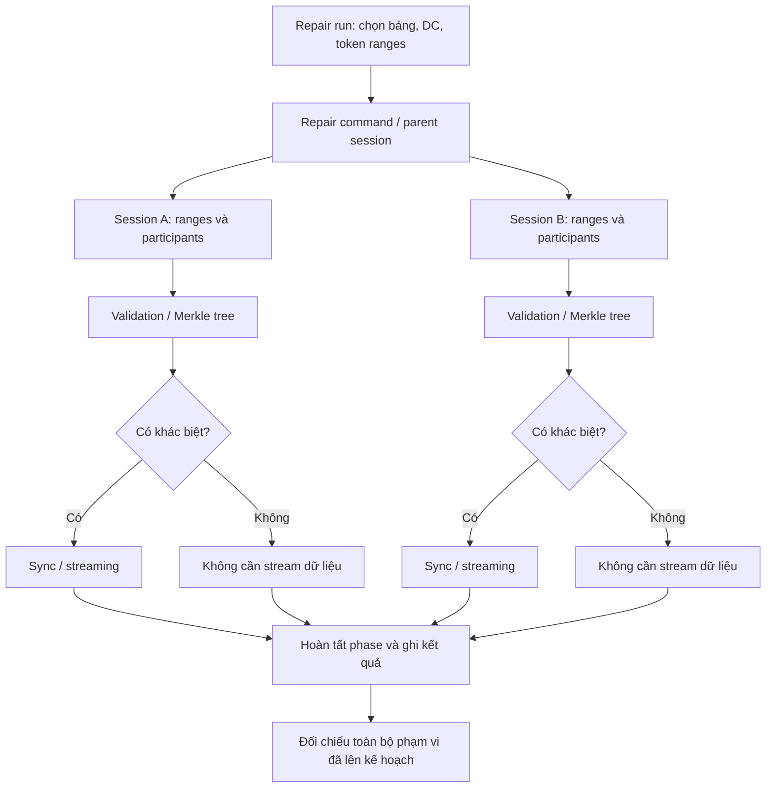

# Repair session, tiến độ và điều kiện xác nhận hoàn tất

Trong Apache Cassandra, replication giúp một partition được lưu trên nhiều nút nhưng **không bảo đảm các replica luôn giống nhau tại mọi thời điểm**. Một nút có thể bỏ lỡ mutation khi mất kết nối, hết hạn hinted handoff hoặc gặp lỗi ghi; khi hoạt động trở lại, dữ liệu ở nút đó có thể khác những replica còn lại. **Anti-entropy repair** đối chiếu dữ liệu của các replica và đồng bộ phần còn thiếu. Vận hành repair đúng không dừng ở việc chạy một lệnh `nodetool repair`: người quản trị cần biết **session nào chạy trên những replica nào, vùng token và bảng nào đã được bao phủ, phần nào đã streaming, phần nào thất bại**, và bằng chứng nào cho phép tuyên bố hoàn tất.

Bài học thuộc chương **Repair** của mô-đun **DATABASE_ENGINE_WIDE_COLUMN_CASSANDRA**, gắn với kiến trúc phân tán, khóa phân vùng, replication, consistency, CQL, compaction, tombstone, xử lý sự cố và ứng dụng Java. Mục tiêu là xây dựng quy trình có thể kiểm chứng trên cụm thật hoặc lab, tránh kết luận sai từ một thông báo “success” hay `nodetool status` hiển thị toàn bộ nút `UN`.

## 1. Mục tiêu học tập

Sau bài này, bạn có thể:

1. Giải thích quan hệ giữa **repair job/parent session, repair session, token range, participant, validation và streaming**.
2. Phân biệt **full repair**, **incremental repair**, **primary-range repair** và repair giới hạn theo DC, host, bảng hoặc token range.
3. Theo dõi tiến độ qua **lệnh nodetool, log coordinator/participant, streaming và metrics**, kể cả khi một phase không còn hiển thị.
4. Định nghĩa tiêu chí nghiệm thu theo **độ phủ phạm vi**, **kết quả từng task**, **trạng thái dữ liệu** và **vận hành sau repair**.
5. Chẩn đoán timeout, validation failure, streaming lỗi, session treo và tác động của việc repair bị ngắt.
6. Lập kế hoạch repair để hạn chế rủi ro zombie data khi tombstone hết `gc_grace_seconds`.
7. Kiểm chứng một kịch bản có replica bỏ lỡ ghi bằng CQL và hiểu giới hạn của phép kiểm thử chỉ dùng SELECT.

## 2. Repair sửa vấn đề gì?

Mỗi partition có một **tập replica** do token của partition key và replication strategy xác định. Ví dụ keyspace dùng `NetworkTopologyStrategy` với RF = 3 trong `dc1`: một mutation ở `LOCAL_QUORUM` có thể thành công khi hai replica đã phản hồi, còn replica thứ ba đang down hoặc tạm không đáp ứng.

Khi replica thứ ba trở lại:

- **Commit log replay** chỉ khôi phục những mutation mà chính nút đó **đã nhận/ghi log** trước khi crash.
- **Hinted handoff** có thể chuyển các mutation nút đã bỏ lỡ nhưng bị ràng buộc bởi cấu hình, giới hạn thời gian, điều kiện lưu hint và khả năng giao thành công.
- **Read repair** (tùy phiên bản và đường đọc) có thể làm hội tụ **dữ liệu mà truy vấn đã chạm**, không tạo lịch đồng bộ chủ động cho mọi partition.
- **Anti-entropy repair** có nhiệm vụ **đối chiếu theo token range** giữa các replica liên quan rồi đồng bộ các chênh lệch trong phạm vi được chọn.
- **Backup/snapshot** phục vụ phục hồi dữ liệu theo phương án sao lưu; repair không thể dựng lại mutation đã mất trên **mọi** replica nếu không có nguồn còn giữ.

Repair là một thao tác vận hành **đọc dữ liệu, tính khác biệt và chuyển dữ liệu cần thiết**. Nó không sửa partition key sai, không tạo một khóa UNIQUE, không làm LWT tự động nhanh hơn và không cung cấp một giao dịch snapshot nhất quán tức thời cho các ứng dụng đang ghi đồng thời.

### Hai câu hỏi khác nhau

| Câu hỏi | Bằng chứng tương ứng |
| --- | --- |
| “Các replica của **partition X** còn giữ bản ghi Y không?” | Đọc có mục tiêu trên những replica phù hợp, consistency và tracing khi cần. |
| “Tất cả **token range/bảng/DC dự kiến** đã được repair thành công?” | Danh mục công việc theo range/participant và kết quả toàn bộ repair sessions, không chỉ một SELECT. |

Kết quả đọc `LOCAL_QUORUM` có thể đúng dù một replica vẫn thiếu dữ liệu. Điều đó là lợi ích về tính sẵn sàng của replication nhưng là lý do không thể dùng **một truy vấn thành công** làm bằng chứng repair toàn cụm.

## 3. Bức tranh từ job đến repair session

Các từ “job”, “parent session” và “session” đôi khi được công cụ giám sát dùng khác nhau theo phiên bản. Khi đọc log, cần phân biệt tối thiểu bốn tầng:

| Tầng | Ý nghĩa logic | Thông tin cần theo dõi |
| --- | --- | --- |
| **Đợt chạy/schedule (run)** | Kế hoạch do người/automation khởi chạy, có thể gồm nhiều lệnh trên nhiều nút. | Run ID riêng của hệ thống vận hành, mục tiêu DC/keyspace/bảng, lịch bắt đầu/kết thúc. |
| **Repair command / parent repair session** | Một lần gọi repair có thể chia nhỏ thành nhiều nhóm range và tác vụ; thường có định danh trong log. | Coordinator, parent ID/command ID nếu có, options, token ranges được phân công, kết quả cuối. |
| **Repair session / child task** | Công việc trên một nhóm range và tập replica tham gia, gồm validation và các phiên đồng bộ. | Session ID, participants, range, phase, số bytes/công việc, lỗi hoặc timeout. |
| **Validation / sync / streaming task** | Tính đặc trưng dữ liệu và di chuyển phần chênh lệch. | Progress cụ thể, streaming success/failure, retry, lỗi peer/disk. |

Không áp dụng cứng một mô hình **một command = một session**: vnode khiến một nút sở hữu nhiều range và repair scheduler có thể tạo nhiều tác vụ. Cũng không coi một session thành công là toàn bộ lệnh đã hoàn tất; có thể còn session khác thất bại hoặc chưa chạy.

### Luồng khái niệm



Sơ đồ mô tả **ý nghĩa các bước**. Thứ tự chuẩn bị, validation, đồng bộ, anti-compaction và finalization khác nhau theo **phiên bản Cassandra và kiểu full/incremental repair**; không dùng sơ đồ như một cam kết thứ tự thực thi từng dòng log.

## 4. Merkle tree, validation và streaming

Để tránh so sánh từng dòng trên toàn bộ mạng, Cassandra sử dụng cơ chế **Merkle tree** trong repair: các replica tính cấu trúc hash đại diện cho dữ liệu thuộc token range. Những phần khác biệt được xác định để đồng bộ dữ liệu liên quan. Trong quá trình này, node có thể đọc nhiều SSTable, dùng CPU để tạo cây, và stream dữ liệu giữa các replica.

Một lượt repair thường có các nhóm công việc:

1. **Prepare và xác định participants**: coordinator xác định những replica liên quan đến token range, kiểm tra thành viên/topology và chuẩn bị phiên.
2. **Validation**: các replica tạo thông tin so sánh dữ liệu (thường dựa trên Merkle tree). Bước này có thể gây disk read, CPU và ảnh hưởng compaction.
3. **Sync**: các bên có chênh lệch đồng bộ data ranges/SSTable qua streaming hoặc cơ chế phù hợp.
4. **Hoàn thiện metadata**: với incremental repair, có thể cần **anti-compaction/finalization** để xử lý trạng thái SSTable repaired/unrepaired/pending repair. Chi tiết theo phiên bản.
5. **Kết thúc**: repair command và các session phải có kết quả cuối không lỗi; công cụ điều phối ghi nhận độ phủ.

### Không có stream bytes có phải lỗi không?

**Không.** Nếu validation không tìm thấy khác biệt cần chuyển thì một repair thành công có thể có **0 bytes streamed**. Điều này không phải bằng chứng việc repair bị bỏ qua. Ngược lại, một session đã stream nhiều GB **chưa chắc thành công** nếu finalization lỗi hoặc session cuối cùng thất bại. Muốn kết luận phải đọc **trạng thái cuối của toàn bộ session**, đồng thời kiểm tra phạm vi dự kiến.

### Repair không nhân ba dữ liệu khi RF = 3

RF = 3 có nghĩa mỗi partition có ba replica tại các node khác nhau (trong ví dụ một DC). Repair đối chiếu và đưa mỗi replica đến trạng thái cần thiết; nó **không** tạo ba sự kiện nghiệp vụ khác nhau trong kết quả CQL và không tăng RF.

## 5. Full, incremental và các phạm vi của repair

Các tùy chọn CLI và mặc định có thể thay đổi giữa Cassandra 3.x, 4.x, 5.x hoặc bản phân phối/managed service. **Luôn chạy `nodetool help repair` trên đúng phiên bản** trước khi lập lịch; những lệnh dưới đây là ví dụ có kiểm soát.

| Kiểu/phạm vi | Ý nghĩa | Khi nào cân nhắc |
| --- | --- | --- |
| **Full repair** | Đối chiếu dữ liệu thuộc phạm vi được yêu cầu, kể cả khi các SSTable từng được đánh dấu repaired theo cơ chế incremental. | Khôi phục độ tin cậy sau sự cố, xác minh dữ liệu, định kỳ theo chính sách cụm. |
| **Incremental repair** | Dựa trên trạng thái repaired/unrepaired để tránh lặp lại một số công việc trong các đợt sau. | Công việc định kỳ trên cụm/phiên bản có quy trình incremental ổn định. |
| **Primary-range repair** (`-pr` / `--partitioner-range` tùy CLI) | Chỉ thực hiện trên các primary token ranges mà node được giao trong sơ đồ partitioner. | Lập lịch **trên toàn bộ các node cần thiết** để giảm repair trùng phạm vi. |
| **Repair giới hạn keyspace/bảng** | Chỉ đối chiếu dữ liệu của keyspace hoặc bảng chỉ định. | Khoanh vùng sự cố và đo tác động, nhưng không khẳng định các bảng khác đã được sửa. |
| **Repair giới hạn DC/host** | Chỉ các participants thuộc nhóm được chọn, theo tùy chọn CLI. | Lập lịch theo DC, giới hạn tải mạng; phải theo dõi phạm vi nào còn chưa repair. |
| **Repair giới hạn token range** | Chỉ các khoảng token được truyền ở tùy chọn start/end token. | Repair có mục tiêu hoặc chia nhỏ lịch; cần ghi rõ chính xác mọi range và tránh lỗ hổng. |
| **Preview repair** (nếu hỗ trợ) | Kiểm tra/ước lượng chênh lệch mà không thực hiện một đợt đồng bộ bình thường. | Chẩn đoán/đo trước khi can thiệp; **không** đánh dấu như repair đã hoàn tất. |

**Incremental và full khác nhau ở cách chọn/đánh dấu dữ liệu**, không phải “incremental chỉ repair vài hàng còn full thì chắc chắn repair toàn cluster”. Một lệnh `--full` trên **một node, một bảng, một DC hoặc token range** vẫn chỉ bao phủ **phạm vi được chỉ định**. Ngược lại, lập lịch nhiều lệnh `-pr` theo đúng sơ đồ node/range có thể tạo độ phủ rộng hơn.

### Các lưu ý khi dùng incremental repair

- Có thể xuất hiện **pending repair SSTables**, trạng thái repaired/unrepaired và anti-compaction; dữ liệu đã được chuyển nhưng trạng thái hoàn tất chưa chắc được cập nhật.
- Lệnh bị hủy/ngắt ở giữa có thể để lại phần công việc cần phục hồi/clean up theo **runbook của phiên bản**. Không tùy tiện xóa file pending hoặc thay metadata SSTable bằng tay.
- Repair đồng thời trên các phạm vi overlap, hoặc trộn full/incremental thiếu kế hoạch, có thể tăng tài nguyên và làm khó xác định lịch sử repaired data.
- Lập lịch incremental cần có bản ghi **thành công toàn diện từng đợt**, không dựa vào việc job scheduler đã kích hoạt.

## 6. Lập ma trận độ phủ trước khi chạy

Giả sử `dc1` có ba node `n01`, `n02`, `n03`, RF = 3. Mỗi node có thể sở hữu nhiều **virtual-node token ranges**, và các partition trong các range ấy có tập replica tương ứng. Một lệnh gọi trên `n01` thường không đại diện cho toàn bộ kế hoạch của mọi keyspace và DC.

Lập bảng phân công **trước khi thực thi**:

| Đơn vị đã lên kế hoạch | Phạm vi | Participants dự kiến | Kết quả cần thu |
| --- | --- | --- | --- |
| R1 | `dc1`, `ks.table`, tập token ranges thứ nhất | Replica của các ranges R1 | Tất cả sessions/phase thành công |
| R2 | `dc1`, `ks.table`, tập token ranges thứ hai | Replica của các ranges R2 | Tất cả sessions/phase thành công |
| R3 | `dc1`, `ks.table`, các ranges còn lại | Replica của các ranges R3 | Tất cả sessions/phase thành công |
| Tổng | Toàn bộ ranges dự kiến của `ks.table` ở `dc1` | Tất cả replica yêu cầu | Không còn range/participant chưa được xác nhận |

Tên R1/R2/R3 chỉ là **nhóm lập lịch**, không phải ba token ranges cố định; token ring thực tế có thể có rất nhiều range do vnodes. Với nhiều DC, cần mở rộng ma trận theo **DC, bảng, participants và chính sách repair liên DC**.

### Quy tắc độ phủ

Điều kiện để tuyên bố **“đã repair toàn bộ bảng theo phạm vi mong muốn”** là:

```text
Planned = tập (keyspace, table, DC/phạm vi replica, token range)
          đã được định nghĩa trước đợt repair.
Succeeded = tập các đơn vị tương ứng có bằng chứng repair thành công
            sau validation/sync/finalization theo yêu cầu.

Coverage pass khi:
    Planned ⊆ Succeeded
    AND không có session còn failed/running/unknown cho các đơn vị Planned
    AND có xác nhận hoàn tất từ tất cả participants cần thiết.
```

Đây là **mô hình kiểm toán vận hành**, không phải câu lệnh CQL hay số liệu tự động của một phiên bản. Nếu dùng `--local` hoặc `-dc dc1`, hãy ghi rõ **giới hạn DC**: thành công trong `dc1` không được báo cáo thành “đa DC đã đồng bộ” nếu `dc2` chưa được đưa vào kế hoạch/kiểm chứng.

### `-pr` không miễn việc chạy đủ node

Khi chọn **primary-range repair**, việc gọi `nodetool repair -pr ...` trên chỉ một node **không đủ độ phủ mọi primary ranges của cả vòng token**. Cần đưa mỗi phạm vi primary range cần sửa vào lịch của **các node sở hữu primary range đó** và kiểm tra thực tế theo topology. Với multi-DC, thay đổi topology hoặc transient replication, việc chia range/participants phải dựa trên khả năng và hướng dẫn của đúng phiên bản.

## 7. Chuẩn bị vận hành trước đợt repair

Trước khi chạy repair production, phải xác định:

1. **Topology hiện hành**: keyspace RF theo DC, snitch, node up/down, rack/AZ, vnodes, các node vừa bootstrap/decommission/rebuild.
2. **Schema của bảng**: partition key để biết truy vấn kiểm chứng, compaction strategy, TTL và `gc_grace_seconds`.
3. **Sức tải**: CPU/GC, disk IOPS/latency, dung lượng trống, network bandwidth, read/write p95/p99, compaction backlog và streaming/backup đang chạy.
4. **Lịch sửa dữ liệu**: lần repair hoàn tất gần nhất, outage dài nhất, failed/pending tasks, mức grace và tombstone retention cần bảo vệ.
5. **Độ phủ mục tiêu**: full/incremental, keyspace/bảng, DC, node/range, khoảng thời gian và mức độ song song.
6. **Tiêu chí dừng/rollback vận hành**: timeout tăng, disk đầy, nhiều node down, latency SLA vượt giới hạn hoặc repair participant lỗi.
7. **Bằng chứng và nơi lưu**: nơi ghi `run_id`, command/options, start/end, logs, metrics, kết quả từng range và trách nhiệm xác nhận.

Nên chọn khung giờ có tài nguyên đủ, tránh đồng thời snapshot lớn, rebuild, streaming, compaction nặng và repair trên các phạm vi overlap. Repair có thể tạo **đọc SSTable lớn + hashing + streaming + ghi dữ liệu + anti-compaction**; đẩy throughput quá cao dễ làm ảnh hưởng request người dùng.

### Lệnh quan sát baseline (đọc-only)

```bash
nodetool help repair
nodetool status
nodetool describecluster
nodetool tablestats repair_lab.events_by_device_day
nodetool compactionstats
nodetool netstats
nodetool tpstats
```

Một số lệnh/tên output phụ thuộc phiên bản. `nodetool status` cho biết node `UN` (Up/Normal), nhưng **không** nói các replica đã có cùng dữ liệu. `netstats` hiển thị streaming đang diễn ra chứ không phải một lịch sử hoàn chỉnh của tất cả bytes đã stream. `compactionstats` có thể phản ánh validation/anti-compaction hoặc backlog, nhưng số pending bằng 0 **chưa đủ** xác nhận repair toàn phạm vi.

## 8. Lab CQL: một replica bỏ lỡ mutation

Thí nghiệm dùng cụm lab có **một DC tên dc1**, tối thiểu ba node ở trạng thái tốt và keyspace RF = 3. Thao tác stop/start chỉ thực hiện ở **nút thử nghiệm** sau khi xác minh chính xác endpoint replica; không dừng node production.

### Bước 1 — Tạo keyspace và bảng thiết kế theo truy vấn

```sql
CREATE KEYSPACE IF NOT EXISTS repair_lab
WITH replication = {
  'class': 'NetworkTopologyStrategy',
  'dc1': 3
}
AND durable_writes = true;

CREATE TABLE IF NOT EXISTS repair_lab.events_by_device_day (
  device_id text,
  event_day date,
  event_id uuid,
  event_type text,
  PRIMARY KEY ((device_id, event_day), event_id)
);
```

Partition key gồm `device_id, event_day`, giúp đọc được đúng một thiết bị/ngày và tránh scan toàn bảng. Trên các node, `nodetool status` xác nhận DC/rack, số node UP và trạng thái cluster; không giả định chỉ vì RF = 3 mà ba replica luôn độc lập về AZ/miền lỗi.

### Bước 2 — Ghi bản ghi gốc khi cả ba replica khỏe mạnh

```sql
CONSISTENCY LOCAL_QUORUM;

INSERT INTO repair_lab.events_by_device_day
  (device_id, event_day, event_id, event_type)
VALUES ('dev-01', '2026-11-21',
        11111111-1111-4111-8111-111111111111,
        'before-outage');

SELECT event_id, event_type
FROM repair_lab.events_by_device_day
WHERE device_id = 'dev-01' AND event_day = '2026-11-21';
```

Lưu `event_id` cố định để xác nhận đúng hàng, tránh dùng `now()` sinh bản ghi mới khi retry. Query sau khi ghi thành công ở `LOCAL_QUORUM` là baseline về kết quả ứng dụng; nó **không** đo trực tiếp trạng thái từng replica.

### Bước 3 — Mô phỏng một replica down và ghi sự kiện mới

1. Dùng công cụ tương ứng phiên bản để xác định endpoint của partition `('dev-01', '2026-11-21')` (ví dụ công cụ lấy replica endpoints/token range nếu môi trường có hỗ trợ), đối chiếu với `nodetool status`.
2. Chọn **một replica thực sự thuộc partition** rồi dừng Cassandra trên node lab đó theo hệ thống quản lý dịch vụ; đợi nó thành `DN`.
3. Từ coordinator **còn sống**, gửi INSERT mới ở `LOCAL_QUORUM`:

```sql
CONSISTENCY LOCAL_QUORUM;

INSERT INTO repair_lab.events_by_device_day
  (device_id, event_day, event_id, event_type)
VALUES ('dev-01', '2026-11-21',
        22222222-2222-4222-8222-222222222222,
        'written-during-outage');
```

4. Với RF = 3, hai replica còn sống **có thể** đủ quorum để ghi thành công. Nếu không đủ phản hồi, xử lý theo trạng thái thực tế và không mặc định ghi đã thất bại chỉ vì timeout.
5. Khởi động lại replica đã dừng, đợi nó thành `UN`, ghi lại thời điểm nó trở lại.

**Giới hạn lab:** hinted handoff/read repair có thể đã chuyển sự kiện mới trước khi bạn bắt đầu repair; vì thế repair có thể không stream byte nào cho key này. Điều đó **không làm phép thử vô giá trị**: mục tiêu ở đây là học cách theo dõi và xác nhận phiên repair, không ép cluster phải luôn có dữ liệu lệch. Không sửa/xóa SSTable hoặc vô hiệu hóa các cơ chế an toàn chỉ để tạo chênh lệch.

### Bước 4 — Chạy repair có giới hạn

Xem đúng cú pháp trước khi thực thi:

```bash
nodetool help repair
```

Ví dụ trên một node của lab (tham số CLI phổ biến):

```bash
# Full repair cho phạm vi bảng có liên quan do node được chọn điều phối.
nodetool repair --full repair_lab events_by_device_day
```

Đây là một **repair command**, không phải bằng chứng mọi token ranges của mọi node trong cluster đã được bao phủ. Nếu muốn tổ chức một vòng primary-range repair trên toàn DC, cần thực hiện lịch phù hợp **trên tất cả node/ranges liên quan** và không chạy các công việc overlap không cần thiết:

```bash
# Ví dụ lệnh từng node theo lịch riêng; không chạy đồng thời trên mọi node.
nodetool repair --full -pr repair_lab events_by_device_day
```

Tùy Cassandra version, thứ tự/tên option có thể khác và incremental/full default khác nhau. Với thí nghiệm **chỉ một bảng**, ghi rõ đó là phạm vi duy nhất được nghiệm thu; các bảng khác của `repair_lab` không nằm trong kết quả.

### Bước 5 — Quan sát trong lúc repair chạy

Trên coordinator và các replica tham gia:

```bash
nodetool status
nodetool compactionstats
nodetool netstats
nodetool tpstats
nodetool tablestats repair_lab.events_by_device_day
```

Đồng thời đọc **log Cassandra và output của repair command** để thu session/parent IDs, phase, thông báo lỗi, bytes streamed và thời điểm kết thúc. Không chỉ quan sát `nodetool netstats` vào cuối đợt: một luồng streaming đã hoàn thành sẽ biến mất khỏi bảng “đang chạy”, trong khi log/monitoring lịch sử mới chứng minh nó đã xảy ra.

### Bước 6 — Đọc dữ liệu sau khi hoàn tất

```sql
CONSISTENCY LOCAL_QUORUM;

SELECT event_id, event_type
FROM repair_lab.events_by_device_day
WHERE device_id = 'dev-01'
  AND event_day = '2026-11-21';
```

Kỳ vọng hai event `before-outage` và `written-during-outage` đều thấy sau khi cluster khỏe mạnh. Đây là **kiểm thử dữ liệu tiêu biểu**, bổ sung cho bằng chứng session/coverage; nó không chứng minh mọi replica của tất cả token ranges giống nhau. Đọc ở `ONE` hay `LOCAL_QUORUM` không mặc nhiên ép hệ thống đọc độc lập từng replica.

## 9. Theo dõi tiến độ theo từng phase

Một trang theo dõi hữu ích phải vừa có **trạng thái**, vừa có **phạm vi và tiến độ có nghĩa**:

| Phase | Dấu hiệu nên theo dõi | Điều chưa thể kết luận |
| --- | --- | --- |
| **Scheduled / queued** | Run ID, command và node đã được chọn; job bắt đầu theo lịch | Chưa có repair thực thi trên dữ liệu. |
| **Preparing** | Participants hợp lệ, session ID, range, bảng, kết nối tới peers | Chưa có bằng chứng validation thành công. |
| **Validating** | Logs validation, progress/CPU/disk read, thời gian xây Merkle tree | “Tree created” chưa chứng minh đã sync khác biệt. |
| **Syncing/streaming** | Bytes/files chuyển, streaming sessions, network throughput, lỗi peer/timeout | Stream 100% ở một participant chưa có nghĩa mọi session hoàn tất. |
| **Finalizing** | Kết quả đồng bộ, anti-compaction/repair metadata nếu incremental, không còn pending state theo version | “Không còn stream đang chạy” chưa chứng minh finalization thành công. |
| **Succeeded** | Tất cả tasks thuộc command đạt trạng thái cuối thành công; có timestamp hoàn tất | Chỉ bao phủ **những ranges/participants trong command**. |
| **Failed/aborted/unknown** | Exception, timeout, participant rớt, command bị hủy hoặc mất log | Chưa thể cộng phạm vi đó vào diện đã repair hoàn tất. |

### Các lệnh và metrics hữu ích

- `nodetool status`: xác nhận sự sẵn sàng và topology, không phải chỉ số tiến độ.
- `nodetool compactionstats`: quan sát các tác vụ liên quan SSTable/validation/anti-compaction và backlog tùy version.
- `nodetool netstats`: tiến độ **streaming đang hoạt động**, hữu ích khi có dữ liệu khác biệt.
- `nodetool tpstats`: các executor/queue bị nghẽn; dùng để phát hiện cluster thiếu tài nguyên.
- Metrics JMX/Prometheus: read latency, disk I/O, network bandwidth, pending repair/streaming/compaction, heap/GC và số task thành công/thất bại (đường dẫn/tên metric tùy version/exporter).
- Cassandra logs và công cụ điều phối repair (nếu có): **nguồn chính** để liên kết parent/session ID, errors, trạng thái cuối và retry.

**Không bịa tỷ lệ tiến độ chỉ từ bytes streamed.** Trước khi sync, validation có thể tiêu tốn thời gian đáng kể mà chưa stream byte nào; các session khác nhau có kích thước dữ liệu/range rất khác nhau. `50% số session` cũng không có nghĩa `50% dung lượng` hay `50% thời gian`.

## 10. Biên bản repair session mẫu

Một hệ thống điều phối nên ghi **một hàng cho mỗi đơn vị kiểm toán**, chẳng hạn command + range + participant set:

| Trường | Ví dụ minh họa | Lưu ý |
| --- | --- | --- |
| `run_id` | `repair-lab-2026-11-21` | ID do nhóm vận hành tự tạo. |
| `scope` | `dc1 / repair_lab.events_by_device_day` | Không ghi “full cluster” nếu chỉ một bảng. |
| `mode` | `full`, primary-range scheduling | Ghi lại options thực, không suy từ tên job. |
| `coordinator` | `n01` | Node nhận `nodetool repair` cho command đó. |
| `parent/session IDs` | Lấy trực tiếp từ output/log | Không tự tạo UUID để giả làm Cassandra session ID. |
| `token_ranges` | Lấy từ kế hoạch/token topology | Có thể nhiều range do vnodes. |
| `participants` | Danh sách endpoint tương ứng các ranges | So với RF/DC và thành viên đã đổi topology. |
| `phase_status` | Validation/sync/finalization | Ghi cả task thành công và lỗi. |
| `start/end` | Thời điểm UTC theo log | Phân biệt retry và session mới. |
| `result` | `SUCCEEDED / FAILED / UNKNOWN` | UNKNOWN không được coi là SUCCESS. |
| `evidence` | Link nội bộ tới log/metrics/tracing | Thu đầy đủ trước khi log bị rotate. |

Ví dụ **mẫu định dạng báo cáo nội bộ**, không phải output thực từ Cassandra:

```text
RUN_ID: repair-lab-2026-11-21
SCOPE: dc1, repair_lab.events_by_device_day
MODE: full; primary range jobs over planned nodes
PLANNED_RANGES: 128 groups                 # ví dụ giả định
SUCCEEDED_RANGES: 127
FAILED_RANGES: 1
UNRESOLVED_SESSIONS: 1
FINAL_RESULT: INCOMPLETE
REQUIRED_ACTION: retry/diagnose failed range, verify participants, re-audit
```

Dù có **127/128 groups** thành công, toàn bộ run **chưa hoàn tất**. Tỷ lệ này chỉ là độ phủ theo đơn vị đã định nghĩa; không nói 99,2% dữ liệu đã hội tụ hay đủ an toàn để giảm `gc_grace_seconds`.

## 11. Khi nào mới được xác nhận “repair hoàn tất”?

Đặt tiêu chí trước đợt chạy; tối thiểu gồm năm cổng nghiệm thu:

### Cổng 1 — Đúng phạm vi

- Xác nhận keyspace/bảng, token ranges, DC/host và mode được chạy **đúng kế hoạch**.
- Độ phủ không thiếu range, không bỏ sót node/rack/DC dự kiến, không hiểu nhầm `-pr` hoặc `--local`.
- Những công việc đang retry/được schedule nhưng chưa chạy không tính là succeeded.

### Cổng 2 — Kết quả từng session

- Toàn bộ parent commands, repair sessions và phase cần thiết **có kết quả cuối thành công**.
- Không còn trạng thái `FAILED`, `ABORTED`, `RUNNING` hoặc `UNKNOWN` **cho phạm vi muốn nghiệm thu**.
- Không có validation/stream/finalization error bị che vì command scheduler trả mã thoát 0 ở tầng khác.

### Cổng 3 — Trạng thái participant và dữ liệu

- Các replica cần tham gia khỏe mạnh và có thể liên lạc trong quá trình repair; sự cố node/network phát sinh được điều tra.
- Không có streaming hoặc pending repair metadata bất thường chưa được giải quyết theo phiên bản.
- Đọc mẫu dữ liệu quan trọng, nhất là mutation/delete xảy ra khi node down, cho kết quả mong muốn. Đây là kiểm chứng **bổ sung**, không thay ma trận coverage.

### Cổng 4 — An toàn vận hành

- CPU/disk/network, compaction backlog, read/write p95/p99 trở về ngưỡng vận hành hợp lý.
- Không có tệp repair tạm hoặc disk pressure vượt giới hạn; việc hoàn tất repair không đồng nghĩa mọi compaction thông thường đã xong.
- Không có task repair “kẹt” với trạng thái cuối chưa xác nhận; các lỗi session đã được theo dõi.

### Cổng 5 — Lịch sử và cam kết tombstone

- Lưu **thời điểm repair hoàn tất thành công** cho tất cả phạm vi cần bảo vệ, cùng phạm vi/phiên bản/topology.
- Đối chiếu khoảng cách repair thành công, thời gian node offline và `gc_grace_seconds`; phải có biên thời gian để dấu xóa tới replica trước khi bị dọn.
- Cập nhật lịch repair tiếp theo và cảnh báo khi repair trễ/thất bại. **Một lần thành công hôm nay không bảo đảm tương lai sẽ an toàn** nếu sau đó repair dừng nhiều tuần.

Nếu **bất kỳ cổng nào chưa có bằng chứng**, báo trạng thái `INCOMPLETE` hoặc `NEEDS_INVESTIGATION`, không gắn nhãn SUCCESS chung. Nên tách **“command đã hoàn tất”** khỏi **“toàn bộ kế hoạch đã hoàn tất và được nghiệm thu”**.

## 12. Repair và `gc_grace_seconds`: vì sao deadline quan trọng?

Tombstone ghi nhận việc xóa logic. Nếu replica A/B đã nhận DELETE còn C down giữ dữ liệu cũ, sau `gc_grace_seconds` và compaction, tombstone trên A/B có thể bị loại; khi C trở lại, dữ liệu cũ có nguy cơ **zombie/resurrection**.

```text
t0: A, B, C đều có X
t1: C down; A/B nhận DELETE X tại LOCAL_QUORUM
t2: C vẫn vắng mặt; chưa repair thành công
t3: tombstone trên A/B đủ điều kiện bị drop sau gc grace
t4: C trở lại với X cũ
t5: repair/read path có nguy cơ lan X nếu dấu xóa cần thiết đã mất
```

Repair thành công **trong thời hạn an toàn**, khi tombstone còn tồn tại, giúp chuyển thông tin xóa đến replica vắng mặt. Không đủ khi chỉ **lên lịch** trước deadline mà job chạy lỗi hoặc chưa bao phủ mọi range.

Về vận hành, cần có:

- Lịch repair **thành công** đủ thường xuyên so với grace, có biên cho outage, retry, streaming và repair chạy lâu.
- Theo dõi **longest node downtime**, repair SLA, failed sessions và phạm vi bị lỡ.
- Quy trình cho node vắng mặt quá lâu, cần **replace/rebuild** từ replica khỏe mạnh hoặc restore đúng cách; không đơn giản cho node cũ quay lại rồi tin một lần SELECT thành công.
- Chính sách compaction/TTL phù hợp. **Compaction cục bộ** không tự đồng bộ tombstone tới các replica khác.

Trong một số topology và workload có đặc thù như time-window TTL, lựa chọn grace có thể khác, nhưng cần chứng minh điều kiện an toàn theo phiên bản và vận hành cụ thể; không mặc định đặt grace = 0 hay coi lịch repair mỗi tuần là bằng chứng hoàn tất.

## 13. Các lỗi repair thường gặp và phản ứng đúng

| Triệu chứng | Nguyên nhân khả dĩ | Điều tra / hành động |
| --- | --- | --- |
| **Validation rất chậm** | SSTable lớn, disk I/O bão hòa, tombstone dày, GC hoặc workload khác | Kiểm tra disk/CPU/GC, `compactionstats`, read latency; giới hạn concurrency và chia range hợp lý. |
| **Streaming bị treo hoặc timeout** | Network loss, disk đầy/chậm, peer down, streaming giới hạn bandwidth | Đối chiếu `netstats`, log cả hai peers, dung lượng và network; retry phần lỗi sau khi khắc phục nguyên nhân. |
| **Một session FAILED còn phần khác SUCCESS** | Một peer/range không khả dụng, schema mismatch, timeout | Ghi lại chính xác session/range; **không** nghiệm thu toàn run. |
| **Repair command không có output một thời gian** | Validation dài, backlog scheduler hoặc deadlock/lỗi | Quan sát tiến độ ở logs/metrics, không suy thành công hay thất bại chỉ từ im lặng. |
| **Node DN trong repair** | Process/network/host lỗi | Xác định quorum và phạm vi session bị tác động; phục hồi node, lập lịch lại có kiểm soát. |
| **Dữ liệu chưa thấy sau repair** | Chưa repair đúng range/DC, giá trị bị TTL/xóa, consistency/query sai, mất dữ liệu ở mọi replica | Kiểm tra partition key, timestamps/tombstones, coverage/participants và nguồn còn giữ dữ liệu. |
| **Incremental repair kết thúc giữa chừng** | Interrupted anti-compaction/finalization hoặc pending repair state | Dùng công cụ/runbook hỗ trợ của phiên bản để xác nhận/khôi phục; không sửa trạng thái SSTable bằng tay. |
| **Repair chạy xong nhưng disk tăng** | Streaming tạo SSTable, anti-compaction, compaction backlog, snapshots | Kiểm tra tablestats/disk/compaction; không xóa SSTable thủ công. |
| **Lệnh trả SUCCESS nhưng có range bị bỏ sót** | Lập lịch primary ranges/DC sai, thiếu một node/command | Đối chiếu ma trận Planned vs Succeeded, chạy bù chính xác phạm vi thiếu. |

### Không retry vô hạn cùng một lỗi

Nếu streaming thất bại do disk đầy, khởi chạy lại ngay lệnh tương tự có thể làm tình hình xấu hơn. Cần:

1. Phân loại **lỗi tài nguyên, lỗi topology, lỗi timeout hoặc lỗi dữ liệu/metadata**.
2. Xác định **phạm vi đã thành công** và phần thất bại; đảm bảo không có run chồng lấn đang hoạt động.
3. Khắc phục nguyên nhân (nút, mạng, dung lượng, cấu hình) trước khi retry.
4. Chạy lại theo phương án/version hỗ trợ và ghi ID mới; không tự giả định phiên cũ có thể “tiếp tục từ byte cuối” sau restart.
5. Đối chiếu phạm vi toàn run với ma trận nghiệm thu sau khi mọi phần sửa xong.

Các thao tác can thiệp trạng thái pending repair, cancel sessions, force completion hoặc thay metadata SSTable là **tác vụ vận hành đặc biệt** và có thể khác theo phiên bản. Không đưa một lệnh “cleanup thần kỳ” chung cho mọi Cassandra release.

## 14. Ảnh hưởng đến CQL và ứng dụng Java

Repair chạy trên node/server, **không phải một câu CQL mà ứng dụng Java cần gửi cho từng request**. Ứng dụng vẫn truy vấn theo partition key, dùng consistency level đã chọn, xử lý timeout và lập log để phát hiện dữ liệu thiếu sau outage.

Ví dụ Java Driver 4.x, `CqlSession session` đã kết nối đúng local datacenter:

```java
import java.time.LocalDate;
import com.datastax.oss.driver.api.core.ConsistencyLevel;
import com.datastax.oss.driver.api.core.cql.PreparedStatement;
import com.datastax.oss.driver.api.core.cql.BoundStatement;
import com.datastax.oss.driver.api.core.cql.ResultSet;
import com.datastax.oss.driver.api.core.cql.Row;

PreparedStatement prepared = session.prepare(
    "SELECT event_id, event_type " +
    "FROM repair_lab.events_by_device_day " +
    "WHERE device_id = ? AND event_day = ?");

BoundStatement query = prepared.bind(
        "dev-01", LocalDate.of(2026, 11, 21))
    .setConsistencyLevel(ConsistencyLevel.LOCAL_QUORUM);

ResultSet result = session.execute(query);
for (Row row : result) {
    // Đối chiếu event_id với dữ liệu expected trong bài lab.
}
```

**Ba giới hạn của phép thử Java này**:

1. Kết quả `LOCAL_QUORUM` là quan sát trên đủ replica theo CL, nhưng **không xác nhận độc lập toàn bộ các replica** đã có dữ liệu.
2. Dữ liệu mới đang được ghi đồng thời có thể thay đổi khi repair chạy. Không coi repair thành công là snapshot giao dịch của toàn bộ bảng tại một thời điểm.
3. Timeout phía Java do network/coordinator hoặc read latency không đồng nghĩa repair thất bại. Cần so sánh **logs/IDs của repair session** với telemetry ứng dụng trước khi kết luận.

Khi Java **ghi** trong lúc repair, tiếp tục dùng prepared statement và xử lý timeout theo nguyên tắc idempotent: giữ **cùng operation ID, primary key và payload** khi retry; không tạo UUID mới cho mỗi lần thử một event. Repair không biến các phép ghi không idempotent (counter, side effects) thành an toàn khi retry.

## 15. Tạo lịch repair duy trì, không chỉ chạy một lần

Một cụm lớn cần coi repair là **quy trình định kỳ có giám sát**, không phải thao tác chỉ thực hiện sau khi thấy dữ liệu thiếu. Lịch phải phản ánh RF/DC, token ranges, lượng dữ liệu, tốc độ mutation, tombstone grace và năng lực phần cứng.

### Mẫu kiểm tra sau mỗi đợt

| Hạng mục | Câu hỏi buộc trả lời |
| --- | --- |
| **Scope** | Có tất cả keyspace/bảng/DC/ranges dự kiến không? |
| **Coverage** | Có range hoặc participant nào chưa có session succeeded? |
| **Outcome** | Có failed/aborted/unknown session, retry hoặc partial finish? |
| **Consistency** | Kiểm thử key dữ liệu quan trọng có đúng, đặc biệt mutation trong outage? |
| **Tombstones** | Repair thành công kịp trước rủi ro gc grace không? |
| **Resources** | Latency ứng dụng, disk, network, GC, compaction có trở lại bình thường? |
| **History** | Đã lưu run ID, start/end, parent/session IDs, logs và kế hoạch lần sau? |

### Cảnh báo vận hành có ích

- **Repair overdue**: chưa có đợt thành công đủ độ phủ trong khoảng cho phép theo grace.
- **Repair incomplete**: số đơn vị Planned không khớp Succeeded hoặc có failed/unknown.
- **Progress stalled**: session không có tiến triển trong khoảng thời gian phù hợp dữ liệu và workload, xác nhận qua nhiều tín hiệu chứ không chỉ bytes stream.
- **Resource saturation**: disk free thấp, latency/GC tăng, pending compactions và network vượt giới hạn khi repair.
- **Participant instability**: nút/rack/DC flapping trong lúc repair, gây nguy cơ phạm vi chưa sửa đủ.

Thông số cảnh báo (giờ, ngày, bytes/s, độ trễ) phải được **đo và thống nhất theo SLA thực tế**; không có một con số đúng cho mọi cluster.

## 16. Những kết luận sai cần tránh

| Nhận định sai | Phản biện kỹ thuật |
| --- | --- |
| “`nodetool status` toàn UN nghĩa là dữ liệu đã được repair.” | UN chỉ báo trạng thái membership/node; chưa xác nhận replica data. |
| “Một lệnh `nodetool repair` success nghĩa là toàn cluster success.” | Chỉ phạm vi của command; có thể còn bảng, node/DC hoặc primary range chưa chạy. |
| “Không có stream bytes nghĩa là repair không chạy.” | Có thể validation thấy dữ liệu đã giống nhau và không cần stream. |
| “Stream đã 100% là job thành công.” | Còn phase/finalization/other sessions và khả năng lỗi sau stream. |
| “Một SELECT ở LOCAL_QUORUM trả dữ liệu mới chứng minh mọi replica đúng.” | Hai replica có thể trả đúng trong khi replica thứ ba vẫn thiếu. |
| “Incremental repair mặc định làm đủ tất cả keyspace/DC.” | Chế độ repair khác **phạm vi được chỉ định** và scheduler coverage. |
| “Repair sau khi tombstone bị xóa trên mọi nguồn vẫn biết phải xóa gì.” | Nếu không còn dấu xóa, bản ghi cũ có nguy cơ sống lại. |
| “Repair chính là compaction.” | Repair đồng bộ **giữa replica**; compaction tổ chức dữ liệu **trên một replica**. |
| “Job scheduler chạy đủ số lần là đáp ứng gc grace.” | Cần **đợt thành công đủ độ phủ**, kể cả failure/retry và node outage. |
| “Đã có hinted handoff nên không cần repair.” | Hints có thời hạn/phạm vi; không bảo đảm mọi mutation đã được giao. |
| “Kết quả retry sau timeout chắc chắn giống lời gọi cũ.” | Ghi có thể đã hoặc chưa thành công; Java cần idempotency. |

## 17. Bài tập tổng hợp

### Bài A — Lập phạm vi repair

Một keyspace `orders` có bảng `orders_by_customer`. Cụm gồm hai DC, mỗi DC có RF = 3 và nhiều vnode. Lịch hiện chạy `nodetool repair -pr orders orders_by_customer` trên **một node của dc1** mỗi tuần, rồi báo “cluster fully repaired”.

Hãy:

1. Chỉ ra **phạm vi thật sự** có thể được bao phủ bởi một lệnh primary range trên một node.
2. Thiết kế ma trận gồm DC, node/range, participants và kết quả.
3. Mô tả lịch bao phủ mọi range mà tổ chức cần bảo đảm, có theo dõi lỗi và tránh các công việc overlap không cần thiết.
4. Nêu những tài liệu/version flags cần kiểm tra trước khi chọn `--local`, `-dc` hay repair liên DC.

### Bài B — Tiến độ không đồng nghĩa hoàn tất

Một run có 20 sessions; 18 thành công, 1 đang validation, 1 streaming lỗi. Dashboard báo “90% completed”.

Trả lời:

- Có được báo `COMPLETED` không? **Không**, vì chưa có đủ 20/20 kết quả cuối thành công.
- 90% sessions có tương ứng 90% dữ liệu/bytes hay 90% thời gian không? **Không**, vì session có workload khác nhau.
- Bạn cần thu evidence nào để retry session thất bại và xác nhận session còn đang chạy?

### Bài C — Node bỏ lỡ xóa và gc grace

RF = 3, node C down 11 ngày, grace của bảng là 10 ngày. A và B nhận DELETE ở quorum trong khi C down. Sau đó compaction có thể loại tombstone tại A/B trước khi C bắt kịp.

Hãy trình bày timeline zombie data, lý do một repair chạy **sau khi nguồn đã mất tombstone** có thể quá muộn, và phương án xử lý an toàn khi C trở lại (đánh giá/replace/rebuild theo runbook, không tự cho dữ liệu cũ tái nhập cụm).

### Bài D — Kiểm toán kết quả repair

Cho nhật ký giả định:

```text
Run R42, table telemetry.events_by_device_day, dc1
Session S1: range-set A, validation success, stream success, final success
Session S2: range-set B, validation success, no diff, final success
Session S3: range-set C, streaming timeout, final FAILED
Session S4: range-set D, coordinator lost response, final UNKNOWN
Run scheduler: process exited
```

Lập báo cáo tình trạng theo từng range. Phân biệt **no diff (S2)** với **failure (S3)** và **unknown (S4)**. Cho biết phải làm gì trước khi có thể sửa nhãn run thành `COMPLETED`.

### Bài E — Đề xuất lịch vận hành

Với một cụm có disk I/O cao ban ngày, `gc_grace_seconds` = 10 ngày, backup hàng ngày và một node từng down bốn ngày, đề xuất lịch repair có **biên cho lần thất bại**, giới hạn concurrency, log/metrics cần lưu, và cảnh báo khi job quá hạn. Không đưa ra số ngày tùy tiện nếu chưa biết thời gian cần để chạy repair đủ độ phủ; nêu những dữ liệu phải đo trước.

### Tiêu chí hoàn thành

Học viên đạt yêu cầu khi chứng minh được đồng thời:

1. **Scope đúng**: bảng, DC, token ranges và participants được thống kê và bao phủ.
2. **Sessions kết thúc đúng**: validation, streaming và finalization cần thiết hoàn thành, không có failed/unknown chưa xử lý.
3. **Dữ liệu và cụm khỏe**: có kiểm thử mẫu, logs/metrics, không còn repair backlog bất thường và mức tải trở lại cho phép.
4. **Thời hạn an toàn được giữ**: có bằng chứng lần repair **thành công đủ độ phủ** diễn ra trước hạn bảo vệ tombstone và có lịch lặp lại.

## 18. Câu hỏi tự đánh giá

1. Vì sao coordinator của một repair command có thể tạo nhiều repair sessions?
2. Merkle tree giải quyết bài toán gì? Vì sao validation có thể tốn CPU/disk dù không stream byte nào?
3. Khi nào có thể kết luận “session success” nhưng chưa kết luận “run success”?
4. Full repair khác incremental repair như thế nào? Tại sao `--full` vẫn không bảo đảm đã repair toàn bộ cluster?
5. Tại sao primary-range repair cần lịch bao phủ **mọi primary ranges**, không chỉ chạy một node?
6. Vì sao `nodetool netstats` không hiển thị streaming cuối đợt không đủ làm bằng chứng completion?
7. Nếu một node down lâu hơn grace và bỏ lỡ DELETE, vì sao repair có thể quá muộn?
8. Khi repair đang stream nhiều dữ liệu, những chỉ số ứng dụng Java và hệ thống nào giúp tránh làm quá tải cluster?

## 19. Tài liệu đọc thêm

- [Apache Cassandra — Repair](https://cassandra.apache.org/doc/latest/cassandra/managing/operating/repair.html): repair, full/incremental, đặc điểm vận hành và giới hạn theo phiên bản.
- [Apache Cassandra — Anti-entropy repair](https://cassandra.apache.org/doc/latest/cassandra/architecture/anti_entropy.html): khái niệm Merkle tree và đối chiếu replica.
- [Apache Cassandra — Nodetool](https://cassandra.apache.org/doc/latest/cassandra/managing/tools/nodetool/nodetool.html): lệnh repair, trạng thái, streaming/compaction và cú pháp cần xác minh trên bản đang chạy.
- [Apache Cassandra — Tombstones](https://cassandra.apache.org/doc/latest/cassandra/managing/operating/compaction/tombstones.html): sự liên hệ giữa repair, tombstone và `gc_grace_seconds`.
- [Apache Cassandra — CQL](https://cassandra.apache.org/doc/latest/cassandra/developing/cql/): keyspace RF, schema bảng và consistency level.

**Ghi nhớ:** một repair hoàn tất về mặt kỹ thuật khi **mọi session/phase cần thiết của phạm vi được chọn kết thúc thành công**; một **đợt repair được nghiệm thu** khi còn chứng minh được **không thiếu bảng/DC/token range/participant**, dữ liệu được kiểm chứng có mục tiêu, hệ thống ổn định và lịch hoàn tất nằm trong giới hạn bảo vệ tombstone. Ghi log và ma trận coverage là một phần của tính đúng đắn vận hành, không phải việc giấy tờ làm sau.
