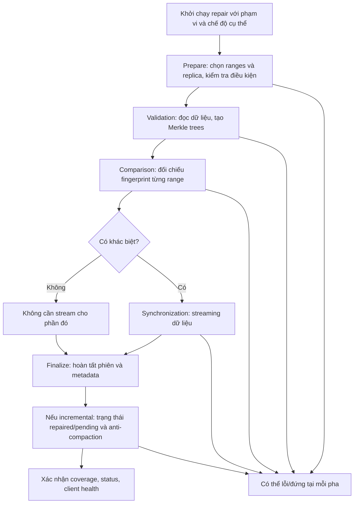
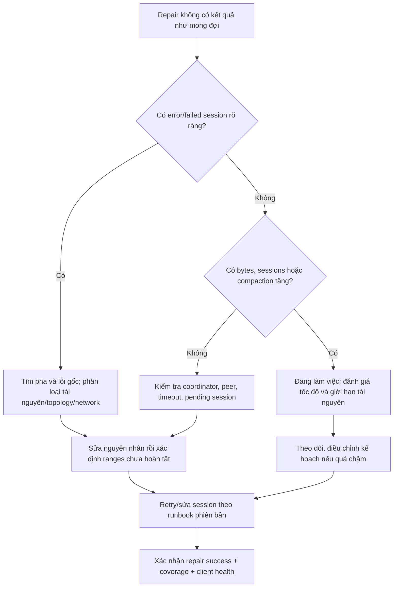

# Repair bị ngắt, thất bại hoặc không tiến triển

> **Chương:** Repair  
> **Mô-đun:** `DATABASE_ENGINE_WIDE_COLUMN_CASSANDRA` — Apache Cassandra, hệ cơ sở dữ liệu wide-column phân tán.  
> **Mục tiêu:** Phát hiện repair bị ngắt, thất bại hoặc tưởng như đứng yên; xác định đúng pha, nguyên nhân và phạm vi chưa đồng bộ; khôi phục an toàn mà không làm mất dấu xóa hoặc khiến cụm quá tải.

**Repair** của Cassandra đối chiếu dữ liệu giữa các replica của cùng token range và đồng bộ các phần sai khác. Nó đặc biệt cần thiết khi node ngừng hoạt động, bỏ lỡ ghi/xóa, hinted handoff không đủ hoặc replica bị lệch theo thời gian. Repair có thể tiêu thụ nhiều disk I/O, CPU và băng thông mạng; khi các bước bị ngắt, không có lý do gì để mặc định mọi range đã được đồng bộ.

Một tác vụ repair có thể gặp ba tình huống khác nhau:

- **Bị ngắt (interrupted):** tiến trình điều phối, kết nối quản trị, node hoặc phiên đang làm việc chấm dứt trước khi tác vụ được xác nhận hoàn tất.
- **Thất bại (failed):** hệ thống báo lỗi rõ ràng ở bước chuẩn bị, validation, comparison, streaming hoặc finalization.
- **Không tiến triển (stalled):** tác vụ còn được báo hoạt động nhưng các dấu hiệu công việc hữu ích không thay đổi trong khoảng quan sát hợp lý. Cũng có thể **chỉ là đang chạy chậm** vì phải quét một table rất lớn.

Không dùng một giá trị phần trăm, một dòng “đã khởi chạy” hay sự xuất hiện của node ở trạng thái `UN` làm bằng chứng repair thành công. Cần đối chiếu **repair command/session ID, token ranges, các replica tham gia, trạng thái của từng pha và kết quả cuối cùng**.

> **Phạm vi phiên bản:** Ví dụ vận hành dựa trên cơ chế repair và các lệnh `nodetool` được tài liệu Apache Cassandra 4.x/5.x mô tả. Cú pháp, tên metric, trạng thái của incremental session và công cụ tự động điều phối có thể khác theo phiên bản/bản phân phối. Luôn đối chiếu `nodetool help` và runbook cụm trước khi chạy trên production.

## 1. Kết quả học tập

Sau bài này, bạn có thể:

1. Mô tả luồng **prepare → validation/Merkle tree → comparison → streaming → finalize/anti-compaction** và chọn cách kiểm tra phù hợp từng pha.
2. Phân biệt **repair chạy chậm**, **repair thật sự đứng**, **repair có phần thất bại** và **chỉ mất kết nối với công cụ điều phối**.
3. Từ log/metrics, xác định node, keyspace/table, token range, DC, phiên và bước khiến repair không hoàn tất.
4. Hiểu vì sao incremental repair có trạng thái pending/finalized riêng; tránh xóa metadata hoặc khởi chạy repair chồng lấn.
5. Lập phương án retry theo phạm vi chưa hoàn thành và lịch repair, nhất là khi `gc_grace_seconds` sắp hết.
6. Thực hiện kiểm tra CQL/Java đại diện và đối chiếu với trạng thái vận hành mà không nhầm đọc thành công với cluster đã đồng bộ.
7. Viết báo cáo sự cố đầy đủ dấu vết, hành động, tiêu chí hoàn tất và rủi ro còn lại.

## 2. Repair thực hiện những việc gì?

### 2.1. Token range, replica và dữ liệu cần so

Với partition key của bảng CQL, Cassandra tính token và dùng replication strategy để chọn các replica. Một repair chỉ có ý nghĩa khi các bản sao **cùng chịu trách nhiệm cho khoảng token được chọn** cùng tham gia đối chiếu.

Giả sử RF = 3 trong `dc1`, A/B/C là ba replica của khoảng R. Nếu C Down khi A/B ghi một bản ghi mới ở `LOCAL_QUORUM`, client vẫn có thể nhận ACK (hai full replica là quorum của ba replica). C không nhất thiết có mutation. Khi C quay lại, anti-entropy repair so cùng R trên các replica và truyền phần dữ liệu lệch.

**Repair không sao chép nguyên bảng từ A sang B một cách mù quáng.** Nó chọn các ranges/replicas, dùng Merkle tree để tìm khu vực không đồng nhất, rồi thực hiện streaming/reconciliation phù hợp. Repair không tạo lại một mutation đã mất ở **tất cả** nguồn.

### 2.2. Các pha và sự cố đặc trưng



| Pha | Công việc chính | Nguyên nhân lỗi hoặc chậm thường gặp | Bằng chứng nên thu |
|---|---|---|---|
| **Prepare** | Định danh ranges, peers, schema, phiên | Replica Down, topology thay đổi, khác schema, không kết nối JMX/cluster | `nodetool status`, metadata DC/rack, log prepare, danh sách peers |
| **Validation** | Quét SSTables và xây Merkle trees | Disk read chậm, bảng lớn, tombstone/partition lớn, compaction cạnh tranh, GC cao | Validation logs, bytes/partitions validated, disk I/O, compaction stats |
| **Comparison** | So Merkle trees | Replica chưa gửi cây, timeout mạng/GC, phiên bị ngắt | Repair session ID, log tree compare, kết quả validation trên từng peer |
| **Streaming** | Truyền subranges khác biệt | Mạng lỗi, peer down, disk đích đầy, stream timeout, throttling | `nodetool netstats` ở nguồn và đích, log stream, network/disk |
| **Finalize / incremental** | Đánh dấu repaired và hoàn tất/anti-compact | Pending repair sessions, disk hết chỗ tạm, anti-compaction chậm/lỗi | `nodetool repair_admin list`, `summarize-pending`, compaction, repaired state |
| **Báo cáo hoàn tất** | Lưu thành công của job và toàn bộ coverage | Scheduler mất kết nối, ghi nhận sai, bỏ sót ranges | Exit status, log coordinator, job ID, danh sách range/session thành công |

Pha thực tế và các tên lớp trong log phụ thuộc bản Cassandra; một số luồng chạy song song hoặc có thêm bước đặc thù. Bảng này là **mô hình chẩn đoán**, không phải thứ tự gói tin cứng cho mọi phiên bản.

## 3. Tình huống “bị ngắt” khác “thất bại” như thế nào?

### 3.1. Mất phiên `nodetool` không tự động chứng minh repair thất bại

Một terminal dùng để gọi `nodetool repair` có thể đóng vì mất SSH, shell chết, công cụ quản trị bị timeout hoặc kết nối JMX bị gián đoạn. Điều này **không đủ** kết luận tất cả công việc server-side đã dừng hay đã hoàn tất.

Trình tự xác minh:

1. Ghi nhận **thời điểm**, node điều phối, command và tùy chọn repair, job/session ID nếu có.
2. Kiểm tra process/log của Cassandra trên coordinator và các peers, trạng thái repair sessions và streaming đang hoạt động.
3. Xem từng node có tiếp tục thực hiện validation/streaming/anti-compaction hay không.
4. Chỉ khi đã xác định trạng thái thật mới quyết định cần chạy lại, hủy phiên hoặc khôi phục lỗi.

Một câu “mất SSH nên chạy lệnh lại ngay” có thể vô tình tạo **hai repair cùng tranh disk/network** hoặc làm khó chẩn đoán pending session.

### 3.2. Repair báo lỗi rõ ràng

Các ví dụ về nguyên nhân có thể thấy trong log (mô tả minh họa, **không phải log nguyên văn bắt buộc**):

```text
[repair-job-a1] PREPARE failed: a replica is unavailable
[repair-job-a1] VALIDATION failed: I/O error reading SSTable
[repair-job-a1] STREAM failed: peer disconnected during transfer
[repair-job-a1] FINALIZE failed: pending incremental session cannot finalize
```

Khi thấy lỗi:

- Phải xác định nó là **lỗi đầu tiên gây ra thất bại** hay chỉ là lỗi hệ quả.
- Thu log cùng timestamp tại **coordinator, nguồn và đích**.
- Tìm keyspace, table, token range, peer, session ID, exception và trạng thái trước/sau.
- Không suy từ một exception đơn lẻ rằng Cassandra đã mất dữ liệu; cũng không coi lỗi “retry được” là đủ an toàn để bỏ qua các ranges còn thiếu.

### 3.3. Repair không tiến triển: xác nhận bằng nhiều tín hiệu

Một thanh tiến độ giữ ở 0% hay 85% trong một thời gian **không tự chứng minh bị treo**. Validation có thể xử lý một SSTable rất lớn mà chưa sinh mốc tiến độ mới; số range cũng không tỉ lệ đều với byte.

Nên chụp **hai hoặc nhiều ảnh số liệu** cách nhau một khoảng quan sát phù hợp với kích thước table và tải hệ thống, rồi so:

- Bytes/partitions validated và trạng thái validation compaction.
- Số session/range hoàn tất hoặc đổi pha.
- Streaming bytes sent/received và active sessions.
- Disk read/write bytes, CPU, GC, compaction activity.
- Lỗi/timeouts mới trong logs, node bị Down hay thay đổi topology.

Nếu không thay đổi theo thời gian, có **dấu hiệu tích cực của lỗi** hoặc peer không phản hồi, phân loại là nghi ngờ stalled. Nếu metrics vẫn tăng dù chậm, đó là **degraded/slow repair**; cần phân tích bottleneck thay vì vội hủy.

## 4. Những lệnh quan sát trước khi can thiệp

Các lệnh sau ưu tiên **đọc trạng thái**. Chạy trên các node có quyền quản trị và theo runbook của phiên bản:

```bash
# 1. Membership, DC/rack, replica health
nodetool status
nodetool describecluster

# 2. Streaming hiện tại ở từng peer
nodetool netstats

# 3. Compaction và thread pools
nodetool compactionstats
nodetool tpstats

# 4. Sức khỏe và kích thước bảng liên quan
nodetool tablestats lab_repair.events_by_account

# 5. Với các bản hỗ trợ quản lý incremental sessions
nodetool repair_admin list
nodetool repair_admin summarize-pending
```

**Tại sao cần nhiều node?** `netstats` trên coordinator có thể không hiển thị toàn bộ diễn biến tại các peers; `repair_admin` và metrics phản ánh trạng thái theo node. Dùng node/peer/range/session ID để nối các đầu mối, không chỉ xem một dashboard tổng hợp.

| Tín hiệu | Cần ghi | Không được kết luận vội |
|---|---|---|
| `nodetool status`: `UN` | Node Up/Normal, đúng DC/rack | Tất cả replica đã đồng bộ |
| `netstats` không có stream | Không thấy luồng hiện tại tại node đó | Repair hoàn tất; có thể đang validation hoặc không có mismatch |
| `compactionstats` | Pending/active, validation/anti-compaction, bytes | Có active compaction tức là repair sẽ thành công |
| `tpstats` | Active, pending, blocked, completed của các stage | Bộ đếm completed tăng tức là toàn bộ token range đã repair |
| `repair_admin list` | Incremental sessions và trạng thái liên quan | Session đang pending có thể xóa/force vô hại |
| Logs | Error đầu tiên, session ID, peer, token ranges | Một dòng “validation finished” nghĩa là đã synchronize |
| Client p99/error rate | Mức ảnh hưởng tới đọc/ghi theo CL | Đọc CQL thành công nghĩa là repair đã bao phủ cả cụm |

Một số bản Cassandra mới có **Auto Repair** riêng, nhưng khả năng kích hoạt/điều phối thay đổi theo phiên bản và cấu hình. Nếu cụm dùng Auto Repair hoặc công cụ orchestrator ngoài, kiểm tra lịch sử/đơn vị công việc trong **công cụ đó** bên cạnh `nodetool`. Đừng giả định repair luôn tự chạy hay luôn hoàn toàn thủ công.

## 5. Định danh đúng tác vụ: phạm vi và phương thức repair

Trước khi xử lý thất bại, ghi rõ **job đã định sửa dữ liệu nào**. Một tác vụ có thể “thành công” nhưng chỉ bao phủ một phần cluster.

Cần biết:

- **Keyspace và bảng**: ví dụ `lab_repair.events_by_account`.
- **Replica placement**: RF theo mỗi DC, token/vnodes, node/rack đang phụ trách phạm vi.
- **Giới hạn token/range**: `-pr`, `-st`, `-et`, DC/hosts đã chọn.
- **Repair mode**: incremental (mặc định trong tài liệu Apache Cassandra 4.x/5.x khi gọi `nodetool repair` thông thường), hay full khi thêm `--full`.
- **Scheduler**: tool, lịch, retries, session IDs, thời gian bắt đầu và hết hạn.
- **Các thay đổi song song**: bootstrap, decommission, replace, thay RF, schema hoặc data center outage.

### 5.1. Full và incremental có hậu quả khác nhau khi bị ngắt

| Đặc điểm | Full repair | Incremental repair |
|---|---|---|
| Dữ liệu được xét | Toàn bộ dữ liệu thuộc phạm vi chọn, bao gồm repaired data theo semantics phiên bản | Thông thường dữ liệu chưa được đánh dấu repaired kể từ lần incremental trước |
| Mục đích | Đối soát sâu, xử lý tình huống cần xét cả dữ liệu đã repaired | Giảm công việc lặp lại khi có lịch thường xuyên |
| Metadata trạng thái | Không dùng tiến trình incremental finalize theo cùng cách | Có thể có **pending repair sessions**, finalize, repaired metadata, anti-compaction |
| Khi bị ngắt | Phải xác định ranges hoàn tất và phạm vi cần chạy lại | Cần xác định **pending/finalized/failed sessions**, không tự xóa metadata |
| Hạn chế | Tốn I/O đáng kể | Incremental không nhất thiết kiểm lại dữ liệu từng được đánh dấu repaired |

Nếu nghi incremental session kẹt, `nodetool repair_admin list` và `nodetool repair_admin summarize-pending` giúp tìm dấu vết trên các bản có hỗ trợ. Các lệnh `cancel`/`cleanup` có tác động trạng thái; **không** chạy như mẹo chữa chung trước khi xác định chính xác session và hướng dẫn phiên bản.

### 5.2. Phạm vi `-pr` và lỗi “job thành công nhưng vẫn thiếu”

Theo tài liệu Apache Cassandra, một lệnh repair chỉ sửa **các token ranges phù hợp với node điều phối và các tùy chọn đã chọn**. Cờ `-pr` giới hạn primary ranges để tránh công việc lặp; muốn bao phủ toàn cluster cần lịch phối hợp giữa các node/DC tương ứng.

Nếu repair ở A thành công, nhưng B/C hoặc các ranges khác không được lịch chọn, dashboard “job done” chỉ chứng minh **job đó**, không chứng minh mọi dữ liệu cluster đã nhất quán.

Tương tự, `--in-local-dc`/`-dc` có thể giới hạn peers; trong cụm nhiều DC, phải kiểm tra phạm vi đồng bộ giữa các DC theo chính sách. **Không bật `--force` để bỏ qua node Down và tự coi repair đã đầy đủ**: bỏ qua peer có thể giải quyết một lỗi trước mắt nhưng vẫn để lại phần chưa được đồng bộ.

## 6. Nguyên nhân theo pha: chuẩn bị và validation

### 6.1. Lỗi prepare vì replica không sẵn sàng

**Tình huống:** Coordinator A chọn ranges cần so với B/C, nhưng C đang Down/Joining, địa chỉ liên node không liên lạc được hoặc topology chưa ổn định.

Kiểm tra theo thứ tự:

1. `nodetool status` trên nhiều node, DC/rack, host ID và membership.
2. Log gossip/peer connection, DNS/broadcast addresses, SSL/authentication liên node.
3. Đang có bootstrap, replace, decommission, thay schema/RF hay không.
4. Dung lượng đĩa và availability của replica còn lại.
5. Có đủ nguồn khỏe để phục hồi dữ liệu cần repair hay không.

**Hướng xử lý:** phục hồi tính sẵn sàng và sự ổn định của topology trước, rồi chạy lại theo phạm vi cần thiết. Nếu node đã Down quá lâu so với tombstone grace, xem phần rủi ro zombie; không bật disk image cũ lên rồi cho nhập cụm vô điều kiện.

### 6.2. Validation quét SSTables quá lâu

**Tình huống:** Job ở 0% hoặc chưa xuất hiện streaming, nhưng disk read vẫn tăng và logs chưa báo lỗi.

Đây có thể là một repair **đang thực sự làm việc**. Validation phải đọc/băm dữ liệu của ranges được giao; bảng lớn hoặc nhiều tombstone có thể mất nhiều thời gian. Những yếu tố làm chậm gồm:

- SSTables lớn, partition quá lớn, nhiều phiên bản/tombstone.
- Disk read IOPS/bandwidth cạn vì client traffic hoặc compaction.
- JVM GC, CPU saturation, thread pool backlog.
- Ổ đĩa gần đầy, vấn đề I/O/SMART, file corruption.
- Repair chọn phạm vi quá rộng hoặc quá nhiều job đồng thời.

**Hướng xử lý:** đo bytes validated qua thời gian, kiểm tra compaction và tài nguyên. Nếu có tiến độ nhưng chậm, thu hẹp concurrency/job scope cho **các lần chạy sau** bằng công cụ được hỗ trợ; không cố kill validator đang hoạt động nếu không có runbook dừng an toàn.

### 6.3. Validation thất bại với lỗi SSTable hoặc I/O

Nếu log cho biết không đọc được SSTable, hash/validation thất bại, cần xác định:

- Lỗi đĩa/phần cứng hay dữ liệu SSTable bị hỏng?
- Các replica khác còn bản dữ liệu có thể phục hồi không?
- Có backup/snapshot hợp lệ để điều tra không?
- Tác động của công cụ sửa chữa SSTable lên dữ liệu là gì?

Các thao tác như scrub, xóa SSTable, sửa repaired marker hoặc thay đổi file thủ công có thể gây mất dữ liệu. **Không tự áp dụng** để làm repair “vượt qua lỗi”; dùng runbook khôi phục đúng phiên bản và nguồn dữ liệu tin cậy.

## 7. Nguyên nhân theo pha: comparison và streaming

### 7.1. Comparison chờ peer hoặc lệch Merkle trees

Nếu Merkle trees đã được tạo tại A nhưng job chưa chuyển sang streaming, kiểm tra cây/validation từ **tất cả peers** đã gửi về chưa. Một bên có thể vẫn đang quét dữ liệu hoặc node bị GC/network timeout.

Hash khác nhau chỉ cho biết phạm vi có sai khác và cần synchronization; **không có “danh sách row phải copy ngay”** trong mọi trường hợp. Nếu một số peers kết thúc validation nhưng một peer lỗi, job vẫn chưa hoàn tất.

### 7.2. Streaming không tiến

Lúc này cần nhìn `nodetool netstats` **cả phía nguồn lẫn phía nhận**, kết hợp log stream:

| Quan sát | Hướng chẩn đoán |
|---|---|
| Không kết nối được peer | Địa chỉ internode, DNS, TLS, firewall, node Down |
| Có stream session nhưng byte không tăng | Network congestion, disk đích nghẽn, stream throttling, I/O timeout |
| Bytes sent tăng nhưng receive bị lỗi | Network reset, đích thiếu disk, checksum/read error, cơ chế retry |
| Stream tiến rồi fail liên tục | Peer flapping, timeout, ràng buộc resource, bug phiên bản cần kiểm tra |
| Không có stream dù cây khớp | Có thể **bình thường** nếu không có mismatch |
| Không có stream dù validation chưa xong | Đang ở pha trước, chưa thể nói lỗi streaming |

Streaming repair chịu ảnh hưởng bởi cùng mạng/đĩa đang phục vụ đọc ghi và có thể cạnh tranh với bootstrap hoặc hints delivery. Điều chỉnh throughput chỉ nên theo metric thực tế và công cụ/tùy chọn **đúng phiên bản**, không đặt “unlimited” để chữa lỗi đĩa hoặc GC.

### 7.3. Đích hết dung lượng

Dù chỉ đồng bộ sai khác, streaming và compaction có thể cần tệp tạm; incremental anti-compaction cũng có thể ghi lại SSTables. Khi disk headroom không đủ:

1. Xác định partition/filesystem nào đầy, dung lượng active SSTable, snapshot, compaction temporary.
2. Kiểm tra tác vụ concurrent và nguyên nhân byte tăng.
3. Bảo vệ tính toàn vẹn dữ liệu, lập kế hoạch tăng dung lượng hoặc xử lý snapshot theo retention policy.
4. Chỉ chạy lại repair khi tài nguyên đủ cho **toàn bộ vòng đời** chứ không chỉ byte stream đầu vào.

**Không xóa tombstone hoặc hạ `gc_grace_seconds` để lấy chỗ ngay.** Đây là thay đổi có nguy cơ làm dữ liệu đã xóa sống lại khi replica cũ trở về.

## 8. Incremental repair: pending session, finalize và anti-compaction

### 8.1. Tại sao cần theo dõi trạng thái session?

Incremental repair có thể chia SSTable theo **repaired/unrepaired/pending** trong quá trình xử lý; sau khi repair thành công, trạng thái dữ liệu được đánh dấu/phân tách theo cơ chế phiên bản. Anti-compaction có thể tạo thêm file/disk I/O để xử lý repaired ranges.

Nếu phiên bị ngắt sau validation/streaming nhưng trước finalize, node có thể giữ dữ liệu **pending repair**. Một người vận hành chỉ nhìn thấy “stream xong” rồi cho rằng mọi thứ đã done sẽ bỏ sót trạng thái này.

Các công cụ chẩn đoán được tài liệu `nodetool repair_admin` mô tả:

```bash
# Đọc các repair sessions
nodetool repair_admin list

# Nếu được hỗ trợ, bao gồm cả session đã hoàn tất/thất bại
nodetool repair_admin list --all

# Tóm tắt lượng dữ liệu đang pending và repaired
nodetool repair_admin summarize-pending
nodetool repair_admin summarize-repaired
```

**Lưu ý:** tên subcommand/option và thông tin kết quả phụ thuộc phiên bản. Đây là **lệnh quan sát**; không đặt `cancel` hoặc `cleanup --force` vào script tự động chỉ vì thấy pending.

### 8.2. Khi session pending nhiều giờ

Cần phân biệt:

- **Có thể vẫn đang hoạt động:** anti-compaction đang xử lý SSTable lớn, disk write tăng.
- **Bị chặn bởi compaction:** có backlog dài, không đủ tài nguyên/tệp cần khóa.
- **Coordinator hoặc peer đã chết:** session không thể finalize như dự kiến.
- **Metadata treo sau lỗi:** có pending session sau khi workflow đã thất bại; cách xử lý phụ thuộc bản Cassandra.

Các bước an toàn:

1. Thu `repair_admin list` trên các node liên quan cùng session ID.
2. Ghi lại trạng thái từng peer và các ranges, repaired/pending stats.
3. Đối chiếu log prepare/validation/sync/finalization với compaction stats.
4. Xác định job còn sống hay đã thất bại; tránh tạo job chồng lấn.
5. Nếu phải hủy hoặc dọn phiên, áp dụng **chính xác lệnh và điều kiện của bản triển khai**, sau backup/runbook/phê duyệt vận hành.
6. Sau xử lý, **chạy lại phạm vi chưa hoàn thành và kiểm chứng**, không tự đánh dấu toàn bộ bảng repaired.

### 8.3. `repair_admin cancel` không phải công tắc dừng mọi repair

Trong tài liệu Apache Cassandra 5.0, `repair_admin cancel --session <id>` hủy **incremental repair session** tương ứng; `--force` có điều kiện riêng khi gọi không từ coordinator. `cleanup` xử lý pending data trong những tình huống cụ thể.

Các thao tác này là **mutation của trạng thái hệ thống**, không phải công cụ chỉ xem lỗi. Dùng sai session ID, sai thời điểm hay bắt buộc hủy có thể làm khó phục hồi. Nếu chưa xác định hướng xử lý, giữ lại log/session ID và kiểm tra runbook thay vì chạy lệnh cho mọi phiên.

### 8.4. Preview/validate giúp chẩn đoán gì?

Tài liệu `nodetool repair` hỗ trợ các biến thể:

```bash
# Chỉ ước lượng phạm vi và dữ liệu có thể cần stream; không stream để sửa
nodetool repair --preview --full lab_repair events_by_account

# Kiểm tra tính đồng bộ của repaired data theo tùy chọn của phiên bản;
# không stream để sửa
nodetool repair --validate lab_repair events_by_account
```

`--preview` và `--validate` **vẫn phải xây/so Merkle trees, có thể gây I/O đáng kể**. Chúng là phép kiểm tra trước hoặc sau khi sửa trong phạm vi xác định, **không thay thế việc repair thật**. Nếu một hệ thống đã nghẽn disk, thậm chí preview có thể làm tình trạng xấu thêm; cần chọn thời điểm hợp lý.

## 9. Rủi ro thời gian: `gc_grace_seconds` và replica Down

Một repair bị ngắt trở thành vấn đề **tính đúng đắn dữ liệu** khi một replica bỏ lỡ `DELETE` hoặc update mà tombstone trên các replica khỏe tiến gần thời điểm đủ điều kiện purge.

Giả sử RF=3, A/B nhận DELETE khi C Down, CL `LOCAL_QUORUM` đã ACK. C giữ giá trị cũ. `gc_grace_seconds` thường có mặc định 864000 giây (10 ngày), nhưng phải đọc giá trị **thực tế của từng bảng**.

Quy tắc dự phòng vận hành mang tính định hướng:

\[
T_{\mathrm{down}} + T_{\mathrm{repair\_finish}} + T_{\mathrm{margin}} < T_{\mathrm{grace}}
\]

Đây **không phải** chứng minh toán học an toàn trong mọi trạng thái: tuổi của từng tombstone, peers và DC, điều kiện compaction/purge, kiểu repair và lỗi đồng thời đều quan trọng. Nhưng nếu một node đã Down 8 ngày, repair dự kiến mất 3 ngày và grace chỉ 10 ngày thì **không còn biên thời gian đủ đáng tin cậy**.

| Tình huống | Rủi ro | Hành động |
|---|---|---|
| Repair fail lúc node Down 1 giờ | Thường còn thời gian phục hồi | Sửa lỗi, chạy lại phạm vi cần thiết, xác nhận completion |
| Repair lặp fail trong nhiều ngày | Range chưa đồng bộ ngày càng cũ | Ưu tiên RCA và khôi phục trước thời hạn grace |
| Node Down vượt grace và vẫn giữ dữ liệu cũ | Nguy cơ **zombie data** nếu tombstone đã purge | Không nhập lại node cũ vô điều kiện; đánh giá replace/rebootstrap từ nguồn tin cậy |
| Repair success chỉ ở một DC | Replica DC khác có thể chưa nhận delete | Kiểm tra policy và coverage giữa DC |
| Tombstone đã mất ở mọi nguồn | Repair không thể suy ra “ý định xóa” | Dùng audit/backup, xác định dữ liệu cần xử lý ở tầng nghiệp vụ |

Đừng kéo dài `gc_grace_seconds` như một phản ứng tự động trong lúc repair fail mà bỏ qua lịch tombstone đã tồn tại, áp lực đĩa và khả năng đồng bộ. Thay đổi cấu hình phải đi cùng đánh giá vòng đời dữ liệu và kế hoạch khôi phục.

## 10. Runbook phân loại và xử lý sự cố

### 10.1. Bước 1 — Bảo toàn dấu vết

Trước khi restart/chạy lại:

- Ghi command/tùy chọn, Cassandra version, coordinator và thời điểm.
- Lưu job ID/session ID, keyspace/table, token range, peers và datacenter.
- Thu log liên quan từ coordinator và các node tham gia theo cùng khoảng thời gian.
- Chụp trạng thái node, netstats, compactionstats, repair_admin, I/O và disk headroom.
- Ghi nhận client timeout/unavailable, p95/p99, ongoing writes/deletes.
- Nếu có scheduler, lưu trạng thái retry/cancel và các nhiệm vụ đang chờ.

Bước này giúp tránh mất khả năng truy nguyên nguyên nhân gốc khi repair bất ngờ tự hồi phục hoặc job được chạy lại.

### 10.2. Bước 2 — Xác định trạng thái thực



### 10.3. Bước 3 — Chọn cách xử lý theo nguyên nhân

| Triệu chứng đã xác nhận | Cách xử lý ưu tiên | Điều không nên làm |
|---|---|---|
| Peer Down, topology chưa ổn định | Sửa availability/topology, tính lại phạm vi repair | Chạy `--force` và coi peer bị bỏ qua đã repaired |
| Mất SSH/JMX nhưng server còn chạy | Theo dõi server-side job và sessions | Chạy lại cùng job ngay |
| Validation chậm, bytes vẫn tăng | Kiểm tra I/O, GC, compaction, size; quản lý lịch | Kill task chỉ vì UI đứng ở 0% |
| Stream timeout do mạng | Sửa đường internode và băng thông, xác nhận peer khỏe | Cứ tăng concurrency/throughput |
| Disk thiếu chỗ | Tăng headroom an toàn, xử lý snapshot theo policy | Xóa SSTable/tombstone tùy tiện |
| Incremental pending lâu, finalize fail | Kiểm tra `repair_admin` và anti-compaction, dùng quy trình khôi phục tương ứng | Xóa/cancel tất cả session không phân biệt |
| SSTable corrupted | Phân tích nguồn tin cậy, backup và thủ tục phục hồi | Scrub/xóa tệp mà không đánh giá dữ liệu |
| Job chỉ sửa một phần ranges | Hoàn thành coverage còn thiếu | Sửa badge thành “complete” cho cả cluster |

### 10.4. Bước 4 — Quyết định retry

Không phải mọi retry đều an toàn như nhau.

1. **Nếu repair còn hoạt động:** không tạo bản chạy mới chồng lấn.
2. **Nếu job đã failed:** xác định các sessions/ranges thành công và thất bại; làm sạch trạng thái pending **chỉ nếu** cơ chế phiên bản yêu cầu và có runbook rõ.
3. **Nếu nguyên nhân gốc chưa được sửa:** chạy lại thường chỉ lặp lỗi và tăng tải.
4. **Nếu thời gian grace sắp hết:** ưu tiên phương án khôi phục replica đáng tin cậy, không xem retry bất tận là chiến lược bảo vệ dữ liệu.
5. **Nếu cần chạy full repair:** đánh giá đầy đủ disk/network capacity vì nó xử lý cả dữ liệu từng được đánh dấu repaired.
6. **Sau retry:** xác nhận từng phạm vi hoàn tất, không chỉ câu trả lời từ một `nodetool` invocation.

Phạm vi retry nên được điều phối theo token ranges/nodes/DC tương ứng để tránh bỏ sót và tránh làm lại quá nhiều; đừng tự tính range từ cảm tính khi vnodes đang tồn tại.

## 11. Ví dụ CQL minh họa dữ liệu cần repair

Tạo keyspace thử nghiệm trong cluster có **đủ ba node ở `dc1`**:

```sql
CREATE KEYSPACE IF NOT EXISTS lab_repair
WITH replication = {
    'class': 'NetworkTopologyStrategy',
    'dc1': 3
};

CREATE TABLE IF NOT EXISTS lab_repair.events_by_account (
    account_id uuid,
    event_id timeuuid,
    occurred_at timestamp,
    payload text,
    PRIMARY KEY ((account_id), event_id)
) WITH CLUSTERING ORDER BY (event_id DESC)
  AND gc_grace_seconds = 864000;
```

Trong `cqlsh`:

```sql
CONSISTENCY LOCAL_QUORUM;

INSERT INTO lab_repair.events_by_account
(account_id, event_id, occurred_at, payload)
VALUES (
    11111111-1111-1111-1111-111111111111,
    7c627d5a-a6b0-11ef-8ae8-0242ac120002,
    '2026-11-21 08:00:00+0000',
    'created'
);

SELECT event_id, payload
FROM lab_repair.events_by_account
WHERE account_id = 11111111-1111-1111-1111-111111111111;
```

Khi lab giả lập một replica Down, có thể ghi/xóa tại `LOCAL_QUORUM` để tạo cơ hội một replica bỏ lỡ mutation (tùy hints). Ví dụ:

```sql
DELETE FROM lab_repair.events_by_account
WHERE account_id = 11111111-1111-1111-1111-111111111111
  AND event_id = 7c627d5a-a6b0-11ef-8ae8-0242ac120002;

SELECT event_id, payload
FROM lab_repair.events_by_account
WHERE account_id = 11111111-1111-1111-1111-111111111111;
```

**Phép `SELECT` trả về rỗng không chứng minh repair đã hoàn tất.** Nó có thể được phục vụ bởi các replica đã nhận tombstone, trong khi một replica khác còn giữ giá trị cũ. Phải theo dõi cả trạng thái node, repair và coverage.

## 12. Bài lab: phân biệt repair chậm, thất bại và bị ngắt

Mọi fault injection dưới đây **chỉ thực hiện trong cluster lab có snapshot/backup và phương án reset môi trường**. Không gây lỗi node hoặc mạng trên production để học.

### 12.1. Chuẩn bị baseline

1. Tạo bảng `lab_repair.events_by_account` và dữ liệu trải trên **nhiều `account_id`**, để sample chạm nhiều token ranges.
2. Ghi lại Cassandra version, RF theo DC, `gc_grace_seconds` và `nodetool status`.
3. Chạy một full repair lab có phạm vi được hiểu rõ:

```bash
# Kiểm tra nodetool help repair trước khi chạy
nodetool repair --full lab_repair events_by_account
```

4. Thu stdout, exit code, coordinator log, session IDs, thời gian và các chỉ số `netstats/compactionstats`.
5. Xác nhận job thực sự thành công, không còn lỗi pending ở phạm vi dự kiến.

### 12.2. Kịch bản A — Validation chậm nhưng còn tiến độ

- Tạo table lab đủ lớn và chạy repair dưới tải được kiểm soát.
- Chụp bytes validated, disk read throughput, active compaction và logs hai lần.
- Nếu dữ liệu vẫn được quét, phân loại **slow**, không gán nhãn **stalled** chỉ vì phần trăm chưa đổi.
- Đánh giá khách quan: elapsed time, bytes/giây, độ trễ client, thời gian ước tính để kịp lịch repair.

### 12.3. Kịch bản B — Mất kết nối quản trị

- Khởi chạy repair trong môi trường thử nghiệm có log/session ID.
- Ngắt **kết nối terminal/quản trị** theo cách được phép trong lab, tránh gây lỗi server ngoài dự kiến.
- Sau đó xem server-side repair session, logs, `netstats` và trạng thái cuối.
- Ghi nhận các trường hợp: job tiếp tục, job abort, hoặc không xác định được từ một node.
- Chỉ retry sau khi đã xác minh job cũ chấm dứt/thất bại và hướng xử lý session rõ ràng.

### 12.4. Kịch bản C — Peer Down làm repair failed

- Dùng cluster lab RF=3, cố tình cách ly một peer theo phương pháp fault injection của lab.
- Quan sát prepare/validation/streaming có lỗi nào, lấy session ID và log ở peer.
- Phục hồi peer trước khi hết grace, đối chiếu data/repair coverage.
- Chạy lại phạm vi còn thiếu bằng runbook và xác nhận lần chạy mới thành công.

### 12.5. Kịch bản D — Incremental finalize bị kẹt

- Môi trường phải hỗ trợ incremental repair và công cụ quản lý phiên.
- Tạo trạng thái lỗi trong lab có kiểm soát; thu `repair_admin list`, `summarize-pending`, compaction backlog.
- Xác định job còn hoạt động hay phiên đã fail; **không** ép cancel/cleanup chỉ vì thấy pending.
- Thực hành thủ tục recovery được tài liệu đúng phiên bản cho phép, rồi kiểm tra pending data và repair coverage.

### 12.6. Phiếu kết quả lab

| Trường | Giá trị cần ghi |
|---|---|
| Bản Cassandra và topology | Version, nodes, DC/racks, RF |
| Bài test | Validation chậm / mất JMX / peer Down / pending incremental |
| Command, options, job ID | Chính xác chuỗi lệnh và session IDs |
| Phạm vi | Keyspace, table, token ranges, participants |
| Bằng chứng trước/sau | Logs, netstats, compactionstats, repair_admin |
| Kết quả | Success, failed, partial hoặc vẫn chưa xác định |
| Retry đã thực hiện | Phương pháp, phạm vi, thời gian |
| Coverage và rủi ro | Các ranges hoàn tất, tombstone grace còn lại |

## 13. Cách xác minh “đã phục hồi” sau sự cố

Một lần repair chạy lại không được coi hoàn tất nếu chỉ vì command trả về mã 0 mà chưa đối chiếu phạm vi.

Dùng checklist sau:

1. **Topology:** các replica mục tiêu Up/Normal, không còn node Down/Joining ngoài kế hoạch.
2. **Sessions:** coordinator và peers không còn repair sessions liên quan đang failed/pending chưa được xử lý theo policy.
3. **Pha dữ liệu:** validation/comparison/sync/finalization được xác nhận hoàn tất trong log/job history.
4. **Coverage:** đúng keyspace/tables, token ranges và DC/replicas đã được lịch repair bao phủ; phần thất bại trước đó đã xử lý.
5. **Sức khỏe hệ thống:** compaction/backlog, disk, network, GC và p95/p99 của client trở lại vùng chấp nhận được.
6. **Đúng dữ liệu:** kiểm tra CQL các partition đại diện (gồm insert, update, delete, TTL) ở CL cần thiết, đồng thời dùng đối soát nghiệp vụ cho dữ liệu quan trọng.
7. **Grace:** lịch sửa chữa vẫn có biên an toàn; node Down quá lâu đã được xử lý bằng nguồn dữ liệu tin cậy.
8. **Báo cáo:** lưu lịch sử lỗi và thời điểm hoàn tất repair cuối, cập nhật lịch và cảnh báo.

**Giới hạn:** một số mẫu `SELECT` đúng không chứng minh mọi row trong cluster đều đúng; repair đồng nhất những dữ liệu tồn tại trong các replica đã chọn, không tái tạo mutation đã biến mất khỏi mọi nguồn hoặc sửa lỗi nghiệp vụ giống nhau trên tất cả bản sao.

## 14. Ứng dụng Java nên phản ứng thế nào khi repair ảnh hưởng dịch vụ?

Repair là tác vụ quản trị, không phải API mà business service nên gọi mỗi khi một lệnh CQL timeout. Khi validation/streaming làm disk/network bận, ứng dụng Java có thể thấy read/write p99 cao hơn hoặc lỗi `UnavailableException`/`DriverTimeoutException`.

Ví dụ **Java Driver 4.x** đọc theo partition key ở `LOCAL_QUORUM`:

```java
import com.datastax.oss.driver.api.core.CqlSession;
import com.datastax.oss.driver.api.core.DefaultConsistencyLevel;
import com.datastax.oss.driver.api.core.cql.PreparedStatement;
import com.datastax.oss.driver.api.core.cql.BoundStatement;
import com.datastax.oss.driver.api.core.cql.ResultSet;
import java.net.InetSocketAddress;
import java.util.UUID;

public final class RepairAwareReader {
    public static void main(String[] args) {
        UUID accountId =
            UUID.fromString("11111111-1111-1111-1111-111111111111");

        try (CqlSession session = CqlSession.builder()
                .addContactPoint(new InetSocketAddress("127.0.0.1", 9042))
                .withLocalDatacenter("dc1")
                .build()) {

            PreparedStatement ps = session.prepare(
                "SELECT event_id, occurred_at, payload " +
                "FROM lab_repair.events_by_account " +
                "WHERE account_id = ? LIMIT 20");

            BoundStatement query = ps.bind(accountId)
                .setConsistencyLevel(DefaultConsistencyLevel.LOCAL_QUORUM)
                .setPageSize(20);

            ResultSet result = session.execute(query);
            result.forEach(row ->
                System.out.println(row.getUuid("event_id")));
        }
    }
}
```

Đoạn mã giả định keyspace/cluster lab ở phần 11 đã sẵn sàng và cấu hình đúng DC. Chỉ số cần theo dõi ở ứng dụng: **query shape, read/write QPS, p95/p99 latency, timeout/unavailable, số lần retry, page count và lỗi theo node**.

Hướng xử lý:

- Thiết kế partition key và CQL theo query shape để giảm truy vấn đắt tiền lúc cluster đang repair.
- Đặt CL/timeout dựa trên yêu cầu nghiệp vụ; không tự đổi `LOCAL_QUORUM` xuống `ONE` để che lỗi repair mà không hiểu trade-off consistency.
- Tránh retry vô hạn gây storm; với mutation có side effects, timeout không chứng minh ghi thất bại và retry cần idempotency.
- Tách dashboard **client availability** khỏi **repair completion**; API vẫn phục vụ được không có nghĩa các replica đã đồng bộ đầy đủ.
- Nếu repair làm vượt SLO, phối hợp đội vận hành giảm mức song song/đổi lịch theo công cụ được hỗ trợ, thay vì sửa dữ liệu trực tiếp từ ứng dụng.

## 15. Các sai lầm cần tránh

### “Progress 0% trong nửa giờ tức là repair bị treo”

Có thể validation đang quét SSTable lớn. So metrics qua thời gian và xem logs trước khi kết luận.

### “Cắt SSH rồi command biến mất, chắc chắn repair dừng”

Mất phiên điều khiển không đủ chứng minh trạng thái các tác vụ nội bộ. Kiểm tra coordinator/peers và session IDs.

### “Repair trả success trên node A thì toàn cụm đã được repair”

Repair có phạm vi theo node, ranges, tables, DC và options. Phải xác nhận coverage của lịch toàn cluster.

### “Không có streaming nghĩa là repair vô ích hoặc lỗi”

Nếu Merkle trees khớp, không cần stream cũng có thể là kết quả đúng. Nếu chưa validation xong, không có stream là bình thường.

### “Bật `--force` để bỏ qua node Down thì đã an toàn”

Một peer không tham gia có thể giữ dữ liệu cũ. `--force` không giải quyết tính nhất quán của replica bị bỏ qua.

### “Dọn hết pending sessions là hết lỗi”

Pending incremental state có ý nghĩa trong vòng đời repair; cancel/cleanup sai có thể phức tạp hóa sự cố. Phải biết session nào và vì sao trước khi chỉnh trạng thái.

### “Đổi `gc_grace_seconds = 0` thì repair khỏi bị chặn bởi tombstone”

Đây là rủi ro zombie data, không phải cách sửa repair. Dấu xóa cần được giữ để replica bỏ lỡ DELETE còn có cơ hội nhận nó.

### “Repair thành công là đủ, khỏi cần backup”

Repair không bảo vệ khỏi xóa nhầm đã được sao chép tới mọi replica, mất dữ liệu trên mọi nguồn, hoặc lỗi ứng dụng. Backup và audit vẫn cần thiết.

## 16. Bài tập tình huống

**Bài 1 — Kiểm tra progress.** Repair ở 0% trong 45 phút. Bytes validated đã tăng từ 100 GiB lên 260 GiB, disk read vẫn cao, không có lỗi. Bạn phân loại là stuck hay slow? Cần kiểm tra thêm gì để đánh giá thời điểm hoàn thành?

**Bài 2 — Mất điều khiển.** SSH đến coordinator mất kết nối khi repair đang chạy. Điều gì phải kiểm tra trước khi gửi lại chính xác lệnh cũ?

**Bài 3 — Pending incremental.** `repair_admin list` vẫn thấy pending session trong khi `netstats` không còn stream. Có thể dùng `cancel --force` ngay không? Những bằng chứng nào cần thu?

**Bài 4 — Vượt grace.** RF=3, C Down 12 ngày, `gc_grace_seconds` 10 ngày. A/B đã từng nhận DELETE, không có repair thành công cho C. Vì sao chỉ khởi động C rồi chạy full repair không bảo đảm an toàn?

**Bài 5 — Không có stream.** Full repair kết thúc không thấy streaming. Nêu hai giải thích: một hợp lệ và một cần điều tra.

**Bài 6 — Thiếu coverage.** Cluster có hai datacenter, công cụ scheduler chỉ chạy `-pr` ở một số node tại `dc1`. Có thể tuyên bố `dc2` đã đồng bộ không? Cần bảng kiểm chứng gì?

**Bài 7 — Dữ liệu đọc đúng nhưng repair failed.** App đọc `account_id=X` ở `LOCAL_QUORUM` và thấy dữ liệu mong muốn, trong khi validation ở C thất bại. Có nên đóng incident không?

**Bài 8 — Disk full ở pha streaming.** Một peer đích chỉ còn 2% disk trống; stream thất bại. Vì sao tăng retry concurrency là nguy hiểm và cần xem những nguồn dung lượng nào?

### Gợi ý đáp án

1. **Slow, có tiến độ.** Xem tốc độ byte/giây, tổng phạm vi, GC, I/O, p99, compaction và khả năng kịp lịch/grace.
2. Xem logs/coordinator/peer, session ID, trạng thái validation/stream/repair_admin; tránh job chồng lấn.
3. **Không.** Xác định phase, job owner, repaired/pending state, anti-compaction, lỗi gốc và hướng dẫn phiên bản.
4. Tombstones có thể đã bị purge, C giữ dữ liệu cũ và có nguy cơ zombie; phải cách ly/đánh giá rebuild/replacement từ nguồn tin cậy.
5. Hợp lệ: các Merkle trees khớp. Cần điều tra: job không thực sự chạy/không bao phủ phạm vi hoặc validation bị bỏ dở.
6. **Không.** Cần coverage của tất cả token ranges, peers/DC, table, job IDs và session statuses theo policy.
7. **Chưa.** Read mẫu không chứng minh replica C/ranges khác đã sửa; cần khôi phục repair và xác minh.
8. Có nguy cơ hết disk khi nhận SSTable/anti-compaction; xem active files, snapshot, compaction temp, free headroom, disk errors và tải đồng thời.

## 17. Checklist ứng phó để lưu vào runbook

**Khi phát hiện:**

- [ ] Ghi thời gian, owner, job/session ID, command, Cassandra version.
- [ ] Phân loại interrupted/failed/stalled/slow bằng logs và metrics.
- [ ] Lấy `status`, `netstats`, `compactionstats`, `tpstats` trên coordinator và peers.
- [ ] Kiểm tra pending incremental sessions nếu phiên bản hỗ trợ.
- [ ] Xác định table, ranges, DC/replicas, mode full/incremental và mọi tùy chọn giới hạn.
- [ ] Đánh giá disk, CPU, GC, mạng, compaction, client SLO và node Down.

**Khi xử lý:**

- [ ] Sửa nguyên nhân gốc; không tạo repair chồng lấn khi job cũ còn sống.
- [ ] Không tự xóa SSTables, repaired markers hoặc pending session metadata.
- [ ] Chỉ dùng cancel/cleanup/force theo runbook phiên bản với session chính xác.
- [ ] Kiểm tra tuổi node Down + repair backlog so với `gc_grace_seconds`.
- [ ] Nếu rủi ro zombie, cách ly node cũ và xác định nguồn phục hồi tin cậy.

**Khi đóng sự cố:**

- [ ] Đã xác nhận repair session hoàn tất theo mode đúng.
- [ ] Các token ranges, tables và DC cần thiết đã được bao phủ.
- [ ] Không còn pending/failed state chưa giải quyết theo policy.
- [ ] Trạng thái cluster, compaction và client p99 đã ổn định.
- [ ] Đã kiểm tra dữ liệu CQL đại diện và đối soát nghiệp vụ khi cần.
- [ ] Lưu lại RCA, log, thời gian hoàn tất, hành động và cảnh báo phòng ngừa.

## 18. Tài liệu đối chiếu theo phiên bản

- [Apache Cassandra — Repair: full/incremental, phạm vi và lịch vận hành](https://cassandra.apache.org/doc/stable/cassandra/managing/operating/repair.html).
- [Apache Cassandra — nodetool repair: full, preview, validate, tùy chọn phạm vi](https://cassandra.apache.org/doc/latest/cassandra/managing/tools/nodetool/repair.html).
- [Apache Cassandra — nodetool repair_admin: list, pending, cancel/cleanup](https://cassandra.apache.org/doc/stable/cassandra/managing/tools/nodetool/repair_admin.html).
- [Apache Cassandra — nodetool netstats: quan sát streaming](https://cassandra.apache.org/doc/stable/cassandra/managing/tools/nodetool/netstats.html).
- [Apache Cassandra — Monitoring: validation, synchronization, anti-compaction metrics](https://cassandra.apache.org/doc/stable/cassandra/managing/operating/metrics.html).

Các tài liệu công khai có thể trỏ tới phiên bản hoặc bản build khác với cluster đang chạy. Khi thực thi, **cú pháp và hành vi thực tế phải được kiểm tra bằng bản Cassandra, `nodetool help` và runbook nội bộ của cụm**.

## 19. Ghi nhớ

- Repair có nhiều pha; **validation xong không đồng nghĩa synchronization/finalize đã xong**.
- Để xác định repair stuck, cần **so tiến độ thực qua thời gian** và tìm lỗi gốc; phần trăm không đủ.
- Mất SSH/JMX, lỗi coordinator và lỗi server-side không thể suy ra từ cùng một dấu hiệu.
- Incremental repair có trạng thái **pending/repaired** cần quản lý; không tự force-cancel, cleanup hoặc xóa metadata khi chưa hiểu session.
- Retry chỉ có ích **sau khi sửa nguyên nhân**, và phải xác nhận **range/replica/DC coverage** của công việc đã hoàn tất.
- Tombstone grace làm repair thất bại trở thành rủi ro dữ liệu: một replica bỏ lỡ DELETE quá lâu có thể tái phát tán dữ liệu zombie.
- CQL/Java client vẫn có thể trả kết quả đúng trong khi repair thất bại; **availability và replica synchronization là hai trục giám sát riêng**.
