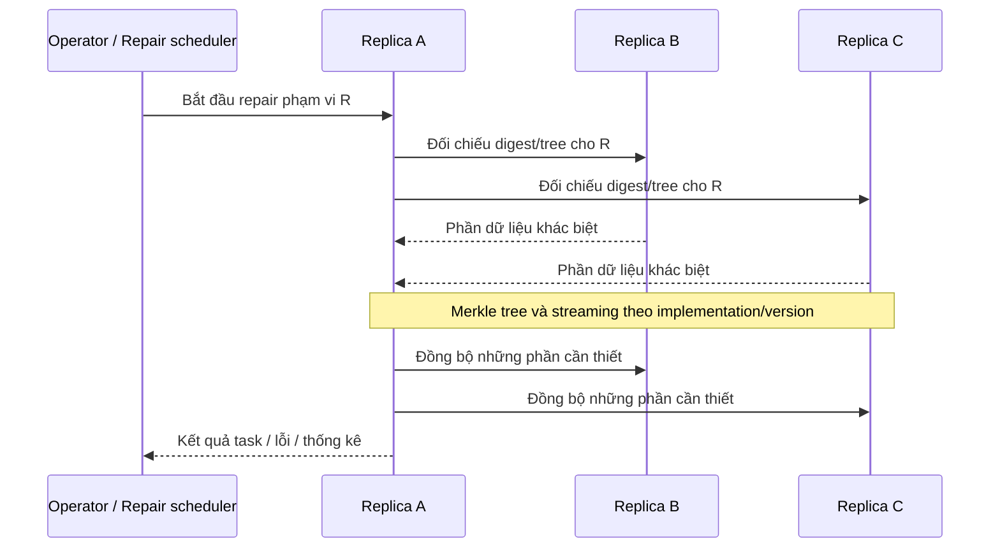
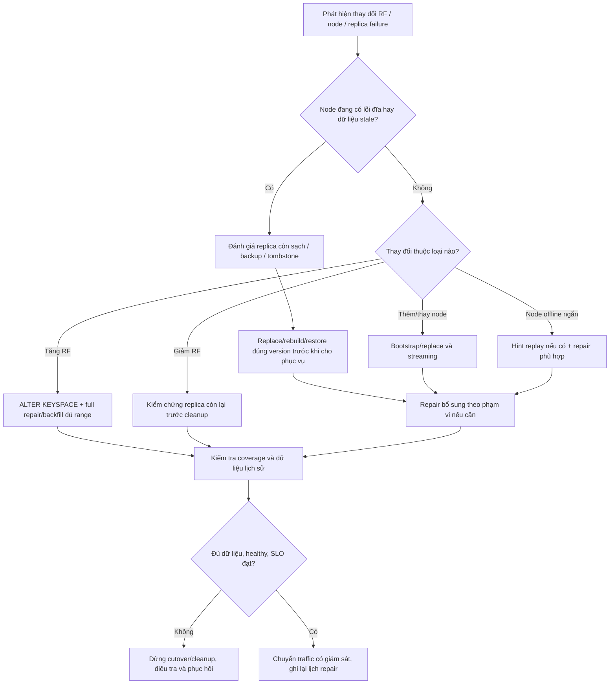

# Repair sau thay đổi RF, thay nút hoặc sự cố bản sao trong Apache Cassandra

## 1. Bài toán thực tế: node khỏe chưa có nghĩa các bản sao đã đồng bộ

Trong **Apache Cassandra**, một partition được xác định bằng **partition key**, ánh xạ thành token và được đặt trên các **replica** theo replication strategy của keyspace. Mỗi replica có commit log, memtable và SSTable riêng. Khi ghi ở mức nhất quán như `LOCAL_QUORUM`, request có thể thành công dù một replica không nhận được bản ghi. Nếu node mất kết nối hoặc thay đổi vị trí lưu dữ liệu, các replica có thể giữ những phiên bản khác nhau.

**Repair (anti-entropy repair)** là quy trình so sánh dữ liệu giữa các replica đang chịu trách nhiệm cho một token range, phát hiện khác biệt và truyền phần dữ liệu cần thiết để hội tụ. Nó quan trọng trong ba tình huống của bài:

1. **Tăng/giảm replication factor (RF):** danh sách replica mục tiêu thay đổi, nhưng metadata không tự bảo đảm dữ liệu lịch sử đã có đủ ở nơi mới.
2. **Thay thế/thêm/bớt node:** streaming có thể đưa dữ liệu vào node mới, nhưng vẫn cần kế hoạch kiểm chứng và repair những phạm vi còn thiếu hoặc lệch.
3. **Sự cố bản sao:** replica offline, lỗi mạng, thất bại ghi hoặc phục hồi từ bản sao cũ có thể để lại dữ liệu không đồng nhất, đặc biệt nguy hiểm khi có tombstone/TTL.

Bài thuộc chương **Repair** của mô-đun `DATABASE_ENGINE_WIDE_COLUMN_CASSANDRA`, trong phạm vi kiến trúc phân tán và wide-column, khóa phân vùng, thiết kế bảng theo truy vấn, consistency level, CQL, replication, compaction, vận hành lỗi và kết nối Java Driver.

### Mục tiêu học tập

Sau bài này, người học có thể:

- Phân biệt **repair**, **bootstrap/streaming**, **hinted handoff**, **read repair**, **cleanup** và **compaction**.
- Giải thích vì sao sau **tăng RF** thường phải có **full repair/backfill** cho dữ liệu lịch sử, không chỉ chạy `ALTER KEYSPACE`.
- Lựa chọn runbook phù hợp cho node mới, node chết cần thay thế, node offline ngắn và node quay lại sau thời gian dài.
- Lên lịch repair có **coverage đầy đủ theo token range**, quan sát tiến độ, xác minh kết quả và giới hạn ảnh hưởng tới lưu lượng ứng dụng.
- Nhận diện tình huống **không thể coi repair là đủ an toàn**, nhất là nguy cơ dữ liệu đã xóa hồi sinh (*zombie data*).

## 2. Những cơ chế dễ nhầm với repair

| Cơ chế | Công việc chính | Giới hạn quan trọng |
| --- | --- | --- |
| **Anti-entropy repair** | So sánh replica cho các token range/keyspace/table được chọn; truyền khác biệt | Chỉ bao phủ **phạm vi đã chạy thành công**, có chi phí CPU/I/O/mạng |
| **Bootstrap/streaming** | Chuyển dữ liệu sang node mới hoặc node nhận thêm range | Không tự chứng minh mọi khác biệt lịch sử của toàn cluster đã được xử lý |
| **Rebuild** | Nạp dữ liệu từ nguồn phù hợp, thường dùng trong tình huống bổ sung DC/khôi phục | Phải chọn đúng nguồn, phiên bản và quy trình; không thay mọi validation |
| **Hinted handoff** | Chuyển lại các ghi bỏ lỡ trong giới hạn thời gian/dung lượng cấu hình | Không phải backfill toàn bộ dữ liệu cũ sau tăng RF, không thay repair định kỳ |
| **Read repair** | Có thể sửa khác biệt trên đường đọc theo phiên bản/CL | Không quét mọi partition/range chưa từng được đọc |
| **Compaction** | Hợp nhất SSTable **trên một node**, tổ chức phiên bản/tombstone | Không so sánh replica trên những node khác |
| **Cleanup** | Xóa dữ liệu trên node không còn sở hữu token range sau topology change | Không bổ sung dữ liệu vào replica đang thiếu; cleanup sớm có thể nguy hiểm |
| **Snapshot/backup/restore** | Cung cấp điểm phục hồi dữ liệu | Restore có thể đưa node về trạng thái cũ, vẫn cần quy trình hội tụ phù hợp |

Điều cần nhớ: **repair liên quan nội dung dữ liệu**, trong khi `ALTER KEYSPACE` đổi **quy tắc placement**, `nodetool status` thể hiện **membership**, và compaction xử lý **SSTable cục bộ**. Không thể dùng một tín hiệu làm bằng chứng thay thế cho cả ba.

## 3. Repair thực hiện gì ở mức khái niệm?

Với token range R, các replica có thể chứa các phiên bản cell, deletion marker và TTL khác nhau. Repair phải kiểm tra trạng thái dữ liệu để những bản sao có trách nhiệm được đồng bộ theo ngữ nghĩa Cassandra, thay vì chỉ so số hàng.



Sơ đồ chỉ mô tả **ý tưởng đối soát**, không phải thứ tự message chính xác của mọi phiên bản. Trong các triển khai Cassandra truyền thống, **Merkle tree** giúp xác định những range có khác biệt; công việc có thể gồm validation, streaming và hoàn tất session. Tùy phiên bản, repair có thể dùng thuật toán/tối ưu khác nhau; theo dõi **trạng thái task** thay vì giả định mọi phiên repair đều hoạt động như một bản copy toàn bảng.

### Ví dụ dữ liệu lệch

Giả sử đơn hàng `order_id=K` được ghi tại thời điểm t1:

| Replica | Tại t1 | Sau một cập nhật t2 |
| --- | --- | --- |
| A | `status=CREATED` | `status=PAID` |
| B | `status=CREATED` | `status=PAID` |
| C | `status=CREATED` | Offline, chỉ còn `CREATED` |

Ghi ở `LOCAL_QUORUM` với RF = 3 có thể thành công vì A và B phản hồi, mặc dù C bỏ lỡ cập nhật. Khi C trở lại, hints có thể bù trong điều kiện phù hợp; anti-entropy repair giúp đối soát phần C còn thiếu **kể cả khi không có hint**. Repair phải tôn trọng timestamp/tombstone, không chỉ “copy dữ liệu từ node có nhiều hàng hơn”.

## 4. Full repair và incremental repair: chọn theo mục tiêu

| Tiêu chí | Full repair | Incremental repair |
| --- | --- | --- |
| Dữ liệu xem xét | Phạm vi dữ liệu áp dụng, **kể cả SSTable đã repaired** theo cơ chế phiên bản | Tập dữ liệu **chưa được đánh dấu repaired** theo trạng thái incremental |
| Mục tiêu điển hình | Đối soát toàn diện sau biến cố placement/RF, mất đồng bộ nghiêm trọng, phục hồi | Bảo trì định kỳ để giảm công việc lặp trên dữ liệu đã repaired |
| Chi phí | Có thể rất lớn nếu dữ liệu nhiều và phạm vi rộng | Có thể ít việc hơn, nhưng vẫn tốn nhiều tài nguyên |
| Ràng buộc | Phải hoạch định phạm vi, node tham gia, concurrency và disk/network | Quản lý repaired/unrepaired/pending-repair SSTable, failure recovery |
| Phù hợp sau tăng RF? | Thường là lựa chọn để **backfill dữ liệu lịch sử** cho replica mới | **Không mặc định đủ**, vì dữ liệu cũ có thể đã được đánh dấu repaired |

Ví dụ với các phiên bản `nodetool` hỗ trợ:

```bash
# Minh họa một full repair cho keyspace ở phạm vi node đang gọi.
# Không phải lệnh đảm bảo tự phủ tất cả token range của cluster.
nodetool repair --full repair_lab

# Chỉ repair primary ranges của node này, cần một lịch bao phủ
# các primary ranges trên toàn bộ node liên quan.
nodetool repair --full -pr repair_lab
```

**Các chi tiết cần kiểm tra theo phiên bản Cassandra:**

- Lựa chọn **mặc định** của `nodetool repair` có thể là incremental trên các phiên bản hiện hành, nhưng không nên dựa vào trí nhớ. Khi yêu cầu full, dùng option **rõ ràng**.
- `-pr` (*primary range*) giới hạn phạm vi của **node gọi lệnh**; chạy một lần trên một node **không có nghĩa** đã bao phủ mọi primary range trong cluster.
- Một lần full repair trên một node có thể phối hợp với replica khác để sửa dữ liệu trong những range được repair, nhưng **không đồng nghĩa** mọi token range của cả cụm đã được kiểm tra.
- Các option giới hạn keyspace/table, DC, hosts, range và số job có khác biệt giữa phiên bản; phải đọc `nodetool help repair` đúng phiên bản và ghi lại phạm vi thật.
- Incremental repair bị lỗi hoặc bị gián đoạn có thể để lại trạng thái **pending repair** cần xử lý theo runbook phiên bản. Đừng tự thay đổi repaired metadata hay xóa SSTable.

### Quy tắc quyết định nhanh

**Nếu nguồn dữ liệu cũ không chắc nằm trong tập “unrepaired”**, hoặc topology/RF đã làm thay đổi tập replica chịu trách nhiệm, phải lập kế hoạch **full reconciliation/repair** cho phạm vi ảnh hưởng, không chạy incremental một cách mù quáng rồi tuyên bố đã hoàn tất.

## 5. Coverage theo token range mới là bằng chứng hoàn tất

Với **vnode**, mỗi node có thể sở hữu nhiều token range. Một task repair thành công chưa chắc tương đương “đã repair toàn bộ keyspace”. Nên lập danh sách những phạm vi cần cover trước và lưu kết quả sau:

```text
keyspace = repair_lab
scope     = dc1 (NTS, RF=3)
goal      = full repair sau RF 2 -> 3

range_group_01: token ranges ... ; source/participants ... ; SUCCESS
range_group_02: token ranges ... ; source/participants ... ; SUCCESS
range_group_03: token ranges ... ; source/participants ... ; FAILED

result = INCOMPLETE (không đánh dấu job đã xong)
```

Đây là **mẫu kế hoạch**, không phải cú pháp lệnh thực tế. Không tự suy ra ba nhóm range là đủ: số range và placement phụ thuộc partitioner, topology, vnode/token configuration và version.

Các tình huống phải báo **coverage chưa chắc chắn**:

1. Chỉ chạy `nodetool repair -pr` trên **một** node của nhiều node.
2. Repair chỉ trên một bảng, trong khi application dùng nhiều bảng và keyspace.
3. Repair chọn `-dc`/`-hosts` làm bỏ sót một replica mới hoặc DC cần backfill.
4. Một hoặc nhiều task bị lỗi, log có streaming failure, timeout hoặc repair bị hủy nhưng báo cáo tổng vẫn ghi “xong”.
5. Job từng chạy **trước** khi RF mới được áp dụng/schema agreement, nên không kiểm tra đúng tập replica sau thay đổi.

Chỉ có thể tuyên bố hoàn tất khi **phạm vi đã kế hoạch hóa được bảo đảm**, task tương ứng thành công và dữ liệu/SLO được kiểm tra độc lập.

## 6. Tình huống A — Tăng RF: full repair dữ liệu lịch sử

### 6.1. CQL thí nghiệm trên một DC

Giả sử `dc1` có ít nhất ba node khỏe, Cassandra dùng `NetworkTopologyStrategy` và có keyspace lab. Không áp dụng RF ví dụ cho DC chỉ có hai node.

```sql
CREATE KEYSPACE IF NOT EXISTS repair_lab
WITH replication = {
    'class': 'NetworkTopologyStrategy',
    'dc1': 2
};

CREATE TABLE IF NOT EXISTS repair_lab.order_by_id (
    order_id uuid PRIMARY KEY,
    status text,
    updated_at timestamp
);

INSERT INTO repair_lab.order_by_id (order_id, status, updated_at)
VALUES (
    11111111-1111-1111-1111-111111111111,
    'CREATED',
    '2026-11-21T00:00:00Z'
);

-- Sau khi có dữ liệu lịch sử và đã hoàn tất baseline:
ALTER KEYSPACE repair_lab
WITH replication = {
    'class': 'NetworkTopologyStrategy',
    'dc1': 3
};
```

**Điều xảy ra:** metadata chỉ ra tập replica mới cho một token range gồm ba replica thay vì hai. Node thứ ba có thể chưa có `status=CREATED` từ trước lúc tăng RF. Những ghi mới sau khi thay RF có thể đến replica thứ ba, nhưng điều đó **không tự sao chép lại toàn bộ lịch sử**.

### 6.2. Runbook tăng RF

1. **Trước thay đổi:** xác minh RF, DC/rack/snitch, node availability, consistency level của ứng dụng, dung lượng, backup, lịch repair và bộ key có dữ liệu lịch sử.
2. **Đổi metadata:** chạy `ALTER KEYSPACE` với đầy đủ các DC trong replication map; chờ schema agreement và membership khỏe. Không làm cùng lúc nhiều thay đổi topology khác.
3. **Xác định range cần backfill:** đối chiếu placement trước/sau và những node mới thành replica. Lập lịch full repair/streaming tương ứng với cơ chế Cassandra **đúng phiên bản**.
4. **Chạy full repair theo phạm vi:** có thể dùng `nodetool repair --full` cùng kế hoạch `-pr`/range coverage; ghi trạng thái từng task, lỗi và retry có kiểm soát.
5. **Kiểm tra dữ liệu lịch sử:** truy vấn các key ghi **trước** khi tăng RF, kiểm chứng endpoint trên các replica mới bằng cách quan sát/đối soát phù hợp; tránh dựa vào một `SELECT` tình cờ trả đúng từ replica cũ.
6. **Sau khi hoàn tất:** kiểm tra p95/p99, timeout, disk free, SSTable/streaming, repair coverage và tình trạng cluster. Ghi biên bản kết thúc.

Lệnh quan sát:

```bash
nodetool status repair_lab
nodetool describecluster
nodetool netstats
nodetool compactionstats
nodetool tablestats repair_lab.order_by_id
```

Và xác minh schema:

```sql
SELECT keyspace_name, replication
FROM system_schema.keyspaces
WHERE keyspace_name = 'repair_lab';
```

**Không lấy `nodetool status` có toàn bộ node `UN` làm bằng chứng dữ liệu đã hội tụ.** Nó chỉ cho biết trạng thái membership/sẵn sàng theo node.

### 6.3. Khi tăng RF ở nhiều DC

Với `NetworkTopologyStrategy`, RF được đặt **riêng cho mỗi DC**. Nếu thêm RF cho DC chưa có dữ liệu lịch sử, có thể cần **rebuild/streaming** phù hợp thủ tục add-DC rồi repair/kiểm chứng, thay vì chỉ chạy một lệnh full repair ở DC cũ. Đặc biệt, **không đưa ứng dụng Java ở DC mới vào `LOCAL_ONE` hoặc `LOCAL_QUORUM` đọc dữ liệu cũ trước khi backfill**.

## 7. Tình huống B — Giảm RF: repair mục tiêu và cleanup phải đúng thứ tự

Giảm RF từ 3 xuống 2 làm ít replica chịu trách nhiệm hơn, nhưng không đồng nghĩa các SSTable dư thừa lập tức biến mất.

```sql
-- Lab: chỉ thực hiện sau khi xác minh dữ liệu và SLO.
ALTER KEYSPACE repair_lab
WITH replication = {
    'class': 'NetworkTopologyStrategy',
    'dc1': 2
};
```

Điểm cần kiểm tra:

- **Replica còn chịu trách nhiệm có đủ dữ liệu không?** Nếu trước đó ghi chỉ đạt quorum, một replica còn lại có thể từng bỏ lỡ giá trị; phải đánh giá và đồng bộ trước khi bỏ nguồn chứa dữ liệu lịch sử.
- **Khả năng chịu lỗi thay đổi:** RF = 3, `LOCAL_QUORUM` cần 2/3 replica; RF = 2, `LOCAL_QUORUM` cần 2/2. Khi một replica mất, `LOCAL_QUORUM` với RF = 2 có thể unavailable.
- **Cleanup khác repair:** `nodetool cleanup` chỉ loại những token range node không còn sở hữu; nó không làm xuất hiện dữ liệu thiếu trên replica được chọn mới.

**Thứ tự khuyến nghị mang tính nguyên tắc:** xác minh/đối soát dữ liệu ở những replica sẽ tiếp tục phục vụ → chỉnh RF với kế hoạch downtime/availability phù hợp → chờ schema agreement và kiểm chứng placement mới → **chỉ cleanup khi an toàn**. Nếu giảm RF trước khi repair, không được ngầm hiểu Cassandra tự giữ mọi phiên bản quan trọng; phải xác định đường phục hồi/backup.

Không áp dụng `nodetool cleanup` ngay lập tức chỉ vì muốn giảm disk usage. Một thao tác xóa range sớm có thể khiến một bản sao dữ liệu lịch sử duy nhất không còn để phục hồi.

## 8. Tình huống C — Thay node chết hoặc lỗi đĩa

### 8.1. Phân biệt replace và decommission/removenode

| Trạng thái node | Hành động phù hợp về mặt khái niệm | Vai trò của repair |
| --- | --- | --- |
| Node khỏe, gỡ có kế hoạch | `nodetool decommission` theo thủ tục topology; streaming bàn giao range | Repair nền/đối soát nếu dữ liệu từng thiếu; xác minh trước/sau |
| Node hỏng, không thể gỡ sạch | `nodetool removenode` và/hoặc thay thế theo **runbook phiên bản** | Repair phục hồi những khác biệt khi có nguồn đầy đủ, không tự tạo dữ liệu đã mất |
| Node cần thay thế cùng vai trò | Thủ tục **replace node** (tham số khởi động/ID theo phiên bản), streaming từ replica còn sống | Validation và repair sau replace để xác minh dữ liệu và xử lý phạm vi còn lệch |
| Node chỉ offline ngắn, đĩa còn tốt | Khôi phục node, nhận hints nếu phù hợp, chạy repair theo phạm vi | Repair bổ sung ghi bị lỡ không nằm trong hints |
| Node mất toàn bộ đĩa, RF = 1 | Chỉ còn nguồn backup/restore nếu có | Repair **không thể** khôi phục dữ liệu khi không có replica/nguồn hợp lệ |

**Replacement không được thực hiện bằng cách khởi động đồng thời node cũ và node mới cùng identity/IP một cách tùy tiện.** Cần biết host ID, token, DC/rack, phiên bản, phương án bootstrapping/replace và replication. Tránh để một node stale tái gia nhập sau khi đã được thay thế.

### 8.2. Các bước sau khi replace

1. Xác định node cũ thực sự mất và không còn tham gia ring; kiểm tra những replica khỏe còn lại có đủ dữ liệu, snapshot và disk headroom.
2. Thực hiện **replace/streaming theo phiên bản Cassandra**; không tự tạo một node rỗng rồi coi `repair` là thay thế đầy đủ quy trình bootstrap.
3. Theo dõi `nodetool netstats`, log stream, bytes received, lỗi kết nối, schema, disk usage và pending compaction trên cả nguồn lẫn đích.
4. Chờ trạng thái node mới hợp lệ, xác minh placement và dữ liệu mẫu đã có **trước node failure**, sau đó đánh giá full repair cho phạm vi bị tác động nếu tồn tại khoảng trống, data divergence hoặc hướng dẫn của phiên bản yêu cầu.
5. Khôi phục lịch incremental/full repair định kỳ theo policy, không chạy chồng nhiều repair gây bão hòa mạng/đĩa.

Một node `UN` chỉ có nghĩa nó đã tham gia và sẵn sàng trong mắt membership, **không tự chứng minh stream thành công cho từng key**. Ngược lại, có tình huống streaming thành công nhưng dữ liệu cũ bị mất ở **mọi nguồn còn lại**; repair không thể tái tạo những gì không tồn tại ở bất cứ nguồn hợp lệ nào.

## 9. Tình huống D — Node offline và quay lại: độ dài thời gian quyết định rủi ro

### 9.1. Offline ngắn, dữ liệu và hint còn khả dụng

Một replica có thể bỏ lỡ ghi trong khi offline. Khi quay lại, hinted handoff có thể phát lại một phần ghi bị lỡ trong phạm vi giới hạn. **Repair** vẫn hữu ích để đối soát dữ liệu cũ, dữ liệu không có hint hoặc những range chưa được đọc.

```text
t0: A/B/C cùng có order K = CREATED
t1: C offline
t2: A/B nhận status = PAID, ghi LOCAL_QUORUM thành công
t3: C trở lại
t4: Hint replay (nếu có) + repair phù hợp + validation
```

Không chỉ dựa vào số hints đã phát lại để tuyên bố “đã đồng bộ toàn bảng”. Những ghi/TTL/tombstone ngoài cửa sổ hints vẫn có thể thiếu.

### 9.2. Offline dài hơn khoảng an toàn xóa dữ liệu

Rủi ro đặc biệt khi replica offline quá lâu liên quan `gc_grace_seconds` và việc **tombstone có thể đã được purge** trên replica khác:

```text
t0: A/B/C cùng có customer K = ACTIVE
t1: C offline
t2: A/B nhận DELETE K (có tombstone)
t3: A/B có thể compact và purge tombstone sau khi đủ điều kiện
t4: C quay lại với ACTIVE cũ nhưng không từng thấy dấu xóa
t5: Đồng bộ sai điều kiện có nguy cơ khôi phục ACTIVE ("zombie")
```

Không phải cứ qua `gc_grace_seconds` là tombstone đã mất; purge còn phụ thuộc SSTable và quy tắc an toàn. Nhưng **khi dấu xóa đã bị loại trên các bản sao khỏe**, node giữ phiên bản cũ có thể làm xuất hiện lại dữ liệu tưởng đã xóa nếu nhập vòng đồng bộ không đúng cách.

**Runbook an toàn cho node offline quá lâu:**

- Xác minh thời điểm offline, sửa chữa gần nhất, lịch repair, TTL/tombstone và `gc_grace_seconds` của **những bảng liên quan**.
- Không tự khởi động node stale để nó tái gia nhập ring nếu nghi ngờ vượt thời gian an toàn; cân nhắc **rebuild/replace từ các replica sạch hoặc backup đáng tin** theo thủ tục phiên bản.
- Đánh giá liệu các nguồn còn lại có đủ dữ liệu và tombstone cần thiết không. Nếu không, đây là **sự cố khả năng phục hồi dữ liệu**, không phải chỉ cần thêm một `nodetool repair`.
- Chỉ cho node phục vụ traffic sau khi cơ chế đồng bộ đã có bằng chứng và nhóm vận hành chấp nhận rủi ro còn lại.

**Lưu ý:** không tự đặt `gc_grace_seconds = 0` để giảm dung lượng hoặc “đỡ phải repair”; điều này có thể làm mất ranh giới bảo vệ tombstone trong các hệ thống cần repair định kỳ.

## 10. Repair khi có lỗi ghi, timeout hoặc kết nối chập chờn

`WriteTimeout` không cho biết chính xác bản sao nào đã ghi thành công; write thành công ở consistency level nhỏ hơn RF cũng có thể bỏ lỡ replica. Giả sử coordinator nhận đủ ACK cho `LOCAL_QUORUM`, phần còn lại có thể đồng bộ muộn. Nếu client retry không kiểm soát với timestamp tự sinh, có thể tạo thêm phiên bản hoặc hành vi nghiệp vụ ngoài ý muốn.

Để điều tra:

1. Xác định time window có network partition, node down, dropped messages, write timeout/`Unavailable`.
2. Khoanh keyspace/table và token ranges/replica liên quan, so sánh **local DC** của ứng dụng Java với DC của replica lỗi.
3. Kiểm tra trạng thái hints, log và metrics về repair; đừng chỉ nhìn `nodetool status` khi node đã lên.
4. Chạy repair phù hợp theo phạm vi, lưu coverage và xác minh dữ liệu đối với bộ key được ghi **trước, trong, sau** sự cố.
5. Nếu còn lỗi đồng bộ, dừng thay đổi topology tiếp theo và điều tra nguyên nhân gốc trước khi chạy nhiều repair song song.

Phản hồi lỗi đọc sau sự cố cũng có thể do node chưa chứa dữ liệu lịch sử, tombstone, RF/CL khác kỳ vọng, query sai partition key hoặc hệ thống đang bão hòa. **Repair không thay thế việc sửa CQL query hay data model.**

## 11. Lập kế hoạch repair có giới hạn tài nguyên

Repair quét dữ liệu, tạo cấu trúc đối chiếu và có thể stream SSTable qua mạng. Nó cạnh tranh với truy vấn đọc/ghi, compaction và các tác vụ khác.

| Nguồn lực | Tác động khi repair | Cần theo dõi |
| --- | --- | --- |
| Disk read I/O | Đọc SSTable/partition theo range | Disk utilization, throughput, latency |
| Network | Stream dữ liệu khác biệt, trao đổi validation | Bandwidth, packet loss, retry/failure |
| CPU/heap/GC | Xây dựng/so sánh cấu trúc hash, cấp phát | CPU, heap, GC pauses |
| Disk free | Có thể phát sinh SSTable và compaction bổ sung | Free disk, temporary space, snapshot |
| Thread/repair sessions | Nhiều job cạnh tranh cùng node | Active/pending repair, thread pools |
| Ứng dụng | Tail latency, timeout, throughput bị tác động | Read/write p50/p95/p99, failure, retry |

Đừng ép chạy full repair toàn bộ cluster trong giờ cao điểm chỉ vì lịch đặt trước, nếu dung lượng/mạng không đủ. Nhưng cũng không được trì hoãn vô hạn khi cửa sổ repair cần bảo vệ tombstone sắp hết; cần lập **lịch có ưu tiên, phạm vi và lượng việc ước tính**.

### Trước khi bắt đầu

1. Ghi Cassandra version, topology, RF/CL, node health, keyspace/table và mục tiêu repair.
2. Kiểm tra **không có topology change, bootstrap, replace hoặc repair xung đột** đang chạy; nếu có, đánh giá yêu cầu đồng bộ theo quy trình cluster.
3. Tính dung lượng, băng thông, cửa sổ thời gian và buffer; tránh dùng hết disk free.
4. Chọn **full hay incremental** có lý do; xác định node nào chạy, phạm vi primary range/keyspace/table, DC tham gia và số lượng job song song.
5. Tạo biên bản **coverage** và điều kiện STOP: số task lỗi, latency vượt SLO, disk free xuống ngưỡng, node mất liên lạc.

### Trong khi chạy

```bash
# Theo dõi cluster, streaming và compaction.
nodetool status repair_lab
nodetool netstats
nodetool compactionstats
nodetool tpstats

# Trợ giúp cú pháp/option đúng version.
nodetool help repair
```

Log server và hệ thống giám sát nên ghi nhận validation/streaming progress, số range/task thành công và lỗi, throughput, downtime của replica. Một lệnh `repair` trả exit code thành công là tín hiệu quan trọng, **nhưng chưa thay thế bằng chứng coverage cho cả kế hoạch**.

### Sau khi chạy

- Đối chiếu danh sách range/task thành công với danh sách dự kiến; lưu các range bị bỏ sót.
- Kiểm tra `nodetool netstats` không còn stream bất thường; compaction backlog có thể tiếp tục sau repair.
- So dung lượng bảng, SSTable count và read/write p95/p99 trước/sau; lượng dữ liệu tăng sau repair **có thể bình thường** khi replica nhận phần thiếu.
- Với incremental repair thất bại, kiểm tra pending repair state theo công cụ phù hợp phiên bản trước khi chạy lại; **không tự xóa metadata**.
- Theo dõi dữ liệu sample và các truy vấn nghiệp vụ; tiếp tục lịch repair định kỳ sau khi xử lý biến cố.

## 12. Quy trình phân tích nhanh: chọn bước nào trước?



Sơ đồ đưa ra thứ tự **ra quyết định**, không phải thực thi tự động. Khi khôi phục sau lỗi phức tạp, phải theo quy trình của phiên bản và hạ tầng thực tế; một node stale không an toàn không được đưa thẳng vào sơ đồ “repair là xong”.

## 13. Kiểm chứng sau repair: đủ ba lớp bằng chứng

**Lớp 1 — Metadata và placement**

```sql
SELECT keyspace_name, replication
FROM system_schema.keyspaces
WHERE keyspace_name = 'repair_lab';
```

Lệnh quan sát trên node:

```bash
nodetool status repair_lab
nodetool describecluster
nodetool tablestats repair_lab.order_by_id

# Minh họa đối tượng phân vùng dạng UUID, cú pháp tùy phiên bản.
nodetool getendpoints repair_lab order_by_id 11111111-1111-1111-1111-111111111111
```

`getendpoints` xác định tập replica mục tiêu cho khóa, **không phải** phép chứng minh riêng từng replica đã chứa đúng nội dung. `status` và `describecluster` giúp kiểm tra membership/schema agreement nhưng cũng không chứng minh dữ liệu đầy đủ.

**Lớp 2 — Chứng cứ repair và streaming**

- Số range/token đã được đối soát so với kế hoạch, node/replica tham gia.
- Dấu hiệu validation/streaming hoàn tất, các task lỗi/hủy và cách xử lý.
- Nếu có replacement/bootstrap, bytes streamed và kết quả trên node nguồn/đích.
- Trạng thái repair kiểu full/incremental và pending session, đặc biệt sau timeout.

**Lớp 3 — Dữ liệu và SLO ứng dụng**

```sql
SELECT status, updated_at
FROM repair_lab.order_by_id
WHERE order_id = 11111111-1111-1111-1111-111111111111;
```

Kiểm thử nên gồm keys **được ghi trước biến cố**, keys được update/delete **trong biến cố**, keys mới **sau phục hồi**, các TTL/tombstone quan trọng và vùng token được phân bố trên nhiều replica. Với dữ liệu nghiệp vụ quan trọng có thể cần checksum/validation theo pipeline riêng để tăng độ tin cậy. **Một `SELECT` đúng ở quorum không đảm bảo tất cả bản sao đã đúng**; nó chỉ là một bằng chứng kiểm tra sample ở CL cụ thể.

Nếu không thể xác nhận dữ liệu sau repair, ghi tình trạng `INCOMPLETE`, phạm vi chưa được chứng minh và phương án bảo vệ; không kết luận thành công từ “tất cả node đều UN”.

## 14. Thực hành từ Java Driver 4.x: đo kết quả đúng CL

Ứng dụng Java không chạy `nodetool repair` qua CQL. Driver kết nối và thực thi truy vấn nghiệp vụ, đồng thời có thể đo **độ trễ, kết quả bất thường và lỗi** trong giai đoạn khôi phục. Ví dụ dùng Java Driver 4.x và Java 17+ (text block):

```java
import com.datastax.oss.driver.api.core.DefaultConsistencyLevel;
import com.datastax.oss.driver.api.core.cql.BoundStatement;
import com.datastax.oss.driver.api.core.cql.PreparedStatement;
import com.datastax.oss.driver.api.core.cql.Row;
import java.util.UUID;

// CqlSession session: đã cấu hình contact points, local DC và credentials.
PreparedStatement ps = session.prepare("""
    SELECT status, updated_at
    FROM repair_lab.order_by_id
    WHERE order_id = ?
    """);

UUID id = UUID.fromString("11111111-1111-1111-1111-111111111111");
BoundStatement statement = ps.boundStatementBuilder()
    .setUuid(0, id)
    .setConsistencyLevel(DefaultConsistencyLevel.LOCAL_QUORUM)
    .build();

long startedAtNs = System.nanoTime();
try {
    Row row = session.execute(statement).one();
    long elapsedNs = System.nanoTime() - startedAtNs;
    // Ghi: run_id, local DC, CL, duration, missing/unexpected status.
    if (row == null) {
        // Không xem "null" là chứng minh repair xong hay dữ liệu đã bị xóa.
    }
} catch (RuntimeException ex) {
    long elapsedNs = System.nanoTime() - startedAtNs;
    // Phân loại Unavailable/ReadTimeout/ReadFailure thay vì coi mọi lỗi giống nhau.
    throw ex;
}
```

Khi ứng dụng chuyển DC sau rebuild, phải chọn **local DC đúng của môi trường chạy**, kiểm chứng cả dữ liệu cũ và mới, và giám sát p95/p99, timeout và retry. Không thay CL từ `LOCAL_QUORUM` xuống `ONE` chỉ để giảm lỗi trong lúc DC mới chưa có dữ liệu lịch sử; thay đổi này có thể che divergence thay vì giải quyết.

## 15. Hai kịch bản mẫu để luyện suy luận

### Kịch bản 1: tăng RF rồi chỉ chạy incremental

Cluster có `dc1` ba node; keyspace từ RF = 2 lên 3. Dữ liệu của tháng trước đã được đánh dấu repaired theo chu kỳ cũ. DBA chạy một lần incremental repair trên một node và thấy task thành công, sau đó tuyên bố backfill hoàn tất.

**Đâu là vấn đề?**

- Incremental có thể bỏ qua dữ liệu **đã repaired** trước khi node thứ ba trở thành replica.
- Một task trên một node có thể không phủ tất cả token ranges.
- Thành công của lệnh và kết quả `SELECT` ở `LOCAL_QUORUM` có thể đến từ các replica cũ.

**Kế hoạch sửa:** xác minh placement mới, lập full repair theo token range cần backfill, lưu kết quả trên từng phạm vi, kiểm chứng dữ liệu lịch sử tại những replica được chọn mới, rồi đánh giá SLO.

### Kịch bản 2: node offline quá lâu và vẫn có dữ liệu cũ

RF = 3. Node C offline qua giai đoạn hàng loạt `DELETE`; A/B đã có khoảng thời gian compaction và purge tombstone. Operator định khởi động C ngay và chạy `nodetool repair`.

**Rủi ro:** nếu C giữ dữ liệu cũ còn A/B không còn dấu xóa, quá trình hội tụ có thể tạo **zombie data**. Repair không phải phép màu có thể tái tạo tombstone đã bị loại sạch trên mọi nguồn.

**Hướng xử lý:** điều tra thời điểm offline/repair và `gc_grace_seconds`, giữ C ngoài đường phục vụ, đánh giá dữ liệu nguồn/backup, chọn rebuild/replace thích hợp nếu xác định C stale không an toàn, xác minh delete semantics trước cutover.

## 16. Những sai lầm vận hành thường gặp

| Sai lầm | Vì sao sai? | Cách phòng tránh |
| --- | --- | --- |
| “RF đã đổi nên dữ liệu tự đầy” | Schema khác với backfill dữ liệu lịch sử | Repair/streaming đủ phạm vi và validate |
| “Node `UN` nên không cần repair” | Membership khác với data convergence | Kiểm tra task, token ranges và sample keys |
| “Một `-pr` là đủ cho toàn cluster” | Chỉ primary ranges của node được chọn | Lên lịch coverage theo tất cả node/range thích hợp |
| “Incremental luôn thay được full” | Repaired SSTable cũ có thể không được đưa vào incremental | Chọn full khi cần đối soát toàn diện sau RF/topology change |
| “Hint replay đủ cho mọi ghi cũ” | Hints bị giới hạn cửa sổ/cấu hình và đích ghi cũ | Anti-entropy repair và xác minh lịch sử |
| “Cleanup ngay sẽ giải quyết lỗi” | Cleanup xóa range không còn sở hữu, không thêm dữ liệu thiếu | Validate placement/data trước khi cleanup |
| “Repair node stale lâu là an toàn” | Tombstone đã purge có thể gây zombie data | Đánh giá outage vs grace và nguồn sạch/replace |
| “Chạy càng nhiều repair càng nhanh” | Disk/network/CPU cạnh tranh, có thể làm p99 xấu | Điều tiết job/concurrency và giám sát |
| “Dùng CL ONE để kiểm chứng mọi replica” | Đọc từ một replica không bao phủ toàn bộ dữ liệu | Coverage repair và validation có kế hoạch |
| “Thao tác trực tiếp trên SSTable” | Sửa/xóa metadata/tệp sai có thể mất dữ liệu | Công cụ Cassandra được hỗ trợ và backup |

## 17. Mẫu báo cáo repair dùng cho vận hành

```text
CHANGE / INCIDENT:
  id, owner, time_window, nguyên nhân (tăng RF / replace / outage)
  Cassandra version, DC/rack, RF trước/sau, node membership

GOAL:
  token ranges/keyspace/table được đồng bộ
  full hay incremental và lý do lựa chọn
  data history/tombstones cần giữ, nguồn hợp lệ còn lại

PRECHECK:
  backup/restore status, outage duration, gc_grace_seconds
  node UN/DN, disk free, network bandwidth, repair gần nhất
  p50/p95/p99, timeouts, throughput, CL và local DC của Java client

EXECUTION:
  lệnh và node chạy, task ids, token range coverage
  validation/streaming completed, failures, pending state
  bytes streamed, disk free peak, network, CPU/GC

VALIDATION:
  schema agreement/placement confirmed
  % planned ranges completed (không dùng % nếu phạm vi không biết)
  sample keys: trước/trong/sau incident, update/delete/TTL
  read/write SLO và error rate ổn định

DECISION:
  COMPLETED hay INCOMPLETE, phần còn thiếu
  traffic/cutover/cleanup được phép hay phải hoãn
  rollback/restore plan, lịch repair tiếp theo
```

**Lưu ý:** số liệu, timestamp, token range và tên replica cần lấy từ hệ thống thực tế; mẫu báo cáo không thay bằng chứng thực thi. Khi một công việc không đủ dữ liệu hoặc có token range thất bại, ghi **INCOMPLETE** để tránh false assurance.

## 18. Câu hỏi tự kiểm tra

1. Vì sao thay RF từ 2 lên 3 có thể khiến replica thứ ba thiếu lịch sử dù `ALTER KEYSPACE` thành công?
2. Full repair khác incremental repair ở dữ liệu đã repaired như thế nào, và vì sao điều đó quan trọng sau tăng RF?
3. Vì sao chạy `nodetool repair --full -pr repair_lab` trên một node không tự chứng minh toàn cluster đã hoàn tất?
4. Khi node mới đã `UN` sau bootstrap, bằng chứng nào còn thiếu để xác nhận nó giữ đủ dữ liệu?
5. Hinted handoff có thể thay repair định kỳ hay không, nhất là sau outage lâu?
6. Có nên cho node offline lâu tái gia nhập trước khi đánh giá tombstone và `gc_grace_seconds`?
7. Sau giảm RF, vì sao phải kiểm tra các replica sẽ giữ dữ liệu trước khi chạy cleanup?
8. Điều gì xảy ra nếu hai bản sao còn sống cùng thiếu một record và không còn backup? Repair có tự tái tạo record đó không?
9. Trong quá trình full repair, cần theo dõi những nguồn lực nào để bảo vệ p99 đọc/ghi?
10. Vì sao kết quả đúng của một `SELECT` ở `LOCAL_QUORUM` không chứng minh mọi replica đã hội tụ?

## 19. Kết luận

**Repair sau RF/topology change hoặc sự cố replica là bài toán bảo đảm dữ liệu lịch sử đã có mặt ở đúng tập replica**, không phải chỉ làm cho mọi node xuất hiện `UN`. Sau **tăng RF**, thường cần **full anti-entropy repair/backfill đủ token range**; sau **replace/bootstrap**, cần xác nhận streaming và sửa phần lệch nếu có; sau **outage**, cần phân biệt node quay lại an toàn với node stale có nguy cơ hồi sinh dữ liệu đã xóa. **Cleanup** chỉ thực hiện sau khi replica đích và dữ liệu đã được kiểm chứng.

Một kế hoạch vận hành đúng phải kết hợp **placement/schema, trạng thái repair/streaming, data validation và SLO** của ứng dụng Java, đồng thời giữ backup và điều kiện rollback. Nếu không chứng minh được coverage hoặc an toàn tombstone, câu trả lời đúng là **chưa hoàn tất**, không phải tiếp tục tăng RF, hạ CL hoặc chạy thêm những lệnh nặng một cách mù quáng.
