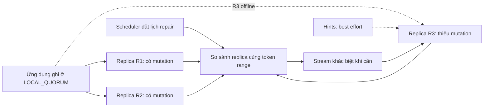
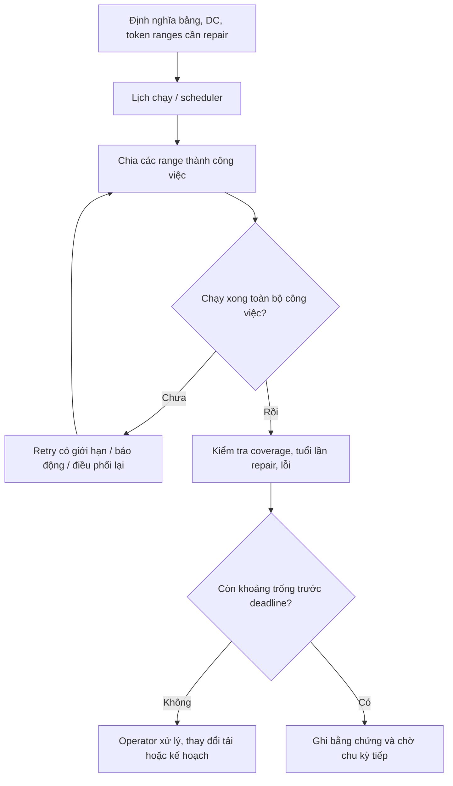
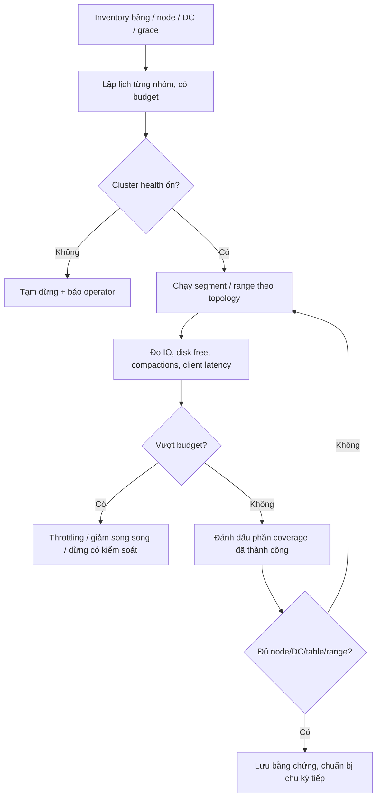

# Công cụ lập lịch repair và ranh giới với trách nhiệm người vận hành

> **Chương:** Repair  
> **Học phần:** `DATABASE_ENGINE_WIDE_COLUMN_CASSANDRA` — Apache Cassandra

Apache Cassandra là cơ sở dữ liệu phân tán theo mô hình *wide-column*. Khóa phân vùng quyết định token, chiến lược replication quyết định replica nào giữ dữ liệu, còn consistency level (CL) quyết định cần bao nhiêu phản hồi khi ứng dụng đọc và ghi. Một write được xác nhận ở `LOCAL_QUORUM` vẫn có thể chưa tới tất cả replica. Khi một node ngừng hoạt động, hints và read repair có thể hỗ trợ bắt kịp một phần, nhưng **anti-entropy repair** vẫn cần được vận hành theo kế hoạch để phát hiện và xử lý khác biệt giữa các replica.

Câu hỏi của bài này không chỉ là “chạy `nodetool repair` vào ngày nào?” mà còn là **công cụ lập lịch chịu trách nhiệm đến đâu, và người vận hành còn phải bảo đảm điều gì?** Một scheduler có thể kích hoạt công việc, chia token range, theo dõi tiến độ, giới hạn tải và thử lại khi gặp lỗi. Nó không thể tự quyết định mọi chính sách retention, xác nhận tính đúng đắn nghiệp vụ, giải quyết đĩa đầy hoặc cam kết dữ liệu đã được đối soát trên toàn cụm chỉ vì một job có trạng thái “completed”.

Sau bài học, bạn có thể:

- Giải thích vì sao cần lịch repair có **coverage** theo node, token range, keyspace, bảng và data center.
- So sánh lịch tự quản bằng `nodetool`, **Cassandra Reaper** và **Auto Repair** tích hợp trong các bản Cassandra hỗ trợ.
- Phân biệt incremental repair, full repair và preview; liên hệ với `gc_grace_seconds` và nguy cơ zombie data.
- Định nghĩa vai trò của scheduler và trách nhiệm kiểm tra, giám sát, ứng cứu của người vận hành.
- Viết runbook gồm preflight, giới hạn tài nguyên, theo dõi, tiêu chí thành công và xử lý khi repair kéo dài hoặc thất bại.
- Hiểu tác động tới ứng dụng Java và xác định những việc driver/consistency level không thể thay repair.

## 1. Repair làm gì và tại sao phải lặp lại?

Khi một replica offline, những replica còn lại vẫn có thể nhận mutation. Ví dụ keyspace có replication factor (RF) bằng 3 trong một data center, ghi ở `LOCAL_QUORUM` cần 2 ACK. Nếu R3 đang tắt, R1/R2 có thể ghi thành công, còn R3 bỏ lỡ mutation.

**Anti-entropy repair** so sánh dữ liệu của những replica cùng sở hữu token range (thường qua Merkle trees), sau đó stream những phần khác biệt cần thiết để đồng bộ. Repair có thể cần đọc SSTable, xây cây hash, truyền dữ liệu và thực hiện các công việc nền liên quan; vì thế nó tiêu thụ CPU, bộ nhớ, mạng và I/O.



Những ranh giới cần nhớ:

- **Hinted handoff** cố phát lại những mutation mà coordinator đã ghi nhớ, có giới hạn cửa sổ và lưu trữ; không đối soát toàn bộ dữ liệu.
- **Read repair** có thể xử lý sự khác biệt khi đọc các partition liên quan, theo hành vi của phiên bản; không phải cơ chế quét toàn bộ token range.
- **Repair** đồng bộ dữ liệu *còn tồn tại ở những replica tham gia*. Nó không tạo lại dữ liệu đã mất khỏi mọi replica; khi đó cần backup/restore.
- Repair không khử trùng một event mà ứng dụng Java đã gửi hai lần, không sửa mô hình partition key nóng và không bảo đảm xử lý đúng những giao dịch nghiệp vụ độc lập với Cassandra.

Một scheduler giúp thực hiện repair **đều đặn, đúng phạm vi và có kiểm soát**, nhưng sự hiện diện của scheduler không đủ để chứng minh rằng mọi replica đang đồng bộ.

## 2. “Đã lên lịch” khác “đã hoàn tất coverage”

Hãy phân biệt ba mức:

1. **Schedule configured:** công cụ đã lưu một lịch chạy cho bảng/keyspace.
2. **Run completed:** một lần chạy đã kết thúc; có thể có task thành công, bị bỏ qua hoặc thất bại ở một phần.
3. **Required coverage achieved:** mọi token range và replica cần thiết của tập dữ liệu đã được xử lý thành công trong khung thời gian yêu cầu.

Chỉ mức **3** mới trả lời được câu hỏi vận hành quan trọng: “Dữ liệu nào đã được repair đủ gần đây để không vượt quá thời hạn an toàn?”



Đặc biệt trong cụm nhiều data center: một lệnh repair trên **một node** không tự bao phủ toàn cụm. Tài liệu Apache khuyến nghị dùng `-pr` (primary token range) để giảm công việc trùng lặp, và phải chạy trên **đầy đủ node trong các data center liên quan** theo lịch đã thiết kế.

### Vì sao `gc_grace_seconds` là deadline vận hành?

`DELETE` và TTL hết hạn tạo tombstone. Tombstone giúp những replica đã bỏ lỡ thao tác xóa hiểu rằng dữ liệu cũ không được hiện lại. `gc_grace_seconds` là thời gian bảo vệ tối thiểu trước khi compaction có thể thu hồi tombstone nếu đáp ứng những điều kiện khác, **không** phải đồng hồ hẹn xóa chính xác đến giây.

Nếu replica bỏ lỡ tombstone và không được repair trước khi tombstone có thể bị thu hồi ở các replica khác, dữ liệu cũ có thể **sống lại (zombie data)**.

Ví dụ minh họa:

- Bảng có `gc_grace_seconds = 864000` (10 ngày).
- Lịch incremental dự kiến chạy **mỗi 2 ngày**, và định kỳ có full repair để kiểm tra cả dữ liệu đã đánh dấu repaired.
- Nếu scheduler không hoạt động trong 8 ngày, **lịch trên giấy vẫn là 2 ngày** nhưng coverage thực tế đã trễ; cần đánh giá các replica vắng mặt, những token range chưa được xử lý và nguy cơ tombstone.
- Kết quả phải tính từ **thời điểm repair thành công gần nhất cho phạm vi cần thiết**, chứ không tính từ lần gần nhất cron khởi động.

Không được dùng một giá trị lịch chung cho toàn hệ thống mà không xem `gc_grace_seconds` **theo từng bảng**, thời gian hoàn tất vòng repair, lỗi node, lượng dữ liệu và thời gian dự phòng. Tài liệu Apache Cassandra đưa ra lịch gợi ý (ví dụ incremental mỗi 1–3 ngày và full định kỳ), nhưng đây là **điểm khởi đầu để điều chỉnh**, không phải SLA chung cho mọi cụm.

## 3. Incremental, full và preview: lên lịch đúng loại công việc

| Loại | Phạm vi đối soát | Điểm mạnh | Điều cần vận hành |
| --- | --- | --- | --- |
| **Incremental repair** | Dữ liệu chưa được đánh dấu repaired kể từ các lần incremental trước | Có thể giảm khối lượng dữ liệu xử lý nếu chạy đều | Phải duy trì lịch; không thay thế việc rà soát toàn bộ dữ liệu đã từng được đánh dấu repaired. |
| **Full repair** | Toàn bộ dữ liệu thuộc token ranges/bảng được chọn, gồm cả dữ liệu đã repaired | Giúp phát hiện lệch do hỏng đĩa, lỗi vận hành hoặc vấn đề tồn tại từ trước | Thường nặng về đọc, hash, mạng và I/O; chạy phù hợp cửa sổ và năng lực cụm. |
| **Preview repair** | Xây/so sánh thông tin để dự báo phần cần streaming, theo tùy chọn | Hữu ích trước full repair lớn hoặc lúc điều tra | **Không stream để sửa** và vẫn có chi phí tính toán/I/O; không tính là đã sửa dữ liệu. |

Trong các bản Cassandra hiện đại, `nodetool repair` mặc định thực hiện incremental repair; `--full` yêu cầu full repair. Khi đã dùng incremental repair, SSTable có thể được đánh dấu repaired và phân tách thông qua anti-compaction; phải tính đến nhu cầu không gian và tương tác với compaction.

**Không có kế hoạch hợp lý nếu chỉ chạy incremental mãi mãi mà không cân nhắc full repair.** Incremental không tự rà soát lại dữ liệu đã đánh dấu repaired ở các vòng trước; ngoài sai lệch do write bị bỏ lỡ, cụm còn có thể gặp hỏng dữ liệu, lỗi thao tác hoặc bug.

### Các lệnh `nodetool` minh họa

```bash
# Quan sát; chạy trên node thích hợp sau khi cấu hình JMX/quyền quản trị.
nodetool version
nodetool status
nodetool describecluster
nodetool compactionstats
nodetool netstats

# Thử trên môi trường kiểm soát và đã xác minh phạm vi:
nodetool repair -pr telemetry sensor_events_by_day

# Full repair phạm vi primary ranges của node:
nodetool repair --full -pr telemetry sensor_events_by_day

# Preview: đánh giá, KHÔNG thay thế việc repair:
nodetool repair --preview --full -pr telemetry sensor_events_by_day
```

Đây là **các lệnh vận hành có tác động tài nguyên** (trừ nhóm quan sát ban đầu). Trên production phải có kế hoạch giới hạn số job, nguồn I/O, lịch và tiêu chí dừng. Option có thể thay đổi theo phiên bản; kiểm tra `nodetool help repair` trên đúng binary trước khi chạy.

`-pr` giới hạn phạm vi primary ranges của **node thực thi**. Muốn coverage toàn cụm, phải có điều phối qua các node/DC cần thiết, hoặc dùng công cụ hiểu đầy đủ topology và trạng thái repair. Không nhầm một lệnh hoàn thành ở một node với “toàn keyspace đã được repair”.

## 4. Các cách lập lịch repair và phạm vi chức năng

### 4.1. Cron/job scheduler + `nodetool` tự quản

Cách đơn giản là hệ thống vận hành (cron, Kubernetes CronJob, job scheduler nội bộ) đặt lịch chạy lệnh `nodetool repair` trên node. Cách này có thể phù hợp cụm nhỏ hoặc lab, nhưng người xây scheduler phải tự xử lý:

- Chọn **đúng danh sách node, data center, keyspace, table và token range**.
- Tránh hai job repair cạnh tranh trên replica hoặc trùng range không cần thiết.
- Điều chỉnh nhịp chạy, giới hạn tài nguyên và dừng khi đĩa/network không đủ năng lực.
- Lưu lịch sử kết quả **theo phạm vi**, chứ không chỉ exit code của script.
- Retry giới hạn, khôi phục sau coordinator/scheduler restart và báo động khi bỏ lỡ chu kỳ.
- Cập nhật danh sách node khi thêm/bớt node, đổi RF hoặc thay topology.

Đừng áp dụng naïve cron “mỗi tối chạy `nodetool repair -pr` trên mọi node cùng lúc”: như vậy có thể chồng chéo tác vụ, dồn tải lên cùng replica và gây ảnh hưởng read/write latency. Cron **chỉ giải quyết kích hoạt thời điểm**; phần điều phối/coverage phải được thiết kế riêng.

### 4.2. Cassandra Reaper

**Cassandra Reaper** là công cụ mã nguồn mở được xây để **điều phối và lập lịch repair**, có giao diện web, API và công cụ dòng lệnh. Nó giúp chia công việc thành những **segment token range**, quản lý schedule theo keyspace/table, theo dõi tiến độ, giới hạn mức độ tích cực của repair (*intensity*), hỗ trợ pause/resume/cancel và các tùy chọn parallelism hoặc data center awareness tùy phiên bản.

Một lịch Reaper thường bao gồm:

| Trường/cấu hình | Ý nghĩa | Câu hỏi người vận hành phải trả lời |
| --- | --- | --- |
| Cluster, keyspace, tables | Phạm vi repair | Có bỏ sót bảng quan trọng hoặc chọn nhầm cụm không? |
| Start time và interval | Thời điểm, chu kỳ | Có đủ thời gian hoàn tất trước `gc_grace_seconds` và có tránh peak load không? |
| Repair type | Full hay incremental | Có cân bằng chi phí với nhu cầu rà soát dữ liệu đã repaired không? |
| Segment count/range partitioning | Quy mô công việc nhỏ | Segment quá lớn dễ timeout; quá nhỏ tạo overhead điều phối không? |
| Parallelism, DC-aware, repair threads | Số tác vụ có thể diễn ra đồng thời | Những replica đang chịu cùng I/O có bị xếp lịch cạnh tranh không? |
| Intensity | Nhịp giữa các segment | Cụm có còn dư throughput cho ứng dụng và compaction không? |
| Owner/ghi chú, trạng thái schedule | Truy vết thay đổi và dừng/khôi phục | Ai nhận cảnh báo và ai được quyền sửa lịch? |

**Lưu ý về khả năng tương thích:** Reaper có hỗ trợ nhiều phiên bản Cassandra nhưng cần chọn bản Reaper và cách kết nối tương thích với **bản Cassandra, bảo mật và topology thực tế**. Một số option/tổ hợp như incremental và DC-aware có giới hạn theo bản Reaper; không chép thiết lập từ một cụm khác mà không kiểm tra tài liệu và thử nghiệm.

Một luồng tạo lịch qua Reaper UI theo tài liệu công cụ:

1. Thêm cụm và kiểm tra Reaper nhìn thấy health/topology chính xác.
2. Tạo lịch cho **bảng có độ ưu tiên cụ thể**, đặt start/interval, loại repair, segment, parallelism và intensity.
3. Cho chạy thử ở phạm vi nhỏ, theo dõi trạng thái các segment và độ trễ của CQL.
4. Bật cảnh báo khi schedule không chạy, backlog tăng, segment liên tục timeout hoặc coverage vượt tuổi cho phép.
5. Khi đổi topology, data center hoặc retention, **đánh giá lại** lịch và quyền truy cập Reaper.

Không nên phó mặc rằng “Reaper báo schedule active” tương đương “toàn bộ bảng đã được đối soát gần đây”.

### 4.3. Auto Repair tích hợp trong Cassandra (điều kiện phiên bản)

Tài liệu Cassandra mới mô tả **Auto Repair** theo CEP-37, bộ lập lịch chạy **ngay trong Cassandra**, có lịch sử repair và cơ chế điều phối, chia token ranges, retry, giới hạn số node chạy song song, xử lý full/incremental/preview.

Điều kiện phiên bản **cần nêu rõ**:

| Apache Cassandra | Auto Repair tích hợp | Hướng xử lý |
| --- | --- | --- |
| 4.x và các bản 5.0 **trước 5.0.8** | Chưa có tính năng Auto Repair được tài liệu chính thức mô tả | Dùng quy trình `nodetool`/công cụ ngoài theo phiên bản. |
| **5.0.8 trở lên trong nhánh 5.0** | CEP-37 được **backport**, cần bật opt-in đúng quy trình | Kiểm tra cấu hình, hậu quả upgrade và khả năng giám sát. |
| **6.0 trở lên** | Tính năng được giới thiệu trong nhánh 6.0 | Kiểm tra bản phát hành, mặc định/flag và tài liệu của bản cụ thể trước khi dùng. |
| Bản phân phối hoặc dịch vụ managed | Có thể khác hành vi OSS | Xem tài liệu nhà cung cấp và quyền điều khiển cụm. |

**Đặc biệt với Cassandra 5.0.8:** tài liệu chính thức yêu cầu bật thuộc tính JVM `-Dcassandra.autorepair.enable=true` khi khởi động node để thêm các phần schema cần cho tính năng, **sau đó mới bật scheduler** trong `cassandra.yaml` hoặc qua JMX. Việc bật thuộc tính này **không thể đảo ngược** trên nhánh được mô tả: không nên thực hiện như phép thử tùy tiện trên production. Phải xem đầy đủ hướng dẫn upgrade, compatiblity và kế hoạch vận hành trước khi quyết định.

Khi bản đang dùng hỗ trợ, có thể kiểm tra các lệnh được tài liệu mô tả:

```bash
# Chỉ có ý nghĩa trên bản Cassandra hỗ trợ Auto Repair.
nodetool getautorepairconfig
nodetool autorepairstatus -t incremental
nodetool autorepairstatus -t full
```

Các thông số điều phối cần cân nhắc gồm `min_repair_interval`, loại repair được bật, token range splitter, `number_of_repair_threads`, số node chạy song song và việc có cho phép các replica cùng sửa đồng thời. Thay đổi cấu hình động qua `setautorepairconfig` có thể **chỉ có hiệu lực trên node được nhắm tới và không tồn tại sau restart**; phải lưu cấu hình chuẩn trong hệ thống quản lý cấu hình.

Auto Repair giảm công sức triển khai scheduler bên ngoài, nhưng không loại bỏ trách nhiệm lựa chọn lịch, giám sát dữ liệu lịch sử, duy trì disk headroom, xử lý lỗi node và quyết định khi nào cần full repair hoặc phục hồi từ backup.

### So sánh để lựa chọn

| Giải pháp | Thuận lợi | Chi phí và điểm phải kiểm soát |
| --- | --- | --- |
| Cron + `nodetool` | Đơn giản, dễ thử trong lab; không cần thêm sản phẩm repair chuyên dụng | Phải tự xây khóa điều phối, retry, audit, coverage, topology awareness. |
| Cassandra Reaper | Lịch, segmentation, theo dõi tiến độ, điều chỉnh intensity/parallelism, UI/API | Cần vận hành Reaper, trạng thái lưu trữ, bảo mật, chọn bản tương thích; cần giám sát Reaper bị down. |
| Auto Repair tích hợp | Lập lịch/điều phối ngay trong Cassandra ở **phiên bản hỗ trợ** | Có điều kiện bật tính năng, yêu cầu version/upgrade; vẫn cần owner và giới hạn tài nguyên. |

**Chọn theo năng lực vận hành, phiên bản thực tế và độ lớn cụm**, không chỉ theo số lượng nút bấm trong UI.

## 5. Phân chia trách nhiệm: scheduler làm được gì, operator phải làm gì?

Một phép phân chia là: **scheduler chịu trách nhiệm thực thi chính sách đã cấu hình**, còn **người vận hành chịu trách nhiệm tính phù hợp của chính sách và kết quả của nó**.

| Công việc | Scheduler/Reaper/Auto Repair | Người vận hành |
| --- | --- | --- |
| Kích hoạt công việc đúng giờ | Có, nếu scheduler hoạt động | Chọn lịch, phát hiện bỏ lỡ chu kỳ, phân công owner |
| Chia token ranges và điều phối parallelism | Có nếu tool hỗ trợ | Đặt giới hạn an toàn theo node/rack/DC, theo dõi hot spots |
| Retry lỗi thoáng qua | Có thể tự thực hiện | Phân biệt lỗi tạm với disk full, node down lâu, schema mismatch |
| Ghi tiến độ/nhật ký | Có ở mức tool hỗ trợ | Đối soát coverage thực tế, bảo đảm log/metric được lưu và cảnh báo |
| Xác định `gc_grace_seconds` và retention | Không tự quyết định yêu cầu nghiệp vụ | Chốt SLA/retention, kiểm tra ngưỡng an toàn theo bảng |
| Repair khi một replica vắng mặt hoặc mất dữ liệu | Có thể hoãn/thất bại | Đánh giá rủi ro, chọn replacement/rebuild/restore/repair đúng quy trình |
| Giữ không gian đĩa, giám sát I/O | Có thể hạn chế tải theo metrics | Capacity planning, xử lý nút cổ chai, điều phối compaction/streaming |
| Quản lý multi-DC/topology change | Công cụ có thể nhận biết topology | Kiểm tra node mới/cũ, RF, DC và phạm vi chạy sau thay đổi |
| Đảm bảo tính đúng dữ liệu nghiệp vụ | Không | Chọn model/query phù hợp, kiểm soát idempotence và đối soát event ở app |
| Đánh giá backup/khôi phục và rủi ro dữ liệu mất hết | Không thay backup | Duy trì backup, kiểm tra restore và chiến lược RPO/RTO |

**Ví dụ trách nhiệm bị nhầm:** Reaper được cấu hình chạy mỗi 48 giờ, nhưng một keyspace mới đã được thêm mà không nằm trong lịch. Reaper có thể hoạt động đúng cấu hình mà **bảng mới vẫn chưa từng được repair**. Đây là lỗi quy trình inventory/change management, không phải bằng chứng công cụ “không biết chạy repair”.

## 6. Thiết kế một lịch repair đủ an toàn

Xét cụm mẫu có hai data center `dc1` và `dc2`, mỗi DC có ba replica theo chiến lược `NetworkTopologyStrategy` cho keyspace `telemetry`. Có bảng `telemetry.sensor_events_by_day` với `gc_grace_seconds` đang là 10 ngày, lưu sự kiện theo ngày và truy vấn chủ yếu theo partition key `(sensor_id, event_day)`.

### 6.1. Xác định các thông số đầu vào

| Thông số | Ví dụ cần ghi vào runbook | Lý do |
| --- | --- | --- |
| Phạm vi | Keyspace `telemetry`, bảng `sensor_events_by_day`, tất cả DC/token ranges liên quan | Tránh repair một phần rồi coi là toàn bộ. |
| Grace | `gc_grace_seconds = 864000` (xác minh qua schema thực tế) | Deadline an toàn của tombstone. |
| Lịch incremental | Ví dụ **mỗi 48 giờ** | Giữ unrepaired data ít và tạo khoảng đệm trước grace. |
| Lịch full | Ví dụ **mỗi 14 ngày** khi đủ I/O, có thể khác theo bảng | Thỉnh thoảng kiểm tra cả dữ liệu đã đánh dấu repaired. |
| Cửa sổ tải | Ngoài giờ ingest/backup cao điểm | Repair tiêu tốn I/O và mạng. |
| Song song | Bắt đầu thấp, tránh sửa đồng thời trên replica cạnh tranh | Giữ dư địa đáp ứng p95/p99 ứng dụng. |
| Điều kiện dừng | Một node down, disk thiếu headroom, compaction backlog lớn, p99 vượt SLO | Không khiến sự cố lan rộng. |
| Cảnh báo | Bảng/range trễ coverage, segment lỗi lặp lại, vòng repair không thể hoàn tất | Owner có thể can thiệp trước deadline. |

Các khoảng thời gian trên **chỉ là ví dụ để thiết kế thử**. Không đặt full repair mỗi 14 ngày ở mọi cụm mà không xét khối lượng dữ liệu, chi phí network, failure rate và lịch incremental. Nếu một vòng repair kéo dài nhiều ngày, phải tính **thời gian hoàn thành**, không chỉ khoảng cách giữa hai lần bắt đầu.

### 6.2. Công thức tư duy cho độ an toàn

Giả sử:

- `G`: thời gian grace ngắn nhất của các bảng cần repair.
- `C`: thời gian hoàn thành vòng coverage trong trường hợp tải cao thực tế.
- `D`: thời gian dự phòng khi scheduler/node bị lỗi hoặc có bảo trì.
- `I`: khoảng từ lần repair thành công đủ coverage trước đến lần kế tiếp theo kế hoạch.

Một điều kiện bảo thủ cần đánh giá là:

\[
I + C + D < G
\]

Đây là **nguyên tắc lập kế hoạch**, không phải bất đẳng thức được Cassandra tự thực thi. Trong thực tế, phải tính **tuổi lần repair thành công theo table/range và replica**, các khoảng downtime bị bỏ lỡ và thời gian tombstone có thể đã đủ điều kiện thu hồi. Vì vậy, dashboard nên hiển thị tuổi coverage và thời gian còn lại trước hạn, không chỉ số job hoàn tất trong ngày.

### 6.3. Tránh trùng tải trên replica và DC



Cần giới hạn riêng cho mỗi DC hoặc nhóm replica thay vì đặt một giá trị song song duy nhất không xét topology. Khi có repair và compaction cùng chạy, anti-compaction của incremental repair có thể tạo thêm áp lực đĩa; hãy bảo đảm đủ không gian cho tệp đầu ra và công việc streaming.

## 7. Runbook khi scheduler hoặc repair gặp lỗi

### Trước giờ chạy

1. Kiểm tra version và cluster health: `nodetool version`, `status`, `describecluster`, schema agreement, trạng thái node/data center, thiết bị lưu trữ.
2. Xác minh `gc_grace_seconds`, TTL và inventory bảng cần repair; xác định bảng mới vừa tạo và bảng đã bỏ.
3. Xem các repair còn chạy, trạng thái compaction, streaming, disk headroom, network throughput và latency của ứng dụng.
4. Kiểm tra công cụ điều phối (Reaper hoặc Auto Repair) có thể kết nối/đọc topology, có lưu được lịch sử, có lịch trùng không.
5. Chốt cửa sổ tải và budget, người trực vận hành, tiêu chí stop/rollback của lịch.

### Trong lúc chạy

Theo dõi **hai lớp**: *sự kiện công cụ* (jobs/segments) và *sức khỏe Cassandra* (node, disk, latency).

```bash
# Nhóm lệnh quan sát chung:
nodetool status
nodetool compactionstats
nodetool netstats
nodetool tpstats

# Chỉ trên bản hỗ trợ built-in Auto Repair:
nodetool autorepairstatus -t incremental
```

| Tín hiệu | Diễn giải thường gặp | Hành động |
| --- | --- | --- |
| Scheduler còn sống nhưng không có run | Schedule disabled, chưa tới lượt, điều kiện health, nhầm timezone hoặc lỗi điều phối | Kiểm tra lịch, lịch sử và log tool; đừng chỉ restart bừa. |
| Segment timeout nhiều lần | Range quá lớn, mất node, nghẽn mạng/disk hoặc repair service kẹt | Thu nhỏ segment/giảm concurrency sau khi xác nhận nguyên nhân, kiểm tra retry. |
| Pending compactions tăng, disk gần đầy | Repair/anti-compaction/streaming gây thêm I/O và dung lượng tạm | Giảm tải, dừng mở rộng repair; phục hồi disk trước. |
| Một DC thiếu tiến độ trong nhiều ngày | Tool không nhận node, chỉ chạy một DC, topology vừa đổi | Rà soát range coverage, quyền và cấu hình DC. |
| Job “completed” nhưng nhiều range chưa có evidence | Lỗi thống kê hoặc chỉ xem trạng thái job cấp cao | Đối chiếu per-range/per-table history; nâng cảnh báo nếu deadline cận. |
| Ứng dụng tăng write/read timeout | Repair cạnh tranh resource với workload | Giảm intensity/parallelism; đánh giá giờ chạy và latency. |

### Khi thất bại kéo dài

- **Không gộp lỗi với timeout từ client:** repair có thể thất bại do node down hoặc disk full; tăng timeout CQL trong Java không sửa được.
- **Không cho nhiều bộ lập lịch cùng điều khiển một phạm vi** nếu chưa có cơ chế chống trùng và phân quyền rõ ràng (ví dụ cron + Reaper + Auto Repair cùng sửa một bảng).
- **Không xóa repaired-state hoặc SSTable thủ công** để “thử lại cho sạch”. Sai thao tác có thể làm hỏng dữ liệu và phá cơ chế incremental.
- **Không hạ `gc_grace_seconds` về 0** để giảm tombstone khi repair đang trễ; có thể tăng nguy cơ zombie data.
- Sau khi khôi phục node, hãy xác định có cần **full repair có phạm vi phù hợp**, replacement/rebuild hay backup restore. Repair không phục hồi dữ liệu đã mất khỏi mọi nguồn.

### Sau khi hoàn thành

1. Đọc kết quả chi tiết: phạm vi range/table/DC đã hoàn thành, segment retry hoặc bị bỏ, thời điểm cuối thực sự thành công.
2. Đối chiếu logs và metrics Cassandra với trạng thái công cụ; quan sát anti-compaction, disk, client latency trở lại bình thường.
3. Cập nhật bằng chứng cho dashboard và báo cáo: “tuổi coverage tối đa” theo bảng/cluster, không chỉ số lượng runs.
4. Tạo ticket nếu còn chênh lệch hoặc nguy cơ vượt grace; ghi owner và hạn xử lý.
5. Sửa chính sách khi retention, RF, topology hoặc workload thay đổi. Một kế hoạch từng phù hợp có thể không phù hợp sau khi dữ liệu tăng gấp đôi.

## 8. CQL và Java: điểm tiếp xúc với lịch repair

### 8.1. Xác minh schema và mức nhất quán

Trong môi trường học tập, keyspace và bảng có thể được tạo như sau. **Không chạy DDL lên production** khi chưa đối chiếu topology và cấu hình replication thực tế:

```sql
CREATE KEYSPACE IF NOT EXISTS telemetry
WITH replication = {
    'class': 'NetworkTopologyStrategy',
    'dc1': '3'
};

CREATE TABLE IF NOT EXISTS telemetry.sensor_events_by_day (
    sensor_id text,
    event_day date,
    event_id uuid,
    reading double,
    PRIMARY KEY ((sensor_id, event_day), event_id)
) WITH gc_grace_seconds = 864000;

SELECT keyspace_name, table_name, gc_grace_seconds
FROM system_schema.tables
WHERE keyspace_name = 'telemetry'
  AND table_name = 'sensor_events_by_day';
```

Khóa phân vùng `(sensor_id, event_day)` phù hợp truy vấn theo một thiết bị trong một ngày; nếu một thiết bị sinh quá nhiều event/ngày, bổ sung bucket/shard là quyết định data modeling riêng. Repair và compaction không làm partition quá lớn tự trở nên hiệu quả.

Nếu ứng dụng ghi ở `LOCAL_QUORUM` với RF=3 trong một DC, có thể nhận phản hồi thành công khi một replica chưa có mutation. Sau này repair đồng bộ các replica ở phạm vi cần thiết; **chọn CL cao hơn không thay thế lịch repair**.

### 8.2. Ví dụ Java Driver 4.x

```java
import java.time.LocalDate;
import java.util.UUID;

import com.datastax.oss.driver.api.core.CqlSession;
import com.datastax.oss.driver.api.core.DefaultConsistencyLevel;
import com.datastax.oss.driver.api.core.cql.BoundStatement;
import com.datastax.oss.driver.api.core.cql.PreparedStatement;

public final class SensorEventStore {
    private final CqlSession session;
    private final PreparedStatement insert;

    public SensorEventStore(CqlSession session) {
        this.session = session;
        this.insert = session.prepare(
            "INSERT INTO telemetry.sensor_events_by_day " +
            "(sensor_id, event_day, event_id, reading) " +
            "VALUES (?, ?, ?, ?)");
    }

    public void write(String sensorId, LocalDate eventDay,
                      UUID eventId, double reading) {
        // Giữ nguyên eventId và payload của cùng sự kiện qua retry.
        BoundStatement stmt = insert.bind(
                sensorId, eventDay, eventId, reading)
            .setConsistencyLevel(DefaultConsistencyLevel.LOCAL_QUORUM)
            .setIdempotent(true);

        session.execute(stmt);
    }
}
```

`setIdempotent(true)` trong ví dụ chỉ hợp lý với **event bất biến, khóa ổn định và không có side effect do gửi lặp**. Nếu cần ngữ nghĩa TTL/timestamp chính xác hoặc khử trùng event trên nhiều hệ thống, phải thiết kế thêm. Với counter `+1`, không được đánh dấu idempotent chỉ để thử lại.

**Java Driver không lập lịch anti-entropy repair**: đó là trách nhiệm cụm và công cụ vận hành. Ứng dụng có thể báo timeout/độ trễ, giữ ID để đối soát và ghi nhận sự kiện thiếu phản hồi; nó không được tự động chạy `nodetool repair` cho mỗi lần write timeout. Repair không phải đường xử lý realtime của từng request.

## 9. Tình huống thực hành: công cụ chạy đúng nhưng dữ liệu vẫn có rủi ro

**Bối cảnh:** một cụm 12 node chia hai DC, một bảng có TTL 30 ngày và `gc_grace_seconds` 10 ngày. Reaper đã được cấu hình lịch incremental 48 giờ và full repair định kỳ. Tuần này có một node ở `dc2` offline 9 ngày; scheduler vẫn cho thấy “schedule enabled”. Một số segment có trạng thái failed vì node chưa trở lại.

Các câu hỏi cần trả lời:

1. **“Schedule enabled” đã đủ an toàn chưa?** Chưa; node/tokens của `dc2` có thể chưa được repair đủ coverage trước grace.
2. **Có thể chờ hints tự phát lại hết không?** Không. Hints có giới hạn, không đồng bộ đầy đủ mọi sai lệch sau downtime dài.
3. **Có nên nâng độ song song lên gấp 10 khi node quay lại?** Không mặc định. Cần xem disk/network, compaction, streaming, số range tồn và ảnh hưởng tới p99.
4. **Khi nào cần escalations?** Ngay khi tuổi coverage và thời gian phục hồi dự kiến có nguy cơ vượt grace, hoặc vẫn còn replica vắng mặt khiến repair không thể hoàn tất.
5. **Ai sửa nguyên nhân?** Tool có thể retry segment và tiếp tục schedule; operator phải giải quyết node down, đánh giá repair/full repair/restore và kiểm tra dữ liệu sau phục hồi.

Một runbook hợp lý sẽ cho node quay lại theo quy trình, xác minh sức khỏe, phát hints còn có, kiểm tra token ranges bị trễ và thực hiện repair có điều phối, theo dõi hoàn thành và nguy cơ zombie. Trong trường hợp đã mất dữ liệu ở mọi replica, cần backup/restore; không có scheduler nào có thể tạo lại dữ liệu không còn nguồn.

## 10. Câu hỏi tự kiểm tra

**Câu 1.** Vì sao lịch chạy `nodetool repair -pr` trên một node mỗi tuần **không đồng nghĩa** toàn cụm RF=3 đã được repair?

**Câu 2.** Một lịch chạy incremental hai ngày/lần, nhưng 15% range bị lỗi liên tục suốt 9 ngày. `gc_grace_seconds` là 10 ngày. Có thể cho rằng kế hoạch vẫn đạt yêu cầu vì job khởi động đều không?

**Câu 3.** So sánh Reaper và cron thuần túy khi cụm có nhiều data center, dữ liệu lớn và cần tránh repair đồng thời trên cùng replica.

**Câu 4.** Một cụm Cassandra 5.0.7 muốn dùng Auto Repair tích hợp. Có dùng ngay `nodetool autorepairstatus` được không? Điều gì đặc biệt khi nâng lên 5.0.8?

**Câu 5.** Khi Reaper báo một scheduled full repair thành công, operator nên kiểm chứng những gì ngoài trạng thái job?

**Câu 6.** Java service nhận write timeout trên câu `UPDATE views = views + 1`. Có nên tự gửi `nodetool repair` hoặc retry vô hạn để bù lại không?

<details>
<summary>Gợi ý đáp án</summary>

1. Lệnh với `-pr` bao phủ primary ranges của node đang chạy; cần lịch bao phủ các node/data center và bảng liên quan, theo topology thực tế.
2. **Không.** Cần xem tuổi coverage và nguy cơ zombie của những range chưa hoàn thành; phải điều tra node, disk/streaming và can thiệp trước deadline.
3. Reaper hỗ trợ segmentation, lịch, intensity/parallelism, thống kê và pause/resume; cron phải tự phát triển những khả năng điều phối/quan sát này.
4. 5.0.7 chưa có CEP-37 Auto Repair tích hợp được tài liệu mô tả. 5.0.8 có bản backport, nhưng cần bật JVM property với bước **không thể đảo ngược**, rồi cấu hình bật scheduler và kiểm tra compatibility.
5. Phạm vi table/range/DC, các segment bị bỏ qua/retry, timestamp thành công gần nhất, health/performance, disk/network và tuổi coverage so với grace.
6. Không. Timeout không chứng minh write chưa áp dụng; counter không idempotent. Repair không phải thao tác bù nghiệp vụ; cần event ID và cơ chế retry/đối soát đúng tầng.

</details>

## Ghi nhớ

- Repair được vận hành theo **coverage có deadline**, không chỉ theo giờ cron; cần bằng chứng các range/table/DC đã được xử lý thành công.
- Incremental repair giúp giảm khối lượng định kỳ, nhưng vẫn nên có full repair theo chính sách nhằm rà soát dữ liệu đã marked repaired.
- **Cassandra Reaper** cung cấp lịch, segmentation, điều phối và theo dõi tiến độ; **Auto Repair** là cơ chế tích hợp từ Cassandra 6.0 và được backport vào **5.0.8**, với điều kiện bật tính năng phải được kiểm soát.
- Scheduler chịu trách nhiệm **thực thi chính sách**; operator chịu trách nhiệm **chọn chính sách đúng, giữ cluster khỏe, quan sát coverage, xử lý lỗi và bảo đảm khôi phục**.
- Repair liên quan trực tiếp `gc_grace_seconds`, tombstone và zombie data. Không dùng repair để thay thế hints, rebuild/replace, backup hoặc idempotency ở Java.
- Điều chỉnh lịch sau khi topology, replication, thời gian retention hoặc workload thay đổi.

### Nguồn tham khảo

- [Apache Cassandra — Repair: incremental, full, primary range và hướng dẫn lịch](https://cassandra.apache.org/doc/stable/cassandra/managing/operating/repair.html)
- [Apache Cassandra — Auto Repair (CEP-37, phiên bản hỗ trợ và điều kiện bật)](https://cassandra.apache.org/doc/latest/cassandra/managing/operating/auto_repair.html)
- [Apache Cassandra — Cấu hình cassandra.yaml và Auto Repair](https://cassandra.apache.org/doc/latest/cassandra/managing/configuration/cass_yaml_file.html)
- [Cassandra Reaper — Documentation](https://cassandra-reaper.io/docs/)
- [Cassandra Reaper — Scheduling a Cluster Repair](https://cassandra-reaper.io/docs/usage/schedule/)
- [Cassandra Reaper — Running a Cluster Repair](https://cassandra-reaper.io/docs/usage/single/)

