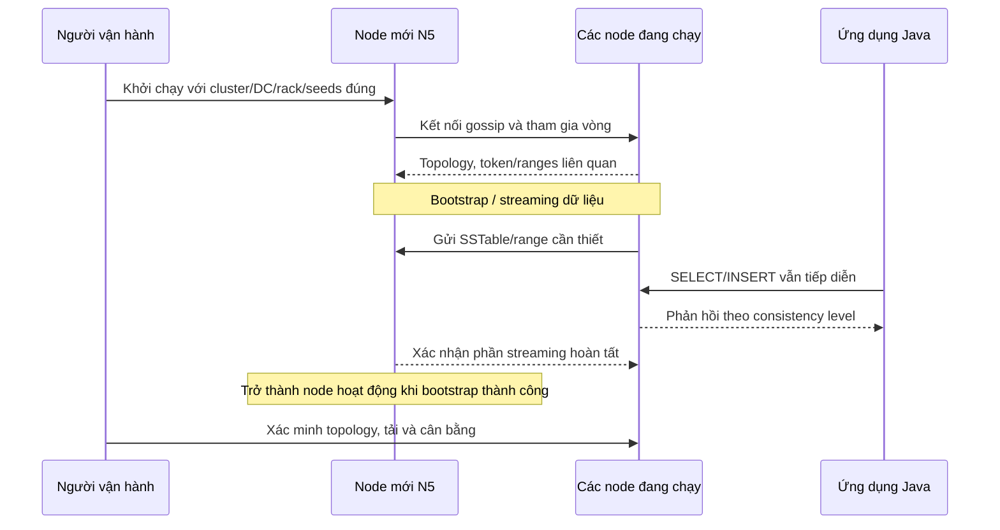
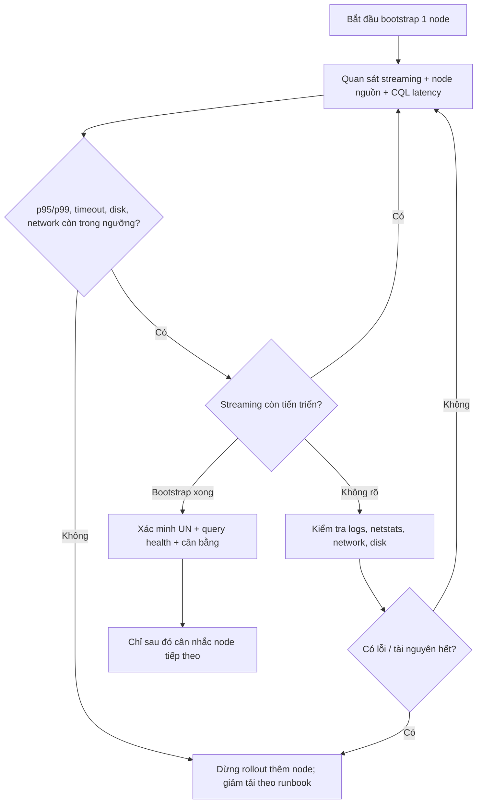

# Thêm nút vào cụm Cassandra đang chạy và bảo vệ tải nghiệp vụ

## 1. Bài toán: mở rộng cụm mà vẫn phục vụ truy vấn

Apache Cassandra là cơ sở dữ liệu **wide-column phân tán**. Mỗi hàng được xác định bởi **partition key** và được ánh xạ tới token trên vòng phân phối; các bản sao (*replica*) được chọn theo chiến lược replication của keyspace. Ứng dụng Java truy vấn bằng CQL và dùng **consistency level (CL)** để quy định số replica phải phản hồi.

Khi dữ liệu, số lượng truy vấn hoặc tải ghi tăng, một cách mở rộng là **thêm node vào cluster đang hoạt động** (*scale out*). Việc này không phải chỉ khởi chạy một tiến trình Cassandra mới: node phải gia nhập vòng, nhận phần dữ liệu cần chịu trách nhiệm và được các node khác cùng client nhìn nhận là thành viên hợp lệ.

Trong suốt quá trình ấy, cluster vẫn cần phục vụ các yêu cầu như:

- `INSERT`/`UPDATE` ghi dữ liệu mới qua commit log và memtable.
- `SELECT` đọc theo partition key và hòa giải dữ liệu từ nhiều replica.
- Truy vấn sử dụng `LOCAL_QUORUM`, `QUORUM` hoặc CL khác theo yêu cầu nghiệp vụ.
- Công việc nền như flush, compaction, repair và streaming đã có từ trước.

**Mục tiêu vận hành:** tăng tài nguyên và cân bằng dữ liệu mà không làm độ trễ p95/p99, tỷ lệ timeout hoặc khả năng đạt quorum vượt ngưỡng chấp nhận.

## 2. Điều gì xảy ra khi node mới bootstrap?

Trong thao tác thêm node thông thường, **bootstrap** là quá trình một node mới tham gia cluster và **stream dữ liệu từ các replica hiện có** để nhận các token range nó sẽ chịu trách nhiệm. Cách chọn token, pending ranges và các tối ưu hóa phụ thuộc phiên bản Cassandra, topology và việc sử dụng virtual nodes (*vnodes*).



Sơ đồ chỉ mô tả nguyên lý; Cassandra có thể dùng nhiều nguồn stream và điều phối các mutation khi ownership đang chuyển. **Không nên tự sửa dữ liệu hoặc điều khiển traffic theo trạng thái giả định của một bước nội bộ**.

Trạng thái thường gặp trong `nodetool status`:

| Trạng thái minh họa | Ý nghĩa quan sát | Hành động |
| --- | --- | --- |
| `UN` | Node Up và Normal | Kiểm tra thêm streaming, logs, token ranges và metrics |
| `UJ` | Node Up và Joining | Bootstrap/đổi membership có thể đang tiến hành; theo dõi tiến độ |
| `DN` | Node Down và Normal theo góc nhìn node quan sát | Điều tra kết nối/sức khỏe trước khi tiếp tục rollout |
| `UL` | Node Up và Leaving | Node đang rời vòng; không nhầm với thao tác add node |

Không được coi một lần thấy `UN` là toàn bộ quá trình rollout đã thành công về mặt vận hành. Phải kiểm tra thêm việc chuyển dữ liệu, ổn định các node nguồn, độ trễ, tỷ lệ lỗi và các điều kiện sau bootstrap.

### “Thêm node” không đồng nghĩa “tăng RF”

Với keyspace có `RF = 3` trong một DC, thêm node thứ năm **không tự làm RF thành 4 hoặc 5**. Mỗi partition vẫn có ba bản sao theo quy tắc replication; điểm đặt các bản sao thay đổi để chia tải trên nhiều node hơn.

Nếu muốn thay RF hoặc thêm DC để chứa bản sao mới, đó là **thay đổi replication/topology bổ sung** và có quy trình đồng bộ dữ liệu riêng. Không gộp hai loại thay đổi vào cùng một thao tác thiếu kế hoạch.

## 3. Ước lượng lợi ích và chi phí trước khi mở rộng

Giả sử một DC có bốn node giống nhau, keyspace RF = 3 và token được phân phối tương đối đồng đều. Với tổng dữ liệu logic là `D`, bỏ qua overhead và skew:

```text
Tổng dung lượng replica cần lưu ≈ D × RF = 3D

Trung bình với 4 node ≈ 3D / 4 = 0,75D / node
Trung bình với 5 node ≈ 3D / 5 = 0,60D / node

Mức giảm trung bình lý tưởng mỗi node cũ:
(0,75D - 0,60D) / 0,75D = 20%
```

Con số **20% chỉ là ví dụ lý tưởng**, không phải dự báo chính xác cho mọi cluster. Kết quả thực tế phụ thuộc số token/vnode, kích thước partition, dữ liệu phân bố lệch, compression, tombstone, rack placement, khoảng trống đĩa và tác vụ nền.

Hơn nữa:

1. **Trong bootstrap:** node mới nhận dữ liệu và node nguồn vẫn giữ dữ liệu, nên lưu trữ tạm thời và lưu lượng mạng có thể tăng.
2. **Sau bootstrap:** các node cũ có thể còn chứa SSTable của token range chúng không còn sở hữu; dữ liệu đó không nhất thiết tự biến mất ngay.
3. **Khi cleanup:** việc thu hồi dữ liệu không còn thuộc trách nhiệm node cần thêm I/O và phải được lên kế hoạch riêng sau khi bootstrap hoàn tất an toàn.

Đặt câu hỏi về **dung lượng đĩa còn trống của cả node mới lẫn node nguồn**, không chỉ kích thước ổ đĩa mới.

## 4. Những cấu hình topology phải đúng ngay từ đầu

Bootstrap an toàn đòi hỏi node mới xác định đúng cluster, DC, rack và địa chỉ có thể truy cập. Tên thuộc tính cụ thể phụ thuộc phiên bản Cassandra và mô hình triển khai (máy ảo, bare metal, Kubernetes/operator).

| Thành phần | Ý nghĩa | Lỗi dễ gây sự cố |
| --- | --- | --- |
| `cluster_name` | Node tham gia đúng cluster | Trùng tên nhầm cluster hoặc không khớp cấu hình |
| Seed provider / seed addresses | Địa chỉ bootstrap để tìm cluster hiện hữu qua gossip | Chỉ trỏ đến node mới hoặc seed không thể liên hệ |
| `listen_address` / broadcast address | Các node Cassandra giao tiếp với nhau | Địa chỉ không route được giữa node/DC |
| CQL/native transport address, port | Client/driver truy cập node | Driver được quảng bá địa chỉ mà ứng dụng không truy cập được |
| Datacenter và rack | Placement replica theo snitch/topology | Khai sai DC/rack làm mất mục tiêu phân tán lỗi |
| Tokens / `num_tokens` | Phần vòng token node nắm giữ | Phân bố dữ liệu không cân, cấu hình không nhất quán |
| `auto_bootstrap` (nếu phiên bản hỗ trợ) | Quyết định quy trình bootstrap tự động của node mới | Tắt khi chưa có kế hoạch dữ liệu có thể gây thiếu dữ liệu |
| Storage/data paths | Ổ đĩa cho SSTable, commit log, cache | Dùng lại data dir/host identity của node cũ |
| TLS, auth, firewall, gossip/streaming ports | Bảo mật và kết nối giữa node | Kết nối gossip được nhưng streaming bị chặn |

**Seed node không phải primary/master.** Nó chủ yếu giúp thành viên mới tìm các thành viên đã tồn tại, không nắm vai trò điều khiển toàn bộ phân vùng. Nên chỉ định các seed đang hoạt động và có khả năng liên hệ; không biến mọi node mới thành seed một cách máy móc.

### DC/rack là quyết định về khả năng chịu lỗi

Nếu cluster dùng `GossipingPropertyFileSnitch`, một ví dụ minh họa nội dung `cassandra-rackdc.properties` là:

```properties
dc=dc1
rack=rack2
```

Hai dòng trên **không phải cấu hình đầy đủ của Cassandra**. Chúng chỉ minh họa rằng node phải nhận đúng DC/rack theo topology hiện hữu. Không chuyển một node đang hoạt động từ DC/rack này sang DC/rack khác bằng cách sửa hai dòng rồi restart; đó là bài toán thay đổi topology khác và cần quy trình riêng.

### Khác biệt giữa add node và replace node

Thêm node mới vào cluster có host ID/token ownership mới **khác với** thay thế node đã chết. Quy trình replacement dùng lựa chọn khởi động hoặc công cụ phù hợp phiên bản, bảo toàn quy tắc identity và token của node cần thay thế. Không dùng một data directory cũ, ép token hoặc tham số replacement để “đi tắt” quy trình add node.

## 5. Preflight: kiểm tra đủ headroom và sức khỏe cluster

Trước khi thêm node, thu thập baseline **theo từng DC và từng node**, trong một khoảng thời gian đại diện:

| Nhóm kiểm tra | Nội dung |
| --- | --- |
| Membership | Các node cần thiết đang Up/Normal, không có thao tác join/leave/move dở |
| Quorum | Với RF và CL hiện tại, số replica sẵn sàng đủ để phục vụ đọc/ghi |
| Disk | Dung lượng trống trên node mới và node nguồn; disk throughput/latency |
| CPU/GC/memory | Còn headroom cho stream, parse SSTable, memtable và CQL |
| Network | Băng thông nội DC/liên DC, packet loss, throughput và firewall cho streaming |
| Compaction/flush | Pending compaction, memtable flush backlog, sức khỏe commit log |
| Latency | CQL read/write p50/p95/p99, retry, timeout, unavailable, dropped requests |
| Replication | Keyspace RF, DC/rack mapping và mức độ lệch dữ liệu cần repair |
| Application | QPS peak, hot partition, SLA/SLO, retry policy của Java Driver |

Một số lệnh quan sát trên node đang chạy:

```bash
nodetool status
nodetool describecluster
nodetool netstats
nodetool compactionstats
nodetool tpstats
```

Các lệnh chỉ cung cấp **từng góc nhìn**. Ví dụ `nodetool status` có thể hiển thị node Up nhưng không chứng minh disk latency ổn định; `nodetool netstats` có thể cho biết streaming nhưng không đo toàn bộ p99 của ứng dụng.

**Không bắt đầu bootstrap khi cluster đã ở ranh giới hết dung lượng hoặc đang không đạt quorum** mà chưa có đánh giá rủi ro. Một node mới chưa nhận đủ dữ liệu không phải giải pháp tức thời cho những node nguồn đang hỏng hoặc đĩa đã đầy.

## 6. Quy trình triển khai từng bước trên cluster đang hoạt động

### Bước 1 — Chốt kế hoạch và ngưỡng dừng

Ghi rõ:

- Mục tiêu thêm bao nhiêu node, ở DC/rack nào và vì sao.
- Cấu hình phần cứng, disks, network và phiên bản Cassandra tương thích.
- Khoảng thời gian có thể chịu thêm streaming I/O; baseline SLA hiện tại.
- Ngưỡng **pause/abort**: ví dụ p99 đọc/ghi vượt SLO liên tục, timeout tăng mạnh, disk free xuống dưới headroom quy định hoặc streaming không tiến triển.
- Cách rollback/phục hồi theo **trạng thái thực tế của bootstrap** và runbook phiên bản.

Không dùng chỉ một ngưỡng cố định cho mọi tổ chức. Ví dụ nếu API có SLO p99 = 150 ms, cần đánh giá sớm khi nhiều cửa sổ đo vượt 150 ms; việc chờ đến lỗi tràn lan mới dừng rollout thường quá muộn.

### Bước 2 — Chuẩn bị node mới nhưng chưa cho nhận traffic chủ động

Cấu hình cluster name, seeds, DC/rack, listen/broadcast addresses, tokens, TLS/auth, ổ đĩa và chính sách vận hành. Đảm bảo địa chỉ được gossip quảng bá có thể truy cập từ các node khác. Nếu dùng orchestrator, xác minh cấu hình persistent volume và identity.

Không đưa node mới vào danh sách contact point của ứng dụng theo kiểu thủ công để “ép” phục vụ tải trước khi nó gia nhập thành công. Driver Cassandra bình thường cập nhật topology từ metadata; **contact points chủ yếu là địa chỉ ban đầu để tìm cluster**, không phải một danh sách node cân bằng tải tĩnh.

### Bước 3 — Khởi động một node mới

Trong trường hợp add node thông thường, dùng cơ chế bootstrap của Cassandra cho phiên bản đang chạy, không vô hiệu hóa `auto_bootstrap` để bỏ bước streaming.

Ngay sau khi khởi động, quan sát từ **nhiều node nguồn**:

```bash
nodetool status
nodetool netstats
```

Node có thể được thấy ở trạng thái Joining trong khi dữ liệu đang stream. Một số phiên bản/triển khai có pha bootstrap hoặc resume riêng; dùng logs và tài liệu phiên bản để phân biệt “đang có tiến triển” với “treo”.

### Bước 4 — Theo dõi streaming và tải nghiệp vụ cùng lúc



**Tránh bootstrap nhiều node đồng thời** nếu chưa xác nhận cluster có đủ băng thông/disk headroom và cơ chế điều phối hỗ trợ. Mỗi node mới có thể yêu cầu stream từ nhiều nguồn, tạo tải chồng lên foreground requests.

### Bước 5 — Xác nhận node hoạt động ổn định

Sau khi node vào trạng thái Normal:

1. Kiểm tra `nodetool status` từ nhiều node khác nhau để phát hiện góc nhìn membership không nhất quán.
2. Kiểm tra `nodetool netstats` và logs xem bootstrap/streaming đã kết thúc và không có session lỗi.
3. So sánh số token, dung lượng dữ liệu, disk free và sự phân bố ownership giữa các node.
4. Đối chiếu CQL p95/p99, timeout/unavailable và retry với baseline ban đầu.
5. Quan sát ứng dụng đủ lâu để biết cluster ổn định sau khi streaming kết thúc.

Chỉ sau đó mới triển khai node tiếp theo hoặc công việc hậu bootstrap. Thời gian quan sát phụ thuộc workload và SLA, không chỉ phụ thuộc một lần lệnh trả kết quả thành công.

## 7. Bảo vệ p95/p99 và khả năng đạt quorum trong khi streaming

Streaming bootstrap dùng mạng, đĩa và CPU của **node nguồn lẫn node đích**, trong khi các node nguồn vẫn nhận yêu cầu từ coordinator. Đây là nguyên nhân dễ tạo tail latency.

| Tải/tín hiệu | Vì sao bị ảnh hưởng? | Cách bảo vệ |
| --- | --- | --- |
| CQL read p99 | Stream đọc SSTable cạnh tranh I/O đọc | Giới hạn stream, bố trí giờ thấp điểm, kiểm soát disk latency |
| CQL write p99 | Stream ghi SSTable/compaction và commit log/flush dùng chung tài nguyên | Theo dõi disk busy, flush, queue và write timeout |
| Timeout/unavailable | Replica bị chậm hoặc không sẵn sàng, không đủ ACK trong deadline | Giữ quorum khỏe mạnh, không restart nhiều replica cùng lúc |
| Network latency | Stream chiếm băng thông, tăng hàng đợi packet | QoS/throttle theo runbook; giám sát mạng nội DC và WAN |
| Disk free | Node đích nhận dữ liệu; node nguồn chưa chắc thu hồi ngay | Giữ khoảng trống đĩa, chỉ cleanup sau khi an toàn |
| Compaction backlog | SSTable mới và streaming tăng công việc nền | Theo dõi `compactionstats`, không tăng compaction mù |

### Điều tiết streaming throughput

Cassandra có các cấu hình/lệnh điều tiết streaming tùy phiên bản. Một số phiên bản cung cấp:

```bash
nodetool getstreamthroughput
nodetool help setstreamthroughput
```

Có thể còn tham số giới hạn inter-DC stream riêng. **Kiểm tra `nodetool help` và tài liệu đúng phiên bản**, nhất là đơn vị (MB/s hay MiB/s), tương tác giữa giới hạn nội DC/WAN và phạm vi node áp dụng.

Nguyên tắc:

- Nếu stream ăn gần hết băng thông, tăng p99 của ứng dụng, hãy **giảm mức tiêu thụ streaming** khi cơ chế phiên bản hỗ trợ.
- Nếu stream quá chậm nhưng disk/network còn dư địa, có thể **tăng giới hạn từng bước** và theo dõi lại.
- Không đặt throughput rất cao trên mọi node đồng thời chỉ để bootstrap kết thúc sớm.
- Chọn mục tiêu cân bằng **thời gian bootstrap và SLA foreground**, không tối ưu riêng “bytes streamed/second”.

### Điều phối tải từ ứng dụng

Nếu tổ chức có cơ chế giảm tải ingest một cách an toàn, có thể chuyển các công việc **không khẩn cấp** sang giờ khác hoặc giảm concurrency trong thời gian bootstrap. Tuy nhiên:

- Không tự động thay `LOCAL_QUORUM` xuống `ONE` chỉ để che timeout. Việc này thay đổi bảo đảm nhất quán.
- Không vô hạn retry những mutation nhận timeout, nhất là **LWT** hoặc thao tác có side effect bên ngoài. Timeout có thể khiến trạng thái commit chưa xác định.
- Không tắt chức năng kiểm soát lỗi của ứng dụng để cải thiện “tỷ lệ thành công” giả tạo.
- Cần chọn deadline và backoff dựa trên yêu cầu nghiệp vụ, tránh retry storm tạo thêm tải trên node đang stream.

## 8. Theo dõi số liệu: trạng thái topology chưa đủ

Một dashboard rollout nên hiển thị **đồng thời ba lớp số liệu**:

| Lớp | Metrics/công cụ | Câu hỏi |
| --- | --- | --- |
| **Membership & dữ liệu** | `nodetool status`, `netstats`, token ownership, bootstrap logs | Node mới đã join, stream xong và phân chia range hợp lý chưa? |
| **Node & tài nguyên** | Disk free, IOPS, disk latency, CPU/GC, mạng, `tpstats`, `compactionstats` | Source/destination node còn headroom không? |
| **SLO ứng dụng** | CQL read/write p50/p95/p99, request error, timeout, retry, unavailable | Khách hàng có chịu ảnh hưởng không? |

Ví dụ bảng số liệu **giả định**:

| Thời điểm | N5 | Streaming | Disk util node nguồn | CQL read p99 | Timeout/5 phút |
| --- | --- | --- | ---: | ---: | ---: |
| 09:00 | chưa join | 0 | 48% | 62 ms | 0 |
| 09:10 | UJ | tăng | 79% | 95 ms | 2 |
| 09:20 | UJ | tiếp tục | 96% | 210 ms | 38 |
| 09:30 | UJ | đã điều tiết | 73% | 88 ms | 3 |
| 10:15 | UN | hoàn tất | 54% | 65 ms | 0 |

Nếu SLO p99 là 150 ms, cửa sổ 09:20 vượt ngưỡng; cần kích hoạt chính sách điều tiết/pause đã đặt trước, **không chờ node mới lên `UN`** rồi mới nhận ra ứng dụng bị ảnh hưởng.

Đây là số giả lập để học phân tích, không phải benchmark mặc định của Cassandra. Tránh kết luận một node mới là nguyên nhân duy nhất chỉ từ tương quan; xem thêm truy vấn nóng, GC, disk issue và công việc bảo trì chạy đồng thời.

### Hiểu “Owns (effective)” trong `nodetool status`

Thông số ownership có thể phụ thuộc keyspace/RF và cách hiển thị của phiên bản. Có thể chỉ định keyspace để có một góc nhìn phù hợp hơn:

```bash
nodetool status orders_lab
```

Không cộng các tỷ lệ effective ownership của các node như dữ liệu chưa replication và suy ra nhất thiết bằng 100%. Với RF lớn hơn 1, **nhiều node cùng có trách nhiệm lưu bản sao của các token range**.

## 9. Thực hành CQL: mô hình dữ liệu vẫn phải đúng khi thêm node

Ví dụ một DC tên `dc1` có ít nhất ba node đang hoạt động trước khi chạy. Thay tên DC/RF theo topology thật; không chạy trực tiếp trong production khi chưa xác nhận cấu hình và quyền:

```sql
CREATE KEYSPACE IF NOT EXISTS orders_lab
WITH replication = {
  'class': 'NetworkTopologyStrategy',
  'dc1': 3
}
AND durable_writes = true;

CREATE TABLE IF NOT EXISTS orders_lab.orders_by_id (
    order_id uuid PRIMARY KEY,
    customer_id text,
    status text,
    updated_at timestamp
);
```

Truy vấn theo partition key:

```sql
INSERT INTO orders_lab.orders_by_id
    (order_id, customer_id, status, updated_at)
VALUES (
    11111111-1111-4111-8111-111111111111,
    'customer-42',
    'PENDING',
    '2026-11-20 09:00:00+0000'
);

SELECT status, updated_at
FROM orders_lab.orders_by_id
WHERE order_id = 11111111-1111-4111-8111-111111111111;
```

Trong `cqlsh`:

```text
CONSISTENCY LOCAL_QUORUM;
```

Thêm node vào cùng DC không yêu cầu ứng dụng sửa mọi câu `SELECT` hay thay primary key. Cassandra dùng metadata topology và token mapping mới để tìm replica của partition.

**Không nên thay schema và partition key đồng thời với một đợt bootstrap** nếu không có kế hoạch migration riêng: khi xảy ra latency hoặc timeout, việc tách nguyên nhân do thay topology hay do thay truy vấn sẽ khó hơn.

## 10. Ứng dụng Java Driver: phát hiện topology mà không đổi semantics

Java Driver 4.x dùng các **contact point** để kết nối ban đầu, sau đó khám phá topology và chọn node phù hợp với datacenter, load-balancing policy và trạng thái kết nối.

Ví dụ minh họa:

```java
import java.net.InetSocketAddress;
import java.util.Optional;
import java.util.UUID;

import com.datastax.oss.driver.api.core.CqlSession;
import com.datastax.oss.driver.api.core.DefaultConsistencyLevel;
import com.datastax.oss.driver.api.core.cql.BoundStatement;
import com.datastax.oss.driver.api.core.cql.PreparedStatement;
import com.datastax.oss.driver.api.core.cql.Row;

public final class OrderReader {
    private final CqlSession session;
    private final PreparedStatement selectStatus;

    public OrderReader(CqlSession session) {
        this.session = session;
        this.selectStatus = session.prepare(
            "SELECT status FROM orders_lab.orders_by_id WHERE order_id = ?"
        );
    }

    public Optional<String> findStatus(UUID orderId) {
        BoundStatement stmt = selectStatus.bind(orderId)
            .setConsistencyLevel(DefaultConsistencyLevel.LOCAL_QUORUM);
        Row row = session.execute(stmt).one();
        return row == null || row.isNull("status")
            ? Optional.empty()
            : Optional.of(row.getString("status"));
    }

    public static CqlSession openExampleSession() {
        return CqlSession.builder()
            .addContactPoint(new InetSocketAddress("10.0.0.10", 9042))
            .withLocalDatacenter("dc1")
            .build();
    }
}
```

Địa chỉ IP và `dc1` là **giá trị minh họa**. Trên production phải cấu hình TLS, xác thực, các contact point dự phòng, routing và giới hạn kết nối theo môi trường. Session nên được dùng lại; không tạo mới mỗi request.

Điểm cần giữ nguyên trong rollout:

- Cùng lược đồ keyspace và `RF` khi chỉ đang **thêm node cùng DC**.
- CL nghiệp vụ như `LOCAL_QUORUM` không bị hạ để né timeout.
- Retry policy không bắn vô hạn và không tạo yêu cầu trùng có side effect.
- Kiểm tra driver có thấy node mới sau khi bootstrap, nhưng không ép routing tới node đang Joining.

Nếu driver không thấy node mới dù `nodetool status` đã có `UN`, kiểm tra broadcast CQL address, cổng, firewall, chứng chỉ và metadata refresh. Đây là vấn đề **kết nối/khám phá topology**, không phải lý do để tạo một primary key mới hoặc bật `ALLOW FILTERING`.

## 11. Sau bootstrap: cleanup, repair và cân bằng dữ liệu

Khi token ownership thay đổi, node cũ có thể còn SSTable chứa dữ liệu của range nó **không còn sở hữu**. Cassandra có cơ chế quản trị như `nodetool cleanup` để thu hồi dữ liệu không còn thuộc trách nhiệm node đó:

```bash
# Chỉ xem xét trên node cũ SAU KHI node mới bootstrap thành công.
# Xác minh phạm vi và cách vận hành theo phiên bản:
nodetool help cleanup
```

**Không chạy cleanup trên node nguồn khi bootstrap chưa hoàn tất**. Trước hết phải bảo đảm node mới đã nhận dữ liệu và ownership ổn định. Cleanup tiêu tốn I/O, có thể làm giảm p99; nên lên lịch riêng và đo đạc. Nó không thay thế repair hoặc backup.

Nếu có các trường hợp replica bỏ lỡ dữ liệu, topology thay đổi liên tiếp hoặc dòng dữ liệu không nhất quán, cần xem xét lịch **anti-entropy repair** theo quy trình và phiên bản hiện hành. Đừng mặc định chạy full repair trên toàn cluster ngay sau bootstrap nếu chưa đánh giá phạm vi, thời gian và tác động tải.

Phân biệt:

| Hoạt động | Khi nào? | Mục đích |
| --- | --- | --- |
| Bootstrap streaming | Trong quá trình node mới tham gia | Cung cấp dữ liệu cho ownership mới |
| Cleanup | Sau khi ownership đã thay đổi ổn định, theo kế hoạch | Loại dữ liệu cũ không còn thuộc node |
| Compaction | Nền theo chiến lược SSTable | Hợp nhất SSTable trên từng replica |
| Anti-entropy repair | Theo lịch hoặc tình huống phục hồi | Đối chiếu/sửa chênh lệch giữa các replica |
| Snapshot/backup | Theo chính sách dữ liệu | Hỗ trợ khôi phục sau sự cố |

**Hoàn tất bootstrap không có nghĩa các hoạt động trên tự động hoàn tất thay nhau**.

## 12. Khi bootstrap lỗi: xử lý theo trạng thái, không “xóa node cho nhanh”

Các sự cố phổ biến:

| Hiện tượng | Nguyên nhân có thể | Cách xử lý ban đầu |
| --- | --- | --- |
| Node mới không xuất hiện trong membership | Seed/gossip network, DC/rack, cluster name, TLS sai | Kiểm tra cấu hình, firewall, log và reachability |
| `UJ` kéo dài, stream không tiến triển | Network đứt, disk chậm/đầy, stream throttling, nguồn quá tải | So `netstats`, log, network/disk trên cả hai phía |
| Đích thiếu dung lượng | SSTable nhận về lớn hơn dự tính hoặc disk free thấp | Khắc phục capacity, không xóa dữ liệu thủ công |
| Nhiều read/write timeout trên node nguồn | Stream cạnh tranh foreground I/O | Áp dụng ngưỡng dừng/điều tiết đã định |
| Một số client không kết nối được node mới | Broadcast address, TLS, port CQL, routing | Kiểm tra driver logs, metadata và network |
| Dữ liệu mất cân bằng sau join | Vnodes/tokens, hot partition, RF/rack placement | Đánh giá ownership theo keyspace, kích thước partition và workload |

### Nguyên tắc phục hồi/rollback

1. **Ghi lại bằng chứng:** host ID, IP, state trong `nodetool status`, tokens, DC/rack, logs, tiến độ streaming và metric trước khi thay đổi.
2. **Không xóa thủ công data directory, SSTable hay commit log** của node mới hoặc node nguồn để “làm lại từ đầu”.
3. **Không chạy `removenode`/`decommission` theo thói quen**: chúng có semantics khác nhau và chỉ phù hợp trạng thái node nhất định.
4. **Phân biệt lỗi trước khi join, đang bootstrap và sau khi đã Normal**. Mỗi giai đoạn có đường xử lý khác nhau.
5. Kiểm tra cơ chế resume/bootstrap retry hay quy trình thay thế node được hỗ trợ bởi **phiên bản Cassandra** trước khi hành động; chuyển sang runbook sự cố khi cần.

`nodetool removenode` là thao tác membership cho node chết trong những trường hợp cụ thể; `nodetool decommission` liên quan đưa một node đang sống rời vòng. Cả hai **không phải nút “undo” phổ quát** của một bootstrap chưa hoàn thành. Không thao tác trên production nếu chưa xác định chính xác trạng thái và tác động token ownership.

## 13. Những sai lầm thường gặp

| Hiểu nhầm | Cách hiểu đúng |
| --- | --- |
| “Khởi động node mới là đã tăng capacity” | Chỉ có ích sau khi join, nhận dữ liệu, phân phối tải và driver nhìn thấy node hợp lệ |
| “Thêm node làm RF tự tăng” | RF do keyspace replication quy định; add node thay placement, không tự đổi RF |
| “`UN` là chắc chắn production ổn” | Cần kiểm tra streaming, disk, read/write latency và errors |
| “Seed là node master” | Seed là điểm khám phá membership; Cassandra không có master dữ liệu kiểu đó |
| “Có thể bootstrap nhiều node cùng lúc để nhanh hơn” | Chỉ an toàn khi cluster và runbook đã tính tải streaming đồng thời |
| “Hạ CL sẽ giải quyết nguyên nhân timeout” | Hạ CL đổi bảo đảm nhất quán; nguyên nhân hạ tầng vẫn còn |
| “Cleanup trong lúc stream để tiết kiệm đĩa” | Có nguy cơ xử lý dữ liệu quá sớm; cleanup thuộc giai đoạn sau khi ownership ổn định |
| “Tăng throughput stream đến tối đa luôn tốt” | Có thể làm foreground p99 và network latency xấu đi |
| “Driver phải thêm node mới vào mọi query” | Driver khám phá topology; query vẫn dùng partition key |
| “Thay node chết và thêm node mới là một quy trình” | Replacement và addition có semantics identity/token khác nhau |

## 14. Bài tập tình huống

### Bài tập 1 — Năm node và RF = 3

DC có bốn node, RF = 3. Thêm node thứ năm. Có bao nhiêu replica của một partition sau khi quá trình mở rộng hoàn tất? Vì sao dung lượng của node cũ có thể chưa giảm ngay?

**Gợi ý:** Vẫn là **ba replica** cho mỗi partition. Thêm node thay đổi placement; dữ liệu cũ của token range được di chuyển không nhất thiết được xóa khỏi các node nguồn cho tới khi xử lý cleanup an toàn.

### Bài tập 2 — Bootstrap làm p99 tăng

Trước bootstrap, p99 đọc là 70 ms, SLO 150 ms. Trong khi streaming, p99 lên 240 ms, đĩa node nguồn gần bão hòa và timeout tăng. Có nên bootstrap thêm hai node để hoàn tất nhanh?

**Gợi ý:** Không. Dừng **mở rộng thêm** và bảo vệ workload đang hoạt động; xem streaming throttle, tải ghi không khẩn cấp, disk latency và cơ chế điều tiết theo runbook. Không tự kill quá trình bootstrap hoặc đổi CL khi chưa phân tích.

### Bài tập 3 — Node mới `UN` nhưng ứng dụng báo lỗi kết nối

`nodetool status` thấy node mới `UN`. Java Driver vẫn báo không thể kết nối địa chỉ CQL được quảng bá. Dữ liệu đang ở đâu và cần kiểm tra những gì?

**Gợi ý:** `UN` không chứng minh CQL endpoint có thể tiếp cận từ mọi client. Kiểm tra broadcast RPC/native transport address, firewall/port 9042, TLS/auth, local DC và driver topology metadata. Không sửa partition key để giải quyết lỗi kết nối.

### Bài tập 4 — Thêm node vào DC khác

Cluster hiện có một DC `dc1`; nhóm vận hành muốn thêm node ở `dc2` để phục vụ client gần vùng địa lý mới. Đây có tương đương thêm một node vào `dc1` không?

**Gợi ý:** Không. Thêm DC cần thiết kế RF theo DC, số node tối thiểu, locality, network, consistency và quy trình cung cấp dữ liệu/repair phù hợp. Không được chỉ copy cấu hình `dc=dc1` và hy vọng tự trở thành replica của dc2.

## 15. Checklist trước, trong và sau khi thêm node

**Trước khi bắt đầu**

- [ ] Cluster ổn định; node nguồn đủ quorum và không có thao tác topology khác đang dở.
- [ ] Đã xác nhận RF, DC/rack, tokens/vnodes, seeds, broadcast addresses, TLS/auth và disk paths.
- [ ] Node nguồn/đích còn **đủ headroom** cho streaming, compaction và foreground traffic.
- [ ] Có baseline về p95/p99, timeouts, unavailable, CPU/GC, disk và network.
- [ ] Có ngưỡng pause/abort và quy trình xử lý bootstrap lỗi cho đúng phiên bản.

**Trong quá trình bootstrap**

- [ ] Thêm node tuần tự hoặc theo mức song song đã kiểm chứng; không làm quá tải các source nodes.
- [ ] Quan sát `nodetool status`, `netstats`, logs và metrics của cả source/destination.
- [ ] Theo dõi SLO ứng dụng song song với tiến độ streaming; điều tiết nếu cần.
- [ ] Không đổi RF, giảm CL hoặc sửa partition key tùy tiện.
- [ ] Không xóa data files, ép cleanup hoặc removenode khi chưa rõ trạng thái.

**Sau khi node ổn định**

- [ ] Xác minh membership Normal, stream hoàn tất và driver nhận biết topology mới.
- [ ] Kiểm tra ownership, dung lượng, hotspots, read/write p99 và error rates.
- [ ] Lên lịch cleanup an toàn trên các node cũ khi thích hợp.
- [ ] Đánh giá lịch repair/backup và trạng thái replica theo runbook.
- [ ] Chỉ tiếp tục node kế tiếp khi cluster và workload ổn định.

**Ghi nhớ:** Thêm node Cassandra là một **thay đổi phân phối dữ liệu đang sống**, không chỉ một thao tác tăng số tiến trình. Bootstrap cần streaming từ các replica hiện hữu nên có thể tăng cạnh tranh I/O, network và p99 latency. Một lần mở rộng thành công phải đồng thời đạt **membership đúng, dữ liệu/ownership hợp lệ, RF/CL không bị thay đổi ngoài ý muốn và SLO của ứng dụng Java còn được bảo vệ**.
