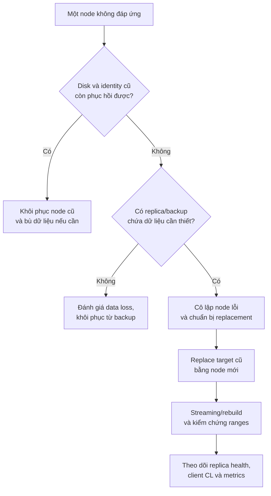
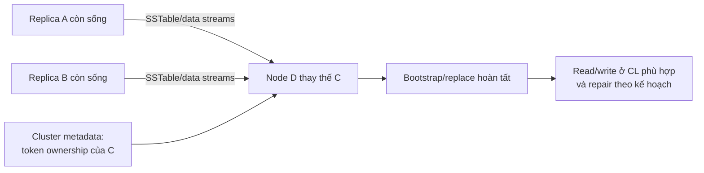

# Thay thế nút mất dữ liệu và điều kiện định danh/địa chỉ

**Chương:** Thay đổi topology  
**Module:** `DATABASE_ENGINE_WIDE_COLUMN_CASSANDRA` — Apache Cassandra

Apache Cassandra là cơ sở dữ liệu wide-column phân tán: partition key quyết định vị trí dữ liệu trên token ring; replication factor (RF) quyết định số bản sao; consistency level (CL) quyết định yêu cầu đọc/ghi cần bao nhiêu replica đáp ứng. Khi một node mất hoàn toàn dữ liệu cục bộ (ví dụ mất volume), không thể chỉ dựng một máy có tên và IP giống cũ rồi giả định nó tự có dữ liệu. Cassandra cần biết **đây là node mới thay thế thành viên nào**, node cũ còn hoạt động hay không, node mới được nhận **token ownership** nào và có thể nhận dữ liệu từ những replica nào.

Bài học thuộc phạm vi hiểu kiến trúc phân tán, khóa phân vùng, thiết kế bảng theo truy vấn, mức nhất quán đọc/ghi, replication, compaction, repair, xử lý lỗi và kết nối ứng dụng Java. Trọng tâm là **thay thế node đã mất dữ liệu**, đặc biệt điều kiện về **định danh node (host ID)**, **địa chỉ mạng**, **datacenter/rack**, **token** và **trạng thái các replica**. Các thao tác thay topology có thể gián đoạn dịch vụ; ví dụ chỉ dành cho cụm thử nghiệm do bạn kiểm soát.

> **Phạm vi phiên bản:** Hướng dẫn dùng khái niệm chung của Apache Cassandra 4.1/5.x. Tên tùy chọn JVM, cách cấu hình container, cơ chế replace address, tốc độ streaming và hành vi khi dùng lại địa chỉ có thể khác theo phiên bản hoặc bản phân phối. Mọi thao tác thay node phải đối chiếu tài liệu và runbook của **phiên bản thực tế** trước khi thực thi trên cụm đang phục vụ người dùng.

## 1. Kết quả học tập

Hoàn thành bài, bạn có thể:

1. Phân biệt **restart/rejoin** node còn dữ liệu với **replace** node mất dữ liệu, **bootstrap** node tăng dung lượng và **removenode/decommission**.
2. Giải thích host ID, endpoint address, token ownership, datacenter/rack, seeds và sự liên hệ với replication.
3. Xác định địa chỉ node cũ dùng làm **replace target** khác với địa chỉ của máy mới.
4. Đánh giá điều kiện phục hồi: dữ liệu còn trên các replica sống không, RF/CL, tombstone, downtime, ổ đĩa và băng thông.
5. Thiết kế quy trình thay node theo các mốc: cô lập node lỗi → chụp trạng thái ring → chuẩn bị node mới → replace/bootstrap streaming → kiểm chứng → đưa vào vận hành.
6. Dùng `nodetool status`, `info`, `gossipinfo`, `netstats` và CQL để ghi bằng chứng, nhưng không suy diễn rằng một truy vấn đúng chứng minh mọi replica đã giống hệt.
7. Nhận diện các tình huống nguy hiểm: node cũ đột ngột quay lại, IP/host ID trùng, sai datacenter/rack, cấu hình seed, RF không có nguồn dữ liệu, thiếu disk space.
8. Thiết kế bước kiểm tra qua Java Driver và kế hoạch xử lý rollback/failure cho một thao tác thay thế bị gián đoạn.

## 2. Trước tiên phải chọn đúng loại thao tác

Không phải mọi node `DN` (Down/Normal) đều cần thay.

| Trạng thái thật | Thao tác thường phù hợp | Vì sao |
| --- | --- | --- |
| Mất mạng ngắn; disk cũ còn nguyên, node có thể khởi động | Khôi phục liên lạc, restart/rejoin **cùng node** nếu cần | Dữ liệu và định danh node cũ còn; hints/repair có thể bù mutation bỏ lỡ |
| Mất volume hoặc hỏng máy không thể khôi phục; replica khác còn dữ liệu cần thiết | **Replace** node cũ bằng một node mới | Node mới cần nhận lại ranges mà thành viên cũ phải lưu |
| Muốn tăng năng lực cụm, không có node nào bị mất | **Bootstrap/add node** | Chia lại token ownership và stream cho thành viên bổ sung |
| Muốn loại bỏ vĩnh viễn một node đã chết, không có máy thay thế trực tiếp | Quy trình **removenode** thích hợp theo phiên bản | Thay đổi membership/ownership; không phải replace cùng mục tiêu |
| Node đang Up, chủ động rút nó khỏi cụm | **Decommission** có kiểm soát | Node còn sống có thể tham gia chuyển dữ liệu trước khi rời ring |
| Dữ liệu của mọi replica cho một partition đều mất và không có backup | Không có nguồn để khôi phục partition đó bằng replace | Phải dùng snapshot/backup hoặc chấp nhận giới hạn mất dữ liệu |

**Quy tắc quyết định:** đừng thay node chỉ vì thấy `DN`. Xác minh có thật sự **mất dữ liệu** hay chỉ là outage có thể sửa. Khi node vẫn giữ nguyên volume và identity, thay thế bằng node trắng làm tăng công việc streaming không cần thiết và có thể tạo xung đột thành viên.

### Sơ đồ chọn quy trình



Không chạy đồng thời `replace` và `removenode` trên cùng một địa chỉ cũ. Chọn một quy trình tương thích với trạng thái ring hiện tại, giữ log và đánh giá khi có lỗi ở giữa.

## 3. Định danh node là gì và địa chỉ nào quan trọng?

Một cụm Cassandra có nhiều loại “tên” hoặc định danh. Chúng không thay thế cho nhau.

| Thành phần | Vai trò | Yêu cầu khi replace |
| --- | --- | --- |
| **Host ID** | UUID định danh thành viên trong metadata/gossip | Node mới phải có identity hợp lệ; không nhân bản tùy tiện `host_id` từ data directory hỏng hay copy toàn bộ system keyspace của node cũ |
| **Listen address / broadcast address** | Địa chỉ để node trao đổi traffic internode, được các peer nhận biết | Địa chỉ của node mới phải routable/đúng policy và không tạo endpoint xung đột |
| **RPC/native transport address** | Endpoint mà client/driver dùng kết nối CQL | Cần phù hợp mạng ứng dụng và cấu hình certificate/firewall/contact points |
| **Token / token ranges** | Phân chia ownership của partition trên ring | Replacement phải nhận trách nhiệm ranges của node bị thay qua quy trình replace được hỗ trợ |
| **Datacenter và rack** | Thuộc tính topology do snitch cung cấp, ảnh hưởng replica placement | Phải kiểm tra vị trí node mới phù hợp với kế hoạch RF/placement; sai rack/DC có thể thay tập replica |
| **Cluster name / partitioner / phiên bản schema** | Ngữ cảnh một node tham gia đúng cluster | Không để node mới tạo thành cụm khác hoặc tham gia với cấu hình không tương thích |
| **Seeds** | Các endpoint hỗ trợ khám phá peer/gossip | Phải có seed sống, phù hợp; không dùng seed list thiếu peer hoặc trỏ sai mạng |
| **Node filesystem/data directory** | SSTables, commit log và metadata nội bộ của node | Replacement với disk mới phải dùng cấu hình dành cho node mới; không sao chép tùy tiện dữ liệu hệ thống từ node khác |

### 3.1. Ba khái niệm phải tách rõ

Giả sử node lỗi **C** được peers biết dưới endpoint `10.42.0.13`. Máy thay thế **D** sử dụng endpoint mới `10.42.0.23`.

- **Địa chỉ mục tiêu cần thay** (*replace target*): `10.42.0.13` — endpoint của thành viên chết mà metadata cluster đang biết.
- **Địa chỉ của node mới**: `10.42.0.23` — địa chỉ mà D dùng để giao tiếp với peers.
- **Định danh host của node mới**: do Cassandra quản lý theo quy trình khởi tạo/replacement; không tùy ý gán bằng cách copy `system.local` của node cũ.

Cơ chế replace theo phiên bản dùng **địa chỉ node lỗi làm tham số** (ví dụ tùy chọn JVM `cassandra.replace_address_first_boot`). Tham số này **không** đồng nghĩa đặt `listen_address` của D thành IP của C. Trường hợp tái sử dụng **chính IP cũ** cần runbook riêng vì gossip, DNS, cache, TLS và khả năng node cũ quay lại có thể tạo xung đột; không tự giả định dùng lại IP là đơn giản nhất.

### 3.2. Host ID và token không phải một thứ

Host ID phân biệt node trong metadata; token chỉ định **phạm vi partition** mà node chịu trách nhiệm. Replacement nhận lại phạm vi cần có của node lỗi theo thủ tục thay thế. Không nên cố sao chép nguyên `system` keyspace hay đặt token bằng tay để “giống hệt máy cũ” nếu chưa có yêu cầu chính thức từ quy trình phiên bản.

Mục tiêu của replace là **phục hồi replica placement hợp lệ**, không phải giả vờ máy mới là máy cũ bằng cách giả mạo toàn bộ filesystem/UUID.

### 3.3. Vì sao rack/datacenter quan trọng?

Với `NetworkTopologyStrategy`, replication factor có thể khác giữa datacenter và chiến lược đặt replica xét topology/rack. Nếu C ở một rack còn D được cấu hình trong rack khác, kết quả placement và fault domain có thể khác dự kiến. Vì vậy, trước khi thay cần ghi lại:

- DC/rack của C và của D.
- RF từng datacenter, danh sách token/ownership.
- Số node sống còn giữ dữ liệu và khả năng chịu thêm lỗi trong lúc streaming.
- Chính sách chống đưa hai replica có cùng fault domain lên một host/volume/rack ngoài ý muốn.

Không dùng một máy mới “chạy được CQL” làm bằng chứng rằng topology sau thay thế đúng.

## 4. Điều kiện tiên quyết: dữ liệu có nguồn để stream không?

Giả sử một DC có ba node A/B/C và RF=3. C mất sạch disk; A/B còn dữ liệu. Trong kịch bản không có thêm sự cố và A/B chứa dữ liệu cần phục hồi, node mới D có thể nhận dữ liệu từ những replica còn sống. Nhưng rủi ro cần phân loại:

| Trạng thái | Nhận định |
| --- | --- |
| RF=3, hai replica sống giữ các mutation cần thiết | Có cơ sở cho thay thế/streaming; vẫn phải xác minh phạm vi và trạng thái tombstone |
| RF=3, một trong hai replica sống cũng thiếu dữ liệu | Phải đánh giá sửa sai lệch/repair, khả năng nguồn và lịch sử write CL; không tuyên bố thay thế sẽ tự khôi phục mọi mutation |
| RF=1, replica duy nhất mất disk | Replace không tự tái tạo dữ liệu đã mất; cần backup hoặc nguồn khác |
| Tombstone bị loại khi replica khác còn giá trị cũ | Có rủi ro resurrection; cần đánh giá lịch repair, downtime, `gc_grace_seconds` |
| Node C chưa chắc đã chết hẳn | Phải cô lập C để nó không bất ngờ online trong lúc D thay thế |
| Không đủ disk/network headroom | Replacement/streaming có thể thất bại hoặc làm ứng dụng chậm nghiêm trọng |

**Consistency level không khôi phục byte đã mất.** Một write `LOCAL_QUORUM` thành công ở RF=3 khi C Down cho biết có hai replica đáp ứng điều kiện ghi tại thời điểm đó; không chứng minh mọi mutation sau này vẫn còn trên một nguồn sống nếu A/B tiếp tục lỗi hoặc mất dữ liệu.

**Repair không phải backup.** Nếu tất cả bản sao của một partition đã mất, Merkle tree và streaming cũng không tự tạo lại giá trị; cần snapshot, backup hoặc nguồn tái dựng nghiệp vụ.

## 5. Mô hình lab: một node mất toàn bộ dữ liệu

Bài thực hành dùng **cluster disposable** có ba node A/B/C trong datacenter `datacenter1`. Mô phỏng **node C chết vĩnh viễn** rồi thay bằng node D với volume mới, IP mới. Đừng xóa dữ liệu thật trong lab dùng chung; lý tưởng là tạo cluster dùng một lần từ đầu, chủ động chuẩn bị node D tách biệt. Chỉ thực hiện bước phá hủy volume ở kịch bản disposable có backup/đã xác nhận ownership.

```text
Trước khi lỗi:
  cassandra1  10.42.0.11  A  UN
  cassandra2  10.42.0.12  B  UN
  cassandra3  10.42.0.13  C  UN  <- sau đó mất data volume

Sau khi lỗi:
  cassandra1  10.42.0.11  A  UN
  cassandra2  10.42.0.12  B  UN
  cassandra3  10.42.0.13  C  DN  <- phải giữ offline
  cassandra4  10.42.0.23  D  ... <- replace target C

Keyspace:
  RF = 3 tại datacenter1
```

Các IP chỉ là **minh họa** cho sơ đồ: không copy nguyên vào Docker Compose/VM. Cần lấy địa chỉ thực từ `nodetool status`/cấu hình mạng của chính cluster.

### 5.1. Kiểm tra phiên bản và topology trước sự cố

Trên từng node còn hoạt động:

```bash
nodetool status
nodetool describecluster
nodetool info
nodetool gossipinfo
```

Trong `cqlsh`:

```sql
SELECT cluster_name, partitioner, release_version
FROM system.local;

SELECT data_center, rack, host_id, broadcast_address
FROM system.local;
```

Tên các trường hệ thống, ý nghĩa broadcast endpoint hoặc output `nodetool` có thể thay đổi theo phiên bản. Mục tiêu là **ghi bằng chứng** phiên bản, hostname/IP thực, datacenter, rack, host ID, token ownership, schema agreement và node health. Không sửa `system.local` trực tiếp.

Tạo keyspace/bảng lab (chỉ khi datacenter thực sự có tên `datacenter1`):

```sql
CREATE KEYSPACE IF NOT EXISTS lab_topology
WITH replication = {
  'class': 'NetworkTopologyStrategy',
  'datacenter1': 3
}
AND durable_writes = true;

CREATE TABLE IF NOT EXISTS lab_topology.orders_by_id (
    order_id uuid PRIMARY KEY,
    customer_id uuid,
    state text,
    amount_cents bigint,
    updated_at timestamp
);
```

Tạo ba bản ghi baseline khi cluster khỏe, ở CL `ALL`:

```sql
CONSISTENCY ALL

INSERT INTO lab_topology.orders_by_id
    (order_id, customer_id, state, amount_cents, updated_at)
VALUES (
    20000000-0000-4000-8000-000000000101,
    10000000-0000-4000-8000-000000000001,
    'CREATED', 100000, '2026-11-21T01:00:00Z'
);

INSERT INTO lab_topology.orders_by_id
    (order_id, customer_id, state, amount_cents, updated_at)
VALUES (
    20000000-0000-4000-8000-000000000102,
    10000000-0000-4000-8000-000000000002,
    'CREATED', 150000, '2026-11-21T01:00:00Z'
);

INSERT INTO lab_topology.orders_by_id
    (order_id, customer_id, state, amount_cents, updated_at)
VALUES (
    20000000-0000-4000-8000-000000000103,
    10000000-0000-4000-8000-000000000003,
    'CREATED', 180000, '2026-11-21T01:00:00Z'
);
```

Chỉ tiếp tục nếu **cả ba** INSERT được ACK ở `ALL`. Nếu có timeout, chưa thể giả định mọi replica đã nhận; sửa môi trường và dùng bộ khóa mới thay vì tiếp tục trên baseline không rõ.

### 5.2. Quan sát khi một replica vắng mặt

Trong cluster dùng một lần, tắt node C nhưng **giữ nguyên volume** ở giai đoạn đầu để phân biệt outage với data loss:

```bash
# Trên Docker host của lab, nếu dùng các tên container tương ứng:
docker stop cassandra3
docker exec cassandra1 nodetool status
```

Khi A/B còn sống, C được peers xem Down, cập nhật một hàng ở `LOCAL_QUORUM`:

```sql
CONSISTENCY LOCAL_QUORUM

UPDATE lab_topology.orders_by_id
SET state = 'PAID', updated_at = '2026-11-21T01:05:00Z'
WHERE order_id = 20000000-0000-4000-8000-000000000101;

SELECT order_id, state
FROM lab_topology.orders_by_id
WHERE order_id = 20000000-0000-4000-8000-000000000101;
```

Nếu A/B đáp ứng, write có thể được ACK dù C chưa nhận mutation. Trong trường hợp này, nếu bạn khởi động lại **cùng C với disk cũ**, đó chỉ là **rejoin**, chưa phải replace. Muốn kiểm tra replace, cần một node D mới với data directory mới và **giữ C cũ không bao giờ khởi động lại** trong suốt vòng đời D thay thế.

Không cần thực hiện lệnh xóa volume vào bài học này. Việc mô phỏng mất disk có thể được chuẩn bị từ hạ tầng disposable riêng. Mọi dữ liệu cần học đã có thể kiểm chứng từ sự kiện C Down và quy trình D mới nhận replica ranges.

## 6. Preflight replacement: checklist không thể bỏ qua

Trước khi bật node D lần đầu:

1. **Xác minh node C thật sự không thể phục hồi hoặc được quyết định thay:** đã cô lập C ở cấp VM/container/network; có chủ sở hữu xác nhận C sẽ không tự quay lại.
2. **Ghi địa chỉ C mà peers biết:** lấy từ `nodetool status` và topology hiện tại. Địa chỉ này dùng làm *replace target*.
3. **Kiểm tra cluster còn đủ replica sống:** các nguồn A/B phải là những node đáng tin cậy, đủ sức cung cấp dữ liệu cho ranges của C.
4. **Lưu thông tin token/host ID cũ làm bằng chứng:** phục vụ so sánh sau thay, **không dùng để gán thủ công** cho D.
5. **Chuẩn bị D với data directory mới:** volume không chứa metadata/host ID của một node khác; cấu hình Cassandra tương thích với cluster.
6. **Chọn endpoint mới:** listen/broadcast address, native transport và firewall đúng; kiểm tra DNS/TLS certificate nếu có.
7. **Kiểm tra datacenter/rack:** cùng chiến lược replica placement và phù hợp mục tiêu chịu lỗi.
8. **Seed list:** D phải tìm được các peer sống; tránh danh sách chỉ chứa C đã chết.
9. **Dung lượng và băng thông:** đủ disk để nhận range, cộng headroom cho compaction và dữ liệu mới đang ghi.
10. **Kế hoạch pause/rollback:** biết sẽ làm gì nếu D boot sai hoặc streaming thất bại; không có tự động rollback về C mất disk.

Preflight này chỉ hoàn tất khi dữ liệu từng mục có **giá trị cụ thể** trong biên bản. Một dòng “đã kiểm tra” không kèm thông tin endpoint/DC/phiên bản chưa đủ cho thao tác production.

## 7. Cấu hình thay node và ý nghĩa của replace address

Với những bản Apache Cassandra hỗ trợ cơ chế truyền thống, node mới có thể được khởi động **lần đầu** cùng tham số JVM:

```text
-Dcassandra.replace_address_first_boot=<địa chỉ endpoint của node C đã chết>
```

Trong ví dụ lab:

```text
-Dcassandra.replace_address_first_boot=10.42.0.13
```

Địa chỉ bên phải là **endpoint của C được gossip/ring biết đến**, không phải IP của D `10.42.0.23`. Tham số phải được cung cấp theo cách JVM của **bản Cassandra đang chạy** nhận được; các Docker image/Helm chart/bản phân phối có quy ước biến môi trường khác nhau. Không suy rằng biến shell mang tên gần giống luôn có tác dụng.

**Không đặt lệnh này thành thuộc tính chạy vĩnh viễn cho mọi lần restart.** Đây là đường đi khởi tạo replacement cho node mới. Sau khi node D đã bootstrap thành công, quá trình restart sau đó phải dùng data directory và identity ổn định của **D**, theo quy trình version-specific. Nếu tiến trình thất bại nửa chừng, đừng xóa mọi dữ liệu D rồi lặp đi lặp lại option này; điều tra log và trạng thái ring trước.

### 7.1. Địa chỉ C và D có thể khác nhau

| Thuộc tính | C đã chết | D thay thế |
| --- | --- | --- |
| Internode endpoint | `10.42.0.13` | `10.42.0.23` |
| Host ID | Host ID cũ lưu trong biên bản | Identity hợp lệ của D do quá trình khởi tạo quản lý |
| Token responsibility | Phạm vi C phải lưu | D nhận trách nhiệm thay C theo replace |
| Datacenter/rack | `datacenter1` / rack cũ | Kiểm tra trùng khớp kế hoạch replica placement |
| Data directory | Mất hoặc hỏng | Trống, sạch, chỉ thuộc D |
| Trạng thái cuối | C không quay lại | D hoàn tất bootstrap, lên `UN` |

Một số triển khai có yêu cầu/giới hạn riêng nếu D dùng **cùng IP** với C. Đừng kết luận rằng thay địa chỉ là một thay đổi không đáng kể: Cassandra peers, firewall, DNS, client contact points và chứng chỉ TLS có thể phụ thuộc endpoint. Khi cùng IP là điều bắt buộc, phải dùng runbook được phiên bản hỗ trợ và bảo đảm C không thể hoạt động trùng địa chỉ.

### 7.2. Điều gì xảy ra nếu quên replace option?

Nếu D bắt đầu như một **node mới bình thường** thay vì replacement, Cassandra có thể cố bootstrap thêm thành viên hoặc gặp xung đột topology. Điều đó **không thực hiện đúng mục tiêu thay C**. Nếu phát hiện sớm, dừng kế hoạch, giữ logs và đánh giá hiện trạng ring trước khi thử lại. Không tự chạy một chuỗi `removenode`/`decommission`/`cleanup` để “sửa cho khớp” khi chưa biết D đã làm gì.

### 7.3. Không cho node C hồi sinh

Khi D bắt đầu thay thế, C phải được bảo đảm **không tự quay lại** qua cơ chế auto-restart, cloud autoscaling hoặc watchdog. Nếu C quay lại cùng endpoint/token metadata cũ sau khi D đã nhận trách nhiệm, cluster có thể gặp xung đột membership/replica. Cần có fencing ở cấp hạ tầng và quy trình xử lý máy cũ.

Điều kiện “C chắc chắn Down” là yêu cầu an toàn của quy trình, không chỉ để tránh một lỗi câu lệnh.

## 8. Streaming trong quá trình replacement

Trong replacement, D cần lấy dữ liệu tương ứng ranges mà thành viên C đang chịu trách nhiệm. Các nguồn được chọn từ những replica phù hợp đang còn sống. Cassandra sử dụng **streaming** để truyền dữ liệu; điều này có thể tốn đáng kể network và disk I/O.



Sơ đồ mang tính khái niệm; không khẳng định cả A và B đều chắc chắn gửi cùng một range hoặc bytes phân bổ ngang nhau. Phạm vi, nguồn streaming và thuật toán phụ thuộc topology/phiên bản.

### 8.1. Khối lượng truyền không bằng “số hàng thiếu”

D có data directory mới nên có thể cần nhận gần như toàn bộ lượng dữ liệu mà C phải sở hữu, **khác** với một lần anti-entropy repair chỉ đồng bộ phần sai lệch. Byte truyền thực tế phụ thuộc token ranges, compression, SSTable contents, overhead, phiên bản và cơ chế streaming.

Ước lượng theo đường nghẽn:

\[
T_{\mathrm{network}} \gtrsim \frac{B_{\mathrm{transferred}}}{V_{\mathrm{effective}}}
\]

Trong đó `B_transferred` là số byte cần truyền và `V_effective` là thông lượng hữu hiệu còn lại cho streaming trên đường mạng giới hạn. Ví dụ **giả định** 120 GiB qua link hữu hiệu 100 MiB/s cần ít nhất khoảng:

\[
\frac{120 \times 1024\ \mathrm{MiB}}{100\ \mathrm{MiB/s}}
=1228{,}8\ \mathrm{s} \approx 20{,}5\ \mathrm{phút}
\]

Mốc này chỉ tính theo network, **không** bao gồm đọc/ghi đĩa, bootstrap metadata, compaction, timeouts, retries hoặc traffic CQL. Không dùng nó để hứa thời gian thay node trên production.

### 8.2. Kiểm tra dung lượng

D cần chỗ chứa dữ liệu streams, metadata và headroom cho compaction sau bootstrap. A/B cũng phải phục vụ đọc dữ liệu để stream và nhận truy vấn ứng dụng. Nếu disk free của D nhỏ hơn dữ liệu dự kiến nhận, replacement có nguy cơ thất bại dù network khỏe.

Ghi riêng cho **mỗi node**: disk free, SSTable bytes, CPU, read/write I/O wait, compaction backlog và network throughput. Tổng “cụm còn 40% disk” không đủ vì một node đơn lẻ có thể hết đĩa trước.

### 8.3. Xem tiến độ

Trong lab, khi D đang thay node và process đã chạy:

```bash
nodetool status
nodetool netstats
nodetool compactionstats
nodetool tablestats lab_topology.orders_by_id
```

Chạy các lệnh trên D và các peer phù hợp; cách gắn vào container/VM tùy hạ tầng. `netstats` cho biết các session streaming đang hoạt động, files/sections và tiến độ nếu phiên bản cung cấp. Không dùng một ảnh chụp “không có stream” làm chứng cứ replacement đã hoàn tất: có thể stream chưa bắt đầu, đã xong hoặc job đã lỗi.

Log bootstrap/replace, `nodetool status` từ **peers**, dữ liệu metrics theo thời gian và chỉ số disk/network là những nguồn cần đối chiếu.

## 9. Kiểm chứng node mới đã thay đúng trách nhiệm

Chỉ đánh dấu thành công khi đạt **nhiều lớp xác minh**:

### 9.1. Lớp membership/topology

- D được peers nhìn thấy là `UN` trong ring sau khi bootstrap/replace hoàn tất.
- Không còn C hoạt động hoặc endpoint/identity cũ đột ngột xuất hiện lại.
- Token ownership/ranges tương ứng với kế hoạch replacement và RF đúng.
- DC/rack phù hợp, schema agreement ổn định, seed/gossip hoạt động.
- D không phải một node mới không liên quan đang thêm capacity, còn C vẫn là thành viên Down chưa xử lý.

### 9.2. Lớp streaming và vận hành

- Log của replacement kết thúc đúng trạng thái thành công; không còn stream/session lỗi đang chờ mà runbook yêu cầu xử lý.
- D có SSTables/dung lượng phù hợp với ranges nhận.
- Disk headroom vẫn chấp nhận được, không có compaction backlog tăng vô hạn.
- Network/client latency giảm về vùng bình thường sau khi streaming.
- Hints/repair và chính sách anti-entropy được đánh giá; không suy rằng bootstrap hoàn tất thì mọi mutation lịch sử ở các replica đều đã được audit.

### 9.3. Lớp dữ liệu logic

Với dataset lab, kiểm tra các khóa theo primary key. Sau khi D hoạt động ổn định, thử tại `LOCAL_QUORUM`:

```sql
CONSISTENCY LOCAL_QUORUM

SELECT order_id, state, amount_cents
FROM lab_topology.orders_by_id
WHERE order_id = 20000000-0000-4000-8000-000000000101;

SELECT order_id, state, amount_cents
FROM lab_topology.orders_by_id
WHERE order_id = 20000000-0000-4000-8000-000000000102;

SELECT order_id, state, amount_cents
FROM lab_topology.orders_by_id
WHERE order_id = 20000000-0000-4000-8000-000000000103;
```

Nếu write `PAID` lúc C Down được ACK và không có ghi cạnh tranh, hàng 101 dự kiến có `state='PAID'`; hai hàng 102/103 vẫn `CREATED`. Sau khi tất cả replica đã sẵn sàng, có thể thử đọc tại `ALL` để kiểm tra khả năng đáp ứng của nhóm replica cho **những khóa đó**:

```sql
CONSISTENCY ALL

SELECT order_id, state
FROM lab_topology.orders_by_id
WHERE order_id = 20000000-0000-4000-8000-000000000101;
```

`ALL` thất bại trong giai đoạn bootstrap chưa hoàn tất **không tự chứng minh data loss**; nó có thể chỉ là yêu cầu quá nhiều replica khi một node chưa sẵn sàng. Ngược lại, một lần đọc đúng tại `ALL` không chứng minh **mọi partition của toàn cluster** đều đồng nhất. Khi cần đánh giá toàn diện, dùng repair/validation theo đúng phạm vi và phiên bản.

## 10. Java Driver: kiểm tra đường đọc sau khi thay node

Driver Java 4.x dùng nhiều contact points/node discovery; khi topology đổi, driver có thể nhận thông tin thay đổi endpoint và tự điều chỉnh kết nối. Nhưng application vẫn phải chịu được một số lần timeout/reconnect trong lúc cluster chuyển trạng thái.

```java
import com.datastax.oss.driver.api.core.CqlSession;
import com.datastax.oss.driver.api.core.DefaultConsistencyLevel;
import com.datastax.oss.driver.api.core.cql.PreparedStatement;
import com.datastax.oss.driver.api.core.cql.Row;

import java.util.List;
import java.util.UUID;

public final class ReplacementReadCheck {
    public static void verify(CqlSession session) {
        PreparedStatement query = session.prepare(
            "SELECT state, amount_cents FROM lab_topology.orders_by_id " +
            "WHERE order_id = ?"
        );

        List<UUID> ids = List.of(
            UUID.fromString("20000000-0000-4000-8000-000000000101"),
            UUID.fromString("20000000-0000-4000-8000-000000000102"),
            UUID.fromString("20000000-0000-4000-8000-000000000103")
        );

        for (UUID id : ids) {
            try {
                Row row = session.execute(
                    query.bind(id)
                         .setConsistencyLevel(
                             DefaultConsistencyLevel.LOCAL_QUORUM)
                ).one();

                if (row == null) {
                    System.out.println(id + " -> ABSENT");
                } else {
                    System.out.println(id + " -> " +
                        row.getString("state") + ", " +
                        row.getLong("amount_cents"));
                }
            } catch (RuntimeException ex) {
                // Lỗi request là outcome khác với SELECT thành công trả rỗng.
                System.err.println(id + " -> READ_ERROR: " + ex);
            }
        }
    }
}
```

Kết quả Java là **quan sát đọc logic ở CL đã chọn**; nó không thay `nodetool netstats`, bootstrap logs, metadata host ID/token hay kiểm kê replica vật lý. Không thực hiện “khắc phục” bằng cách gửi lại mutation một cách mù quáng từ ứng dụng trong lúc replace; đặc biệt các counter/increment không idempotent có thể thay đổi giá trị.

Với workload nhạy độ trễ, ứng dụng nên có retry policy phù hợp từng loại request, deadline, metrics lỗi và cơ chế phát hiện node thay đổi qua driver. Cấu hình contact points/native transport endpoints/certificate SAN phải phù hợp với D nếu clients cần truy cập trực tiếp node mới.

## 11. Những lỗi thường gặp khi thay node

| Triệu chứng | Khả năng nguyên nhân | Cách chẩn đoán/ứng phó |
| --- | --- | --- |
| Replace bị từ chối vì endpoint mục tiêu vẫn Up | C chưa thật sự bị cô lập, còn watchdog tự khởi động | Fence C, kiểm tra trạng thái từ peers và log; không cố ép replace node sống |
| D không gặp được peers | Seeds sai, IP/listen/broadcast address sai, firewall/TLS | Xem logs, reachability, DC/rack, seed list và internode ports |
| D lên như node mới, không đúng vai trò thay C | Bỏ quên hoặc truyền sai tham số replace lần đầu | Dừng kế hoạch, giữ logs và đánh giá ring; tránh chạy lệnh remove/cleanup tùy tiện |
| Hai node có vẻ cùng identity/endpoint | Data directory copy từ máy khác hoặc IP trùng | Cô lập tiến trình xung đột, dùng quy trình phục hồi metadata theo phiên bản |
| C xuất hiện lại trong lúc D đang replace | Auto-restart/VM cũ chưa bị vô hiệu hóa | Ngăn C hoạt động, kiểm tra membership và log trước khi tiếp tục |
| D không nhận đủ SSTable / read timeout | Streaming lỗi, nguồn replica không khỏe, thiếu disk/network | Xem `netstats`, bootstrap logs, disk free, CL và phạm vi token |
| Node ở sai rack/datacenter | Snitch/config không khớp | Dừng đánh giá thành công, sửa kế hoạch placement theo phiên bản |
| Cluster chạy được nhưng một phần dữ liệu thiếu | Dữ liệu đã mất ở tất cả nguồn sống, tombstone/TTL hoặc write không ACK như tưởng | Kiểm tra từng khóa, snapshot/backup, write CL, timestamps, repair/restore |
| Disk đích đầy trong quá trình stream | Ước lượng quá thấp, snapshots/compaction tốn thêm chỗ | Bổ sung capacity theo runbook, không xóa SSTable hệ thống thủ công |
| p99 ứng dụng tăng khi bootstrap | A/B vừa phục vụ client vừa stream, tranh chấp CPU/đĩa/mạng | Giới hạn tốc độ, lập lịch, theo dõi metrics và ưu tiên SLA |

**Không tự chạy lại cùng tham số khởi tạo trong một vòng lặp** mỗi khi D gặp lỗi. Việc replace có state; trước khi thử lại phải biết node đã có host ID/metadata, đã nhận token ranges nào, đã ghi tệp nào và peers hiện hiểu membership ra sao.

## 12. Dữ liệu xóa, TTL và thời gian node vắng mặt

Một node C bỏ lỡ DELETE hoặc TTL có thể còn phiên bản cũ. Nếu các replica sống đã dọn tombstone quá sớm rồi dùng chúng làm nguồn khôi phục, kết quả có thể không đúng ý định xóa. Cassandra dùng timestamp/tombstone và cơ chế repair để hòa giải, nhưng quá trình này phụ thuộc `gc_grace_seconds`, lịch repair, thời gian node offline và tình trạng toàn bộ replica.

Quy trình thay node cần trả lời:

- C đã vắng bao lâu? Có vượt thời hạn an toàn được runbook cho phép không?
- Có nhiều DELETE/TTL trong khoảng đó không?
- Các replica sống có được repair đúng lịch và đủ phạm vi không?
- Có snapshot/backup đáng tin cậy và chính sách retention không?
- Có nguy cơ kết hợp dữ liệu cũ và mới do write timestamp do client đặt sai không?

Đừng giảm `gc_grace_seconds` hoặc ép major compaction chỉ để giảm disk trước replacement. Cũng không xem việc đọc được dữ liệu ở quorum là bằng chứng không có tombstone/replica divergence nào còn tồn tại.

Nếu không còn bản sao dữ liệu hợp lệ hoặc có lịch sử repair không đáng tin, phải **đánh giá khả năng mất dữ liệu** trước khi tuyên bố thay node hoàn tất.

## 13. Phân biệt replace, removenode, decommission và rebuild

| Quy trình | Mục tiêu | Khi nào phù hợp |
| --- | --- | --- |
| **Replace** | Một node mới tiếp quản trách nhiệm của node chết, thường từ disk sạch và stream dữ liệu | Node cũ đã mất khả năng phục vụ, có nguồn replica phù hợp |
| **Rejoin/restart** | Node cũ quay lại với dữ liệu và identity còn hợp lệ | Outage ngắn, volume chưa mất |
| **Decommission** | Node đang sống rời ring có kiểm soát, chuyển ownership trước khi ngừng | Giảm số node khi node còn khả dụng |
| **Removenode** | Loại node đã chết khỏi membership để ring điều chỉnh ownership | Không thực hiện replace trực tiếp hoặc runbook topology yêu cầu |
| **Rebuild** | Dựng lại dữ liệu trên một node theo phạm vi/datacenter nguồn trong tình huống hỗ trợ | Quy trình phục hồi/đồng bộ đặc thù, không thay thế tùy tiện cho replace |
| **Bootstrap/add** | Đưa node mới vào để tăng capacity/chia token | Không có một node lỗi cần được thay ngay |

**Không phối hợp bừa bãi** các thủ tục trên cùng target. Chẳng hạn, nếu đã removenode hoàn tất, địa chỉ cũ có thể không còn là mục tiêu replace hợp lệ; một node mới lúc đó cần quy trình tham gia khác phù hợp topology hiện tại.

## 14. Nhật ký thay node và mốc quyết định

Dùng biểu mẫu để kết quả có thể được audit:

| Mốc | Sự kiện | Bằng chứng cần ghi |
| --- | --- | --- |
| T0 | Còn đủ node, chuẩn bị baseline | Cassandra version, RF/CL, token/DC/rack, trạng thái node, baseline ACK |
| T1 | C mất dữ liệu | Loại lỗi volume/host, quyết định không thể rejoin, snapshot nếu có |
| T2 | Fence C và preflight | C DN từ peers, endpoint cũ, host ID cũ, nguồn A/B, disk/network |
| T3 | Chuẩn bị D | Identity mới, IP mới, rack/DC, seeds, config, dữ liệu trống |
| T4 | D khởi động replace | Tham số target đúng phiên bản, logs/bootstrap, trạng thái ring |
| T5 | Streaming | `netstats`, bytes sent/received, throughput, errors, disk free |
| T6 | D hoàn tất và `UN` | Gossip/membership, token ownership, schema agreement |
| T7 | Read/repair verification | Kết quả từng khóa theo CL, job logs và phạm vi đã đối soát |
| T8 | Ổn định tải ứng dụng | Read/write p95/p99, error rate, compaction và dung lượng |
| T9 | Kết thúc sự kiện | Lưu báo cáo, hạ tầng C cũ đã vô hiệu, kế hoạch repair/backup tiếp theo |

Mẫu ghi nhanh:

```text
INCIDENT_ID:
CASSANDRA_VERSION:
DATACENTER / RACK / RF:
OLD_ENDPOINT:
OLD_HOST_ID:
OLD_TOKEN_RANGES:
OLD_NODE_FENCED_AT_UTC:
REPLACEMENT_ENDPOINT:
REPLACEMENT_HOST_ID:
REPLACEMENT_RACK:
REPLACE_TARGET_PARAMETER:
BOOTSTRAP_START_AT_UTC:
BOOTSTRAP_RESULT:
STREAM_BYTES_SENT / RECEIVED:
MINIMUM_DISK_FREE:
P95_P99_CLIENT_LATENCY:
SCHEMA_AGREEMENT:
RING_MEMBERSHIP_AFTER:
READ_CL_AND_EXPECTED_VALUES:
REPAIR_SCOPE_AND_RESULT:
UNRESOLVED_DATA_RISKS:
OWNER_AND_NEXT_ACTION:
```

Chỗ không đo được phải ghi “không quan sát được” thay vì điền con số ước lượng như dữ liệu thật. Chỉ dùng biểu mẫu sau khi đã xác minh topology/phiên bản; không copy địa chỉ hay host ID giả định từ bài.

## 15. Thực hành suy luận: sáu kịch bản

### Trường hợp A — C mất volume, A/B sống, RF=3

D với IP mới cần tiếp quản trách nhiệm của C. Preflight phải có địa chỉ C mà gossip biết, cluster health, rack/DC và nguồn stream. Sau bootstrap, kiểm chứng token ownership và đọc ở CL phù hợp. Đừng bật lại C.

### Trường hợp B — C Down nhưng disk vẫn nguyên

Ưu tiên sửa nguyên nhân mạng/host và rejoin bằng identity cũ. Replacement trong tình huống này có thể gây streaming thừa và nguy cơ xung đột nếu C tự quay lại.

### Trường hợp C — RF=1 và replica duy nhất mất dữ liệu

Không có nguồn stream nội cụm để phục hồi partition đã mất. Node replacement có thể đưa membership/ownership về trạng thái ổn, nhưng dữ liệu phải khôi phục từ backup hoặc nguồn nghiệp vụ khác. Không tuyên bố replace khôi phục được bản ghi tự động.

### Trường hợp D — D dùng sai datacenter/rack

D có thể truy cập CQL nhưng placement không đúng. Dừng kết luận thành công, đánh giá metadata và điều kiện bản phân phối; không tự đổi rack giữa bootstrap rồi kỳ vọng không ảnh hưởng replica sets.

### Trường hợp E — D bắt đầu nhận stream, sau đó hết disk

Giữ logs và trạng thái, xử lý capacity/giới hạn tải theo runbook. Không xóa SSTables mới nhận một cách tùy tiện và không khởi động lại bằng tham số replace lặp lại nếu chưa hiểu tiến độ bootstrap.

### Trường hợp F — C bất ngờ bật lại sau khi D hoàn tất

Tình huống này chứng minh thiếu fencing. Ngăn C quay lại, đối chiếu ring/host ID/token và dùng quy trình xử lý xung đột có kiểm soát. Không để cả hai node cùng quảng bá vai trò cũ rồi chờ Cassandra “tự sửa”.

## 16. Câu hỏi tự kiểm tra

1. Vì sao nhìn `DN` trên `nodetool status` chưa đủ quyết định cần replace?
2. Khác nhau giữa mất network và mất sạch disk của cùng một node là gì?
3. Với C là `10.42.0.13` và D là `10.42.0.23`, địa chỉ nào là *replace target*? Địa chỉ nào là *listen/broadcast endpoint* của D?
4. Tại sao không được copy `system.local` hoặc toàn bộ data directory từ một node khác sang D chỉ để lấy host ID/token?
5. Host ID khác token ownership thế nào? Vì sao giữ trách nhiệm ranges quan trọng hơn việc “giả làm” cùng UUID?
6. Trong NTS, sai rack/datacenter của D ảnh hưởng gì tới chiến lược chọn replica?
7. Với RF=1 và replica duy nhất mất disk, replace có tự khôi phục được các bản ghi không?
8. Khi C Down, A/B còn sống với RF=3, write `LOCAL_QUORUM` có thể ACK không? Điều đó nói gì về dữ liệu trên C?
9. Nếu D boot thành node mới thay vì replacement, bạn phải kiểm tra những metadata nào trước khi thực hiện lại?
10. Vì sao không thể dùng một câu SELECT thành công ở `ONE` làm bằng chứng mọi replica đã hội tụ?
11. Khi streaming dữ liệu 120 GiB qua link hữu hiệu 100 MiB/s, thời gian tối thiểu riêng do băng thông là bao nhiêu? Vì sao thực tế dài hơn?
12. Tại sao bắt buộc **fence node C** trước và trong khi thay thế?
13. Phân biệt replace với decommission, removenode và bootstrap.
14. Vì sao thời gian node offline, repair cadence, TTL và tombstone phải được đánh giá chung?
15. Hãy lập bảng T0–T9 cho một node mất volume và đánh dấu những mốc nào chứng minh membership, những mốc nào chứng minh dữ liệu.

### Checklist trước khi chấp thuận hoàn thành replacement

- [ ] Đã chứng minh node cũ không thể/không nên rejoin với disk hiện tại.
- [ ] Node cũ được fence và không thể tự bật lại trong/sau replacement.
- [ ] Đã ghi endpoint, host ID, token, DC/rack và phiên bản Cassandra của node cũ.
- [ ] Đã phân biệt đúng **replace target address** với **địa chỉ node mới**.
- [ ] Đã xác minh replication strategy/RF và nguồn dữ liệu còn sống.
- [ ] Disk D sạch, identity hợp lệ, config mạng/TLS/seeds/partitioner phù hợp.
- [ ] Tham số JVM replacement đúng phiên bản, chỉ được áp dụng theo quy trình first boot.
- [ ] Không có removenode/decommission/bootstrap xung đột đang chạy.
- [ ] Đã đo disk headroom, network throughput, compaction và p99 trước khi stream.
- [ ] Đã xem bootstrap/replacement logs, `netstats` và trạng thái lỗi.
- [ ] D xuất hiện `UN` trên peers, ownership và schema agreement đúng.
- [ ] Đã kiểm tra CQL trên khóa mẫu tại CL xác định và phân biệt lỗi đọc với hàng vắng.
- [ ] Đã đánh giá repair/hints/tombstone và các ranges còn chưa được xác minh.
- [ ] Đã ghi giới hạn tính toàn vẹn dữ liệu, tác động ứng dụng và kế hoạch backup/repair tiếp theo.

**Ghi nhớ:** Thay một node Cassandra mất dữ liệu là thay **trách nhiệm của một thành viên ring**, không chỉ thay máy. Thành công đòi xác định **đúng node cũ**, giữ node cũ không quay lại, cho node mới tham gia bằng **địa chỉ và identity hợp lệ**, stream đủ dữ liệu từ replica còn sống và xác minh topology lẫn dữ liệu sau phục hồi. `UN` là điều kiện cần cho availability, không phải giấy chứng nhận mọi bản sao đã hội tụ.

