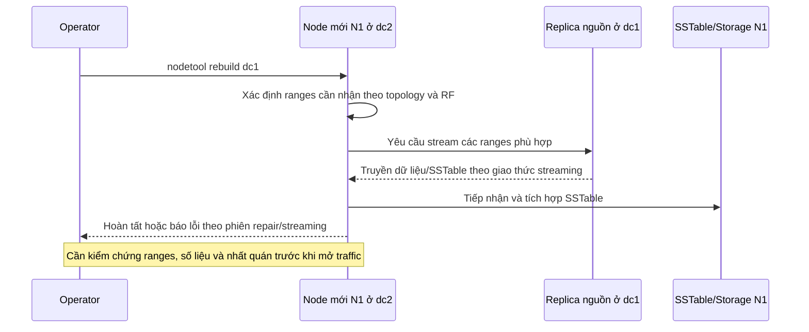

# Rebuild dữ liệu từ bản sao hoặc datacenter khác

> **Chương:** Thay đổi topology  
> **Phạm vi:** Apache Cassandra, cơ sở dữ liệu phân tán theo mô hình *wide-column*. Bài tập trung vào việc dựng lại dữ liệu mà một node/datacenter phải sở hữu bằng cách **streaming từ các replica còn dữ liệu**, đặc biệt khi mở rộng sang datacenter mới. Có ví dụ CQL, `nodetool`, kiểm tra nhất quán và Java Driver 4.x.

## 1. Bài toán: một datacenter mới làm sao có dữ liệu cũ?

Giả sử cluster Cassandra đang chạy trong datacenter `dc1`. Keyspace `shop` sử dụng `NetworkTopologyStrategy` với **RF=3 tại dc1**, và ba replica đã giữ dữ liệu đơn hàng trong nhiều tháng.

Do yêu cầu dự phòng thảm họa hoặc đưa ứng dụng tới khu vực khác, đội vận hành bổ sung `dc2`. Các node mới có thể tham gia cluster, nhận token, nhìn thấy schema và báo trạng thái `UN` (Up/Normal), nhưng **điều đó chưa chứng minh chúng đã có toàn bộ dữ liệu cũ cần phục vụ**.

Mục tiêu là tạo đủ bản sao trên các node của `dc2` tương ứng với token ranges và replication factor của keyspace. Cassandra có thể **stream SSTable/dữ liệu từ replica nguồn phù hợp** để lấp các phần còn thiếu. Khi triển khai một datacenter mới, lệnh `nodetool rebuild` là công cụ thường được sử dụng theo quy trình dành cho phiên bản Cassandra đang chạy.

```text
Ban đầu:
dc1                                dc2
  R1 ─┐                            (chưa chứa dữ liệu lịch sử)
  R2 ─┼─ 3 replica của keyspace
  R3 ─┘

Sau khi cấu hình topology/replication và streaming thành công:
dc1                                dc2
  R1 ─┐                              N1 ─┐
  R2 ─┼─ RF=3 ở dc1     STREAMING →  N2 ─┼─ RF=3 ở dc2
  R3 ─┘                              N3 ─┘

Mỗi node chỉ sở hữu những token ranges cần thiết của nó.
Không phải mọi node đều nhận toàn bộ keyspace.
```

**Rebuild trong ngữ cảnh này là đưa một replica tới trạng thái có dữ liệu cần có theo quyền sở hữu token**, không phải phục hồi một bản sao lưu từ ngày hôm trước, không phải chạy lại mọi CQL ban đầu và cũng không tự động thay thế quy trình repair lâu dài.

## 2. Những khái niệm quyết định nguồn và đích dữ liệu

### Token range và partition key

Cassandra băm **partition key** thành token. Ring token và chiến lược replication quyết định replica nào chịu trách nhiệm lưu từng partition. Với mô hình wide-column, thiết kế bảng theo truy vấn giúp đọc chính xác partition; khi thay topology, chính những partition này cần được phân phối lại cho đúng tập replica.

Một node được thêm vào cluster **không có nghĩa phải tải toàn bộ dữ liệu của mọi node còn lại**. Nó chỉ cần phần dữ liệu thuộc những token ranges mà topology mới giao cho node đó, với RF và placement hiện hành.

### Replication factor theo datacenter

`NetworkTopologyStrategy` cấu hình số bản sao độc lập cho từng datacenter. Ví dụ:

```cql
CREATE KEYSPACE shop
WITH replication = {
  'class': 'NetworkTopologyStrategy',
  'dc1': 3
};
```

Khi hệ thống mở rộng và mục tiêu là ba replica trong mỗi datacenter, schema mong muốn có thể là:

```cql
ALTER KEYSPACE shop
WITH replication = {
  'class': 'NetworkTopologyStrategy',
  'dc1': 3,
  'dc2': 3
};
```

Đây là **ví dụ schema**, không phải hướng dẫn thực thi ngay trên production. Thứ tự chuẩn bị node, rack, token ownership, sửa RF, khởi chạy streaming và kích hoạt traffic phải tuân theo **runbook của phiên bản đang vận hành**. Việc thay replication metadata **không tự điền các hàng lịch sử** vào những replica mới.

### Node đích và datacenter nguồn

- **Node đích:** nơi cần có dữ liệu cho token ranges mà node hiện sở hữu. Trong trường hợp mở `dc2`, chính các node `dc2` là đích của rebuild.
- **Replica nguồn:** node còn giữ dữ liệu tương ứng, thường trong datacenter đã có dữ liệu `dc1`.
- **Source DC:** tham số chỉ ra datacenter nguồn khi dùng hình thức `nodetool rebuild <source_dc>` theo phiên bản hỗ trợ. `source_dc` là **nơi lấy dữ liệu**, không phải tên datacenter đích.

Viết nhầm tên DC hoặc nhầm RF có thể khiến node không có nguồn stream phù hợp, streaming thất bại hoặc hoàn tất thiếu phạm vi dự kiến.

## 3. Phân biệt rebuild với bootstrap, replace, repair và restore

Những thao tác này đều liên quan đến dữ liệu giữa node, nhưng không thể hoán đổi tùy ý:

| Thao tác | Khi nào dùng | Điều gì được thực hiện | Giới hạn quan trọng |
| --- | --- | --- | --- |
| **Bootstrap** | Thêm node vào topology hiện hữu theo quy trình khởi tạo node | Phân phối token/ranges và nhận dữ liệu phù hợp khi node gia nhập | Không giả định bootstrap của một node mới tự hoàn tất dữ liệu lịch sử cho cả một DC mới |
| **`nodetool rebuild`** | Dựng dữ liệu trên node đã tham gia cluster, thường trong quy trình thêm DC mới | Streaming các ranges node phải sở hữu từ replica nguồn | Không sửa sai ownership/schema và không thay thế repair định kỳ |
| **Replace node** | Node cũ mất hẳn và cần node khác tiếp quản danh tính/ownership phù hợp | Thực hiện quy trình replace của Cassandra để node mới lấy dữ liệu | Không lấy node trắng rồi chạy rebuild tùy ý mà bỏ qua cơ chế thay node |
| **Repair** | Đối soát replica đang sở hữu cùng ranges, kể cả sau gián đoạn | So sánh dữ liệu và stream phần khác biệt | Không tự cấu hình thêm DC/RF hoặc thiết kế token mới |
| **Restore snapshot/backup** | Khôi phục từ bản lưu được quản lý | Phục hồi tệp/dữ liệu theo thời điểm và quy trình backup | Có thể cần replay/restore hoặc reconcile mutation về sau; không mặc định đồng nhất với streaming live |
| **Decommission/removenode** | Loại node khỏi topology | Điều chỉnh ownership và đảm bảo di chuyển dữ liệu theo quy trình | Thao tác thay đổi cụm, không phải cách kích hoạt rebuild cho node đích |

**Quy tắc:** xác định nguyên nhân node thiếu dữ liệu trước khi chọn lệnh. “Node trống dữ liệu” có thể do vừa mở DC, thêm node có bootstrap chưa xong, mất disk, schema RF sai hoặc chưa hoàn tất streaming. Mỗi trường hợp có runbook khác nhau.

### Trường hợp node mất toàn bộ ổ đĩa

Nếu một replica hiện hữu bị mất toàn bộ dữ liệu cục bộ, hãy đánh giá **quy trình replace/rebuild được hỗ trợ cho phiên bản**, trạng thái node, token và replica lành trước tiên. Việc tự xóa các thư mục hệ thống rồi chạy `nodetool rebuild` có thể tạo topology sai hoặc gây mất dữ liệu.

Nếu **mọi replica của một partition đều mất dữ liệu**, rebuild không thể tạo lại giá trị đó từ hư không. Khi ấy cần chiến lược backup/restore và xác định RPO/RTO.

## 4. Rebuild thực hiện việc gì trong đường phân tán?

Ở mức khái niệm, node đích biết token ranges mà nó chịu trách nhiệm theo topology hiện tại. Nó yêu cầu dữ liệu từ những replica nguồn thích hợp và nhận thông tin qua cơ chế **streaming** của Cassandra.



Mô hình này cố ý đơn giản hóa: tập nguồn, cách truyền tệp/section, kiểm tra stream, lựa chọn endpoint và xử lý SSTable phụ thuộc phiên bản, cấu hình và token ownership.

### Những điều rebuild không trực tiếp làm

- **Không** tự đổi `NetworkTopologyStrategy` hay replication factor của keyspace.
- **Không** đưa client Java sang một datacenter khác.
- **Không** tự tạo backup hay bảo đảm có một point-in-time snapshot nhất quán đa bảng.
- **Không** biến các mutation không tới replica nguồn thành dữ liệu có thể phục hồi.
- **Không** thay đổi ý nghĩa consistency level của các request.
- **Không** chứng minh mọi range đã đủ dữ liệu chỉ bằng việc node ở trạng thái `UN`.

## 5. Preflight trước khi mở rộng datacenter

Trước khi sửa topology, hãy thu thập thông tin có thể kiểm tra được. Mục đích là xác định **dữ liệu nào sẽ được chuyển, từ đâu và trong điều kiện nào**.

| Nhóm | Cần kiểm tra | Tại sao |
| --- | --- | --- |
| **Phiên bản** | Cassandra version, khả năng tương thích giữa node, cú pháp `nodetool rebuild` | Streaming và trình tự thêm DC có thể khác giữa bản phát hành |
| **Topology** | Tên DC/rack thực tế, snitch, token placement, trạng thái `UN` | Node có thể được đưa vào DC/rack sai |
| **Replication** | `NetworkTopologyStrategy` và RF của **từng keyspace** tại dc1/dc2 | Dữ liệu cần stream tùy từng keyspace và RF |
| **Nguồn** | Độ khỏe replica dc1, repair history, node offline, tombstone/TTL | Nguồn cũ/thiếu dữ liệu không phải nền để rebuild an toàn |
| **Dung lượng** | SSTable bytes, disk headroom, dự báo tăng dung lượng trên dc2 | Streaming cần không gian lưu và phát sinh compaction |
| **Tải** | Read/write p95/p99, CPU, disk I/O, compaction backlog | Rebuild cạnh tranh tài nguyên với truy vấn sống |
| **Mạng** | Routing, latency/bandwidth liên DC, firewall, TLS/port streaming phù hợp | Stream có thể bị nghẽn dù CQL 9042 hoạt động |
| **Khả năng rollback** | Backup/snapshot, runbook xử lý partial stream, điểm chuyển traffic | Phải có cách kiểm tra và quay lại luồng đọc cũ |
| **Dữ liệu đặc thù** | TTL, tombstone, LWT, indexes/materialized views nếu dùng | Dữ liệu và cấu trúc phụ trợ cần được đánh giá sau stream |

### Đừng nhầm replication với số lượng node

Nếu đặt `'dc2': 3`, datacenter dc2 cần có đủ **replica phù hợp** theo cấu hình rack/placement và chính sách của cluster. Chỉ có hai node nhưng RF mục tiêu là 3 không tạo được ba replica độc lập đúng nghĩa. Trước khi chạy rebuild, hãy xử lý cấu hình RF và số node để topology có thể đáp ứng mục tiêu.

### Vì sao cần quan tâm tombstone và repair nguồn?

Giả sử một replica ở dc1 bỏ lỡ một `DELETE` trong thời gian dài. Nếu tombstone đã bị purge tại các nguồn còn lại và một replica cũ vẫn mang dữ liệu, rebuild/streaming hoặc repair có thể có rủi ro đưa dữ liệu cũ quay lại. Trước thay đổi topology lớn, kiểm tra node offline, lịch repair và `gc_grace_seconds` của những bảng có xóa/TTL nhiều.

Rebuild không phải cơ chế phân xử giá trị nghiệp vụ nào “đáng tin” hơn nếu cụm nguồn vốn đã có nguy cơ zombie data.

## 6. Ước lượng khối lượng streaming và thời gian

Mỗi node đích chỉ cần dữ liệu của **ranges nó sở hữu**; không lấy dung lượng toàn cluster nhân với số node một cách máy móc.

Giả sử keyspace có khoảng **1,5 TiB dữ liệu logic** và dc2 muốn RF=3. Với giả định phân phối đều, kích thước bản sao tại dc2 về mặt khái niệm có thể gần **4,5 TiB trước khi xét nén, SSTable dư và metadata**. Đây chỉ là cách thấy quy mô cần provision, không phải số byte chắc chắn sẽ đi qua mạng.

Thực tế cần phân biệt:

- **Logical bytes:** dung lượng dữ liệu nghiệp vụ.
- **Stored bytes:** SSTable đã nén, tombstone, metadata và các file do compaction tạo ra.
- **Bytes streamed:** phụ thuộc phạm vi, nguồn, trạng thái đích, phương pháp truyền, dữ liệu trùng và kiểm tra.
- **Peak disk usage:** trong lúc stream/compaction có thể cao hơn dữ liệu sau cùng.

Mô hình lập kế hoạch sơ bộ:

```text
Tối thiểu về băng thông ≈ tổng bytes phải truyền / thông lượng mạng hữu dụng
Thời gian thực tế     = thời gian stream + validation/chờ tài nguyên
                       + retry/compaction + khoảng dự phòng
```

Không dùng thông lượng lý thuyết của đường truyền WAN làm lời hứa hoàn tất. Disk đọc tại nguồn, disk ghi tại đích, CPU, TLS, network congestion và số stream cùng lúc thường là nút thắt.

### Ví dụ giới hạn concurrency

Nếu dc1 đang phục vụ API p99 nhạy cảm, chạy rebuild trên mọi node dc2 cùng lúc có thể đẩy nhiều nguồn dc1 vào đọc/stream đồng thời. Một phương án thận trọng là **thử một node đích trước**, đo lượng stream và tải, rồi tăng số node chạy song song tới mức vẫn bảo đảm SLO.

Tuy nhiên, chạy tuần tự hoàn toàn cũng có thể kéo dài thời gian mở DC. Quyết định nên dựa trên metric và deadline, không cố định “1 node hay 3 node” cho mọi cluster.

## 7. Thực hành khung: mở `dc2` từ `dc1`

Phần này là **kịch bản minh họa**, không phải quy trình copy-paste lên production. Thứ tự bổ sung node, bootstrap mode, thiết lập racks/seeds và cập nhật replication cần tra cứu runbook đúng phiên bản Cassandra; các lựa chọn sai ở giai đoạn đó có thể làm cụm nhận token hoặc dữ liệu không đúng.

### Bước A — Ghi nhận cấu trúc trước thay đổi

Trên các node còn khỏe:

```bash
nodetool status
nodetool describecluster
```

Từ client CQL có quyền xem metadata:

```cql
DESCRIBE KEYSPACE shop;
```

Xác nhận `dc1` thực sự chứa dữ liệu cần thiết, RF hiện hành và bảng phục vụ các query chính. Đặc biệt, giữ danh sách **keyspace ứng dụng cần dựng lại**; đừng suy đoán một lần thao tác sẽ sửa đúng mọi keyspace của mọi dịch vụ.

### Bước B — Chuẩn bị và kết nối node vào dc2

Trước khi dữ liệu lịch sử được phục vụ bởi dc2, các node mới phải có:

- **DC/rack đúng** theo snitch và topology mong muốn.
- Networking đủ cho internode messaging và **streaming**; không chỉ cổng CQL.
- Disk, CPU, network và chính sách bảo mật tương thích.
- Tokens/ownership theo thủ tục thêm DC được hỗ trợ.
- Cấu hình cluster và schema nhất quán.

Với mỗi phiên bản, hãy xác định rõ **bootstrap mode** phù hợp khi đưa các node của DC mới vào và lúc nào mới mở RF tương ứng. Không tự tắt/bật `auto_bootstrap` hoặc đưa node trắng vào cluster sản xuất theo một hướng dẫn chung không kiểm chứng.

### Bước C — Đặt replication mục tiêu cho keyspace

Sau khi điều kiện topology được đáp ứng theo quy trình version-specific, schema mục tiêu:

```cql
ALTER KEYSPACE shop
WITH replication = {
  'class': 'NetworkTopologyStrategy',
  'dc1': 3,
  'dc2': 3
};
```

Cassandra sử dụng schema này để tính replica placement cho mỗi range. **Đổi RF là thay metadata/placement; không đồng nghĩa dữ liệu cũ đã được copy.**

Nếu cluster có nhiều keyspace ứng dụng, xác định và thực hiện quy trình tương ứng cho từng keyspace. Không thay đổi những keyspace hệ thống hoặc chính sách replication ngoài phạm vi đã được thiết kế.

### Bước D — Stream từ DC nguồn đến từng node đích

Trên **một node đích thuộc dc2** đã sẵn sàng theo runbook:

```bash
nodetool rebuild dc1
```

Với cú pháp thông dụng, `dc1` trong lệnh trên chính là **source datacenter**. Hãy xác minh `nodetool help rebuild`, phiên bản và tham số tùy chọn trước khi chạy thực tế. Không thực thi lệnh tại node nguồn dc1 chỉ vì lệnh nhắc tên `dc1`.

Theo dõi khi lệnh đang chạy:

```bash
nodetool netstats
nodetool tpstats
nodetool compactionstats
```

Khi một node hoàn tất **và xác nhận dữ liệu/metric hợp lệ**, tiếp tục các node đích còn lại theo concurrency plan. Trường hợp lệnh báo thành công nhưng log có range/session lỗi hoặc node mất liên lạc giữa chừng, phải đối chiếu sự kiện streaming trước khi coi mục tiêu đã đạt.

### Bước E — Kiểm chứng trước khi mở ứng dụng tới dc2

Sau khi mọi node liên quan hoàn tất:

```bash
nodetool status
nodetool tablestats shop.orders_by_id
nodetool netstats
```

Các chỉ số như số SSTable, live disk space, streaming session, pending compaction, read latency và trạng thái node giúp chứng minh quá trình thực sự đã chuyển dữ liệu.

Sau đó cần:

1. **Đối chiếu các partition quan trọng** với nguồn theo partition key; lấy mẫu có chủ đích cả dữ liệu cũ, dữ liệu mới và dữ liệu gần TTL/deletion boundary.
2. **Xác minh coverage của token ranges** mà mỗi node dc2 phải sở hữu; không chỉ kiểm tra tổng row count.
3. **Chạy quy trình repair/reconcile phù hợp** nếu runbook và tình trạng ghi đồng thời yêu cầu, lưu ý phạm vi DC và tính nhất quán giữa replica.
4. **Thử truy vấn từ client đặt local DC là dc2** theo consistency level mong muốn, đo p95/p99.
5. Chỉ khi kiểm tra đạt mới chuyển một phần hoặc toàn bộ traffic; tiếp tục theo dõi.

Một `SELECT` trả kết quả từ một node không chứng minh toàn bộ DC đã được dựng đầy đủ: request có thể được phục vụ bởi replica khác, hoặc chỉ kiểm tra một partition vốn đã có dữ liệu.

## 8. Rebuild trong khi ứng dụng vẫn đang ghi dữ liệu

Một thay đổi topology thường diễn ra trên cluster còn hoạt động. Khi nguồn tiếp tục nhận ghi, dữ liệu mới có thể xuất hiện **trong lúc streaming đang chạy**.

Điều này tạo ra hai lớp cần xử lý:

- **Dữ liệu trước thời điểm streaming:** phải được chuyển đủ tới các replica mới theo token ranges tương ứng.
- **Mutation phát sinh trong lúc/ sau streaming:** phải được phân phối theo replication và topology có hiệu lực, hoặc được đối soát bằng bước repair/reconcile khi có khoảng thiếu.

Không nên giả định rebuild là “ảnh chụp giao dịch hoàn hảo tại một thời điểm” cho toàn bộ cluster đang ghi. Việc chuyển traffic phụ thuộc kết quả đối soát và quy trình hỗ trợ ghi đồng thời của phiên bản, đặc biệt với các bảng thay đổi trạng thái nhanh.

### Ví dụ race condition

```text
10:00:00  N1(dc2) bắt đầu rebuild range X từ dc1.
10:00:04  Ứng dụng cập nhật order_id=42 sang PAID.
10:00:05  N1 nhận một phần dữ liệu streaming cũ.
10:00:10  N1 báo hoàn tất phần stream đã yêu cầu.
10:00:15  Đội vận hành chuẩn bị chuyển reader sang dc2.
```

Không thể kết luận đơn 42 chắc chắn là `PAID` trên mọi replica dc2 chỉ dựa vào thời điểm “stream hoàn tất”. Cần kiểm tra quyền sở hữu, phân phối mutation sau thay topology, consistency level và đối soát để tránh chỉ đọc trạng thái cũ.

Nếu workload dùng **LWT/`IF`**, lưu ý đây là đường ghi có điều kiện với giao thức riêng. Thay DC/RF có thể làm thay đổi phạm vi replica tham gia, và việc xác minh toàn vẹn trạng thái phải theo quy trình phù hợp với phiên bản; không chỉ tin tưởng một phép `SELECT` ngẫu nhiên.

## 9. Java Driver: kiểm tra bằng local DC và consistency level

Cassandra Java Driver 4.x chọn coordinator theo chính sách định tuyến. Trong hệ nhiều datacenter, cấu hình **local datacenter** đúng là điều kiện quan trọng để tránh đọc/ghi qua WAN không dự kiến.

Ví dụ một hàm kiểm tra dữ liệu với `CqlSession` **đã được cấu hình để sử dụng dc2**:

```java
import java.util.UUID;

import com.datastax.oss.driver.api.core.CqlSession;
import com.datastax.oss.driver.api.core.DefaultConsistencyLevel;
import com.datastax.oss.driver.api.core.cql.BoundStatement;
import com.datastax.oss.driver.api.core.cql.PreparedStatement;
import com.datastax.oss.driver.api.core.cql.Row;

public final class RebuildReadCheck {
    private final CqlSession session;
    private final PreparedStatement getOrder;

    public RebuildReadCheck(CqlSession session) {
        this.session = session;
        this.getOrder = session.prepare(
            "SELECT order_id, state, updated_at " +
            "FROM shop.orders_by_id WHERE order_id = ?"
        );
    }

    public String readState(UUID orderId) {
        BoundStatement statement = getOrder.bind(orderId)
            .setConsistencyLevel(DefaultConsistencyLevel.LOCAL_QUORUM)
            .setIdempotent(true);

        Row row = session.execute(statement).one();
        return row == null ? null : row.getString("state");
    }
}
```

Ví dụ không tự cấu hình `CqlSession`; người chạy kiểm tra phải xác nhận **driver profile/local DC = dc2**, contact points, RF và quyền truy cập. `LOCAL_QUORUM` yêu cầu quorum của RF **trong DC của coordinator**, không buộc kết quả phải được đồng bộ với `dc1` ngay tại thời điểm đọc.

Vì vậy, sau rebuild:

- Chạy thử bằng client có local DC là **dc2**, thay vì chỉ đọc từ client dc1.
- So sánh một tập partition biết trước với kết quả từ dc1 và nghiệp vụ mong đợi.
- Kiểm tra cả read consistency, write consistency và routing thực tế.
- Giám sát error rate, latency, timeout và việc data thay đổi sau khi chuyển traffic.

**Không dùng một lệnh `SELECT COUNT(*)` toàn bảng như kiểm tra độ đầy đủ.** Quét toàn bảng có thể tốn kém và chỉ cho con số tổng, khó phát hiện range còn thiếu hoặc dữ liệu sai phiên bản. Ưu tiên xác thực theo token ranges và mẫu partition có ý nghĩa.

## 10. Rebuild không phải repair: kiểm tra nhất quán sau streaming

Streaming có nhiệm vụ đưa dữ liệu tới node sở hữu ranges mới. Repair có nhiệm vụ **đối soát replica hiện đang sở hữu cùng ranges**.

Một node có thể nhận đủ SSTable từ nguồn mà vẫn có khác biệt ở những mutation xảy ra trong khoảng thay đổi topology hoặc tồn tại từ trước ở cluster nguồn. Trong trường hợp cần thiết, runbook phải có bước đối soát bằng repair phù hợp với token ranges/DC.

Các khái niệm cần phân biệt:

| Tình trạng | Rebuild xử lý đến đâu? | Việc tiếp theo |
| --- | --- | --- |
| Node dc2 chưa có dữ liệu lịch sử của ranges mới | Streaming từ nguồn giúp điền dữ liệu | Đo stream hoàn tất, xác minh placement |
| Replica dc1 vốn có sai khác vì node từng offline | Rebuild không đảm bảo tự giải quyết mọi sai khác nguồn | Kiểm tra repair history và đối soát nguồn/đích |
| Một số mutation xảy ra khi stream đang chạy | Có thể cần reconciliation theo quy trình cluster | Repair/kiểm tra consistency khi cutover |
| Tất cả replica đều đã mất một partition | Không có nguồn live để stream partition đó | Backup/restore hoặc phục hồi từ nguồn nghiệp vụ |
| Trình tự thêm DC cấu hình sai RF/snitch | Rebuild không thể tạo placement đúng chỉ bằng stream | Sửa topology/schema theo runbook trước |

### Tombstone và `gc_grace_seconds`

Bản dữ liệu đã xóa có thể tồn tại như tombstone trên replica còn khỏe. Nếu node vắng quá lâu hoặc replica nguồn chưa được repair trước khi tombstone bị purge, giá trị cũ có thể sống lại (*zombie data*).

Mở rộng sang DC mới từ nguồn có lịch repair không tin cậy không làm biến mất vấn đề này. Cần xem xét `gc_grace_seconds` của các bảng, lịch replica offline, read/write CL và thời điểm compaction trước khi kết luận dữ liệu được dựng lại là chính xác.

## 11. Xử lý lỗi trong quá trình rebuild

### Lỗi 1 — Lệnh báo không tìm được nguồn phù hợp

**Dấu hiệu:** không có replica nguồn cho range mong muốn, source DC sai, RF hoặc token placement không hợp lý.

**Kiểm tra:** tên DC/rack thật, `NetworkTopologyStrategy`, version, số node và token ownership, trạng thái replica nguồn. Không thử đổi tên source DC tùy tiện cho đến khi hết lỗi.

### Lỗi 2 — Streaming bắt đầu rồi dừng vì mạng

**Dấu hiệu:** `nodetool netstats` cho thấy session lỗi hoặc tiến độ đứng lâu; log node có timeout/connection error.

**Kiểm tra:** kết nối internode, đường mạng giữa DC, port/TLS, bandwidth throttling, packet loss và nguồn còn phục vụ. Xử lý căn nguyên, xác nhận partial state rồi dùng quy trình retry/resume của phiên bản. Đừng tự xóa thư mục data.

### Lỗi 3 — Node đích hết disk

**Dấu hiệu:** storage tăng nhanh, compaction/streaming báo lỗi ghi SSTable.

**Kiểm tra:** logical data và stored data thực tế, RF, khoảng trống trong lúc SSTable tồn tại song song, snapshot và nhu cầu compaction. Cần mở rộng lưu trữ hoặc điều chỉnh lịch hợp lý. Không xóa SSTable hoặc commit log thủ công.

### Lỗi 4 — Nguồn quá tải, API p99 tăng cao

**Dấu hiệu:** dc1 đọc/ghi chậm, disk I/O và network tăng cùng lúc dc2 streaming.

**Khắc phục:** giảm số node đích rebuild song song, chỉnh giới hạn streaming phù hợp với phiên bản, dời cửa sổ, xử lý compaction backlog và quan sát tới khi SLO ổn định.

### Lỗi 5 — Node `UN` nhưng truy vấn ở dc2 thiếu dữ liệu

**Dấu hiệu:** trạng thái gossip bình thường, nhưng các partition kiểm thử không đủ hoặc trả trạng thái cũ.

**Kiểm tra:** rebuild đã thực sự hoàn tất trên tất cả node/ranges chưa, source DC đúng chưa, replication metadata có bao phủ dc2 chưa, driver có đặt local DC đúng không, consistency level dùng là gì. Đối soát và repair phù hợp trước khi mở traffic.

### Lỗi 6 — Đích chứa dữ liệu cũ từ một lần dựng thất bại

**Dấu hiệu:** node đã từng tham gia cluster, có SSTable từ topology cũ, rebuild mới không cho kết quả như dự kiến.

**Nguyên tắc:** rebuild không phải lệnh “format dữ liệu và cài lại node”. Cần xác định lại danh tính node, token và dữ liệu đang giữ, rồi thực hiện quy trình replace/rebuild/restore được phiên bản hỗ trợ. Không reset token hoặc xóa file hệ thống để thử vận may.

## 12. Những thao tác không nên thực hiện để “đẩy nhanh rebuild”

- **Tự xóa data/commitlog hoặc system keyspace:** dễ làm mất bằng chứng phục hồi và metadata nhận diện node.
- **Tăng RF vượt số node có thể phục vụ:** không tạo được đủ replica thực tế.
- **Chuyển toàn bộ client sang dc2 khi một node vừa báo `UN`:** gossip health không tương đương dữ liệu đã đủ.
- **Chạy rebuild trên mọi node và DC cùng lúc:** có thể bão hòa mạng/đĩa của nguồn; luôn dựa trên capacity thực tế.
- **Dùng `ALLOW FILTERING` hoặc `COUNT(*)` toàn bảng để “kiểm tra tất cả”:** chi phí lớn, kết quả khó xác nhận coverage.
- **Coi thông báo stream completed là thay cho repair:** có thể bỏ sót sai khác nguồn và mutation phát sinh trong lúc chuyển.
- **Thay thế backup bằng rebuild:** không khôi phục dữ liệu đã mất trên mọi replica.

## 13. Mẫu checklist bàn giao sau khi bổ sung datacenter

| Mục | Bằng chứng cần có |
| --- | --- |
| Topology đúng | `nodetool status` cho thấy node DC/rack và trạng thái như thiết kế |
| RF/schema đúng | Mọi keyspace ứng dụng cần thiết có replication config mong muốn |
| Nguồn stream tin cậy | Replica nguồn khỏe, không có lỗ hổng repair hoặc node offline chưa được xử lý |
| Streaming hoàn tất | Mỗi node đích có log/session thành công, không còn lỗi đang treo |
| Token coverage | Ranges mà dc2 chịu trách nhiệm có dữ liệu được xác nhận, không chỉ một vài query |
| Lưu trữ ổn định | Disk headroom, SSTable counts, compaction/streaming backlog chấp nhận được |
| Tính nhất quán | Đã kiểm tra partition quan trọng và repair/reconcile cần thiết |
| Ứng dụng | Driver local DC đúng, `LOCAL_QUORUM`/CL phù hợp, traffic canary đạt p95/p99 |
| Vận hành | Alert node/stream/repair, backup, rollback và owner rõ ràng |
| Chuyển tiếp | Có ghi nhận thời điểm và điều kiện chuyển reader/writer sang dc2 |

### Quy trình ngắn theo vai trò

1. **Kiến trúc:** thống nhất RF/DC, racks, capacity, dữ liệu nào phải có và deadline.
2. **Vận hành cluster:** kiểm tra nguồn và topology, chuẩn bị node đích theo runbook version-specific.
3. **Streaming:** thực hiện rebuild theo nhóm node đích có kiểm soát, lưu kết quả từng node/range.
4. **Đối soát:** chứng minh range coverage, repair cần thiết và truy vấn quan trọng đạt yêu cầu.
5. **Ứng dụng Java:** đặt local DC/consistency phù hợp và canary traffic trước rollout rộng.
6. **Theo dõi:** quan sát compaction, disk, network, p99 và repair schedule sau thay đổi topology.

## 14. Các hiểu lầm thường gặp

**“Node mới đã `UN` thì dữ liệu cũ đã đủ.”** Sai. `UN` mô tả node hoạt động trong topology, không phải bằng chứng mọi SSTable cần thiết đã được stream.

**“`nodetool rebuild dc1` nghĩa là rebuild các node của dc1.”** Sai trong kịch bản thêm DC: `dc1` là **DC nguồn**; lệnh được chạy ở node **đích dc2**.

**“Đặt `'dc2': 3` trong `ALTER KEYSPACE` tự copy ba replica lịch sử.”** Sai. Metadata replication và quá trình đưa dữ liệu tới replica mới là hai công việc khác nhau.

**“Rebuild copy toàn bộ dữ liệu tới mọi node đích.”** Sai. Node nhận dữ liệu theo token ranges mà nó sở hữu.

**“Rebuild tương đương restore snapshot.”** Sai. Rebuild stream dữ liệu từ replica live phù hợp; restore từ backup có ngữ nghĩa nguồn và thời điểm khác.

**“Rebuild xong thì không cần repair nữa.”** Sai. Replica vẫn có thể lệch theo thời gian và cần lịch anti-entropy repair.

**“Ứng dụng dùng `LOCAL_QUORUM` sẽ tự đọc dữ liệu của cả dc1 và dc2.”** Sai. `LOCAL_QUORUM` đánh giá quorum theo datacenter cục bộ của coordinator, không tự so sánh xuyên DC.

**“Nếu toàn bộ replica mất dữ liệu, chọn nguồn stream khác là có thể hồi phục.”** Sai. Không có replica chứa dữ liệu nghĩa là cần nguồn khôi phục khác (backup hoặc hệ nghiệp vụ).

**“Có thể tắt compaction để rebuild luôn nhanh hơn.”** Không có bảo đảm. Streaming, compaction và disk headroom liên quan chặt chẽ; thay đổi cấu hình phải đo theo phiên bản và workload, tránh tạo nợ compaction kéo dài.

## 15. Bài tập áp dụng

1. Cụm có `dc1` RF=3 và mở `dc2` RF=3. Nêu **ba việc khác nhau**: đổi metadata replication, đưa node dc2 vào topology và stream dữ liệu lịch sử.
2. Vì sao `nodetool status` hiện `UN` chưa đủ để xác nhận replica dc2 đã có mọi đơn hàng?
3. Với cú pháp `nodetool rebuild dc1` chạy trên node dc2, `dc1` là source hay destination? Tại sao?
4. So sánh hành động cần làm khi **thêm dc2** với tình huống **một node dc1 mất ổ đĩa**. Vì sao không chạy chung một runbook?
5. Một keyspace có 2 TiB dữ liệu logic và RF=3 ở dc2. Vì sao không thể suy ra chính xác số byte stream chỉ từ phép nhân `2 × 3`?
6. Một số replica dc1 đã offline lâu hơn `gc_grace_seconds`. Trước khi dùng chúng làm nguồn, bạn cần xác minh điều gì?
7. Khi streaming làm p99 từ 80 ms tăng lên 250 ms, bạn sẽ giảm tải ở tầng nào và theo dõi các metrics gì?
8. Rebuild báo thành công lúc 10:00 nhưng ứng dụng vẫn ghi liên tục tới 10:05. Vì sao cần đối soát trước khi bật traffic ở dc2?
9. Java Driver đặt local DC là dc1 nhưng ứng dụng muốn thử dc2. Kết quả `SELECT` thành công có chứng minh dc2 khỏe không?
10. Nếu stream thất bại do disk đầy, vì sao không được xóa các SSTable cũ trực tiếp rồi chạy lại?

## 16. Kết luận vận hành

```text
Thêm DC hoặc dựng lại replica
          |
          v
Kiểm tra source + RF + DC/rack + token ownership
          |
          v
Chuẩn bị node đích theo quy trình phiên bản
          |
          v
Streaming/rebuild đúng source, đúng ranges, giới hạn tải
          |
          v
Xác minh hoàn tất + repair/reconcile nếu cần
          |
          v
Canary Java Driver theo local DC đích + CL phù hợp
          |
          v
Mở traffic và tiếp tục giám sát/repair định kỳ
```

**Ghi nhớ:** `nodetool rebuild` là một công cụ **đưa dữ liệu từ replica nguồn tới node đang thiếu dữ liệu cho token ranges nó phải sở hữu**, nổi bật trong quy trình mở datacenter mới. Dữ liệu chỉ thực sự sẵn sàng phục vụ khi **topology, replication, streaming, tính nhất quán và routing của ứng dụng** đều được xác minh. Đừng xem `UN` hoặc một lệnh stream hoàn tất là bằng chứng thay thế cho kiểm tra đầy đủ và repair.
