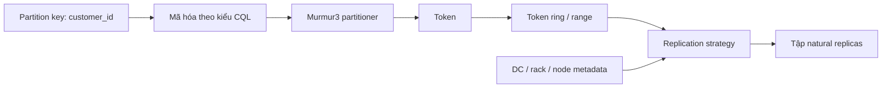
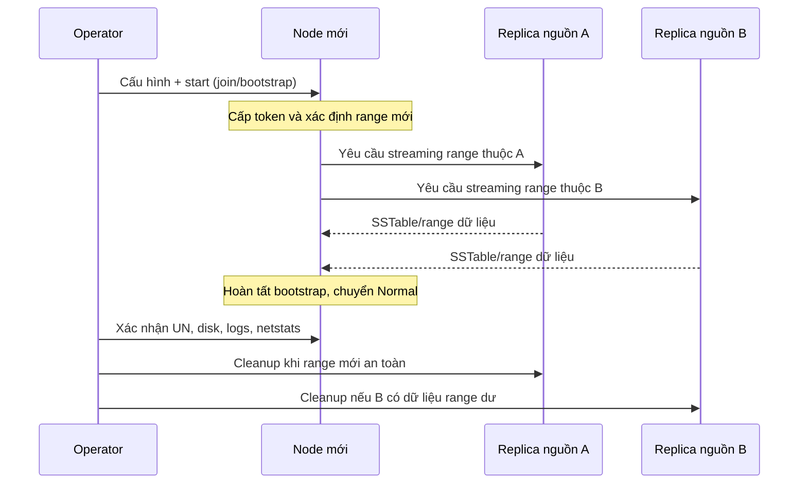

# Thay token hoặc bố trí nút và giới hạn theo phiên bản

## 1. Vấn đề thực tế: đổi vị trí node không chỉ là sửa một con số

Apache Cassandra phân tán các partition của mô hình **wide-column** bằng cách tính **token** từ partition key, xác định token range rồi chọn **natural replicas** theo replication strategy và topology (data center, rack). Khi thay token, thêm/bớt node hoặc chuyển vị trí node, các **token range được gán lại** và dữ liệu có thể phải **stream** giữa các replica. Dịch vụ Java vẫn gửi CQL như trước, nhưng đường đi request, disk/network load và khả năng đáp ứng consistency level (CL) có thể thay đổi trong lúc chuyển.

Trong mô-đun `DATABASE_ENGINE_WIDE_COLUMN_CASSANDRA`, chương **Thay đổi topology** kết nối kiến trúc phân tán, thiết kế bảng theo truy vấn, partition key và replication với thao tác CQL, compaction, repair, xử lý lỗi và Java Driver. Bài này trả lời câu hỏi: **Khi muốn đổi token hoặc bố trí node, thao tác nào thực sự được hỗ trợ, phạm vi ảnh hưởng ra sao, và giới hạn phụ thuộc phiên bản Cassandra như thế nào?**

Sau bài, người học cần:

1. Phân biệt **token ownership**, **replica placement**, **dung lượng thực đang lưu** và **trạng thái node**.
2. Biết khi nào có thể dùng `nodetool move` và vì sao **không** dùng lệnh này cho node có nhiều vnode.
3. So sánh các quy trình **bootstrap**, **decommission**, **removenode**, **replace** và **cleanup**.
4. Hiểu giới hạn của `num_tokens`, `initial_token` và bộ phân bổ token trong từng dòng phiên bản.
5. Có checklist an toàn để đo trước/sau, điều phối streaming, bảo vệ RF/CL và phục hồi khi một đợt thay đổi chưa hoàn tất.

> Phạm vi bài: các cơ chế token-ring và công cụ quản trị Cassandra thường gặp. **Không có một lệnh đổi token/node dùng được cho mọi phiên bản, mọi cluster.** Cần đối chiếu tài liệu, `nodetool help` và runbook tương ứng **đúng phiên bản đang triển khai** trước khi thực thi thao tác gây thay đổi dữ liệu.

## 2. Token ring, partition key, vnode và natural replicas

Với partitioner thường dùng `Murmur3Partitioner`, Cassandra hash **đầy đủ partition key đã mã hóa** thành token số nguyên có dấu 64-bit. Các node sở hữu token hoặc tập **virtual nodes (vnodes)**; mỗi token là một ranh giới trên vòng, và một node thường chịu trách nhiệm cho các khoảng token dạng **(token trước, token hiện tại]** theo quy tắc ring.

Ví dụ bảng cho truy vấn theo khách hàng:

```sql
CREATE TABLE lab_ks.orders_by_customer (
    customer_id text,
    order_id uuid,
    state text,
    updated_at timestamp,
    PRIMARY KEY ((customer_id), order_id)
);
```

Ở đây `customer_id` là **partition key**, còn `order_id` là **clustering key**. Token được tính từ `customer_id`, **không** đổi khi `state` hay `updated_at` thay đổi. Mỗi lần thay đổi token ownership, hệ thống phải tính lại tập natural replicas chịu trách nhiệm cho những partition thuộc các khoảng bị ảnh hưởng.



**Ba điểm không được nhầm:**

- **RF** của keyspace quy định số bản sao *mong muốn* theo DC; token/placement quyết định **node nào** giữ các bản sao đó. `ALTER KEYSPACE` đổi RF là một thay đổi replication metadata, **không tự hoàn tất sao chép toàn bộ dữ liệu lịch sử**.
- **`Owns (effective)`** trong `nodetool status <keyspace>` là tỷ lệ sở hữu **có xét replication**, có thể cộng vượt 100% khi nhìn toàn cluster; không phải tỷ lệ CPU, dung lượng ổ đĩa hay số hàng của một node.
- **Vnode** là việc một node giữ **nhiều token/range**. `num_tokens: 1` là mô hình single-token; `num_tokens > 1` là mô hình nhiều vnode. Hai mô hình có giới hạn di chuyển khác nhau.

### Ví dụ minh họa một node đổi token

Giả sử một DC có bốn node A/B/C/D, mỗi node một token; bảng bên dưới chỉ minh họa thứ tự token, **không phải thuật toán chọn vị trí thực tế**:

```text
Trước:
     ... -> A(-80) -> B(-20) -> C(40) -> D(100) -> [vòng về A]

Sau khi B chuyển sang token 70:
     ... -> A(-80) -> C(40) -> B(70) -> D(100) -> [vòng về A]
```

Ranh giới các range thay đổi và **tập natural replicas theo RF/rack cũng có thể thay đổi**. Những node từng giữ range không còn thuộc trách nhiệm của mình có thể vẫn còn SSTable cũ. Cassandra ưu tiên tránh mất dữ liệu khi chuyển range nên **cleanup là bước riêng, chỉ tiến hành sau khi topology mới ổn định**.

## 3. Các mục tiêu vận hành dẫn đến những thao tác khác nhau

| Mục tiêu | Hướng tiếp cận phù hợp | Điều cần đặc biệt tránh |
| --- | --- | --- |
| **Thêm năng lực lưu trữ/CPU** | Bootstrap **node mới**, tự phân bổ hoặc cấp token đã hoạch định | Sửa `num_tokens` trên node cũ rồi restart với hy vọng được phân bố lại. |
| **Rút một node còn sống** | `nodetool decommission` trên **node cần rời** | Tắt máy rồi xóa metadata thủ công thay vì chuyển dữ liệu. |
| **Loại một node đã chết, không thể khôi phục** | `nodetool removenode` từ node còn sống, với host ID đúng và đủ replica nguồn | Dùng `decommission` khi node đã chết; dùng `assassinate` như bước thông thường. |
| **Thay phần cứng cho node chết** | Quy trình **replace dead node**, cho node thay thế bootstrap dữ liệu | Cho node cũ và node thay thế cùng hoạt động với danh tính/token chồng lấn. |
| **Chuyển token của node single-token** | `nodetool move <new-token>`, khi điều kiện phiên bản và `num_tokens: 1` được đáp ứng | Dùng `move` cho node có nhiều vnode. |
| **Đổi vị trí của node vnode** | Lập kế hoạch **decommission + bootstrap node mới** hoặc công cụ cân bằng hỗ trợ rõ ràng | Ép đổi `initial_token` hoặc `num_tokens` trên data directory hiện hữu. |
| **Đổi vị trí vật lý/rack/DC** | Quy trình chuyển topology có xét snitch, replication và streaming | Chỉ đổi `cassandra-rackdc.properties` rồi coi dữ liệu tự chuyển tới rack/DC mới. |
| **Thay RF của keyspace** | Thay replication metadata + quy trình đồng bộ theo topology mới | Coi `ALTER KEYSPACE` là thao tác chuyển mọi dữ liệu tự động trong một giao dịch. |

Các thao tác trên **không tương đương nhau** và không thể thay bằng câu `UPDATE` CQL; ở cấp độ partition, Cassandra vẫn dùng partition key/token như trước nhưng **mapping token → node** thay đổi.

## 4. Khi nào thực sự dùng được `nodetool move`?

Theo tài liệu vận hành Apache Cassandra 3.11/4.x/5.0, **`nodetool move` được hỗ trợ cho node có `num_tokens: 1`**. Lệnh yêu cầu **một token đích mới**. Với node giữ nhiều token, một tham số `<new token>` không thể mô tả cả tập vnode; thao tác sẽ không thực hiện được theo cơ chế thông thường.

```bash
# CÁC LỆNH CHỈ ĐỌC: xem trước, không thay đổi topology.
nodetool status lab_ks
nodetool info
nodetool ring lab_ks
nodetool help move

# CÚ PHÁP MINH HỌA, KHÔNG CHẠY TRÊN PRODUCTION KHI CHƯA DUYỆT:
# nodetool -h cassandra-node-b move 700000000000000000
```

Phân biệt từng điều kiện:

1. **`num_tokens: 1`**: kiểm tra cấu hình **thực tế của node đã join** và số token hiển thị trong ring, không chỉ tin cấu hình mẫu mới tải về.
2. **Token đích hợp lệ/chưa bị chiếm**: phải tính toán ranh giới ring, natural replicas, topology DC/rack, mức mất cân bằng và lượng byte cần streaming. Không chọn token ngẫu nhiên để chữa một biểu đồ tải cao.
3. **Node và các nguồn streaming khỏe mạnh**: các range mới phải lấy dữ liệu từ replica đang có; khi một replica nguồn unavailable, quy trình chuyển range nhất quán có thể không hoàn thành.
4. **Đủ disk/bandwidth và cửa sổ bảo trì**: node nhận thêm range có thể tăng disk load, còn node khác có thể phải stream dữ liệu và phục vụ CQL.
5. **Theo dõi và cleanup sau move**: chỉ sau khi xác nhận move đã hoàn tất và topology mới hợp lệ; cleanup **trên node giữ range dư**, không mặc định chạy bừa trên mọi node.

**Không đổi token bằng cách sửa `initial_token` trên node đã có dữ liệu rồi restart.** `initial_token` là tham số phân bổ token lúc khởi tạo/bootstrap trong những tình huống được hỗ trợ; việc thay giá trị cấu hình không thể thay quy trình chuyển range và metadata đã được cluster ghi nhận.

### Nút `move` có thể tồn tại nhưng vẫn không dùng được

Việc `nodetool help move` hiển thị cú pháp **không có nghĩa** cluster hỗ trợ di chuyển một node đang có 8/16/256 vnode. Đừng suy từ việc command tồn tại ra khả năng move nhiều token. Nếu cluster đã dùng vnode, nên điều chỉnh năng lực bằng **bootstrap/decommission/replace** theo runbook, thay vì tìm một token duy nhất để nhét vào `move`.

## 5. Thêm node: bootstrap thay đổi ownership như thế nào?

Khi bổ sung node vào cluster, Cassandra thường:

1. **Định danh node mới** với cấu hình cluster, seeds, snitch/DC/rack, network và storage phù hợp.
2. **Chọn token**: dựa trên `num_tokens` và bộ phân bổ đang sử dụng, hoặc danh sách `initial_token` được chỉ định có chủ đích.
3. **Đưa node vào trạng thái Joining/Bootstrap**. Cluster xác định những token range mà nó sẽ trở thành replica mới.
4. **Streaming dữ liệu** từ các replica nguồn tương ứng trong các range mới; những hoạt động này cạnh tranh disk, CPU và network với CQL.
5. **Hoàn tất join và chuyển sang Normal**. Khi các bất biến dữ liệu được xác nhận, lên lịch `cleanup` trên các node không còn sở hữu một số range.



### Tự cấp token và cấp thủ công

Các tham số liên quan:

| Tham số | Ý nghĩa | Cảnh báo |
| --- | --- | --- |
| `num_tokens` | Số token/vnode dự kiến cấp cho **node khi khởi tạo** | Không phải nút tăng RF hay lệnh rebalance runtime cho node đã join. |
| `initial_token` | Danh sách một/nhiều token **cấp cụ thể** khi trường hợp bootstrap/restore hỗ trợ | Tránh xung đột và phân bổ lệch; không chỉnh trên existing node để “move nhanh”. |
| `allocate_tokens_for_keyspace` | Cấp token tối ưu dựa trên phân bổ replica/load của keyspace được chọn trong phiên bản hỗ trợ | Thường gắn với bộ cấp token dựa trên replication; không phải lệnh chạy trên node đang hoạt động. |
| `allocate_tokens_for_local_replication_factor` | Cấp token theo RF địa phương thay vì một keyspace cụ thể, trên phiên bản hỗ trợ | Kiểm tra phiên bản và phân bố RF thực; không chọn số 3 vì “luôn mặc định” nếu DC có RF khác. |

Tài liệu Apache Cassandra 4.1 nêu mô hình mặc định cũ dùng nhiều vnode (ví dụ 256), trong khi tài liệu cấu hình và khuyến nghị production mới có thể dùng **ít token hơn** và bộ cấp token phù hợp replication. Vì vậy **đừng chép cứng `num_tokens: 256` hoặc `num_tokens: 16` từ ví dụ khác vào môi trường đang chạy**. Cần xem **giá trị của binary/config thực tế** và đánh giá tải, số node, số token range, rack/DC, RF.

**Lưu ý an toàn khi bootstrap thất bại:** Trên các phiên bản có cơ chế `nodetool bootstrap resume` và cờ `cassandra.reset_bootstrap_progress`, việc tiếp tục có thể sử dụng dữ liệu đã stream ở lần trước hoặc yêu cầu stream lại. Chọn sai có thể giữ dữ liệu thiếu/cũ. Không xóa data directory hoặc đặt cờ reset theo phỏng đoán; kiểm tra tài liệu đúng version, log, trạng thái range và quy trình khôi phục trước khi thao tác.

## 6. Bớt node: `decommission` khác `removenode`

### 6.1. Rút node còn sống: decommission

Khi node có thể hoạt động và kết nối với cluster, quy trình **decommission** chuyển trách nhiệm token/range và dữ liệu cần thiết sang các node còn lại rồi đưa node rời ring. Ví dụ:

```bash
# LỆNH THAY ĐỔI TOPOLOGY — CHỈ CHẠY THEO RUNBOOK ĐƯỢC DUYỆT:
# nodetool -h cassandra-node-b decommission

# Các lệnh quan sát độc lập:
nodetool status lab_ks
nodetool -h cassandra-node-b netstats
```

- `decommission` được thực hiện **trên node cần rút**, hoặc qua `-h` trỏ đến node đó.
- Cần đủ node/replica nhận dữ liệu để duy trì RF và khả năng thỏa CL. Không dùng tùy chọn **force** làm bước mặc định; có thể giảm số replica dưới RF cấu hình.
- Sau khi rời ring, data directory trên máy cũ **không tự biến mất**. Đừng tái sử dụng dữ liệu/token/host ID của node đã decommission để gia nhập lại nếu không có quy trình chuẩn bị node mới.

### 6.2. Node chết vĩnh viễn: removenode

Nếu node đã down và không thể thực hiện decommission, hệ thống cần **bỏ metadata thành viên đó** và tái dựng phạm vi replication từ các replica còn sống. Lệnh `removenode` được chạy trên **một node còn sống** với **host ID của node chết** (không phải tùy ý đưa IP vào tham số ID):

```bash
# Xem trạng thái và host ID trước:
nodetool status
nodetool help removenode

# MINH HỌA CÚ PHÁP, KHÔNG CHẠY NẾU CHƯA XÁC NHẬN HOST ID:
# nodetool removenode 11111111-2222-3333-4444-555555555555
```

**Rủi ro:** Nếu những replica còn sống không giữ đủ dữ liệu mới nhất, việc loại node chết có thể không khôi phục được mọi mutation. Kiểm tra hints, thời gian outage so với `gc_grace_seconds`, repair coverage, khả năng streaming và backup. Không dùng `assassinate` để “xử lý nhanh” tình huống bình thường, vì đó là thao tác cưỡng bức có thể bỏ qua bảo vệ nhân bản dữ liệu.

### Khi nào cần thay node thay vì chỉ xóa?

Nếu cần giữ số lượng node và token ownership hiện có nhưng phần cứng node chết, phương án **replace** thường phù hợp hơn xóa rồi thêm, bởi node mới có thể chiếm trách nhiệm của node chết theo quy trình có hỗ trợ.

## 7. Thay node chết: giữ danh tính topology đúng cách

Trong các nhánh Cassandra 3.11/4.x/5.0, tài liệu vận hành mô tả quy trình thay node bằng cờ khởi động JVM:

```text
-Dcassandra.replace_address_first_boot=<IP-cua-node-chet>
```

Đây là **cấu hình cho lần khởi động thay thế**, không phải câu lệnh `nodetool move` và không phải thao tác nhập trực tiếp trên cqlsh. Địa chỉ, seed, rack/DC, dữ liệu còn lưu trên máy và phạm vi IP **cần được kiểm tra theo runbook từng phiên bản**.

Nguyên tắc:

- **Node cũ phải thật sự không còn hoạt động** và không được quay lại với cùng danh tính khi node thay thế đang nhận range.
- Node thay thế stream dữ liệu từ các replica còn sống. Có thể có khác biệt giữa **dùng cùng IP** và **dùng IP mới** về việc nhận mutation phát sinh trong khi bootstrap.
- Nếu outage vượt thời gian sinh/giữ hints, hoặc replacement dùng cùng IP và kéo dài qua thời gian hints liên quan, tài liệu yêu cầu **repair** để bổ sung những mutation bị lỡ.
- `UN` sau replacement không đủ chứng minh mọi bản sao đã nhất quán; cần đọc `netstats`, log, repair history và kiểm tra request với CL phù hợp.

Không khởi chạy node mới bằng cách copy data directory của node khác để “nhân đôi ngay” nếu không có quy trình restore/clone tương thích. Những file đó liên quan host ID, token, schema, SSTable metadata, phiên bản và trạng thái repair.

## 8. Rack/DC, snitch và replication strategy: bố trí nút khác với token

Một token có thể giữ nguyên nhưng **replica placement vẫn đổi** nếu nhãn data center/rack, snitch hoặc RF đổi. Với `NetworkTopologyStrategy`, các nhãn topology tham gia lựa chọn replica và nhằm phân bố bản sao qua rack để tăng khả năng chịu lỗi.

Ví dụ:

```sql
CREATE KEYSPACE lab_ks
WITH replication = {
    'class': 'NetworkTopologyStrategy',
    'dc1': 3
};
```

Giả sử node A và B cùng rack `r1`, C ở `r2`. “Chuyển B sang rack r2” không chỉ là thay một chuỗi văn bản ở dashboard:

1. Cần phân biệt **chuyển máy vật lý** sang rack khác, **chuyển nhãn** rack hay **migrating sang DC khác**.
2. Kiểm tra snitch được cấu hình và cách xác định DC/rack. Với `GossipingPropertyFileSnitch`, cấu hình thường nằm ở `cassandra-rackdc.properties` và được phổ biến qua gossip.
3. Phải đánh giá natural replica placement **trước/sau** cho keyspace với RF khác nhau. Đổi nhãn không bảo đảm các SSTable tự được stream vào replica mới ở mọi phiên bản.
4. Lập kế hoạch streaming/repair/cleanup theo **tài liệu chuyển topology**, không tự ý sửa một file trên node đang chạy và giả định dữ liệu sẽ tự hội tụ.

Đặc biệt, **đổi DC** có thể ảnh hưởng đến write/read CL như `LOCAL_QUORUM`, cơ chế xác định local DC của Java Driver, client routing và băng thông liên DC. Khi xây thêm DC mới, cần **tạo node đúng DC, thay replication strategy/RF theo kế hoạch, streaming/rebuild/repair đầy đủ** rồi mới chuyển traffic. Không điều chỉnh DC của một node đang giữ dữ liệu như cách duy nhất để di chuyển cả khu vực dữ liệu.

### RF thay đổi chưa phải là dữ liệu đã đến nơi

```sql
-- Ví dụ chỉ minh họa thay metadata, KHÔNG CHẠY trên keyspace production:
ALTER KEYSPACE lab_ks
WITH replication = {
    'class': 'NetworkTopologyStrategy',
    'dc1': 3,
    'dc2': 2
};
```

Câu lệnh cập nhật **yêu cầu replication**, nhưng dữ liệu lịch sử cho `dc2` phải được tái đồng bộ theo quy trình phù hợp. Đọc `system_schema.keyspaces` chỉ thấy metadata, không phải bằng chứng các node mới đã nhận đủ SSTable/partition.

## 9. Giới hạn theo phiên bản: bảng quyết định cho người vận hành

| Dòng phiên bản / đặc tính | Ý nghĩa với token và topology | Cách kiểm tra |
| --- | --- | --- |
| **Cassandra 3.11 và cluster legacy** | Có thể dùng single-token hoặc nhiều vnode; tài liệu mô tả `move` chỉ cho `num_tokens: 1`, `initial_token` cho các tình huống được hỗ trợ. Một số tham số/đơn vị và thủ tục khôi phục khác các phiên bản mới. | Tài liệu 3.11, `nodetool help`, cấu hình thực tế và kiểm tra ring. |
| **Cassandra 4.0/4.1** | Vẫn có bootstrap, decommission, removenode, replace, `move` cho single-token. Thuật toán phân bổ token, thủ tục resume/reset tiến triển bootstrap và bản sửa lỗi ảnh hưởng vận hành có thể khác theo minor patch. | Tài liệu đúng patch và release notes; kiểm tra `num_tokens` trước move. |
| **Cassandra 5.0** | Tài liệu chính thức vẫn mô tả `move` cho `num_tokens: 1`; có cấu hình cấp token theo local RF và khuyến nghị production về số vnode; không suy các giá trị mặc định từ tài liệu 4.x. | Tài liệu 5.0, `cassandra.yaml` đang chạy, `nodetool help`. |
| **Nhánh mới/nâng cấp với cơ chế metadata mới** | Một số nhánh đưa vào **Transactional Cluster Metadata / Cluster Metadata Service (TCM/CMS)** và quy tắc nâng cấp/thay metadata mới. Trong giai đoạn chuyển đổi, có thể phải **đóng băng thao tác bootstrap/decommission/move** cho đến khi metadata được khởi tạo và nhất quán. | Chỉ làm theo release notes của **binary thật**, xác nhận trạng thái metadata và điều kiện rolling upgrade; không ghép runbook nhiều nhánh. |

**Điểm tinh tế:** Một lệnh có cùng tên trên hai phiên bản **không nhất thiết có cùng điều kiện tiên quyết, flag, tiến trình phục hồi hay semantics**. Tên `nodetool move` còn tồn tại trong tài liệu 5.0, nhưng chỉ những node single-token mới dùng được theo quy trình này. Những thay đổi đề xuất hoặc phát triển ở nhánh tương lai cũng không phải chứng cứ rằng cluster production hiện hỗ trợ chức năng ấy.

**Không áp dụng các tham số nội bộ thiếu kiểm chứng**, ví dụ:

- `auto_bootstrap: false` có thể bỏ qua quá trình stream khi join, chỉ dành cho các tình huống restore/migration đặc biệt; không phải cách tăng tốc bình thường.
- `cassandra.consistent.rangemovement=false` có thể bỏ qua bảo đảm lấy dữ liệu từ replica thích hợp nếu nguồn down, kéo theo nguy cơ dữ liệu thiếu; không dùng như “fix” mặc định.
- `cassandra.reset_bootstrap_progress` có ngữ nghĩa reset/reuse thay đổi theo phiên bản; đặt sai có thể dùng lại range stream thiếu hoặc giữ dữ liệu cũ trên đĩa.

Những cờ này phải được duyệt ở mức vận hành và có phương án xác minh/khôi phục cụ thể.

## 10. Quy trình điều hành thay token hoặc bố trí node

### Bước 1 — Xác định chính xác mục tiêu

Làm rõ cần **mở rộng**, **thu hẹp**, **thay node chết**, **đổi vị trí token single-token**, **đổi rack/DC**, hay **điều chỉnh RF**. Mỗi mục tiêu có cách khác nhau. Ghi bằng chứng vấn đề: node quá đầy, disk skew, RF/CL không đáp ứng, rack failure domain không đúng, hay p99 request tăng.

Nếu chỉ một bảng nóng do partition key kém (ví dụ mọi sự kiện dùng cùng `device_id` nhưng thiếu time bucket), chuyển token **không sửa được hot partition logic**: một partition vẫn nằm trên một tập replica theo RF. Cần xem lại schema thiết kế theo truy vấn và phân bố partition.

### Bước 2 — Chụp topology và workload hiện tại

```bash
# Chỉ đọc, chạy trên node thích hợp:
nodetool version
nodetool describecluster
nodetool status lab_ks
nodetool ring lab_ks
nodetool describering lab_ks
nodetool info
nodetool netstats
nodetool compactionstats
```

Chụp thêm: danh sách host ID, IP, DC/rack, snitch, keyspace replication, `num_tokens`, `initial_token` (nếu dùng), số replica sẵn sàng, dung lượng trống, snapshot, lượng data từng node, throughput streaming và p95/p99 read/write theo client.

**Dữ liệu quan trọng nhất:** không chỉ “node A đang giữ 25% ring” mà còn **A giữ những replica nào của keyspace nào, đang dùng bao nhiêu disk và có chịu đúng workload nóng hay không**. Các cột `Load` và `Owns (effective)` không tương đương nhau.

### Bước 3 — Lập kế hoạch về placement mới và nguồn streaming

Với từng keyspace quan trọng:

1. Tính/ước lượng **token ranges trước/sau**, natural replicas cho một tập partition đại diện, theo rack/DC.
2. Đối chiếu RF và local quorum tại DC liên quan; bảo đảm không làm thiếu khả năng phục vụ nếu một node chậm hoặc bảo trì.
3. Ước lượng lượng byte cần stream và chỗ trống tại node nhận; dự trù snapshot và SSTable/compaction phát sinh.
4. Đánh giá tốc độ mạng nội DC/liên DC, giờ ít tải, repair/backup đang chạy và mức thay đổi concurrent cho phép.
5. Chốt người chịu trách nhiệm, ngưỡng **abort/rollback**, các bước dự phòng theo phiên bản, kế hoạch repair/cleanup sau chuyển.

Không thay nhiều node hoặc nhiều DC đồng thời chỉ để giảm tổng thời gian nếu không có khả năng chứng minh RF/CL và bandwidth vẫn an toàn.

### Bước 4 — Thực hiện **một** thay đổi theo runbook

Với node mới: bootstrap. Với node còn sống cần rời: decommission. Với node chết: removenode hoặc replace theo mục tiêu. Với node single-token cần đổi ranh giới: `move` nếu đúng điều kiện. Với node vnode muốn tái cân bằng: ưu tiên **thay đổi membership có streaming** thay vì sửa token trên node cũ.

Trong lúc thực hiện, giám sát:

```bash
nodetool status lab_ks
nodetool netstats
nodetool tpstats
nodetool compactionstats
```

Theo dõi logs của các node tham gia; trạng thái `UJ` (Up/Joining), `UL` (Up/Leaving), `UM` (Up/Moving) nếu version hiển thị, và những lỗi `Bootstrap`, `Streaming`, `Unavailable`/`Timeout`. **Một node có thể đang Up nhưng chưa Normal**; đừng bắt đầu cleanup khi range movement chưa kết thúc.

### Bước 5 — Kiểm tra topology và dữ liệu

Sau thay đổi, xác nhận trên **hơn một node**:

- Node đúng IP/host ID, DC/rack, trạng thái `UN` khi dự kiến đã Normal.
- Tập token/range và natural replicas theo metadata keyspace đúng kế hoạch.
- Streaming đã hoàn tất; không còn lỗi/pending range và không có sự khác biệt metadata nghiêm trọng.
- Những truy vấn CQL có partition key cụ thể trả đúng dữ liệu ở CL thích hợp, có mẫu kiểm tra nhiều keyspace/partition.
- Read/write p95/p99, timeout, disk/net/cpu và load skew được đo lại sau khi traffic ổn định.

**Quan trọng:** Các ví dụ data check không thay cho **repair/anti-entropy** trên những range cần đối soát. Bootstrap/replacement không bảo đảm dữ liệu bị lỡ trong outage kéo dài đã tự động có mặt trên mọi replica.

### Bước 6 — Cleanup và đối soát sau chuyển

Khi topology mới đã ổn định và phạm vi dữ liệu đã được xác nhận:

```bash
# Ví dụ cleanup keyspace/table, tại node từng giữ range nay không sở hữu:
# nodetool -h cassandra-node-a cleanup lab_ks orders_by_customer

# Trước khi chạy:
nodetool help cleanup
nodetool status lab_ks
```

`cleanup` xóa dữ liệu local **không còn thuộc trách nhiệm node**; đây là công việc SSTable/disk I/O, **không** phải repair. Đừng chạy trước khi bootstrap/decommission/move hoàn tất hoặc khi metadata còn đang đổi. Node mới thường không cần cleanup các range vừa được phân công, nhưng node nguồn/neighbor có thể cần.

Repair là bước riêng để đồng bộ những replica chưa nhất quán; lập kế hoạch theo tình huống replacement, RF change, outage so với hints và tombstone grace. Không tuyên bố “mọi replica đã có đúng dữ liệu” chỉ vì `cleanup` hay `compactionstats` hoàn tất.

## 11. Thực hành lab: đọc token và dự đoán ảnh hưởng trước khi thao tác

### 11.1. Lab an toàn chỉ đọc

Giả sử `lab_ks` đã tồn tại với dữ liệu và một bảng có khóa phân vùng `customer_id` kiểu `text`:

```bash
nodetool status lab_ks
nodetool ring lab_ks
nodetool describering lab_ks
nodetool getendpoints lab_ks orders_by_customer cust-42
nodetool help move
nodetool help decommission
nodetool help removenode
nodetool help cleanup
```

`getendpoints` liệt kê các natural replicas cho **partition key cụ thể**, không phải bằng chứng tất cả chúng đều có giá trị mới nhất. Sau đó xác định:

1. Node nào giữ bao nhiêu token? Có node chỉ giữ một token hay đều dùng vnode?
2. Partition của `cust-42` dự kiến nằm trên những replica nào?
3. Trên một cluster RF = 3 với đúng ba node khỏe trong một DC, tại sao `Owns (effective)` có thể gần 100% cho **mỗi** node?
4. Nếu muốn đổi vị trí một node có 16 vnode, tại sao `nodetool move` với một token đích là sai?
5. Nếu thêm node, sau bootstrap những node nào có thể còn giữ SSTable thuộc range đã mất ownership?

### 11.2. Lab có thay đổi topology (chỉ cluster thử nghiệm riêng)

Với cluster thử nghiệm nhiều node có snapshot/khả năng dựng lại và không phục vụ production:

1. Chụp baseline: RF, ring/rack, disk, p95/p99 ứng dụng, streaming trạng thái nghỉ.
2. Thêm **một node mới** được cấu hình đúng DC/rack và token allocation để chạy bootstrap theo quy trình của **binary đang sử dụng**. Không bật `auto_bootstrap: false` chỉ để rút ngắn thí nghiệm.
3. Theo dõi node `Joining → Normal`, `netstats` và logs; không chạy thao tác khác trong lúc streaming chưa hoàn tất.
4. Đọc lại ring và `getendpoints` cho tập partition sample; đối chiếu danh sách replica trước/sau và kết quả CQL.
5. Lên lịch cleanup trên các node đã mất range, sau khi chứng minh data và membership ổn định; theo dõi disk free/cpu/compaction.
6. Khép lại bằng số liệu p99/timeout/disk skew và danh sách range còn cần repair.

**Không** bắt buộc thực hiện `move`, decommission hoặc thay node chết để hoàn thành lab. Những thao tác này có nguy cơ ảnh hưởng dữ liệu và cần runbook riêng; bài thực hành có thể đạt mục tiêu bằng **phân tích token layout và mô phỏng kế hoạch thay đổi**.

## 12. Các tình huống lỗi thường gặp

| Hiện tượng | Nguyên nhân có thể | Hướng điều tra |
| --- | --- | --- |
| `nodetool move` báo không hỗ trợ node nhiều token | Node có `num_tokens > 1` | Xác nhận ring; chuyển sang quy trình phù hợp vnode, không ép token. |
| Sau sửa `initial_token` node không join đúng | Token, metadata đã tồn tại, cấu hình và dữ liệu không khớp | Dừng thay đổi ad hoc; phục hồi theo runbook của phiên bản, không xóa dữ liệu thủ công. |
| Bootstrap treo/failed | Replica nguồn down, thiếu disk, network, timeout hoặc trạng thái stream đã ghi nhận | Xem `netstats`/logs, bản thân bootstrap state; không đặt reset/consistent flag một cách mù quáng. |
| Node mới `UN` nhưng các node cũ còn chiếm disk | Dữ liệu range dư còn trong SSTable nguồn | Kiểm tra mới join/streaming thành công, sau đó cleanup có kiểm soát trên node phù hợp. |
| Decommission làm client timeout | Các node nhận range quá tải hoặc không đủ replica để đáp ứng CL | Giảm concurrent movements, đo read/write/streaming và RF, rà soát mất cân bằng. |
| Node thay thế hiển thị Up nhưng thiếu dữ liệu mới | Node cũ down lâu, hints hết hạn hoặc replacement không nhận hết write trong bootstrap | Repair theo tài liệu phù hợp, kiểm tra consistency và dữ liệu mẫu. |
| Di chuyển rack/DC rồi thấy độ trễ WAN tăng | Placement, local-DC routing hoặc snitch/RF thay đổi | Kiểm tra snitch, driver local DC, replicas, CL và topology mới. |
| `Owns (effective)` không khớp tỷ lệ disk | Ownership có RF và không phản ánh kích thước partition/hot key | Xem `Load`, disk, token count, partition size, workload và compression. |
| Một số node thấy ring khác nhau sau thay đổi | Metadata/gossip chưa hội tụ hoặc thao tác bị lỗi giữa chừng | Kiểm tra logs/describecluster, trạng thái node và phiên bản; không khởi động thay đổi tiếp. |
| Thay topology giữa rolling upgrade gặp lỗi metadata | Phiên bản/đời cơ chế metadata chưa tương thích hoặc trạng thái nâng cấp chưa hoàn tất | Dừng topology change, làm đúng release notes/upgrade runbook; không ghép workflow từ hai nhánh. |

## 13. Liên hệ với Java Driver và consistency

Thay token/range là thao tác vận hành ở cluster; ứng dụng Java **không được sửa token bằng CQL**. Driver cần biết topology và DC, chuẩn bị statement và chọn CL phù hợp. Ví dụ Java Driver 4.x:

```java
PreparedStatement ps = session.prepare(
    "SELECT state FROM lab_ks.orders_by_customer " +
    "WHERE customer_id = ? AND order_id = ?"
);

BoundStatement query = ps.bind(
    "cust-42",
    UUID.fromString("11111111-2222-3333-4444-555555555555")
).setConsistencyLevel(DefaultConsistencyLevel.LOCAL_QUORUM);

long startedNs = System.nanoTime();
Row row = session.execute(query).one();
double ms = (System.nanoTime() - startedNs) / 1_000_000.0;

System.out.printf("state=%s; queryLatencyMs=%.2f%n",
    row == null ? "<missing>" : row.getString("state"), ms);
```

Đoạn mã giả định `session`, schema thử nghiệm và imports đã có. Driver thường cập nhật metadata topology qua cơ chế discovery/event; tuy nhiên trong lúc bootstrap/decommission, request có thể bị retry, tăng latency hoặc gặp timeout nếu replica được chọn đang chậm. Một lần đọc thành công **không** chứng minh mọi range đã stream và repair đầy đủ. Thu metrics p50/p95/p99 và lỗi của **cùng loại request trước/sau**, kiểm tra driver local data center khi thêm/chuyển DC.

Đặc biệt, nếu `LOCAL_QUORUM` ở DC A vẫn hoạt động trong khi DC B mới được thêm, điều đó không bảo đảm DC B đã có dữ liệu lịch sử; cần xác nhận streaming/repair và phạm vi phục vụ trước khi chuyển traffic.

## 14. Câu hỏi tự kiểm tra

1. Khác nhau giữa **số token của node**, **RF của keyspace**, **Owns (effective)** và **disk Load** là gì?
2. Vì sao `nodetool move` hợp lệ cho node `num_tokens: 1` nhưng không dùng để thay một token của node có nhiều vnode theo quy trình phổ biến?
3. Cần làm gì nếu mục tiêu là thay đổi bố trí node vnode để giảm disk skew thay vì thay một token đơn?
4. Vì sao sửa `initial_token` hoặc `num_tokens` trên node cũ không tự chuyển dữ liệu?
5. So sánh **decommission node còn sống**, **removenode node chết**, và **replace node chết** theo nguồn dữ liệu dùng để streaming.
6. Sau bootstrap, vì sao node nguồn vẫn có thể chiếm nhiều disk? Khi nào `cleanup` trở nên phù hợp và tại sao không chạy sớm?
7. Vì sao thay rack/DC hoặc RF có thể đổi natural replicas dù `customer_id` và token của partition không thay?
8. Cluster nâng cấp version có thay đổi cơ chế metadata: cần kiểm chứng điều kiện gì trước khi bootstrap/decommission/move?
9. Nếu replacement node Up nhưng outage trước đó vượt thời gian hints, tại sao vẫn có thể cần repair?
10. Với RF = 3 và `LOCAL_QUORUM`, điều gì có thể xảy ra nếu hai replica cùng chịu streaming/disk I/O nặng lúc đổi topology?

**Tiêu chí hoàn thành:** Người học nhận diện đúng thao tác theo mục tiêu và giới hạn version; không đổi token runtime bằng chỉnh sửa file cấu hình; phân biệt single-token/vnode, kiểm tra bản đồ natural replicas theo keyspace, bảo vệ RF/CL khi streaming và có kế hoạch cleanup/repair/dữ liệu trước khi kết luận topology mới ổn định.

## 15. Tài liệu tham khảo

- [Apache Cassandra — Adding, replacing, moving and removing nodes (5.0)](https://cassandra.apache.org/doc/5.0/cassandra/managing/operating/topo_changes.html): bootstrap, token allocation, move single-token, decommission/removenode, replace, cleanup và giới hạn resume.
- [Apache Cassandra — Topology changes (4.1)](https://cassandra.apache.org/doc/4.1/cassandra/operating/topo_changes.html): đối chiếu hành vi ở nhánh 4.x, cách tự cấp token và restore.
- [Apache Cassandra — nodetool move](https://cassandra.apache.org/doc/5.0/cassandra/managing/tools/nodetool/move.html): tham số đích của thao tác di chuyển token.
- [Apache Cassandra — Configuration (5.0)](https://cassandra.apache.org/doc/5.0/cassandra/managing/configuration/cass_yaml_file.html): `num_tokens`, `initial_token`, bộ phân bổ token theo local RF và snitch.
- [Apache Cassandra — Production recommendations](https://cassandra.apache.org/doc/stable/cassandra/getting-started/production.html): đánh đổi giữa số vnode, khả năng cân bằng tải và mở rộng cluster.
- [Apache Cassandra — nodetool status / troubleshooting](https://cassandra.apache.org/doc/stable/cassandra/troubleshooting/use_nodetool.html): giải thích `Up/Down`, `Joining/Leaving/Moving`, effective ownership và kiểm tra nhiều node.
- [Apache Cassandra — Snitch](https://cassandra.apache.org/doc/stable/cassandra/managing/operating/snitch.html): ý nghĩa DC/rack và lựa chọn replica.

**Kết luận:** Thay token hay bố trí node trong Cassandra là **di chuyển quyền sở hữu các token range và dữ liệu replica**, không phải chỉnh một số trong cấu hình. `nodetool move` chỉ phù hợp với node single-token theo tài liệu phiên bản tương ứng; các cluster vnode thường cần quy trình membership/streaming. Dù chọn bootstrap, decommission, removenode, replace hay đổi rack/DC, luôn xác minh RF/CL, topology theo keyspace, dữ liệu và streaming trước khi cleanup hoặc tuyên bố thay đổi hoàn tất.
