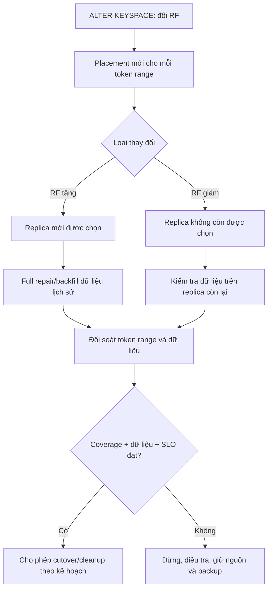
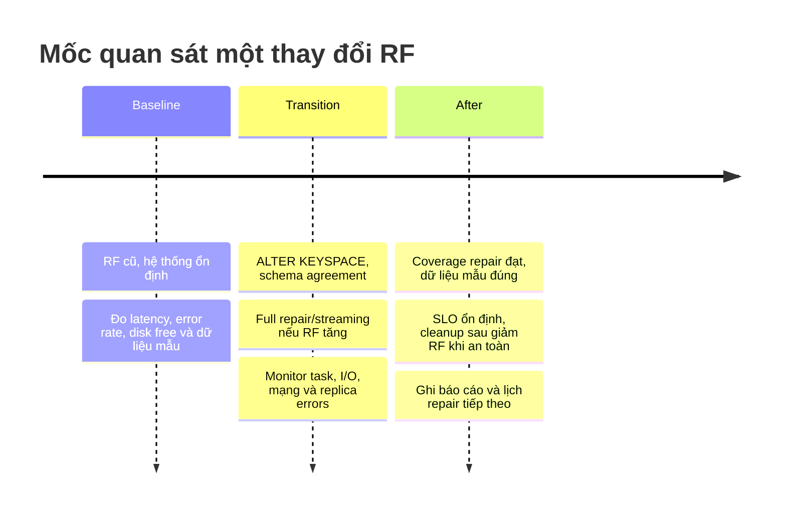

# Thay RF và kế hoạch repair/kiểm chứng sau thay đổi trong Apache Cassandra

## 1. Bối cảnh: đổi replication factor không đồng nghĩa dữ liệu đã được sao chép

Trong **Apache Cassandra**, partition key được ánh xạ thành **token**, sau đó replication strategy của keyspace cùng topology (data center, rack, node) quyết định replica nào chịu trách nhiệm lưu dữ liệu. Mỗi replica có commit log, memtable và SSTable riêng. Các replica có thể tạm thời khác nhau vì request ghi chỉ cần số phản hồi tương ứng với **consistency level**, node offline hoặc mạng bị phân vùng.

**Replication factor (RF)** mô tả **số bản sao mục tiêu**, không phải cam kết rằng mọi node được chọn đã chứa mọi bản ghi lịch sử. Do đó, lệnh `ALTER KEYSPACE` làm thay đổi **metadata chọn replica**, trong khi **full repair/backfill** hoặc quy trình chuyển dữ liệu phù hợp mới giúp các replica mới nhận phần dữ liệu cũ còn thiếu. Ngược lại, giảm RF làm một số bản sao trở thành **dư thừa**, nhưng chỉ có thể thu hồi an toàn sau khi xác minh các replica còn lại.

Bài thuộc chương **Thay đổi topology** của mô-đun `DATABASE_ENGINE_WIDE_COLUMN_CASSANDRA`. Kiến thức nền gồm mô hình wide-column, khóa phân vùng, thiết kế bảng theo truy vấn, consistency level đọc/ghi, CQL, replication, compaction, repair, xử lý sự cố và ứng dụng Java. Trọng tâm bài này là **lập kế hoạch thay RF, thực thi repair đúng phạm vi, đo lường và kiểm chứng trước khi đóng change ticket**.

### Mục tiêu

Sau khi học, bạn có thể:

1. Giải thích ảnh hưởng của tăng/giảm RF lên replica placement, durability và quorum.
2. Phân biệt **thay schema**, **full repair**, **streaming**, **cleanup** và **kiểm chứng dữ liệu**.
3. Xây dựng runbook tăng RF an toàn, có full repair phủ đủ token range.
4. Xây dựng runbook giảm RF có đánh giá độ sẵn sàng và điều kiện chạy cleanup.
5. Kiểm chứng bằng schema agreement, replica endpoints, repair coverage, dữ liệu lịch sử, latency và lỗi client.
6. Xác định tiêu chí **GO / NO-GO / ROLLBACK** thay vì coi node `UN` hay lệnh `ALTER KEYSPACE` thành công là đủ.

## 2. Phân biệt placement, dữ liệu đang có và khả năng phục vụ

Một hệ thống có thể có metadata đúng mà dữ liệu vẫn thiếu:



Ba trục cần kiểm soát độc lập:

| Trục | Câu hỏi | Bằng chứng phù hợp |
| --- | --- | --- |
| **Placement** | Theo topology mới, node nào *nên* chứa partition? | `system_schema.keyspaces`, `nodetool status`, `getendpoints`, DC/rack/snitch |
| **Data coverage** | Các replica mới *đã nhận* dữ liệu cũ và tombstone cần thiết chưa? | Full repair và streaming thành công cho đủ ranges, kiểm tra dữ liệu |
| **Availability / SLO** | Ứng dụng Java còn phục vụ đúng CL, latency và lỗi không? | Client read/write p95/p99, `Unavailable`, timeout, error rate, throughput |

**Đừng nhầm** `nodetool status` hiển thị toàn bộ node `UN` với việc dữ liệu đã được đồng bộ. `UN` là tình trạng Up/Normal theo membership, không phải kết quả một lần anti-entropy repair toàn keyspace.

## 3. Bản đồ quyết định: tăng RF, giảm RF hay mở DC?

| Thao tác | Metadata thay đổi | Công việc dữ liệu cần cân nhắc | Rủi ro nổi bật |
| --- | --- | --- | --- |
| **Tăng RF trong một DC đã có node** | Nhiều replica mục tiêu hơn/token range | **Full repair** đủ phạm vi để backfill lịch sử; theo dõi streaming | Replica mới có thể thiếu row/tombstone cũ |
| **Giảm RF trong một DC** | Ít replica mục tiêu hơn/token range | Đối soát nguồn còn lại **trước**, `cleanup` bản sao dư **sau** khi an toàn | Giảm fault tolerance, loại bản sao còn giữ dữ liệu duy nhất |
| **Tăng RF của DC mới** | Keyspace bắt đầu chọn replica ở DC khác | Có thể cần `rebuild`/streaming phù hợp quy trình thêm DC, rồi repair/validation | Chuyển traffic sang DC mới trước khi có dữ liệu lịch sử |
| **Giảm RF của DC đang phục vụ** | Ít bản sao tại DC đó | Kiểm tra client local DC, khả năng phục vụ, data placement trước cleanup | `LOCAL_QUORUM` không đủ phản hồi nếu một replica lỗi |
| **Thêm node nhưng giữ RF** | Số node/token ownership thay đổi | Bootstrap/streaming, repair theo tình huống, cleanup node cũ | Đây là thay topology membership, **khác** việc chỉ sửa RF |

Với production, tránh gộp “tăng RF, thêm node, đổi consistency level và di chuyển ứng dụng” vào một lần thay đổi không tách mốc. Nếu không có checkpoint rõ, khó biết lỗi do metadata, streaming, repair, driver hay mạng.

### Những trường hợp phải tách thành runbook đặc biệt

- **Transient replication**, ví dụ RF có cú pháp `3/1` ở các phiên bản hỗ trợ, có yêu cầu repair/cleanup khác cấu hình full replica thông thường. Bài này giả định **full replicas** dùng `NetworkTopologyStrategy`.
- Các bảng có **materialized view**, secondary index hoặc nghiệp vụ dùng **LWT/Paxos** có thể cần kiểm chứng/thủ tục mở rộng tương ứng; không quy mọi cơ chế thành một lệnh repair cơ bản.
- Trạng thái **node đang bootstrap, leaving, moving, down lâu** làm phức tạp placement; **không** thay RF khi những thay đổi nền này chưa được xử lý theo kế hoạch.

## 4. Tính lại quorum trước khi thay RF

Trong một DC dùng `NetworkTopologyStrategy` với toàn bộ replica là full replica, quorum cục bộ cho `LOCAL_QUORUM`:

```text
required_acks = floor(RF_local_dc / 2) + 1
```

| RF tại DC của ứng dụng | Số ACK cần cho LOCAL_QUORUM | Số replica có thể tạm không phản hồi nếu còn lại đều khỏe |
| ---: | ---: | ---: |
| 1 | 1 | 0 |
| 2 | 2 | 0 |
| 3 | 2 | 1 |
| 4 | 3 | 1 |
| 5 | 3 | 2 |

Hai ví dụ:

- **Tăng 2 → 3:** `LOCAL_QUORUM` vẫn cần 2 phản hồi, nhưng tập replica mục tiêu đã đổi. Có thể hoàn tất một request trong lúc replica mới chưa có dữ liệu lịch sử; đó là lý do phải full repair và kiểm chứng.
- **Giảm 3 → 2:** `LOCAL_QUORUM` từ 2/3 thành 2/2. Dù giảm dung lượng mục tiêu, hệ thống **không còn chịu được việc mất một replica** trong tập cục bộ mà vẫn đáp ứng `LOCAL_QUORUM`.

**`QUORUM` khác `LOCAL_QUORUM`.** Ở keyspace nhiều DC, `QUORUM` xét tổng replica trong phạm vi replication; `LOCAL_QUORUM` xét DC cục bộ của request. `EACH_QUORUM` có ý nghĩa riêng với ghi đa DC. Không đổi consistency level để che dữ liệu thiếu mà chưa xác minh SLA và mức nhất quán mà sản phẩm yêu cầu.

Một công thức khác hay bị lạm dụng là điều kiện `R + W > RF` để suy luận overlap replica; nó cần những giả định phù hợp về placement và dữ liệu nhất quán. **Overlap của phản hồi không thay cho đồng bộ dữ liệu lịch sử**, đặc biệt trong giai đoạn replica set mới chưa hội tụ.

## 5. Kế hoạch trước thay đổi: chứng minh hệ thống sẵn sàng

### 5.1. Mục tiêu, phạm vi, người phụ trách

Một change ticket tốt tối thiểu có:

| Nội dung | Phải ghi |
| --- | --- |
| **Đích thay đổi** | Keyspace, RF trước/sau **theo từng DC**, lý do thay, thời điểm |
| **Topology** | Cassandra version, node/DC/rack, snitch, tokens/vnodes, node đang up/down |
| **Ứng dụng** | Query shape, read/write CL, local DC, driver version, retry, critical endpoints |
| **Data inventory** | Tables, số liệu dung lượng, TTL, tombstone, partition size, mẫu dữ liệu lịch sử |
| **Nguồn phục hồi** | Backup/snapshot và khả năng restore, những replica đang thực sự có dữ liệu |
| **Repair plan** | Full/incremental vì sao, token ranges, nơi chạy, concurrency, thời điểm |
| **Safety** | Disk free/headroom, network, CPU, GC, p95/p99, error-rate thresholds |
| **Go/no-go** | Điều kiện bắt đầu, dừng, cutover, cleanup, rollback và người duyệt |

Không có quy tắc một lần chạy `nodetool repair` trên một node sẽ tự bao phủ mọi phạm vi token của cụm. Nếu dùng `-pr` (*primary range*), phải lập lịch phủ các primary ranges thích hợp trên các node và xác nhận từng task hoàn tất.

### 5.2. Sức khỏe cụm và baseline

Trên từng node thuộc phạm vi thay đổi:

```bash
# Quan sát, không ghi dữ liệu
nodetool status
nodetool describecluster
nodetool netstats
nodetool compactionstats
nodetool tpstats
nodetool tablestats rf_change_lab.orders_by_id
```

Ví dụ lệnh cuối giả định bảng lab đã tồn tại. Trong production, thay bằng keyspace/table thật và lấy metric từ **mọi node/DC liên quan**. Một số trường có tên khác theo version.

Chỉ bắt đầu khi các node/range cần thiết đủ khỏe và không có bootstrap, repair, decommission hoặc streaming xung đột chưa được hiểu. Ghi **schema agreement**, disk free, compaction backlog, throughput, read/write p95/p99, timeout rate và lịch repair gần nhất. Đừng dựa duy nhất vào `Load` từ `nodetool status` để ước lượng byte sẽ phải chuyển.

### 5.3. Backup, tombstone và cửa sổ bảo trì

- Xác minh backup **khôi phục được**, không chỉ có snapshot filename.
- Kiểm tra thời gian replica từng offline, chính sách `gc_grace_seconds`, TTL và dấu xóa; node stale có thể làm dữ liệu zombie xuất hiện nếu tombstone đã được purge ở các replica còn lại.
- Bảo đảm disk headroom cho SSTable mới, stream và compaction sau repair. Không đặt lịch khi volume gần hết và không tự xóa SSTable để giải phóng ổ.
- Theo dõi replica placement theo **DC/rack**; có ba node cùng một rack không tương đương ba failure domain độc lập.
- Thông báo với đội vận hành ứng dụng Java về giai đoạn chuyển tiếp có thể tăng latency/timeout.

## 6. Thực hành CQL: tăng RF từ 2 lên 3

Ví dụ này **chỉ dành cho lab** có ít nhất ba node khỏe ở DC tên `dc1`, không chạy ở cụm hai node. `NetworkTopologyStrategy` thích hợp cho topology theo DC; dùng tên DC thực tế do snitch báo.

```sql
-- Bước A: schema ban đầu
CREATE KEYSPACE IF NOT EXISTS rf_change_lab
WITH replication = {
    'class': 'NetworkTopologyStrategy',
    'dc1': 2
};

CREATE TABLE IF NOT EXISTS rf_change_lab.orders_by_id (
    order_id uuid PRIMARY KEY,
    status text,
    updated_at timestamp
);

-- Ghi trước khi RF tăng: dữ liệu lịch sử cần backfill.
INSERT INTO rf_change_lab.orders_by_id (order_id, status, updated_at)
VALUES (
    11111111-1111-1111-1111-111111111111,
    'CREATED',
    '2026-11-21T00:00:00Z'
);

-- Ghi nhận baseline ở consistency level phù hợp.
SELECT status, updated_at
FROM rf_change_lab.orders_by_id
WHERE order_id = 11111111-1111-1111-1111-111111111111;

-- Bước B: chỉ thay RF sau khi preflight đạt
ALTER KEYSPACE rf_change_lab
WITH replication = {
    'class': 'NetworkTopologyStrategy',
    'dc1': 3
};
```

Ngay sau `ALTER KEYSPACE`, replica placement mục tiêu đổi thành ba replica. **Không suy rằng mọi dòng đã ghi trước thời điểm đó sẽ tự xuất hiện trên replica bổ sung.** Ghi mới sau thay đổi và đọc ở một CL có thể thành công ngay, trong khi data cũ chưa được backfill.

Với keyspace có **nhiều DC**, luôn nêu **đầy đủ RF của các DC cần giữ** trong map của `ALTER KEYSPACE`. Không sao chép map chỉ chứa `dc1` nếu keyspace đang có `dc2`: có thể vô tình thay đổi replication của DC khác.

### Điều kiện chuyển sang repair

1. `system_schema.keyspaces` thể hiện đúng replication map mục tiêu.
2. Schema agreement đạt trên các node cần thiết.
3. Các replica mục tiêu đang hoạt động và không có node đang joining/leaving bất thường.
4. Disk/network đủ khả năng phục vụ anti-entropy repair và streaming.
5. Runbook đã liệt kê các token ranges cần bao phủ và cách thu bằng chứng.

## 7. Full repair sau tăng RF: tại sao không chỉ incremental?

Trong Cassandra, **full repair** đối soát dữ liệu thuộc phạm vi repair, kể cả những SSTable đã mang trạng thái repaired. **Incremental repair** tập trung vào dữ liệu chưa được đánh dấu repaired theo cơ chế phiên bản. Khi RF tăng, có thể có dữ liệu lịch sử đã **repaired theo placement cũ**, nhưng replica mới chưa có chúng. Một incremental repair đơn lẻ **không bảo đảm backfill đầy đủ**.

Tài liệu chính thức của Apache Cassandra khuyến nghị **full repair khi tăng RF**, sau `ALTER KEYSPACE`. Đặt `-full` rõ ràng thay vì dựa vào mặc định:

```bash
# Chỉ là ví dụ một task trên một node: phạm vi tùy token ranges nó phục vụ.
nodetool repair -full rf_change_lab

# Nếu kế hoạch chia theo primary token ranges trên các node:
# chạy theo lịch phủ đủ node/ranges, KHÔNG chỉ một node.
nodetool repair -full -pr rf_change_lab
```

**Quan trọng:** những lệnh trên là cú pháp minh họa trên phiên bản hỗ trợ; `-pr` không phải “repair toàn bộ keyspace của cả cụm” mà chỉ chọn primary ranges của node chạy lệnh. Với RF thay đổi ở nhiều DC, tùy chọn giới hạn DC/hosts có thể **vô tình bỏ sót replica mới**, nên không dùng `-dc` hay `-hosts` nếu chưa hiểu rõ replica participant set và kế hoạch coverage.

### 7.1. Cách lập lịch rolling repair

Một runbook khả thi:

1. Xác định keyspace/table và tập range cần full repair theo placement mới.
2. Chọn node điều phối/scheduler và thứ tự các task, tránh repair chồng trên cùng replica set.
3. Bắt đầu từng task với concurrency phù hợp, lưu node, start/end timestamp, options và số range.
4. Quan sát validation, streaming, anti-compaction nếu có, disk I/O, CPU, heap/GC, network và p99 ứng dụng.
5. Khi một task lỗi, đánh dấu **FAILED**; xác định phạm vi chưa được xử lý, khắc phục nguyên nhân rồi retry có kiểm soát.
6. Chỉ khi **toàn bộ phạm vi đã lập kế hoạch** thành công mới chuyển sang validation/cutover.

### 7.2. Bảng theo dõi token range

| Phạm vi | Replica tham gia | Repair mode | Tình trạng | Bằng chứng |
| --- | --- | --- | --- | --- |
| Nhóm range R1 | Các replica ứng với R1 theo RF mới | full | SUCCESS | Task ID, completion log |
| Nhóm range R2 | Các replica ứng với R2 theo RF mới | full | SUCCESS | Task ID, validation/streaming |
| Nhóm range R3 | Các replica ứng với R3 theo RF mới | full | FAILED | Lỗi, retry plan |

Đây là **bảng mẫu**, không phải có đúng ba range trong cụm. Nếu R3 thất bại, toàn bộ change ở trạng thái **INCOMPLETE**. Đừng biến việc “hai trong ba task thành công” thành “đã repair toàn bộ”.

### 7.3. Lệnh hỗ trợ kiểm tra và giới hạn

```bash
# Đọc options của phiên bản đang vận hành.
nodetool help repair

# Preview lượng dữ liệu dự kiến cần stream cho phạm vi repair.
# Chạy trên node/range theo kế hoạch, preview không sửa dữ liệu.
nodetool repair -prv -full rf_change_lab

# Theo dõi luồng truyền và tải nền.
nodetool netstats
nodetool compactionstats
nodetool tpstats
```

**`-prv` preview** giúp ước lượng hoạt động stream, nhưng không tự truyền dữ liệu; mức độ dự báo có giới hạn và tiêu thụ tài nguyên validation. **`-vd` validate** trên phiên bản hỗ trợ kiểm tra dữ liệu đã repaired, không phải phép chứng minh rằng mọi dữ liệu chưa repaired đều đồng bộ. Các tùy chọn `-full`, `-pr`, `-prv`, `-vd` và khả năng kết hợp phải kiểm tra bằng `nodetool help repair` theo phiên bản của cụm.

## 8. Thực hành CQL: giảm RF từ 3 xuống 2

Giảm RF ít tốn thêm streaming hơn tăng RF trong điều kiện dữ liệu sạch, nhưng **có thể xóa đi nguồn dữ liệu phục hồi** và làm giảm availability. Đừng chỉ nhìn mục tiêu tiết kiệm byte.

```sql
-- Chỉ thay trên lab sau khi xác minh các bản sao còn lại.
ALTER KEYSPACE rf_change_lab
WITH replication = {
    'class': 'NetworkTopologyStrategy',
    'dc1': 2
};
```

### Runbook giảm RF

1. **Trước `ALTER`:** xác nhận data integrity ở các replica đang có, repair thích hợp và backup có thể khôi phục. Lập danh sách các replica sẽ tiếp tục giữ dữ liệu theo placement mới.
2. **Đánh giá CL và khả năng chịu lỗi:** RF = 2, `LOCAL_QUORUM` cần 2/2; nếu mất một replica, nhiều read/write ở CL này có thể `Unavailable`. Được duyệt bởi người sở hữu SLO.
3. **Thay metadata:** áp dụng `ALTER KEYSPACE` với map đầy đủ DC; chờ schema agreement, không chạy các thay đổi topology khác cùng lúc.
4. **Kiểm tra sau metadata:** placement mới, node availability, dữ liệu lịch sử và các request ghi đang diễn ra; nếu chưa có bằng chứng, **hoãn thao tác xóa dữ liệu dư**.
5. **Cleanup sau khi an toàn:** chạy `nodetool cleanup rf_change_lab` trên **từng node cần thiết**, theo runbook và lịch tách tải. Nó loại dữ liệu token range mà node không còn chịu trách nhiệm; cleanup **không phải repair**.
6. **Đo kết quả:** dung lượng SSTable, disk free, compaction, read/write p95/p99, timeout, `Unavailable` và khả năng chịu lỗi thực tế.

```bash
# Không chạy trong production khi chưa qua bước xác nhận coverage.
# Cleanup là tác vụ CÓ THỂ LOẠI dữ liệu vật lý.
nodetool cleanup rf_change_lab
```

**Thứ tự là trọng tâm.** Nếu replica sẽ giữ dữ liệu không có một số phiên bản cũ nhưng replica sắp bị cleanup lại có, cleanup quá sớm có thể khiến phần dữ liệu ấy không còn nguồn để repair. **Rollback sau cleanup** không chỉ là `ALTER KEYSPACE` ngược; có thể cần streaming/repair/restore từ backup.

Giảm RF không nhất thiết giảm dung lượng ngay khi lệnh `ALTER` hoàn tất. Các tệp SSTable có thể còn đó cho tới khi cleanup và việc thu hồi tệp hoàn tất. Ở một số topology, một node vẫn giữ phần lớn dữ liệu vì token range của nhiều keyspace; hãy đo **per-keyspace/per-node**, không suy đoán từ số node.

## 9. Thêm hoặc tăng RF của DC khác: tránh mở traffic quá sớm

Giả sử ban đầu ứng dụng chạy ở `dc1` với RF 3; bạn muốn có ba bản sao tại `dc2`:

```sql
-- Giả định dc2 đã được thêm đúng quy trình topology,
-- các node mới có phiên bản, rack và địa chỉ hợp lệ.
ALTER KEYSPACE rf_change_lab
WITH replication = {
    'class': 'NetworkTopologyStrategy',
    'dc1': 3,
    'dc2': 3
};
```

**Metadata mới không backfill dữ liệu lịch sử sang dc2.** Thêm DC có thể cần **`nodetool rebuild`/streaming** từ DC nguồn theo tài liệu phiên bản, sau đó repair/validation thích hợp. **Không chuyển Java client sang `dc2` để đọc `LOCAL_ONE` hay `LOCAL_QUORUM` trước khi dữ liệu cũ được xác nhận**.

Trong thay đổi đa DC:

- Xác nhận tên DC/rack từ snitch; `dc1` và `dc2` là ví dụ, không phải giá trị mặc định.
- Đánh giá liên kết mạng, cross-DC bandwidth, disk capacity và chi phí rebuild.
- Duy trì RF của DC nguồn trong replication map nếu vẫn cần dữ liệu tại đó.
- Repair có phạm vi DC nào phải ghi rõ các replica nào tham gia; không tự giới hạn `-local` nếu mục tiêu là xác minh dữ liệu ở DC mới khác.
- Đo latency và error rate của ứng dụng **từ mỗi DC** sau cutover; một kết quả đọc đúng ở dc1 không chứng minh dc2 đã đủ dữ liệu.

Không kết hợp add-DC, change RF và failover vào một bước thiếu checkpoint: khi rollback có thể không biết đã stream được những token range nào.

## 10. Kiểm chứng sau thay RF: bốn lớp bắt buộc

### Lớp A — Schema agreement và replica placement

```sql
SELECT keyspace_name, replication
FROM system_schema.keyspaces
WHERE keyspace_name = 'rf_change_lab';
```

```bash
nodetool status rf_change_lab
nodetool describecluster

# Ví dụ cho partition key duy nhất kiểu UUID. Cú pháp có thể khác theo bản.
nodetool getendpoints rf_change_lab orders_by_id 11111111-1111-1111-1111-111111111111
```

Lệnh `getendpoints` cho biết **node được chọn theo placement**, không chứng minh từng node ấy đã giữ đủ dữ liệu. `describecluster` có thể giúp quan sát schema versions, nhưng nhìn một nguồn thông tin chưa đủ: phải xác minh schema agreement theo khả năng và công cụ của phiên bản đang chạy.

### Lớp B — Phạm vi và kết quả repair/streaming

Lưu:

```text
change_id: CHG-EXAMPLE-009
keyspace: rf_change_lab
RF_before: dc1=2
RF_after:  dc1=3
repair_type: full
scope: keyspace / tables / token ranges
per_task: node, session_id, range_set, participants, start, finish
per_task_status: SUCCESS / FAILED / CANCELLED / PENDING
uncovered_ranges: (nếu có, ghi rõ; không bỏ trống khi chưa kiểm tra)
streamed_bytes: từ số liệu thực nếu thu thập được
cluster_readiness: NOT_READY cho tới khi hết range chưa đạt
```

`nodetool repair` trả về thành công với một phiên repair là tín hiệu tích cực, nhưng **không có nghĩa** scheduler đã chạy đủ mọi range/table hoặc toàn bộ DC. Đánh giá cả validation logs, streaming failures, khoảng range chưa chạy và trạng thái repaired/unrepaired/pending repair theo phiên bản.

### Lớp C — Kiểm tra nội dung dữ liệu trước và sau

```sql
-- Bản ghi đã được tạo trước khi tăng RF
SELECT status, updated_at
FROM rf_change_lab.orders_by_id
WHERE order_id = 11111111-1111-1111-1111-111111111111;
```

Kiểm chứng phải bao gồm **nhiều token range**, không chỉ một khóa:

- Các bản ghi được tạo **trước thay RF** để xác nhận lịch sử đã được phân phối.
- Bản ghi được cập nhật/ghi mới **trong thời gian thay đổi** để xác nhận không mất cập nhật.
- Bản ghi ghi **sau thay đổi** để xác nhận đường ghi mới hoạt động.
- Các bản ghi đã `DELETE` hoặc TTL hết hạn để phát hiện dữ liệu zombie hoặc dữ liệu cũ không hợp lệ.
- Kiểm tra tính đúng theo timestamp, giá trị, checksum/ngữ nghĩa nghiệp vụ, không chỉ `COUNT(*)`.

**Chỉ chạy một `SELECT` ở `LOCAL_QUORUM` không chứng minh mọi replica đúng.** Coordinator có thể đã lấy kết quả từ các replica cũ vốn có dữ liệu. Normal CQL không được coi là công cụ đảm bảo bạn đã đọc riêng tất cả replica mới; dùng repair coverage/validation, logs và công cụ kiểm chứng phù hợp.

### Lớp D — Khả năng phục vụ và tài nguyên

| Chỉ số | Mục tiêu kiểm chứng |
| --- | --- |
| Read/write p50/p95/p99 phía Java | Không vượt SLO của ứng dụng ở cùng workload |
| Timeout, `ReadFailure`, `Unavailable` | Không tăng ngoài ngưỡng đã đặt trước |
| Offered RPS và successful RPS | Không “đẹp latency” bằng cách giảm số request phục vụ |
| Disk free / live SSTable bytes | Đủ headroom trong lúc repair và sau cleanup |
| CPU/heap/GC, disk I/O, network | Không có nghẽn kéo dài do streaming/repair |
| Compaction backlog | Trở về mức ổn định hoặc có kế hoạch xử lý |
| Driver local DC và routing | Request thực hiện tại DC dự kiến, nhất là sau add-DC |

Một change chỉ được đánh dấu **COMPLETED** khi bốn lớp này đã đạt; trường hợp chưa có bằng chứng cho một lớp thì báo **INCOMPLETE**, không tự suy kết quả từ lớp khác.

## 11. Java Driver 4.x: kiểm tra từ điểm nhìn ứng dụng

Java Driver không thay thế `nodetool repair`, nhưng đo được **trải nghiệm thật của client**. Ví dụ sau dùng Java 17+ (text block). Giả sử `CqlSession session` đã được cấu hình với contact points, credentials và local DC thích hợp.

```java
import com.datastax.oss.driver.api.core.DefaultConsistencyLevel;
import com.datastax.oss.driver.api.core.cql.BoundStatement;
import com.datastax.oss.driver.api.core.cql.PreparedStatement;
import com.datastax.oss.driver.api.core.cql.Row;
import com.datastax.oss.driver.api.core.servererrors.ReadFailureException;
import com.datastax.oss.driver.api.core.servererrors.ReadTimeoutException;
import com.datastax.oss.driver.api.core.servererrors.UnavailableException;
import java.util.UUID;

PreparedStatement ps = session.prepare("""
    SELECT status, updated_at
    FROM rf_change_lab.orders_by_id
    WHERE order_id = ?
    """);

BoundStatement statement = ps.boundStatementBuilder()
    .setUuid(0, UUID.fromString("11111111-1111-1111-1111-111111111111"))
    .setConsistencyLevel(DefaultConsistencyLevel.LOCAL_QUORUM)
    .build();

long startedNs = System.nanoTime();
try {
    Row row = session.execute(statement).one();
    long latencyNs = System.nanoTime() - startedNs;
    // Đẩy latencyNs, hasRow, expectedValueMatch, localDC, CL
    // cùng change_id và phiên bản data set vào metrics.
    if (row == null) {
        // Điều tra thiếu bản ghi; không giả định tombstone hay data đã mất.
    }
} catch (UnavailableException | ReadTimeoutException | ReadFailureException error) {
    long latencyNs = System.nanoTime() - startedNs;
    // Phân biệt các lỗi trong báo cáo SLO; không retry vô hạn.
    throw error;
}
```

Để đo độ trễ p99 đáng tin cậy, thu histogram từ nhiều request/cửa sổ có đủ mẫu, giữ nguyên query shape, concurrency, page size, CL và mức tải giữa baseline/after. **Không thay CL xuống `ONE` chỉ để giảm timeout** trong lúc replica mới chưa đủ dữ liệu; khi làm vậy, bạn đã thay yêu cầu consistency và khó so sánh.

Lưu ý khi đổi DC: **local DC của driver phải phù hợp nơi ứng dụng chạy và DC đã được backfill**. Các phiên bản driver có cách cấu hình khác nhau; ví dụ trên không tự thiết lập local DC và không thể chứng minh dữ liệu tồn tại trên từng replica bằng một query thành công.

## 12. Theo dõi giai đoạn chuyển tiếp và khả năng rollback

Các thay đổi RF có thể làm **latency và dung lượng xấu trước khi tốt**: repair đọc SSTable, stream dữ liệu, tạo tệp mới và tăng tải compaction. Vì vậy nên phân ba mốc:



| Rủi ro | Điểm dừng/giảm tải | Cách ứng phó |
| --- | --- | --- |
| Repair/streaming khiến p99 vượt SLO | Task concurrency và giờ bảo trì | Giảm song song, tạm dừng các bước kế tiếp theo phương thức được hỗ trợ |
| Disk free xuống dưới headroom | Có thể phải giữ SSTable nguồn/đích đồng thời | Dừng rollout, bổ sung capacity hoặc giải phóng dữ liệu qua quy trình an toàn |
| Có range repair FAILED | Không được mở traffic/cleanup như đã hoàn tất | Điều tra logs, sửa nguyên nhân, retry đúng range |
| DC mới đọc dữ liệu cũ thiếu | Metadata đúng nhưng chưa backfill | Rút traffic khỏi DC mới, hoàn tất streaming/repair/validation |
| RF giảm gây `Unavailable` | Quorum thay đổi hoặc replica lỗi | Đánh giá lại RF/CL theo nghiệp vụ, không che lỗi tùy tiện |
| Tombstone có nguy cơ zombie | Replica offline lâu và purge sớm | Giữ node stale ngoài phục vụ, điều tra nguồn sạch, backup/replace |
| Cleanup chạy sớm | Nguồn dữ liệu cuối cùng có thể bị loại | Dừng cleanup, kiểm tra nguồn còn lại và phương án restore |

### Rollback không phải chỉ ALTER ngược

Nếu đã tăng RF nhưng chưa cleanup gì, có thể xem xét sửa metadata về cấu hình cũ **theo kế hoạch**, sau khi xác minh data placement và ứng dụng. Tuy nhiên các replica mới đã nhận dữ liệu và trạng thái schema sẽ cần quản lý tiếp; không có “rollback tự động” không rủi ro.

Nếu đã giảm RF **và chạy cleanup**, phục hồi RF trước đó có thể yêu cầu **full repair/streaming** để tạo lại các bản sao đã bị xóa. Nếu còn nguồn duy nhất là backup, cần restore. Do đó, **lập phương án backup và dữ liệu nguồn trước khi cleanup**, không đợi thấy lỗi mới nghĩ cách khôi phục.

## 13. Lịch repair định kỳ sau thay đổi vẫn quan trọng

**Full repair sau tăng RF là một mốc chuyển đổi**, không thay thế chính sách repair định kỳ. Những ghi mới vẫn có thể bị lỡ trên một replica do timeout, sự cố mạng, node offline; hints có giới hạn thời gian và dung lượng, còn read repair chỉ tác động tới dữ liệu được đọc theo đường đọc có hỗ trợ.

Nếu dùng **incremental repair** để bảo trì thường xuyên, phải ghi rõ runbook:

- Phân biệt repaired/unrepaired/pending repair SSTable; không sửa metadata hoặc xóa tệp bằng tay.
- Sau một sự cố bất thường, quyết định **full hay incremental** theo khả năng thiếu dữ liệu đã repaired, không theo thói quen.
- Bảo đảm các vùng token được đối chiếu trước khi tombstone có thể bị purge; lịch phải phù hợp `gc_grace_seconds`, downtime và phiên bản.
- Theo dõi số task hoàn tất, task lỗi, bytes streamed, độ trễ đọc/ghi và giới hạn disk I/O/CPU/mạng.
- Với cluster nhiều DC, hiểu rõ phạm vi DC của repair; “đã chạy repair trên dc1” chưa đủ để khẳng định dữ liệu ở dc2 đã hội tụ.

Giảm `gc_grace_seconds` để thu hồi dung lượng nhanh có thể làm tăng nguy cơ **zombie data** nếu replica offline bỏ lỡ dấu xóa và các replica khác đã purge tombstone. Không chỉnh thông số này chỉ để sửa hậu quả của một lần đổi RF.

## 14. Chẩn đoán những kết quả bất thường

| Hiện tượng | Giả thuyết | Điều tra |
| --- | --- | --- |
| `ALTER KEYSPACE` xong nhưng khóa cũ trả `null` | Replica mới chưa có lịch sử; query/CL cũng có thể liên quan | Schema, endpoints, full repair coverage, dữ liệu mẫu |
| `nodetool status` toàn `UN` nhưng data không đủ | Membership không chứng minh data convergence | Repair logs, failed ranges, token coverage |
| Một task `repair -pr` thành công nhưng còn key sai | Range khác chưa được cover, hoặc data source thiếu | Repair plan tất cả primary ranges và sample theo token |
| Repair incremental chạy nhanh bất thường sau tăng RF | Có thể bỏ qua SSTable repaired từ trước | Full repair theo tài liệu phiên bản |
| Total disk used tăng sau RF tăng | Replica bổ sung đã nhận data/compaction đang chạy | `tablestats`, `df`, snapshot, transient peak |
| Disk không giảm sau RF giảm | Cleanup chưa thực hiện hoặc tệp còn tham chiếu | Kiểm tra per-node cleanup completion và disk space |
| `LOCAL_QUORUM` unavailable sau RF 3 → 2 | RF 2 yêu cầu 2/2 phản hồi | SLO và node health; quyết định giữ/đổi RF |
| Tăng p99 trong thời gian repair | Cạnh tranh disk, CPU, GC, network | Task overlap, concurrency, throughput, workload |
| Dữ liệu xóa xuất hiện trở lại | Tombstone purge trước khi replica stale đồng bộ | Thời gian outage, `gc_grace_seconds`, backup, repair history |
| DC2 đọc thiếu nhưng DC1 bình thường | Chưa rebuild/backfill đầy đủ hoặc driver local DC sai | Stream/repair DC2, placement và driver |

Một câu hỏi cốt lõi khi debug là: **“Phần dữ liệu bị thiếu đã tồn tại ở đâu trước thay đổi, và cơ chế nào đã/đáng lẽ phải đưa nó tới replica mục tiêu?”** Nếu không có replica hay backup nào còn dữ liệu hợp lệ, repair không thể tạo lại từ hư không.

## 15. Mẫu change report và bộ tiêu chí GO/NO-GO

```text
CHANGE:
  id, owner, thời điểm, Cassandra version, cluster/DC/racks
  keyspace, RF_before, RF_after, topology/range affected

PRECHECK:
  schema agreement, UN/DN, topology tasks còn chạy
  back-up/restore tested, tombstone/gc_grace/repaired state
  read/write CL, local DC, p95/p99, error rate, offered RPS
  disk free per node, network throughput, compaction backlog

EXECUTION:
  ALTER KEYSPACE timestamp và full replication map
  repair type (full), node/scheduler, ranges, participant replicas
  session IDs, bytes streamed, success/failure/cancelled
  coverage percentage chỉ khi có danh sách phạm vi xác định

VALIDATION:
  schema agreement and placement OK?
  every planned range SUCCESS?
  old / transition / new writes tested? delete/TTL tested?
  read/write p95/p99 + error rate within SLO?
  replication/availability target achieved?
  disk headroom acceptable? dc-specific traffic tests OK?

POST-CHANGE:
  cleanup required? if yes, only after data safety validated
  backup/rollback plan, on-call owner, repair schedule
  final: COMPLETED / INCOMPLETE / ROLLED_BACK
```

**GO** chỉ khi các điều kiện trước thay đổi đạt. **NO-GO** nếu replica cần repair đang down, thiếu disk headroom, backup không rõ, topology đang bất ổn hoặc không có cách đo data coverage. **COMPLETED** chỉ khi repair đã phủ đúng phạm vi, dữ liệu lịch sử được kiểm chứng và ứng dụng đáp ứng SLO. Không nhầm “task đã chạy” với “kết quả đã được kiểm chứng”.

## 16. Bài tập thực hành

### Bài tập 1: RF 2 → 3 nhưng kết quả kiểm tra có vẻ đúng

Một cluster ba node ở dc1, keyspace đã có dữ liệu từ tháng trước với RF 2. DBA chạy `ALTER KEYSPACE ... 'dc1': 3` rồi đọc 20 khóa ở `LOCAL_QUORUM`. Cả 20 trả đúng; DBA muốn đóng ticket.

**Câu hỏi:** Vì sao chưa đủ? Hãy thiết kế một kế hoạch full repair theo phạm vi và nêu tối thiểu ba bằng chứng giúp kiểm chứng replica mới đã nhận lịch sử.

### Bài tập 2: giảm RF để tiết kiệm disk

RF dc1 từ 3 xuống 2, ứng dụng dùng `LOCAL_QUORUM`. Sau `ALTER`, một node chập chờn và `Unavailable` tăng. Ops muốn chạy cleanup ngay để giải phóng ổ.

**Câu hỏi:** RF 2 khiến `LOCAL_QUORUM` yêu cầu mấy ACK? Những điều kiện nào phải đạt trước cleanup? Nêu cách rollback có xét trường hợp cleanup đã chạy.

### Bài tập 3: thêm RF cho DC mới

DC2 có ba node, NTS replication vừa đổi từ `{'dc1': 3}` thành `{'dc1': 3, 'dc2': 3}`. Ứng dụng Java ở dc2 bắt đầu đọc `LOCAL_ONE`, thấy thiếu đơn hàng cũ.

**Câu hỏi:** Metadata đã đảm bảo những gì, chưa đảm bảo điều gì? Thiết kế luồng rebuild/streaming, repair/validation và chuyển traffic theo canary.

### Bài tập 4: giải thích dữ liệu metric

Số đo minh họa **giả định** trên một node (không phải benchmark thật):

| Chỉ số | Trước tăng RF | Trong full repair | Sau ổn định |
| --- | ---: | ---: | ---: |
| Live SSTable bytes | 140 GiB | 188 GiB | 190 GiB |
| Pending compactions | 0 | 24 | 0 |
| Client read p99 | 41 ms | 130 ms | 44 ms |
| Client write p99 | 27 ms | 89 ms | 30 ms |
| Disk free | 400 GiB | 278 GiB | 343 GiB |

**Câu hỏi:** Vì sao tăng byte/live SSTable không nhất thiết là lỗi? Vì sao không lấy latency **trong full repair** làm kết quả vận hành ổn định? Cần thêm chỉ số nào trước khi kết luận RF change thành công?

## 17. Tự kiểm tra kiến thức

1. Cái gì thay đổi ngay sau `ALTER KEYSPACE`, và cái gì phải chờ repair/backfill?
2. Vì sao tăng RF thường yêu cầu `nodetool repair -full` mà incremental repair có thể thiếu dữ liệu lịch sử?
3. `-pr` giới hạn phạm vi như thế nào? Vì sao một task trên một node chưa đủ phủ toàn keyspace?
4. Sau RF 3 → 2, `LOCAL_QUORUM` thay đổi yêu cầu phản hồi và fault tolerance ra sao?
5. `nodetool cleanup` có tác dụng gì, và lúc nào không được chạy?
6. Vì sao `getendpoints` cho một partition key chưa phải bằng chứng replica mới có nội dung đúng?
7. Những trường hợp nào phải dùng kế hoạch rebuild/streaming cho DC mới thay vì chỉ thay RF?
8. Những loại dữ liệu thử nghiệm nào cần kiểm tra để phát hiện sai lệch ở bản ghi cũ, update và delete?
9. Điều kiện nào yêu cầu dừng change dù schema agreement đã đạt?
10. Vì sao hạ consistency level hoặc tăng retry từ Java không giải quyết được dữ liệu lịch sử bị thiếu?

## 18. Tài liệu chính thức để đối chiếu theo phiên bản

- [Apache Cassandra FAQ – thay replication factor của keyspace](https://cassandra.apache.org/doc/stable/cassandra/overview/faq/index.html): nêu rõ **tăng RF cần full repair**, **giảm RF cần cleanup** và khuyến nghị rolling repair.
- [Apache Cassandra – Repair](https://cassandra.apache.org/doc/stable/cassandra/managing/operating/repair.html): full/incremental repair, `-pr`, preview, validate và lưu ý vận hành.
- [Apache Cassandra – nodetool repair](https://cassandra.apache.org/doc/latest/cassandra/managing/tools/nodetool/repair.html): cú pháp và option bản tương ứng.

Cú pháp/cách kiểm tra có thể khác theo phiên bản Apache Cassandra hoặc bản phân phối vận hành. Trước khi chạy lệnh trên production, luôn kiểm tra `nodetool help <command>` và tài liệu đúng **version**.

## 19. Kết luận

**Thay RF là một thay đổi topology của replica placement, không phải thao tác sao chép dữ liệu hoàn chỉnh.** Khi **tăng RF**, phải lập kế hoạch **full repair/backfill lịch sử và đủ token ranges**; khi **giảm RF**, phải bảo vệ dữ liệu và availability của các replica còn lại rồi mới **cleanup** dữ liệu dư. Với **DC mới**, không chuyển client sang đọc cục bộ khi streaming/rebuild và validation chưa hoàn tất.

Đánh giá thành công dựa trên bốn lớp bằng chứng: **metadata/placement**, **repair/stream coverage**, **nội dung dữ liệu**, và **SLO của ứng dụng Java**. Nếu một lớp chưa được chứng minh, change còn **INCOMPLETE** dù `ALTER KEYSPACE` thành công hay node đã `UN`. Đây là cách giữ dữ liệu an toàn và biến một thay đổi RF thành quy trình vận hành có thể kiểm tra, giải thích và phục hồi.
