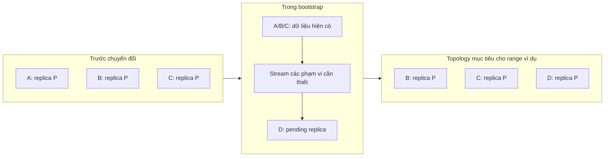
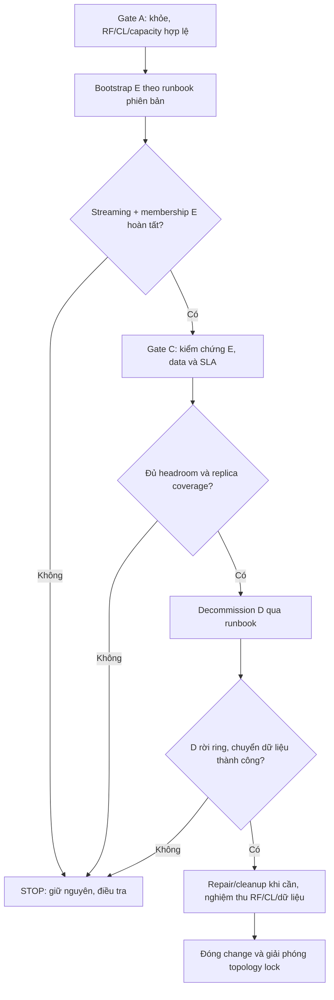

# Chuyển động topology đồng thời và các điều kiện an toàn

Trong Apache Cassandra, **topology** là cách các node, token và replica được bố trí trên các data center (DC), rack và miền lỗi. Khi thêm node (*bootstrap*), rút node đang sống (*decommission*), thay node hỏng (*replace*), loại node đã mất (*remove*) hoặc chuyển quyền sở hữu token (*move*, nếu cấu hình/phiên bản hỗ trợ), cụm cần chuyển dữ liệu giữa các replica. Trong giai đoạn đó, **vòng token đang chuyển tiếp**: tập replica cũ, replica mới và phạm vi token đang di chuyển có thể cùng tham gia việc phục vụ đọc/ghi.

Vấn đề trở nên khó hơn nếu **hai thay đổi topology diễn ra đồng thời**, hoặc một đợt thay đổi chưa hoàn thành nhưng hệ thống triển khai đã khởi động đợt khác. Một node hiện `UN` không tự chứng minh dữ liệu đã stream đủ hay mọi partition đã đạt replication factor (RF) mong muốn. Để bảo vệ dữ liệu và tính sẵn sàng, cần quản trị các thay đổi như **một chuỗi công việc có ranh giới, điều kiện bắt đầu, tín hiệu theo dõi và tiêu chí nghiệm thu**.

Bài thuộc chương **Thay đổi topology** trong mô-đun **DATABASE_ENGINE_WIDE_COLUMN_CASSANDRA**. Nội dung kết hợp kiến trúc phân tán, partition key, replica placement, mức nhất quán CQL, replication/streaming, compaction, repair, xử lý lỗi và kết nối Java để trả lời câu hỏi: **khi nào một chuyển động topology là an toàn, và tại sao không được tự động bắt đầu chuyển động kế tiếp chỉ vì lệnh đầu đã được gửi?**

## 1. Mục tiêu học tập

Sau bài này, bạn có thể:

1. Giải thích sự khác nhau giữa **token ownership hiện tại**, **pending replica** và **ownership mục tiêu** khi topology thay đổi.
2. Phân biệt bootstrap, decommission, remove, replace, move và thay đổi RF; nhận ra các tổ hợp đồng thời nguy hiểm.
3. Đánh giá **RF, consistency level, khả năng chịu mất node, rack/DC, năng lực streaming và disk headroom** trước khi thay đổi.
4. Thiết kế **gates** để chặn thao tác kế tiếp khi đang có joining/leaving/moving, streaming/repair lỗi hoặc replica chưa hội tụ.
5. Theo dõi bằng `nodetool status`, `ring`, `netstats`, logs, metrics và kiểm chứng dữ liệu CQL.
6. Xử lý timeout/unknown state, node mất kết nối giữa bootstrap/decommission và kế hoạch retry an toàn trong Java.
7. Lập runbook chuyển đổi node tuần tự có bằng chứng nghiệm thu theo bảng, token range và miền lỗi.

## 2. Những khái niệm nền tảng

### Token ring không phải một danh sách node đơn giản

Partition key được băm để cho ra **token**. Replication strategy, RF và thông tin DC/rack quyết định những node nào là **natural replicas** của token range. Cụm dùng **virtual nodes (vnodes)** có thể giao nhiều token ranges cho một node; vì vậy thêm/rút *một* node có thể làm thay đổi quyền sở hữu của **nhiều range** rải trên ring.

| Khái niệm | Ý nghĩa cần giữ khi vận hành |
| --- | --- |
| **Natural replica** | Node được chiến lược replication chọn để giữ dữ liệu cho một partition ở topology đã xác định. |
| **Pending replica / pending range** | Replica hoặc phạm vi chuẩn bị nhận quyền sở hữu trong một chuyển động topology; cần xét khi đảm bảo ghi và chuyển dữ liệu. |
| **Bootstrap / joining** | Node mới vào cụm, nhận token và stream dữ liệu cần thiết trước khi trở thành thành viên phục vụ ổn định. |
| **Leaving / decommission** | Node đang sống chủ động rời ring, dữ liệu và ownership cần chuyển theo topology đích. |
| **Moving** | Thay đổi vị trí/token của node, nếu hỗ trợ bởi token assignment và phiên bản cụ thể. |
| **Replace** | Dùng node mới thay node hỏng để đảm nhiệm phạm vi bản sao tương ứng; không đồng nghĩa thêm replica độc lập. |
| **Remove** | Loại metadata một node không còn có thể decommission; có thể cần stream từ replica khác và bảo đảm không còn dữ liệu duy nhất. |
| **Streaming** | Chuyển SSTable/dữ liệu giữa các node phục vụ bootstrap, decommission, replace, repair hoặc rebuild. |
| **Schema agreement / topology agreement** | Các thành viên cần nhìn nhất quán metadata cần thiết; cơ chế phối hợp topology tùy phiên bản, đặc biệt Cassandra 5.x có **Cluster Metadata/TCM**. |

### “Đồng thời” có nhiều dạng

1. **Hai chuyển động membership cùng lúc**: ví dụ hai node cùng bootstrap hoặc một node decommission trong lúc node khác replace.
2. **Chuyển động + đổi RF/DC topology**: metadata đặt replica thay đổi trong khi token ranges cũng thay đổi.
3. **Chuyển động + repair/streaming lớn**: không phải hai thao tác membership nhưng cùng tranh băng thông mạng, disk I/O và trạng thái SSTable.
4. **Chuyển động + sự cố node thứ ba**: bootstrap đang stream thì một nguồn dữ liệu bị down, làm mất khả năng hoàn tất hoặc giảm quorum.
5. **Chuyển động + deploy ứng dụng**: client pool/tính token-aware routing chưa kịp cập nhật topology, tăng timeout và áp lực coordinator.

**Không kết luận mọi phiên bản Cassandra đều cho phép hoặc cấm cùng một tổ hợp lệnh theo cùng cách.** Cơ chế điều phối topology thay đổi qua các release; Cassandra 5.x có cơ chế quản lý metadata/topology khác các bản cũ. **Nguyên tắc an toàn ở mức vận hành** vẫn là chỉ cho một thay đổi topology chính được điều phối tại một thời điểm, đợi chứng cứ hoàn tất và đánh giá lại sức khỏe cụm trước thay đổi tiếp theo, trừ khi một quy trình đã được tài liệu phiên bản và kiểm thử thực tế chứng minh hỗ trợ song song.

## 3. Chuyển động ownership nhìn từ một partition

Giả sử `dc1` có RF = 3 và partition `P` ban đầu nằm trên A, B, C. Thêm node D có thể làm một số token ranges có tập replica **mục tiêu** khác tập trước đó; không phải mọi partition đều di chuyển. Với một range minh họa, topology đích có thể chọn B, C, D.



Sơ đồ là ví dụ về **một token range**, không phải phép tính ownership chính xác từ chỉ bốn tên node. Cassandra có thể dùng nhiều node làm nguồn stream, và cách ghi được định tuyến đến natural/pending endpoints trong chuyển đổi tùy phiên bản và trạng thái. Không suy rằng A được xóa dữ liệu cũ ngay khi D vừa bắt đầu bootstrap.

Tại thời điểm chuyển đổi:

- **Định tuyến ghi** phải xét trạng thái replica/metadata để không đánh rơi mutation khi quyền sở hữu chuyển từ nguồn sang đích. Việc bảo đảm cụ thể phụ thuộc giao thức và consistency của Cassandra đang chạy.
- **Định tuyến đọc** và replica được chọn có thể thay đổi, nên kết quả đọc từ một coordinator/CL chưa chứng minh tất cả node đã đồng bộ.
- **Dữ liệu đang stream** cần disk, network và thời gian; hoàn tất về membership không nên được đồng nhất với công việc hậu kiểm, repair/cleanup đã xong.
- **Lỗi bất ngờ** khi nhiều range đồng thời di chuyển có thể tạo khoảng trống vận hành: không rõ thao tác nào đang sở hữu phạm vi, đâu là nguồn dữ liệu hợp lệ và cần retry phần nào.

Vì thế, runbook cần quản lý cả **state của cluster** và **độ phủ của dữ liệu**.

## 4. Phân biệt các loại thay đổi và rủi ro

| Thao tác | Khi nào dùng | Dữ liệu/metadata đổi ra sao | Cảnh báo quan trọng |
| --- | --- | --- | --- |
| **Bootstrap** | Mở rộng cụm bằng node mới | Node mới nhận token và stream dữ liệu cho ranges sắp sở hữu. | Chưa hoàn tất stream thì không coi node mới là capacity/replica ổn định. |
| **Decommission** | Chủ động rút **node còn sống** | Node rời ring, chuyển ownership/dữ liệu cho những replica đích. | Phải đủ capacity/RF sau khi rút; không tắt cưỡng bức giữa chuyển đổi. |
| **Replace** | Một node hỏng cần thay thế bằng node mới | Node mới thay vai trò/token ownership của node cũ theo quy trình version-specific. | Không vô tình để cả node cũ và node mới dùng cùng danh tính/địa chỉ hoặc song song phục vụ sai cách. |
| **Remove** | Node hỏng vĩnh viễn, không thể decommission | Loại membership của node cũ, tái phân bổ dữ liệu từ replica còn sống. | Nếu node cũ là bản sao duy nhất của dữ liệu chưa hội tụ, thao tác không thể phục hồi phép màu. |
| **Move** | Thay vị trí token của node | Ownership các ranges liên quan dịch chuyển. | Tính hỗ trợ phụ thuộc vnodes và phiên bản; không coi là lệnh phổ quát. |
| **Thay RF** | Thay số bản sao cho keyspace/DC | Replica placement mục tiêu đổi; dữ liệu phải được phân phối lại theo kế hoạch. | `ALTER KEYSPACE` không tự chứng minh đã stream/repair đủ để đạt RF mới. |
| **Đổi snitch/rack/DC** | Thay miền lỗi/định danh vị trí node | Tác động cách NetworkTopologyStrategy chọn replica. | Rất nhạy cảm; không đổi “cho đẹp” trong khi streaming/repair hoặc metadata chưa ổn định. |

### Những phép thay thế không tương đương

- **Decommission** dành cho node còn hoạt động đủ để rời ring theo quy trình. Với node mất vĩnh viễn, cần **replace/remove** theo tài liệu và điều kiện dữ liệu.
- **Replace** không phải **thêm node bình thường với IP khác** rồi hy vọng dữ liệu tự nhận đúng ownership; phải đảm bảo node mới thực hiện đúng vai trò thay thế.
- **Remove** không phải cách sửa “nút đang JOINING hơi chậm”: có thể làm trạng thái membership phức tạp hơn. Phải xem log/phase và runbook phiên bản.
- **Repair** không phải thao tác membership và không thay thế bootstrap stream; **cleanup** chỉ thu hồi phạm vi không còn thuộc node **sau khi** topology và dữ liệu đích đã được xác minh.

## 5. Ma trận rủi ro khi chạy đồng thời

| Tình huống đồng thời | Rủi ro chính | Nguyên tắc xử lý |
| --- | --- | --- |
| **Hai bootstrap cùng lúc** | Nhiều pending ranges, stream cạnh tranh, nguồn dữ liệu/định tuyến thay đổi liên tục. | Thử nghiệm/phiên bản phải hỗ trợ rõ; mặc định chạy **tuần tự từng node** và nghiệm thu giữa các lượt. |
| **Bootstrap + decommission** | Ownership nguồn/đích cùng đổi; tăng khả năng chồng lấn stream và tính toán capacity sai. | Tránh overlap; cho bootstrap hoàn tất, ổn định rồi mới rút node. |
| **Decommission + remove node hỏng** | Rút thêm replica khi đã thiếu nguồn; quorum và nguồn stream suy giảm. | Ưu tiên khôi phục RF/quorum, đánh giá replica còn giữ dữ liệu trước thao tác thứ hai. |
| **Replace + node cũ tự quay lại** | Hai danh tính hoặc hai thành viên tranh vị trí cũ, đọc/ghi vào nguồn lỗi thời. | Cô lập/khóa node cũ theo runbook; chỉ cho quay lại nếu đã giải quyết identity và membership. |
| **Đổi RF + thay membership** | Số replica mục tiêu, token ownership và dữ liệu thực tế lệch nhau. | Chia thành những giai đoạn riêng, có repair/streaming và nghiệm thu RF mỗi giai đoạn. |
| **Topology change + full repair trên cùng phạm vi** | Disk/network và SSTable tasks tranh tài nguyên; thay đổi peer/range khi validation/streaming. | Thường dời repair lớn sang giai đoạn ổn định, trừ yêu cầu recovery có runbook được kiểm chứng. |
| **Topology change + compaction lớn/backup** | Disk headroom suy giảm, I/O bão hòa, kéo dài streaming và read/write tail latency. | Giới hạn concurrency, lên lịch và giữ headroom; không ép major compaction. |
| **Topology change + node thứ ba down** | Mất quorum hoặc thiếu nguồn stream, tăng nguy cơ availability/data loss. | Đóng băng mọi thay đổi mới, đánh giá sức khỏe RF/CL và khôi phục đúng thứ tự. |

**Một thao tác tự động bị từ chối vì “operation already in progress” là tín hiệu cần điều tra**, không phải lý do dùng option `force` để vượt chặn. Một số lệnh có cơ chế cưỡng bức tùy phiên bản nhưng phải qua runbook đặc biệt và đánh giá rủi ro mất dữ liệu.

## 6. RF, consistency và miền lỗi là điều kiện trước tiên

### Quorum theo số replica trong một DC

Với `NetworkTopologyStrategy` và **RF = 3 ở dc1**, `LOCAL_QUORUM` cần:

```text
quorum = floor(RF / 2) + 1 = floor(3 / 2) + 1 = 2

RF=3, LOCAL_ONE    -> cần 1 replica phù hợp phản hồi.
RF=3, LOCAL_QUORUM -> cần 2 replica trong dc1 phản hồi.
RF=3, ALL          -> cần đủ 3 replica theo phạm vi truy vấn.
```

**Quorum không bằng số node UP toàn cluster.** Nếu node UP không phải replica của partition đang được truy vấn, nó không thể thay thế một replica cần phản hồi. Khi đổi topology, cần đánh giá **từng keyspace/DC và phạm vi token**; một phép tính “còn 4 node UP” không đảm bảo mọi partition đang có 2 replica khả dụng.

### Phản ví dụ: rút node khi RF không còn khả thi

Một DC chỉ có **ba node** với RF = 3. Nếu decommission một node mà không thêm capacity, DC chỉ còn hai node để lưu ba bản sao khác nhau. Không thể đáp ứng nguyên tắc **ba replica trên ba node riêng** như trước. Dù một số câu SELECT có thể vẫn phản hồi, đấy không phải phép chứng minh topology mục tiêu hợp lệ.

Quy trình có thể phù hợp hơn:

1. Thêm node mới vào DC/rack theo placement và capacity đã phê duyệt.
2. Đợi bootstrap, streaming và hậu kiểm hoàn tất.
3. Xác nhận RF, replica coverage, dung lượng, read/write SLA ổn định.
4. Mới bắt đầu decommission node cũ.
5. Kiểm chứng lại và cleanup hậu thay đổi khi an toàn.

### Miền lỗi không được bỏ qua

Ba replica trên ba node **cùng một rack/AZ** không có mức chịu lỗi rack/AZ như ba replica phân bố ở những miền lỗi độc lập. Kiểm tra snitch, DC/rack labels, placement và tính đồng nhất cấu hình giữa các node. Việc sắp xếp token không thay thế thiết kế rack-aware replication.

Với nhiều DC, `LOCAL_QUORUM` chỉ xét quorum ở DC cục bộ của yêu cầu; một DC khác mất kết nối có thể tiếp tục tụt dữ liệu. Không chuyển một thao tác bootstrap/DC failover thành tuyên bố “toàn cầu đã đồng bộ” chỉ dựa trên thành công ở một DC.

## 7. Ba cổng an toàn: trước, trong và sau mỗi chuyển động

### Gate A — Trước khi bắt đầu

| Phải xác nhận | Bằng chứng tối thiểu |
| --- | --- |
| **Không còn chuyển động topology khác** | `nodetool status/ring`, log/metadata và công cụ điều phối không có joining/leaving/moving/removing chưa giải quyết. |
| **Cluster metadata đồng thuận** | Kiểm tra trạng thái metadata/schema theo cơ chế của phiên bản; không có drift DC/rack/token hoặc nhiệm vụ membership chưa kết thúc. |
| **RF/CL còn khả thi sau thay đổi** | Phân tích từng keyspace/DC, số replica theo miền lỗi, tính quorum khi có thêm một failure. |
| **Dữ liệu có nguồn còn sống** | Xác định replica đang giữ phạm vi cần stream; không thao tác xóa/rút nguồn duy nhất khi chưa phục hồi. |
| **Dung lượng và tốc độ mạng đủ** | Disk free, dung lượng dự tính stream + compaction overhead, headroom cho lỗi/retry. |
| **Tải ứng dụng trong giới hạn** | P95/p99 đọc/ghi, timeout, GC, disk latency và streaming/compaction backlog trong ngưỡng đã thống nhất. |
| **Backup/repair và runbook sẵn** | Tình trạng repair gần nhất, backup phù hợp, kế hoạch dừng/khôi phục nếu có failure. |
| **Node đích đúng cấu hình** | Cluster name, DC/rack, seeds, auth, version, config, địa chỉ/identity theo thao tác định thực hiện. |

Không dùng điều kiện **“mọi node đều UN”** làm gate duy nhất. Nó không nói lên data consistency, khả năng stream từ đúng nguồn, disk headroom hay cấu hình RF hậu thay đổi.

### Gate B — Trong khi đang chuyển động

1. **Khóa lịch thay đổi topology** ở orchestrator/change management; không cho workflow khác cùng lúc phát lệnh bootstrap/decommission/replace/remove.
2. Quan sát state node và metadata, streaming, CPU/GC, disk/network, compaction, timeouts/availability và data protection cho các partition trọng yếu.
3. Theo dõi **nguồn và đích streaming**. Nếu node nguồn down, disk đích sắp đầy hoặc stream bị lỗi, dừng **việc khởi động thêm thao tác**, phân loại tình huống trước khi can thiệp.
4. Giữ cơ chế retry của ứng dụng **idempotent**, không tự hạ consistency để “cho chạy được” khi replica tạm thiếu.
5. Ghi run ID, command, phiên bản, node/token ranges liên quan, start/end, log/metrics, chủ trách nhiệm và các thay đổi ngoài kế hoạch.

### Gate C — Sau khi hoàn thành

- Node mới/đích ở trạng thái **Normal** phù hợp, node rời được loại khỏi membership theo cách hoàn chỉnh và metadata topology nhất quán.
- Không còn **pending topology transition/streaming thất bại** cho công việc vừa thực hiện; kết quả cuối từ công cụ điều phối và log phải rõ ràng.
- Đánh giá **replica coverage/RF** cho phạm vi mục tiêu, không chỉ đếm node UP.
- Thử đọc/ghi một số partition đại diện bằng CL đã phê duyệt; kiểm tra sự hội tụ theo repair/hints/streaming và những token ranges cần thiết.
- Dung lượng, SSTable/compaction backlog, GC, read/write p95/p99 và timeout trở về ngưỡng ổn định.
- Nếu cần **repair/cleanup** sau thay đổi, hoàn tất theo runbook version-specific trước khi tuyên bố toàn bộ giai đoạn vận hành kết thúc.
- Có biên bản kết quả, những range/node chưa xử lý được ghi nhận là **INCOMPLETE**, không mặc định SUCCESS.

**Một gate fail thì không được tự động chạy bước tiếp theo.** Phải ghi rõ lý do, phạm vi bị ảnh hưởng và phương án phục hồi hoặc dừng ở trạng thái an toàn đã xác định.

## 8. CQL minh họa: khóa phân vùng và dữ liệu nghiệm thu

Việc di chuyển node/token do công cụ vận hành thực hiện, **không phải CQL ALTER TABLE**. CQL hữu ích để kiểm tra dữ liệu theo những partition đã biết trước và sau thay đổi.

Ví dụ keyspace cho **lab** có data center `dc1` ít nhất ba node, NetworkTopologyStrategy và RF = 3:

```sql
CREATE KEYSPACE IF NOT EXISTS topology_lab
WITH replication = {
  'class': 'NetworkTopologyStrategy',
  'dc1': 3
}
AND durable_writes = true;

CREATE TABLE IF NOT EXISTS topology_lab.events_by_tenant_day (
  tenant_id text,
  event_day date,
  event_id uuid,
  event_type text,
  PRIMARY KEY ((tenant_id, event_day), event_id)
);

CONSISTENCY LOCAL_QUORUM;

INSERT INTO topology_lab.events_by_tenant_day
  (tenant_id, event_day, event_id, event_type)
VALUES ('tenant-lab', '2026-11-21',
        11111111-1111-4111-8111-111111111111,
        'baseline-before-topology-change');

SELECT event_id, event_type
FROM topology_lab.events_by_tenant_day
WHERE tenant_id = 'tenant-lab'
  AND event_day = '2026-11-21';
```

**Vì sao dùng khóa cố định?** Khi ghi thử sau chuyển động và retry gặp timeout, cùng `event_id` cho phép đối soát chính xác một mutation, tránh tạo nhiều hàng khác nhau vì mỗi lượt dùng `now()`/UUID mới. Trong một ứng dụng nghiệp vụ, còn cần cơ chế idempotency phù hợp nếu có side effects ngoài Cassandra.

**Giới hạn kiểm thử:** đọc ở `LOCAL_QUORUM` trả về đúng **chưa chứng minh mọi replica của mọi token ranges đã đồng bộ**. Cần đối chiếu dữ liệu ở **nhiều partition/token ranges đại diện**, nhật ký streaming/repair và metadata placement. Nếu muốn kiểm chứng đầy đủ, dùng công cụ và runbook cho phiên bản để xác định endpoint/token ranges thay vì tự suy ra từ `tenant_id`.

## 9. Các lệnh quan sát topology và streaming

Những lệnh **đọc-only** sau có thể dùng trên từng node Cassandra có quyền quản trị phù hợp:

```bash
nodetool status
nodetool ring
nodetool describecluster
nodetool netstats
nodetool compactionstats
nodetool tpstats
nodetool info
```

| Công cụ | Giúp nhìn thấy | Không thay thế được |
| --- | --- | --- |
| `status` | Trạng thái UP/DOWN và Normal/Joining/Leaving/Moving khi được thể hiện; DC/rack/load/tokens. | Không đủ để xác nhận stream, RF coverage và hội tụ dữ liệu. |
| `ring` | Thông tin token/ownership và sự hiện diện node theo ring. | Không phải biên bản nghiệm thu từng stream/range. |
| `describecluster` | Metadata cụm/schema version tùy phiên bản. | Không chứng minh topology transition hay tất cả SSTable đã chuyển xong. |
| `netstats` | Các luồng streaming hiện hành, chế độ hoạt động tùy release. | Stream đã hoàn thành có thể không còn hiện; cần log/metrics lịch sử. |
| `compactionstats` | Pending/running compactions, tác động SSTable/repair. | Pending 0 không đồng nghĩa membership transition complete. |
| `tpstats` | Executor/queue và áp lực xử lý nội bộ. | Không trực tiếp chứng minh dữ liệu đúng. |
| `info` | Một số chỉ số trạng thái/nội bộ của node. | Không thay nhật ký thao tác trên toàn cluster. |

Trong trạng thái của Cassandra, thường gặp **UN = Up/Normal**, **UJ = Up/Joining**, **UL = Up/Leaving**, **UM = Up/Moving**; biểu diễn cụ thể phụ thuộc phiên bản/lệnh. Node hiện **UN** sau khi bootstrap có thể mới đáp ứng một phần điều kiện C; vẫn cần kiểm tra streaming errors, repair/handoff và ổn định dịch vụ. Nếu hai tool phản ánh trạng thái mâu thuẫn, dừng tự động hóa và kiểm tra log/metadata theo phiên bản.

### Khi quan sát thêm các lỗi

- **Streaming không tiến triển**: kiểm tra cả bên gửi/nhận, link mạng, backlog, disk full, token range và lỗi connection.
- **SSTable/compaction tăng vọt**: stream có thể tạo file mới và thúc đẩy compaction; giữ headroom và không ép major compaction “để dọn nhanh”.
- **Read/write timeout tăng**: xác định partition/CL/DC, không chỉ tăng timeout/giảm CL. Khi còn hai replica ở RF3, một failure nữa có thể làm `LOCAL_QUORUM` không khả dụng.
- **Schema/metadata drift**: không tiếp tục thay token/rack/RF; xử lý metadata và schema agreement trước.
- **Kết quả streaming không rõ**: phân biệt tiến độ `100%` ở một stream với **hoàn tất toàn bộ thao tác topology**.

## 10. Mẫu lịch tuần tự an toàn: thêm node rồi rút node

Tình huống lab: `dc1` có bốn node A/B/C/D, RF = 3, muốn thay D bằng E mà không làm giảm số node phục vụ trong giai đoạn chính. D còn sống và đủ khỏe để decommission. Mỗi bước bên dưới là một **cổng**, không phải lệnh tự chạy nối tiếp không kiểm tra:



**Quy trình khuyến nghị:**

1. Chụp baseline: topology, DC/rack, RF, tỉ lệ CPU/disk, p99, repair/backup, những partition quan trọng.
2. Xác nhận E dùng **đúng cluster identity, phiên bản tương thích, rack/DC, network/security** và quy trình bootstrap của release. Không sao chép data directory/system keyspace từ D sang E nếu runbook không yêu cầu và chưa xác minh identity.
3. Cho **E** join/stream **một mình**; không đồng thời decommission D hoặc sửa RF.
4. Theo dõi E về trạng thái Normal, không còn streaming lỗi; kiểm tra dung lượng, placement và dữ liệu mẫu ở các range E nhận.
5. Cho cụm ổn định, đủ capacity và quorum khi **D** rời. Dùng **decommission** vì D còn sống, theo tài liệu chính xác của phiên bản.
6. Khi D rời hoàn chỉnh, kiểm tra node membership, replica coverage, dữ liệu và p95/p99; thực hiện **cleanup** trên các nút còn lưu ranges không còn sở hữu khi đúng thời điểm và theo runbook.
7. Đảm bảo repair/sự hội tụ cần thiết được xử lý trong phạm vi thay đổi trước khi đóng change; tạo lịch theo dõi sự cố sau chuyển đổi.

Ví dụ lệnh **nguy hiểm**, chỉ thực hiện trên **node D còn sống trong lab** sau khi Gate A/B/C và runbook xác minh:

```bash
# Chỉ để học cú pháp: chạy trên node D thực sự cần rời ring.
nodetool decommission
```

Không chạy lệnh trên node production chỉ vì nhìn thấy nó trong bài học. Nó không phải thao tác kiểm tra và có thể làm thay đổi ownership dữ liệu. Với node D đã mất vĩnh viễn, cần **kịch bản replace/remove riêng** chứ không thực thi decommission thông thường.

## 11. Kịch bản lỗi: một bootstrap dở dang, người vận hành muốn replace nút khác

Giả sử node E đang ở trạng thái Joining và còn stream khoảng dữ liệu từ B/C. Đúng lúc đó B mất kết nối. Một automation khác nhận cảnh báo “B down” rồi chuẩn bị replace B, đồng thời scheduler lại muốn decommission D.

| Quyết định | Kết quả/rủi ro |
| --- | --- |
| Cứ replace B và decommission D ngay | Có thể tiếp tục làm thiếu nguồn streaming/quorum; nhiều ownership cùng chuyển và khó khôi phục. |
| Ép E thành Normal vì đã thấy file SSTable | Không bảo đảm mọi token ranges/metadata đã hoàn thành; có thể tạo khoảng trống dữ liệu. |
| Giảm `LOCAL_QUORUM` xuống `ONE` để vượt lỗi | Thay cam kết dữ liệu/nhất quán của ứng dụng, không sửa replica thiếu hay stream thất bại. |
| **Khóa các thao tác mới, đánh giá sức khỏe và hoàn tất/khôi phục chuyển động đầu tiên theo runbook** | Giữ phạm vi sự cố có thể điều tra và tránh giảm thêm số replica khả dụng. |

### Quy trình phản ứng có kiểm soát

1. **Dừng phát hành thao tác topology mới**; ghi lại chính xác lệnh, parent operation/transition ID và trạng thái E, B, D.
2. Thu `nodetool status/ring/netstats`, logs E/B/C, RF và CL của các keyspace; đánh giá những token ranges thiếu nguồn.
3. Phân biệt B chỉ mất kết nối tạm với B mất vĩnh viễn. Không quyết định `replace`/`remove` cho một node có thể trở lại mà không có runbook identity.
4. Nếu hệ thống tự hỗ trợ resume/cancel của phiên bản, thực hiện **đúng cơ chế chính thức**, bảo toàn logs và dữ liệu cần thiết. Không xóa thư mục dữ liệu, SSTable hoặc chỉnh token thủ công để “gỡ kẹt”.
5. Khi trạng thái topology có kết quả cuối rõ, xác minh replica placement và repair/hints theo phạm vi; **sau đó** mới mở gate cho thao tác kế tiếp.
6. Nếu không đủ replica để phục vụ CL đã cam kết, kích hoạt quy trình availability/incident riêng thay vì mở thêm thay đổi topology.

**Không có một lệnh “force resume” chung cho mọi Cassandra release.** Cassandra 5.x và các phiên bản cũ khác nhau ở quản lý metadata; thao tác recovery phải tra cứu đúng version/runbook, không đoán tên subcommand và không gộp nhiều bước khôi phục thành một script mù.

## 12. Thay đổi RF hoặc DC/rack: một giai đoạn riêng

Ví dụ một keyspace trước đó có `dc1: 3` và cần thêm DC `dc2: 3`. Thay replication map bằng CQL là **thay đổi khai báo**; nó không đồng nghĩa rằng dữ liệu đã được đặt đầy đủ trên tất cả replica mới.

```sql
-- Cú pháp minh họa. Không chạy trên production nếu chưa lập kế hoạch.
ALTER KEYSPACE topology_lab
WITH replication = {
  'class': 'NetworkTopologyStrategy',
  'dc1': 3,
  'dc2': 3
};
```

Trước khi thay:

1. Bảo đảm `dc2` đã có đủ các node/rack cần thiết và đã được đưa vào cụm **ổn định** theo runbook.
2. Xác nhận đường mạng liên DC, quyền truy cập, snitch/DC labels, version và khả năng stream dữ liệu.
3. Thực hiện `ALTER KEYSPACE` trong một giai đoạn riêng, sau đó chạy các bước **rebuild/repair/streaming** để populate replica mới theo tài liệu phiên bản.
4. Theo dõi dữ liệu ở DC mới, RF/CL thực tế, hậu kiểm và readiness của Java driver.
5. Chỉ sau nghiệm thu mới mở traffic/CL tương ứng hoặc tiếp tục decommission/replace/đổi rack.

**Điều chỉnh RF không được coi là công cụ sửa nóng khi một bootstrap đang kẹt.** Nếu làm song song, bạn thay đổi cả tập đích và cơ chế đồng bộ giữa khi nguồn dữ liệu đang di chuyển.

## 13. Ứng dụng Java trong lúc topology thay đổi

Java Driver 4.x sử dụng metadata/topology, routing và load-balancing để chọn coordinator; cấu hình **local datacenter** có vai trò quan trọng khi cụm nhiều DC. Một node thay đổi membership có thể làm driver phải cập nhật danh sách endpoint/routing. Ứng dụng cần xử lý lỗi mạng/timeout nhưng không “giúp Cassandra” bằng cách tự sửa token hoặc ghi vào replica trực tiếp.

Ví dụ thao tác đọc theo partition key bằng Java Driver 4.x:

```java
import java.time.LocalDate;
import com.datastax.oss.driver.api.core.ConsistencyLevel;
import com.datastax.oss.driver.api.core.cql.PreparedStatement;
import com.datastax.oss.driver.api.core.cql.BoundStatement;
import com.datastax.oss.driver.api.core.cql.ResultSet;
import com.datastax.oss.driver.api.core.cql.Row;

PreparedStatement select = session.prepare(
    "SELECT event_id, event_type FROM topology_lab.events_by_tenant_day " +
    "WHERE tenant_id = ? AND event_day = ?");

BoundStatement query = select.bind(
        "tenant-lab", LocalDate.of(2026, 11, 21))
    .setConsistencyLevel(ConsistencyLevel.LOCAL_QUORUM);

ResultSet result = session.execute(query);
for (Row row : result) {
    // Ghi nhận expected event_id, latency và exception theo operation ID.
}
```

### Retry khi coordinator hoặc replica chuyển trạng thái

- **Read timeout**: retry có giới hạn nếu nghiệp vụ chịu được; trước tiên xem tính khả dụng của replica và mức CL. Retry vô hạn có thể làm cụm đang stream càng nghẽn.
- **Write timeout**: không có nghĩa mutation chưa được ghi; cùng một request nên giữ **primary key, payload và idempotency key** qua retry. Không dùng UUID mới cho từng lần retry một event.
- **Counter, LWT và side effects**: không tự đánh dấu idempotent nếu thao tác không idempotent về nghiệp vụ; xử lý unknown result/reconciliation theo giao thức tương ứng.
- **Local DC**: không giả định driver tự chuyển DC hoặc hạ consistency khi mất coordinator. Failover liên DC cần chính sách và phạm vi nhất quán được thiết kế rõ.
- **Quan sát**: log phiên bản topology/change ID, DC/endpoint khi có thể, loại lỗi, số lần thử và read/write latency. Không gửi thêm bulk load trong khi cluster đang thiếu headroom.

Một ứng dụng trả kết quả SELECT đúng trong lúc bootstrap là tín hiệu tốt về **đường phục vụ một truy vấn**, nhưng **không phải bằng chứng chuyển động topology hoàn tất trên mọi range**.

## 14. Nghiệm thu bằng phạm vi và bằng chứng

Một biên bản thay đổi nên coi thao tác topology là **change có ID**, với nhiều điều kiện:

| Trường | Nội dung cần ghi |
| --- | --- |
| `change_id` | ID duy nhất do nhóm vận hành cấp; thao tác bootstrap/decommission/replace/remove/RF change. |
| `version/tooling` | Cassandra version, nodetool/distribution và các cờ thực sự sử dụng. |
| `before/after topology` | DC/rack/node/token ownership, RF từng keyspace quan trọng. |
| `scope` | Node nguồn/đích, ranges liên quan, bảng/keyspace, miền lỗi. |
| `preflight` | Node health, repair/backup, disk/network headroom, SLAs và snapshot baseline. |
| `transition evidence` | Logs, command result, topology/metadata status, streaming completion. |
| `data validation` | Partition kiểm tra trước/sau, coverage token range, hints/repair cần thiết. |
| `postflight` | Quorum/availability, p95/p99, disk, GC, backlog, lỗi còn lại. |
| `final status` | `COMPLETED / INCOMPLETE / FAILED / UNKNOWN` và người phê duyệt. |

### Mẫu báo cáo minh họa

```text
CHANGE: topology-lab-2026-11-21-01
ACTION: bootstrap E, dc1
BASELINE: A/B/C/D Normal, RF=3, LOCAL_QUORUM healthy
TRANSITION: E joined; streams tracked across required ranges
RESULT: command reported success, E Normal
CHECKS: token/replica placement PASS; validation keys PASS
METRICS: read/write p99 within agreed threshold; disk headroom PASS
POST-ACTIONS: cleanup/repair according to runbook completed or tracked
FINAL: COMPLETED
NEXT GATE: decommission D may be scheduled after independent preflight
```

Đây là **mẫu kiểm toán tự thiết kế**, không phải output tự động từ Cassandra. Không ghi `COMPLETED` nếu chỉ có dòng “node up” nhưng chưa có streaming/topology/data validation hoặc vẫn có lỗi chưa xử lý.

## 15. Bài thực hành và câu hỏi tình huống

### Bài A — Ma trận an toàn

Cho DC có bốn node RF = 3, workload ghi `LOCAL_QUORUM`. Nhà vận hành dự kiến thêm E, đồng thời rút D và đổi rack label của C.

Hãy lập bảng:

1. Tập replica/miền lỗi và token ranges có thể bị ảnh hưởng.
2. Những thao tác phải tuần tự và điều kiện để mở gate tiếp theo.
3. Khả năng mất quorum nếu một node đang stream bất ngờ down.
4. Chỉ số phải đo và cách nghiệm thu data placement sau mỗi giai đoạn.

**Kỳ vọng:** không đánh đồng ba thay đổi trên thành một bước deployment “song song để tiết kiệm thời gian”.

### Bài B — Bootstrap chưa hoàn tất

Node E hiển thị Joining, `netstats` báo stream còn chạy. Node B là một nguồn stream lại mất kết nối; scheduler đề xuất replace B.

Giải thích vì sao **đóng băng mọi thao tác topology mới**, thu log E/B, đánh giá RF/CL và khôi phục theo runbook thường an toàn hơn bắt đầu replace cùng lúc. Nêu ba loại bằng chứng cần có trước khi mở lại lịch.

### Bài C — Quorum không phải số node UP

Hai DC có RF `dc1:3, dc2:3`. Một partition ở dc1 đang thiếu một replica, `LOCAL_QUORUM` yêu cầu hai phản hồi. Chỉ ra điều gì xảy ra khi một replica nữa trong dc1 bị mất trong lúc decommission/streaming, dù dc2 vẫn có ba node UN. Phân biệt `LOCAL_QUORUM` với các chiến lược consistency liên DC.

### Bài D — RF thay đổi trước khi có dữ liệu

Nhóm vừa `ALTER KEYSPACE` thêm `dc2:3` và ngay lập tức cho ứng dụng đọc ở dc2. Đọc không ra dữ liệu, nhóm muốn hạ consistency và tiếp tục decommission node ở dc1.

Xác định **lỗ hổng kế hoạch**: RF metadata mới chưa chứng minh dữ liệu đã được populate/repair ở dc2. Thiết kế chuỗi thao tác và các phép kiểm tra cần hoàn tất trước khi chuyển traffic.

### Bài E — Review biểu đồ hiệu năng

Trong bootstrap, p99 read tăng từ mức bình thường lên cao, disk utilization gần đầy, compaction pending tăng và stream ít tiến triển. Đưa ra nguyên nhân có thể và kế hoạch giảm tải/khôi phục an toàn. **Không** đề xuất major compaction, tăng timeout vô hạn hoặc chạy thêm bootstrap như một “cách sửa nhanh”.

### Tiêu chí đạt

Một phương án được xem là đủ an toàn khi học viên cung cấp:

1. **Bản đồ phạm vi thay đổi**: node, token/ranges, RF, DC/rack và dữ liệu nguồn/đích.
2. **Điều kiện bắt đầu**: cluster khỏe, không có chuyển động khác, quorum/capacity/disk/network đủ.
3. **Điều kiện kết thúc**: membership/metadata, streaming, replica coverage và truy vấn kiểm chứng đều có bằng chứng.
4. **Phương án khi lỗi**: khóa topology mới, xác định trạng thái còn dang dở, dùng quy trình hỗ trợ theo phiên bản, không xóa/chỉnh SSTable/token thủ công.

## 16. Câu hỏi tự kiểm tra

1. Vì sao `nodetool status` thấy toàn `UN` không đủ để chứng minh một lần bootstrap đã hoàn tất về dữ liệu?
2. Pending replica khác natural replica ở topology cuối cùng ở điểm nào?
3. Tại sao không nên chạy decommission một node khi DC đang có RF = 3 nhưng chỉ còn ba node khả dụng?
4. Khi thay `RF` trong keyspace, có phải `ALTER KEYSPACE` tự sao chép đầy đủ dữ liệu ngay lập tức không?
5. Phân biệt replace một node chết với decommission một node còn sống.
6. Tại sao bootstrap + repair/compaction nặng có thể làm streaming treo dù topology syntax đúng?
7. Nếu node cũ quay lại sau replace, rủi ro identity/ownership là gì?
8. Một SELECT trả kết quả đúng có chứng minh mọi token ranges đã hội tụ không?
9. Vì sao cần ghi lại phiên bản Cassandra trước khi chọn lệnh recovery cho topology đang kẹt?
10. Thiết kế ba gate nào để một automation không bao giờ khởi động topology change thứ hai khi change thứ nhất chưa được nghiệm thu?

## 17. Tài liệu đọc tiếp theo phiên bản

- [Apache Cassandra documentation](https://cassandra.apache.org/doc/latest/): chọn **đúng phiên bản**, tra mục Operating Cassandra / topology changes, bootstrap, decommission, replace và remove.
- [Apache Cassandra — Architecture](https://cassandra.apache.org/doc/latest/cassandra/architecture/): token ring, partitioning, NetworkTopologyStrategy và đường đọc/ghi giữa replicas.
- [Apache Cassandra — nodetool](https://cassandra.apache.org/doc/latest/cassandra/managing/tools/nodetool/): cú pháp `status`, `ring`, `netstats`, `decommission` và các lệnh vận hành được hỗ trợ.
- [Apache Cassandra — Repair](https://cassandra.apache.org/doc/latest/cassandra/managing/operating/repair.html): phạm vi và giới hạn repair sau thay đổi replica/topology.
- [Apache Cassandra — CQL](https://cassandra.apache.org/doc/latest/cassandra/developing/cql/): keyspace replication, primary key, CL và dữ liệu nghiệm thu.

**Ghi nhớ:** một chuyển động topology là **thay đổi quyền sở hữu dữ liệu đang sống**, không chỉ là lệnh thêm/xóa máy. Dù Cassandra phiên bản mới có thể phối hợp metadata tốt hơn, chạy nhiều chuyển động đồng thời vẫn có thể làm khó kiểm soát streaming, quorum, dung lượng và recovery. Thiết kế quy trình theo **một chuyển động được điều phối → quan sát → xác minh dữ liệu/replica/SLAs → nghiệm thu → mới mở chuyển động tiếp theo**; khi trạng thái còn UNKNOWN, việc an toàn trước nhất là **không phát thêm thay đổi topology**.
