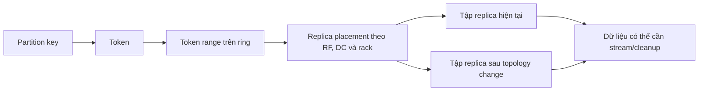
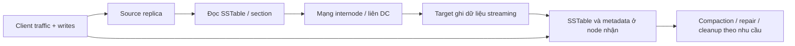

# Phân phối lại dung lượng, mạng streaming và nhu cầu dung lượng tạm

> **Chương:** Thay đổi topology  
> **Mô-đun:** `DATABASE_ENGINE_WIDE_COLUMN_CASSANDRA` — Apache Cassandra, hệ cơ sở dữ liệu wide-column phân tán.  
> **Trọng tâm:** Ước lượng dữ liệu cần di chuyển, băng thông streaming và dung lượng đĩa **trong suốt** quá trình thêm, rút hoặc thay node; xây dựng kế hoạch vận hành và kiểm thử trước khi thay topology production.

Cassandra chia partition thành các **token range**, phân phối chúng lên các node theo partitioner và replication strategy. Khi thay topology, cluster phải thay đổi **tập replica chịu trách nhiệm** cho nhiều khoảng token. Vì vậy, “thêm một node để giảm tải đĩa” không chỉ là lắp máy mới: các replica phải stream dữ liệu sang nơi có trách nhiệm mới, node cũ có thể tạm giữ bản sao không còn sở hữu, compaction/repair còn phát sinh I/O và dữ liệu không tự cân bằng tuyệt đối ngay lập tức.

Có ba bài toán gắn liền nhau:

1. **Phân phối lại dung lượng:** Sau thay đổi topology, mỗi node/DC phải lưu bao nhiêu byte và có xảy ra skew/hotspot không?
2. **Mạng streaming:** Cần gửi bao nhiêu byte qua những đường mạng nào; tốc độ hữu hiệu là bao nhiêu khi vẫn phục vụ đọc/ghi?
3. **Dung lượng tạm:** Trong quá trình chuyển, SSTable đầu vào, file output compaction, snapshot, commit log, index và dữ liệu cũ chưa cleanup có thể **cùng tồn tại**; cần bao nhiêu chỗ trống để không chạm disk-full?

**Bài học cốt lõi:** Tính dung lượng *sau khi cân bằng* chưa đủ. Phải lập ngân sách cho **đỉnh dung lượng và đỉnh I/O trong quá trình chuyển**, có biên an toàn và tiêu chí xác nhận hoàn tất.

## 1. Mục tiêu học tập

Sau khi học, bạn có thể:

- Giải thích cách partition key, token/vnodes, RF và topology DC/rack dẫn đến việc stream lại dữ liệu.
- Phân biệt **bootstrap**, **decommission**, **remove dead node**, **replace** và thay đổi RF.
- Tính mức dung lượng trung bình ước lượng trước/sau khi đổi số node và phát hiện giới hạn của trung bình.
- Xây dựng ngân sách cho **network ingress/egress, disk read/write, compaction, repair và free space**.
- Ước lượng thời gian streaming theo **thông lượng hiệu dụng**, không theo danh nghĩa 10/25 GbE của NIC.
- Quan sát `nodetool status`, `netstats`, `compactionstats`, `tablestats` và các chỉ số khách hàng.
- Lập runbook preflight → streaming → hậu kiểm, biết khi nào phải dừng/cách ly node và không làm hỏng dữ liệu.
- Liên hệ tới thiết kế bảng theo truy vấn, consistency level, CQL và Java Driver trong thời gian chuyển topology.

## 2. Mô hình dữ liệu và các khái niệm nền

### 2.1. Token range thuộc về những replica nào?

Cassandra dùng partition key để tính token. Với chiến lược replication đã cấu hình, ring token xác định tập replica cho một partition. **RF (replication factor)** là số bản sao mong muốn trong phạm vi datacenter tương ứng, không phải số lượng byte nhân thêm vào *mọi* node.

Ví dụ bảng sự kiện:

```sql
-- Chỉ dùng trên lab có datacenter tên dc1 và đủ node cho RF=3.
CREATE KEYSPACE IF NOT EXISTS lab_topology
WITH replication = {
    'class': 'NetworkTopologyStrategy',
    'dc1': 3
};

CREATE TABLE IF NOT EXISTS lab_topology.events_by_tenant_day (
    tenant_id uuid,
    event_day date,
    event_time timestamp,
    event_id timeuuid,
    event_type text,
    payload text,
    PRIMARY KEY ((tenant_id, event_day), event_time, event_id)
) WITH CLUSTERING ORDER BY (event_time DESC, event_id DESC);
```

Toàn bộ dữ liệu cùng `(tenant_id, event_day)` thuộc **một partition** và dùng cùng token. Các cột `event_time`, `event_id` quyết định thứ tự trong partition, không ảnh hưởng vị trí replica.

Một truy vấn phù hợp đường đọc:

```sql
SELECT event_time, event_id, event_type
FROM lab_topology.events_by_tenant_day
WHERE tenant_id = 11111111-1111-1111-1111-111111111111
  AND event_day = '2026-11-21'
LIMIT 50;
```

Biết đủ partition key giúp coordinator/driver định tuyến theo token. Nhưng khi **topology đang thay đổi**, metadata về replica placement, streaming và node availability cũng thay đổi; vì thế cần giám sát driver/node, không mặc định mọi truy vấn đều có độ trễ như trước.

### 2.2. Vnodes và sự khác biệt giữa “node” với “khoảng token”

Với **virtual nodes (vnodes)**, một node có thể sở hữu nhiều token và tham gia replica của nhiều khoảng rời nhau. Khi thêm/rút một node, nhiều range có thể đổi tập replica.



**Đừng nhầm “node có 100 token” với “node lưu 100 phần bằng nhau”.** Dung lượng phân bố còn phụ thuộc số byte của từng partition, mật độ token, compaction, index, dữ liệu chết/tombstone, TTL và skew theo tenant.

### 2.3. Bốn thao tác topology cơ bản

| Thao tác | Điều thay đổi | Hướng di chuyển dữ liệu thường gặp |
|---|---|---|
| **Bootstrap** node mới | Node mới nhận một phần replica ownership | Các replica khỏe truyền SSTable/range tới node mới |
| **Decommission** node còn sống | Node rời ring có kiểm soát, ownership chuyển cho node còn lại | Node rời và/hoặc các replica khác cung cấp dữ liệu cần thiết cho replica mới |
| **Remove dead node** | Loại một node không còn phục vụ khỏi ring | Những node còn sống tái tạo/stream phần dữ liệu để khôi phục RF khi có đủ bản sao nguồn |
| **Replace** node lỗi | Node mới thay trách nhiệm của node cũ | Node thay thế bootstrap/stream dữ liệu tương ứng từ replica khỏe |

**Thay đổi RF** (ví dụ tăng RF trong một DC) là một bài toán khác: tổng số replica đích thay đổi; có thể đòi bổ sung dữ liệu qua thủ tục riêng sau khi cập nhật schema. Không xem tăng/giảm RF là phép cộng bớt node đơn thuần.

## 3. Công thức ước lượng dung lượng ở trạng thái ổn định

### 3.1. Chọn đơn vị và phạm vi trước

Để tính đơn giản, đặt:

- \(L\): tổng kích thước *một bản sao logic của dữ liệu đang sống*, đã quy đổi sang **byte lưu trữ tương đương** với compression/encoding đang dùng (GiB). Chưa tính số replica.
- \(r\): số replica đầy đủ mong muốn trong datacenter đang xét.
- \(N\): số node dữ liệu khỏe trong datacenter đó, có khả năng chia sẻ ownership theo kế hoạch.
- \(D_{\text{steady}}\): byte dữ liệu live replica trên **mỗi node trung bình**, trước khi cộng tombstone, version cũ, index, snapshot, commit log và tệp tạm.

Với giả định các replica có dung lượng gần đều, không có transient replication đặc thù và chỉ xét **một DC**:

\[
D_{\text{steady}} \approx \frac{L \times r}{N}
\]

Nếu cluster có nhiều DC, phải tính riêng mỗi DC với **RF và N của chính DC đó**. Không cộng tất cả node trên các DC rồi chia bừa dữ liệu theo một RF duy nhất.

**Đây là phép xấp xỉ về dung lượng**, không phải thuật toán chọn replica hay lượng byte streaming thật. Partition size lệch và cách placement có thể làm một số node vượt trung bình đáng kể.

### 3.2. Ví dụ thêm một node: từ 6 lên 7 node

Giả sử trong `dc1`:

- Dữ liệu live quy đổi một bản sao: \(L=1.200\ \text{GiB}\).
- RF trong DC: \(r=3\).
- Số node ban đầu: \(N_0=6\).
- Số node sau bootstrap: \(N_1=7\).
- Mỗi node có **dung lượng khả dụng theo filesystem** \(C=1.024\ \text{GiB}\).

Tổng dữ liệu live replicated ước lượng:

\[
D_{\text{DC,live}}=1.200\times3=3.600\ \text{GiB}
\]

Trước khi thêm:

\[
D_{\text{old,avg}}=\frac{3.600}{6}=600\ \text{GiB/node}
\]

Sau khi thêm (lý tưởng):

\[
D_{\text{new,avg}}=\frac{3.600}{7}\approx514{,}3\ \text{GiB/node}
\]

Mức giảm trung bình **lý tưởng trên mỗi node cũ**:

\[
\Delta_{\text{old,ideal}}=600-514{,}3\approx85{,}7\ \text{GiB}
\]

Node mới cần nhận dữ liệu live tương đương khoảng **514,3 GiB** trong hình dung cân bằng hoàn hảo.

| Chỉ số | 6 node (trước) | 7 node (sau, lý tưởng) |
|---|---:|---:|
| Live replicas toàn DC | 3.600 GiB | 3.600 GiB |
| Trung bình live/node | 600 GiB | 514,3 GiB |
| Tỷ lệ live/1.024 GiB | 58,6% | 50,2% |
| Tổng số node | 6 | 7 |

**Những con số trên không phải dự báo chính xác byte streaming hay disk usage tức thời.** Token ownership mới có thể lệch, data replica không đồng nhất, các file SSTable có phần overlap và nguồn gửi có thể phải đọc/stream nhiều hơn net growth cuối cùng.

### 3.3. Vì sao node cũ không lập tức giảm 85,7 GiB?

Một node cũ có thể **vẫn giữ SSTable chứa ranges mà nó không còn là replica** sau bootstrap. Cassandra có quy trình `cleanup` để loại những dữ liệu không còn thuộc trách nhiệm node sau khi ring ổn định.

Do đó phải phân biệt:

- **Ownership mới:** metadata ring đã thay đổi.
- **Dữ liệu đã stream:** node nhận đã có những replica cần thiết.
- **Disk đã giảm:** file không còn sở hữu đã được cleanup/compaction khi phù hợp, snapshot cũ không giữ block, hệ thống file đã giải phóng byte.

Trước khi cleanup, node cũ có thể vẫn dùng gần 600 GiB hoặc hơn do tệp tạm và ghi mới. **Không hứa với đội vận hành rằng thêm một node sẽ lập tức giải phóng 85,7 GiB trên mỗi node cũ.**

### 3.4. Skew: trung bình không phải node nặng nhất

Nếu có tenant rất lớn, partition nóng, lượng tombstone khác nhau hoặc không cân bằng token, một node có thể nặng hơn trung bình.

Ước tính có hệ số skew chỉ để **stress test**:

\[
D_{\text{max,estimate}} = D_{\text{avg}}\times k_{\text{skew}}
\]

Với node đích trung bình 514,3 GiB:

| Hệ số giả định | Node nặng nhất ước lượng |
|---|---:|
| \(k=1{,}00\) | 514,3 GiB |
| \(k=1{,}20\) | 617,2 GiB |
| \(k=1{,}40\) | 720,0 GiB |

`k` **không phải hệ số Cassandra mặc định**. Phải rút ra từ quan sát ownership, `Load`, per-table bytes, top partitions và workload thực. Nếu một partition lớn/hot không thể chia bằng token, thêm node có thể không giải quyết hotspot đó. Lúc ấy cần **thiết kế lại partition/bucketing theo truy vấn**, không chỉ tăng số node.

## 4. Ước lượng dữ liệu di chuyển: net change khác traffic thực

### 4.1. Cận dưới theo mô hình cân bằng

Với tình huống 6 → 7 node:

- Node mới ở trạng thái mục tiêu cần chứa khoảng **514,3 GiB** dữ liệu live theo giả định lý tưởng.
- Đây là **quy mô dữ liệu cần bootstrap**, không phải khẳng định NIC sẽ chỉ gửi đúng 514,3 GiB.
- Những node cũ giảm net live ownership tổng cộng khoảng 514,3 GiB, nhưng **chúng không tự động giải phóng ngay số byte đó**.
- Streaming thực tế có thể gồm nhiều nguồn gửi, retry, metadata, SSTable section, ảnh hưởng nén và phát sinh mutation trong quá trình chạy.

Trong thực tế, lượng network traffic của toàn job phụ thuộc token ranges chuyển, replica placement, chiến lược lấy nguồn, phần dữ liệu đã có sẵn, SSTable format và lỗi truyền. Không suy lượng byte chính xác từ \(Lr/N\).

### 4.2. Thêm node, rút node và replace không giống nhau

**Thêm node:** node mới nhận dữ liệu từ replica khỏe. Những node khác có thể tiếp tục nhận write, lưu các replica cũ, chờ ring ổn định rồi mới cleanup phần không còn sở hữu.

**Decommission:** node sắp rút truyền trách nhiệm sang các replica đích. Với RF không đổi, **các node còn lại phải chứa nhiều dữ liệu hơn**; rủi ro lớn là disk target đầy trong lúc stream, trước khi node cũ được rút sạch. Node rút vẫn phải tồn tại/khỏe cho tới khi hoàn tất quy trình.

**Remove node đã chết:** khác với decommission vì node đó **không thể stream dữ liệu của nó**. Cụm phải dựa vào replica khỏe còn lại; nếu dữ liệu chỉ còn ở node chết và không có nguồn/backup, không có thuật toán streaming nào tái tạo được từ hư không.

**Replace:** node mới nhận trách nhiệm của node hỏng; dung lượng ban đầu có thể phải chứa tương đương phần replica của node cũ. Thường **không có lợi ích giảm dung lượng trên các node còn lại** như một lần scale-out.

### 4.3. Ví dụ rút một node: từ 6 xuống 5 node

Cùng giả định \(L=1.200\) GiB và RF=3:

\[
D_{\text{after,avg}}=\frac{3.600}{5}=720\ \text{GiB/node}
\]

So với trước (600 GiB), mỗi node còn sống phải nhận thêm **trung bình 120 GiB live replicas** nếu cân bằng hoàn hảo.

| Chỉ số | Trước: 6 node | Sau: 5 node |
|---|---:|---:|
| Trung bình live/node | 600 GiB | 720 GiB |
| Tỷ lệ live/1.024 GiB | 58,6% | 70,3% |
| Net tăng ở mỗi node sống (lý tưởng) | — | +120 GiB |

Tỷ lệ 70,3% ở **steady state** vẫn chưa cộng tombstone, index, snapshot, compaction output và skew. Nếu quy định nội bộ yêu cầu headroom lớn hơn, kế hoạch rút node có thể **không an toàn dù có đủ RF**.

Mỗi node đích có thể cần thêm không gian cho **stream đang nhận và compaction chạy song song**. Đừng lấy số 120 GiB rồi khẳng định chỉ cần trống đúng 120 GiB.

## 5. Streaming đi qua những tài nguyên nào?

### 5.1. Không chỉ là bandwidth của NIC



Một luồng streaming phải vượt qua nhiều giới hạn:

- **Source disk read:** đọc SSTables có thể cạnh tranh với client read và compaction.
- **Mạng internode:** NIC, switch, rack uplink, firewall/TLS, packet loss, giới hạn per-peer và QoS.
- **Target disk write:** ghi file nhận có thể cạnh tranh với commit log/flush/compaction.
- **CPU/compression/checksum:** xử lý truyền và đọc/ghi có thể tốn CPU.
- **Repair/compaction sau đó:** vừa nhận đủ byte không có nghĩa node lập tức khỏe, không backlog.
- **Traffic hiện hữu:** app reads/writes, hints, CDC, backup và streaming khác vẫn tiêu thụ tài nguyên.

**Thông lượng hữu hiệu** bị chi phối bởi nút nghẽn thật, chứ không bởi “NIC 10 Gbps” trên hợp đồng máy chủ.

### 5.2. Ước lượng thời gian tối thiểu theo byte và throughput

Đặt:

- \(B_{\text{move}}\): GiB phải truyền theo **một đường đo** (ví dụ tổng inbound đến node mới).
- \(v_{\text{eff}}\): MiB/s **aggregate hữu hiệu** đo được trên đường đó, đã dành tài nguyên cho client.
- \(T_{\text{transfer}}\): số giây chuyển dữ liệu, chưa tính prepare, retry, topology changes, compaction hoặc hậu kiểm.

\[
T_{\text{transfer}}\approx\frac{B_{\text{move}}\times1024}{v_{\text{eff}}}
\]

Ví dụ node mới cần nhận **xấp xỉ 514 GiB** và có **80 MiB/s** inbound hữu hiệu:

\[
T\approx\frac{514\times1024}{80}
=6.579\ \text{giây}\approx1{,}83\ \text{giờ}
\]

**Đây là ước lượng lý tưởng cho riêng phần chuyển byte**, không phải thời gian hứa hẹn bootstrap. Nếu throughput giảm, retry hoặc bytes thực lớn hơn, thời gian tăng. Cần cộng biên cho prepare, stream setup, index/compaction và các bước xác nhận membership.

### 5.3. Công thức chẩn đoán “nút cổ chai”

Theo mô hình đơn giản:

\[
v_{\text{eff}}\lesssim\min(
v_{\text{source-read}},
v_{\text{network-usable}},
v_{\text{target-write}},
v_{\text{configured-limit}}
)
\]

Với nhiều nguồn gửi, cần xét **tổng tài nguyên trên node đích** và các liên kết dùng chung. Một node đích có thể nhận từ A/B/C đồng thời, nên tổng inbound của nó có thể là giới hạn dù từng source còn dư mạng. Một đường uplink chung giữa các rack/DC cũng có thể nghẽn khi cộng nhiều phiên.

Khi đo, so **byte rate theo thời gian** (MiB/s) với I/O và NIC thật, không chỉ xem `netstats` có tiến độ phần trăm.

### 5.4. Mạng trong DC và liên DC

Trong cụm nhiều DC:

- Replication strategy có RF riêng cho từng DC.
- Thêm một node trong DC1 không mặc định làm phân phối live data tại DC2 giảm theo công thức dùng tổng node hai DC.
- Repair/streaming/hints có thể có lưu lượng liên DC tùy topology và phiên bản, nhưng phải **đo thay vì giả định**.
- Các đường WAN/inter-DC thường có latency, cost và giới hạn riêng.
- Tính thời gian truyền theo băng thông **thực có thể sử dụng trong giờ tải cao**, không theo tên gói WAN.

Nếu thay RF và đổi số node cùng một đợt, rất khó tách nguyên nhân và lưu lượng: nên lập kế hoạch từng bước riêng khi có thể.

## 6. Disk headroom: tính đỉnh dung lượng, không chỉ trạng thái đích

### 6.1. Những thành phần phải được tính

Một mô hình budget tại node bất kỳ:

\[
P_{\text{peak}}
\approx
D_{\text{existing}}
+ D_{\text{inbound}}
+ D_{\text{compaction-temp}}
+ D_{\text{other-temp}}
+ D_{\text{growth}}
- D_{\text{actually-reclaimed}}
\]

Trong đó:

- \(D_{\text{existing}}\): file/data đang chiếm **thực tế** (không chỉ live bytes), tính cả index/tombstone phù hợp với scope.
- \(D_{\text{inbound}}\): lượng dữ liệu stream vào **trước khi được khấu trừ/xóa**.
- \(D_{\text{compaction-temp}}\): output compaction có thể song song tồn tại với input.
- \(D_{\text{other-temp}}\): snapshot không chia sẻ block, repair/anti-compaction, build index, spill/tệp tạm và các việc khác.
- \(D_{\text{growth}}\): dữ liệu ghi mới trong thời gian topology change.
- \(D_{\text{actually-reclaimed}}\): byte đã được filesystem xác nhận giải phóng, **không** phải số byte “sẽ cleanup sau”.

Cần bảo đảm:

\[
P_{\text{peak}}+H_{\text{reserve}}<C_{\text{usable}}
\]

với \(C_{\text{usable}}\) là dung lượng filesystem **thực sự khả dụng** và \(H_{\text{reserve}}\) là biên dự phòng vận hành mà tổ chức chấp nhận. Không có con số dự phòng 10%, 20% hay 30% đúng cho mọi hệ thống; nó phụ thuộc workload, compaction strategy, kích thước SSTable, failure budget và chính sách disk pressure.

### 6.2. Vì sao disk tạm quan trọng khi streaming?

**Compaction** trong LSM-tree đọc nhiều SSTable và ghi SSTable mới trước khi các input được bỏ. Với STCS, một lần merge các file lớn có thể cần lượng output rất đáng kể. Với LCS/UCS, nhiều nhóm compaction có thể chạy đồng thời. TWCS có thể giữ window cũ/expired SSTables và snapshot.

**Repair incremental** có thể dùng anti-compaction, ảnh hưởng disk và I/O; các lần repair sau bootstrap/replace có thể tăng nhu cầu thêm. **Cleanup** có thể phải viết lại file/chỉ mục để loại phần không còn sở hữu.

Mức thêm tạm thời vì thế phụ thuộc **lịch công việc cùng lúc**, không chỉ lượng data sắp stream.

### 6.3. Ví dụ ngân sách disk node mới

Tiếp tục 6 → 7 node, đích lý tưởng **514,3 GiB live** trên node mới, filesystem usable 1.024 GiB. Kế hoạch giả định:

| Thành phần ở node mới | Dung lượng ví dụ |
|---|---:|
| SSTables cần nhận để đạt ownership đích | 514 GiB |
| Compaction/repair/index/tệp phụ trong cao điểm | 110 GiB |
| Dữ liệu ứng dụng tiếp tục tăng trong thời gian chuyển | 20 GiB |
| Reserve không được sử dụng theo chính sách nội bộ | 180 GiB |
| **Tổng cần dự trù** | **824 GiB** |

Với các giả định này, 1.024 GiB đủ theo mô hình: dư khoảng **200 GiB ngoài phần reserve**. Nhưng nếu dữ liệu thực bị skew lên 720 GiB, **cùng phụ phí 110 + 20 + 180 = 310 GiB** sẽ yêu cầu **1.030 GiB**, vượt 1.024 GiB. Khi đó kế hoạch phải thay đổi: tăng disk, chọn node khác hoặc giảm peak concurrency sau khi đo, phân bố token tốt hơn, hoặc sửa schema/hot partition.

Các số 110, 20 và 180 GiB chỉ là **ví dụ tính ngân sách**, không phải mặc định Cassandra.

### 6.4. Phân biệt “size đang dùng” và “live useful data”

Để lập budget, cần nhìn riêng:

| Khái niệm | Dùng làm gì | Điều chưa nói |
|---|---|---|
| **Live data estimate** | Ước lượng replica storage steady state | Không bao gồm đủ SSTable cũ/tombstone |
| **SSTable disk used** | Đo file bảng đang chiếm | Có thể chưa gồm commit log, filesystem reserve |
| **Total disk used** | Đo tình trạng thật của filesystem | Không phân biệt data, snapshot, logs, temp |
| **Snapshot/hard links** | Phát hiện block vẫn bị giữ | Hard link không cộng block hai lần khi cùng inode |
| **Pending compactions** | Đo công việc sẽ làm phát sinh rewrite | Chưa dự đoán chính xác byte output |
| **Stream bytes received** | Đo dữ liệu đã đến node | Không bảo đảm đã cleanup/compact xong |

Không lấy `nodetool status` cột `Load` làm số duy nhất cho disk capacity planning. `Load` là chỉ báo hữu ích nhưng có thể khác footprint filesystem và không trực tiếp tính toàn bộ headroom.

## 7. Kế hoạch riêng cho từng thao tác topology

### 7.1. Bootstrap: thêm node để scale out

**Trước bootstrap:**

1. Xác định DC/rack và phiên bản của node mới; cấu hình network, storage, snitch, seed/contact points, replication strategy theo cluster.
2. Kiểm tra cluster khỏe, schema thống nhất, nguồn replica đáng tin và không có thay topology chồng lấn.
3. Ước lượng token ranges đích, dung lượng inbound và băng thông theo peers.
4. Kiểm tra new-node disk usable và headroom; không bootstrap vào disk gần đầy.
5. Dự phòng cho write traffic, compaction và khả năng retry nếu một stream peer Down.

**Trong bootstrap:**

- Theo dõi node thường đi qua trạng thái joining và nhận SSTables; dùng `nodetool status` và `netstats` để biết thực tế.
- Theo dõi bytes/s, streaming sessions, network, disk và p99 client.
- Không coi node đã mở port CQL là đã sẵn sàng phục vụ ownership đầy đủ.
- Tránh thay token, RF hoặc chạy decommission/replace đồng thời nếu runbook không hỗ trợ.

**Sau bootstrap:**

- Xác nhận node `UN`, ownership/ranges, streaming đã xong, không còn lỗi phiên.
- Kiểm tra client requests, latency và replica availability theo CL.
- Thực hiện quy trình hậu kiểm, bao gồm cleanup dữ liệu không còn sở hữu trên node cũ **khi topology đã ổn định và runbook cho phép**.
- Kiểm tra disk của cả node mới lẫn cũ, snapshot và compaction backlog; chỉ kết luận scale-out hoàn thành khi tài nguyên thực đã phản ánh kế hoạch.

### 7.2. Decommission: rút node còn hoạt động

**Điều kiện đầu tiên:** các node còn lại phải có **dung lượng và sức khỏe** để nhận thêm replica ranges mà vẫn đáp ứng RF trong DC và yêu cầu availability.

Checklist:

- Tính mức tăng live bytes trên mỗi survivor và **max/skew estimate**, không chỉ trung bình.
- Tính peak inbound + compaction temporary trên các node đích.
- Kiểm tra RF và fault domains: số node/rack còn lại có đáp ứng placement mong muốn không?
- Bảo đảm node sắp rút còn hoạt động và có thể streaming; dùng đúng quy trình `decommission` của phiên bản.
- Trong thời gian chạy, giám sát source disk read, target inbound, client p99 và lỗi stream.
- Chỉ xóa hạ tầng/node khỏi inventory sau khi decommission hoàn tất và ring ổn định.

**Không** dùng `removenode` như đường tắt cho node còn hoạt động có thể decommission; ngữ nghĩa và quy trình khôi phục khác nhau.

### 7.3. Remove dead node: node đã chết

Một node không còn hoạt động không thể tự stream ranges của nó. Để giữ RF, các node sống có thể cần lấy dữ liệu từ những **replica khỏe khác**.

Rủi ro cần làm rõ:

1. Còn đủ bản sao chứa dữ liệu và tombstone quan trọng không?
2. Node đã Down bao lâu so với `gc_grace_seconds` và lịch repair?
3. Có sự kiện mất nhiều replica cùng phạm vi không?
4. Peers còn dung lượng và băng thông nhận dữ liệu không?
5. Có backup/audit để phục hồi dữ liệu thiếu không?

Dùng `nodetool removenode` theo runbook **chỉ sau khi xác nhận đúng host ID và trạng thái node chết**, kiểm tra các tùy chọn/cơ chế nếu removal bị treo. Không ra lệnh bỏ node khi chưa biết nguồn replica nào sẽ bảo toàn dữ liệu.

### 7.4. Replace: thay một node hỏng

Khi replace, node mới thường cần nhận lại toàn bộ những replica ranges node cũ đang phụ trách. Hãy lập kế hoạch cho:

- **Ingress tới node thay thế:** có thể tương đương dung lượng node cũ trước khi lỗi, không chỉ phần chênh sau scale-out.
- **Nguồn stream:** những peers còn có dữ liệu/tombstone và đủ khỏe.
- **Thời gian recovery:** dưới sự cạnh tranh của client traffic và compaction.
- **Ring identity:** host ID, token replacement, IP/address và cấu hình theo đúng phiên bản Cassandra.
- **Dữ liệu cũ của node hỏng:** không tự đưa disk image đã mất kết nối quá lâu trở lại cụm; có nguy cơ zombie.
- **Repair/hậu kiểm:** bảo đảm replication khỏe và không còn range thiếu.

Cơ chế replace/address/first boot **khác giữa các bản Cassandra**; không dùng một flag JVM lấy từ ví dụ trên Internet mà chưa kiểm tra runbook đúng phiên bản. Không cho node cũ và node thay thế đồng thời tự nhận cùng trách nhiệm.

### 7.5. Thay RF hoặc thêm datacenter

Nếu đổi `NetworkTopologyStrategy` để tăng RF trong DC, không thể chỉ `ALTER KEYSPACE` rồi cho rằng mọi bản sao mới đã được materialize đầy đủ. Cần quy trình bootstrap/rebuild/repair thích hợp để đưa dữ liệu đến các replica mới theo phiên bản.

Với một DC mới, lượng dữ liệu chuyển có thể rất lớn và đi qua đường liên DC. Đo khả năng WAN, chi phí egress, RF đích, security/network, seed/discovery và failover; có thể cần triển khai theo từng giai đoạn.

## 8. Cân bằng băng thông streaming và SLO của ứng dụng

### 8.1. Khi mạng nhanh nhưng latency CQL tăng

Streaming cạnh tranh với:

- Read requests tới replica.
- Write replication theo CL.
- Hints và repair traffic.
- Compaction gây disk I/O.
- Java Driver connection pools, topology refresh và application retries.

Do đó một job chỉ mất 2 giờ trên benchmark trống có thể làm p99 client tăng vọt nếu chạy cùng peak QPS. Mục tiêu vận hành thường là **tốc độ chuyển đủ nhanh trong giới hạn tài nguyên dành cho dịch vụ**, không phải max raw throughput.

### 8.2. Rate limit và điều tiết

Các bản Cassandra có công cụ/tùy chọn để xem hoặc điều chỉnh streaming throughput, ví dụ `nodetool getstreamthroughput` và `setstreamthroughput` trên bản hỗ trợ. Với inter-DC traffic, tùy chọn riêng có thể tồn tại. Tên, đơn vị và mặc định thay đổi theo phiên bản.

Quy trình an toàn:

1. Đo network/disk throughput của nguồn và đích khi chưa stream.
2. Chọn **budget còn lại** cho streaming mà vẫn giữ client p95/p99 trong SLO.
3. Đặt giới hạn bằng công cụ được hỗ trợ, ghi nhận giá trị cũ và mới.
4. Quan sát throughput hiệu dụng ở nhiều node, không chỉ command output của một node.
5. Điều chỉnh từng bước; nếu lỗi do disk không đáp ứng hoặc peer Down, tăng limit không giải quyết nguyên nhân.
6. Khôi phục giới hạn theo policy sau khi chuyển topology hoàn tất.

**Không giả định throughput limit là chính xác bằng số byte/s thực tế**. Nó là một phần của chuỗi giới hạn tổng thể.

### 8.3. Tính bài toán từ góc nhìn node đích

Nếu bootstrap nhận dữ liệu từ 4 sources, mỗi source gửi 60 MiB/s thì **tổng lý thuyết** inbound là 240 MiB/s. Nhưng:

- Target NIC có thể chỉ còn 150 MiB/s hữu hiệu dưới client traffic.
- Disk target có thể ghi bền vững dưới 130 MiB/s trong khi compaction.
- Một source có thể đang chịu read traffic lớn, không thể duy trì 60 MiB/s.
- Uplink chung giữa rack có thể giới hạn nhiều luồng đồng thời.

Trong ví dụ này throughput thực không thể duy trì 240 MiB/s, và **nút thắt có thể là disk write khoảng 130 MiB/s** chứ không phải NIC của source.

### 8.4. Giám sát QoS qua nhiều lớp

| Lớp | Chỉ số cần quan sát | Dấu hiệu cần xử lý |
|---|---|---|
| Client | p50/p95/p99, timeout/unavailable, retries | SLO vượt ngưỡng |
| Driver | Độ trễ theo query, pool/exhaustion, topology changes | Hàng đợi tăng, lỗi định tuyến |
| Cassandra | Read/write latency, dropped messages, GC | Coordinator/replica quá tải |
| Streaming | Session, bytes sent/received, throughput, failures | Dừng tiến độ hoặc retry nhiều |
| Network | NIC in/out, drops, retransmissions, inter-DC utilization | Saturation hoặc mất gói |
| Disk | Read/write MiB/s, IOPS, latency, free space | Compaction/stream chặn lẫn nhau |
| Compaction | Active/pending tasks, throughput, errors | Nợ compaction tăng mãi |
| Topology | `UN/UJ/UL/DN`, ownership, ring agreement | Ring không ổn định |

## 9. Quan sát trực tiếp bằng nodetool

### 9.1. Những lệnh cơ bản

```bash
# Trên node thích hợp trong cụm:
nodetool status
nodetool describecluster
nodetool describering lab_topology

# Theo dõi bytes và phiên streaming ở source/target:
nodetool netstats

# Theo dõi compaction và thread pools:
nodetool compactionstats
nodetool tpstats

# Dung lượng SSTable/các chỉ số của bảng:
nodetool tablestats lab_topology.events_by_tenant_day
```

Cú pháp và dạng output có thể khác theo phiên bản. `nodetool status` phản ánh membership và load ước lượng; `netstats` phản ánh tiến độ streaming tại node chạy lệnh; `tablestats` hỗ trợ đo theo table. **Không có một lệnh đơn lẻ chứng nhận topology đã cân bằng, data đã repair và disk tạm đã được giải phóng.**

### 9.2. Cần thu thập số liệu theo thời gian

Một snapshot đơn lẻ không phân biệt được stalled với slow. Thu nhiều mẫu tại các thời điểm cố định, ví dụ:

| Thời gian | Target received | Rate thực | Free disk đích | Pending compaction | Client p99 |
|---|---:|---:|---:|---:|---:|
| T0 | 0 GiB | — | 900 GiB | 2 | 20 ms |
| T+10 phút | 40 GiB | ~68 MiB/s | 853 GiB | 5 | 24 ms |
| T+20 phút | 78 GiB | ~65 MiB/s | 808 GiB | 7 | 30 ms |
| T+30 phút | 78 GiB | 0 | 808 GiB | 7 | 100 ms |

**Số trong bảng là giả định minh họa**, không phải kết quả benchmark. Ở T+30, cần kiểm tra `netstats` và logs, disk/network/peer health để phân biệt stream tạm nghỉ, đang chờ pha khác, job lỗi hay bị chặn tài nguyên.

Số free disk giảm có thể lớn hơn riêng stream bytes do log, compaction temporary và ghi mới; cần đo tách nguyên nhân thay vì kết luận có mất dữ liệu.

### 9.3. Lệnh cleanup: điều kiện và giới hạn

Sau bootstrap, một số node cũ giữ dữ liệu không còn là trách nhiệm của chúng. Khi topology ổn định, có thể dùng:

```bash
# Chỉ chạy khi runbook đã xác nhận node ổn định và phạm vi hợp lệ.
nodetool cleanup lab_topology events_by_tenant_day
```

Cần xác minh rõ:

1. Node đã hoàn tất bootstrap/nhận ranges mới, ring không còn chuyển trạng thái.
2. Dữ liệu cần thiết đã ở replica đích, backup/repair policy được đáp ứng.
3. Có đủ disk/CPU/I/O cho cleanup.
4. Thực hiện trên **những node còn giữ dữ liệu không thuộc sở hữu** theo kế hoạch.
5. Theo dõi disk thực giải phóng; snapshot/hard link có thể giữ byte.

**Không chạy cleanup trong lúc bootstrap chưa hoàn tất** hoặc khi không hiểu ownership mới. Cleanup có thể là tác vụ nặng và cần chạy từng bước.

## 10. Tình huống kết hợp: scale-out vẫn gặp disk pressure

Hãy quay lại ví dụ 6 → 7 node:

- Live data mới trên node thêm vào ước lượng 514 GiB.
- Node cũ lý tưởng giảm 85,7 GiB/node sau redistribution.
- Nhưng **ngay sau bootstrap**, node mới đã phải nhận ~514 GiB; các node cũ có thể còn giữ tệp cũ chưa cleanup.
- Các node nguồn phải đọc SSTables, vẫn nhận client writes; node đích phải ghi SSTables và xử lý background tasks.
- Nếu compaction đã backlog hoặc snapshot nhiều, **đỉnh disk usage toàn cluster có thể tăng** trước khi giảm.

Vì vậy scale-out có thể **làm tình trạng disk pressure tạm thời xấu hơn** trên một số node, dù mục tiêu dài hạn là giảm tải. Nếu cluster đã sát 95% disk, kế hoạch “thêm node rồi tự nhiên có chỗ trống” có thể thất bại **trước khi đủ dữ liệu chuyển để cứu cluster**.

### 10.1. Quyết định khi cluster đã quá đầy

Các lựa chọn cần đánh giá theo rủi ro:

- **Tăng dung lượng đĩa hợp lệ** hoặc bổ sung capacity tạm thời trên các node nguồn/đích.
- **Giảm ingestion/backfill** có kiểm soát nếu nghiệp vụ cho phép để tránh free disk tiếp tục giảm.
- **Xử lý snapshot cũ đúng retention** sau khi xác minh không còn cần cho backup (không xóa file SSTable thủ công).
- **Tối ưu compaction backlog** theo chính sách phù hợp với I/O; không chạy major compaction bừa bãi khi thiếu chỗ.
- **Tăng node theo từng bước** sau khi bảo đảm có đủ headroom cho stream và hậu kiểm.
- **Thiết kế lại dữ liệu** nếu một vài partition cực lớn/hot là nguyên nhân, vì thêm node không chia được một partition duy nhất.

**Không** hạ `gc_grace_seconds`, xóa tombstone hoặc sửa SSTable metadata chỉ để lấy chỗ trong lúc topology change; điều này có thể làm dữ liệu đã xóa xuất hiện lại.

## 11. Tương tác với consistency level, repair và tombstone

### 11.1. Streaming không phải là repair

| Cơ chế | Mục đích |
|---|---|
| **Bootstrap/decommission/replace streaming** | Đưa dữ liệu đến các replica chịu trách nhiệm theo topology |
| **Anti-entropy repair** | Đối chiếu và đồng bộ những bản sao của cùng token ranges |
| **Compaction** | Merge SSTables cục bộ, thu hồi file/tombstone khi an toàn |
| **Cleanup** | Loại dữ liệu không còn thuộc trách nhiệm node theo ring mới |
| **Hinted handoff** | Chuyển lại một số mutation đã bỏ lỡ trong cửa sổ hints |

Một node có thể bootstrap xong mà dữ liệu nguồn đã **sai lệch từ trước**; streaming không tự sửa được các mutation đã mất khỏi mọi replica. Một node cũng có thể `UN` sau replace nhưng vẫn cần repair/hậu kiểm theo runbook.

### 11.2. RF, CL và khả năng phục vụ trong khi chuyển

Với RF=3 và `LOCAL_QUORUM`, client thường cần hai full replica ACK trong local DC. Trong lúc node joining/leaving hoặc peer lỗi:

- Không phải mọi replica cũ/mới đều sẵn sàng cùng thời điểm.
- Coordinator có thể gặp timeout/unavailable nếu số replica thực sự phản hồi dưới ngưỡng yêu cầu.
- Latency tăng vì disk/network contention, không nhất thiết vì mất dữ liệu.
- Driver cần theo dõi topology metadata và retry policy; đừng giảm CL tùy tiện để che lỗi.

**Năng lực đáp ứng CL phải được tính cho cả trạng thái trung gian**, không chỉ sau khi node đã thêm hoặc rút thành công.

### 11.3. Node cũ Down quá lâu và nguy cơ zombie

Nếu node lỗi bỏ lỡ DELETE rồi trở lại sau `gc_grace_seconds`, một số tombstone trên replica khỏe có thể đã bị purge. Dữ liệu cũ của node đó có nguy cơ được tái lan truyền.

Đối với replace hoặc remove dead node:

- Xác định thời gian Down và repair cuối cùng hoàn tất.
- Nếu node Down vượt tombstone grace hoặc nguồn dữ liệu không đáng tin, **không để disk image cũ tự nhập cụm**.
- Ưu tiên quy trình thay/rebootstrap bằng dữ liệu từ replica khỏe, backup và đối soát theo hướng dẫn phiên bản.
- Không coi một lần `SELECT` trả kết quả đúng là bằng chứng replica đã an toàn.

## 12. CQL và Java Driver trong thời gian topology change

### 12.1. Dùng truy vấn phù hợp khóa phân vùng

CQL ứng dụng nên giữ query shape ổn định và tận dụng partition key đúng:

```sql
CONSISTENCY LOCAL_QUORUM;

INSERT INTO lab_topology.events_by_tenant_day (
    tenant_id, event_day, event_time, event_id, event_type, payload
) VALUES (
    11111111-1111-1111-1111-111111111111,
    '2026-11-21',
    '2026-11-21 08:00:00+0000',
    7c627d5a-a6b0-11ef-8ae8-0242ac120002,
    'order-created',
    'demo'
);

SELECT event_time, event_id, event_type
FROM lab_topology.events_by_tenant_day
WHERE tenant_id = 11111111-1111-1111-1111-111111111111
  AND event_day = '2026-11-21'
LIMIT 50;
```

Truy vấn có đủ partition key giúp định tuyến theo token; khi cluster chuyển ownership vẫn cần giám sát timeout, unavailable, số retry và latency. Đừng tạo truy vấn `ALLOW FILTERING` quét rộng để “kiểm tra tất cả dữ liệu” trong lúc stream vì nó sẽ tăng tải không cần thiết.

### 12.2. Ví dụ Java Driver 4.x

```java
import com.datastax.oss.driver.api.core.CqlSession;
import com.datastax.oss.driver.api.core.DefaultConsistencyLevel;
import com.datastax.oss.driver.api.core.cql.BoundStatement;
import com.datastax.oss.driver.api.core.cql.PreparedStatement;
import com.datastax.oss.driver.api.core.cql.ResultSet;
import java.net.InetSocketAddress;
import java.time.LocalDate;
import java.util.UUID;

public class TenantEventReader {
    public static void main(String[] args) {
        UUID tenantId = UUID.fromString(
            "11111111-1111-1111-1111-111111111111");
        LocalDate day = LocalDate.of(2026, 11, 21);

        try (CqlSession session = CqlSession.builder()
                .addContactPoint(new InetSocketAddress("127.0.0.1", 9042))
                .withLocalDatacenter("dc1")
                .build()) {
            PreparedStatement ps = session.prepare(
                "SELECT event_time, event_id, event_type " +
                "FROM lab_topology.events_by_tenant_day " +
                "WHERE tenant_id = ? AND event_day = ? LIMIT 50");
            BoundStatement stmt = ps.bind(tenantId, day)
                .setConsistencyLevel(DefaultConsistencyLevel.LOCAL_QUORUM)
                .setPageSize(50);

            ResultSet result = session.execute(stmt);
            result.forEach(row ->
                System.out.println(row.getString("event_type")));
        }
    }
}
```

Đoạn code giả định keyspace/DC đã cấu hình trên lab và đủ full replicas cho CL. Ở production, dùng contact points đáng tin, cấu hình topology-aware/connection pool của driver, timeout và retry phù hợp; theo dõi request metrics thay vì dựa vào một `127.0.0.1`.

**Không dùng một lần SELECT thành công làm “validation topology”.** Ứng dụng chỉ đọc một partition; ownership, streaming và các replica khác cần được kiểm tra bằng công cụ vận hành.

### 12.3. Quy tắc retry trong lúc topology thay đổi

- Timeout của một mutation có thể xảy ra **sau khi một số replica đã ghi thành công**; retry không đúng có thể tạo side effects hoặc timestamp mới.
- Với idempotent requests, đánh dấu idempotence khi API/driver hỗ trợ và chọn retry policy có giới hạn.
- Với LWT, counter, workflow thanh toán hoặc thao tác không idempotent, không retry tùy tiện.
- Theo dõi lỗi theo node/DC và thời điểm topology event để phân biệt connectivity với bottleneck.
- Nếu không có quorum, **không tự đổi CL xuống `ONE`** mà không chấp nhận rõ ràng trade-off consistency của nghiệp vụ.

## 13. Runbook từ preflight tới hậu kiểm

### 13.1. Preflight — trước khi chạm topology

**Dữ liệu và placement**

- [ ] Biết Cassandra version, partitioner, snitch, vnodes/tokens, RF theo DC/rack.
- [ ] Đo used/free disk per node bằng filesystem và SSTable/table stats; có tỷ lệ skew.
- [ ] Ước lượng live replica bytes theo DC và lượng inbound/egress thực tế.
- [ ] Kiểm tra bảng có partition lớn/hot, nhiều tombstone, TTL hoặc index tăng footprint.
- [ ] Xác nhận repair gần nhất, node Down và rủi ro tombstone/grace.

**Hệ thống và tải**

- [ ] Các nguồn stream khỏe, ring và schema ổn định, không có repair/topology job nguy hiểm đang chạy.
- [ ] Có băng thông mục tiêu cho stream, network path giữa source-target, throughput đo được.
- [ ] Có disk headroom cho inbound, compaction, streaming retry, snapshot và data growth.
- [ ] Có metrics p95/p99, timeout/unavailable, GC, compaction, disk/network, alert threshold.
- [ ] Có backup/audit và runbook rollback/recovery phù hợp phiên bản.
- [ ] RF/CL vẫn có thể phục vụ ứng dụng ở trạng thái chuyển tiếp; tránh mất một failure domain quan trọng.

### 13.2. Trong khi chuyển

1. Khởi động đúng quy trình bootstrap/decommission/replace/removenode của **phiên bản đang chạy**.
2. Ghi mốc thời gian, node/host ID, token ranges, source peers, state `UN/UJ/UL/DN` và trách nhiệm của từng người.
3. Đo streaming bytes mỗi 5–15 phút tùy kích thước workload (tần suất là ví dụ); đọc log nếu số byte không tăng.
4. Cập nhật dự báo dung lượng đỉnh dựa trên **disk dùng thực**, không chỉ kế hoạch trung bình.
5. Quan sát client p99, error rate, network, disk, compaction và GC; điều tiết streaming nếu chạm SLO.
6. Không đồng thời xóa node, sửa RF, chạy cleanup và thay đổi topology khác khi quy trình chưa xác nhận an toàn.
7. Nếu lỗi, giữ bằng chứng trước khi khởi chạy lại; không chạy trùng hai job streaming lên cùng range một cách thiếu kiểm soát.

### 13.3. Hậu kiểm — chỉ đóng change khi đã đạt tiêu chí

- [ ] Node/ring chuyển sang trạng thái ổn định; không còn joining/leaving bất thường.
- [ ] Streaming sessions cần thiết hoàn tất, không có retry/failures chưa xử lý.
- [ ] Replica placement/ownership đúng RF và DC/rack đích; không còn range thiếu dữ liệu.
- [ ] Thực hiện cleanup hậu bootstrap đúng node/thời điểm và xác nhận disk đã được thu hồi.
- [ ] Repair/đối soát sau thay đổi theo policy và phiên bản đã được thực hiện khi cần.
- [ ] Disk used/free, snapshots, compaction backlog và streaming traffic trở về ổn định.
- [ ] Ứng dụng Java/CQL có p95/p99, timeout và availability bình thường ở CL mong muốn.
- [ ] Báo cáo byte đã move, peak network/disk, thời gian, sai lệch so với forecast và công việc còn lại.

**Tiêu chí hoàn tất cần đo được**: “ring `UN`” là điều kiện cần, chưa đủ; “disk giảm đúng mức dự báo và cleanup/repair thành công” là các kiểm chứng bổ sung.

## 14. Bốn tình huống xử lý sự cố

### 14.1. Bootstrap đứng ở mức 70%, `netstats` không tăng

Nguyên nhân có thể: peer nguồn Down, source disk read nghẽn, target disk write lỗi, network timeout, session chờ phase khác hoặc stream bị hủy.

Kiểm tra:

1. `netstats` tại cả source và target, log streaming cùng thời điểm.
2. Network retransmission, throughput per-peer, TLS/firewall internode.
3. Disk free, disk latency, CPU/GC, `compactionstats`.
4. Topology/host ID và trạng thái job có đang chạy thật không.

**Không** restart/bootstrap lại ngay nếu chưa biết session cũ còn hoạt động hay node đang dở dang nhận ranges.

### 14.2. Thêm node xong nhưng node cũ vẫn gần đầy

Có thể các SSTable cũ vẫn chứa data không còn sở hữu, cleanup chưa chạy, snapshots giữ block, compaction chưa kết thúc, hoặc mô hình cân bằng đã sai do skew.

Kiểm tra ring ownership, table disk usage, snapshot, filesystem used và log cleanup. Chỉ chạy cleanup sau khi bootstrap/replication ổn định. Nếu node cũ vẫn là replica của nhiều partition nặng, cần phân tích token distribution/schema.

### 14.3. Decommission gây disk-full trên một node sống

Node đích phải nhận range mới nhưng trước đó đã có dữ liệu/tombstone/index và compaction backlog. Dung lượng **steady state** từng tính có thể dưới giới hạn nhưng peak do streaming + temporary vượt giới hạn.

Đây là lý do phải dự báo **max node target** và worst-case headroom; không suy từ tổng free disk toàn DC. Cần xử lý năng lực disk, workload, snapshot hoặc thay kế hoạch capacity trước khi tiếp tục; không xóa SSTable hay giảm grace để chữa cháy.

### 14.4. Replace node xong, app vẫn timeout ở `LOCAL_QUORUM`

Có thể:

- Replica mới đang bootstrap/repair và chưa sẵn sàng như dự kiến.
- Một replica khác cũng Down hoặc quá tải.
- GC/disk/network bị streaming làm chậm; quorum ACK không đủ trong timeout.
- Driver đang cập nhật topology metadata hoặc connection pool chưa ổn định.
- Phân bố token/rack không như dự kiến.

Kiểm tra RF/CL, `status`, `netstats`, logs, peer health và p99 per node. Không tự giảm CL trước khi phân tích consistency requirements.

## 15. Bài tập tính toán và mô phỏng

### Bài 1 — Dung lượng sau scale-out

Một DC có \(L=900\) GiB, RF=3, từ 5 lên 6 node. Giả sử dữ liệu phân bố đều và dùng cùng encoding, hãy tính live replica bytes trung bình trước/sau. Vì sao byte giải phóng trên node cũ không xuất hiện ngay?

### Bài 2 — Rút node và skew

DC có 3.600 GiB live replicas trên 6 node, mỗi node có 1.024 GiB usable. Nếu rút xuống 5 node và node nặng nhất cao hơn trung bình 25%, hãy ước lượng node nặng nhất và so với 80% capacity. Những chi phí nào còn chưa được cộng?

### Bài 3 — Thời gian streaming

New node cần nhận 600 GiB. Thông lượng aggregate inbound hữu hiệu đo được 75 MiB/s. Tính thời gian truyền tối thiểu lý tưởng bằng công thức `B × 1024 / v`. Vì sao thực tế có thể lâu hơn?

### Bài 4 — Tính headroom

Một node đích đang chiếm 450 GiB thực tế; dự kiến nhận thêm 230 GiB, compaction temp có thể 120 GiB, tăng trưởng 25 GiB, reserve chính sách 170 GiB, usable 1.024 GiB. Tổng peak + reserve dự toán là bao nhiêu? Có còn khoảng trống không?

### Bài 5 — Nguồn khác đích

Ba nguồn mỗi nguồn có khả năng 90 MiB/s, nhưng target write chỉ 150 MiB/s. Có thể kỳ vọng inbound duy trì 270 MiB/s không? Nếu user traffic tăng và disk target giảm còn 100 MiB/s thì ước lượng nào thay đổi?

### Bài 6 — Quyết định giữa bootstrap và thay partition key

Một tenant tạo ra 40% traffic và một partition duy nhất cực lớn. Việc thêm bốn node có tự chia partition này thành bốn phần hay không? Phương án thiết kế dữ liệu nào cần xét?

### Bài 7 — Node Down nhiều ngày

Một node đã Down vượt `gc_grace_seconds`. Vì sao không nên mang disk cũ trở lại trước khi có kế hoạch replacement/rebuild và đánh giá repair history?

### Bài 8 — Điểm hoàn tất

Sau bootstrap, `nodetool status` báo `UN` và `netstats` trống, nhưng node cũ vẫn đầy 85%, compaction backlog cao, app p99 tăng. Có nên đóng change không? Cần làm thêm gì?

### Gợi ý đáp án

1. Tổng replica = 2.700 GiB; trước \(2.700/5=540\) GiB/node, sau \(2.700/6=450\) GiB/node; file cũ cần cleanup/compaction/snapshot release.
2. Trung bình sau rút \(3.600/5=720\) GiB; node skew 25% khoảng 900 GiB, bằng 87,9% của 1.024 GiB, cao hơn 80%; chưa tính compaction temporary, snapshots và tăng trưởng.
3. \(600\times1024/75=8.192\) giây, khoảng 2,28 giờ; chưa kể prepare, retries, bottleneck, repair/compaction.
4. \(450+230+120+25+170=995\) GiB; còn 29 GiB ngoài reserve giả định, khá mỏng nếu các dự báo bị lệch.
5. Không; disk target giới hạn khoảng 150 MiB/s trước overhead. Khi còn 100 MiB/s, throughput hữu hiệu và ETA xấu đi tương ứng.
6. Không, partition key xác định một token; cân nhắc bucket/shard với mô hình truy vấn và fan-out có kiểm soát.
7. Node có thể giữ bản ghi bị DELETE mà nguồn khỏe đã purge tombstone; đưa disk stale về có nguy cơ zombie data.
8. Chưa; cần kiểm tra cleanup, disk thực, snapshot, backlog, client SLO, replica placement và hậu kiểm repair.

## 16. Ghi nhớ

- **Thay topology là thay replica ownership theo token**, không phải phép chia lại byte đơn giản theo số máy.
- Công thức \(L\times RF/N\) hữu ích để tính **trung bình live replica bytes trong một DC**, nhưng không dự đoán được skew, SSTable cũ, streaming traffic hay peak disk.
- Bootstrap thường cần **node mới nhận dung lượng lớn trước khi các node cũ cleanup**; decommission dồn dữ liệu vào survivors; replace phải nhận lại phần replica bị mất.
- **Streaming throughput thực** phụ thuộc source disk read, network, target disk write, CPU và budget cho client; ước lượng ETA phải dựa trên MiB/s hữu hiệu.
- **Disk headroom phải xét đỉnh**, gồm inbound, compaction/repair, snapshot, index, ghi mới và reserve; không được trừ đi dữ liệu “dự kiến sẽ xóa” trước khi thực sự giải phóng.
- `nodetool status`, `netstats`, `compactionstats` và metrics CQL/Java là các góc nhìn bổ sung nhau, không lệnh nào một mình chứng minh công việc hoàn tất.
- Streaming, repair, cleanup và compaction có chức năng khác nhau; cần lịch và tiêu chí hậu kiểm riêng.
- Quy trình tốt luôn có **preflight capacity**, quan sát trong khi chuyển, ngưỡng dừng khi chạm SLO/disk, và **postflight xác minh replica/disk/client health**.
