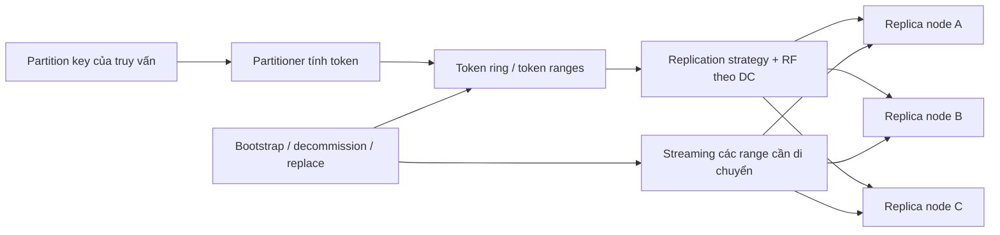
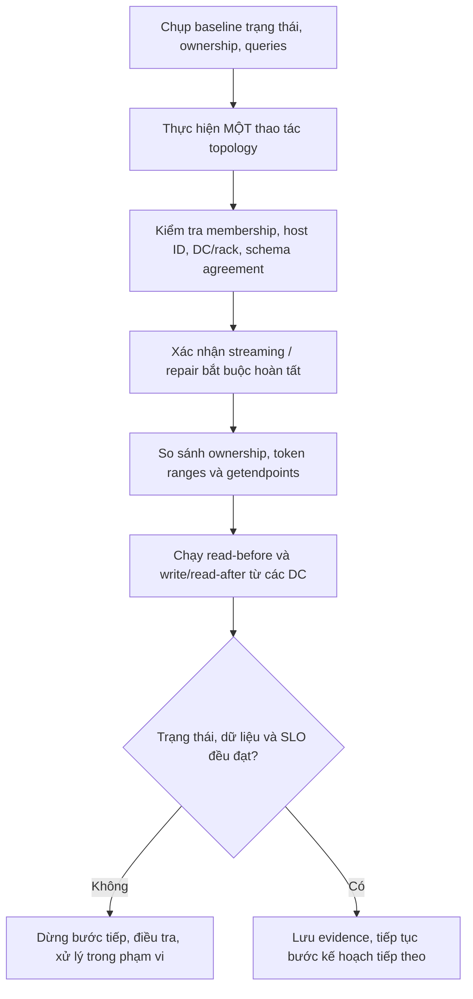

# Kiểm tra trạng thái, quyền sở hữu và truy vấn sau mỗi thao tác

> **Chương:** Thay đổi topology  
> **Học phần:** `DATABASE_ENGINE_WIDE_COLUMN_CASSANDRA` — Apache Cassandra

**Thay đổi topology** trong Apache Cassandra là thay đổi cách các node tham gia cụm, nhận token range và lưu bản sao dữ liệu: thêm node (bootstrap), rút node còn sống (decommission), loại node chết (removenode), thay node, chuyển token, thêm data center hoặc đổi replication factor. Vì Cassandra là cơ sở dữ liệu *wide-column phân tán*, topology ảnh hưởng trực tiếp tới **partition key → token → replica**, tới consistency level (CL) của truy vấn đọc/ghi và tới luồng dữ liệu streaming/repair.

Một thao tác có thể trả về exit code thành công nhưng ứng dụng vẫn lỗi: node mới có thể đã xuất hiện trong `nodetool status` nhưng còn đang streaming; các replica có thể chưa đủ dữ liệu sau khi tăng RF; driver Java có thể chưa kết nối được tới DC mới; hoặc một số truy vấn theo partition key vẫn timeout. Vì thế, sau **mỗi thao tác topology**, phải kiểm tra ba lớp:

1. **Trạng thái:** node nào Up/Down, Joining/Leaving/Moving/Normal, schema đã thống nhất, streaming có hoàn tất và node có khỏe không?
2. **Quyền sở hữu:** những node nào đang giữ các token range của keyspace, số replica đúng theo RF/DC chưa, một partition cụ thể sẽ được định tuyến tới đâu?
3. **Truy vấn:** các câu `SELECT`/`INSERT`/`UPDATE` đại diện có cho kết quả đúng theo mức nhất quán mong đợi từ những DC được phục vụ không?

Bài học xây dựng một quy trình kiểm tra có thể áp dụng lặp lại sau mọi thay đổi. Các lệnh minh họa theo cú pháp Apache Cassandra 4.1/5.0 thông dụng; **hãy chạy `nodetool help <lệnh>` trên đúng binary** khi triển khai, vì một số tùy chọn và hành vi khác nhau giữa các phiên bản hoặc sản phẩm managed.

## 1. Mô hình: token, replica và trạng thái node

Cassandra dùng **partitioner** ánh xạ partition key thành token. Các node nhận một hoặc nhiều token (thường là vnodes); chiến lược replication, ví dụ `NetworkTopologyStrategy`, lựa chọn replica trong từng data center. Một thay đổi membership có thể khiến node mới nhận một phần token range, các node cũ nhường bớt ownership và phải **stream** SSTable tới replica mới.



Trạng thái thường gặp trong `nodetool status`:

| Ký hiệu | Ý nghĩa | Kết luận vận hành |
| --- | --- | --- |
| `UN` | **Up / Normal** | Node sống và đang ở trạng thái Normal, **chưa đủ** để kết luận dữ liệu trên mọi replica đã đồng bộ. |
| `UJ` | **Up / Joining** | Node đang tham gia ring; thường còn bootstrap/streaming. |
| `UL` | **Up / Leaving** | Node còn sống nhưng đang rời ring qua quá trình thay ownership. |
| `UM` | **Up / Moving** | Node đang chuyển vị trí token trong trường hợp phiên bản/topology hỗ trợ. |
| `DN` | **Down / Normal** | Node được ring ghi nhận nhưng hiện không reachable từ góc nhìn node được hỏi. |
| `D*` | **Down / trạng thái tương ứng** | Kết hợp Down với trạng thái thành viên chưa hoàn tất; phải xem log/streaming. |

Gossip có thể khiến các node tạm thời **nhìn topology khác nhau**. Vì vậy, nếu đang điều tra hiện tượng bất thường, hãy lấy `nodetool status` từ **ít nhất hai node khỏe ở những rack/DC khác nhau**, không chỉ từ một node. Lệnh `describecluster` giúp kiểm tra tên cụm, partitioner, snitch và schema versions; nếu schema chưa agreement, các phép kiểm tra sau có thể chưa phản ánh một trạng thái ổn định.

### “Owns (effective)” không phải tỷ lệ ổ đĩa

`nodetool status <keyspace>` và `nodetool ring <keyspace>` cung cấp thông tin ownership có xét replication của **keyspace được chọn**. Cột `Owns (effective)` thể hiện phần token space mà node có thể giữ dưới vai trò một replica; nó **không** phải phần trăm byte dữ liệu đang lưu, cũng **không** phải lượng disk free.

Với RF=3, một phần token space được gán cho **ba replica**, nên tổng phần trăm effective ownership qua các node có thể **lớn hơn 100%**. Không đánh giá “mất dữ liệu” chỉ vì số Owns của một node giảm sau khi thêm node. Để hiểu tải vật lý, phải xem cột `Load`, kích thước SSTable, dung lượng đĩa, tốc độ đọc/ghi và sự lệch kích thước partition.

## 2. Chụp baseline trước khi thao tác

Không có baseline thì không thể phân biệt một lỗi đã tồn tại với lỗi do thay đổi topology gây ra. Trước mỗi bước, lưu những nhóm bằng chứng sau:

| Nhóm | Dữ liệu nên lưu | Mục đích |
| --- | --- | --- |
| Cluster & membership | Phiên bản từng node, `UN/DN/UJ/UL`, host ID, DC/rack, tokens | Đối chiếu node xuất hiện/biến mất, vị trí và phiên bản. |
| Schema & replication | Schema agreement, `NetworkTopologyStrategy` và RF của các keyspace liên quan | Biết topology logic kỳ vọng và tránh nhầm RF. |
| Ownership | `status <keyspace>`, `ring <keyspace>`, `describering <keyspace>` và một số endpoint mẫu | Xác nhận sự phân phối token/replica trước–sau. |
| Streaming & nền | `netstats`, `compactionstats`, pending tasks, disk free, network utilization | Biết còn tác vụ đang chạy và khả năng chịu streaming. |
| Truy vấn & nghiệp vụ | Key mẫu ở nhiều token range, dữ liệu mong đợi, read/write p95/p99, timeout, unavailable | Chứng minh client truy cập được dữ liệu sau chuyển đổi. |
| Phục hồi | Trạng thái backup, hints, lịch repair, `gc_grace_seconds` | Chuẩn bị xử lý replica bỏ lỡ dữ liệu hoặc mất nguồn. |

Các lệnh **đọc và quan sát** sau là điểm bắt đầu. Đăng nhập vào node có quyền vận hành/JMX; mẫu tên `telemetry` giả định keyspace này đã tồn tại:

```bash
# Lấy từ nhiều node khỏe, lưu output kèm thời điểm và danh tính node.
nodetool version
nodetool status
nodetool status telemetry
nodetool describecluster
nodetool ring telemetry
nodetool describering telemetry
nodetool netstats
nodetool compactionstats
nodetool tpstats
```

**Cách hiểu các lệnh:**

- `status`: danh sách node, DC, rack, host ID, trạng thái và load. Thêm tham số `telemetry` để đọc ownership theo replication của keyspace.
- `ring telemetry`: token ring và ownership theo keyspace; với nhiều vnodes có thể tạo output dài, chỉ trích những phần cần theo dõi.
- `describering telemetry`: xem các token range và endpoint thuộc keyspace; dùng để đối chiếu phạm vi chuyển sở hữu.
- `describecluster`: xem schema versions; không nên chỉnh sửa tiếp khi cụm chưa ổn định về schema.
- `netstats`: theo dõi các hoạt động streaming từ bootstrap, replace, decommission hoặc removenode. “Không còn active streams” **không tự chứng minh** dữ liệu đúng hay quá trình trước đó đã thành công.
- `compactionstats` và `tpstats`: xem cạnh tranh I/O và backlog có thể ảnh hưởng truy vấn sau thao tác.

Tham số, tên cột và thông tin hiển thị của `nodetool` có thể thay đổi theo phiên bản. Trên cụm managed, quyền sử dụng JMX hoặc những lệnh này có thể bị giới hạn; khi đó cần telemetry tương đương từ nhà cung cấp.

## 3. Kiểm tra replica của **một partition cụ thể**

Trung bình ownership thường che khuất các điểm nóng: cùng một nhóm node có thể gánh các partition nặng dù phần trăm token space tương đương. Để kiểm tra route thực tế của một key, dùng `nodetool getendpoints` với **keyspace, table và partition key**:

```bash
# Ví dụ bảng events_by_bucket có partition key đơn kiểu text.
nodetool getendpoints telemetry events_by_bucket sensor-07_2026-11-21
```

Lệnh này trả các node endpoint theo quy tắc replication của keyspace. Hãy chạy cùng key trước/sau thao tác và so sánh endpoint:

- Sau **bootstrap**, key nằm trong range chuyển sang node mới có thể đổi danh sách replica.
- Sau **decommission/removenode**, endpoint của node cũ phải biến mất khi metadata đã cập nhật hoàn tất.
- Sau **replace**, địa chỉ/host ID node nhận trách nhiệm được thay theo thủ tục replacement, còn token/range phải phù hợp kế hoạch.
- Sau đổi **RF**, số replica theo data center phải phản ánh giá trị RF mới nếu có đủ node hợp lệ, nhưng phải đối chiếu việc **dữ liệu cũ đã được stream/repair**.

**Lưu ý khóa phức hợp:** cú pháp `getendpoints <keyspace> <table> <key>` của phiên bản 5.0 biểu diễn **một đối số key**. Với partition key nhiều thành phần hoặc kiểu nhị phân/UDT, không tự nối chuỗi bằng dấu phẩy rồi tin endpoint là đúng: cách mã hóa partition key phụ thuộc driver và kiểu dữ liệu. Hãy kiểm tra hỗ trợ của đúng phiên bản công cụ hoặc dùng driver/token-aware tracing và mapping token theo schema.

**Không nên chỉ so sánh số replica.** Cần kiểm tra replica nằm ở **DC/rack dự kiến**, host ID chính xác và không có hai node cùng token/identity do nhân bản VM hoặc cấu hình sai. Cũng không được giả định `Owns (effective)` phải chia đều tuyệt đối: vnodes, phân bố dữ liệu thực tế và replication strategy đều ảnh hưởng.

## 4. Một mẫu dữ liệu kiểm chứng đọc và ghi

Những câu truy vấn để kiểm tra sau topology change phải **đúng partition key**, có dữ liệu mong đợi biết trước và có thể chạy lặp an toàn. Ví dụ bảng trong lab dành riêng cho probe; **không tạo bảng/keyspace này trên production nếu chưa được phép và chưa kiểm tra topology thực tế**.

Giả sử cụm lab có data center `dc1` gồm ba node với replication phù hợp:

```sql
CREATE KEYSPACE IF NOT EXISTS telemetry
WITH replication = {
    'class': 'NetworkTopologyStrategy',
    'dc1': 3
};

CREATE TABLE IF NOT EXISTS telemetry.events_by_bucket (
    bucket_id text,
    event_id uuid,
    payload text,
    created_at timestamp,
    PRIMARY KEY ((bucket_id), event_id)
);
```

Ở đây `bucket_id` là khóa phân vùng đơn có dạng ổn định `sensor-07_2026-11-21`. Nó gom sự kiện của một thiết bị/ngày để tránh một partition vô hạn; nếu một thiết bị có hàng triệu sự kiện/ngày, cần bucket nhỏ hơn hoặc thêm shard. Việc chọn primary key theo truy vấn là vấn đề data modeling độc lập với thao tác bootstrap/decommission.

**Trước thay đổi**, ghi vài bản ghi mẫu có khóa và payload cố định, rồi lưu kết quả đọc:

```sql
INSERT INTO telemetry.events_by_bucket
    (bucket_id, event_id, payload, created_at)
VALUES (
    'sensor-07_2026-11-21',
    11111111-1111-4111-8111-111111111111,
    'probe-before-change',
    '2026-11-21T09:00:00Z'
);

SELECT event_id, payload, created_at
FROM telemetry.events_by_bucket
WHERE bucket_id = 'sensor-07_2026-11-21'
  AND event_id = 11111111-1111-4111-8111-111111111111;
```

**Sau thay đổi**, có hai phép kiểm tra độc lập:

1. **Read-before:** truy vấn key đã có trước thay đổi, xác nhận `payload` và giá trị trả về. Việc chỉ ghi/đọc một key *mới* có thể bỏ qua dữ liệu lịch sử chưa được stream.
2. **Write-after + read-after:** dùng **event_id mới** và một payload cố định rồi đọc lại theo cùng partition key. Đảm bảo không phát sinh duplicate do retry thiếu idempotence.

```sql
-- Thao tác này chỉ trên bảng probe/lab đã được cho phép.
INSERT INTO telemetry.events_by_bucket
    (bucket_id, event_id, payload, created_at)
VALUES (
    'sensor-07_2026-11-21',
    22222222-2222-4222-8222-222222222222,
    'probe-after-change',
    '2026-11-21T09:15:00Z'
);

SELECT event_id, payload
FROM telemetry.events_by_bucket
WHERE bucket_id = 'sensor-07_2026-11-21'
  AND event_id IN (
    11111111-1111-4111-8111-111111111111,
    22222222-2222-4222-8222-222222222222
  );
```

Trong `cqlsh`, đặt mức nhất quán đúng với hệ thống cần xác minh:

```sql
-- Lệnh tương tác của cqlsh, không phải CQL DDL:
CONSISTENCY LOCAL_QUORUM;
```

Với RF=3 trong `dc1`, `LOCAL_QUORUM` yêu cầu đa số replica địa phương (2/3). Kiểm tra `LOCAL_QUORUM` thành công **không chứng minh mọi replica đều giữ cùng một giá trị**; coordinator có thể phục vụ kết quả hợp nhất từ phần replica đáp ứng CL. Cần giám sát streaming và **repair** để đối soát sai lệch replica còn lại.

Khi có nhiều DC, hãy chạy probe **từ đúng DC đích bằng session/driver cấu hình local data center tương ứng**, kiểm tra CL và định tuyến thực tế. Chỉ truy vấn thành công ở `dc1` không chứng minh `dc2` đã được nạp dữ liệu.

### Chọn key mẫu có ý nghĩa

Không chỉ kiểm tra một key dễ trúng cache. Chọn tập key đã biết từ:

- Những partition tồn tại **trước** thay đổi ở các token ranges bị chuyển.
- Partition vẫn ở nhóm replica cũ, làm nhóm đối chứng.
- Partition ghi trong **cửa sổ streaming hoặc node down**, vì có nguy cơ cần hints/repair.
- Partition có tombstone/TTL nếu workload thực tế phụ thuộc thao tác xóa.
- Partition có kích thước lớn, ghi nóng và các truy vấn paging/limit được dùng nhiều.

Tránh `SELECT * FROM <table>` không có partition key để “kiểm tra toàn bộ”: đó là truy vấn không phù hợp Cassandra ở quy mô lớn. Đối soát toàn cụm phải dùng kế hoạch repair, scan có phân vùng/bucket hoặc nguồn kiểm chứng đáng tin cậy, không dựa vào vài `SELECT` rời rạc.

## 5. Cổng kiểm tra sau **mỗi** thao tác topology

Dù loại thay đổi là gì, nên đặt một **checkpoint** trước khi bắt đầu bước tiếp theo:



Mẫu bảng kết quả của một checkpoint:

| Kiểm tra | Điều kiện đạt (PASS) | Dấu hiệu phải dừng |
| --- | --- | --- |
| Membership | Đúng node/host ID/DC/rack dự kiến; node hoàn tất ở `UN` hoặc đã rời ring | `UJ/UL/UM` kéo dài không giải thích được, `DN` không dự kiến, host ID trùng |
| Schema | Cùng schema version trên các node liên quan | Schema disagreement kéo dài sau thao tác |
| Streaming | Tác vụ dự kiến hoàn tất thành công, không còn lỗi stream | Failed stream, disk full, không có tiến độ |
| Ownership | Token ranges/endpoints phản ánh thay đổi đúng kế hoạch và RF | Key mẫu trỏ về node đã xóa hoặc không đủ replica |
| Read-before | Key cũ đọc đúng payload, ở các DC/CL yêu cầu | Missing hoặc sai giá trị, timeout |
| Write-after | Probe mới được xác nhận theo CL, đọc lại được | Write timeout/unavailable liên tục, read-after sai |
| SLO và node health | Latency/errors, I/O, heap, compaction trong ngưỡng đã chốt | Backpressure, disk/CPU/network bão hòa |
| Repair & backup | Các bước repair/cleanup được xác định và có lịch | Tăng RF chưa full repair, zombie risk, thiếu dữ liệu nguồn |

**Không gắn nhãn hoàn tất** nếu chỉ nhìn `nodetool status` có toàn `UN`. `UN` là điều kiện cần cho nhiều kịch bản, nhưng chưa đủ cho correctness và hiệu năng ứng dụng.

## 6. Sau bootstrap (thêm node)

**Mục tiêu:** node mới nhận token ranges và dữ liệu cần sở hữu, trong khi các node khác giảm phạm vi ownership tương ứng. Cassandra bootstrap chọn nguồn từ replica hiện tại và stream dữ liệu theo range.

**Các điểm cần kiểm tra theo thứ tự:**

1. Khi node mới gia nhập, trạng thái có thể là `UJ`; quan sát `nodetool netstats` trên node mới và nguồn để nhận biết streaming. Nếu node kẹt ở Joining, đọc log, kiểm tra source replica, network và disk trước khi can thiệp.
2. Khi hoàn tất, node mới phải thành `UN` trên nhiều góc nhìn, host ID mới đúng, DC/rack đúng và schema agreement đạt.
3. `nodetool status telemetry`, `ring telemetry` cho thấy ownership phân phối lại; `getendpoints` cho key mẫu có thể xuất hiện node mới.
4. Kiểm tra **key cũ** thuộc các range node mới nhận và một key mới ghi sau khi bootstrap. Chạy từ client/driver thực và xem p95/p99.
5. Sau khi đã chắc chắn node mới phục vụ tốt, lên lịch `nodetool cleanup` trên những node **không còn sở hữu một số range**, nhằm giải phóng dữ liệu dư. Cleanup tốn disk I/O; không chạy trước khi đã chứng thực node mới có dữ liệu.

Theo tài liệu Cassandra, **bootstrap chưa hoàn tất thì không nên mở bước topology tiếp theo**; bật cờ “bỏ qua consistent rangemovement” hoặc tự xóa dữ liệu bootstrap dở dang là hành động có rủi ro và phải tuân thủ runbook theo phiên bản. Nếu bootstrap thất bại, `nodetool bootstrap resume` có điều kiện riêng; kiểm tra lịch sử và hướng dẫn phiên bản thay vì reset tiến độ mù quáng.

| Kết quả | Khi nên PASS |
| --- | --- |
| Node mới | `UJ → UN` hoàn tất, schema agree, không còn failed streams |
| Ownership | Những range chuyển sang node mới đã phản ánh trong ring/endpoint |
| Truy vấn | Key trước thay đổi đọc được, key mới ghi và đọc được, errors không tăng |
| Dọn dẹp | Cleanup chỉ sau khi đã xác minh node mới và đủ dung lượng cho tác vụ |

## 7. Sau decommission (rút node còn sống)

Dùng `nodetool decommission` trên **node còn sống** mà bạn định rút khỏi cụm. Nó stream dữ liệu cần chuyển sang các replica khác theo topology mới; trong quá trình rút, node có thể ở trạng thái `UL`.

Sau thao tác:

- Node được rút **không còn trong ring**, không còn là endpoint của các key mẫu sau khi metadata ổn định.
- Những node nhận trách nhiệm mới đã hoàn tất streaming và không bị quá tải.
- RF trong từng DC vẫn có **đủ số node thực tế**; nếu giảm số node thấp hơn RF, không thể giả định mức CL như trước vẫn phục vụ tốt.
- Truy vấn các key do node cũ từng sở hữu vẫn chạy thành công. Nếu còn app contact points hoặc seed/config tham chiếu node đã rút, cập nhật theo kế hoạch.
- Data disk của node đã decommission **không tự động trống**. Không coi dữ liệu trên node ấy là nguồn sẵn sàng phục vụ sau decommission.

```bash
# Trên node khác vẫn nằm trong cụm, sau khi decommission hoàn tất:
nodetool status telemetry
nodetool ring telemetry
nodetool netstats
```

**Đặc biệt quan trọng:** chỉ được đánh dấu PASS sau khi xác nhận **nút đã rời ring và dữ liệu cần thiết đã tới các replica còn lại**. Nếu operator dừng Cassandra trên node dự định decommission trước khi quá trình hoàn tất, tình huống có thể chuyển thành loại node chết và cần runbook khác.

## 8. Sau removenode (loại node chết)

`nodetool removenode <host-id>` dùng khi node đã chết, **không thể decommission trực tiếp**. Data được stream từ những replica còn sống, thay vì từ node bị loại. Vì có thể thiếu nguồn dữ liệu, việc xác minh phải thận trọng hơn decommission.

Các bước kiểm tra:

1. Ghi lại **host ID** đúng của node chết từ baseline; xác nhận đó là node cần loại, không nhầm IP/node mới.
2. Thực hiện removal theo runbook và theo dõi `nodetool removenode status` cùng `netstats` từ node khỏe. Không tự gọi `removenode force` chỉ vì tiến độ chậm; bỏ qua các bước còn thiếu có thể để lại dữ liệu chưa được phân phối.
3. Sau khi remove hoàn tất, host ID cũ biến mất khỏi ring/endpoint list; replica mới đáp ứng kế hoạch RF ở từng DC.
4. Kiểm tra những key đã ghi **khi node chết** và key có dữ liệu cũ trên range từng thuộc node đó, theo các CL/DC tương ứng.
5. Đánh giá repair có phạm vi và backup/restore nếu từng có replica thiếu dữ liệu, nhất là sau downtime dài hoặc quá cửa sổ hinted handoff.

```bash
# Quan sát trên node khỏe trong lúc removal:
nodetool removenode status
nodetool netstats
nodetool status telemetry
```

**Lưu ý:** nếu dữ liệu chỉ còn trên node đã mất và không có replica/backup chứa bản sao hợp lệ, removenode hay repair **không tạo lại được dữ liệu**. Không dùng `assassinate` như shortcut vì nó là phương án cuối cùng có thể bỏ qua việc tái phân phối dữ liệu; cần quy trình khôi phục riêng.

## 9. Sau replace (thay node chết)

Replacement khác việc “thêm một node mới”: node thay thế phải nhận **đúng vai trò token/range của node cũ** theo cơ chế replacement của phiên bản. Cassandra có tham số khởi động chuyên biệt, chẳng hạn `cassandra.replace_address_first_boot` trong tài liệu topology 5.0, nhưng cách đặt IP, token và host identity phải tuân thủ runbook bản đang chạy.

Điểm kiểm tra:

- Trước: node cũ được xác nhận Down; backup/replica còn khả dụng; không cố khởi động đồng thời node cũ và node thay thế với cùng quyền sở hữu.
- Trong: `nodetool netstats` ở node thay thế **quan trọng hơn chỉ nhìn `status`**, vì topology có thể hiển thị trạng thái tạm thời khác nhau ở các góc nhìn.
- Sau: node thay thế thành `UN` và không còn phiên streaming lỗi; token/range **khớp vai trò dự kiến**, host ID/IP được quản lý theo thủ tục thay thế; ring không có node ma.
- Truy vấn: key trước sự cố, key ghi trong downtime và key vừa ghi sau thay thế đều được kiểm tra.
- Repair: nếu thời gian từ khi node cũ chết đến khi thay thế hoàn tất **vượt cửa sổ hints**, hoặc dùng lại IP cũ và replacement kéo dài hơn cửa sổ này, tài liệu Cassandra yêu cầu **repair** vì có thể đã bỏ lỡ các write trong/ trước giai đoạn streaming. Không dùng việc nhìn thấy `UN` để bỏ qua bước đó.

Lưu ý cleanup/compaction phải thực hiện khi đã hiểu vai trò range và tình trạng dữ liệu. Không xóa SSTable/commit log thủ công để “sửa” host ID hay tái sử dụng thư mục node.

## 10. Sau move token, thay replication và mở rộng data center

### 10.1. Move token

`nodetool move` chỉ khả dụng với cấu hình/phiên bản phù hợp, điển hình khi `num_tokens: 1`. Trong quá trình move node có thể ở `UM`. Sau cùng:

- `UM → UN`, streaming hoàn tất, ring và endpoint của key mẫu phản ánh token mới.
- Không còn range trùng hoặc token sai. Theo dõi load trước/sau và hot partition.
- Chạy `nodetool cleanup` **sau khi đã xác minh dữ liệu ở owner mới**, trên node còn giữ dữ liệu không thuộc ownership của mình.

Với cụm dùng nhiều vnodes, đừng áp dụng lệnh move theo ví dụ một token. Thường cần cách khác như thêm/rút node có điều phối.

### 10.2. Tăng replication factor

Ví dụ keyspace `telemetry` của DC `dc1` đang có RF=2 và muốn lên RF=3 khi đủ ba node khỏe:

```sql
-- Ví dụ DDL có tác động schema; chỉ chạy sau khi được phê duyệt.
ALTER KEYSPACE telemetry
WITH replication = {
    'class': 'NetworkTopologyStrategy',
    'dc1': 3
};
```

Sau `ALTER KEYSPACE`, **schema có thể hiển thị RF=3 nhưng bản sao dữ liệu đã tồn tại chưa được phân phối đầy đủ** tới replica mới. Vì vậy cần:

1. Kiểm tra schema agreement và `nodetool status telemetry`, `ring telemetry`, `getendpoints` ở các key mẫu.
2. Thực hiện **full repair** đúng phạm vi, có điều phối theo node/DC để đưa dữ liệu cũ tới replica mới; không chỉ incremental repair vốn có thể bỏ qua dữ liệu đã được đánh dấu repaired.
3. Theo dõi streaming/repair completion, disk headroom và client latency.
4. Chạy read-before và write/read-after theo mức nhất quán mục tiêu sau khi dữ liệu mới đã được phân phối.

```bash
# MINH HỌA tác vụ tốn tài nguyên, chỉ trong kế hoạch repair:
nodetool repair --full -pr telemetry
```

Chạy `-pr` trên **một** node chỉ bao phủ primary ranges của node đó. Một kế hoạch full repair toàn cụm phải điều phối **đủ những node/DC liên quan**, tránh trùng hoặc đẩy toàn bộ I/O vào một thời điểm.

### 10.3. Giảm replication factor

Sau khi thay RF giảm, các node có thể còn dữ liệu dư. Cần xác nhận schema và endpoint phù hợp RF mới; khi chắc chắn không còn cần những bản sao đó, chạy `nodetool cleanup` theo kế hoạch từng node để thu hồi SSTable không còn thuộc ownership. Trước cleanup, luôn xác minh backup và đúng định nghĩa RF, bởi giảm RF cũng làm giảm dư địa chịu lỗi.

### 10.4. Thêm data center

Thêm node vào `dc2` không tự động làm RF trong `dc2` có dữ liệu nếu keyspace chỉ cấu hình `dc1`. Sau khi có topology phù hợp:

- Xác nhận từng node hiện diện ở **DC/rack đúng**, không chỉ `UN`.
- Cập nhật `NetworkTopologyStrategy`/RF theo kế hoạch và **stream/rebuild/full repair** dữ liệu cho replica mới ở DC mới theo runbook phiên bản; không suy rằng tạo node là đã có dữ liệu.
- `status telemetry` và `getendpoints` phải cho thấy replica ở **mỗi DC được khai báo RF**.
- Chạy probe bằng **session được định tuyến đến cả dc1 và dc2**, đặt đúng local data center; `LOCAL_QUORUM` ở dc1 không chứng minh dữ liệu dc2 đã sẵn.
- Xác minh network liên DC, TTL/tombstone/repair schedule và năng lực đọc/ghi trước khi chuyển traffic.

## 11. Java Driver: kiểm tra đúng tuyến đường và CL

Java Driver 4.x nhận biết topology và lựa chọn coordinator theo load balancing policy; ứng dụng cần khai báo **local data center** đúng ở nơi chạy. Sau thay đổi topology, một service có thể vẫn kết nối được nhưng truy vấn chậm hoặc lỗi do seed/contact point cũ, mạng tới node mới, DC mapping sai hoặc thiếu bản sao dữ liệu.

Ví dụ chỉ đọc một probe có ID cố định:

```java
import java.util.Objects;
import java.util.UUID;
import com.datastax.oss.driver.api.core.CqlSession;
import com.datastax.oss.driver.api.core.DefaultConsistencyLevel;
import com.datastax.oss.driver.api.core.cql.PreparedStatement;
import com.datastax.oss.driver.api.core.cql.Row;

public final class TopologyReadProbe {
    private final CqlSession session;
    private final PreparedStatement statement;

    public TopologyReadProbe(CqlSession session) {
        this.session = session;
        this.statement = session.prepare(
            "SELECT payload FROM telemetry.events_by_bucket " +
            "WHERE bucket_id = ? AND event_id = ?");
    }

    public void verify(String bucketId, UUID eventId, String expectedPayload) {
        Row row = session.execute(
            statement.bind(bucketId, eventId)
                .setConsistencyLevel(DefaultConsistencyLevel.LOCAL_QUORUM)
                .setIdempotent(true)
        ).one();

        if (row == null || !Objects.equals(expectedPayload, row.getString("payload"))) {
            throw new IllegalStateException(
                "Topology readback mismatch for event " + eventId);
        }
    }
}
```

Ví dụ giả định `CqlSession` đã được tạo bằng thông tin xác thực phù hợp, đặt local DC đúng và keyspace `telemetry` có RF đủ cho `LOCAL_QUORUM`. Không tự ghi mật khẩu vào source code.

Khi sử dụng probe trong hệ thống thực:

1. Chạy từ từng **DC mà ứng dụng sử dụng**, qua chính cấu hình session của ứng dụng.
2. Ghi read latency, exception (timeout/unavailable), coordinator/host metadata khi driver cung cấp, và request ID; đừng in dữ liệu nhạy cảm.
3. So sánh với baseline cho cả **key cũ và key mới**. Chọn key từ các range bị chuyển để tránh “test PASS do trùng node không đổi”.
4. Đối chiếu phạm vi routing với `nodetool getendpoints` hoặc token metadata; nếu local DC mới không có đủ replica, `LOCAL_QUORUM` có thể thất bại.
5. Nếu write timeout, **không kết luận ghi chưa thành công**. Với counter, increment/decrement hoặc side effect khác, retry có thể áp dụng hai lần. Repair/streaming topology không giải quyết idempotency của nghiệp vụ.

Một lần `SELECT` thành công **không chứng minh** repair/streaming toàn bộ dữ liệu hoàn tất. Probe giúp phát hiện lỗi nghiêm trọng trên đường truy vấn thực; coverage toàn cụm còn cần dữ liệu telemetry và công cụ repair/streaming.

## 12. Khi checkpoint không đạt: tìm nguyên nhân theo lớp

| Triệu chứng | Nguyên nhân cần xem trước | Hướng xử lý tiếp |
| --- | --- | --- |
| Node kẹt `UJ`, streaming dừng | Source replica down, network lỗi, disk đầy, bootstrap state cũ | Đọc `netstats` và log; xử lý nguồn; theo hướng dẫn resume/bootstrap của bản chạy. |
| Node mới `UN` nhưng `SELECT` key cũ thất bại | Chưa stream đủ range, metadata lệch, quorum/timeout, dữ liệu vốn thiếu từ trước | So sánh endpoint, schema, logs, snapshot baseline; repair đúng phạm vi khi đủ nguồn. |
| `status` từ các node khác nhau không giống | Gossip chưa hội tụ, mạng phân tách, node down | Chưa chạy thay đổi tiếp; kiểm tra gossip/network và trạng thái từng node. |
| Ownership % sau thêm node không chia đều | Vnodes/token allocation, RF, dữ liệu phân bố lệch | So sánh ring theo keyspace, load và hot partition; không vội kết luận lỗi. |
| `getendpoints` vẫn chứa node đã rút | Decommission/removenode chưa hoàn tất hoặc metadata chưa đồng bộ | Theo dõi removal status/streaming, kiểm tra host ID, chưa dọn dữ liệu. |
| `LOCAL_QUORUM` lỗi ở DC mới | DC mới chưa có đủ replica/data hoặc driver local DC sai | Kiểm tra replication, streaming/repair, DC/rack và config driver. |
| Truy vấn được nhưng p99 tăng | Streaming/repair/compaction tranh chấp IO/network, hot partition | Giảm tốc độ công việc nền có kiểm soát, theo dõi SLO và lưu lượng. |
| Sau tăng RF, dữ liệu cũ thiếu trên replica mới | Chỉ đổi metadata, chưa full repair để phân phối data | Điều phối full repair và xác minh coverage trước chuyển traffic. |
| Sau cleanup, thiếu dữ liệu | Cleanup chạy trước khi ownership/streaming bảo đảm | Dừng thay đổi, kiểm tra nguồn còn lại/backup; cần quy trình phục hồi. |

Không dùng `nodetool removenode force`, `assassinate`, `reset_bootstrap_progress` hoặc xóa SSTable/commit log như biện pháp khắc phục mặc định. Những thao tác này có thể làm tình hình khó khôi phục hơn nếu chưa xác định chính xác trạng thái range và bản sao dữ liệu.

## 13. Checklist ngắn cho người vận hành

Có thể gắn bảng này vào ticket của **mỗi bước topology**, ghi người xác minh và bằng chứng:

| Check | Trước thao tác | Sau thao tác |
| --- | --- | --- |
| Host ID, IP, DC/rack | Lưu mapping và version node | Khớp kỳ vọng, không trùng host/token |
| Cluster status | Ghi các `UN/DN` bất thường | Không còn `UJ/UL/UM` ngoài kế hoạch |
| Schema agreement | Có baseline | Đã agreement ở node liên quan |
| Ring/ownership | Ghi token ranges của keyspace | Thay đổi đúng hướng và đúng RF/DC |
| Streaming/repair | Không có backlog nguy hiểm | Task bắt buộc thành công; không còn lỗi |
| Query key cũ | Lưu ID và payload mong đợi | Đọc được theo CL và DC yêu cầu |
| Query key mới | Chưa cần có | Ghi/readback thành công với ID ổn định |
| Client SLO | Ghi p95/p99/error rate | Trong ngưỡng, không tăng timeout kéo dài |
| Disk/compaction | Có headroom | Không đầy đĩa hoặc backlog bất thường |
| Cleanup và backup | Đã xác định các bước bảo vệ | Chỉ cleanup khi ownership đã an toàn |
| Go/No-go | Có người chịu trách nhiệm | Dừng nếu checkpoint fail |

**Nguyên tắc:** *một thay đổi → một checkpoint → chứng nhận PASS → mới bước tiếp*. Điều này làm lỗi dễ quy về nguyên nhân hơn và giảm nguy cơ nhiều luồng streaming/repair cùng quá tải cụm.

## 14. Bài tập tình huống và câu hỏi tự kiểm tra

**Bài 1.** Cụm RF=3 vừa thêm node thứ tư. `nodetool status` cho thấy bốn node `UN`, nhưng key cũ từng nằm trên range được chuyển sang node mới đọc không ra. Có thể tuyên bố bootstrap xong không? Cần kiểm tra những gì trước?

**Bài 2.** `nodetool status telemetry` báo `Owns (effective)` của các node cộng lại gần 300%. Có nghĩa dữ liệu bị nhân bản lỗi hay chiếm 300% dung lượng đĩa không? Giải thích.

**Bài 3.** Một node chết được `removenode`. Output còn cho thấy ID cũ trong kết quả `getendpoints` ở một node khác. Lệnh trên node chủ điều phối báo hoàn tất. Đội vận hành nên làm gì?

**Bài 4.** Sau khi tăng RF từ 2 lên 3, `status telemetry` hiện ba replica mỗi range và các write mới đọc được. Dữ liệu của tuần trước có chắc đã hiện diện trên replica thứ ba không? Tác vụ gì cần đánh giá?

**Bài 5.** Một node vừa bị replace và đã thành `UN`. Node cũ down lâu hơn `max_hint_window`. Có được bỏ repair vì thử `LOCAL_QUORUM` đọc vài key đều thành công không?

**Bài 6.** Cụm thêm `dc2`, app Java trong `dc1` đọc được `LOCAL_QUORUM`. Khi chuyển traffic tới `dc2`, một số request timeout. Hãy liệt kê những kiểm tra theo thứ tự.

**Bài 7.** Sau bootstrap, đội vận hành định chạy `nodetool cleanup` ngay trên toàn cụm trước khi có kết quả streaming và readback. Tại sao không an toàn?

<details>
<summary>Gợi ý đáp án</summary>

1. Chưa đủ. Cần xem logs/`netstats`, schema, endpoints/range, nguồn dữ liệu và kết quả các probe cũ/mới; điều tra streaming hoặc repair trước khi hoàn tất checkpoint.
2. Không. Effective ownership tính cả **các bản sao theo RF**, không phải tỷ lệ byte thực tế hay disk usage.
3. Dừng thao tác tiếp; kiểm tra gossip/schema từ nhiều node, `removenode status`, ring và host ID; chỉ tiếp tục khi metadata hội tụ và endpoint cũ biến mất đúng kế hoạch.
4. Không chắc. Thay RF chỉ đổi kế hoạch replica. Cần full repair đúng phạm vi để phân phối dữ liệu cũ và xác minh streaming/các key trước thay đổi.
5. Không. Downtime vượt hint window có thể khiến mutation bị lỡ; cần repair theo yêu cầu runbook Cassandra và kiểm tra coverage thay vì chỉ dựa vài `SELECT`.
6. Xác minh DC/rack, RF `dc2`, schema, ownership/endpoints, streaming/rebuild/repair ở DC mới, local DC và load balancing của driver, network latency và probe trực tiếp từ `dc2`.
7. Cleanup có thể xóa dữ liệu trên node cũ trước khi node mới đã nhận/đối soát đủ. Phải xác minh bootstrap, ownership và readback trước; cleanup còn tạo I/O nên cần lịch và headroom.

</details>

## Ghi nhớ

- Sau **mỗi** topology operation, kiểm tra ba lớp: **status + ownership + truy vấn**, rồi mới thực hiện thay đổi tiếp theo.
- `UN` chỉ nói node Up/Normal; **không** chứng minh streaming, repair và dữ liệu trên mọi replica đã đúng.
- Dùng `status <keyspace>`, `ring <keyspace>`, `describering <keyspace>` và `getendpoints` để đối chiếu **token/range/replica** theo keyspace, không suy từ phần trăm ownership ra byte dữ liệu.
- Query probes phải gồm **key đã tồn tại trước thay đổi** và **key được ghi sau thay đổi**; chạy theo CL, DC và partition key thực tế của ứng dụng Java.
- Sau bootstrap/decommission/removenode/replace phải xác minh streaming; sau **tăng RF cần full repair**, sau giảm RF hoặc nhường range có thể cần cleanup **khi đã bảo đảm dữ liệu an toàn**.
- Repair, hints và backup xử lý các yêu cầu phục hồi khác nhau; không dùng một vài truy vấn thành công thay cho đối soát đầy đủ.

### Tài liệu tham khảo chính thức

- [Apache Cassandra — Adding, replacing, moving and removing nodes](https://cassandra.apache.org/doc/stable/cassandra/managing/operating/topo_changes.html)
- [Apache Cassandra — Use Nodetool để kiểm tra cluster status](https://cassandra.apache.org/doc/stable/cassandra/troubleshooting/use_nodetool.html)
- [Apache Cassandra — nodetool status](https://cassandra.apache.org/doc/stable/cassandra/managing/tools/nodetool/status.html)
- [Apache Cassandra — nodetool ring](https://cassandra.apache.org/doc/stable/cassandra/managing/tools/nodetool/ring.html)
- [Apache Cassandra — nodetool describering](https://cassandra.apache.org/doc/stable/cassandra/managing/tools/nodetool/describering.html)
- [Apache Cassandra — nodetool getendpoints](https://cassandra.apache.org/doc/stable/cassandra/managing/tools/nodetool/getendpoints.html)
- [Apache Cassandra — nodetool removenode](https://cassandra.apache.org/doc/stable/cassandra/managing/tools/nodetool/removenode.html)
- [Apache Cassandra — Repair và thay đổi RF](https://cassandra.apache.org/doc/stable/cassandra/managing/operating/repair.html)

