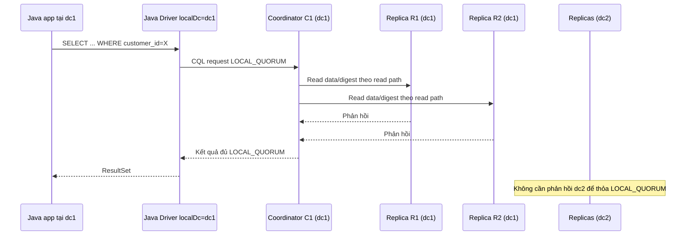

# Local datacenter ở driver và đường đi của yêu cầu

> **Chương:** Nhiều trung tâm dữ liệu  
> **Phạm vi:** Apache Cassandra, cơ sở dữ liệu phân tán kiểu *wide-column*, cùng ứng dụng sử dụng Java Driver 4.x. Bài giải thích cách cấu hình **local datacenter** để định tuyến request tới coordinator thích hợp, sau đó phân biệt tuyến **client → coordinator** với tuyến **coordinator → replica** trong cụm nhiều datacenter.
>
> **Kết quả học tập:** Giải thích vì sao đặt local DC không có nghĩa dữ liệu chỉ được ghi trong DC đó; lựa chọn consistency level đúng phạm vi; kiểm tra driver routing bằng mã Java, CQL và metrics; xây quy trình failover DC có kiểm soát.

## 1. Bài toán: vì sao có hai datacenter mà truy vấn vẫn đi qua WAN?

Giả sử doanh nghiệp triển khai Cassandra ở hai trung tâm dữ liệu:

- `dc1`: ba node phục vụ ứng dụng gần khu vực A.
- `dc2`: ba node phục vụ ứng dụng gần khu vực B.
- Keyspace `orders` dùng `NetworkTopologyStrategy` với **RF=3 ở mỗi DC**.

Một service Java chạy sát `dc1`. Nếu driver kết nối tới coordinator ở `dc2` cho mọi truy vấn, kết nối client–coordinator phải vượt WAN. Điều này có thể làm tăng độ trễ, tạo phụ thuộc mạng liên DC và khiến thời gian phản hồi không ổn định.

Cassandra Java Driver dùng **local datacenter** để xác định datacenter mà ứng dụng muốn ưu tiên kết nối tới coordinator. Với chính sách load balancing mặc định của driver, ứng dụng nên đặt local DC khớp datacenter nơi instance chạy hoặc nơi nó được thiết kế phục vụ.

Tuy nhiên, đây mới là **nửa đầu đường đi**:

```text
Ứng dụng Java ở khu vực A
        |
        | 1. Driver chọn COORDINATOR thuộc dc1
        v
     dc1/C1 (coordinator)
        |
        | 2. Cassandra xác định REPLICA theo token + RF
        |
        +----> dc1/R1, R2, R3 (replica của partition)
        |
        +----> dc2/R4, R5, R6 (replica của partition)
                       (khi request/cơ chế cần thiết)
```

**Quy tắc quan trọng:** `local datacenter` là **thuộc tính định tuyến của driver**, không phải lệnh “chỉ lưu dữ liệu ở DC này”. Việc phân phối dữ liệu tới replica do **partition key, replication strategy, RF và consistency level** quyết định.

## 2. Ba vai trò không được nhầm lẫn

| Khái niệm | Vai trò | Ai quyết định? |
| --- | --- | --- |
| **Local datacenter của driver** | DC mà driver ưu tiên chọn node **coordinator** cho lời gọi từ ứng dụng | Cấu hình Java Driver/load-balancing policy |
| **Coordinator** | Node nhận CQL từ driver, xác định replica, thu thập phản hồi và trả kết quả | Driver chọn node nhận request; Cassandra tại node ấy điều phối |
| **Replica** | Node giữ bản sao dữ liệu của một partition theo token placement | Replication strategy, RF, token range và topology |

Một node có thể làm coordinator cho một query dù bản thân nó **không phải replica của partition đang đọc**. Khi driver biết routing key và token, chính sách *token-aware* thường ưu tiên một replica **phù hợp trong local DC** làm coordinator; nếu không thể, nó vẫn có thể chọn một node local khác để điều phối.

Điều này phân biệt hai loại khoảng cách mạng:

1. **Client → coordinator:** ảnh hưởng bởi local DC, load balancing, contact points và trạng thái kết nối.
2. **Coordinator → replicas:** ảnh hưởng bởi replication topology, partition key, CL và cách Cassandra triển khai đường đọc/ghi.

Tối ưu loại 1 không tự bảo đảm loại 2 hoàn toàn không vượt WAN.

## 3. Mô hình ví dụ với RF theo từng datacenter

Tạo keyspace lab giả định `shop_md`, với ba replica ở mỗi DC:

```cql
CREATE KEYSPACE IF NOT EXISTS shop_md
WITH replication = {
    'class': 'NetworkTopologyStrategy',
    'dc1': 3,
    'dc2': 3
};
```

Sau đó tạo bảng theo mẫu truy vấn lịch sử đơn hàng:

```cql
CREATE TABLE IF NOT EXISTS shop_md.orders_by_customer (
    customer_id uuid,
    created_at timestamp,
    order_id uuid,
    status text,
    total decimal,
    PRIMARY KEY ((customer_id), created_at, order_id)
) WITH CLUSTERING ORDER BY (created_at DESC, order_id ASC);
```

Truy vấn có partition key rõ ràng:

```cql
SELECT order_id, created_at, status, total
FROM shop_md.orders_by_customer
WHERE customer_id = aaaaaaaa-aaaa-4aaa-8aaa-aaaaaaaaaaaa
LIMIT 20;
```

Với **một partition cụ thể**, Cassandra chọn tập replica dựa vào token của `customer_id`. Giả sử tập đó có ba node ở `dc1` và ba node ở `dc2`. **Không được suy ra mọi node trong datacenter đều là replica** nếu DC có nhiều hơn ba node; chỉ những node được placement chọn cho partition mới là replica.

### Điều gì xảy ra khi ứng dụng ở dc1 gửi SELECT?

Đường đi cơ bản:

1. Driver khám phá topology và ưu tiên coordinator ở `dc1`.
2. Driver gửi CQL tới coordinator đã chọn.
3. Coordinator tính các replica của `customer_id`.
4. Coordinator gửi các yêu cầu đọc phù hợp để đáp ứng CL; với `LOCAL_QUORUM` ở cấu hình RF=3 của dc1, cần **hai phản hồi hợp lệ từ dc1**.
5. Coordinator hòa giải kết quả, kiểm tra tính hợp lệ/nhất quán theo đường đọc và trả phản hồi.
6. Driver giao kết quả cho Java application.

Nếu coordinator local cũng là replica phù hợp, đường mạng nội DC có thể ngắn hơn. Dù vậy, không hứa một số hop cố định: cách chọn coordinator, speculative read, digest, read repair và trạng thái replica đều có thể ảnh hưởng đường đi thực tế.

## 4. Cấu hình local DC trong Java Driver 4.x

### Cách 1 — Khai báo trực tiếp khi tạo session

Ví dụ sử dụng địa chỉ **192.0.2.10** thuộc dải dành cho tài liệu, không phải địa chỉ node thật:

```java
import java.net.InetSocketAddress;
import com.datastax.oss.driver.api.core.CqlSession;

public final class CassandraSessionFactory {
    public static CqlSession connectToDc1() {
        return CqlSession.builder()
            .addContactPoint(new InetSocketAddress("192.0.2.10", 9042))
            .withLocalDatacenter("dc1")
            .withKeyspace("shop_md")
            .build();
    }
}
```

Trên hệ thống thật, thay contact point bằng địa chỉ có thể kết nối tới cluster và dùng đúng cơ chế authentication/TLS. Trong Java Driver 4.x, việc đặt `withLocalDatacenter("dc1")` giúp chính sách định tuyến biết DC cục bộ mong muốn.

**Contact point không đồng nghĩa local DC.** Contact point là địa chỉ dùng để kết nối và khám phá cluster khi khởi tạo session. Sau khi metadata topology được khám phá, driver có thể biết nhiều host khác. Danh sách contact point nên ưu tiên các node phù hợp với local DC và topology thực tế; không dùng một địa chỉ bên `dc2` rồi mặc nhiên tin rằng mọi request sẽ luôn được xử lý đúng ý ở `dc1`.

### Cách 2 — Cấu hình trong `application.conf`

Một dạng cấu hình Java Driver 4.x:

```hocon
datastax-java-driver {
  basic.load-balancing-policy.local-datacenter = "dc1"
  basic.request.consistency = LOCAL_QUORUM
}
```

Cách ghi thuộc tính và các policy mở rộng phải được kiểm tra theo phiên bản driver đang sử dụng. Đừng đặt cấu hình `dc1` đồng thời với `withLocalDatacenter("dc2")` mà không chủ động xác định precedence. Mỗi môi trường triển khai nên có **một local DC rõ ràng** từ cấu hình đã kiểm thử.

### Tên DC phải trùng topology của Cassandra

Driver không tạo datacenter và không tự đổi tên DC trên server. Tên `dc1`/`dc2` là metadata từ snitch và cấu hình node.

Có thể kiểm tra:

```bash
nodetool status
nodetool describecluster
```

Tìm đúng tên datacenter/rack, trạng thái node và xác nhận contact points nằm trong cluster mong muốn. Nếu Java dùng tên DC không tồn tại, chính sách định tuyến có thể không chọn được host phù hợp hoặc báo lỗi cấu hình/kết nối.

**Không tùy tiện đổi tên DC trên node để “sửa” driver.** Thay tên DC ảnh hưởng placement, RF và topology, là một thay đổi cluster lớn cần runbook riêng.

## 5. Consistency level quyết định những replica phải trả lời

Giả định một keyspace có RF=3 ở `dc1` và RF=3 ở `dc2`, tức **tổng sáu replica** cho mỗi partition.

| Consistency level | Điều kiện phản hồi tối thiểu | Cần mạng liên DC để hoàn tất? |
| --- | --- | --- |
| `LOCAL_ONE` | Một replica trong DC cục bộ của coordinator | Không cần phản hồi từ DC xa |
| `LOCAL_QUORUM` | Hai trong ba replica của DC cục bộ | Không cần phản hồi từ DC xa |
| `ONE` | Một replica hợp lệ trong toàn bộ tập replica | Có thể hoàn tất bằng replica local; không có ràng buộc local như `LOCAL_ONE` |
| `QUORUM` | Bốn trong tổng sáu replica | Thường cần phản hồi ở cả hai DC nếu mỗi DC chỉ có ba replica |
| `ALL` | Cả sáu replica | Phải chờ tất cả, gồm replica ở DC xa |
| `EACH_QUORUM` | Quorum trong **mỗi DC** (hai ở dc1 **và** hai ở dc2) | Có; dùng cho **ghi**, không phải consistency đọc thông thường |

**Chi tiết quan trọng:** `LOCAL_QUORUM` được tính theo **datacenter của coordinator**, không phải theo một biến độc lập ở client tên `localDc`. Khi driver route tới coordinator của `dc1`, `LOCAL_QUORUM` yêu cầu hai replica dc1. Nếu một lần thực thi bị chuyển sang coordinator `dc2` trong một quy trình failover được cấu hình hợp lệ, cùng tên CL sẽ yêu cầu hai replica dc2.

Cũng không được áp công thức `QUORUM = 4` cho mọi topology. Công thức ấy chỉ đúng với ví dụ RF tổng bằng sáu: quorum toàn cục là `floor(6/2)+1 = 4`. Với `LOCAL_QUORUM` tại DC RF=3, kết quả là `floor(3/2)+1 = 2`.

### Phạm vi LWT/serial consistency

Với lệnh CQL dạng `IF`, Cassandra còn có bước đồng thuận Paxos và mức **serial consistency** (ví dụ `SERIAL`, `LOCAL_SERIAL`). Đây là lớp riêng với mức nhất quán phản hồi đọc/ghi thông thường. Không chọn `LOCAL_SERIAL` chỉ để thay thế `LOCAL_QUORUM` cho `SELECT` không có điều kiện.

Khi nghiệp vụ yêu cầu bất biến trạng thái nghiêm ngặt xuyên DC, cần đánh giá **phạm vi đồng thuận LWT** cùng RF, CL, latency WAN và cơ chế failover; không suy luận rằng `LOCAL_QUORUM` biến hai DC thành một giao dịch toàn cục.

## 6. Đường đọc: coordinator local có nhất thiết chỉ đọc replica local?

Giả sử client Java ở `dc1` truy vấn `customer_id = X` với `LOCAL_QUORUM`:



Đây là minh họa đường đi thông thường, không phải trace chính xác từng thông điệp nội bộ. Khi bản sao có sai lệch, coordinator có thể cần các bước xử lý bổ sung theo phiên bản và policy. Khi speculative retry xảy ra, một replica đọc dự phòng có thể được liên lạc.

`LOCAL_QUORUM` giúp tránh **phụ thuộc phản hồi** từ DC xa cho việc hoàn tất đọc, nhưng **không phải bộ lọc mạng tuyệt đối** cho mọi hoạt động bảo trì, sửa chữa, tracing hay các cơ chế khác trên cluster.

### Nếu client chọn QUORUM toàn cục?

Với RF 3+3, `QUORUM` cần bốn phản hồi nên không thể hoàn tất chỉ từ ba replica ở dc1. Coordinator phải có phản hồi hợp lệ từ replica của DC khác. Đây là khác biệt lớn về độ trễ và khả năng sẵn sàng khi WAN gián đoạn.

### Vai trò của cache và mô hình wide-column

Định tuyến local DC tốt không sửa được truy vấn không khớp partition key:

- Query theo đầy đủ partition key có thể hướng tới token/replica mục tiêu.
- Query lọc rộng hoặc dùng `ALLOW FILTERING` có thể tiêu tốn nhiều đọc, kể cả khi mọi node đều local.
- Cache, SSTable, compaction và tombstone ở replica quyết định phần lớn tail latency đường đọc.

Nếu API cần “20 đơn mới nhất của khách hàng X”, hãy dùng bảng với partition/clustering key hợp lý rồi tối ưu routing; không đảo ngược thứ tự bằng cách hy vọng local DC hoặc cache sẽ chữa một schema không phù hợp.

## 7. Đường ghi: local coordinator vẫn có thể gửi tới cả hai DC

Với `INSERT` hoặc `UPDATE` vào keyspace RF=3+3:

1. Driver từ `dc1` gửi mutation tới coordinator local.
2. Coordinator xác định sáu replica tự nhiên theo placement.
3. Cassandra phân phối mutation tới các replica ở cả hai DC theo đường ghi và trạng thái kết nối; những replica không nhận được có thể liên quan đến cơ chế hint trong điều kiện hỗ trợ.
4. Coordinator đợi đủ số phản hồi **theo CL của request** trước khi trả ACK.
5. Những replica chưa xác nhận vẫn có thể đang nhận/xử lý mutation; về sau cần repair để xử lý sai khác dài hạn.

```text
Client ở dc1
    |
    v
Coordinator C1 ở dc1
    |
    +----> dc1: R1 ---- ACK
    |      dc1: R2 ---- ACK      LOCAL_QUORUM đủ 2 ACK dc1
    |      dc1: R3 ---- ...      -> client có thể nhận SUCCESS
    |
    +----> dc2: R4 ---- ...      mutation vẫn được phân phối/đồng bộ
           dc2: R5 ---- ...      nhưng ACK dc2 không bắt buộc cho
           dc2: R6 ---- ...      LOCAL_QUORUM tại dc1
```

**“Ghi thành công tại local quorum” không đồng nghĩa “DC kia đã cập nhật xong”.** Khi có độ trễ WAN hoặc lỗi replica, client tại `dc2` có thể đọc trạng thái cũ trong một khoảng thời gian, ngay cả khi chính client đó dùng `LOCAL_QUORUM`.

### Tại sao LOCAL_QUORUM ở hai DC không tạo bảo đảm read-after-write xuyên DC?

Giả sử một ghi tại `dc1` hoàn tất với `LOCAL_QUORUM` sau khi R1 và R2 xác nhận. Một đọc ngay lập tức ở `dc2` dùng `LOCAL_QUORUM` có thể nhận phản hồi từ R4 và R5 **trước khi các replica này nhận mutation**.

Với RF=3 mỗi DC:

```text
Write quorum trong dc1 = {R1, R2}
Read quorum trong dc2  = {R4, R5}
Giao của hai tập        = rỗng
```

Quy tắc giao quorum cần xét **cùng tập replica**. Hai local quorum nằm ở hai DC khác nhau không có giao bắt buộc, nên không cho lời hứa tức thời về tính mới xuyên DC.

Khi API yêu cầu đọc ngay giá trị vừa ghi từ vùng khác, cần thiết kế mức nhất quán, định tuyến vùng, latency và có thể cơ chế đồng bộ ứng dụng phù hợp. Việc chỉ đặt `withLocalDatacenter` không tự giải quyết yêu cầu đó.

## 8. Token-aware routing và prepared statement từ Java

Java Driver có khả năng **token-aware** khi biết partition key. Điều đó giúp ưu tiên coordinator gần partition cần đọc, trong local DC được phép.

Ví dụ Java Driver 4.x với query có đầy đủ partition key `customer_id`:

```java
import java.math.BigDecimal;
import java.net.InetSocketAddress;
import java.time.Instant;
import java.util.UUID;

import com.datastax.oss.driver.api.core.CqlSession;
import com.datastax.oss.driver.api.core.DefaultConsistencyLevel;
import com.datastax.oss.driver.api.core.cql.BoundStatement;
import com.datastax.oss.driver.api.core.cql.PreparedStatement;
import com.datastax.oss.driver.api.core.cql.ResultSet;
import com.datastax.oss.driver.api.core.cql.Row;
import com.datastax.oss.driver.api.core.metadata.Node;

public final class MultiDcDemo {
    public static void main(String[] args) {
        // 192.0.2.10 chỉ là địa chỉ tài liệu; thay bằng contact point thật.
        try (CqlSession session = CqlSession.builder()
                .addContactPoint(new InetSocketAddress("192.0.2.10", 9042))
                .withLocalDatacenter("dc1")
                .withKeyspace("shop_md")
                .build()) {

            PreparedStatement query = session.prepare(
                "SELECT order_id, created_at, status, total " +
                "FROM orders_by_customer WHERE customer_id = ? LIMIT ?"
            );

            UUID customerId =
                UUID.fromString("aaaaaaaa-aaaa-4aaa-8aaa-aaaaaaaaaaaa");

            BoundStatement statement = query.bind(customerId, 20)
                .setConsistencyLevel(DefaultConsistencyLevel.LOCAL_QUORUM)
                .setIdempotent(true)
                .setPageSize(20);

            ResultSet result = session.execute(statement);

            Node coordinator = result.getExecutionInfo().getCoordinator();
            System.out.println("Coordinator DC: " +
                (coordinator == null
                    ? "không có metadata"
                    : coordinator.getDatacenter()));

            for (Row row : result) {
                UUID orderId = row.getUuid("order_id");
                Instant createdAt = row.getInstant("created_at");
                String status = row.getString("status");
                BigDecimal total = row.getBigDecimal("total");
                System.out.printf("%s %s %s %s%n",
                    orderId, createdAt, status, total);
            }
        }
    }
}
```

Trong ví dụ:

- `withLocalDatacenter("dc1")` định hướng lựa chọn coordinator.
- `LOCAL_QUORUM` quy định điều kiện ACK **ở DC coordinator**.
- Prepared statement giúp driver có thông tin schema và routing key cho truy vấn có `customer_id`, tạo cơ hội chọn replica local.
- `getExecutionInfo().getCoordinator()` giúp xác minh **coordinator của execution**; metadata này không chứng minh mọi replica tham gia đều ở cùng DC.
- `setIdempotent(true)` là khai báo an toàn thực thi lại cho `SELECT`; không tự bật speculative execution. Driver còn phụ thuộc policy/cấu hình.

Code giả định keyspace đã tồn tại, địa chỉ contact point có thể truy cập, auth/TLS và topology được cấu hình đúng. Không triển khai trực tiếp địa chỉ `192.0.2.10` vào môi trường thật.

### Khi driver không biết routing key

Nếu statement thiếu partition key, dùng một số truy vấn index hoặc cần routing metadata mà driver không có, policy có thể chọn **một coordinator local bất kỳ**. Node ấy sẽ tính replica và chuyển request tới đúng nơi. Vẫn giữ mục tiêu định tuyến local DC, nhưng không còn bảo đảm coordinator được ưu tiên vì sở hữu token của partition.

Vì vậy hãy giám sát cả **routing policy** lẫn **query shape**; không chỉ bật một cờ token-aware rồi xem như mọi SELECT đã tối ưu.

## 9. Local DC có tự chuyển khi cả datacenter bị lỗi không?

**Không nên giả định có.** Với local DC được cấu hình rõ và chính sách mặc định của Java Driver 4.x, ứng dụng thường ưu tiên host trong DC cục bộ; các node ở DC xa không phải nguồn failover tự động cho mọi request.

Tình huống toàn bộ `dc1` mất kết nối:

```text
App A localDc=dc1
        |
        +--> Không còn coordinator dc1 phù hợp
                 |
                 +--> Request lỗi/hết node sẵn sàng
                 |
                 +--> KHÔNG mặc định tự đổi localDc sang dc2
```

Việc đưa ứng dụng từ dc1 sang dc2 là **quyết định failover của hệ thống**, không chỉ là tính năng retry một request:

1. Xác nhận `dc2` còn đủ replica và **đã có dữ liệu cần thiết**.
2. Bảo đảm endpoint mạng, authentication, DNS/service discovery và quyền truy cập.
3. Khởi tạo hoặc chuyển sang session/client profile với **local DC = dc2** theo thiết kế failover.
4. Đánh giá CL, RF của dc2, trạng thái LWT, độ trễ đồng bộ và dữ liệu có thể chưa nhận mutation từ dc1.
5. Giám sát read/write errors, duplicate retries, p95/p99 và đồng bộ trở lại khi dc1 phục hồi.

Có thể triển khai service **active-active** với mỗi bản triển khai ứng dụng có session local DC riêng; vẫn phải quản lý xung đột ghi vào cùng khóa và chính sách nhất quán xuyên DC. Không lấy việc Cassandra nhân bản được dữ liệu để mặc định nghiệp vụ đã có cơ chế xử lý cạnh tranh.

### Rủi ro retry trong failover

Nếu một ghi bị timeout tại dc1 rồi ứng dụng tự gửi lại sang dc2, **không biết chắc** ghi đầu tiên đã được replica nào nhận. Với thao tác không idempotent (counter, mutation phụ thuộc thời gian, side effect ngoài Cassandra hoặc thay trạng thái có điều kiện), retry có thể gây kết quả ngoài ý muốn.

Nên sử dụng khóa nghiệp vụ ổn định, idempotency key, cơ chế đối soát hoặc LWT khi có yêu cầu bất biến rõ ràng. Với dữ liệu có TTL, timestamp và expiry, retry thay thời điểm ghi có thể thay đổi cả thời điểm hết hạn.

## 10. Đặt local DC trong hệ thống nhiều vùng

Một cách bố trí đơn giản:

| Thành phần | Vị trí chạy | Local DC trong driver | Đường đọc thông thường |
| --- | --- | --- | --- |
| Service A | Khu vực A | `dc1` | Coordinator dc1 → replica dc1 cho `LOCAL_QUORUM` |
| Service B | Khu vực B | `dc2` | Coordinator dc2 → replica dc2 cho `LOCAL_QUORUM` |
| Công cụ quản trị | Máy/bastion được chỉ định | DC theo mục đích kiểm tra | Không suy ra đường đọc production từ một session admin |
| Failover của Service A sang B | Sau quyết định chuyển vùng | `dc2` sau khi chuyển cấu hình/session | Phải kiểm chứng dữ liệu, routing và khả năng đáp ứng |

Tính đúng đắn của phương án còn phụ thuộc RF, locality thực tế, độ trễ WAN, mô hình bảng và yêu cầu người dùng. “Đặt DC gần client” là hướng tối ưu chi phí mạng nhưng **không phải lời hứa tất cả yêu cầu chỉ dùng tài nguyên của một DC**.

## 11. Thực hành kiểm chứng đường đi của yêu cầu

### Bước A — Xác nhận schema và topology

Trong lab:

```cql
DESCRIBE KEYSPACE shop_md;
DESCRIBE TABLE shop_md.orders_by_customer;
```

Tại node cho phép quan sát:

```bash
nodetool status
nodetool describecluster
```

Đảm bảo tên DC/rack được Cassandra nhận diện đúng, số node và RF có thể đáp ứng mục tiêu. `LOCAL_QUORUM` RF=3 yêu cầu hai replica local có khả năng phản hồi; nếu dc2 chỉ có một replica khả dụng, không thể giả định ứng dụng vẫn phục vụ bằng `LOCAL_QUORUM` ở dc2.

### Bước B — Ghi và đọc theo partition key

```cql
CONSISTENCY LOCAL_QUORUM;

INSERT INTO shop_md.orders_by_customer
    (customer_id, created_at, order_id, status, total)
VALUES (
    aaaaaaaa-aaaa-4aaa-8aaa-aaaaaaaaaaaa,
    '2026-11-21T09:00:00Z',
    11111111-1111-4111-8111-111111111111,
    'PAID',
    250.00
);

SELECT order_id, created_at, status, total
FROM shop_md.orders_by_customer
WHERE customer_id = aaaaaaaa-aaaa-4aaa-8aaa-aaaaaaaaaaaa
LIMIT 20;
```

Trong `cqlsh`, `CONSISTENCY LOCAL_QUORUM` đặt CL cho session cqlsh; nó **không thay đổi** cấu hình consistency mặc định của Java Driver hay replication keyspace. DC cục bộ của phiên cqlsh phụ thuộc coordinator mà cqlsh kết nối tới. Để thử từng DC, cần kết nối đến node thuộc đúng DC, không chỉ thay giá trị CL.

### Bước C — Quan sát coordinator từ hai ứng dụng

Chạy cùng prepared SELECT từ một service được cấu hình `dc1` và một service được cấu hình `dc2`. Ghi:

- DC của coordinator qua `ExecutionInfo`.
- CL của statement.
- Độ trễ p50/p95/p99 và timeout.
- Kết quả từng partition kiểm tra, đặc biệt mutation vừa ghi.
- Trạng thái replica, đường truyền WAN và các metrics read/write/streaming.

Kết quả mong đợi trong trạng thái khỏe: service ở dc1 thường nhận coordinator thuộc dc1; service ở dc2 thường nhận coordinator thuộc dc2. Nhưng **không** so sánh hai kết quả đọc ngay sau ghi local rồi kết luận lỗi hệ thống nếu cross-DC replication chưa hoàn tất.

### Bước D — Quan sát CQL tracing trong lab

```cql
TRACING ON;

SELECT order_id, created_at, status, total
FROM shop_md.orders_by_customer
WHERE customer_id = aaaaaaaa-aaaa-4aaa-8aaa-aaaaaaaaaaaa
LIMIT 20;

TRACING OFF;
```

Tracing có thể giúp nhìn thấy coordinator và trao đổi với replica; nội dung sự kiện cụ thể thay đổi theo phiên bản và kiểu read. Chỉ bật có kiểm soát vì tracing tạo overhead. Đừng gây lỗi mạng/kill node production để minh họa topology.

### Bước E — Thử hành vi lỗi an toàn

Ở cluster lab, mô phỏng một replica cục bộ chậm hoặc không phản hồi rồi kiểm tra `LOCAL_QUORUM` có còn đạt điều kiện hai replica local không. Tách riêng kiểm thử **mất cả DC** bằng kế hoạch failover của ứng dụng. Không giả định driver tự tìm DC khác, và không thay topology production chỉ để quan sát.

## 12. Những chỉ số giúp xác định local DC có đang hoạt động đúng?

| Tầng | Chỉ số / bằng chứng | Nó trả lời điều gì? |
| --- | --- | --- |
| Driver | Số request theo coordinator host/DC, latency, timeouts, pool/connections | Driver có đang thực thi chủ yếu ở DC dự kiến? |
| Statement | CL thực tế, routing key, idempotent/speculative policy | Query có đủ thông tin để token-aware và retry an toàn? |
| Cassandra | Read/write latency, pending tasks, dropped messages theo node | Replica nào đang chậm và coordinator đang chịu tải ra sao? |
| Network | Throughput và latency liên DC, packet loss, connection errors | Có WAN dependency hoặc replication backlog bất thường? |
| Topology | RF từng DC, token ownership, node status | DC có đủ replica cho CL đã chọn? |
| Replica health | Repair history, hints, tombstone/compaction, disk | Dữ liệu và đường đọc tại từng DC có đáng tin cậy? |
| Ứng dụng | p95/p99 API theo region, error rate, độ mới dữ liệu cần bảo đảm | Người dùng có thực sự hưởng lợi từ routing local? |

Đừng chỉ đo ping tới contact point. Ping hoặc CQL connect thành công không chứng minh coordinator selection, replica placement hay consistency level của truy vấn đang đúng.

## 13. Sự cố điển hình và hướng chẩn đoán

### 13.1. Driver cấu hình local DC sai tên

**Dấu hiệu:** không có host phù hợp, lỗi khởi tạo session hoặc request không tìm được node.

**Kiểm tra:** DC name do `nodetool status` báo, cấu hình snitch, `withLocalDatacenter`/HOCON và contact points. Sửa **tên ở client** khi lỗi do client; không tự sửa placement trên cluster.

### 13.2. Application ở dc1 nhưng coordinator thấy ở dc2

**Dấu hiệu:** `ExecutionInfo.getCoordinator().getDatacenter()` cho ra `dc2` khi service được thiết kế phục vụ tại dc1.

**Kiểm tra:** load balancing policy có bị custom không, local DC có đúng là dc1 không, contact points và cấu hình theo profile, có session khác đang được dùng không. Xem cả log và metrics để tránh kết luận từ một request được gửi qua cơ chế khác.

### 13.3. `LOCAL_QUORUM` đọc tại dc2 thấy dữ liệu cũ ngay sau ghi dc1

**Dấu hiệu:** write local tại dc1 thành công, read local tại dc2 chưa thấy mutation.

**Giải thích:** hai local quorum thuộc hai tập replica khác nhau; không có giao quorum bắt buộc. Kiểm tra trạng thái replication, network/hints/repair và yêu cầu độ mới xuyên DC của nghiệp vụ.

**Hướng thiết kế:** nếu cần bảo đảm mạnh ngay sau ghi xuyên DC, điều chỉnh CL hoặc luồng nhất quán dựa trên RF và latency thực tế; không chỉ tăng số contact points.

### 13.4. Đặt `QUORUM` khiến latency tăng dù driver đã local

**Dấu hiệu:** p99 tăng cùng độ trễ WAN hoặc lỗi DC khác.

**Giải thích:** với RF 3+3, QUORUM cần bốn replica; local dc1 chỉ có ba nên phải chờ ít nhất một phản hồi từ dc2.

**Hướng xử lý:** chọn CL theo yêu cầu dữ liệu và tính sẵn sàng, không đổi sang `LOCAL_QUORUM` nếu nghiệp vụ cần giao quorum toàn cụm mà chưa đánh giá hệ quả.

### 13.5. Cả dc1 mất nhưng service không chuyển sang dc2

**Dấu hiệu:** driver báo không có coordinator local, dù dc2 vẫn hoạt động.

**Giải thích:** local DC không phải chế độ tự động chuyển datacenter. Cần chính sách failover ứng dụng/traffic, session tại dc2 và kiểm tra dữ liệu/CL phù hợp.

### 13.6. Một truy vấn dùng coordinator đúng DC nhưng vẫn chậm

**Dấu hiệu:** coordinator local, p99 rất cao, tombstone/compaction hoặc partition nóng.

**Giải thích:** local DC chỉ tối ưu một phần mạng; query và storage path có thể là nút thắt. Xem lại partition key, clustering range, SSTable, cache và read amplification thay vì đổi DC.

## 14. Những hiểu lầm cần tránh

**“Đặt `withLocalDatacenter("dc1")` khiến chỉ dc1 có dữ liệu.”** Sai. Bản sao được đặt theo `NetworkTopologyStrategy`, RF và token.

**“Contact point thuộc dc1 nghĩa là local DC luôn là dc1.”** Sai. Contact point giúp khám phá cluster; nên khai báo local DC rõ và kiểm tra policy, đặc biệt trong nhiều DC.

**“Coordinator luôn là replica đang giữ partition.”** Không phải luôn luôn. Token-aware có thể ưu tiên replica phù hợp, nhưng node local khác vẫn có thể làm coordinator.

**“`LOCAL_QUORUM` nghĩa là hai phản hồi của toàn cluster.”** Sai. Nó là quorum **trong DC của coordinator**, và số lượng phụ thuộc RF DC đó.

**“Ghi `LOCAL_QUORUM` thành công thì dc2 có dữ liệu mới ngay.”** Không bảo đảm. Replica dc2 có thể chưa nhận/áp dụng mutation khi client nhận ACK từ dc1.

**“Hai local quorum ở hai DC luôn giao nhau.”** Sai. Chúng có thể hoàn toàn không có replica chung.

**“`QUORUM` luôn nhanh như `LOCAL_QUORUM` nếu driver đặt local DC.”** Sai. QUORUM được tính trên tập replica toàn cụm và có thể chờ WAN.

**“Driver tự failover sang dc2 khi dc1 mất.”** Không phải mặc định. Chuyển DC cần thiết kế availability và consistency rõ ràng.

**“Token-aware routing sửa được câu query sai partition key.”** Sai. Nó cần routing information; mô hình bảng theo truy vấn vẫn là nền tảng hiệu năng Cassandra.

**“Đổi local DC là đổi toàn bộ mức nhất quán dữ liệu.”** Sai. Đổi coordinator có thể thay phạm vi `LOCAL_*`, nhưng replication, LWT và cross-DC semantics vẫn cần thiết kế phù hợp.

## 15. Bài tập tự kiểm tra

1. Với RF=3 ở dc1 và RF=3 ở dc2, xác định số phản hồi tối thiểu của `LOCAL_QUORUM`, `QUORUM` và `EACH_QUORUM` cho một mutation ghi.
2. Vì sao chọn local DC của Java Driver khác với chọn replication strategy trong CQL?
3. Trong trường hợp nào coordinator được driver chọn ở dc1 nhưng không phải replica của partition đang đọc?
4. Tại sao một ghi `LOCAL_QUORUM` ở dc1 không bảo đảm đọc `LOCAL_QUORUM` ở dc2 thấy ngay giá trị mới?
5. Khi driver biết partition key, token-aware mang lại lợi ích gì ngoài việc dùng local DC?
6. Nếu người vận hành đổi contact point từ dc1 sang dc2 nhưng giữ `withLocalDatacenter("dc1")`, có thể phát sinh điều gì và nên xác minh bằng công cụ nào?
7. Tại sao `LOCAL_QUORUM` có thể tiếp tục phục vụ khi WAN hỏng, trong khi `QUORUM` với RF=3+3 có thể thất bại?
8. Một lần ghi bị timeout ở dc1 rồi service failover sang dc2. Vì sao không được tự động retry counter hoặc mutation không idempotent?
9. Làm sao dùng `ExecutionInfo`, metrics driver và CQL tracing để phân biệt coordinator selection với replica contacts?
10. Nếu API local vẫn chậm dù coordinator đúng DC, bạn sẽ kiểm tra những gì về partition key, SSTable, cache, tombstone và compaction?

## 16. Quy tắc vận hành

```text
Ứng dụng tại dc1
     |
     v
Driver localDc=dc1
     |
     +--> chọn coordinator thuộc dc1 (ưu tiên replica local khi có token)
             |
             v
      Cassandra tính replica theo partition key + RF từng DC
             |
             +--> READ LOCAL_QUORUM: cần đủ ACK replica dc1
             |
             +--> WRITE LOCAL_QUORUM: phân phối mutation theo replication
             |                       nhưng chỉ chờ quorum ACK dc1
             |
             +--> QUORUM/ALL/EACH_QUORUM khi áp dụng:
                  có thể cần ACK từ dc2 và phụ thuộc WAN

Mất toàn dc1?
     |
     +--> Không mặc định đổi localDc trong session.
          Cần runbook failover ứng dụng + kiểm chứng dữ liệu dc2.
```

**Ghi nhớ:** **Local datacenter điều khiển nơi driver chọn coordinator; replication và consistency level điều khiển nơi dữ liệu nằm và những replica nào phải phản hồi.** Với Cassandra nhiều DC, tối ưu độ trễ đọc/ghi đòi hỏi phối hợp **partition key đúng, driver local DC đúng, RF theo DC, CL phù hợp, repair và failover được kiểm thử**. Không coi một cờ cấu hình ở Java là bảo đảm mọi request, replica và dữ liệu luôn nằm trong một datacenter.
