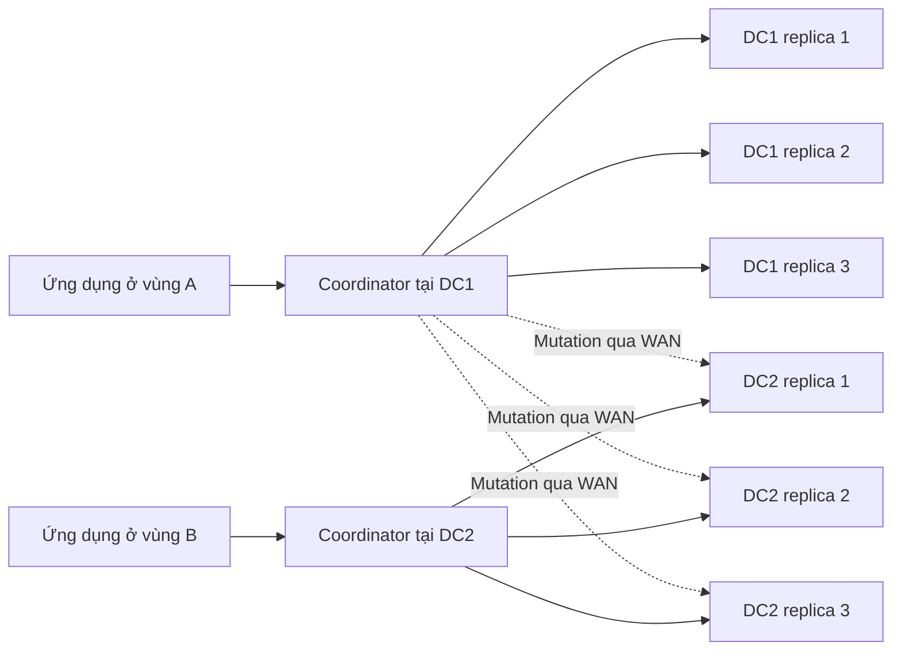
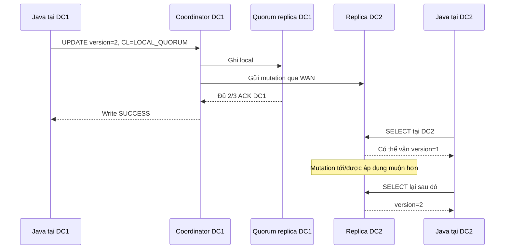

# Độ trễ sao chép xuyên vùng và yêu cầu đọc dữ liệu mới trong Apache Cassandra

## 1. Vấn đề: vừa ghi ở vùng A, đọc ở vùng B đã thấy dữ liệu mới chưa?

Một ứng dụng thương mại điện tử chạy tại hai trung tâm dữ liệu (**data center**, DC) đặt ở hai vùng địa lý. Người dùng cập nhật trạng thái đơn hàng từ ứng dụng Java tại DC1 rồi ngay lập tức chuyển sang một máy chủ ứng dụng ở DC2. Truy vấn ở DC2 có thể trả về trạng thái cũ, dù thao tác ghi trước đó đã được báo **thành công**.

Đây không nhất thiết là lỗi mạng hay Cassandra mất dữ liệu. Có thể lần ghi đã đạt **consistency level (CL)** yêu cầu trong DC1, còn việc chuyển mutation sang các replica ở DC2 vẫn đang diễn ra hoặc gặp sự cố. Cassandra cho phép chọn mức nhất quán **theo từng request**; một dấu xác nhận thành công ở CL thấp hơn yêu cầu của nghiệp vụ không phải cam kết tất cả DC đã thấy bản ghi.

Bài thuộc chương **Nhiều trung tâm dữ liệu** của mô-đun `DATABASE_ENGINE_WIDE_COLUMN_CASSANDRA`. Nội dung kết hợp kiến trúc phân tán và wide-column, partition key, thiết kế bảng theo truy vấn, đọc/ghi với mức nhất quán, replication, repair, xử lý lỗi và kết nối **Java Driver**. Trọng tâm là ba câu hỏi thực tế:

1. **Khi nào** một ghi ở DC1 được coi là thành công và **khi nào** replica tại DC2 thực sự có dữ liệu?
2. Khi yêu cầu **đọc dữ liệu mới nhất** hoặc **read-your-writes** xuyên vùng, cần chọn CL, tuyến đọc hoặc giao thức ứng dụng thế nào?
3. Làm sao **đo và kiểm chứng độ trễ hiển thị xuyên DC** thay vì chỉ quan sát network ping hoặc p99 ghi?

### Kết quả mong đợi

Sau bài này, bạn có thể giải thích đường ghi và đọc trong nhiều DC; chứng minh bằng giao nhau của quorum khi nào một giá trị vừa ghi phải nhìn thấy; phân biệt **write acknowledgment**, **remote visibility** và **end-to-end latency**; lập thí nghiệm theo dõi time-to-visibility; thiết kế đường truy cập Java và runbook khi một DC chậm, mất liên lạc hoặc chưa đồng bộ dữ liệu lịch sử.

## 2. Kiến trúc: một cluster, nhiều DC, không có primary cố định

Cassandra theo mô hình **multi-primary**: không có một node primary duy nhất cho mọi bản ghi. Một client gửi CQL đến một **coordinator**; coordinator xác định những replica cần lưu dữ liệu theo partition key/token và replication strategy của keyspace. Với `NetworkTopologyStrategy`, số replica được đặt **riêng theo từng DC**.

Ví dụ minh họa:

```sql
CREATE KEYSPACE IF NOT EXISTS commerce_geo
WITH replication = {
    'class': 'NetworkTopologyStrategy',
    'dc1': 3,
    'dc2': 3
};
```

Đây là cấu hình **3 replica mỗi DC**, tổng cộng có **6 replica đích** cho một partition trong ví dụ, giả định đủ node full replica và topology hợp lệ. Trong production, tên `dc1`/`dc2` phải khớp snitch; lựa chọn rack và failure domain cũng quan trọng. Cấu hình RF **không bảo đảm** node mới thêm vào DC tự có toàn bộ dữ liệu cũ: mở DC phải có kế hoạch streaming/rebuild/repair và xác minh.



**Điều dễ nhầm:** Cassandra thông thường **gửi mutation đến tất cả replica đích**, không phải chỉ những replica đủ CL. Tuy nhiên, **CL quyết định số và vị trí phản hồi ACK mà coordinator phải chờ trước khi trả thành công**. Nếu client ghi `LOCAL_QUORUM` tại DC1, coordinator không bắt buộc đợi quorum ở DC2. Có trường hợp DC2 đã cập nhật trước khi client nhận ACK; cũng có trường hợp DC2 còn chậm hoặc không nhận được. **Không có độ trễ sao chép xuyên vùng cố định được suy ra từ CL.**

## 3. Phân biệt ba loại thời gian

Khi nói “replication latency” cần định nghĩa mốc đo, nếu không sẽ so sánh nhầm.

| Thuật ngữ | Từ đâu đến đâu? | Có được bảo đảm bằng một write thành công ở DC1? |
| --- | --- | --- |
| **Client write latency** | Java gửi INSERT/UPDATE → nhận ACK/thất bại theo CL chọn | Chỉ đo ngưỡng chờ của **request đó** |
| **Remote apply/visibility delay** | Mutation được ghi/xử lý tại nguồn → đủ replica ở DC2 có thể trả phiên bản mới theo kiểu đọc đã chọn | **Không** nếu ghi chỉ chờ `LOCAL_QUORUM` DC1 |
| **End-to-end read-after-write latency** | Người dùng ấn lưu → một lần đọc sau đó tại DC2 trả đúng giá trị cần thấy | Phụ thuộc CL ghi, CL đọc, routing, network, thời điểm đọc và cạnh tranh cập nhật |

Độ trễ *remote visibility* và *latency đọc ở DC2* khác nhau. Ví dụ dữ liệu đã có ở hai replica DC2 nhưng máy chủ Java phải đợi queue/network hoặc bị retry thì client vẫn thấy đọc chậm. Ngược lại, một `LOCAL_ONE` đọc trúng một replica cập nhật sớm có thể thấy giá trị mới **trước khi các replica DC2 hội tụ**.

### 3.1. Timeline ghi LOCAL_QUORUM tại DC1

Giả sử RF = 3 trong mỗi DC; client ghi `version=2` tại DC1 với `LOCAL_QUORUM`:



Sơ đồ cố tình chọn tình huống remote apply chậm để minh họa, **không phải mọi lần ghi đều có thứ tự này**. Remote ACK có thể về sớm, và đọc `LOCAL_QUORUM` thực tế liên hệ các replica theo đường đọc do coordinator quyết định; một mũi tên đọc một replica trong sơ đồ chỉ là hình tượng hóa.

**Điểm mấu chốt:** thời điểm client nhận `SUCCESS` là mốc hoàn tất của **CL đã yêu cầu**, không phải mốc “tất cả DC đã đồng bộ”.

## 4. Consistency level trong nhiều DC: điều coordinator đợi

Giả sử `NetworkTopologyStrategy` với `dc1=3` và `dc2=3`, chỉ dùng **full replicas** để bài toán dễ tính. Trường hợp transient replication cần công thức/tài liệu riêng.

| CL | Số ACK/phản hồi cần đợi trong ví dụ | Đặc tính chính |
| --- | --- | --- |
| `LOCAL_ONE` | Một replica trong DC cục bộ | Thấp latency, không giao nhau chắc chắn với local quorum ghi |
| `LOCAL_QUORUM` | Hai trong ba replica **của DC cục bộ** | Phù hợp đường đọc/ghi theo DC; không chờ quorum DC khác |
| `QUORUM` | Bốn trong sáu replica **toàn bộ các DC** | Có thể kéo cả phản hồi WAN vào đường hoàn tất tùy replica nào phản hồi |
| `EACH_QUORUM` | Với **ghi**, cần hai ACK từ **mỗi DC**: 2/3 DC1 và 2/3 DC2 | Chờ các DC, tăng độ trễ/phụ thuộc WAN và availability |
| `ALL` | Cần tất cả sáu replica | Đòi hỏi availability cao nhất từ replica, dễ thất bại khi một replica chậm/lỗi |
| `ONE` | Một replica trong tập tất cả (không bắt buộc DC cục bộ) | Cần hiểu routing; không tương đương `LOCAL_ONE` |

Giá trị `EACH_QUORUM` được thiết kế chủ yếu cho **ghi đa DC**; đừng dự định dùng `SELECT` với EACH_QUORUM như một cách đọc “tất cả DC”. Khi đọc dữ liệu mới, hãy xây dựng cặp **write CL + read CL** có giao nhau đúng phạm vi cần thiết.

**Công thức quorum trong DC:** `Qdc = floor(RFdc / 2) + 1`. Với RF=3, `Qdc=2`. Một ghi nhận được hai ACK trong DC1 và một đọc thu hai phản hồi trong DC1 **bắt buộc** có ít nhất một replica tham gia cả hai tập, nếu replica placement không thay đổi giữa hai request.

### 4.1. LOCAL_QUORUM có “mạnh” không?

Cặp **ghi `LOCAL_QUORUM` DC1 → đọc `LOCAL_QUORUM` DC1** có tập replica giao nhau trong **DC1**. Nó cho phép đọc thấy phiên bản vừa ghi đã được xác nhận, theo giả định thông thường của quorum, hòa giải theo timestamp và không có ghi tranh chấp làm thay đổi phiên bản logic.

Nhưng cặp **ghi `LOCAL_QUORUM` DC1 → đọc `LOCAL_QUORUM` DC2** có **hai quorum thuộc hai tập node tách biệt**. Chúng **không** bắt buộc giao nhau. Đây chính là nguồn rủi ro “vừa lưu tại vùng A, chuyển vùng B đọc thấy dữ liệu cũ”.

### 4.2. Vì sao QUORUM toàn cụm không giống LOCAL_QUORUM của DC2?

Với 3+3 full replicas, một ghi `QUORUM` được ACK bởi **4/6** replica có thể phân bố:

```text
ACK ghi QUORUM:  DC1 = [A1,A2,A3], DC2 = [B1]    (4/6)
Đọc LOCAL_QUORUM tại DC2:       [B2,B3]          (2/3)
Giao hai tập phản hồi trên:     rỗng
```

Vì vậy, **ghi `QUORUM` toàn cụm không tự bảo đảm một đọc `LOCAL_QUORUM` ở DC2 có tập phản hồi giao với ghi**. Ngược lại, **ghi `QUORUM` và đọc `QUORUM` toàn cụm** với RF tổng 6 có giao nhau vì 4+4 > 6; nhưng cả hai có thể chịu tác động độ trễ và lỗi WAN.

**Không áp dụng máy móc `R+W>RF` bằng cách lấy quorum thuộc DC này cộng quorum của DC khác.** Phải xét **tập replica thực tế** mà hai operation chờ phản hồi.

## 5. Ma trận yêu cầu đọc dữ liệu mới sau ghi

| Ghi (ACK đã thành công) | Đọc kế tiếp | Giao nhau được bảo đảm? | Kết luận về việc thấy ghi vừa hoàn tất |
| --- | --- | --- | --- |
| `LOCAL_QUORUM` DC1 (2/3) | `LOCAL_QUORUM` DC1 (2/3) | **Có, ở DC1** | Thông thường bảo đảm thấy phiên bản đã ACK trong cùng DC khi không có ghi cạnh tranh |
| `LOCAL_QUORUM` DC1 (2/3) | `LOCAL_ONE` DC1 (1/3) | **Không** | Có thể đọc replica chưa nhận ghi |
| `LOCAL_QUORUM` DC1 (2/3) | `LOCAL_QUORUM` DC2 (2/3) | **Không, khác DC** | **Có thể stale** khi remote chưa cập nhật đủ |
| `QUORUM` toàn cụm (4/6) | `LOCAL_QUORUM` DC2 (2/3) | **Không chắc** | Có thể stale; ví dụ 3+1 và chọn 2 replica còn lại DC2 |
| `QUORUM` toàn cụm (4/6) | `QUORUM` toàn cụm (4/6) | **Có, toàn cụm** | Giao nhau; đổi lại có thể cần phản hồi xuyên vùng |
| `EACH_QUORUM` ghi (2/3 mỗi DC) | `LOCAL_QUORUM` DC2 (2/3) | **Có, tại DC2** | Đọc có thể thấy phiên bản đã ACK theo hòa giải Cassandra |
| `EACH_QUORUM` ghi (2/3 mỗi DC) | `LOCAL_ONE` DC2 (1/3) | **Không chắc** | Có thể trúng replica thứ ba chưa nhận mutation |

Bảng giả định RF không đổi, mọi replica là full replica và chưa có đồng thời một mutation khác thắng theo timestamp. **“Đọc mới nhất” của Cassandra là theo quy tắc version/timestamp của Cassandra, không có nghĩa thứ tự nghiệp vụ theo đồng hồ tường trong trường hợp concurrent writes hoặc clock skew.**

### 5.1. Khi nào nên chấp nhận eventual consistency?

Với danh mục sản phẩm, dashboard hoặc dữ liệu analytics, yêu cầu có thể là “thông thường hiện dữ liệu mới trong vài giây, đôi khi trễ và có cảnh báo”. Cặp `LOCAL_QUORUM` ghi tại DC1 và `LOCAL_ONE`/`LOCAL_QUORUM` đọc tại DC2 có thể đáp ứng mục tiêu latency/availability, **nếu sản phẩm chấp nhận một cửa sổ stale được đo và giám sát**.

Với xác nhận chuyển tiền, trạng thái thanh toán, phát hành vé hoặc quy trình cần **read-after-write xuyên DC ngay sau ACK**, không nên ngầm giả định kết quả ở DC2 mới như DC1 khi chỉ ghi `LOCAL_QUORUM`. Cần chọn **bảo đảm mạnh hơn** hoặc thiết kế giao thức xác nhận ở ứng dụng.

## 6. Yêu cầu nghiệp vụ và lựa chọn thiết kế

Trước khi chọn CL, hãy viết ra **điều người dùng mong đợi**:

| Yêu cầu | Hướng thiết kế | Đánh đổi |
| --- | --- | --- |
| Vừa ghi vừa đọc **trong cùng DC** cần thấy ghi vừa ACK | `LOCAL_QUORUM` cho ghi và đọc; giữ session/request ở home DC | Đọc/ghi tránh WAN ở critical path; failover DC cần quy tắc riêng |
| Đọc ở DC khác ngay sau ghi phải thấy **phiên bản vừa ACK** | Ghi `EACH_QUORUM` rồi đọc `LOCAL_QUORUM` tại DC đích, khi RF/placement phù hợp | Write latency chịu WAN; nếu DC đích lỗi, ghi có thể thất bại |
| Cần quorum toàn cluster thay vì per-DC | Dùng cặp `QUORUM` ghi + `QUORUM` đọc | Giao nhau toàn cục nhưng request có thể phải đợi WAN |
| Ứng dụng được phép stale trong một cửa sổ có SLO | Ghi/đọc cục bộ, đo time-to-visibility và cảnh báo khi quá ngưỡng | Đơn giản, latency thấp hơn; không đảm bảo cross-DC read-your-writes ngay |
| Cần read-your-writes cho **một phiên đăng nhập** qua nhiều DC | Duy trì **home DC/session affinity**, hoặc phiên bản/fence kèm logic điều phối đọc; chỉ chuyển vùng khi dữ liệu được xác nhận | Phức tạp routing/failover; phải định nghĩa timeout và trạng thái “chưa sẵn sàng” |
| Cần tính tuyến tính tuyệt đối cho cập nhật có cạnh tranh | Đánh giá LWT/Paxos cùng phạm vi SERIAL/LOCAL_SERIAL đúng phiên bản và kiến trúc nghiệp vụ | Chi phí giao thức cao, không tự thay việc chứng minh mọi DC đã nhận mutation |

### 6.1. Phương án A: giữ người dùng tại home DC

Nếu yêu cầu là “người dùng vừa sửa xong phải thấy sửa đổi của chính mình”, cách giảm độ phức tạp là:

1. Ghi và đọc các request liên quan tại **cùng một home DC** với cặp CL có giao nhau, ví dụ `LOCAL_QUORUM`/`LOCAL_QUORUM`.
2. Định tuyến request tiếp theo của phiên người dùng về home DC cho đến lúc hoàn tất bước chuyển vùng.
3. Khi failover sang DC khác, **không coi quyền đọc mới nhất được giữ nguyên vô điều kiện**. Có thể từ chối tạm các thao tác đòi freshness, hiển thị trạng thái đang đồng bộ hoặc dùng bước xác nhận dữ liệu đích đã sẵn sàng.

Chỉ dùng **sticky session** không giải quyết được khi cả vùng nguồn bị mất hoặc client đã được failover sang một DC chưa nhận ghi. Cần đặt hành vi fallback rõ ràng.

### 6.2. Phương án B: chờ quorum của từng DC

Khi RF=3 mỗi DC và ghi `EACH_QUORUM` thành công, coordinator đã nhận ít nhất 2 ACK tại **mỗi DC**. Một đọc `LOCAL_QUORUM` tại DC2 dùng 2/3 replica sẽ có ít nhất một replica giao nhau với tập đã ACK tại DC2.

Kỹ thuật này có thể đáp ứng **yêu cầu thấy ghi đã hoàn tất tại mọi DC** với giả định nêu trên. Nhưng chi phí là **critical path của ghi phải chờ WAN và DC chậm nhất cần ACK**. Khi network partition giữa các DC, có thể **không thể ghi thành công** ở `EACH_QUORUM` dù DC1 hoàn toàn khỏe.

Không bật `EACH_QUORUM` cho mọi thao tác mà không phân loại nghiệp vụ; chi phí độ trễ và availability có thể không chấp nhận được.

### 6.3. Phương án C: xác nhận phiên bản ở tầng ứng dụng

Một cơ chế hữu ích là gắn **version/operation ID** với dữ liệu để khi chuyển vùng ứng dụng có thể kiểm tra mình đã thấy **ít nhất phiên bản được xác nhận**. Ví dụ lưu `version` do hệ thống cấp có điều phối. Khi người dùng vừa ghi phiên bản 42 tại DC1 rồi đi DC2:

- DC2 đọc được `version >= 42`: có thể phục vụ theo hợp đồng phiên bản đó.
- DC2 mới đọc được `version=41`: không trả nó như “chắc chắn mới nhất”; có thể chờ với deadline ngắn, route về nguồn, hoặc báo chưa đồng bộ.
- Hết deadline: trả trạng thái “dữ liệu chưa cập nhật” hay lỗi nhất quán theo sản phẩm, **không** giả vờ thành công với dữ liệu cũ.

Đây là **protocol ứng dụng**, không phải một bảo đảm miễn phí của `SELECT`. Nếu có writer đồng thời, ứng dụng phải cấp version một cách đáng tin cậy (ví dụ LWT/nguồn tuần tự hóa riêng), xử lý idempotency, timestamp và rollback. Không dùng số thứ tự tăng bằng cộng một ở mỗi vùng mà thiếu cơ chế giải quyết cạnh tranh.

## 7. Trễ sao chép xuyên vùng đến từ đâu?

| Yếu tố | Cách ảnh hưởng | Cách đo/kiểm tra |
| --- | --- | --- |
| **WAN RTT, jitter, packet loss** | Mutation/ACK phải đi qua đường truyền giữa vùng; delay hoặc mất gói có thể tăng thời gian apply | RTT, retransmission, network errors per link |
| **Coordinator và queue** | Coordinator chịu tải cao, backpressure hoặc dropped messages làm đường chuyển mutation chậm | CPU, thread pools, dropped messages, write latency |
| **Replica remote** | Commit log/memtable, CPU, GC, disk và write queue ảnh hưởng thời gian xử lý | GC, disk latency, thread pool pending, write metrics |
| **Node/DC unavailable** | Remote không nhận ghi ngay; có thể chỉ nhận lại qua hints/repair | Node status, logs, hints và anti-entropy repair |
| **Hệ thống retry/timeout** | Một ghi bị timeout có trạng thái chưa rõ; retry có thể sinh thêm thao tác nếu không idempotent | Client error/retry metrics và request ID |
| **Thay đổi topology/RF** | Replica mới chưa có dữ liệu lịch sử, placement thay đổi | Schema agreement, streaming/rebuild, full repair coverage |
| **Timestamp, concurrent writes** | Giá trị được Cassandra chọn có thể không giống thứ tự nghiệp vụ | Kiểm tra write timestamp, clock skew, writer identity |

**Không có một “replication offset” duy nhất giống log của hệ thống streaming** để có thể lấy `remote_offset - local_offset` rồi coi là độ trễ chuẩn của Cassandra. Mỗi partition, replica, CL và đường truy cập có thể có tiến độ khác nhau. Số liệu WAN ping là chỉ dấu hạ tầng, **không trực tiếp đo độ trễ hiển thị dữ liệu mới**.

### 7.1. Hinted handoff và repair không cho một hạn chót freshness

Khi replica không sẵn sàng, coordinator có thể lưu **hints** và phát lại sau khi node quay lại. Hints có giới hạn thời gian, dung lượng và chính sách; chúng là **best effort**, không đảm bảo tất cả dữ liệu cũ cuối cùng đã được gửi đến từng replica. **Anti-entropy repair** cần được vận hành để xử lý dữ liệu bỏ lỡ, kể cả tombstone.

Với một yêu cầu “phải thấy mới trong tối đa 200 ms” (chỉ là ví dụ SLO), không thể đáp ứng bằng câu “cứ đợi hinted handoff/repair”. Chúng là cơ chế hội tụ khi có lỗi, không phải một deadline nhất quán cho từng mutation. Cần hợp đồng CL hoặc protocol ứng dụng có kiểm soát.

## 8. Phân biệt ba tình huống tưởng giống nhau

### 8.1. Remote replica bình thường nhưng chưa ACK

Ghi `LOCAL_QUORUM` DC1 đã thành công; mutation đang trên đường tới DC2 hoặc đã tới một trong ba replica. Đọc `LOCAL_ONE` ở DC2 có thể cũ hoặc mới tùy node được chọn. Đọc `LOCAL_QUORUM` DC2 cũng có thể cũ nếu chưa đủ replica mang phiên bản mới; **tránh suy ra từ một lần đọc may mắn** rằng mọi replica đã hội tụ.

### 8.2. WAN bị partition nhưng mỗi DC vẫn khỏe

DC1 và DC2 không liên lạc được:

- Ghi `LOCAL_QUORUM` trong DC1 vẫn có thể thành công nếu 2/3 replica DC1 còn khỏe. DC2 sẽ **không có cam kết nhìn thấy** những ghi mới của DC1 cho tới khi mạng phục hồi và quá trình hội tụ được xử lý.
- Ghi `EACH_QUORUM` khó hoặc không thể hoàn tất vì thiếu ACK quorum DC2. Đổi lại, yêu cầu “thành công nghĩa là cả hai vùng đã xác nhận” không bị hạ thấp âm thầm.
- Hai vùng tiếp tục ghi **cùng key** trong lúc mất kết nối có thể tạo xung đột phiên bản. Cassandra dùng timestamp và quy tắc hòa giải để chọn giá trị; kết quả có thể không tương ứng ý nghĩa “sửa cuối” theo đồng hồ người dùng.

Vì thế phải định nghĩa ưu tiên: **availability khi một vùng mất liên lạc** hay **freshness xuyên vùng trước khi trả thành công**. Không thể đồng thời hứa vô điều kiện cả hai dưới mọi network partition.

### 8.3. DC mới mở nhưng dữ liệu lịch sử chưa backfill

Nếu vừa thêm DC2 và cập nhật `NetworkTopologyStrategy`, node DC2 có thể vẫn thiếu những bản ghi tạo ra trước khi DC đó có mặt. Đây **không chỉ là trễ vài mili giây** của mutation mới. Cần **streaming/rebuild/full repair** phù hợp quy trình thay đổi topology, xác minh coverage rồi mới cho client dùng DC2 phục vụ đọc dữ liệu cũ.

Không dùng thí nghiệm time-to-visibility của vài ghi mới để chứng minh toàn bộ data history đã được backfill.

## 9. CQL lab: tạo dữ liệu có version để đo khả năng nhìn thấy

Thực hành trên cluster thử nghiệm với **hai DC thực**, mỗi DC có đủ ba node khỏe, và phiên bản Cassandra đã được xác nhận. Chạy ví dụ với một DC đơn sẽ không thể kiểm tra trễ xuyên vùng.

```sql
CREATE KEYSPACE IF NOT EXISTS geo_lab
WITH replication = {
    'class': 'NetworkTopologyStrategy',
    'dc1': 3,
    'dc2': 3
};

CREATE TABLE IF NOT EXISTS geo_lab.order_state_by_id (
    order_id uuid PRIMARY KEY,
    revision bigint,
    write_id uuid,
    status text,
    updated_at timestamp
);
```

`revision` và `write_id` là **cột do ứng dụng quản lý để quan sát**, không phải số sequence toàn cục Cassandra tự cấp. Trong lab, **chỉ có một writer cho mỗi order_id**; giả định này tránh tranh chấp. Nếu nhiều writer cùng sửa một hàng thì phải dùng protocol cấp revision và ngữ nghĩa cạnh tranh phù hợp, không xem `revision + 1` tính ở client là thao tác nguyên tử.

Chuẩn bị một key cố định:

```sql
INSERT INTO geo_lab.order_state_by_id
    (order_id, revision, write_id, status, updated_at)
VALUES (
    11111111-1111-1111-1111-111111111111,
    1,
    22222222-2222-2222-2222-222222222222,
    'CREATED',
    '2026-11-21T00:00:00Z'
);

SELECT revision, write_id, status
FROM geo_lab.order_state_by_id
WHERE order_id = 11111111-1111-1111-1111-111111111111;
```

Trước khi đo, xác minh dữ liệu `revision=1` đã hiện diện theo các kỳ vọng ở **cả DC1 và DC2** bằng repair/validation phù hợp. Đừng thử nghiệm trên một DC2 còn thiếu dữ liệu cũ vì chưa rebuild rồi suy ra đó là “replication latency”.

### 9.1. Thiết kế thử nghiệm có kiểm soát

1. Tạo Java client **A** kết nối local DC=`dc1` và client **B** local DC=`dc2`, cố định contact points, driver version, CL và network.
2. Client A cập nhật `revision=2`, `write_id` mới, ghi ở `LOCAL_QUORUM`. Đo thời gian từ gửi đến ACK.
3. Ngay sau ACK, client B lặp `SELECT` tại DC2 với `LOCAL_ONE` hoặc `LOCAL_QUORUM` theo bài test; dừng khi quan sát đúng `write_id` mới hoặc đến deadline. Ghi **số lần đọc, thời điểm đầu thấy version, lỗi và timeout**.
4. Lặp nhiều lần với các partition keys khác nhau, xen kẽ khoảng đủ để không trộn phiên bản. Đo ở các mức tải khác nhau, ban ngày/giờ cao điểm và lúc cluster có compaction.
5. Chạy một lượt riêng với **ghi `EACH_QUORUM`** và **đọc `LOCAL_QUORUM` ở DC2** để đối chiếu latency write và visibility. Không so hai lượt nếu offered RPS/concurrency, dataset hoặc cấu hình khác nhau.

Không cần ép network partition để có bài lab cơ bản. Nếu muốn thử lỗi WAN, chỉ làm trên môi trường cách ly với kế hoạch phục hồi và quyền vận hành, không chủ động làm gián đoạn production.

## 10. Đo “time-to-visibility” đúng cách

Vì không có đồng hồ offset replication chung, hãy chọn **mốc đo có thể tái hiện**. Một metric đơn giản:

```text
t_ack          = lúc Java writer nhận write success
t_seen_dc2     = lúc Java reader B nhận lần đầu đúng write_id
delay_post_ack = max(0, t_seen_dc2 - t_ack)
```

Nếu writer/reader dùng **hai process khác nhau**, không trừ trực tiếp `System.nanoTime()` giữa các process hoặc host. Dùng **một controller** ghi cả hai mốc theo một đồng hồ monotonic, hoặc ghi thời gian ở các máy có đồng bộ và mang sai số đo vào báo cáo. `System.nanoTime()` chỉ có ý nghĩa tính khoảng thời gian **trong cùng JVM**; đồng hồ tường chịu ảnh hưởng clock skew/NTP.

**Diễn giải quan trọng:**

- `delay_post_ack` không đo toàn bộ thời gian kể từ lúc mutation rời coordinator. DC2 có thể đã nhận dữ liệu **trước** khi ACK tới client DC1, khi đó lần đọc đầu tiên đã mới và metric gần 0.
- Nếu polling mỗi 50 ms, thời điểm thực DC2 có dữ liệu nằm trong khoảng **giữa lần đọc cũ cuối và lần đọc mới đầu**, không biết chính xác đến từng mili giây.
- Nếu hết deadline mà vẫn chưa thấy dữ liệu, đó là **quan sát bị kiểm duyệt (censored)** hoặc failure, không được xóa khỏi thống kê để làm p99 đẹp hơn.
- Nếu write thất bại hoặc timeout, không được mặc định không có gì được ghi: Cassandra có thể đã nhận mutation trên một số replica trước khi timeout. Phải phân loại case ấy riêng.
- Nếu reader chỉ đọc `LOCAL_ONE`, nhìn thấy version không có nghĩa mọi replica DC2 đều mới; nếu `LOCAL_QUORUM`, kết quả liên quan đến quorum thực tế nhưng cũng không là phép đo riêng lẻ từng replica.

### Ví dụ báo cáo kết quả (toàn bộ số giả định)

| Metric | Ghi LOCAL_QUORUM DC1 → đọc LOCAL_QUORUM DC2 | Ghi EACH_QUORUM → đọc LOCAL_QUORUM DC2 |
| --- | ---: | ---: |
| Client write p50 | 8 ms | 42 ms |
| Client write p99 | 23 ms | 130 ms |
| Post-ACK visibility p50 | 18 ms | 0–1 chu kỳ polling |
| Post-ACK visibility p99 | 240 ms | 0–1 chu kỳ polling |
| Đọc vượt deadline 1 s | 0,8% | 0,0% trong lượt thử |
| Ghi thành công khi DC2 mất kết nối | Có thể vẫn thành công | Không đủ quorum DC2 → có thể thất bại |

Các số **không phải benchmark Cassandra thật** và không biểu thị SLA mặc định. Với `EACH_QUORUM`, độ trễ sau ACK thường rất thấp cho một đọc `LOCAL_QUORUM` cùng DC vì quorum đã giao nhau, nhưng phải báo **poll interval**, lỗi, concurrent writes và tính đúng của dữ liệu. Giá trị 0% failure trong một lượt thử không phải bảo đảm bất biến mọi lúc.

### Chọn SLA theo nghiệp vụ

Một tiêu chí ví dụ (không có nghĩa là khuyến nghị sẵn cho mọi sản phẩm):

```text
Read-after-write xuyên DC của thao tác xác nhận:
  - 99,9% request đọc phải thấy write_id đã ACK
  - Deadline: 300 ms sau khi write success
  - Khi không đạt: trạng thái explicit "PENDING_SYNC", không trả dữ liệu cũ
  - Báo cáo riêng write failure, read timeout, observed stale và cancelled

Dashboard eventual consistency:
  - 99% mutation có thể đọc tại DC2 sau tối đa 5 giây
  - Có hiển thị "last refreshed", cho phép stale hợp lý
```

SLO chỉ có nghĩa khi được đo bằng **write ID cụ thể**, với số mẫu, tải và phạm vi DC xác định. Một thống kê p99 latency của `INSERT` không tự chứng minh SLO freshness xuyên vùng.

## 11. Java Driver 4.x: tách đường ghi DC1 và đường đọc DC2

Driver cho Cassandra có khái niệm **local datacenter** để ưu tiên coordinator/replica gần ứng dụng. Đừng dùng một session có cấu hình `dc1` trên máy ứng dụng đặt ở `dc2` rồi tưởng mình đang đo đọc cục bộ DC2. Để kiểm tra rõ, tạo hai session/config riêng cho môi trường lab tương ứng.

Ví dụ dưới đây dùng Java 17+ (text block), Java Driver 4.x, `CqlSession`. IP và hostname minh họa; thay bằng contact points thực, cổng, credentials và TLS trong hệ thống của bạn.

```java
import com.datastax.oss.driver.api.core.CqlSession;
import com.datastax.oss.driver.api.core.DefaultConsistencyLevel;
import com.datastax.oss.driver.api.core.cql.PreparedStatement;
import com.datastax.oss.driver.api.core.cql.BoundStatement;
import com.datastax.oss.driver.api.core.cql.Row;
import java.net.InetSocketAddress;
import java.util.UUID;

// Thực tế tạo session lâu dài và đóng khi ứng dụng dừng.
// Hai session ở đây chỉ phục vụ lab đo hai local DC.
try (
    CqlSession dc1 = CqlSession.builder()
        .addContactPoint(new InetSocketAddress("127.0.0.1", 9042))
        .withLocalDatacenter("dc1")
        .build();
    CqlSession dc2 = CqlSession.builder()
        .addContactPoint(new InetSocketAddress("127.0.0.2", 9042))
        .withLocalDatacenter("dc2")
        .build()
) {
    UUID orderId = UUID.fromString(
        "11111111-1111-1111-1111-111111111111");
    UUID writeId = UUID.randomUUID();

    PreparedStatement update = dc1.prepare("""
        UPDATE geo_lab.order_state_by_id
        SET revision = ?, write_id = ?, status = ?
        WHERE order_id = ?
        """);
    PreparedStatement select = dc2.prepare("""
        SELECT revision, write_id, status
        FROM geo_lab.order_state_by_id
        WHERE order_id = ?
        """);

    BoundStatement write = update.boundStatementBuilder()
        .setLong(0, 2L)
        .setUuid(1, writeId)
        .setString(2, "PAID")
        .setUuid(3, orderId)
        .setConsistencyLevel(DefaultConsistencyLevel.LOCAL_QUORUM)
        .build();

    long startWriteNs = System.nanoTime();
    dc1.execute(write);
    long ackNs = System.nanoTime();

    long deadlineNs = ackNs + 1_000_000_000L;
    boolean observed = false;
    int attempts = 0;
    do {
        attempts++;
        Row row = dc2.execute(
            select.boundStatementBuilder()
                .setUuid(0, orderId)
                .setConsistencyLevel(DefaultConsistencyLevel.LOCAL_QUORUM)
                .build()
        ).one();
        if (row != null && writeId.equals(row.getUuid("write_id"))) {
            long observedNs = System.nanoTime();
            long postAckNs = observedNs - ackNs;
            observed = true;
            // Ghi write_latency=ackNs-startWriteNs,
            // postAckNs, attempts, CL, run_id vào histogram.
            break;
        }
        Thread.sleep(50); // Lab: polling 50ms, cần kiểm soát tải.
    } while (System.nanoTime() < deadlineNs);

    if (!observed) {
        // Ghi deadline-exceeded và value quan sát gần nhất.
        // Không loại mẫu thất bại khỏi báo cáo freshness.
    }
}
```

**Các giới hạn của ví dụ:**

- Địa chỉ loopback `127.0.0.1` và `127.0.0.2` chỉ là **placeholder**; chúng **không** tạo ra hai data center thật. Lab cần contact point có thể truy cập và đúng DC.
- Cùng một JVM điều phối hai session nên `System.nanoTime()` có thể dùng đo khoảng thời gian. Nếu triển khai hai ứng dụng ở hai vùng, cần một controller hoặc hệ thống tracing có phương pháp đồng bộ thời gian.
- `Thread.sleep(50)` là polling có giới hạn để minh họa, không nên nhân thành hàng nghìn vòng polling mỗi giây ở production.
- Khi ghi timeout có thể đã được apply trên một số replica; code lab chưa xử lý timeout, idempotency và retry policy. Trong hệ thống thực cần tách request `WRITE_UNKNOWN` và điều tra.
- Nếu có nhiều writer cập nhật một `order_id`, `revision=2` và `write_id` không tự giải quyết xung đột hay bảo đảm “ghi cuối” theo thứ tự nghiệp vụ. Cần protocol điều phối hoặc LWT thích hợp.
- Thí nghiệm chỉ chứng minh từng `write_id` được đọc theo CL cụ thể; nó không kiểm tra toàn bộ DC hội tụ hoặc dữ liệu lịch sử sau mở DC.

### 11.1. Thử EACH_QUORUM cho ghi

Thay một dòng:

```java
.setConsistencyLevel(DefaultConsistencyLevel.EACH_QUORUM)
```

trong **statement ghi**, giữ phép đọc DC2 ở `LOCAL_QUORUM`. So write p99, tỷ lệ thành công và số lần phải polling. Trường hợp WAN lỗi, ghi `EACH_QUORUM` có thể bị timeout/unavailable; **đừng retry vô hạn** mà không có idempotency và cách xác định ghi trước đã thành công hay chưa.

## 12. Tranh chấp cùng một key và đồng hồ: vấn đề khác replication delay

Cassandra thường chọn phiên bản cell theo **write timestamp**, không phải “request nào đến replica cuối cùng” hay “request nào client nhận ACK muộn nhất” trong mọi trường hợp.

Giả sử:

```text
DC1: writer A cập nhật status="APPROVED" với timestamp=1000
DC2: writer B cập nhật status="CANCELLED" với timestamp=999
Hai mutation đến mỗi DC theo thứ tự khác nhau.
Sau khi hội tụ, timestamp=1000 có thể thắng.
```

Nếu nghiệp vụ muốn “hủy sau khi duyệt thì hủy phải thắng” nhưng timestamp của hai writer không phản ánh thứ tự, Cassandra có thể cho kết quả khác mong muốn. Điều này **không được giải quyết bằng cách chờ thêm vài giây** hay chỉ đổi `LOCAL_QUORUM` sang `EACH_QUORUM`.

Với yêu cầu cập nhật cạnh tranh có điều kiện, nghiên cứu **lightweight transactions (LWT)/Paxos**, `SERIAL` hoặc `LOCAL_SERIAL` và phạm vi nhất quán của chúng theo phiên bản. `LOCAL_SERIAL` là một lựa chọn scope cục bộ, **không tự bảo đảm** mọi DC có cùng thứ tự nghiệp vụ. Các cập nhật đa vùng cực kỳ nghiêm ngặt có thể cần một coordinator nghiệp vụ, ownership theo key, saga hoặc một hệ thống giao dịch chuyên dụng tùy yêu cầu.

**Lưu ý clock skew:** dùng `USING TIMESTAMP` sai hoặc nhiều máy có clock lệch có thể làm bản ghi “cũ hơn về nghiệp vụ” thắng ở Cassandra. Không sửa lỗi freshness bằng cách tăng timestamp giả tạo, vì có thể khiến các ghi hợp lệ về sau bị che.

## 13. Cách quan sát trên cluster: điều công cụ có và không đo

### 13.1. Trạng thái và replication strategy

```sql
SELECT keyspace_name, replication
FROM system_schema.keyspaces
WHERE keyspace_name = 'geo_lab';
```

```bash
# Theo dõi node/DC/rack và token ownership, không phải độ trễ per-write.
nodetool status geo_lab
nodetool describecluster

# Công việc stream dữ liệu trong bootstrap/repair, KHÔNG phải
# metric chung đo từng mutation xuyên vùng trong đường ghi thường nhật.
nodetool netstats

# Phát hiện hàng đợi, lỗi, compaction gây cạnh tranh tài nguyên.
nodetool tpstats
nodetool compactionstats
nodetool tablestats geo_lab.order_state_by_id
```

`nodetool netstats` chủ yếu báo **streaming** đang hoạt động (bootstrap, repair và các tác vụ tương tự). Không nên thấy “không có stream” rồi kết luận “không có replication delay”, bởi **mutation replication thông thường không hiển thị như một hàng đợi streaming duy nhất**.

### 13.2. Bảng chỉ số cần thu thập

| Phân lớp | Metric | Mục đích |
| --- | --- | --- |
| **Java writer DC1** | Write p50/p95/p99, timeout, error, ACK CL, offered RPS | Thời gian ứng dụng chờ và tỷ lệ ghi hoàn tất theo CL |
| **Java reader DC2** | Read p50/p95/p99, stale read, deadline exceeded | Chất lượng đọc và khả năng thấy ghi mới |
| **Freshness theo write ID** | Post-ACK visibility p50/p95/p99, số case chưa thấy trong deadline | Đo trực tiếp yêu cầu nghiệp vụ xuyên DC |
| **Cassandra node** | Pending/dropped messages, read/write latency, heap/GC, disk latency | Chẩn đoán queue và bottleneck server |
| **WAN** | RTT/jitter/loss/retransmits, network throughput | Tìm nguyên nhân giao tiếp vùng chậm |
| **Hints/repair** | Hints pending/age/delivery, repair coverage/failures | Theo dõi hội tụ khi replica bị bỏ lỡ ghi |
| **Topology** | Node `UN/DN`, schema agreement, DC/rack placement | Loại trừ tình huống DC chưa có đầy đủ replica |

Ở các bản Cassandra có `ideal_consistency_level` và metric liên quan, bạn có thể đánh giá **tỷ lệ ghi đạt một mức nhất quán “lý tưởng”** (ví dụ EACH_QUORUM) ngoài CL thực sự client yêu cầu. Nhưng đó **không phải đồng hồ trễ sao chép theo từng partition**, cần đối chiếu tài liệu/metric của release. Không nên suy ra “ideal consistency đạt” đồng nghĩa mọi replica đã đồng bộ tức thì.

Trước khi dựng dashboard, xác định metric là counter tích lũy, gauge, histogram hay ratio. Với p99 từ nhiều node/DC, **không lấy trung bình đơn giản các p99**, cần dùng histogram/mẫu phù hợp và giữ số request bị lỗi trong báo cáo.

## 14. Runbook khi người dùng đọc thấy dữ liệu cũ ở vùng khác

### 14.1. Phân loại sự cố

| Triệu chứng | Giả thuyết đầu tiên | Kiểm tra |
| --- | --- | --- |
| DC1 vừa ACK ghi, DC2 đọc cũ vài chục mili giây rồi tự mới | Ghi `LOCAL_QUORUM` DC1, remote apply chưa đủ | Write/read CL, local DC, write ID và post-ACK delay |
| DC2 đọc cũ nhiều phút, node từng offline | Hint/replay chậm hoặc bỏ lỡ; cần repair | Node status, hints, repair và logs |
| DC2 luôn thiếu lịch sử sau mở DC | Chưa rebuild/full repair đủ token range | Replication map, streaming và data coverage |
| Ghi `EACH_QUORUM` timeout khi mạng liên DC lỗi | Không đủ ACK ở DC đích | WAN, node health, timeout và client write-unknown |
| Cả DC1 và DC2 đọc trạng thái ngoài mong muốn dù đã hội tụ | Concurrent timestamps, clock skew, data model | Client timestamp, writer ordering, LWT/condition |
| P99 đọc xấu nhưng giá trị luôn đúng | Bottleneck đọc/I/O, GC, load hoặc WAN path | Node metrics, query/partition model, driver routing |
| Chỉ một số key stale | Hot partition, replica-specific backlog, xung đột cập nhật | Token placement, per-key write ID, sample range |

### 14.2. Sáu bước xử lý

1. **Xác nhận hợp đồng:** nghiệp vụ cần **đọc mới ngay xuyên DC** hay cho phép stale tối đa X giây? Ghi đúng CL ghi/đọc, local DC và vùng có lỗi.
2. **Thu dấu vết:** write ID, partition key đã ẩn danh, client ACK timestamp, read timestamps, request ID, p99 và lỗi. Không dựa vào một ảnh chụp màn hình thiếu thời điểm.
3. **Kiểm tra topology/schema:** NTS replication map, node trạng thái, DC/rack, startup/streaming mới, repair/backfill sau thay RF.
4. **Chẩn đoán queue và WAN:** RTT/loss, pending/dropped, hints, CPU/GC/disk, read/write timeout, compaction và stream cạnh tranh.
5. **Giảm tác động:** với luồng cần freshness, giữ home DC nếu an toàn; chặn hoặc trả `PENDING_SYNC` khi DC đích chưa đáp ứng, không âm thầm trả stale như đã đồng bộ. Giới hạn retry/polling.
6. **Sửa gốc và kiểm chứng:** chọn CL phù hợp hoặc protocol version/fence; nếu replica bỏ lỡ dữ liệu, repair/backfill; chạy lại cùng thí nghiệm và so p99 freshness lẫn availability.

Không “chữa” việc thiếu dữ liệu ở DC2 bằng cách hạ consistency level của đọc, vì điều đó có thể khiến stale xuất hiện khó đoán hơn. Không đổi `gc_grace_seconds` để ép hội tụ: tombstone cần thời gian lưu và repair an toàn, xóa sớm có thể làm dữ liệu zombie.

## 15. Failover và disaster recovery: viết rõ hợp đồng dữ liệu

Một kiến trúc hai vùng thường có hai loại mục tiêu:

- **RTO (Recovery Time Objective):** mất bao lâu để chuyển hoạt động sang DC khác khi vùng nguồn lỗi?
- **RPO (Recovery Point Objective):** có thể chấp nhận mất/thiếu bao nhiêu dữ liệu đã ACK bởi vùng nguồn tại thời điểm chuyển?

Nếu ứng dụng ghi `LOCAL_QUORUM` tại DC1, DC1 có thể báo thành công mà DC2 chưa đủ dữ liệu. Khi DC1 mất hoàn toàn ngay sau ACK, DC2 có nguy cơ chưa thấy một số ghi đó. **Không hứa RPO=0 xuyên DC chỉ dựa vào `LOCAL_QUORUM`.**

Với `EACH_QUORUM`, một ghi đã **thực sự nhận ACK thành công** có quorum ở mỗi DC trong cấu hình/giả định đang xét, đổi lại ghi có thể bị từ chối khi DC đích hoặc WAN không sẵn sàng. Các ghi **timeout/unknown outcome** phải được điều tra riêng; không được lặng lẽ xem chúng là thất bại hoàn toàn hoặc đã thành công.

Trước cutover:

1. Xác minh DC đích đã được bootstrap/rebuild và repair dữ liệu lịch sử; node `UN` không chứng minh coverage.
2. Chốt **watermark/write IDs** hoặc quy trình dữ liệu quan trọng phải có ở DC đích, tùy hợp đồng nghiệp vụ.
3. Kiểm tra driver local DC và định tuyến khách hàng tại vùng đích; thử canary với CL thực tế.
4. Nêu chính sách đối với ghi chưa chắc đã đến DC đích: đợi, báo trạng thái chưa hoàn tất, reconcile sau failback hay chấp nhận RPO đã định nghĩa.
5. Diễn tập phục hồi khi mạng bị partition, không chỉ khi một node down; đưa chỉ số stale/timeout vào kết quả.

Đừng dùng `EACH_QUORUM` như một nhãn “strong consistency tuyệt đối cho mọi race”. Với ghi cạnh tranh, timestamp semantics và phạm vi LWT vẫn là vấn đề riêng.

## 16. Chọn chiến lược theo workload và chi phí

| Workload | Chọn lựa ban đầu | Cần theo dõi đặc biệt |
| --- | --- | --- |
| Sự kiện/telemetry cho phép chậm vài giây | Ghi cục bộ `LOCAL_QUORUM` hoặc theo SLA, đọc cục bộ; đo freshness | P99 stale, repair/hints, WAN outage |
| Trang sản phẩm có cache và cập nhật theo lô | Có thể cho phép eventual consistency và version/TTL cache | Cache invalidation khác replication |
| Đơn hàng cần người tạo thấy ngay sau ghi | Giữ home DC, dùng write/read `LOCAL_QUORUM` cùng DC | Session affinity và failover đúng hướng |
| Đơn hàng cần xem ngay tại **bất kỳ DC** sau xác nhận | Xem xét `EACH_QUORUM` write + `LOCAL_QUORUM` read hoặc protocol xác nhận ở ứng dụng | WAN write p99, lỗi khi DC xuống, chi phí SLA |
| Luồng cần đọc/ghi quorum toàn cluster | Cặp `QUORUM`/`QUORUM` theo replication đầy đủ | WAN access, availability, read/write p99 |
| Nhiều vùng cùng sửa một key | Ownership theo key, LWT/cơ chế điều phối thích hợp | Clock skew, timestamp, idempotency, conflict policy |

Không có một CL “tốt nhất” độc lập với SLA. Cấu hình ưu tiên latency và availability có thể làm giảm bảo đảm freshness xuyên vùng; cấu hình yêu cầu ACK ở nhiều vùng có thể không ghi được khi WAN gặp lỗi.

## 17. Bài tập thực hành và câu hỏi tự kiểm tra

### Bài tập A: chứng minh QUORUM không đủ với local read ở DC2

Keyspace NTS có `dc1=3, dc2=3`, ghi `QUORUM` đã nhận bốn ACK: A1, A2, A3 ở DC1 và B1 ở DC2. Đọc `LOCAL_QUORUM` tại DC2 dùng B2 và B3.

1. Hai tập ACK có giao nhau không?
2. `QUORUM` ghi và `QUORUM` đọc **toàn cụm** có giao nhau không?
3. Muốn ghi xong DC1 mà một đọc `LOCAL_QUORUM` ở DC2 **bắt buộc** thấy phiên bản, có thể chọn cặp CL nào và phải chấp nhận đánh đổi gì?

### Bài tập B: đo hai loại “độ trễ”

Viết lab Java với hai session DC1/DC2; ghi một `write_id` mới rồi poll DC2:

1. Đo p50/p95/p99 client write latency và post-ACK visibility latency riêng.
2. Thử `LOCAL_ONE`/`LOCAL_QUORUM` cho đọc DC2 và `LOCAL_QUORUM`/`EACH_QUORUM` cho ghi.
3. Tăng tải có kiểm soát, ghi số lần polling, deadline misses, request timeout và sự kiện compaction.
4. Giải thích vì sao giá trị post-ACK 0 ms không chứng minh mọi replica ở DC2 đã nhận mutation.

### Bài tập C: vùng B đang mất mạng

Giả sử WAN giữa DC1/DC2 bị partition một phút. Client tại DC1 tiếp tục ghi `LOCAL_QUORUM` thành công. Đội vận hành muốn failover user sang DC2:

1. Có thể cam kết RPO=0 không? Vì sao?
2. Nên hành xử thế nào với request phải đọc phiên bản vừa ACK ở DC1?
3. Vì sao retry liên tục hoặc sửa read CL thành `ONE` không bảo đảm dữ liệu mới xuất hiện?
4. Sau khi mạng phục hồi, kiểm tra hints/repair và dữ liệu lịch sử ra sao?

### Câu hỏi nhanh

1. Trong Cassandra, CL quy định số replica *được gửi mutation* hay số ACK cần chờ trước khi báo thành công?
2. Ghi `LOCAL_QUORUM` tại DC1 có bắt buộc chờ DC2 không?
3. Vì sao hai quorum tại DC1 và DC2 không có giao nhau, dù mỗi quorum có hai replica?
4. `EACH_QUORUM` write và `LOCAL_ONE` read tại DC2 có chắc thấy ghi mới không?
5. Vì sao `QUORUM`/`QUORUM` toàn cụm có thể chậm hơn write/read cục bộ khi DC ở xa?
6. Chỉ số `nodetool netstats` có đo trực tiếp replication lag của mọi mutation CQL không?
7. Tại sao dùng `System.nanoTime()` trên hai host khác nhau để trừ timestamp là không chính xác?
8. Hinted handoff có thay thế repair định kỳ hoặc backfill dữ liệu lịch sử khi mở DC mới không?
9. Một ghi timeout ở DC1 có chắc chưa được lưu trên replica nào không?
10. Vì sao timestamp cao hơn có thể thắng ngay cả khi mutation đó “cũ hơn” theo nghiệp vụ?

## 18. Tài liệu Apache Cassandra để đối chiếu

- [Apache Cassandra – Dynamo architecture và Tunable Consistency](https://cassandra.apache.org/doc/stable/cassandra/architecture/dynamo.html): replication strategy, gửi mutation tới replica và điều kiện quorum giao nhau.
- [Apache Cassandra – Hinted handoff](https://cassandra.apache.org/doc/stable/cassandra/managing/operating/hints.html): cơ chế bù ghi đã bỏ lỡ và giới hạn best effort.
- [Apache Cassandra – Repair](https://cassandra.apache.org/doc/stable/cassandra/managing/operating/repair.html): anti-entropy repair, full/incremental, phạm vi token range.
- [Apache Cassandra – cassandra.yaml configuration](https://cassandra.apache.org/doc/stable/cassandra/managing/configuration/cass_yaml_file.html): các cấu hình liên quan metrics như `ideal_consistency_level` theo phiên bản.

Trước khi áp dụng một CL hoặc tính năng đặc biệt trong production, hãy kiểm tra tài liệu **đúng phiên bản Cassandra, driver, replication strategy và loại replica** của cụm. Các ví dụ trong bài dùng full replicas NTS và không thay thế capacity planning hay kiểm thử lỗi mạng thực tế.

## 19. Kết luận

**Độ trễ sao chép xuyên vùng** không phải một hằng số và không được suy ra từ việc `INSERT` trả success. Cassandra thường gửi ghi đến các replica ở mọi DC, nhưng `LOCAL_QUORUM` chỉ buộc coordinator chờ quorum **trong DC cục bộ**. Vì vậy, đọc ngay tại DC khác có thể thấy dữ liệu cũ. Muốn yêu cầu đọc thấy một ghi đã ACK tại DC đích, cần **chọn cặp write/read CL có tập replica phản hồi giao nhau** (ví dụ `EACH_QUORUM` write và `LOCAL_QUORUM` read trong DC đích) hoặc dùng **protocol ứng dụng** như home-DC affinity và version fence, kèm nhận thức rõ về latency và availability.

Đo chất lượng bằng **write ID, post-ACK time-to-visibility, tỷ lệ stale/deadline miss, read/write p99 và tình trạng cluster**, không chỉ bằng ping WAN hay `nodetool status`. Khi DC mất liên lạc, phải nêu rõ RPO/RTO và cách xử lý kết quả chưa chắc chắn; khi mới thêm DC, phải backfill dữ liệu lịch sử trước khi chuyển traffic. Một giải pháp đa vùng tốt là giải pháp có **hợp đồng freshness cụ thể, bằng chứng đo lường và hành vi failover được định nghĩa trước**.
