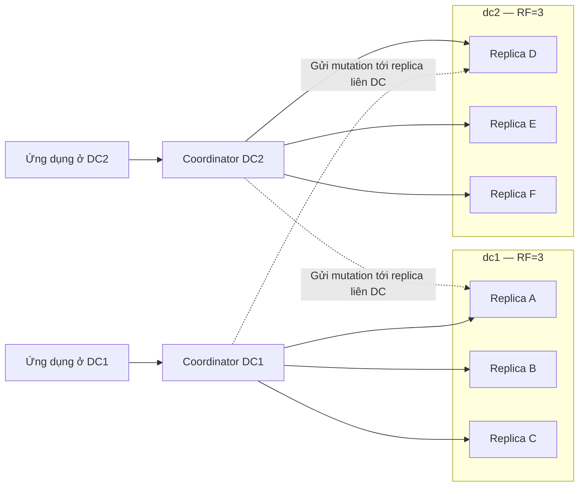
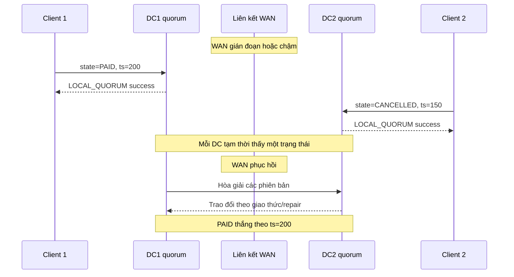

# Ghi từ nhiều datacenter, timestamp và cập nhật xung đột

Một ứng dụng triển khai ở hai datacenter (DC) có thể cho người dùng ghi dữ liệu tại DC gần họ nhất để giảm độ trễ. Trong Apache Cassandra, mỗi DC có thể giữ bản sao của cùng partition và tiếp nhận ghi qua coordinator tại DC đó. Điều này hỗ trợ **active-active traffic** nhưng cũng tạo ra tình huống hai người ghi **cùng một cell** qua hai DC gần như đồng thời. Cassandra không tự thực hiện phép hợp nhất theo luật nghiệp vụ: trong các ghi thông thường, các phiên bản thường được hòa giải theo **timestamp của cell** (*last-write-wins*, LWW), không phải theo thời điểm gói tin đến node.

Giả sử một đơn hàng bị đánh dấu `PAID` tại DC1 và `CANCELLED` tại DC2 khi đường mạng liên DC bị gián đoạn. Cả hai yêu cầu đều có thể thành công ở `LOCAL_QUORUM` của DC tương ứng. Khi kết nối trở lại, một phiên bản sẽ thắng theo quy tắc timestamp; **“cập nhật sau theo cảm nhận của người dùng” không nhất thiết là phiên bản thắng**, và cả hai cập nhật không thể được hiểu là hai giao dịch tuần tự hợp lệ chỉ nhờ Cassandra tự đồng bộ.

Bài thuộc chương **Nhiều trung tâm dữ liệu** của mô-đun **DATABASE_ENGINE_WIDE_COLUMN_CASSANDRA**. Ta kết nối replica placement và partition key với consistency, CQL, timestamp, tombstone, repair, xử lý lỗi và Java driver để thiết kế ghi đa DC có **ngữ nghĩa nghiệp vụ rõ ràng**, thay vì chỉ kỳ vọng replication sẽ quyết định đúng hộ ứng dụng.

## 1. Mục tiêu học tập

Sau bài này, bạn có thể:

1. Phân biệt **DC-local acknowledgment**, replication liên DC và khả năng quan sát dữ liệu tại DC khác.
2. Giải thích `NetworkTopologyStrategy` cùng `LOCAL_QUORUM`, `QUORUM`, `EACH_QUORUM` và `ALL` trên cụm nhiều DC.
3. Mô tả cách Cassandra so sánh timestamp của **cell**, bao gồm hiện tượng hai ghi đến ngược thứ tự nhưng phiên bản cũ hơn theo timestamp không thắng.
4. Nhận diện clock skew, timestamp do client/server cấp, tombstone, TTL và cập nhật từng cột là những nguồn gây kết quả bất ngờ.
5. Thực hành CQL từ coordinator ở hai DC, đọc `WRITETIME` và kiểm chứng xung đột.
6. Phân biệt chiến lược **single-writer/fencing**, **immutable events**, **LWT/CAS xuyên DC** và các cơ chế đối soát ngoài Cassandra.
7. Viết Java driver code có consistency, timestamp/idempotency rõ ràng và xây bộ tiêu chí nghiệm thu active-active.

## 2. Multi-DC replication không đồng nghĩa ghi đồng bộ ở mọi DC

Cassandra đặt replica theo **token** của partition key. Với `NetworkTopologyStrategy` (NTS), số bản sao được chỉ định theo từng DC. Ví dụ:

```sql
CREATE KEYSPACE IF NOT EXISTS multi_dc_lab
WITH replication = {
  'class': 'NetworkTopologyStrategy',
  'dc1': 3,
  'dc2': 3
}
AND durable_writes = true;
```

Khi cả hai DC đều có đủ node/miền lỗi và topology đã được điền dữ liệu đúng, mỗi partition có **ba replica tại dc1** và **ba replica tại dc2**. Sáu bản sao là sáu vị trí vật lý/lưu trữ của **cùng dữ liệu logic**, không phải sáu hàng nghiệp vụ. `durable_writes = true` liên quan tới commit log trên replica, nhưng độ bền thực tế còn chịu chính sách sync, sự cố đĩa và mức nhất quán.



Sơ đồ biểu diễn **quan hệ logic**; số kết nối và cách coordinator gửi qua mạng liên DC là chi tiết hiện thực phụ thuộc phiên bản. Điểm cần nhớ:

- Một ghi với **`LOCAL_QUORUM` tại dc1** chờ đủ replica được yêu cầu **trong dc1**. Nó **không chờ quorum ở dc2**.
- Coordinator vẫn tham gia phân phối dữ liệu tới những replica thuộc topology, nhưng mutation có thể tới DC kia muộn hoặc gặp lỗi mạng.
- Ghi với **`LOCAL_QUORUM` tại dc2** có thể được xác nhận độc lập trong lúc hai DC không trao đổi được dữ liệu với nhau.
- Một SELECT ở DC khác có thể quan sát phiên bản cũ cho tới khi bản sao ở đó nhận và hòa giải mutation.
- **Hinted handoff và repair** có thể giúp hội tụ khi replica bỏ lỡ ghi. Chúng không thay thế quy tắc giải quyết xung đột nghiệp vụ.

### Coordinator, replica và partition key

Ứng dụng Java thường kết nối tới một coordinator do driver chọn. Coordinator đó **không nhất thiết là replica** giữ partition; nó dùng token metadata để tìm đúng tập replica. Nếu partition key là `order_id` thì tất cả phiên bản của **một order_id** được đặt theo cùng sơ đồ replica logic, nhưng chúng vẫn có thể tạm khác nhau giữa DC khi ghi đang được chuyển tiếp.

Thiết kế bảng theo truy vấn vẫn quan trọng. Dù hệ thống có hai DC, Cassandra không biến một câu `SELECT ... WHERE state = 'PAID'` trên cột thường thành truy vấn hiệu quả. Phải có partition key/truy vấn phù hợp; replication không thay thế data modeling.

## 3. Bảng consistency level cho hai DC

Giả sử **dc1: RF=3, dc2: RF=3**, và không có replica transient hay topology đang chuyển đổi. Các con số sau là để hiểu cách tính quorum:

| Consistency level | Yêu cầu chính cho write | Điều cần nhớ |
| --- | --- | --- |
| `LOCAL_ONE` | 1 replica trong DC cục bộ | Độ trễ thấp hơn nhưng chịu rủi ro quan sát phiên bản cũ nếu replica khác chưa có dữ liệu. |
| `LOCAL_QUORUM` | `floor(3/2)+1 = 2` replica trong **DC cục bộ** | Không xác nhận DC khác đã có mutation. |
| `QUORUM` | `floor((3+3)/2)+1 = 4` replica trên tổng RF=6 | Đủ bốn phản hồi **trên tổng**, không nhất thiết hai ở mỗi DC. |
| `EACH_QUORUM` | 2 replica **trong dc1** và 2 replica **trong dc2** | Dành cho **write**, tăng chi phí/độ phụ thuộc WAN và giảm khả năng ghi khi DC mất kết nối. |
| `ALL` | Tất cả sáu replica | Đòi hỏi sự sẵn sàng cao của toàn bộ replica, thường nhạy cảm với sự cố mạng/nút. |

**`EACH_QUORUM` không phải mức nhất quán đọc thông thường**: theo CQL Cassandra, nó được dùng cho **write**. Đối với SELECT, thường cân nhắc `LOCAL_QUORUM` hoặc `QUORUM` theo mục tiêu và topology.

### Trường hợp quan trọng: DC1 ghi LQ, DC2 đọc LQ

```text
t0: Ứng dụng DC1 ghi order=P ở LOCAL_QUORUM (A/B đã ack).
t1: DC2 chưa nhận mutation mới vì WAN trễ/đứt.
t2: Ứng dụng DC2 đọc order=P ở LOCAL_QUORUM (D/E).
Kết quả có thể là dữ liệu CŨ hoặc chưa thấy hàng.
t3: Mutation được chuyển qua DC2 / repair bổ sung.
t4: Đọc tại DC2 mới quan sát phiên bản mới.
```

Điều này **không trái với cam kết của `LOCAL_QUORUM`**. Mỗi DC có quorum riêng; write quorum ở DC1 và read quorum ở DC2 **không bắt buộc giao nhau**.

Nếu một write được xác nhận ở `EACH_QUORUM` (hai replica trong **mỗi DC**), sau đó read `LOCAL_QUORUM` (hai trên ba) ở DC nào cũng có **giao nhau ít nhất một replica** với tập replica đã ack ở chính DC đó, giả định topology/replica set ổn định và không có write mới hơn. Đây là một cơ sở để kỳ vọng đọc thấy bản cập nhật đã được xác nhận theo ngữ nghĩa reconciliation của Cassandra, **không** có nghĩa mọi replica đã nhận và **không** làm hai writer đang cạnh tranh thành giao dịch nối tiếp.

### R + W > RF cần áp dụng đúng phạm vi

Quy tắc quorum giao nhau chỉ hữu ích khi read và write xét **cùng tập replica**. Đừng áp dụng một cách máy móc `R+W>RF` toàn cụm nếu hai thao tác lần lượt dùng `LOCAL_QUORUM` ở **hai DC khác nhau**. Tương tự, một write `QUORUM` tổng 4/6 có thể không gồm quorum ở DC2, nên không được tự suy mọi LOCAL_QUORUM read ở DC2 phải giao với tập ack.

**Thực tế:** consistency level quy định **khi nào request được báo thành công**, không quy định nghiệp vụ được phép xử lý hai cập nhật cùng đối tượng theo thứ tự nào. Hai vấn đề cần được thiết kế riêng.

## 4. Timestamp quyết định phiên bản thắng như thế nào?

Trong các ghi thông thường, Cassandra sử dụng **timestamp gắn với cell**, có độ phân giải **microsecond** theo biểu diễn CQL, để lựa chọn phiên bản thắng khi các replica chứa nhiều cập nhật của cùng cell. Timestamp lớn hơn thường được xem là mới hơn **dù mutation đó được gửi/nhận trước hay sau**. Các bản ghi đến lệch thứ tự vẫn có thể hội tụ về cùng một giá trị theo quy tắc hòa giải.

```text
DC1: UPDATE status='PAID',       timestamp = 1700000000000200
DC2: UPDATE status='CANCELLED',  timestamp = 1700000000000100

Giả sử bản tin DC2 đến replica X SAU bản tin DC1:
  CANCELLED có timestamp thấp hơn → không ghi đè PAID.

Kết quả cuối khi các replica đã hòa giải:
  status = 'PAID' (timestamp 1700000000000200)
```

Hệ thống không hỏi “người dùng chọn hủy sau khi thanh toán hay không?” và cũng không dùng đồng hồ nhận gói tin để đo thứ tự thực tế. **Last-write-wins ở Cassandra chủ yếu là *timestamp-wins*, không phải *last-arrival-wins* hay *last-business-action-wins*.**

### Timestamp của một write lấy ở đâu?

Tùy câu CQL và cấu hình **driver/phiên bản Cassandra**, timestamp có thể được đặt tường minh bằng `USING TIMESTAMP`, được sinh bởi client/driver, hoặc do phía server/coordinator cấp. Không được ngầm định hai dịch vụ ở hai DC luôn dùng cùng một đồng hồ thời gian với sai số bằng 0.

- **`USING TIMESTAMP 1700000000000200`**: giá trị được biểu diễn bằng **microseconds kể từ Unix epoch** trong CQL.
- **`WRITETIME(column)`**: kiểm tra timestamp lưu cùng giá trị một cột thường; hữu ích cho lab và điều tra.
- **Clock skew**: nếu một bên đặt timestamp **đi trước tương lai**, các cập nhật thực tế tới sau nhưng có timestamp thấp hơn có thể tiếp tục thua.
- **Nhiều client**: mỗi instance khác nhau có thể sinh timestamp riêng; cần kiểm tra chính sách timestamp generator, NTP/clock sync và cách failover.

Timestamp ở đây là công cụ **giải quyết xung đột ở tầng lưu trữ**, không phải một đồng hồ giao dịch phân tán cung cấp quan hệ *happens-before*. NTP giúp giảm sai lệch nhưng **không tạo linearizability** cho các ghi thông thường từ nhiều DC.

### Khi hai cập nhật có timestamp bằng nhau

Cassandra có cơ chế hòa giải **xác định** khi timestamp trùng; với tombstone và giá trị sống cùng timestamp, quy tắc xóa có ý nghĩa đặc biệt. Tuy nhiên, **ứng dụng tuyệt đối không dùng tie-break ở tầng byte/giá trị làm luật nghiệp vụ**: có thể không phản ánh thứ tự người dùng mong đợi. Hãy tránh timestamp cố ý trùng cho các phiên bản cạnh tranh và định nghĩa cơ chế conflict resolution riêng.

## 5. Timeline active-active: hai ghi đều thành công, một cập nhật thua

Hãy xem trạng thái đơn hàng số 42. Ứng dụng vùng châu Á ghi vào DC1, ứng dụng vùng châu Âu ghi vào DC2; WAN tạm bị phân vùng:



Thông điệp “hòa giải” trong sơ đồ là khái niệm, không mô tả một RPC cố định. Sau khi mạng phục hồi, replica có thể nhận các mutation đã trễ, hints hoặc repair; *nếu* chúng nhận đủ dữ liệu hợp lệ, chúng tiến về cùng quy tắc thắng.

**Kết quả ở tầng lưu trữ không phải kết luận nghiệp vụ đúng.** Nếu CANCELLED là quyết định hợp lệ đến sau khi đơn hàng được thanh toán, LWW có thể làm mất quyết định đó. Nếu hệ thống ngân hàng trừ tiền, hoàn tiền hoặc cập nhật kho, không được giao tính đúng đắn cho một trường `state` được upsert active-active mà không có điều phối.

### “Đã thành công” có ba nghĩa khác nhau

1. **Client write success tại DC1**: đủ phản hồi theo CL của request DC1.
2. **Replica convergence**: các replica nhận và hòa giải đủ cập nhật; trạng thái quan sát giữa DC không còn lệch do replication lag.
3. **Business success**: hành động đã được xác nhận theo luật nghiệp vụ, không mất transition, không thực hiện side effect hai lần.

Ba điều kiện này không tương đương. Repair có thể giúp đạt điều kiện 2, **không tự tạo** điều kiện 3.

## 6. Per-cell reconciliation: một hàng có thể trộn kết quả hai writer

Cassandra hòa giải mutation ở mức dữ liệu/cell theo timestamp. Khi hai luồng cập nhật **những cột khác nhau** hoặc không cùng thời điểm, kết quả cuối có thể là tổ hợp hợp lệ ở tầng lưu trữ nhưng **chưa từng được một writer ghi thành một trạng thái nghiệp vụ nguyên vẹn**.

Giả sử bảng lưu hai cột `state` và `source_dc`:

```sql
-- Writer DC1 cập nhật hai cột ở timestamp 1700000000000400.
UPDATE multi_dc_lab.order_state_by_id
USING TIMESTAMP 1700000000000400
SET state = 'PAID', source_dc = 'dc1'
WHERE order_id = 11111111-1111-4111-8111-111111111111;

-- Writer DC2 chỉ cập nhật source_dc ở timestamp mới hơn.
UPDATE multi_dc_lab.order_state_by_id
USING TIMESTAMP 1700000000000500
SET source_dc = 'dc2'
WHERE order_id = 11111111-1111-4111-8111-111111111111;
```

Sau khi hòa giải, hàng có thể hiển thị `state='PAID'` với `source_dc='dc2'`. Đây là **kết quả ghép các phiên bản theo từng cell**, không phải một bản ghi `PAID from dc2` được cả ứng dụng đồng ý. Cần xác định trường nào là **metadata của một phiên bản**, và nếu các trường phải cùng thay đổi, sử dụng mô hình dữ liệu/workflow giữ được bất biến đó. Tính nguyên tử của mutation một partition không thay thế việc sắp xếp tuần tự hai mutation cạnh tranh tới từ DC khác nhau.

### Tombstone và TTL có tham gia xung đột

- `DELETE` tạo **tombstone** với timestamp. Nó che các giá trị cũ theo quy tắc reconciliation và cần được giữ đủ lâu để replica đang down nhận được thông tin xóa.
- Khi timestamp của DELETE **thấp hơn** một ghi hợp lệ mới hơn, không được tự coi DELETE là thao tác “đến sau” rồi kết luận phải xóa giá trị mới.
- **TTL hết hạn** tạo dữ liệu bị xóa logic; TTL không phải cơ chế hòa giải hai quyết định nghiệp vụ mâu thuẫn. TTL, local expiry metadata và timestamp sai lệch có thể khiến điều tra xung đột phức tạp hơn.
- **`gc_grace_seconds` + repair** bảo vệ khỏi zombie data khi replica vắng mặt. Hạ grace để “đồng bộ nhanh hơn” có thể làm mất dấu xóa trước khi replica cũ bắt kịp.
- Timestamp rất xa trong tương lai có thể khiến những write bình thường tiếp theo bị che trong thời gian dài. Không xử lý bằng cách xóa SSTable/commit log thủ công hoặc cấp timestamp lớn hơn tùy tiện trên production.

## 7. Thực hành CQL: chuẩn bị một bảng có xung đột

> Lab cần một cụm Cassandra **đã có hai DC thực sự** là `dc1` và `dc2`, mỗi DC có ít nhất ba node thích hợp RF=3. Nếu không có lab hai DC, chỉ chạy phần CQL trên môi trường thử nghiệm để nghiên cứu cú pháp; **không tự tuyên bố đã quan sát xung đột liên DC**. Không thay RF/topology của cụm production để làm bài.

Tạo keyspace như phần 2, sau đó tạo bảng theo truy vấn **một đơn hàng theo ID**:

```sql
CREATE TABLE IF NOT EXISTS multi_dc_lab.order_state_by_id (
  order_id uuid PRIMARY KEY,
  state text,
  source_dc text,
  business_version bigint,
  updated_at timestamp
);
```

Trong lab, `business_version` chỉ là **cột được lưu**, **không** có kiểm tra monotonic nếu dùng INSERT/UPDATE thường. Cột `updated_at` do ứng dụng ghi để hiển thị thời gian nghiệp vụ; không được nhầm với `WRITETIME(state)` là timestamp của cell. Nếu business version là điều kiện bắt buộc, cần LWT hoặc cơ chế điều phối khác được trình bày phía dưới.

### Kết nối tới đúng DC

Mở **hai phiên cqlsh** được cấu hình tới coordinator trong hai DC khác nhau:

```bash
# Terminal A: địa chỉ coordinator trong dc1.
cqlsh DC1_COORDINATOR_HOST 9042

# Terminal B: địa chỉ coordinator trong dc2.
cqlsh DC2_COORDINATOR_HOST 9042
```

Trong **cả hai** phiên:

```sql
CONSISTENCY LOCAL_QUORUM;
```

Kiểm chứng địa chỉ đúng DC bằng `nodetool status`/metadata node của lab; `LOCAL_QUORUM` là local đối với **DC của coordinator**, không phải một nhãn vùng người dùng tự đặt ở client. Kết nối thành công tới một IP chưa đủ chứng minh routing đang theo DC mong muốn.

### Bước 1 — Ghi baseline ở DC1

Chỉ dùng khóa thử nghiệm chưa có dữ liệu trước đó:

```sql
INSERT INTO multi_dc_lab.order_state_by_id
  (order_id, state, source_dc, business_version, updated_at)
VALUES (
  11111111-1111-4111-8111-111111111111,
  'NEW', 'seed', 0, '2023-11-14T22:13:20+0000'
)
USING TIMESTAMP 1700000000000000;

SELECT state, source_dc, business_version,
       WRITETIME(state) AS state_writetime
FROM multi_dc_lab.order_state_by_id
WHERE order_id = 11111111-1111-4111-8111-111111111111;
```

Timestamps 1700000000000000, 1700000000000100 và 1700000000000200 là **giá trị giả lập cố định** cho lab, có đơn vị microsecond. Chúng tương ứng mốc trong quá khứ so với thời điểm bài học, để kết quả dễ tái lập trên một khóa **mới**. Không dùng các timestamp này cho nghiệp vụ thật hoặc key đã có ghi với timestamp lớn hơn.

### Bước 2 — DC1 ghi phiên bản timestamp lớn

Tại **cqlsh DC1**:

```sql
UPDATE multi_dc_lab.order_state_by_id
USING TIMESTAMP 1700000000000200
SET state = 'PAID',
    source_dc = 'dc1',
    business_version = 1
WHERE order_id = 11111111-1111-4111-8111-111111111111;
```

### Bước 3 — DC2 ghi phiên bản timestamp nhỏ hơn

Sau khi bước 2 được báo thành công, tại **cqlsh DC2**:

```sql
UPDATE multi_dc_lab.order_state_by_id
USING TIMESTAMP 1700000000000100
SET state = 'CANCELLED',
    source_dc = 'dc2',
    business_version = 1
WHERE order_id = 11111111-1111-4111-8111-111111111111;
```

Hai thao tác có thể được Cassandra xác nhận theo `LOCAL_QUORUM` của từng DC. Khi mutation mới và cũ đã tới đủ replica và reconciliation diễn ra, **`PAID` thắng** dù câu UPDATE `CANCELLED` được gửi *sau*: timestamp của nó thấp hơn. Nếu đọc ngay trong khi replication còn trễ, DC2 vẫn có thể hiển thị phiên bản cũ tạm thời; **không** ép kết luận hội tụ chỉ từ một lần SELECT.

### Bước 4 — Kiểm tra từ cả hai DC

Chạy ở **cả cqlsh DC1 và DC2**:

```sql
CONSISTENCY LOCAL_QUORUM;

SELECT state, source_dc, business_version,
       WRITETIME(state) AS state_writetime,
       WRITETIME(source_dc) AS source_writetime
FROM multi_dc_lab.order_state_by_id
WHERE order_id = 11111111-1111-4111-8111-111111111111;
```

Với dữ liệu đã hội tụ, kỳ vọng:

| Cột | Giá trị cuối mong đợi |
| --- | --- |
| `state` | `PAID` |
| `source_dc` | `dc1` |
| `business_version` | `1` |
| `WRITETIME(state)` | `1700000000000200` |
| `WRITETIME(source_dc)` | `1700000000000200` |

Nếu hai DC vẫn trả khác nhau, kiểm tra connectivity, replica availability, consistency, logs/metrics và lịch repair **theo phạm vi của lab**. Việc này không bảo đảm write sau với timestamp nhỏ tự lan đi như “giá trị cuối” trong tất cả thời điểm.

### Bước 5 — Đảo thứ tự: timestamp lớn hơn vẫn thắng

Dùng **order_id mới** để tránh các write của bước trước. Ghi `CANCELLED` ở DC2 với timestamp lớn hơn trước, rồi ghi `PAID` ở DC1 với timestamp thấp hơn. Kết quả sau hội tụ vẫn là giá trị có **timestamp lớn hơn**, không phụ thuộc thứ tự hai client gửi thao tác.

**Bằng chứng cần lưu:** order_id thử nghiệm, coordinator/DC, CL, timestamp tường minh, thời gian từng request, kết quả đọc của từng DC và `WRITETIME`. Không chỉ ghi “DC1 thắng” mà bỏ số liệu timestamp vì như vậy sẽ nhầm với một luật ưu tiên DC.

## 8. Ba thí nghiệm mở rộng

### Thí nghiệm A — Clock skew và timestamp tương lai

Trên một order_id lab khác, thử ghi một cột với timestamp **lớn hơn rõ rệt** timestamp từ các client còn lại rồi cập nhật cùng cột bằng timestamp nhỏ hơn. Quan sát giá trị mới không thắng dù request ghi sau được báo thành công. Đây là lý do đồng hồ của tất cả writer phải được đồng bộ và giám sát. **Không tạo timestamp xa tương lai trên dữ liệu production** vì có thể che các write hợp lệ về sau.

### Thí nghiệm B — Cập nhật từng cell

Chạy hai lệnh ở mục 6 trên khóa lab mới: DC1 ghi `state` và `source_dc` ở timestamp `T`; DC2 chỉ cập nhật `source_dc` ở `T+100`. Sau hội tụ, đối chiếu `WRITETIME` của hai cột. Rút ra: một hàng nhìn có vẻ “được ghi ở dc2” nhưng `state` thực ra từ writer dc1. Nếu cần một trạng thái hợp lệ nguyên khối, schema/workflow phải thể hiện ranh giới phiên bản đó.

### Thí nghiệm C — Mất liên kết WAN

Chỉ trong **lab được phép can thiệp hạ tầng**, cô lập kết nối liên DC, giữ quorum mỗi DC hoạt động rồi ghi **hai giá trị khác nhau của cùng partition** tại mỗi DC ở `LOCAL_QUORUM`. Kiểm tra cả hai write có thể được ack độc lập; sau khi phục hồi WAN, quan sát reconciliation và repair theo quy trình.

**Không** thử cắt mạng production; cũng đừng hạ CL tùy tiện để “mô phỏng” cùng điều kiện, vì hành vi không tương đương. Đặt giới hạn thời gian cô lập ngắn hơn chính sách hints/repair và bảo toàn chứng cứ. Cả khi phục hồi mạng, cần xác minh tiến trình hội tụ thực tế, không chỉ giả định Cassandra đã cập nhật mọi replica tức thì.

## 9. Chọn kiến trúc giải quyết xung đột theo nghiệp vụ

Không có tùy chọn CQL nào bảo đảm “hai hành động nghiệp vụ cùng lúc ở hai DC sẽ được hợp nhất đúng như người dùng muốn” cho mọi kiểu dữ liệu. Chọn chiến lược theo bất biến cần giữ:

| Yêu cầu | Cách tiếp cận | Đánh đổi/chú ý |
| --- | --- | --- |
| Chỉ một vùng được sửa **một thực thể** tại một thời điểm | **Single-writer per key** theo chủ sở hữu DC, cộng fencing khi failover | Cần routing và quy trình chuyển chủ sở hữu; tránh hai vùng cùng nhận quyền khi mạng chia cắt. |
| Chấp nhận bản mới nhất theo timestamp | **Normal writes + LWW** | Đơn giản/nhanh nhưng có thể mất cập nhật hợp lệ; không dùng cho invariants quan trọng. |
| Cần lưu mọi sự kiện rồi tính trạng thái | **Append-only immutable events** với event ID, dedup và consumer/order riêng | Truy vấn trạng thái cần projection; giải quyết duplicate, ordering và đối soát. |
| Cần điều kiện trên cùng partition | **LWT/CAS** với serial consistency xuyên DC phù hợp | Tăng độ trễ, phụ thuộc availability giữa DC; chỉ giải quyết phạm vi được điều kiện hóa, không phải đa partition transaction. |
| Cần giao dịch mạnh đa thực thể, ledger, thanh toán | **Authority/transactional service** hoặc workflow có idempotency, saga và reconciliation | Phức tạp hơn nhưng giữ luật nghiệp vụ; Cassandra làm kho dữ liệu/tập sự kiện phục vụ truy vấn. |
| Có dữ liệu cộng dồn (counter) | Thiết kế xử lý đúng semantics/retry của counter hoặc event-based aggregation | Counter updates có tính chất riêng, retry thiếu kiểm soát có thể đếm trùng; không tự suy là “an toàn active-active”. |

### Phương án 1 — Single-writer, ownership và fencing

Ứng dụng chọn một **DC chủ sở hữu** cho mỗi order/account. Những yêu cầu từ DC khác được chuyển tới owner hoặc được ghi thành event/command đợi xử lý. Nếu owner DC lỗi:

1. Hệ thống điều phối đưa ra **quyết định chuyển quyền** có tính duy nhất.
2. Cấp **epoch/fencing token** mới cho writer kế tiếp.
3. Writer cũ **không còn được phép** tiếp tục ghi sau khi quyền đã chuyển, kể cả khi mạng hồi phục.
4. Reconcile các request đã ack nhưng chưa quan sát được ở DC đích trước khi nhận mutation cạnh tranh mới.
5. Ghi lại mỗi operation ID và business version để thực hiện retry/dedup an toàn.

Chỉ gắn `owner_dc='dc1'` trong một hàng Cassandra **không đủ tạo fencing** nếu hai writer có thể cùng sửa cột đó bằng normal writes. Cần cơ chế giành quyền có tính tuần tự thực sự, chẳng hạn CAS toàn cục đúng phạm vi hoặc authority riêng, và thực thi kiểm tra quyền **trước mọi cập nhật**.

### Phương án 2 — Immutable events + projection

Thay vì hai DC cùng UPDATE một cell `state`, mỗi hành động được ghi như **một event** với định danh duy nhất và context nghiệp vụ. Ví dụ:

```sql
CREATE TABLE IF NOT EXISTS multi_dc_lab.order_events_by_id (
  order_id uuid,
  event_id uuid,
  event_type text,
  origin_dc text,
  domain_version bigint,
  occurred_at timestamp,
  PRIMARY KEY ((order_id), event_id)
);
```

Schema lưu **nhiều event của cùng đơn hàng** theo key khác nhau, giúp giảm overwrite cùng một cell. Tuy nhiên:

- UUID/event ID **không tự cấp thứ tự nghiệp vụ tuyệt đối**; consumer cần quy tắc ordering và giải quyết sự kiện mâu thuẫn.
- Các DC vẫn có thể quan sát **tập event chưa đủ** khi WAN trễ; projection phải cho phép cập nhật/đối soát khi event đến muộn.
- Retry nên dùng **cùng event_id**, không tạo UUID mới cho cùng logical event. Nếu nhiều writer cấp cùng ID khác payload, vẫn cần chính sách phát hiện conflict.
- Đừng suy rằng chỉ tạo bảng event đã giải quyết bài toán “hai lệnh trừ tiền cùng lúc”. Trạng thái tài chính cần bất biến và authority phù hợp.

### Phương án 3 — Version có điều kiện, không chỉ là một cột số

Lưu `business_version=42` bằng UPDATE thường không ngăn writer khác cùng ghi `42`. Muốn ngăn một thay đổi khi phiên bản đã bị tăng, cần **compare-and-set** (LWT) hay một hệ thống tuần tự hóa đảm bảo điều kiện:

```sql
-- Ví dụ trên một order_id đã có business_version=41.
UPDATE multi_dc_lab.order_state_by_id
SET state = 'PAID',
    source_dc = 'dc1',
    business_version = 42
WHERE order_id = 11111111-1111-4111-8111-111111111111
IF business_version = 41;
```

Trong `cqlsh` hoặc Java, cần chọn nhất quán LWT/serial consistency và kiểm tra kết quả `[applied]`. Nếu không applied, đọc/đối soát bản hiện tại trước khi retry; không tăng timestamp để cưỡng bức overwrite. Đặc biệt, nếu có writer khác **bỏ qua LWT** và cập nhật cùng các cell bằng normal write, chương trình không còn giữ được bất biến chỉ bằng việc một số lời gọi dùng CAS.

## 10. LWT xuyên DC: SERIAL không phải LOCAL_SERIAL

LWT sử dụng giao thức đồng thuận (Paxos/biến thể theo Cassandra release) cho một điều kiện trên **partition**, có thêm chi phí round trip và có thể chịu ảnh hưởng WAN. Trong cụm nhiều DC cần phân biệt:

| Serial consistency | Ý nghĩa thiết kế | Rủi ro khi dùng sai |
| --- | --- | --- |
| `SERIAL` | Hướng tới đảm bảo serial/linearizable của LWT trên **tập replica liên quan**, phù hợp khi cần điều phối cạnh tranh **xuyên các DC**. | Tăng độ trễ và giảm availability khi WAN/replica không đủ điều kiện cho đồng thuận. |
| `LOCAL_SERIAL` | Giới hạn pha serial vào **DC cục bộ**. | **Không** được dùng như khóa CAS toàn cục nếu writer tại DC khác cũng có thể ghi đồng thời. |

Cần phân biệt **regular consistency** dùng cho pha ghi/đọc đi cùng LWT với **serial consistency** dùng cho pha điều kiện. Java driver có API riêng cho hai loại. **Không dùng `USING TIMESTAMP` thủ công để thay thế CAS**; với conditional write, cú pháp/cơ chế timestamp có ràng buộc riêng. LWT chỉ bảo vệ điều kiện **cùng partition**; chuyển tiền giữa hai account khác partition cần mô hình giao dịch/workflow khác.

**Tình huống WAN partition:** nếu đòi hỏi CAS có tính duy nhất toàn cục, hệ thống có thể phải **từ chối hoặc chờ ghi** khi không đạt đồng thuận xuyên DC. Đấy là đánh đổi tính nhất quán/availability thực sự, không phải một lỗi có thể xóa bằng cách đổi sang `LOCAL_SERIAL` trong lúc incident.

### Kiểm tra kết quả CAS

```sql
-- Thực hiện tại DC1 hoặc DC2 với serial consistency đã được chọn.
CONSISTENCY LOCAL_QUORUM;
SERIAL CONSISTENCY SERIAL;

UPDATE multi_dc_lab.order_state_by_id
SET state = 'SHIPPED',
    business_version = 43
WHERE order_id = 11111111-1111-4111-8111-111111111111
IF business_version = 42;
```

Cú pháp đặt serial consistency trong `cqlsh` phụ thuộc phiên bản công cụ; nếu shell không hỗ trợ dạng lệnh này, cấu hình ở Java driver và xác minh bằng tính năng đã hỗ trợ của bản triển khai. **Không coi một lệnh shell không được nhận diện là Cassandra thiếu LWT**. Với CAS thành công, `[applied]=true`; thất bại trả trạng thái/giá trị hiện hữu để người gọi đối soát theo API.

## 11. Java Driver 4.x: ghi có timestamp và retry idempotent

Ví dụ dưới đây dùng hai `CqlSession` riêng, mỗi session đã cấu hình **contact points/local datacenter** tới DC mong muốn (ví dụ `dc1Session`, `dc2Session`). Cả hai cùng truy cập keyspace/table Cassandra; ứng dụng không cần gọi thẳng replica và không sửa replication metadata ở mỗi request.

```java
import java.util.UUID;
import com.datastax.oss.driver.api.core.ConsistencyLevel;
import com.datastax.oss.driver.api.core.cql.BoundStatement;
import com.datastax.oss.driver.api.core.cql.PreparedStatement;
import com.datastax.oss.driver.api.core.cql.ResultSet;

UUID orderId = UUID.fromString(
    "22222222-2222-4222-8222-222222222222");

// Giả định version/timestamp do một quy trình cấp phát có kiểm soát
// đã cấp cho logical operation này; KHÔNG sinh lại khi retry.
long stableTimestampMicros = 1700000000000200L;

PreparedStatement update = dc1Session.prepare(
    "UPDATE multi_dc_lab.order_state_by_id " +
    "USING TIMESTAMP ? " +
    "SET state = ?, source_dc = ?, business_version = ? " +
    "WHERE order_id = ?");

BoundStatement statement = update.bind(
        stableTimestampMicros, "PAID", "dc1", 42L, orderId)
    .setConsistencyLevel(ConsistencyLevel.LOCAL_QUORUM)
    .setIdempotent(true);

ResultSet result = dc1Session.execute(statement);
```

**Điều kiện quan trọng**:

- `stableTimestampMicros` trong ví dụ là **mốc giả lập cho lab**. Khi viết production, timestamp phải xuất phát từ chính sách thống nhất giữa writer và không được cấp tùy tiện theo `System.currentTimeMillis()*1000` như một bảo đảm toàn cục.
- `setIdempotent(true)` chỉ khai báo cho driver có thể áp dụng cơ chế retry phù hợp, **không biến một nghiệp vụ có side effect thành exactly-once**. Cùng primary key, cùng payload và cùng timestamp giúp tránh thay đổi kết quả LWW khi retry **một** logical write, nhưng không tự ngăn writer khác cạnh tranh.
- Một **timeout** không có nghĩa ghi chưa xảy ra. Đừng đổi UUID/order ID hay timestamp chỉ vì response bị mất; ghi lại operation ID, DC, CL, exception và quy trình đối soát.
- Nếu không có một nguồn cấp **version/timestamp có trật tự được bảo đảm**, hãy chọn single-writer, event log hoặc LWT; không giả định đồng hồ của hai máy đủ để đạt đúng thứ tự nghiệp vụ.

### Java LWT với SERIAL

Khi thực sự cần CAS cho một partition, dùng prepared statement có điều kiện và khai báo **serial consistency** rõ ràng:

```java
PreparedStatement cas = dc1Session.prepare(
    "UPDATE multi_dc_lab.order_state_by_id " +
    "SET state = ?, business_version = ? " +
    "WHERE order_id = ? IF business_version = ?");

BoundStatement guarded = cas.bind(
        "PAID", 42L, orderId, 41L)
    .setConsistencyLevel(ConsistencyLevel.LOCAL_QUORUM)
    .setSerialConsistencyLevel(ConsistencyLevel.SERIAL);

ResultSet appliedResult = dc1Session.execute(guarded);
if (appliedResult.wasApplied()) {
    // Đã vượt qua điều kiện CAS cho partition này.
} else {
    // Phiên bản đã khác: lấy dữ liệu hiện hữu và giải quyết xung đột nghiệp vụ.
}
```

Ví dụ không xây một ứng dụng production hoàn chỉnh. Với LWT timeout, kết quả cũng có thể **chưa biết** từ phía client; phải thiết kế idempotency/reconciliation, không gửi lại side effect ngoài Cassandra một cách mù quáng. Nếu dùng LWT để quản lý version, **tất cả các writer liên quan** phải tôn trọng cùng workflow, và cần đánh giá độ trễ WAN/công suất Paxos.

## 12. Vận hành liên DC: đồng bộ thời gian, mạng và replica

Một thiết kế active-active phải giám sát **hai chiều**, không chỉ độ trễ HTTP của ứng dụng:

| Nhóm | Các câu hỏi cần theo dõi |
| --- | --- |
| **Clock synchronization** | NTP/clock offset, drift, client timestamp generator, có writer cấp timestamp trong tương lai không? |
| **DC/rack topology** | NTS, RF từng DC, replica placement, node/rack DOWN, metadata schema/topology có ổn định không? |
| **Network liên DC** | RTT, packet loss, throughput, kết nối mất/chập chờn, queue backlog, cảnh báo đường truyền. |
| **Write/read availability** | p95/p99 và timeout theo từng DC, loại consistency, coordinator và token range liên quan. |
| **Hinted handoff** | Hints pending/expired/replayed, peer liên tục down hoặc không nhận được mutation? |
| **Anti-entropy repair** | Lần repair **đã thành công đủ phạm vi** gần nhất, range/DC còn failed, khoảng cách so với `gc_grace_seconds`. |
| **Commit log / durability** | Chính sách sync, disk errors, dung lượng commit log, mất node cùng miền lỗi; đã ack ở replica có bền qua power loss không? |
| **SSTable/compaction** | Pending compactions, tombstones, streaming SSTable, disk usage; có làm chậm catch-up hoặc tăng read latency? |
| **Application conflict telemetry** | Số lần CAS `[applied]=false`, business-version conflict, duplicate operation IDs, projection lag, sự kiện bị từ chối. |

### Đồng bộ dữ liệu ≠ đúng nghiệp vụ

Repair giúp các replica tiến về một trạng thái theo **timestamp/tombstone rules**. Sau repair, cả DC1 và DC2 có thể thống nhất `PAID` nhưng **vẫn sai về nghiệp vụ** nếu một yêu cầu hủy hợp lệ đã thua theo timestamp. Vì thế cần theo dõi cả:

1. **Replica convergence**: cùng phiên bản đọc được từ từng DC, không có repair gap chưa xử lý.
2. **Business conflict resolution**: không có transition bị bỏ sót, số liệu đối soát (đơn hàng, tiền, tồn kho) nhất quán với các sự kiện/nguồn sự thật.

### Khi DC mới vừa được thêm vào replication

Nếu vừa `ALTER KEYSPACE` để tăng RF ở DC2, metadata NTS mới **không tự chứng minh dữ liệu lịch sử đã được populate đầy đủ**. Phải thực hiện quy trình streaming/rebuild/repair theo phiên bản và kiểm chứng trước khi chuyển traffic read/write sang DC mới. Không kết luận “DC2 đã sẵn sàng active-active” vì `nodetool status` cho biết node `UN`.

## 13. Runbook xử lý xung đột hoặc sự cố liên DC

Khi hai DC trả giá trị khác nhau hoặc một cập nhật hợp lệ bị “biến mất”:

1. **Khoanh phạm vi**: order/entity ID, partition key, cell bị ảnh hưởng, hai DC/coordinator, thời điểm request và consistency levels.
2. **Thu bằng chứng**: truy vấn `WRITETIME(cell)` ở mỗi DC, business version, operation IDs, client/server timestamp generator, logs app/driver và trạng thái WAN.
3. **Xác định thuộc loại nào**: (a) replication lag, (b) xung đột đã được LWW phân thắng, (c) tombstone/TTL, (d) stale cache hoặc projection, (e) mất mutation/repair gap.
4. **Bảo toàn tính đúng đắn**: nếu là thanh toán/tồn kho/trạng thái đơn hàng, khóa hoặc hạn chế luồng sửa cùng đối tượng theo runbook, tránh phát thêm normal updates để “ép” trạng thái.
5. **Đối chiếu nguồn sự thật**: sự kiện, ledger, business command, dấu xác nhận ngoài Cassandra. Chọn quyết định nghiệp vụ; **không chỉ chọn timestamp lớn nhất**.
6. **Áp dụng sửa có kiểm soát**: single-writer/LWT hoặc workflow bù trừ đã thiết kế, kèm operation ID/idempotency. Nếu phải thực hiện sửa dữ liệu thủ công, đánh giá tombstone, timestamp và mọi replica trước.
7. **Kiểm chứng hai tầng**: đọc theo CL ở cả DC, và xác nhận business invariant/projection/side effects; ghi kết quả repair/đối soát.
8. **Ngăn tái phát**: sửa clock sync, routing, CAS/version, schema, policy retry hoặc giám sát WAN, theo nguyên nhân gốc.

**Không nên** chạy `nodetool repair` vô tội vạ và kỳ vọng nó tự chọn đúng quyết định kinh doanh. Nếu dữ liệu đã được LWW hòa giải theo timestamp “sai” với nghiệp vụ, repair chỉ có thể giúp lan giá trị thắng đó tới các replica.

### Ma trận triệu chứng và hướng điều tra

| Triệu chứng | Có thể do | Không nên làm |
| --- | --- | --- |
| DC1 đã ack nhưng DC2 chưa thấy ngay | LOCAL_QUORUM chỉ ack local, WAN lag/hints. | Tuyên bố ghi bị mất ngay, retry với ID mới, hạ CL. |
| Cập nhật gửi sau không thắng | Timestamp thấp hơn, clock skew hoặc client cấp timestamp khác. | Tăng timestamp lên giá trị khổng lồ để “đè” trên production. |
| State và nguồn cập nhật không nhất quán | Per-cell timestamps và partial updates. | Giả định hàng là một object có last-write-wins nguyên khối. |
| Delete rồi thấy lại giá trị | Tombstone bị thu hồi trước replica trễ, restore dữ liệu cũ, repair gap. | Hạ `gc_grace_seconds` hoặc xóa SSTable thủ công. |
| CAS thất bại ở hai vùng | Writer cạnh tranh, serial/regular CL sai, version cũ. | Chuyển `SERIAL` → `LOCAL_SERIAL` để vượt xung đột toàn cục. |
| Write timeout trong partition mạng | Không đủ replica/đường WAN, client không biết outcome. | Retry side effect không idempotent vô hạn. |
| Hạ tầng đã nối lại nhưng dữ liệu vẫn lệch | Hints hết hạn, node bỏ lỡ ghi, repair chưa đủ range/DC. | Xem `UN` là bằng chứng đã hội tụ. |

## 14. Đánh giá các mức nhất quán theo yêu cầu nghiệp vụ

| Yêu cầu | Phương án khởi đầu | Giới hạn cần ghi rõ |
| --- | --- | --- |
| Người dùng ở từng vùng cần ghi nhanh, chấp nhận lag liên DC | `LOCAL_QUORUM` trên mỗi DC, ghi **khác partition/key** hoặc có conflict policy rõ. | Ghi cùng cell có thể xung đột; đọc DC khác ngay có thể stale. |
| Khi write thành công, cả hai DC đều phải có quorum ack | `EACH_QUORUM` cho write, đánh giá read `LOCAL_QUORUM`. | WAN/remote DC outage làm mất tính sẵn sàng write; không giải quyết concurrent business conflicts. |
| Cần một điểm quyết định cho version của **một partition** | LWT với `SERIAL` và workflow nhất quán mọi writer. | Độ trễ WAN/Paxos và ngữ nghĩa không vượt phạm vi partition. |
| Cần thứ tự giao dịch tài chính/đa thực thể | Authority/ledger hoặc transaction service, event log và saga theo invariant. | Cassandra RF/CL/LWT một partition không cấp atomicity đa partition. |
| Hệ thống read-mostly, muốn DR ở DC2 | Single-writer DC1, replication sang DC2, failover có fencing và catch-up. | RPO/RTO, ghi chưa tới DC2 và cơ chế chuyển ownership cần được diễn tập. |

### RPO/RTO khi failover

- **RPO** phụ thuộc CL, dữ liệu đã được các replica/DC xác nhận, sync policy, mức mất đồng thời, WAN lag và backup. Một write `LOCAL_QUORUM` ở DC1 **không mặc định có RPO=0 khi mất toàn DC1** trước khi DC2 nhận mutation.
- **RTO** bao gồm phát hiện lỗi, chuyển routing/owner, kiểm tra dữ liệu, reconciliation, trạng thái client driver và khả năng phục vụ của DC dự phòng.
- Nếu cần RPO rất thấp cho disaster recovery, phải quyết định rõ **có chờ remote acknowledgment hay không**, và đo tác động WAN/availability. Không suy giá trị RPO từ riêng RF.

## 15. Kiểm thử và nghiệm thu active-active

Một lab nhiều DC chỉ nên được công nhận là đã hiểu đúng xung đột khi có bằng chứng **cả tầng Cassandra lẫn tầng nghiệp vụ**:

| Kịch bản | Thao tác thử | Bằng chứng mong đợi |
| --- | --- | --- |
| **Replication bình thường** | Ghi một order từ DC1, đọc từ DC1/DC2 theo nhiều thời điểm. | LQ local ack; quan sát thời gian DC2 hội tụ, `WRITETIME`. |
| **Concurrent same-cell writes** | Hai DC cập nhật cùng state với timestamp khác nhau. | Giá trị timestamp lớn hơn thắng sau hội tụ, không theo thứ tự arrival. |
| **Clock skew** | Tạo timestamp lệch có kiểm soát trong lab. | Phát hiện ghi hợp lệ nhưng thua vì timestamp nhỏ, có cảnh báo clock. |
| **Partial-column updates** | Hai DC sửa các cột khác nhau. | Kết quả có thể ghép field và `WRITETIME` khác nhau. |
| **WAN partition** | Hai DC local write ở LQ rồi khôi phục mạng. | Hai bên có thể ack cục bộ; cuối cùng hội tụ theo rule, có đối soát nghiệp vụ. |
| **Remote quorum** | Write `EACH_QUORUM`, đo độ trễ và mô phỏng DC remote down. | Mục tiêu ack mỗi DC, thời điểm lỗi và trade-off availability được ghi. |
| **LWT competing writers** | Hai client CAS cùng version, cấu hình `SERIAL`. | Không cả hai cùng được áp dụng cho cùng điều kiện; lưu `[applied]`/retry outcome. |
| **Outage dài/hints hết hạn** | Node offline có kiểm soát, rồi repair trên lab. | Quan sát repair coverage và tombstone handling; không tin một SELECT duy nhất. |
| **Failover owner** | Chuyển single-writer từ DC1 sang DC2 và cô lập old writer. | Fencing ngăn writer cũ tiếp tục sửa sau epoch mới; event không bị đếm đôi. |

**Các chỉ số cần lưu:** write/read p50/p95/p99 theo DC và CL, WAN RTT/packet loss, hints/repair lag, số conflict trên cùng entity, số CAS rejected, retry rate, clock offset, độ trễ projection, số business events thiếu/trùng và các phiên bản `WRITETIME` quan sát được.

### Tiêu chí “đã nghiệm thu” không chỉ là hai DC trả giống nhau

1. **Topology đúng:** NTS RF theo DC, rack/AZ và replica placement được kiểm chứng; không còn bootstrap/replace/rebuild chưa hoàn thành.
2. **CL có nghĩa:** từng API ghi rõ CL/serial CL phù hợp, các rủi ro WAN/remote DC failure được chấp nhận.
3. **Conflict policy rõ:** nhóm biết khi nào LWW chấp nhận được, khi nào cần single-writer/LWT/event log và cách xử lý timeout không rõ kết quả.
4. **Dữ liệu hội tụ:** có đối chiếu keys và `WRITETIME` trong nhiều partition đại diện, repair/hints không còn phạm vi lỗi chưa xử lý.
5. **Bất biến nghiệp vụ được giữ:** không trừ tiền hai lần, không mất một quyết định hợp lệ, không ghi đè trạng thái sai mà chỉ vì clock nhanh.
6. **DR đã diễn tập:** WAN partition, mất DC, failover với fencing, phục hồi old DC và reconciliation đều có runbook/metrics.

## 16. Ngộ nhận thường gặp

| Ngộ nhận | Cách hiểu chính xác |
| --- | --- |
| “Cassandra active-active nên hai update cùng hàng luôn được merge đúng.” | Normal writes chủ yếu **LWW theo cell timestamp**; luật nghiệp vụ phải thiết kế. |
| “Ghi `LOCAL_QUORUM` ở DC1 rồi đọc LQ ở DC2 sẽ thấy ngay.” | Hai quorum **khác DC** không giao nhau; remote có thể lag. |
| “`QUORUM` trên hai DC đồng nghĩa hai replica mỗi DC ack.” | Với RF3+3, QUORUM = **4 tổng**, không bảo đảm 2+2; **EACH_QUORUM** mới đòi quorum mỗi DC. |
| “Last write wins là lệnh gửi sau thắng.” | Timestamp lớn hơn thắng, dù mutation đến sớm hơn. |
| “Đồng bộ NTP là có thứ tự giao dịch tuyệt đối.” | Clock skew giảm nhưng không tạo happens-before hay serializability. |
| “Mỗi hàng có một timestamp duy nhất.” | Cell có timestamp riêng; một row có thể chứa phiên bản từ nhiều mutation. |
| “Cột business_version tự chặn ghi cũ.” | Chỉ là dữ liệu bình thường nếu không có CAS/authority điều kiện hóa. |
| “Repair sẽ chọn đúng quyết định của khách hàng.” | Repair hội tụ **theo luật lưu trữ**, không hiểu business transition. |
| “Hạ `gc_grace_seconds` giúp replica đồng bộ nhanh.” | Có thể loại dấu xóa quá sớm và gây zombie data. |
| “LWT LOCAL_SERIAL là unique/correct toàn multi-DC.” | Nó giới hạn serial vào DC local, không thay thế global coordination khi hai DC cùng ghi. |
| “Hai write dùng `setIdempotent(true)` là exactly-once.” | Cờ driver không tự tạo idempotency và không chống side effects/đối thủ cạnh tranh. |
| “RF cao bảo đảm mất cả DC vẫn không mất ghi mới.” | Còn phụ thuộc remote acknowledgment, commit log sync, replication lag và kiểu lỗi. |

## 17. Bài tập thực hành

### Bài A — Tính quorum đúng theo DC

Cụm có `dc1: 3, dc2: 3`, ứng dụng ghi từ DC1 với `LOCAL_QUORUM`.

1. Cần bao nhiêu replica ở DC1 phản hồi?
2. Sau success, có thể đảm bảo DC2 đọc `LOCAL_QUORUM` thấy giá trị mới ngay không? Vì sao?
3. So sánh write `QUORUM`, `EACH_QUORUM` và `ALL`: số replica và trade-off WAN?
4. Nếu mất kết nối liên DC, active-active local writes còn có thể thành công không và điều kiện nào cho phép điều đó?

### Bài B — Đồng hồ nhanh và cập nhật hợp lệ bị mất

DC1 ghi `state=PAID` ở timestamp 1.700.000.000.000.500; DC2 sau đó ghi `state=CANCELLED` ở timestamp 1.700.000.000.000.300. Sau khi hội tụ:

1. Giá trị nào thắng?
2. Nếu CANCELLED là quyết định đúng sau PAID theo luật nghiệp vụ thì điều gì đã sai?
3. Giải pháp nào phù hợp hơn: tăng timestamp thủ công, NTP, single-writer, CAS `SERIAL` hay event sourcing? Lý giải phạm vi bảo đảm của từng phương án.

### Bài C — Partial update và bất biến

Một order có `state`, `source_dc` và `business_version`. DC1 và DC2 cập nhật một phần các cột với timestamp khác nhau; cuối cùng hệ thống cho một hàng trông như state do DC này quyết định nhưng source_dc ghi DC kia.

Thiết kế bảng hoặc workflow để **các trường metadata đúng phiên bản** và giải thích vì sao `WRITETIME` giúp điều tra mà **không** tự sửa dữ liệu.

### Bài D — Thử nghiệm CAS và WAN partition

Hai client ở hai DC đọc cùng `business_version=41` rồi cùng muốn lên 42. Hãy:

1. Viết CQL `IF business_version=41`.
2. Đặt serial consistency phù hợp khi muốn điều kiện xuyên DC.
3. Giải thích điều gì xảy ra với availability nếu WAN bị chia cắt.
4. Thiết kế retry/đối soát khi client không biết CAS đã áp dụng hay chưa.
5. Nêu vì sao vẫn không thể dùng CAS một partition để chuyển tiền nguyên tử giữa hai account khác partition.

### Bài E — Chấp nhận một chiến lược active-active

Một hệ thống bán hàng phục vụ hai vùng và đòi hỏi **không hủy nhầm đơn đã giao, không hoàn tiền hai lần**, nhưng muốn API local latency thấp. Chọn phương án single-writer, event log hoặc authority/transaction service; xác định:

- Chủ thể cấp business version và xử lý quyền ghi khi failover;
- Cách đặt event/operation ID để retry idempotent;
- Cách read model tại DC còn lại được đồng bộ và đối soát;
- Chỉ số đo độ trễ replication, số conflict, độ chính xác projection, RPO/RTO;
- Kịch bản mất kết nối WAN và quy trình phục hồi không tạo double side effect.

**Tiêu chí hoàn thành:** học viên chứng minh được **(a)** CL xác nhận những replica nào, **(b)** timestamp nào sẽ thắng và tại sao, **(c)** nghiệp vụ nào không nên phó mặc cho LWW, và **(d)** có runbook/metrics để phát hiện và đối soát sau xung đột liên DC.

## 18. Câu hỏi tự kiểm tra

1. Vì sao `LOCAL_QUORUM` write ở DC1 và `LOCAL_QUORUM` read ở DC2 không bảo đảm read-your-writes ngay?
2. Với NTS `dc1:3, dc2:3`, `QUORUM` và `EACH_QUORUM` khác nhau ở số replica được yêu cầu **mỗi DC** ra sao?
3. Trong Cassandra, hai cập nhật cùng cell nhưng đến ngược thứ tự được chọn theo timestamp thế nào?
4. Tại sao đồng hồ của một client chạy nhanh có thể làm nhiều write tới sau bị “vô hình”?
5. Tại sao `WRITETIME(state)` và `updated_at` do ứng dụng ghi không nhất thiết giống nhau?
6. Nếu hai DC UPDATE các cột khác nhau của cùng row, khi nào kết quả nghiệp vụ có thể là trạng thái “lai”?
7. `SERIAL` và `LOCAL_SERIAL` khác nhau thế nào khi writer ở hai DC tranh cùng partition?
8. Repair có thể giải quyết chênh lệch replica, nhưng có sửa được một quyết định nghiệp vụ sai vì LWW không?
9. Tại sao dùng UUID/event ID mới khi retry write timeout có thể làm trùng sự kiện?
10. Khi mất toàn DC1, vì sao write đã ack ở `LOCAL_QUORUM` tại DC1 không tự chứng minh DC2 có đủ dữ liệu để failover không mất mát?

## 19. Tài liệu đọc tiếp

- [Apache Cassandra — Data replication](https://cassandra.apache.org/doc/latest/cassandra/architecture/dynamo.html): replication, consistency và cơ chế giao tiếp giữa replica.
- [Apache Cassandra — CQL data manipulation](https://cassandra.apache.org/doc/latest/cassandra/developing/cql/dml.html): `INSERT`, `UPDATE`, `USING TIMESTAMP`, conditional writes và `WRITETIME`.
- [Apache Cassandra — CQL data definition](https://cassandra.apache.org/doc/latest/cassandra/developing/cql/ddl.html): `NetworkTopologyStrategy` và replication theo DC.
- [Apache Cassandra — Repair](https://cassandra.apache.org/doc/latest/cassandra/managing/operating/repair.html): anti-entropy, hội tụ replica, giới hạn khi có mutation bỏ lỡ.
- [Apache Cassandra — Tombstones](https://cassandra.apache.org/doc/latest/cassandra/managing/operating/compaction/tombstones.html): deletion timestamp, `gc_grace_seconds` và nguy cơ zombie.
- [Apache Cassandra Documentation](https://cassandra.apache.org/doc/latest/): đối chiếu chính sách timestamp/serial consistency và syntax theo đúng phiên bản đang vận hành.

**Ghi nhớ:** Cassandra cho phép ứng dụng ở nhiều datacenter ghi vào cùng tập replica logic, nhưng normal writes không tạo thứ tự nghiệp vụ toàn cầu. `LOCAL_QUORUM` bảo vệ phản hồi trong DC cục bộ, **không** đảm bảo DC khác đã quan sát ngay; Cassandra hòa giải xung đột theo **timestamp của cell**, không theo thứ tự arrival hoặc mong muốn của người dùng. Muốn bảo toàn bất biến khi active-active, hãy chọn rõ **owner/fencing, LWT SERIAL đúng phạm vi, immutable events và đối soát**, rồi kiểm chứng cả **replica convergence** và **business correctness**.
