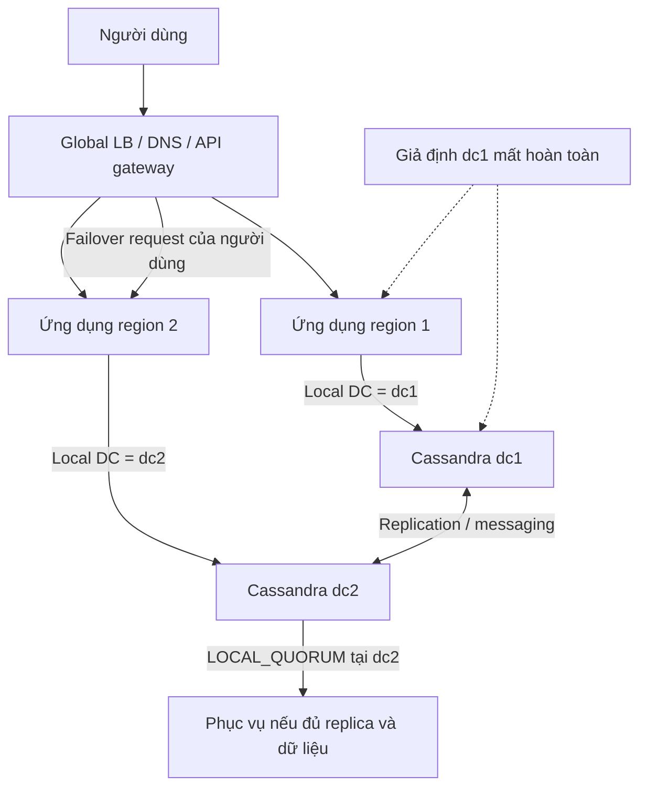

# Mất một datacenter và lựa chọn tuyến kết nối/khả dụng

## 1. Khi một DC mất kết nối, ứng dụng có còn đọc và ghi được không?

Apache Cassandra là cơ sở dữ liệu **wide-column phân tán**, đặt nhiều bản sao của mỗi partition lên các node theo **replication strategy** của keyspace. Trong triển khai đa trung tâm dữ liệu (*multi-datacenter, multi-DC*), mỗi DC có thể chứa một số replica riêng. Khi **một DC bị mất điện, bị cô lập mạng WAN hoặc toàn bộ node không thể phục vụ**, những bản sao ở DC còn lại có thể tiếp tục xử lý CQL — **nếu** dữ liệu đã được nhân bản đầy đủ, số replica khỏe đạt **consistency level (CL)** và ứng dụng có đường kết nối thích hợp.

Ba câu hỏi phải tách riêng:

1. **Dữ liệu có ở DC sống sót không?** Phụ thuộc RF theo DC, tiến độ replication trước sự cố, bootstrap/repair và tình trạng replica.
2. **Request có đủ phản hồi theo CL không?** Phụ thuộc ngưỡng `LOCAL_ONE`, `LOCAL_QUORUM`, `QUORUM`, `EACH_QUORUM`, `ALL` và những node thực sự đáp ứng.
3. **Client có đi tới coordinator ở DC sống sót không?** Phụ thuộc hạ tầng ứng dụng, DNS/load balancer, chính sách chọn DC của Java Driver, auth/TLS và kết nối mạng.

Bài thuộc chương **Nhiều trung tâm dữ liệu** của mô-đun `DATABASE_ENGINE_WIDE_COLUMN_CASSANDRA`. Nó kết nối kiến trúc phân tán, partition key, mô hình bảng theo truy vấn và read/write consistency với vận hành replication, compaction, repair, lỗi hạ tầng và Java Driver. Trọng tâm không phải tạo thêm DC, mà là **ra quyết định về tuyến truy cập và mức khả dụng khi mất một DC**.

Kết thúc bài, người học cần tính được ngưỡng ACK/đọc, thiết kế hai tuyến ứng dụng phù hợp DC, nhận diện **data staleness/RPO**, phân biệt failover ứng dụng và failover của driver, có runbook cô lập sự cố và khôi phục an toàn.

## 2. Điều kiện nền: RF theo từng DC và node thực sự giữ dữ liệu

Giả sử cluster có hai DC, mỗi DC ba node:

```text
             Vùng/Region 1                   Vùng/Region 2
           +----------------+              +----------------+
           |   Cassandra    |    WAN       |   Cassandra    |
           | dc1: A, B, C   |<------------>| dc2: D, E, F   |
           +----------------+              +----------------+
                   ^                                ^
                   |                                |
             App ở region 1                   App ở region 2
                   ^                                ^
                   +------ Global traffic route ----+
                              (DNS / LB)
```

Ví dụ keyspace sử dụng `NetworkTopologyStrategy`:

```sql
CREATE KEYSPACE shop_ks
WITH replication = {
    'class': 'NetworkTopologyStrategy',
    'dc1': 3,
    'dc2': 3
}
AND durable_writes = true;
```

Đối với **mỗi partition**, khi topology có đủ node phù hợp, Cassandra phân công **3 natural replicas ở dc1 và 3 ở dc2**. RF tổng logic của keyspace là **6**, không phải 3. Các DC khác nhau có thể chứa cùng một partition, nhưng SSTable, lịch compaction và thời điểm cập nhật trên từng replica **không nhất thiết giống nhau tuyệt đối**.

Trên hệ thống thật, xác nhận:

```sql
SELECT keyspace_name, replication, durable_writes
FROM system_schema.keyspaces
WHERE keyspace_name = 'shop_ks';

SELECT data_center, rack
FROM system.local;
```

Truy vấn `system.local` ở **từng node hoặc mỗi phiên cqlsh kết nối tới DC tương ứng** để biết DC/rack theo node đó, không coi kết quả từ một coordinator là mô tả của mọi node. Đồng thời xem `nodetool status`, `nodetool ring shop_ks` và snitch thực tế.

**Điều kiện cần:** keyspace phải thực sự nhân bản ở DC còn sống. Nếu `dc2` có RF = 0 hoặc mới đổi metadata lên RF = 3 nhưng dữ liệu lịch sử **chưa được stream/repair đầy đủ**, việc một DC còn ba node Up **không bảo đảm** ứng dụng đọc được mọi dữ liệu tại đó.

## 3. Sơ đồ mất DC: ba loại failover khác nhau



Có **ba tầng chuyển hướng** không nên nhập làm một:

| Tầng | Ai quyết định? | Điều thay đổi? |
| --- | --- | --- |
| **Tầng người dùng/HTTP** | Global load balancer, DNS, API gateway, orchestration | Lưu lượng từ region 1 chuyển tới **ứng dụng sống ở region 2**. |
| **Tầng Java Driver → coordinator** | Load-balancing policy, `local-datacenter`, contact points, kết nối | Ứng dụng region 2 chọn **node Cassandra của dc2** để gửi CQL. |
| **Tầng coordinator → replicas** | Replication strategy, token, RF, CL | Coordinator dc2 liên hệ các replica phù hợp và chờ đủ ACK/response theo CL. |

**Cassandra không tự di chuyển ứng dụng HTTP** khi DC hỏng. Driver không làm thay nhiệm vụ global traffic failover. Ngược lại, DNS đưa người dùng đến region 2 cũng chưa chứng minh phiên Java tại đó kết nối tới các coordinator của dc2 và dùng CL khả dụng.

## 4. Tính chính xác khả dụng: RF = 3 ở mỗi DC

Quorum của \(N\) bản sao được tính:

\[
Q(N) = \left\lfloor \frac{N}{2} \right\rfloor + 1
\]

Với `NetworkTopologyStrategy {dc1: 3, dc2: 3}`:

- `LOCAL_QUORUM` tại **dc2** = `Q(3) = 2` replica **ở dc2**.
- `QUORUM` toàn keyspace = `Q(3 + 3) = Q(6) = 4` replica **bất kỳ DC**, đúng ngưỡng/quy tắc của thao tác.
- `EACH_QUORUM` khi **ghi** = `2 ở dc1 và 2 ở dc2`.
- `ALL` = **6 replica**.

Giả sử **dc1 mất hoàn toàn**, còn D/E/F ở dc2 khỏe mạnh và coordinator nhận request **tại dc2**:

| Consistency level | Đọc được? | Ghi được? | Lý do trong tình huống này |
| --- | --- | --- | --- |
| `LOCAL_ONE` | Có thể | Có thể | Chỉ cần **1 replica ở dc2** phản hồi; dữ liệu có thể cũ. |
| `ONE` | Có thể | Có thể | Cần 1 replica; không ràng buộc DC ở ngữ nghĩa CL, dù coordinator ở dc2 thường ưu tiên local. |
| `TWO` | Có thể | Có thể | Cần 2 replica; D/E/F có thể đáp ứng. |
| `THREE` | Có thể | Có thể | Cần 3 replica; đủ D/E/F nếu cả ba khỏe. |
| **`LOCAL_QUORUM`** | **Có thể** | **Có thể** | Cần **2/3 replica của dc2**; không phải chờ dc1. |
| **`QUORUM`** | **Không** | **Không** | Cần **4/6**; dc2 chỉ còn 3, dù cả ba đều Up. |
| **`EACH_QUORUM`** | Không áp dụng cho đọc | **Không** | Ghi phải có **2 ACK ở mỗi DC**, nhưng dc1 không phản hồi. |
| **`ALL`** | **Không** | **Không** | Cần cả 6 replica. |
| `ANY` | Không áp dụng cho đọc | Có thể | Ghi có thể được xác nhận chỉ bằng hint, không bảo đảm replica thực đã có dữ liệu. |

**“Có thể” không phải cam kết thành công tuyệt đối**: giả định dữ liệu đã được nhân bản, mạng tới dc2 thông suốt, node khỏe và request hoàn tất trước timeout. Một replica `UN` vẫn có thể chậm bởi CPU, GC, I/O hoặc network.

### Trường hợp bất đối xứng: dc1 RF = 3, dc2 RF = 2

Nếu keyspace có `{dc1: 3, dc2: 2}`, **tổng RF = 5** và `QUORUM = 3`. Khi **dc2 mất**, dc1 còn 3 replica thì `QUORUM` **có thể** đáp ứng; khi **dc1 mất**, dc2 còn 2 replica thì `QUORUM` **không thể** đáp ứng. Trong dc2, `LOCAL_QUORUM = 2/2`, tức **một node dc2 chậm/down cũng đủ làm local quorum không đạt**.

Vì vậy không được kết luận đơn giản “QUORUM luôn ngừng khi mất một DC” hay “LOCAL_QUORUM luôn chịu được thêm một node hỏng”: phải **tính RF theo từng DC và vị trí coordinator**.

## 5. Chọn CL nào khi ưu tiên tiếp tục hoạt động?

| Nhu cầu nghiệp vụ | Lựa chọn thường cân nhắc | Giá phải trả / giới hạn |
| --- | --- | --- |
| Phục vụ request tại DC còn sống, không chờ WAN | Đọc/ghi `LOCAL_QUORUM` tại dc còn sống (khi RF đủ) | Không cam kết bản ghi vừa ACK ở DC đã chết **đã đến DC kia**. |
| Đọc rất nhanh, chấp nhận nguy cơ dữ liệu cũ | `LOCAL_ONE` tại DC đang phục vụ | Không có giao nhau giữa read/write quorum; khả năng stale read cao hơn. |
| Chỉ trả success khi cả hai DC đều xác nhận ghi ở mức quorum địa phương | Write `EACH_QUORUM` | Khi mất một DC, **không còn nhận được ghi**. |
| Yêu cầu đa số replica trên toàn keyspace | `QUORUM` | Với RF3+3, mất một DC khiến đọc/ghi `QUORUM` không thể đạt; tăng độ trễ WAN trong nhiều trường hợp. |
| Cần cả sáu replica trả ACK | `ALL` | Độ khả dụng rất thấp trước một DC outage hoặc một replica chậm. |

**Không “cứ thấy `Unavailable` là đổi về `ONE`”**. Hạ CL có thể giúp một request hoàn tất nhưng thay đổi hợp đồng consistency và khả năng quan sát dữ liệu cũ. CL là một phần của yêu cầu nghiệp vụ và phải được quyết định **trước sự cố**, được kiểm thử và ghi nhận cùng RPO/RTO.

**EACH_QUORUM chỉ dùng cho ghi thông thường**, không phải một read CL. Với Lightweight Transactions (`IF NOT EXISTS`, `IF ...`), Cassandra còn có **serial consistency** `SERIAL`/`LOCAL_SERIAL`; không lấy bảng ACK ghi thường để khẳng định thao tác đồng thời có điều kiện là an toàn xuyên DC.

## 6. Tính sẵn sàng không đồng nghĩa tính mới và độ bền xuyên DC

Giả sử ở region 1:

1. Ứng dụng ghi `order-42 = PAID` qua coordinator dc1 với **write CL = LOCAL_QUORUM**.
2. Replica A và B ở dc1 ACK, nên ứng dụng nhận **success**.
3. Cassandra vẫn cố phân phối mutation tới các natural replicas ở dc2, **nhưng success tại dc1 không đòi đợi dc2 ACK**.
4. Ngay sau đó, toàn dc1 mất kết nối trước khi dc2 nhận đầy đủ mutation.
5. Lưu lượng người dùng chuyển tới ứng dụng/dc2; `SELECT` ở `LOCAL_QUORUM` tại dc2 **có thể còn thấy trạng thái cũ**.

```mermaid
sequenceDiagram
    participant App1 as App region 1
    participant Q1 as Coordinator dc1
    participant R1 as Replica dc1
    participant R2 as Replica dc1
    participant Q2 as Replicas dc2
    participant App2 as App region 2
    App1->>Q1: UPDATE order-42; LOCAL_QUORUM
    Q1->>R1: mutation
    Q1->>R2: mutation
    Q1-->>Q2: Replication có thể đến muộn
    R1-->>Q1: ACK
    R2-->>Q1: ACK
    Q1-->>App1: Success
    Note over Q1,Q2: dc1 mất trước khi dc2 cập nhật đầy đủ
    App2->>Q2: SELECT; LOCAL_QUORUM tại dc2
    Q2-->>App2: Có thể là giá trị cũ
```

Điều này giải thích **RPO (Recovery Point Objective)**: mức dữ liệu gần nhất có thể mất/không còn thấy khi chuyển vùng. Với write `LOCAL_QUORUM`, **không có cam kết RPO = 0 xuyên DC** chỉ vì cả hai DC đều có RF = 3. Đọc `LOCAL_QUORUM` tại dc2 ngay sau khi một ghi được xác nhận ở dc1 **không bảo đảm read-your-writes xuyên DC**; quorum địa phương của hai DC không giao nhau.

**RTO (Recovery Time Objective)** là thời gian để người dùng lại có dịch vụ. Nó phụ thuộc phát hiện lỗi, health check, chuyển HTTP traffic, khởi động ứng dụng dự phòng, driver connections, DNS TTL/route, xác nhận dữ liệu và quyết định mở ghi — không thể tính chỉ từ RF và CL.

| Trạng thái | Kết luận có thể đưa ra |
| --- | --- |
| dc2 còn đủ replica và ứng dụng kết nối được | Có nền tảng để tiếp tục phục vụ ở CL địa phương. |
| Ghi dc1 `LOCAL_QUORUM` đã success | Không đảm bảo mutation đó đã ACK ở dc2. |
| Ghi ở mức `EACH_QUORUM` thành công **trước sự cố** | Đã có ACK ở cả hai DC theo ngưỡng của lệnh, nhưng vẫn phải xét commit log/durability và lỗi đồng thời. |
| dc2 đọc ra một giá trị | Không chứng minh mọi partition đã cập nhật hoặc mọi ghi dc1 đã đến. |
| dc1 không phục hồi, mutation chỉ tồn tại trên dc1 | Hints/repair từ dc2 **không thể tái tạo dữ liệu không còn bản sao nào giữ**; cần bản backup hoặc nguồn nghiệp vụ khác. |

Vì thế khi thiết kế DR, cần có **backup độc lập, quy trình đối soát nghiệp vụ, idempotency** và quyết định có nên tạm dừng những thao tác nhạy cảm (thanh toán, chuyển tiền, cấp phát ID nghiệp vụ...) lúc chưa biết RPO.

## 7. Java Driver 4.x: tuyến local DC là lựa chọn có chủ đích

### 7.1. Mỗi vùng ứng dụng dùng driver local với DC của mình

Java Driver 4.x có load-balancing policy định tuyến trong **local datacenter** theo mặc định; nếu ứng dụng khai báo contact points cụ thể, nên đặt `local-datacenter` rõ ràng. Ví dụ ứng dụng ở region 2:

```java
import java.net.InetSocketAddress;
import java.util.UUID;
import com.datastax.oss.driver.api.core.CqlSession;
import com.datastax.oss.driver.api.core.DefaultConsistencyLevel;
import com.datastax.oss.driver.api.core.cql.*;

// IP TEST-NET ví dụ; trên thực tế dùng node ở dc2 có thể kết nối đến.
try (CqlSession session = CqlSession.builder()
        .addContactPoint(new InetSocketAddress("192.0.2.21", 9042))
        .addContactPoint(new InetSocketAddress("192.0.2.22", 9042))
        .withLocalDatacenter("dc2")
        .build()) {

    PreparedStatement ps = session.prepare(
        "SELECT status FROM shop_ks.orders_by_customer " +
        "WHERE customer_id = ? AND order_id = ?");

    BoundStatement request = ps.bind(
        "cust-42", UUID.fromString("11111111-2222-3333-4444-555555555555"))
        .setConsistencyLevel(DefaultConsistencyLevel.LOCAL_QUORUM);

    Row row = session.execute(request).one();
    System.out.println(row == null ? "<missing>" : row.getString("status"));
}
```

Giả định schema có bảng/khóa như mục lab, contact points thực tế dùng địa chỉ hợp lệ và tài khoản/TLS được cấu hình riêng. Chỉ định **`withLocalDatacenter("dc2")`** giúp driver ưu tiên các node dc2 và không vô ý coi dc1 là local. Sau failover vùng, cần bảo đảm **toàn bộ ứng dụng, session, connection pool, health check** được cấu hình theo dc còn sống.

**Không chỉ thay IP rồi giữ `withLocalDatacenter("dc1")`** và mong load-balancing tự hiểu ý định DR. `LOCAL_QUORUM` được tính theo DC **của coordinator thực tế**, không phải luôn theo nhãn vùng HTTP hay tên DC mà người vận hành muốn dùng. Định tuyến và consistency phải phù hợp nhau.

### 7.2. Chuyển lưu lượng HTTP đến ứng dụng vùng sống sót là lựa chọn chuẩn

Với hai region có cả ứng dụng và Cassandra:

- Bình thường, người dùng vùng 1 → App 1 → driver local dc1; người dùng vùng 2 → App 2 → driver local dc2.
- Khi dc1/region 1 mất, load balancer hoặc service discovery điều hướng traffic sang **App 2**, vốn đã có session với `local-datacenter = dc2`.
- App 2 thực hiện request ở CL đã được thiết kế cho tình huống DR; không cần khởi tạo đường WAN xuyên vùng mất điện.

Ưu điểm là **phân tách tuyến người dùng và tuyến database**, dễ áp chính sách mạng, TLS, capacity và khống chế failback. Điều này đòi App 2 có đủ CPU/connection pool/capacity cho lưu lượng tăng và có đường truy cập các phụ thuộc khác (queue, object storage, IAM...) của hệ thống.

### 7.3. Tùy chọn failover trực tiếp từ driver: có nhưng không mặc định

**Java Driver 4.10+** bổ sung **cross-datacenter failover tùy chọn** trong built-in load-balancing policy. Ví dụ cấu hình dành cho **môi trường kiểm thử**:

```hocon
datastax-java-driver {
  basic.load-balancing-policy.local-datacenter = dc1
  advanced.load-balancing-policy.dc-failover {
    max-nodes-per-remote-dc = 2
    allow-for-local-consistency-levels = true
  }
}
```

Lưu ý bắt buộc:

- Mặc định `max-nodes-per-remote-dc = 0`: failover **bị tắt**. Chỉ khi chọn giá trị dương, một số node remote mới có thể vào query plan.
- Mặc định driver **không** failover những request dùng `LOCAL_ONE`/`LOCAL_QUORUM`/`LOCAL_SERIAL` sang remote. `allow-for-local-consistency-levels = true` là **bật hành vi nhạy cảm**, phải được chấp nhận rủi ro trước.
- Nếu RF địa phương dc1 = 3 nhưng dc2 = 1, yêu cầu `LOCAL_QUORUM` qua coordinator dc2 chuyển từ **2 ACK** thành **1 ACK**. Đó là **thay đổi ngữ nghĩa nhất quán**, không chỉ đổi đường truyền.
- Remote traffic có thể tăng đột ngột trong WAN outage; nếu mọi app vẫn ở region 1 và region 1 đã sập, failover trong driver **không cứu được ứng dụng đã chết**.
- Driver 4.x **trước 4.10** không có tính năng failover này trong built-in policy. Tên tùy chọn và khả năng dùng phải kiểm tra đúng minor version.

**Khuyến nghị thiết kế:** Với hạ tầng đa vùng đầy đủ, ưu tiên **global application traffic failover** cùng một driver local DC ở mỗi vùng. Chỉ chọn failover xuyên DC ở tầng driver khi đã thử đủ latency WAN, CL, capacity, auth/TLS, network policy và tác động đến RPO.

## 8. Tách “DC thật sự chết” khỏi “mạng WAN bị phân vùng”

Một sự cố WAN partition không đồng nghĩa tất cả node ở DC kia bị tắt. Hai DC có thể **đều sống** và phục vụ client của riêng mình nhưng không thấy nhau:

```text
dc1: A/B/C <----X  WAN bị phân vùng  X----> dc2: D/E/F
    App 1 vẫn ghi LOCAL_QUORUM             App 2 vẫn ghi LOCAL_QUORUM
    cùng partition K                       cùng partition K
```

Với RF3 mỗi DC, cả hai bên vẫn có thể nhận **ghi `LOCAL_QUORUM`** trong lúc phân vùng. Khi kết nối phục hồi, các mutation phải được phân phối/đối soát và Cassandra giải quyết xung đột theo **timestamp và quy tắc reconciliation** (có cả tombstone), **không** hiểu logic nghiệp vụ như “trừ tồn kho hai lần là sai”.

Ví dụ hai vùng cùng ghi `balance` hoặc `order.status` vào một ô CQL mà không phối hợp: giá trị cuối cùng theo timestamp **không phải** tổng của hai cập nhật và có thể làm mất một quyết định nghiệp vụ. LWT hoặc một giao thức phối hợp có điều kiện riêng cũng cần được đánh giá theo phạm vi SERIAL/LOCAL_SERIAL và topology.

Để tránh split-brain ở tầng nghiệp vụ:

1. Có **quyền writer duy nhất** hoặc cơ chế phân quyền/epoch/fencing rõ ràng cho các dữ liệu yêu cầu thứ tự.
2. Cấp **idempotency key** và mã giao dịch ổn định để retry/failover không tạo hai hành động.
3. Phân biệt **trạng thái phục vụ đọc** với **được phép nhận ghi nhạy cảm** trong health checks.
4. Sau phục hồi, đối soát các nghiệp vụ đã phát sinh ở cả hai phía; repair dữ liệu replica không tự giải quyết mọi xung đột nghiệp vụ.

## 9. Runbook khi phát hiện mất toàn bộ một DC

### Bước 1 — Xác minh phạm vi sự cố, không đoán từ một lỗi client

Thu trạng thái từ **node sống sót** và hệ thống giám sát:

```bash
nodetool status
nodetool describecluster
nodetool netstats
nodetool tpstats
```

Đối chiếu với health của vùng ứng dụng, link WAN, khả năng mở CQL port, log/gossip và các metric `ClientRequest.Read/Write.Latency`, `Timeouts`, `Unavailables`, `Failures`. Một node `DN` theo gossip có thể là lỗi mạng giữa hai DC; không tùy tiện khởi replacement nếu node đó **vẫn sống và có thể quay trở lại**.

### Bước 2 — Tính lại số replica phục vụ được cho **từng keyspace**

```sql
SELECT keyspace_name, replication
FROM system_schema.keyspaces
WHERE keyspace_name IN ('shop_ks');
```

Xác định keyspace nào có replica ở dc2, RF của dc2, số replica local còn khỏe, DC/rack và CL thật của từng loại query. Không suy từ keyspace `shop_ks` rằng keyspace khác cũng có `dc2:3`. Ghi rõ **đọc** và **ghi** có cùng khả năng đáp ứng hay không.

### Bước 3 — Ra quyết định rõ về tuyến người dùng và khả năng nhận ghi

- Chuyển global HTTP traffic sang ứng dụng của DC còn sống sau **health check end-to-end**.
- Xác nhận driver/session của ứng dụng đó có `local-datacenter` và contact points đúng.
- Với query dùng `LOCAL_QUORUM`, đảm bảo đủ quorum ở dc còn sống; không dùng CL global `QUORUM` theo quán tính nếu RF3+3 và đã mất một nửa số replica.
- Nếu không biết các ghi cuối cùng của DC bị mất đã đến DC còn sống hay chưa, xem xét **chế độ read-only hoặc giới hạn một số luồng ghi nhạy cảm** theo chính sách RPO/RTO.

**Không đưa CL từ `QUORUM` xuống `ONE` trên toàn bộ ứng dụng chỉ để loại timeout** khi chưa đánh giá ngữ nghĩa nghiệp vụ và khả năng quan sát dữ liệu cũ.

### Bước 4 — Giám sát trong failover

Theo dõi throughput/p99 của **App 2 và dc2**, vì nó có thể phải xử lý lượng traffic gấp đôi. Kiểm tra local replica latency, disk free, GC, queue, số connection, timeout và số session từ driver. Hạn chế tác vụ quản trị tranh tài nguyên như full repair/compaction lớn trong lúc phải giữ SLO, trừ khi runbook recovery yêu cầu.

### Bước 5 — Bảo toàn bằng chứng và xử lý những request có kết quả không xác định

Một request ghi ở DC vừa hỏng có thể đã ACK nhưng client mất phản hồi, hoặc đã được client xác nhận mà chưa tới DC còn sống. Ghi nhận request ID, `order_id`, timestamp nghiệp vụ và kết quả trước khi retry. Retry phải **idempotent** theo thiết kế; không tự cấp UUID khác cho cùng đơn hàng sau timeout.

### Bước 6 — Khi DC hỏng quay lại, **không failback ngay**

Xác minh node, rack/DC, schema, token, disk, gossip và `netstats`. Kiểm tra hints có còn, outage dài bao lâu, repair cuối thành công và có tombstone nào đã qua `gc_grace_seconds` hay không.

Nếu DC mất quá lâu, node chứa dữ liệu cũ có nguy cơ làm **zombie data** xuất hiện sau khi tombstone tại replica khỏe đã bị dọn. Khi đó cần quy trình khôi phục/rebuild/replace và đối soát phù hợp, **không** đơn giản đưa toàn bộ node cũ vào phục vụ ghi ngay. Repair cần xem phạm vi token range, từng keyspace, tình trạng repaired/unrepaired và trạng thái streaming theo phiên bản.

### Bước 7 — Repair/đối soát và failback có kiểm soát

Chỉ sau khi DC đã ổn định và có kế hoạch repair đủ phạm vi, theo dõi kết quả anti-entropy giữa các replica. Đối soát dữ liệu nghiệp vụ phát sinh trong outage, kiểm tra client read/write ở CL thích hợp, sau đó chuyển dần traffic về DC cũ bằng canary/traffic weights. Tránh điều hướng quá nhanh làm quá tải hoặc tạo split-brain write.

### Bước 8 — Đóng sự cố bằng các chỉ số có thể kiểm chứng

Ghi **RTO thực**, phạm vi dữ liệu nghi thiếu (RPO quan sát được), số request timeout/retry, token range đã repair, trạng thái DC/rack, thời điểm hoàn tất backfill, mức lệch dữ liệu/đối soát, latency p95/p99 và hành động phòng ngừa.

## 10. Thực hành CQL an toàn: mô phỏng quyết định failover

> Chỉ dùng **cluster thử nghiệm** có hai DC, mỗi DC đủ ba node. Thay `dc1`/`dc2` bằng đúng tên DC thực tế. Không ngắt nguồn, chặn WAN hoặc tắt node production để hoàn thành bài học.

### 10.1. Tạo keyspace và bảng theo truy vấn

```sql
CREATE KEYSPACE shop_ks
WITH replication = {
    'class': 'NetworkTopologyStrategy',
    'dc1': 3,
    'dc2': 3
}
AND durable_writes = true;

CREATE TABLE shop_ks.orders_by_customer (
    customer_id text,
    order_id uuid,
    status text,
    total decimal,
    updated_at timestamp,
    PRIMARY KEY ((customer_id), order_id)
);

INSERT INTO shop_ks.orders_by_customer
    (customer_id, order_id, status, total, updated_at)
VALUES
    ('cust-42',
     11111111-2222-3333-4444-555555555555,
     'CREATED', 125.50, toTimestamp(now()));
```

Partition key là `customer_id`; Cassandra chọn replica theo token của trường này. Giả sử hai DC đã **bootstrap và đồng bộ dữ liệu đầy đủ** trước khi kiểm thử.

### 10.2. Kết nối và đối chiếu CL từ mỗi DC

Ở terminal kết nối tới **node dc1**:

```bash
# Địa chỉ ví dụ, thay bằng host phù hợp trong lab.
cqlsh 192.0.2.11 9042
```

Trong cqlsh:

```sql
SELECT data_center FROM system.local;
CONSISTENCY LOCAL_QUORUM

SELECT customer_id, order_id, status
FROM shop_ks.orders_by_customer
WHERE customer_id = 'cust-42'
  AND order_id = 11111111-2222-3333-4444-555555555555;
```

Lặp lại với **node dc2**; `SELECT data_center FROM system.local` phải cho thấy dc2. Quan sát dữ liệu có giống nhau không, và nhớ rằng **một lần đọc thành công không chứng minh mọi partition đã đồng bộ**.

Sau đó tính trên giấy hoặc trong bảng lab:

| Thử nghiệm giả định | RF/CL | Kỳ vọng nếu dc1 không phản hồi, dc2 có D/E/F khỏe |
| --- | --- | --- |
| Đọc tại coordinator dc2 | RF3+3, `LOCAL_QUORUM` | Có thể đọc với 2 ACK từ dc2. |
| Ghi tại coordinator dc2 | RF3+3, `LOCAL_QUORUM` | Có thể ghi với 2 ACK từ dc2, remote replica có thể nhận muộn. |
| Đọc tại coordinator dc2 | RF3+3, `QUORUM` | Không đạt 4/6 ACK; kỳ vọng lỗi theo CL. |
| Ghi tại coordinator dc2 | RF3+3, `EACH_QUORUM` | Không đạt quorum dc1; không success theo CL. |
| Đọc tại coordinator dc2 | RF3+3, `LOCAL_ONE` | Có thể đọc một replica dc2 nhưng có nguy cơ stale. |

Trong lab riêng biệt có công cụ tạo lỗi và khả năng khôi phục, có thể kiểm tra ma trận bằng cách **mô phỏng** sự cố một DC. Nếu không có môi trường như vậy, bài vẫn hoàn thành bằng phép tính CL, quan sát topology và chạy từng query khi cả hai DC khỏe mạnh.

### 10.3. Đọc metrics để phân biệt lỗi tuyến với lỗi CL

```bash
nodetool status shop_ks
nodetool netstats
nodetool tpstats
```

Một lỗi `NoNodeAvailableException` hoặc `AllNodesFailedException` ở Java Driver là tín hiệu **chưa thực thi được qua các coordinator trong query plan**; cần xem lỗi theo từng node (ở Driver 4.14+ một số trường hợp node bận không còn trả `NoNodeAvailableException` mà trả `AllNodesFailedException`). `UnavailableException` từ Cassandra cho biết coordinator không đủ replica sẵn sàng để đạt CL; `ReadTimeoutException`/`WriteTimeoutException` có thể xảy ra khi không đủ phản hồi kịp thời. Không nên dùng cùng một biện pháp cho cả ba nhóm.

## 11. Bảng xử lý sự cố nhanh

| Triệu chứng | Kiểm tra đầu tiên | Quyết định an toàn |
| --- | --- | --- |
| dc2 khỏe nhưng App 1 không kết nối được Cassandra | App 1 còn sống? Driver `local-datacenter` là dc1? Remote failover có bật không? | Ưu tiên chuyển traffic sang App 2 có driver local dc2; không đổi cấu hình driver mù quáng. |
| `LOCAL_QUORUM` ở dc2 bị `Unavailable` | RF dc2, node sống, coordinator đang ở DC nào? | Khôi phục đủ replica/local route; đừng hạ CL nếu nghiệp vụ không cho phép. |
| `QUORUM` ngừng khi dc1 down | Tổng RF và quorum là bao nhiêu? Với 3+3 cần 4 | Nếu DR yêu cầu chạy khi một DC mất, phải thiết kế trước CL local hoặc topology khác, không ứng cứu bằng giả định. |
| App 2 đọc thấy trạng thái cũ sau failover | Ghi cuối có ACK xuyên dc2 chưa? Hints/repair, timestamps, TTL | Xác định RPO, giới hạn hành động nhạy cảm, đối soát business events. |
| Hai DC đều Up nhưng ghi khác nhau sau WAN partition | Writer còn hoạt động cả hai bên? Cùng khóa? Timestamp nào thắng? | Kiểm soát quyền ghi/fencing, xử lý xung đột nghiệp vụ và repair. |
| Driver failover trực tiếp gây WAN traffic đột biến | `max-nodes-per-remote-dc`, remote pool, request retries, local CL | Đánh giá lại thiết kế; ưu tiên app regional failover, capacity dự phòng. |
| DC cũ quay lại với dữ liệu rất cũ | Outage so với hints/grace, repair history, bootstrap status | Không failback ngay; dùng kế hoạch rebuild/repair và kiểm chứng. |
| `nodetool status` báo `UN` nhưng client vẫn chậm | Disk, GC, pending tasks, CL, network, driver pool | Điều tra nhiều lớp; trạng thái Up không bảo đảm đạt timeout/SLO. |

## 12. Những ngộ nhận cần loại bỏ

| Ngộ nhận | Điều đúng |
| --- | --- |
| “RF3 ở mỗi DC nghĩa là `QUORUM` chỉ cần 2 khi một DC mất.” | Sai. Tổng RF = 6, global `QUORUM` cần **4**, nên một DC còn 3 node là không đủ. |
| “`LOCAL_QUORUM` ở dc1 và dc2 là cùng một nhóm replica.” | Sai. Hai nhóm khác DC và không giao nhau bắt buộc; đọc dc2 có thể chưa thấy ghi vừa ACK ở dc1. |
| “Ứng dụng đã failover DNS thì Cassandra cũng tự đổi local DC.” | Sai. Driver có topology/load-balancing policy và session riêng, cần cấu hình đúng. |
| “Java Driver luôn tự gửi sang DC khác nếu local mất.” | Sai. Driver 4.x mặc định chỉ kết nối local DC; failover remote là tùy chọn phiên bản/cấu hình. |
| “Bật failover remote cho `LOCAL_QUORUM` không đổi consistency.” | Sai. Ngưỡng phụ thuộc RF tại DC **của coordinator mới**; có thể khác RF ban đầu. |
| “Mất một DC thì mọi ghi đã thành công ở đó có chắc ở DC kia.” | Sai với write `LOCAL_QUORUM`: remote ACK không phải điều kiện thành công. |
| “`UN` sau khôi phục có nghĩa dữ liệu replica đã hội tụ.” | Sai. Hints best effort, streaming/repair và độ dài outage vẫn phải được xem xét. |
| “Repair tự giải quyết được tất cả xung đột hai vùng.” | Sai. Anti-entropy xử lý sai khác bản sao, không biết quy tắc nghiệp vụ về thứ tự lệnh hay thanh toán. |
| “Hạ `QUORUM` xuống `ONE` là biện pháp failover an toàn cho mọi bảng.” | Sai. Thay CL có thể làm thay đổi freshness, độ bền quan sát được và hợp đồng ứng dụng. |

## 13. Bài tập tình huống và câu hỏi tự kiểm tra

**Tình huống A — 3+3:** Ứng dụng vùng 1 dùng `LOCAL_QUORUM`, vùng 2 đã chạy cùng schema. Toàn dc1 mất. Hãy vẽ đường người dùng → App 2 → coordinator dc2 → D/E/F. Ghi ngưỡng đọc và ghi, khả năng stale read của những mutation vừa ACK tại dc1 và các thành phần hạ tầng cần chuyển.

**Tình huống B — 3+2:** Với `NetworkTopologyStrategy {dc1:3, dc2:2}`, global `QUORUM` cần 3. So sánh hai trường hợp mất dc1 và mất dc2. Tại sao `LOCAL_QUORUM` ở dc2 cần cả hai node dc2?

**Tình huống C — WAN partition nhưng không DC nào chết:** Cả App 1 và App 2 cùng cập nhật `order.status` ở `LOCAL_QUORUM` tại DC của mình. Nêu vì sao đều có thể thành công, tại sao Cassandra không biết “trạng thái nghiệp vụ đúng” và cần cơ chế nào để tránh double-processing.

**Tình huống D — Driver 4.8:** App 1 đã xác định `local-datacenter = dc1`, dc1 mất hoàn toàn, dc2 khỏe. Giải thích tại sao không thể mặc định có remote failover và cách chuyển người dùng sang một ứng dụng có driver local dc2. So sánh với Driver 4.10+ khi remote failover được bật nhưng local CL phải được xem xét riêng.

**Câu hỏi ngắn:**

1. Vì sao `LOCAL_QUORUM` tại DC sống sót không cần ACK từ DC đã chết?
2. Vì sao `QUORUM` của RF3+3 không đạt chỉ với ba node dc2?
3. `EACH_QUORUM` dùng cho thao tác nào? Điều gì xảy ra khi mất toàn bộ một DC?
4. Điều kiện để RPO = 0 xuyên DC có suy ra từ write `LOCAL_QUORUM` không?
5. Vì sao đổi `local-datacenter` có thể đổi ngưỡng `LOCAL_QUORUM` khi RF từng DC khác nhau?
6. Sau khi dc1 quay lại, vì sao cần đối soát/repair trước failback? Outage dài hơn `gc_grace_seconds` tạo rủi ro gì?
7. Làm sao phân biệt `NoNodeAvailableException`/`AllNodesFailedException` tại driver với `UnavailableException` do consistency level?

**Tiêu chí hoàn thành:** Tính đúng ACK cho RF từng DC, chọn được tuyến ứng dụng/driver/coordinator khi mất một DC, phân biệt **khả dụng, độ mới dữ liệu và RPO/RTO**, có kế hoạch failover/failback và không đánh đồng việc node quay lại Up với replica đã sửa đủ dữ liệu.

## 14. Tài liệu tham khảo

- [Apache Cassandra — Dynamo / tunable consistency](https://cassandra.apache.org/doc/stable/cassandra/architecture/dynamo.html): ngữ nghĩa `LOCAL_QUORUM`, `QUORUM`, `EACH_QUORUM`, `ALL` và ngưỡng giao nhau giữa đọc/ghi.
- [Apache Cassandra — Replication strategy](https://cassandra.apache.org/doc/stable/cassandra/architecture/dynamo.html): nguyên tắc nhân bản và chọn replica theo topology.
- [Apache Cassandra Java Driver 4.18 — Load balancing](https://apache.github.io/cassandra-java-driver/4.18.0/core/load_balancing/): `local-datacenter`, định tuyến local và failover xuyên DC tùy chọn từ 4.10.
- [Apache Cassandra Java Driver 4.18 — Upgrade guide](https://apache.github.io/cassandra-java-driver/4.18.0/upgrade-README/): thay đổi một số lỗi driver `NoNodeAvailableException`/`AllNodesFailedException` từ 4.14.
- [Apache Cassandra — Hinted handoff](https://cassandra.apache.org/doc/stable/cassandra/managing/operating/hints.html): hint và giới hạn best effort khi replica tạm thời unavailable.
- [Apache Cassandra — Repair](https://cassandra.apache.org/doc/stable/cassandra/managing/operating/repair.html): Merkle tree, full/incremental repair và đối soát sau outage.
- [Apache Cassandra — cqlsh](https://cassandra.apache.org/doc/stable/cassandra/managing/tools/cqlsh.html): lệnh `CONSISTENCY` và cách kiểm tra CL trong lab.

**Kết luận:** Khi mất một datacenter, **RF theo DC xác định bản sao nào còn tồn tại; CL quyết định request có đạt ngưỡng phản hồi; routing ứng dụng và Java Driver quyết định request có đến đúng coordinator hay không**. Với RF3+3, `LOCAL_QUORUM` trên DC sống sót có thể duy trì dịch vụ, trong khi `QUORUM` toàn cluster, `EACH_QUORUM` và `ALL` không còn đạt. Tuy nhiên, phục vụ được không có nghĩa các ghi vừa ACK ở DC đã chết đã đến DC dự phòng. Một kế hoạch DR hoàn chỉnh phải bao gồm RPO/RTO, kiểm soát writer, năng lực vùng dự phòng, backup, đối soát và failback theo bằng chứng.
