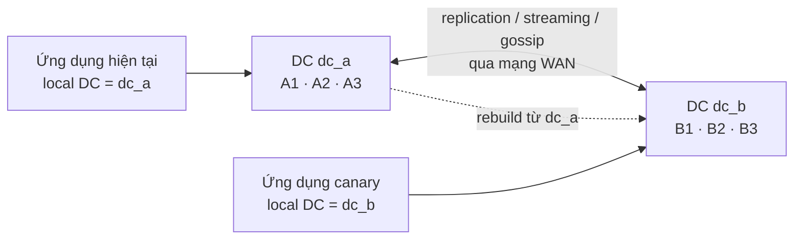
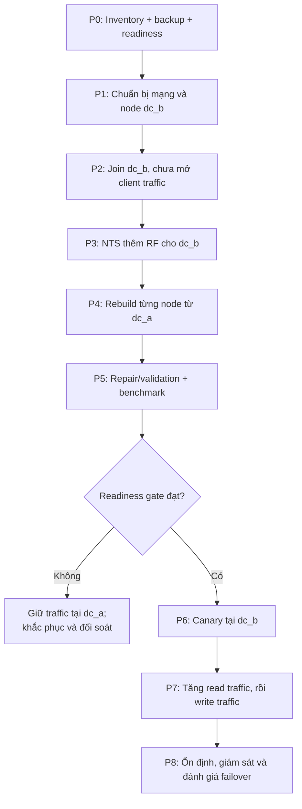

# Thêm datacenter mới, rebuild và chuyển dần tải ứng dụng

**Chương:** Nhiều trung tâm dữ liệu  
**Module:** `DATABASE_ENGINE_WIDE_COLUMN_CASSANDRA` — Apache Cassandra

Khi một ứng dụng mở rộng từ một datacenter (DC) sang hai datacenter, mục tiêu không chỉ là **thêm máy**. Ta phải điều chỉnh **vị trí bản sao**, **đường vận chuyển dữ liệu hiện có**, **consistency level của client**, **đường mạng giữa các DC** và **cách chuyển tải từng bước**. Nếu mở DC mới rồi lập tức cho ứng dụng đọc dữ liệu, node mới có thể tham gia ring nhưng chưa nhận đủ các hàng lịch sử: một truy vấn chạy thành công không đồng nghĩa kết quả đã đầy đủ.

Apache Cassandra là cơ sở dữ liệu wide-column phân tán; partition key được băm thành token, replica placement do replication strategy và topology quyết định. Kiến thức về khóa phân vùng, thiết kế bảng theo truy vấn, consistency level, replication, CQL, compaction, repair, xử lý lỗi và Java Driver đều được sử dụng ở đây. Bài này hướng dẫn **một lộ trình an toàn có điều kiện**: thêm datacenter `dc_b`, rebuild từ `dc_a`, xác minh dữ liệu và **chuyển dần traffic** mà không nhầm tính sẵn sàng với tính nhất quán.

> **Phạm vi:** Ví dụ sử dụng các khái niệm phổ biến trong Apache Cassandra 4.1/5.x. Tùy phiên bản/bản phân phối, cách đặt tên DC, cấu hình `auto_bootstrap`, lệnh repair/rebuild và cơ chế cloud/Kubernetes có thể khác. Thao tác thêm DC, thay RF và rebuild gây tải mạng/đĩa lớn; **chỉ thực hành trong cluster thử nghiệm** và dùng runbook đã kiểm chứng cho production.

## 1. Mục tiêu và điều kiện hoàn thành

Sau bài này, bạn cần:

1. Giải thích vì sao **thêm node vào DC mới** khác với tăng dung lượng trong DC cũ, và vì sao phải dùng `NetworkTopologyStrategy` (NTS).
2. Thiết kế ma trận RF theo DC, hiểu địa chỉ internode, snitch, rack, seeds và topology discovery.
3. Phân biệt **bootstrap**, **rebuild**, **repair** và **streaming**; chọn nguồn dữ liệu đúng khi rebuild DC mới.
4. Lập kế hoạch thay RF của keyspace hiện có, không bỏ quên keyspace liên quan đến auth/tracing hoặc metadata hệ thống do bản phân phối yêu cầu.
5. Quan sát quá trình truyền dữ liệu: `nodetool netstats`, disk headroom, streaming throughput, compaction, p95/p99 và lỗi.
6. Thiết kế kiểm tra trước khi mở client traffic mới, kể cả so sánh dữ liệu mẫu/histogram và xác định giới hạn của việc đọc thành công.
7. Điều khiển Java Driver để ứng dụng dùng **local datacenter** thích hợp và `LOCAL_QUORUM`/`LOCAL_ONE` có chủ đích.
8. Thực hiện chuyển tải theo canary → read traffic → write traffic → mở rộng, kèm ngưỡng dừng và quy trình rollback.
9. Phân tích WAN partition, hai DC độc lập cùng ghi và nguy cơ **last-write-wins** gây mất cập nhật theo nghiệp vụ.

**Tiêu chí hoàn tất không phải chỉ là `nodetool status` hiển thị thêm `UN`.** DC mới chỉ sẵn sàng phục vụ production khi cấu hình RF đúng, dữ liệu lịch sử được rebuild/đối soát, latency/throughput đủ và ứng dụng được chuyển lưu lượng theo từng giai đoạn có giám sát.

## 2. Mô hình triển khai: DC nguồn và DC đích

Giả sử có hai datacenter trong **cùng một Cassandra cluster**:

- `dc_a`: datacenter hiện hữu, ba node A1/A2/A3; đang phục vụ toàn bộ ứng dụng.
- `dc_b`: datacenter mới, ba node B1/B2/B3; ban đầu chưa phục vụ ứng dụng.
- Các node chạy phiên bản Cassandra tương thích, có kết nối internode theo đúng giao thức/cổng và topology metadata.
- Keyspace nghiệp vụ dùng `NetworkTopologyStrategy` với RF=3 trong mỗi DC sau mở rộng.
- Trong từng DC có đủ racks/fault domains để placement phù hợp mục tiêu chịu lỗi.



Một cụm Cassandra đa DC khác với hai cụm độc lập có ETL hai chiều: các DC dùng chung ring metadata và keyspace schema, trong khi replica được đặt theo DC. Nếu DC khác mạng/region, tính ổn định kết nối internode, firewall, latency và chi phí truyền WAN là những ràng buộc vận hành thực tế.

### 2.1. RF theo datacenter

Trước mở rộng:

```sql
-- Ví dụ schema hiện hành:
CREATE KEYSPACE IF NOT EXISTS shop
WITH replication = {
  'class': 'NetworkTopologyStrategy',
  'dc_a': 3
}
AND durable_writes = true;
```

Đích sau mở rộng:

```sql
ALTER KEYSPACE shop
WITH replication = {
  'class': 'NetworkTopologyStrategy',
  'dc_a': 3,
  'dc_b': 3
}
AND durable_writes = true;
```

Khi `dc_b: 3` được áp dụng, Cassandra hiểu bảng của keyspace `shop` **cần có ba replica tại dc_b**. Nhưng thay schema **không tự sao chép tức thời tất cả dữ liệu lịch sử** vào các node mới. Đó là lý do cần rebuild/repair phù hợp.

**Quan trọng:** NTS có thể có RF khác nhau theo DC, ví dụ `dc_a: 3`, `dc_b: 2`. Mọi phép tính `LOCAL_QUORUM` ở mỗi DC phải dùng **RF riêng của DC đó**. Đừng suy từ số node hoặc tổng RF toàn cụm rằng mỗi DC chịu được cùng số lỗi.

### 2.2. Rack và snitch có ý nghĩa gì?

Snitch quyết định Cassandra nhận diện node thuộc DC/rack nào. NTS cố gắng đặt các replica trên các rack khác nhau trong cùng DC nếu topology cho phép. Một node B3 bị cấu hình nhầm là `dc_a` không trở thành replica `dc_b` chỉ vì đặt vật lý ở vùng mạng mới.

Trước khi mở rộng, ghi rõ:

| Dữ liệu | Ví dụ | Lý do kiểm tra |
| --- | --- | --- |
| DC nguồn | `dc_a` | Là tên dùng trong `nodetool rebuild dc_a` |
| DC đích | `dc_b` | Phải trùng **chính tả và chữ hoa/thường** trong NTS/snitch |
| Rack/fault domain | `rack1`, `rack2`, `rack3` | Phân tán replica và nguy cơ lỗi chung |
| RF nguồn/đích | `3/3` | Quyết định số replica yêu cầu và CL |
| Seeds | Các endpoint còn sống, được phép liên lạc | Giúp node mới khám phá cluster; seeds không phải nơi lưu bản sao “chuẩn” |
| Internode addresses | IP/hostname routable giữa DC | Cho gossip/streaming/replication; khác native transport client |
| Disk/headroom | Đo trên từng node | Rebuild và compaction cần dung lượng vật lý |
| WAN bandwidth/latency | Đo thực tế | Giới hạn streaming và ảnh hưởng mutation |
| TLS/auth/ports | Theo chính sách hạ tầng | Không mở WAN tùy tiện để chạy thử |

## 3. Bốn cơ chế: join, bootstrap, rebuild, repair

| Hoạt động | Mục tiêu | Điều không nên hiểu sai |
| --- | --- | --- |
| **Join/discovery** | Node mới nhận biết ring, gossip và schema/topology | `UN` không có nghĩa đã có dữ liệu lịch sử |
| **Bootstrap** | Node mới gia nhập và stream dữ liệu để phục vụ ranges theo cơ chế của phiên bản | Thêm DC mới có thể dùng quy trình join **không auto-bootstrap**, sau đó rebuild riêng |
| **Rebuild** | Trên node đích, yêu cầu nhận dữ liệu nó cần từ các node nguồn, thường từ DC khác | Rebuild không phải full audit mọi replica nguồn; nguồn chưa đồng bộ có thể cung cấp dữ liệu chưa hoàn chỉnh |
| **Anti-entropy repair** | So sánh dữ liệu trên các replicas/ranges và bù phần sai lệch theo phạm vi | Repair không thay thế cấu hình RF hoặc bảo đảm dữ liệu lịch sử được tự động tải đúng nếu chưa có nguồn |

**Điểm khác nhau lớn:** ở DC mới, không nên để node tự phục vụ đọc lịch sử chỉ vì chúng có token và status `UN`. Quy trình điển hình cho một DC mới là cho các node gia nhập theo cách được runbook/phiên bản hỗ trợ, cập nhật replication rồi **chạy rebuild trên từng node trong DC mới, chỉ rõ DC nguồn đang có dữ liệu**.

Cú pháp phổ biến (xác minh bằng `nodetool help rebuild` trên cluster):

```bash
# Thực thi trên từng node thuộc dc_b:
nodetool rebuild dc_a
```

Với các phiên bản hỗ trợ cú pháp phân cách option:

```bash
nodetool rebuild -- dc_a
```

`dc_a` là **tên datacenter nguồn**, không phải node IP, keyspace hay DC đích. Đừng mặc định bỏ tham số nguồn vẫn an toàn: tùy topology/phiên bản, rebuild chọn nguồn không phù hợp có thể không nhận được dữ liệu bạn kỳ vọng.

### Rebuild có phải “đọc mọi replica rồi chọn bản mới nhất” không?

Không. Rebuild dùng các nguồn được chọn cho các token ranges cần nhận; nó không phải phép kiểm định nghiệp vụ đa bản sao hay mặc nhiên hòa giải **tất cả** nguồn như một read quorum. Nếu một nguồn ở `dc_a` đang thiếu mutation/tombstone hoặc cluster chưa repair đúng, dữ liệu chuyển qua `dc_b` có thể không hoàn chỉnh. Vì thế:

1. Đánh giá sức khỏe, lịch repair và tính hội tụ của DC nguồn **trước** khi rebuild.
2. Chỉ rebuild khi các nguồn phù hợp còn đủ dữ liệu, không có outage lớn.
3. Sau rebuild, có kế hoạch **full repair/validation theo phạm vi phù hợp**, đặc biệt khi vừa tăng RF.
4. Không dùng rebuild như backup thay cho snapshot/restore.

## 4. Kế hoạch nhiều giai đoạn và điểm dừng

Đừng thực hiện tất cả các thao tác trong một lệnh triển khai duy nhất.



**Đây là khung điều phối**, không khẳng định mọi phiên bản bắt buộc cùng thứ tự cấu hình từng chi tiết. Một số runbook dùng khai báo DC mới với RF=0 trước khi join, một số thay RF sau khi có node mới. Phải đối chiếu khả năng hỗ trợ `RF=0`, thời điểm thay RF, `auto_bootstrap` và metadata của Cassandra/nhà cung cấp trước khi chạy. Mục tiêu bất biến là: **không mở ứng dụng tới DC đích khi nó chưa nhận/đối soát dữ liệu**.

## 5. P0 — Inventory và điều kiện an toàn trước thay đổi

### 5.1. Cluster health và schema

Trên các node hiện hữu:

```bash
nodetool status
nodetool describecluster
nodetool info
nodetool compactionstats
nodetool netstats
```

Trong `cqlsh`:

```sql
SELECT cluster_name, partitioner, release_version
FROM system.local;

SELECT data_center, rack, host_id
FROM system.local;

SELECT keyspace_name, replication
FROM system_schema.keyspaces;
```

Ghi các keyspace nghiệp vụ cần mở rộng và **các keyspace hệ thống có replication cấu hình được** theo phiên bản và chính sách nhà cung cấp, như `system_auth`, `system_distributed`, `system_traces` khi thích hợp. Không sao chép một lệnh `ALTER` cho mọi keyspace `system_*`: một số keyspace được quản lý nội bộ hoặc không thể/không nên sửa thủ công. Nếu bỏ sót auth/tracing, DC mới có thể thiếu dữ liệu cần cho truy cập/điều hành dù bảng nghiệp vụ đã rebuild.

### 5.2. Dữ liệu và vận hành

- Ghi số liệu base: read/write p50/p95/p99, request timeout/unavailable, throughput theo DC, lỗi driver.
- Ghi dung lượng SSTable, disk free, compaction backlog và streaming capacity **từng node**.
- Xác nhận DC nguồn không có node Down kéo dài, không còn repair lỗi nghiêm trọng và có backup/recovery plan.
- Xác định traffic ingress: người dùng ở region nào, service discovery/DNS/load balancer nào quyết định nơi chạy ứng dụng.
- Xác định **read consistency, write consistency, yêu cầu RPO/RTO và vùng lỗi có thể chấp nhận**; không gán mặc định “multi-DC = zero data loss”.
- Dự báo chi phí WAN: dữ liệu lịch sử cần truyền lần đầu và mutation mới đi qua link liên DC.

### 5.3. Readiness gate trước khi sang P1

Không mở rộng nếu đang tồn tại: cluster nguồn mất replica chưa có kế hoạch khôi phục, write latency rất bất ổn, disk nguồn/đích không đủ, schema disagreement, hoặc network liên DC không bảo đảm traffic internode/tls. Thêm DC khi nguồn đã yếu có thể làm nghiêm trọng hơn khả năng phục vụ ứng dụng.

## 6. P1–P2 — Dựng node ở datacenter mới

### 6.1. Chuẩn bị identity và topology

Trên **từng** node B1/B2/B3:

- Dùng phiên bản Cassandra tương thích với cluster nguồn và cùng partitioner.
- Khai báo cùng tên cluster; listen/broadcast address **riêng** của node mới.
- Cấu hình snitch/DC/rack chính xác (`dc_b` và rack tương ứng).
- Seeds trỏ tới node nguồn còn sống, có thể truy cập được; không tạo một cụm mới vô tình tách biệt.
- Thiết lập internode TLS/mTLS, chứng chỉ phù hợp hostname/IP, firewall, NAT và đường mạng hai chiều.
- Chọn topology/num_tokens/token allocation theo runbook; không copy `system.local` hoặc host ID từ A1/A2.
- Có volume trống/ownership đúng; không chứa metadata của cluster khác.
- Cấu hình client native transport và telemetry, nhưng **chưa** đưa node mới vào load balancer/service discovery của ứng dụng.

### 6.2. `auto_bootstrap` phải được quản lý có điều kiện

Trong quy trình **thêm một DC mới**, một số phiên bản/runbook sử dụng `auto_bootstrap: false` khi các node mới join để tránh streaming sai thời điểm; sau đó tăng RF và rebuild từ DC nguồn. Apache Cassandra mô tả thủ thuật **manual bootstrap** này cho các trường hợp tạo datacenter mới.

Đây **không** phải một tùy chọn nên tắt tùy tiện trong cluster hiện hữu. Tắt auto-bootstrap trên node tham gia vào DC đã có dữ liệu, hoặc khởi động lại với trạng thái bootstrap nửa chừng không được quản lý, có thể làm node vào ring mà thiếu ranges cần có.

Vì thế:

1. Xác minh bản phân phối hỗ trợ `auto_bootstrap` và đúng đường cấu hình (file/JVM/Helm operator).
2. Chỉ áp dụng theo runbook **new DC**, không áp dụng chung cho mọi node mới.
3. Ghi thời điểm bật/tắt và kết quả bootstrap/rebuild của từng node.
4. Sau khi DC được rebuild theo quy trình, phục hồi chế độ bootstrap bình thường nếu runbook yêu cầu để các lần node mới gia nhập về sau không bỏ qua streaming.

### 6.3. Xem ring từ cả hai DC

```bash
# Trên node nguồn và node mới, sau khi khởi chạy theo runbook:
nodetool status
nodetool describecluster
nodetool gossipinfo
```

Bạn cần thấy cả `dc_a` và `dc_b`, đúng số node/rack, tất cả node dự kiến `UN` và metadata/schema không mâu thuẫn. Nhưng đây là **membership readiness**, chưa phải data readiness.

**Không** cho client `LOCAL_ONE`/`LOCAL_QUORUM` ở `dc_b` truy vấn dữ liệu lịch sử trước rebuild/đối soát; cluster có thể điều phối tới replica mới nhưng chưa đủ dữ liệu.

## 7. P3 — Chuyển keyspace sang replication đa datacenter

Khi các node `dc_b` đã gia nhập theo quy trình phù hợp và cấu hình được xác minh, cập nhật các keyspace nghiệp vụ cần replicate.

Ví dụ với `shop` đã tồn tại ở `dc_a`:

```sql
ALTER KEYSPACE shop
WITH replication = {
  'class': 'NetworkTopologyStrategy',
  'dc_a': 3,
  'dc_b': 3
}
AND durable_writes = true;
```

**Lưu ý:** Ví dụ `shop` là keyspace ứng dụng đã tồn tại. Không chạy `ALTER KEYSPACE` khi chưa xác minh schema thực và cơ chế vận hành. Đảm bảo không bỏ sót các DC khác: một câu `ALTER` phải chứa **toàn bộ** các datacenter mà bạn muốn giữ replica. Nếu vô ý bỏ `dc_a` khỏi map, bạn đang thay đổi chiến lược replication, không chỉ “thêm dc_b”.

Kiểm tra:

```sql
SELECT keyspace_name, replication
FROM system_schema.keyspaces
WHERE keyspace_name = 'shop';
```

Tên DC có phân biệt hoa/thường. Đừng định nghĩa `dc_b` khi node thực tế báo `DC_B` và kỳ vọng Cassandra tự chuẩn hóa.

### 7.1. Keyspace nào cần thay?

Tạo bảng kiểm kê trước khi chạy:

| Nhóm keyspace | Cần xét | Quy tắc |
| --- | --- | --- |
| Nghiệp vụ quan trọng | Ví dụ `shop`, `billing` | Mở NTS tới `dc_b` nếu muốn phục vụ ứng dụng tại DC mới |
| Auth/security | Ví dụ `system_auth` | Theo hướng dẫn bản phân phối/phiên bản; thiếu replicas phù hợp có thể ảnh hưởng đăng nhập |
| Tracing/distributed | Ví dụ `system_traces`, `system_distributed` | Xem schema thực tế và chính sách vận hành |
| Local metadata | `system` và các keyspace nội bộ đặc thù | Không tùy ý sửa vì nhiều phần chỉ lưu cục bộ/được Cassandra quản lý |
| Chỉ dùng tại một DC | Keyspace nội bộ có yêu cầu cô lập | Có thể chủ động không replicate, cần công bố phạm vi |

Thay RF **không tự điền dữ liệu cũ**. Sau bước này vẫn phải chạy rebuild/repair phù hợp.

### 7.2. Tại sao không bật traffic ngay khi RF đã đổi?

Một request đọc ở `dc_b` có thể tìm tới replica mới chưa nhận dữ liệu quá khứ. Các mutation **mới** có thể được gửi đến cả hai DC theo placement, nhưng lịch sử từ trước khi thêm DC chưa tự hiện lên nhờ `ALTER KEYSPACE`. Ứng dụng phải chờ bước P4/P5.

## 8. P4 — Rebuild từ DC nguồn trên từng node DC mới

Trên **mỗi node B1, B2, B3** trong `dc_b`, sau khi cấu hình RF phù hợp:

```bash
# Kiểm tra cú pháp thực tế:
nodetool help rebuild

# Chạy trên B1, rồi B2, rồi B3 nếu muốn giảm áp lực WAN:
nodetool rebuild dc_a
```

Tùy phiên bản có thể hỗ trợ:

```bash
nodetool rebuild -- dc_a
```

Tham số `dc_a` là **source datacenter**. Nó không phải tên keyspace. Một số phiên bản có `--keyspace` để giới hạn phạm vi; nếu thực hiện rebuild chỉ một keyspace, phải lập kế hoạch những keyspace khác **chưa** được rebuild. Dùng `nodetool help rebuild` tại node để xác nhận flags.

### 8.1. Tại sao thực hiện trên từng node?

Token range do B1/B2/B3 chịu trách nhiệm không giống nhau hoàn toàn. Rebuild trên B1 **không** bảo đảm B2/B3 đã nhận toàn bộ dữ liệu cần thiết. Cần theo dõi kết quả từng node, không kết luận toàn DC sau khi một lệnh thành công.

Chọn thứ tự và độ đồng thời theo tài nguyên:

- **Tuần tự**: đơn giản và giảm cạnh tranh WAN/đĩa nguồn.
- **Song song giới hạn**: nhanh hơn nếu đủ băng thông, disk throughput và ứng dụng chịu được tail latency.
- **Không chạy tất cả không giới hạn**: có thể bão hòa link liên DC và làm dịch vụ đang chạy ở `dc_a` chậm rõ rệt.

Đừng lấy việc một node hiện `UN` làm bằng chứng rebuild đã thành công; `nodetool rebuild` có thể đang chạy, lỗi hoặc chưa được gọi.

### 8.2. Rebuild có thể không có dữ liệu nếu chọn sai nguồn

Nếu gọi lệnh mà không chỉ rõ DC nguồn trong tình huống DC mới chưa có dữ liệu, một số đường chọn nguồn có thể chọn peer không phù hợp hoặc không stream dữ liệu như mong muốn. Bởi vậy bài dùng tên **`dc_a` rõ ràng** và kiểm tra dữ liệu sau khi chạy.

Đọc logs/metrics để xác nhận có source peers đúng, các ranges được stream và các job hoàn tất. Không đánh dấu P4 complete chỉ vì process kết thúc mã 0 mà không đối chiếu dữ liệu lịch sử.

### 8.3. Giám sát streaming và headroom

Trên node nguồn và đích trong khi rebuild:

```bash
nodetool netstats
nodetool compactionstats
nodetool tablestats shop.orders_by_customer
nodetool status
```

Ví dụ `shop.orders_by_customer` chỉ dùng nếu bảng này thực sự có trong cluster lab. Nếu tên bảng khác, thay tên tương ứng; `tablestats` có output/cú pháp theo phiên bản.

Đồng thời thu thập metrics từ hạ tầng:

| Chỉ số | Vì sao quan trọng | Dấu hiệu dừng hoặc giảm đồng thời |
| --- | --- | --- |
| WAN sent/received bytes | Chi phí truyền dữ liệu liên DC | Gần saturation, mất gói, timeout tăng |
| Disk free của B1/B2/B3 | Có chỗ nhận SSTable và compaction | Headroom dưới ngưỡng đã đặt |
| Disk I/O A1/A2/A3 | Source phải đọc dữ liệu để stream | Queue và I/O wait tăng cùng p99 |
| Pending compactions | Streaming và nền có thể tranh I/O | Backlog tăng kéo dài |
| CPU/GC và heap pressure | Coordinator, streaming, compaction | GC pauses, overload |
| Read/write p95/p99 tại `dc_a` | Bảo vệ SLA hiện hữu | Vượt threshold/timeout |
| Streaming session progress | Phát hiện stuck/failed ranges | Session lỗi hoặc không tiến triển |
| Hệ thống giám sát/alerts | Phát hiện tác động thực tế | Error rate và unavailable tăng |

**Chú ý:** Tổng bytes mà node B nhận có thể khác kích thước dữ liệu logic do compression, SSTable sections, metadata và cơ chế truyền. Đừng ước lượng chi phí chỉ bằng số hàng trong một query `COUNT(*)` quét lớn.

### 8.4. Ước lượng thời gian theo link nghẽn

Nếu `B` byte cần truyền qua WAN và `V` là thông lượng hữu hiệu dành cho rebuild:

\[
T_{\mathrm{network}} \gtrsim \frac{B}{V}
\]

Ví dụ **giả định** 300 GiB qua link dành cho streaming khoảng 150 MiB/s có mốc riêng do mạng:

\[
\frac{300 \times 1024\ \mathrm{MiB}}{150\ \mathrm{MiB/s}}
= 2048\ \mathrm{s}\approx 34{,}1\ \mathrm{phút}
\]

Đây **không phải** ETA của toàn bộ kế hoạch: còn đối chiếu dữ liệu, đọc/ghi đĩa, compaction, WAN contention, retries và nhiều nguồn/đích khác nhau. Một link nhỏ hoặc một node có disk yếu có thể quyết định tốc độ dù băng thông tổng các máy cao.

## 9. P5 — Repair, validation và readiness trước chuyển tải

### 9.1. Vì sao rebuild xong chưa đủ?

Rebuild nhận dữ liệu từ source replicas được chọn. Nếu DC nguồn có các replica lệch nhau, hoặc phát sinh ghi/DELETE/TTL trong khi rebuild, việc đối soát dữ liệu mới cần được đánh giá riêng. Sau khi **tăng RF**, tài liệu Cassandra khuyến nghị chạy **full repair** trên các phạm vi bị ảnh hưởng để đưa các replica về trạng thái phù hợp. Chọn phạm vi/lịch chạy đúng phiên bản, không bắn repair toàn cluster đồng thời.

Ví dụ ý tưởng trên cluster thử nghiệm, khi đã kiểm tra phiên bản:

```bash
# Ví dụ: sửa full repair cho keyspace đã tăng RF trên phạm vi phù hợp.
nodetool repair --full shop
```

**Không** suy rằng chạy lệnh này **một lần trên B1** đã sửa xong toàn bộ ranges ở B2/B3/DC khác. Với topology nhiều vnodes, cần lịch repair bao phủ đủ token ranges và replicas (có thể dùng primary range `-pr` nếu runbook yêu cầu). Chọn full/incremental theo chính sách repair hiện hữu, lưu log job và ảnh hưởng performance.

### 9.2. Đối soát ứng dụng

Chuẩn bị một tập khóa kiểm chứng **trước khi mở rộng**:

- Khóa cũ lâu năm (để kiểm tra historical backfill).
- Khóa được ghi **trong khi** rebuild chạy.
- Hàng được sửa nhiều lần, tombstone/TTL (kiểm tra semantics xóa).
- Partition lớn và nhỏ, token ranges trên nhiều node/racks.
- Giá trị ở những access patterns trọng yếu của ứng dụng.
- Một số truy vấn chỉ dùng khóa partition/clustering hợp lệ; không đưa quét toàn bảng vào stress test vô tình.

Ví dụ (giả sử có bảng `shop.orders_by_id` với PK `order_id uuid`):

```sql
CONSISTENCY LOCAL_QUORUM

SELECT order_id, customer_id, state, updated_at
FROM shop.orders_by_id
WHERE order_id = 20000000-0000-4000-8000-000000000101;
```

Chạy cùng truy vấn từ một `cqlsh`/driver session **định tuyến đúng DC** để quan sát `dc_a` và `dc_b`. **Chỉ thay contact point của cqlsh không luôn đủ để kết luận replica đọc thuần trong một DC**, vì coordinator có thể áp dụng CL/logic chọn replica; quan trọng là phiên `LOCAL_QUORUM` phục vụ trên coordinator thuộc DC nào và topology actual.

Giữ một bộ ghi baseline theo khóa và thời điểm/CL. Với update đồng thời, hai lần đọc ở hai thời điểm khác nhau không tạo snapshot nguyên tử để so sánh. Nếu cần so sánh nhất quán, có giai đoạn dữ liệu ổn định hoặc cơ chế ứng dụng đảm bảo không có write cạnh tranh trên khóa thử.

### 9.3. Readiness gate cho `dc_b`

Không chuyển client tới `dc_b` trước khi thỏa các điều kiện:

| Gate | Điều kiện chấp nhận |
| --- | --- |
| Topology | B1/B2/B3 `UN`, đúng DC/rack, schema agreement |
| Replication | RF chính xác cho các keyspace cần dùng |
| Rebuild | Job trên **từng node** hoàn tất, không còn ranges lỗi chưa xử lý |
| Repair/validation | Phạm vi đủ theo runbook, kết quả log đầy đủ |
| Historical data | Mẫu dữ liệu lịch sử, cập nhật, DELETE/TTL đúng kỳ vọng |
| Security | Auth/roles/TLS/service discovery hoạt động |
| Capacity | Disk headroom, CPU, WAN và compaction còn dư theo ngưỡng |
| Latency | p95/p99 tại `dc_b` đạt SLO trong canary tải nhỏ |
| Rollback | Có thể chuyển ứng dụng về `dc_a` mà không phá ring/RF |

Một node Up chưa đủ cho gate. Cũng không dùng `SELECT` trả đúng một hàng thay thế cho quy trình validation cả keyspace.

## 10. Consistency level trong hệ đa DC

### 10.1. `LOCAL_QUORUM` khác `QUORUM` và `EACH_QUORUM`

Với NTS `dc_a:3` và `dc_b:3`:

| CL | Ý nghĩa | Rủi ro/cần nhớ |
| --- | --- | --- |
| `LOCAL_ONE` | Một replica trong DC local của coordinator | Độ trễ thấp, có thể thấy replica còn cũ |
| `LOCAL_QUORUM` | Hai replica trong **DC local** (RF local=3) | Bảo vệ consistency trong DC đó, không yêu cầu DC khác ACK |
| `QUORUM` | Quorum của **tổng RF trên các DC** (RF tổng 6 ⇒ 4) | Khác local quorum; khả năng chịu WAN partition giảm |
| `EACH_QUORUM` cho **write** | Quorum trong từng DC | Đòi cả các DC đạt quorum; không phải consistency level dành cho SELECT thông thường |
| `ALL` | Tất cả các replica của partition phải đáp ứng | Rất nhạy với một node/đường WAN lỗi |

**Quan trọng:** Ghi ở `LOCAL_QUORUM` tại `dc_a` sẽ được coordinator cố gửi tới các replicas ở cả hai DC theo replication strategy, nhưng **ACK có thể đến trước khi các replica `dc_b` nhận đủ mutation**. Do đó read `LOCAL_QUORUM` ngay lập tức tại `dc_b` không được bảo đảm thấy write vừa ACK ở `dc_a`. Đây là một điểm quan trọng khi ứng dụng chuyển region hoặc cần read-your-write xuyên DC.

### 10.2. Ví dụ WAN partition

Giả sử WAN giữa `dc_a` và `dc_b` bị cắt nhưng mỗi DC còn đủ ba node cục bộ.

- Client trong `dc_a` ghi `LOCAL_QUORUM` có thể vẫn được ACK tại A.
- Client trong `dc_b` ghi `LOCAL_QUORUM` cũng có thể được ACK tại B.
- Nếu hai phía cập nhật cùng một khóa trong thời gian partition, mutation có thể xung đột; Cassandra reconcile theo timestamp cell/tombstone, **không giải quyết xung đột nghiệp vụ**.
- Sau khi WAN phục hồi, hints/repair có thể đưa replica về cùng trạng thái lưu trữ, nhưng một thao tác từ phía này có thể bị ghi đè bởi thao tác từ phía kia theo last-write-wins.
- Không dùng quorum local ở hai DC rồi tuyên bố dữ liệu **linearizable toàn cầu**.

Nếu ứng dụng thật cần bất biến mạnh (chẳng hạn chống trừ tiền hai lần, inventory không âm), phải thiết kế cơ chế nghiệp vụ bổ sung, phân vùng quyền ghi hoặc chọn consistency/transaction phù hợp. Không thể chỉ đổi `LOCAL_QUORUM` thành `QUORUM` mà giải quyết hết cạnh tranh ghi và yêu cầu latency của WAN.

### 10.3. Clock skew và timestamps

Cassandra dùng timestamp của mutation/cell trong giải quyết xung đột. Nếu clock trên nodes/clients sai lệch lớn hoặc ứng dụng tự đặt `USING TIMESTAMP` không có kỷ luật, một write cũ theo nghiệp vụ có thể thắng write mới. Khi mở DC mới:

- Đồng bộ thời gian hệ thống/NTP và theo dõi clock drift ở cả hai DC.
- Không đưa client timestamp bất nhất lên production.
- Thiết kế idempotency/retries rõ ràng cho các thao tác có thể timeout.
- Không coi repair thành công là bằng chứng phiên bản thắng đúng theo yêu cầu nghiệp vụ.

## 11. P6–P7 — Chuyển lưu lượng ứng dụng theo nhiều nấc

Không đưa 100% traffic sang DC mới chỉ vì rebuild đã xong. Chuyển tải nên có **gate đo** giữa các nấc và khả năng quay về DC cũ về mặt **định tuyến** khi có lỗi.

| Giai đoạn | Tải tại `dc_b` | Mục tiêu | Điều kiện lên nấc |
| --- | --- | --- | --- |
| 0 — Readiness | Chưa có user traffic | Topology, rebuild, security, validation | Gate P5 đạt |
| 1 — Synthetic/canary | Request kiểm thử không gây hại hoặc vài user nội bộ | Xác nhận route, CL, auth, schema và correctness | Error/latency và dữ liệu đạt |
| 2 — Shadow reads có kiểm soát | Đọc phụ, kết quả chưa ảnh hưởng người dùng | So sánh kết quả giữa DC, phát hiện thiếu lịch sử | Tỷ lệ mismatch dưới ngưỡng; hiểu nguyên nhân |
| 3 — 1–5% read traffic | Một phần nhỏ read production | Đo tail latency, cache/warmup, disk I/O | p99, errors, kết quả ổn định |
| 4 — 10–25% rồi 50% | Tăng dần read, tiếp theo write có kiểm soát | Đo năng lực thật và tác động nguồn/đích | Mỗi nấc đạt ngưỡng quan sát |
| 5 — Chuyển ưu tiên | Phần lớn workload tại `dc_b` | Đáp ứng routing/latency trong vùng mới | Không phát sinh thiếu dữ liệu/overload |
| 6 — Ổn định | Cân bằng theo vùng hoặc failover policy | Runbook vận hành lâu dài | Hoàn tất tài liệu, cảnh báo và phục hồi |

Các tỷ lệ chỉ là **ví dụ thiết kế rollout**. Tỷ lệ phù hợp tùy số node, traffic, batch size, peak hour, cache và SLO. Shadow reads phải được triển khai sao cho không tạo side effects, không thay đổi dữ liệu, không gây double billing hay thêm chi phí quá lớn.

### 11.1. Đọc trước, ghi sau — nhưng hiểu giới hạn

Chuyển **read traffic** trước thường dễ kiểm soát hơn khi dữ liệu đã rebuild. Khi cân nhắc **write traffic**, phải trả lời:

- Node/driver local DC sẽ chuyển từ `dc_a` sang `dc_b` thế nào?
- Nếu client ghi ở `dc_b` tại `LOCAL_QUORUM` rồi ngay lập tức đọc ở `dc_a`, ứng dụng xử lý độ trễ hội tụ ra sao?
- Nếu user/tenant có request tới nhiều region, cần **sticky routing** hay vùng ghi ưu tiên theo tenant?
- Retry do timeout được thiết kế idempotent chưa?
- Có cách **tạm dừng một nhóm traffic** hoặc chuyển route về `dc_a` mà không gửi lại write hai lần?

Nếu workload không chấp nhận stale read hoặc duplicate mutation xuyên DC, cần kế hoạch nhất quán nghiệp vụ trước khi tăng write traffic.

### 11.2. Thực hiện rollback ở lớp nào?

**Rollback định tuyến** có nghĩa đưa request mới về `dc_a` khi `dc_b` có lỗi. Nó **không đồng nghĩa** xóa `dc_b` khỏi replication map, xóa node, hạ RF hoặc đảo mọi mutation đã được ghi.

Nếu `dc_b` đã nhận write riêng trong giai đoạn canary, việc đổi route về `dc_a` có thể khiến client đọc chậm thấy các write ấy nếu chưa được truyền tới A. Do đó cần quan sát/outstanding writes, chính sách read-after-write và cơ chế reconcile trước khi quyết định rollback.

**Đừng tự động `ALTER KEYSPACE` giảm RF hay `decommission` DC mới chỉ để rollback một đợt canary.** Đây là thay đổi topology/retention vật lý lớn, cần kế hoạch riêng sau khi xác định trạng thái dữ liệu.

## 12. Java Driver: local datacenter và hai đường truy cập

Java Driver 4.x sử dụng cấu hình **local datacenter** để chọn node phù hợp và chính sách load balancing. Nếu ứng dụng đã chạy tại `dc_b` nhưng driver vẫn khai báo `dc_a` là local DC, nó có thể tiếp tục ưu tiên coordinator trong DC nguồn và tạo lưu lượng WAN không mong muốn.

Một cách rõ ràng trong lab là dùng hai `CqlSession` độc lập — mỗi session có contact point và local DC riêng — để so sánh cùng một truy vấn đọc.

```java
import com.datastax.oss.driver.api.core.CqlSession;
import com.datastax.oss.driver.api.core.DefaultConsistencyLevel;
import com.datastax.oss.driver.api.core.cql.PreparedStatement;
import com.datastax.oss.driver.api.core.cql.Row;

import java.net.InetSocketAddress;
import java.util.UUID;

public final class DcReadValidation {
    public static void main(String[] args) {
        UUID orderId = UUID.fromString(
            "20000000-0000-4000-8000-000000000101");

        // Thay IP/port bằng contact point thực của môi trường lab.
        // Hai session được cấu hình local DC khác nhau có chủ ý.
        try (
            CqlSession inA = CqlSession.builder()
                .addContactPoint(new InetSocketAddress("10.10.1.11", 9042))
                .withLocalDatacenter("dc_a")
                .build();
            CqlSession inB = CqlSession.builder()
                .addContactPoint(new InetSocketAddress("10.20.1.11", 9042))
                .withLocalDatacenter("dc_b")
                .build()
        ) {
            printOrder(inA, "dc_a", orderId);
            printOrder(inB, "dc_b", orderId);
        }
    }

    private static void printOrder(CqlSession session,
                                   String dc,
                                   UUID orderId) {
        PreparedStatement query = session.prepare(
            "SELECT order_id, customer_id, state, updated_at " +
            "FROM shop.orders_by_id WHERE order_id = ?"
        );

        try {
            Row row = session.execute(
                query.bind(orderId).setConsistencyLevel(
                    DefaultConsistencyLevel.LOCAL_QUORUM)
            ).one();

            if (row == null) {
                System.out.println(dc + ": no row returned");
            } else {
                System.out.println(dc + ": " +
                    row.getUuid("order_id") + " " +
                    row.getString("state") + " " +
                    row.getInstant("updated_at"));
            }
        } catch (RuntimeException e) {
            // Không xem timeout/unavailable là "hàng không tồn tại".
            System.err.println(dc + ": read error: " + e);
        }
    }
}
```

**Điều kiện sử dụng:** đoạn code giả sử bảng `shop.orders_by_id` có PK `order_id uuid` và các cột trong SELECT; phải tạo/đối chiếu schema thật trước khi chạy. IP chỉ mang tính minh họa, không được dùng làm contact point nếu không có node tương ứng. Cấu hình TLS/auth và load balancing của ứng dụng thực phải được áp dụng thêm.

Trong production:

- Cấu hình `localDatacenter` tương ứng với region nơi process ứng dụng chạy.
- Đặt request timeout, metrics, connection pool và retry policy có kiểm soát.
- Không tạo session mới **cho mỗi request**; tạo và tái sử dụng session theo vòng đời dịch vụ.
- Nếu cần chuyển tải bằng feature flag, có thể quản lý các pool/session theo DC và định tuyến một phần request có kiểm soát.
- Tách **lỗi truy vấn** khỏi **kết quả rỗng**; dùng correlation ID và ghi CL/route/DC để điều tra.
- Không dựa vào việc kết quả A và B giống nhau ở một thời điểm để khẳng định mọi partition đã hội tụ hoặc đảm bảo đọc tức thời sau ghi xuyên DC.

### 12.1. Không đánh đồng local DC với nơi client vật lý đang chạy

Local DC là khái niệm **góc nhìn coordinator/driver**. Một process chạy trong hạ tầng `dc_b` nhưng được cấu hình driver local DC = `dc_a` vẫn có thể tạo nhiều kết nối WAN tới A. Vì vậy, khi làm canary, quan sát actual coordinator/DC và network paths chứ không chỉ thông tin DNS trên dashboard.

## 13. Thí nghiệm thực hành có thể lặp lại

### 13.1. Tạo bộ dữ liệu đối chứng tại DC nguồn

Giả sử `shop.orders_by_id` đã tồn tại với PK `order_id`. Chạy khi chỉ DC nguồn đang nhận traffic:

```sql
CONSISTENCY LOCAL_QUORUM

INSERT INTO shop.orders_by_id
    (order_id, customer_id, state, updated_at)
VALUES (
    20000000-0000-4000-8000-000000000101,
    10000000-0000-4000-8000-000000000001,
    'CREATED', '2026-11-21T01:00:00Z'
);

INSERT INTO shop.orders_by_id
    (order_id, customer_id, state, updated_at)
VALUES (
    20000000-0000-4000-8000-000000000102,
    10000000-0000-4000-8000-000000000002,
    'CREATED', '2026-11-21T01:01:00Z'
);
```

Ghi UUID, timestamp, response và CL vào nhật ký. Để tăng độ tin cậy baseline của DC nguồn, xác minh trạng thái replica/repair theo runbook chứ không xem hai INSERT là chứng nhận dữ liệu trên mọi node A.

### 13.2. Checklist từng giai đoạn

| Bước | Hành động | Kết quả cần lưu |
| --- | --- | --- |
| L1 | Baseline `dc_a` và ghi hai hàng mẫu | UUID, CL, latency, số node Up |
| L2 | Chuẩn bị `dc_b` và xác minh snitch/rack | NTS, node status, metadata và topology |
| L3 | Thay RF keyspace | Schema sau `ALTER` và agreement |
| L4 | Rebuild B1 từ `dc_a` | Log, bytes, kết quả và disk free |
| L5 | Rebuild B2/B3 từ `dc_a` | Job result của từng node |
| L6 | Repair/validation | Phạm vi, job result, dữ liệu mẫu |
| L7 | Canary Java local DC = `dc_b` | Read response, p95/p99 và errors |
| L8 | Tăng read traffic, thử write nhỏ có kiểm soát | Mismatch/error/latency theo từng nấc |
| L9 | Mô phỏng một sự cố không phá hủy (nếu lab cho phép) | Failover policy/rollback routing |
| L10 | Chốt kết quả và hạn chế | Điểm đã/ chưa chứng minh, lệnh cần hoàn tác |

Không cần tạo WAN partition thật để kiểm chứng cú pháp rebuild. Các fault-injection liên DC có thể gây side effects và phải là một bài lab riêng với phương án hoàn tác rõ ràng.

### 13.3. Kiểm tra dữ liệu khi có ghi đồng thời

Nếu ứng dụng đang ghi trong lúc rebuild, sự khác nhau giữa hai SELECT cách nhau vài giây có thể do mutation mới, chưa hội tụ, paging khác nhau hoặc lỗi. Đừng sửa bằng cách ghi lại dữ liệu tùy tiện. Để giảm nhập nhằng:

1. Chọn một số khóa chỉ được tạo trước rebuild và **không cập nhật** trong giai đoạn đối soát.
2. Chọn một số khóa ghi **đúng lúc** rebuild, có correlation ID và timestamp.
3. Kiểm tra nhóm DELETE/TTL với chính sách grace/repair phù hợp.
4. Ghi CL, coordinator/DC, thời điểm và response/error cho mọi truy vấn.
5. Chỉ kết luận sau khi đã phân biệt **thiếu dữ liệu lịch sử**, **chậm replication** và **lỗi nghiệp vụ do writer**.

## 14. Rủi ro quan trọng khi chuyển nhiều DC

### 14.1. Quá ít racks hoặc RF cao hơn số node khả dụng

Nếu đặt `dc_b:3` nhưng DC mới mới có một hoặc hai node hoạt động, quorum/read/write availability có thể không đạt. Đừng mở client traffic rồi kỳ vọng Cassandra tự giảm RF theo số node Up. Đảm bảo số node/rack phù hợp replication và kế hoạch chịu lỗi.

### 14.2. Dữ liệu lịch sử trống tại DC mới

Nguyên nhân có thể là: chỉ thay RF mà chưa rebuild; rebuild từ sai DC; rebuild lỗi một số ranges; chọn nguồn dữ liệu không đầy đủ; keyspace chưa được nhân bản; hoặc ứng dụng route tới DC chưa sẵn sàng. Kiểm tra schema, `netstats`, rebuild logs, repair/validation và các khóa có trước mở rộng.

### 14.3. Đổi DC nhưng driver vẫn ưu tiên DC cũ

Triệu chứng: latency WAN cao, traffic network không chuyển như kế hoạch, dashboard client ở `dc_b` nhưng coordinator thực tế ở `dc_a`. Kiểm tra `local-datacenter`, contact points, load balancing, TLS và runtime config của driver.

### 14.4. Mất kết nối WAN khi cả hai DC cùng nhận ghi

Mỗi DC có thể xử lý `LOCAL_QUORUM` độc lập. Nếu cùng khóa được ghi ở hai phía, reconciliation theo timestamp có thể làm một thay đổi nghiệp vụ bị ghi đè. Cần xác định vùng ghi chủ động theo tenant/key, idempotency, phát hiện xung đột và chính sách failover. Không xem Cassandra NTS là transaction địa lý toàn cầu.

### 14.5. Tăng RF nhưng chưa repair đủ phạm vi

Rebuild có thể lấy dữ liệu từ nguồn chưa đồng nhất; một số token ranges hoặc keyspace hệ thống bị bỏ sót. Giữ traffic tại `dc_a`, làm full repair/validation theo runbook của cluster, không chuyển production trên chứng cứ `UN`.

### 14.6. Rebuild làm ứng dụng nguồn chậm

Streaming phải đọc SSTable tại `dc_a`, truyền WAN và ghi tại `dc_b`. Nếu A bị bão hòa disk I/O/network, client p99 tăng. Hạn chế số node rebuild song song, cấu hình throttle theo phiên bản, đặt lịch ít tải và đo trước/sau. Không suy rằng tăng throughput WAN luôn giảm thời gian khi disk mới là nút nghẽn.

### 14.7. Rollback routing làm read-after-write bị hụt

Ứng dụng đã ghi ở `dc_b` nhưng quay về đọc tại `dc_a` trước khi mutation lan sang A. Read local tại A có thể còn cũ. Khi rollback, ghi rõ tồn tại write chưa hội tụ, chọn cơ chế chờ/đối soát phù hợp, tránh lặp write không idempotent.

### 14.8. Thiếu cấu hình bảo mật ở DC mới

Auth/role data, certificate SAN, internode encryption và native transport policy chưa phù hợp có thể làm ứng dụng login/stream thất bại. Cần xem riêng keyspace auth có NTS đúng, quyền truy cập và sự sẵn sàng của service discovery. Không tắt auth/TLS chỉ để “xem như DC hoạt động”.

## 15. Quan sát và đặt ngưỡng triển khai

Một rollout có thể được dừng/tiếp tục dựa trên **ngưỡng rõ ràng** thay vì cảm giác:

| Chỉ số | Ví dụ tiêu chí (phải thay bằng SLO thực) |
| --- | --- |
| DC B node health | Tất cả node yêu cầu `UN`, không schema disagreement |
| Rebuild | Mỗi node có job kết thúc success và không còn lỗi chưa xử lý |
| Keyspace data validation | Các mẫu lịch sử, mới ghi, UPDATE/DELETE/TTL đạt |
| Client error rate | Không tăng vượt ngưỡng cho canary/read/write |
| Read p99 | Nằm trong SLO tại tải và CL đã chọn |
| Write p99 | Không vượt SLO khi traffic dịch chuyển |
| Disk free thấp nhất | Trên mức headroom đã lập kế hoạch từng node |
| Streaming/compaction backlog | Không tăng không kiểm soát |
| WAN throughput/loss | Không làm ảnh hưởng ứng dụng `dc_a` |
| Auth/TLS | Canaries đăng nhập thành công, không phải hạ quyền bảo mật |
| Rollback test | Route về `dc_a` được, với xử lý read-after-write rõ ràng |

Nếu có gate thất bại, **dừng tăng traffic**, giữ nguyên RF/topology để điều tra; xử lý lỗi theo trạng thái dữ liệu và nguồn. Không tự động đảo schema/rút node mới trong lúc chưa xác định writes đã đi đâu.

## 16. Runbook và nhật ký thực hành

Ghi lại mỗi giai đoạn bằng cấu trúc đơn giản:

```text
CHANGE_ID:
CASSANDRA_VERSION:
SOURCE_DC:
TARGET_DC:
SOURCE_RF / TARGET_RF:
SOURCE_NODES_AND_RACKS:
TARGET_NODES_AND_RACKS:
KEYSPACES_AND_RF_BEFORE:
KEYSPACES_AND_RF_AFTER:
AUTO_BOOTSTRAP_PROCEDURE:
JOIN_STATUS:
REBUILD_COMMAND_ON_B1:
REBUILD_COMMAND_ON_B2:
REBUILD_COMMAND_ON_B3:
REBUILD_JOB_RESULTS:
TOTAL_STREAM_BYTES:
MAX_WAN_THROUGHPUT:
MIN_DISK_FREE_PER_NODE:
REPAIR_SCOPE_AND_RESULTS:
VALIDATION_KEYS_AND_RESULTS:
READ_CL / WRITE_CL:
DRIVER_LOCAL_DC_CONFIG:
CANARY_TRAFFIC_PERCENT:
READ_P99 / WRITE_P99 / ERROR_RATE:
FAILOVER_AND_ROUTING_ROLLBACK:
UNRESOLVED_RISKS:
OWNER / APPROVAL / NEXT_ACTION:
```

Đối với một cluster lớn, lưu log streaming/repair, metrics thời gian, kết quả kiểm tra dữ liệu và thay đổi cấu hình dưới change ID. Khi một bước có thể chạy lại, phải biết nó **idempotent hay không** và trạng thái node hiện tại. Không tự dọn data directory hoặc chạy lại rebuild trên tất cả node mù quáng khi một session lỗi; đọc logs và xác định ranges chưa hoàn tất trước.

## 17. Câu hỏi tự kiểm tra

1. Tại sao thêm node `dc_b` nhưng chưa rebuild có thể khiến ứng dụng đọc thiếu dữ liệu lịch sử?
2. Với `dc_a:3` và `dc_b:3`, `LOCAL_QUORUM` tại mỗi DC cần bao nhiêu replica? `QUORUM` toàn cluster cần bao nhiêu?
3. Sự khác nhau giữa `nodetool rebuild dc_a` chạy **trên B1** và `nodetool repair --full shop` là gì?
4. Vì sao cần rebuild trên **từng node** mới thay vì chỉ một node của DC B?
5. Tại sao rebuild không nên chọn nguồn DC trống hoặc nguồn có dữ liệu chưa hội tụ?
6. Những keyspace ngoài nghiệp vụ nào cần được kiểm kê khi mở DC mới? Vì sao không sửa mọi keyspace `system_*`?
7. `auto_bootstrap: false` có thể được dùng trong quy trình thêm DC mới nhưng tại sao không áp dụng tùy tiện cho mọi node mới?
8. Nếu hai DC bị WAN partition và client ở hai phía đều ghi `LOCAL_QUORUM` vào cùng khóa, Cassandra đảm bảo gì và **không** đảm bảo gì?
9. Vì sao `EACH_QUORUM` không phải một chế độ đọc CQL thông thường?
10. Ứng dụng chạy ở `dc_b` nhưng driver local DC là `dc_a` có vấn đề gì?
11. Nếu B1 rebuild thành công còn B2/B3 chưa xong, có nên tăng read traffic tới DC B không?
12. Thay RF lên hai DC có đủ để phân phối tất cả dữ liệu lịch sử trước đó không?
13. Tại sao shadow reads có thể giúp so sánh dữ liệu nhưng cần hạn chế tác động phụ/tải?
14. Khi rollback route từ B về A sau vài phút đã có write ở B, rủi ro read-after-write nào xuất hiện?
15. Ước lượng mốc truyền mạng cho 300 GiB với 150 MiB/s; vì sao đó không phải thời gian toàn bộ rollout?
16. Nêu ba chỉ số đĩa/mạng và ba chỉ số ứng dụng làm gate quyết định tăng traffic.
17. Mô tả sự khác biệt giữa “node DC B là `UN`”, “rebuild kết thúc”, “repair đạt” và “app đủ điều kiện chuyển tải”.
18. Tại sao cần đồng bộ clock và quản lý client timestamps khi có ghi từ nhiều DC?

### Checklist trước khi kết thúc rollout

- [ ] Đã ghi topology/RF/DC/rack/phiên bản và nguồn dữ liệu trước mở rộng.
- [ ] NTS khai báo **đủ tất cả datacenter cần giữ**, không làm mất RF ở DC nguồn.
- [ ] Các node `dc_b` có identity/mạng/TLS/snitch/seeds đúng, được theo dõi `UN`.
- [ ] `auto_bootstrap` theo đúng runbook phiên bản; không vô tình bỏ qua streaming cần thiết.
- [ ] Đã chạy `nodetool rebuild dc_a` trên **mỗi node `dc_b`** và lưu log kết quả.
- [ ] Đã đánh giá/sửa những keyspace liên quan auth và metadata theo hướng dẫn phiên bản.
- [ ] Đã chạy repair/validation đủ phạm vi, đặc biệt sau tăng RF.
- [ ] Các mẫu lịch sử, mutation mới và DELETE/TTL đã được đối soát.
- [ ] Có đủ disk headroom/throughput và không làm p99 tại `dc_a` vượt SLO.
- [ ] Java Driver tại mỗi vùng dùng local DC và CL phù hợp.
- [ ] Đã kiểm thử canary, shadow reads, mở read/write traffic từng nấc với ngưỡng dừng.
- [ ] Đã xác định rõ consistency xuyên DC, chống ghi cạnh tranh và xử lý read-after-write.
- [ ] Rollback **routing** không bị nhầm với rollback topology/schema.
- [ ] Có giám sát, cảnh báo, repair cadence, backup và runbook WAN partition.

**Ghi nhớ:** Thêm datacenter trong Cassandra gồm **ba quá trình độc lập nhưng liên quan**: **mở rộng topology/RF**, **đưa dữ liệu lịch sử đến replica mới bằng rebuild/repair**, và **chuyển hướng ứng dụng theo từng nấc**. Không nhầm `UN` với dữ liệu đầy đủ, không nhầm `LOCAL_QUORUM` với nhất quán đồng bộ xuyên DC, và không bật traffic production tại DC mới trước khi đạt gate kiểm chứng.

## Tài liệu đối chiếu theo phiên bản

- [Apache Cassandra — Quản lý thay đổi topology](https://cassandra.apache.org/doc/latest/cassandra/managing/operating/topo_changes.html).
- [Apache Cassandra — Lệnh nodetool rebuild](https://cassandra.apache.org/doc/latest/cassandra/managing/tools/nodetool/rebuild.html).
- [Apache Cassandra — Replication và NetworkTopologyStrategy](https://cassandra.apache.org/doc/stable/cassandra/architecture/dynamo).
- [DataStax Cassandra OSS — Quy trình thêm datacenter (hướng dẫn 3.x, dùng để tham khảo trình tự và kiểm tra khác biệt phiên bản)](https://docs.datastax.com/en/cassandra-oss/3.x/cassandra/operations/opsAddDCToCluster.html).

Các liên kết này cung cấp mô hình và lệnh tham chiếu; cấu hình/option trong runbook của môi trường đang chạy phải được xác minh riêng trước khi thực hiện.

