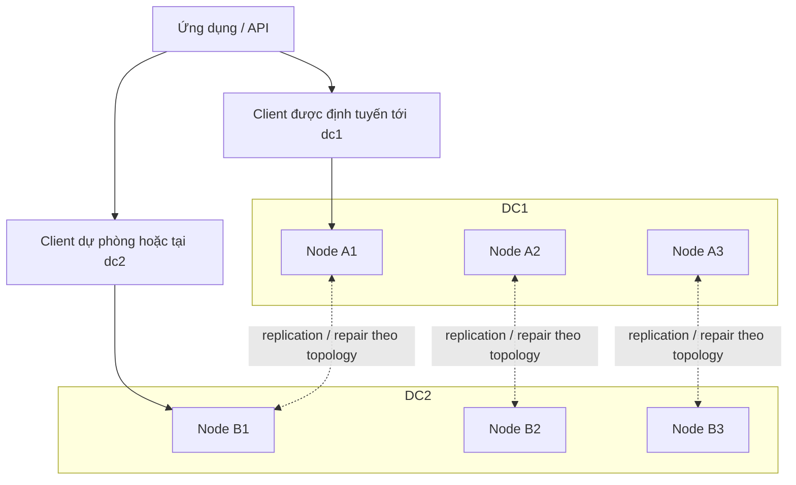
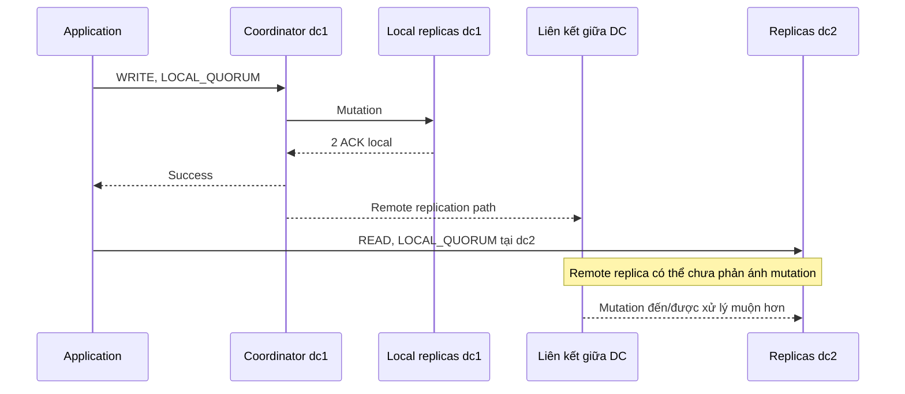

# Repair, backup và vận hành trên toàn bộ miền dữ liệu

> **Chương:** Nhiều trung tâm dữ liệu  
> **Mô-đun:** `DATABASE_ENGINE_WIDE_COLUMN_CASSANDRA` — Apache Cassandra, cơ sở dữ liệu wide-column phân tán.  
> **Mục tiêu:** Bảo vệ dữ liệu khi Cassandra chạy trên nhiều datacenter (DC): thiết kế repair bao phủ đúng replica, xây dựng backup/restore thực sự khôi phục được, vận hành failover và kiểm thử rủi ro xuyên DC.

Khi Cassandra hoạt động trên nhiều trung tâm dữ liệu, **sao chép dữ liệu (replication)** giúp hệ thống tiếp tục phục vụ trong một số tình huống mất node hoặc mất cả DC. Tuy nhiên, replication **không tương đương repair**, và cả hai **không thay thế backup**. Một lệnh `DELETE` nhầm, schema thay đổi sai hoặc ứng dụng ghi dữ liệu hỏng có thể được sao chép sang tất cả replica; repair còn có thể giúp chúng **đồng nhất với trạng thái sai đó**.

Để vận hành đáng tin cậy, phải quản lý đồng thời ba lớp:

1. **Replication và consistency level (CL):** phân bố bản sao theo DC/rack, điều kiện đọc/ghi thành công, đường đi của client khi DC bị lỗi.
2. **Anti-entropy repair:** đối chiếu các replica của cùng token range, kể cả việc đồng bộ giữa các DC theo phạm vi job và khả năng chịu băng thông liên vùng.
3. **Backup, restore và diễn tập khôi phục:** giữ lại các phiên bản độc lập với cụm đang chạy, kiểm soát RPO/RTO và xác minh thực sự phục hồi được dữ liệu.

Bài này gắn các nguyên tắc trên với thiết kế bảng theo truy vấn, partition key, CQL, token/replication, SSTable/compaction, tombstone, Java Driver và runbook vận hành đa DC.

> **Lưu ý áp dụng:** Ví dụ sử dụng mô hình Apache Cassandra 4.x/5.x với `NetworkTopologyStrategy`, full replicas và các DC giả định `dc1`, `dc2`. Cú pháp/tùy chọn `nodetool`, incremental repair, backup/restore và streaming có thể khác theo phiên bản/bản phân phối. Kiểm tra tài liệu chính xác cho cluster trước khi dùng trên production.

## 1. Kết quả học tập

Sau bài này, bạn có thể:

- Giải thích vì sao `LOCAL_QUORUM` tại DC1 và tại DC2 là hai điều kiện **khác nhau**, và dữ liệu có thể chưa đồng bộ ngay khi chuyển vùng.
- Xác định phạm vi repair theo **keyspace/table, token ranges, replica/DC và thời điểm hoàn tất**, không chỉ nhìn một job màu xanh.
- Phân biệt repair **trong một DC** với đối soát cần thiết **giữa các DC**; đánh giá tác động WAN/streaming.
- Giải thích vai trò của `gc_grace_seconds`, tombstone và thời gian DC mất kết nối trong nguy cơ zombie data.
- Xây dựng chiến lược backup theo node/table/DC và bảo quản **ngoài miền lỗi**, gồm snapshot, incremental backup, commit log archive khi có kế hoạch.
- Viết runbook khôi phục một bảng, một node hoặc cả DC, với RPO/RTO đo được qua diễn tập.
- Dùng CQL và Java Driver để kiểm thử hành vi đọc/ghi tại DC khác nhau mà không nhầm một phép đọc đúng với repair thành công.
- Thiết kế bảng giám sát cho repair coverage, bản sao lưu, mạng liên DC và thời gian khôi phục.

## 2. Miền dữ liệu (failure domain) là gì?

Trong bối cảnh Cassandra, một **miền lỗi** là tập tài nguyên có thể cùng hỏng vì một nguyên nhân: máy chủ, rack, nguồn điện, mạng, datacenter hoặc cả vùng địa lý. Với nhiều DC, hệ thống thường muốn sống sót khi **một miền lớn bị mất**, nhưng không thể đạt điều đó chỉ bằng việc cấu hình RF cao.



Đây là sơ đồ khái niệm; Cassandra **không** gắn cứng A1 ↔ B1 cho mọi partition. Tập replica được xác định bởi token placement, snitch, RF theo DC và rack. Không dựa vào cặp node được vẽ để suy ra hướng streaming thực tế.

### 2.1. Khóa phân vùng và token vẫn là nền tảng

Một bảng Cassandra có partition key; partitioner ánh xạ khóa thành token. `NetworkTopologyStrategy` chọn replica theo RF của từng DC, có xét phân bố rack khi topology và snitch cho phép. Vì vậy:

- **Một partition key** có thể có bản sao ở nhiều DC.
- Mỗi DC có **một tập replica riêng** cho các token ranges.
- Đọc/ghi theo khóa phân vùng phù hợp giúp Cassandra định vị replica và giảm fan-out.
- Node trong hai DC không nhất thiết giữ toàn bộ dữ liệu giống nhau; chỉ so những replica của **cùng khoảng token**.
- Tăng/giảm node hoặc thay RF phải kèm đánh giá streaming, disk headroom và repair coverage.

### 2.2. Ví dụ RF và số replica

Giả sử keyspace:

```sql
CREATE KEYSPACE IF NOT EXISTS lab_multidc
WITH replication = {
    'class': 'NetworkTopologyStrategy',
    'dc1': 3,
    'dc2': 3
};
```

Với full replicas, mỗi partition có **ba replica trong DC1 và ba replica trong DC2**, tổng số bản sao mong muốn là sáu. Trong một DC có đủ ba full replica:

\[
\text{LOCAL\_QUORUM}(RF=3)=\left\lfloor\frac{3}{2}\right\rfloor+1=2
\]

Việc DC1 đạt hai ACK không đồng nghĩa DC2 đã đạt hai ACK; đồng thời dữ liệu trong cả cụm cũng không nhất thiết đọc thấy ngay lập tức tại DC2. Đây là lý do phải xác định **DC của coordinator**, CL và quy tắc failover trước khi vận hành.

## 3. Replication, repair và backup giải quyết ba vấn đề khác nhau

| Cơ chế | Câu hỏi cơ chế giải quyết | Không bảo đảm |
|---|---|---|
| **Replication** | Một partition cần bao nhiêu bản sao, đặt ở DC/rack nào? | Mọi replica luôn đồng bộ tức thời; phục hồi xóa nhầm |
| **Write/Read CL** | Bao nhiêu replica phải xác nhận/đáp ứng một request? | Mọi replica của mọi DC đều có trạng thái giống nhau |
| **Hinted handoff** | Có thể gửi lại một số mutation cho replica tạm Down không? | Đồng bộ đầy đủ khi DC mất kết nối quá lâu |
| **Read repair** | Sửa một số sai khác được phát hiện trên đường đọc? | Quét và sửa mọi token range |
| **Anti-entropy repair** | Những replica đang giữ cùng range có khác nhau, cần đồng bộ gì? | Phục hồi mutation đã mất ở tất cả replica |
| **Compaction** | Hợp nhất SSTable trên từng node, thu hồi dữ liệu đủ điều kiện? | Đồng bộ xuyên DC |
| **Backup/restore** | Có thể phục hồi dữ liệu ở phiên bản/thời điểm tin cậy độc lập với cụm sống? | Tự động có RPO=0 hoặc khôi phục nhanh nếu chưa diễn tập |

**Quy tắc vận hành:** Replication duy trì khả năng phục vụ; repair duy trì tính đồng nhất giữa các bản sao còn tồn tại; backup bảo vệ trước **mất mát hoặc lỗi logic đã lan tới mọi bản sao**. Cả ba cần chính sách riêng.

### 3.1. Những trường hợp replication không cứu được dữ liệu

- Ứng dụng vô tình chạy `DELETE` một partition quan trọng và mutation được nhân tới mọi DC.
- `DROP TABLE`/`TRUNCATE` nhầm được thực thi hợp lệ trong cluster; bản sao thường không chứa lịch sử schema/data để “undo”.
- Bug ghi giá trị sai vào cùng row ở tất cả replica.
- Tombstone của một delete bị purge trên replica khỏe trước khi DC offline nhận được nó; dữ liệu cũ có thể xuất hiện trở lại.
- Hỏng dữ liệu/metadata đồng loạt hoặc mất quyền truy cập toàn bộ cluster.
- Một thao tác khôi phục sai chép dữ liệu cũ vào cụm và ghi đè hoặc tạo bản ghi zombie.

Trong các trường hợp này, **bản sao lưu độc lập, audit, CDC hoặc log nghiệp vụ** có thể quan trọng hơn việc tăng RF.

## 4. Consistency level khi đọc/ghi trên nhiều DC

### 4.1. So sánh các CL thường gặp

Giả sử RF=3 tại `dc1` và RF=3 tại `dc2`:

| CL | Ý nghĩa đơn giản hóa | Trade-off |
|---|---|---|
| `ONE` | Một replica phản hồi tại phạm vi theo quy tắc request | Dễ tiếp tục phục vụ nhưng có thể đọc dữ liệu cũ |
| `LOCAL_QUORUM` | Quorum của **DC local của coordinator**; thường 2/3 | Hạn chế phụ thuộc WAN cho ACK local, không yêu cầu quorum remote |
| `QUORUM` | Quorum của toàn bộ full replicas cho keyspace; thường 4/6 | Có thể phụ thuộc replica liên DC, tăng độ trễ hoặc giảm availability |
| `EACH_QUORUM` (write) | Yêu cầu quorum tại **mỗi DC** theo RF tương ứng | Chặt hơn với ACK multi-DC, nhưng một DC không đạt quorum có thể khiến write thất bại |
| `ALL` | Tất cả full replicas cần đáp ứng theo semantics request | Khó duy trì availability nếu bất kỳ replica cần thiết nào lỗi |

Cần kiểm tra các giới hạn áp dụng cho **read và write** trên phiên bản sử dụng; đừng suy rằng mọi CL hỗ trợ mọi thao tác giống nhau. `EACH_QUORUM` thường được xét cho **ghi** multi-DC, không phải công tắc thay thế mọi kiểu đọc.

### 4.2. Ghi tại DC1 rồi đọc ngay tại DC2

Giả sử ứng dụng ghi ở DC1 tại `LOCAL_QUORUM`, rồi lập tức gửi read tại DC2 ở `LOCAL_QUORUM`:



Sơ đồ đơn giản hóa, không mô tả thứ tự gói tin chính xác trên mọi bản Cassandra; Cassandra có thể gửi mutation tới remote replicas ngay trong đường ghi, nhưng **ACK của local quorum không chờ remote quorum**. Do đó thao tác đọc tại DC2 ngay sau đó **có thể chưa thấy bản ghi mới**.

Ứng dụng có yêu cầu read-your-write **xuyên DC ngay tức thì** phải thiết kế giao thức/CL và luồng đọc ghi tương ứng; không tuyên bố có bảo đảm chỉ nhờ cùng dùng `LOCAL_QUORUM` ở hai nơi.

### 4.3. Chuyển DC không chỉ là đổi URL

Khi `dc1` gặp sự cố và client chuyển sang `dc2`:

- `dc2` phải có đủ replica khỏe để đáp ứng CL của request.
- Bản sao tại `dc2` có thể trễ một số mutation trước thời điểm mất kết nối.
- Driver phải chọn **local DC đúng** và contact points phù hợp.
- Các write còn đang gửi tới `dc1` có thể có kết quả **không xác định** khi timeout.
- Các workflow đòi thứ tự/chống ghi trùng cần idempotency hoặc giao thức ở tầng nghiệp vụ.

**RPO (Recovery Point Objective)** lúc failover không thể suy đơn giản từ RF. Cần đo độ trễ và tính đúng đắn của replication dưới sự cố thật.

## 5. Repair coverage trong cụm nhiều DC

### 5.1. Repair phải xác định đủ ba trục

Một chiến lược repair cần chỉ ra:

1. **Phạm vi dữ liệu:** keyspace, tables, token ranges và SSTables/loại dữ liệu thuộc chính sách.
2. **Phạm vi replica:** node/peers, datacenter, rack và RF; có đang bỏ qua những replica không phản hồi không?
3. **Thời gian:** repair lần cuối **hoàn tất thành công** cho các ranges đó là khi nào, còn đủ biên so với tombstone grace không?

`nodetool repair` không phải phép “repair hết mọi thứ” chỉ vì gọi được một lần. Với vnodes, có nhiều ranges, nhiều node và nhiều DC, một job có thể chỉ bao phủ một phần.

### 5.2. Local DC repair và đối soát xuyên DC

Một số bản Cassandra hỗ trợ tùy chọn hạn chế repair ở DC local hoặc một DC được chỉ định. Hãy đọc `nodetool help repair` của bản đang chạy trước khi áp dụng.

| Kiểu phạm vi repair | Lợi ích | Điều có thể còn thiếu |
|---|---|---|
| Repair trong `dc1` | Dùng nguồn/đích nội bộ DC1, giảm áp lực WAN | Không chứng minh DC2 nhận những mutation DC1 có |
| Repair trong `dc2` | Đối chiếu giữa các replica trong DC2 | Không chứng minh DC1 và DC2 giống nhau |
| Repair có peers phù hợp trên nhiều DC | Có thể phát hiện/đồng bộ sai khác xuyên DC | Dùng WAN, đòi kiểm soát băng thông, latency và availability |
| Repair chỉ một nhóm token ranges | Hữu ích để chia nhỏ workload | Các ranges ngoài nhóm chưa được kiểm chứng |

**Hai DC cùng “đồng bộ nội bộ” không có nghĩa đồng bộ với nhau.** Giả sử DC1 có bản ghi X còn DC2 thiếu X, nhưng **cả ba replica trong từng DC giống nhau**. Repair độc lập nội bộ từng DC có thể đều không tìm thấy mismatch, trong khi hai DC khác nhau. Vì vậy thiết kế repair cần một cơ chế bao phủ **sai khác liên DC** phù hợp với topology và phiên bản.

### 5.3. Merkle tree theo cùng token range

Repair thường xây fingerprint/Merkle tree trên các replica của **cùng token range**:

```text
Keyspace lab_multidc, table events_by_tenant_day, range R

DC1: A1/A2/A3 → dữ liệu trong R → Merkle tree theo R
DC2: B1/B2/B3 → dữ liệu trong R → Merkle tree theo R

So các cây theo những cặp/ranges hợp lệ.
- Cây khớp: không cần streaming cho vùng được so.
- Cây lệch: xác định subranges khác, đồng bộ qua stream/reconciliation.
```

Merkle tree giúp khoanh vùng sai khác, nhưng validation phải đọc/băm SSTable; streaming qua WAN có thể nặng. Nếu hai DC cùng thiếu một mutation, tree giống nhau cũng không thể tái tạo ghi đã mất ở mọi nơi.

### 5.4. Full và incremental repair

Các bản Cassandra hiện đại có cơ chế **full** và **incremental**; cách đánh dấu repaired/unrepaired và pending sessions phụ thuộc phiên bản.

- **Full repair:** so phạm vi dữ liệu được chọn theo semantics đầy đủ, có thể làm việc nhiều hơn, hữu ích cho một số lần xác minh/khôi phục.
- **Incremental repair:** tập trung dữ liệu chưa được đánh dấu repaired và quản lý repaired/pending state, có thể dùng anti-compaction; giảm công việc lặp nhưng không tự kiểm lại toàn bộ repaired SSTables.
- **Gián đoạn incremental:** có thể để lại pending sessions/anti-compaction cần kiểm tra trước khi chạy chồng lấn hoặc force cleanup.
- **Phạm vi DC:** full/incremental không có nghĩa tự bao phủ mọi DC; cần kiểm tra tùy chọn và lịch điều phối.

Một ví dụ **chỉ trong lab đã hiểu đúng phạm vi**:

```bash
# Chạy ở node phù hợp; một lần chạy không mặc nhiên sửa cả cluster.
nodetool repair --full lab_multidc events_by_tenant_day

# Quan sát trạng thái incremental repair trên bản hỗ trợ:
nodetool repair_admin list
nodetool repair_admin summarize-pending
```

Trước khi chạy ở production, xác định DC/peers, primary ranges, concurrency và job scheduler. Không tự gắn `--force` để bỏ qua node lỗi và tuyên bố phạm vi đã an toàn.

## 6. Repair liên DC: lập lịch và cân bằng mạng WAN

### 6.1. Tại sao phải đo WAN?

Đối với job repair có peers ở DC khác, có hai loại lưu lượng cần tính:

- **So sánh/validation:** đọc SSTables và trao đổi cây/hashes cùng metadata.
- **Synchronization/streaming:** gửi SSTable/data khi phát hiện khác biệt.

Cùng lúc đó, hệ thống còn có **replication write traffic**, client traffic, hints, backup export và các hoạt động topology. Một đợt repair lớn có thể chiếm đường liên DC, làm p95/p99 tăng hoặc khiến remote replication chậm.

### 6.2. Ước lượng thời gian streaming

Giả sử cần truyền \(B=500\) GiB dữ liệu sai khác qua đường liên DC; aggregate throughput **hữu hiệu còn lại** cho repair là \(v=80\) MiB/s.

\[
T_{\mathrm{transfer}}\approx\frac{B\times1024}{v}
=\frac{500\times1024}{80}=6.400\ \text{giây}
\approx1{,}78\ \text{giờ}
\]

Đây chỉ là **ước lượng lý tưởng cho byte được truyền**, chưa tính validation, retries, chuẩn bị/hoàn tất repair, compaction, disk I/O và băng thông thay đổi. Nếu các node nguồn/đích cũng bận, thực tế có thể lâu hơn nhiều.

Đừng lấy tốc độ NIC 10 Gbps làm throughput đảm bảo. Cần đo trên **đường WAN và tài nguyên disk thực**, giữ đủ headroom cho ghi/đọc.

### 6.3. Kế hoạch vận hành repair liên DC

1. Xác định lịch repair theo keyspace/table, replica ranges và các DC cần tham gia.
2. Tránh chạy đồng thời nhiều job repair/streaming lớn qua cùng WAN nếu không có điều tiết.
3. Chọn cửa sổ mà traffic ứng dụng và backup không tranh cùng băng thông.
4. Theo dõi network in/out, retransmission, disk, CPU, GC, compaction và client errors ở **cả hai DC**.
5. Ghi nhận session IDs, bytes validated, bytes streamed và status cuối; không coi “đã chạy” là “đã đồng bộ”.
6. Nếu job failed, xử lý các phạm vi thiếu; đừng lặp vô hạn làm tăng tắc nghẽn.
7. Xác minh lần repair **cuối cùng thành công** và cập nhật lịch sử coverage.

### 6.4. Không trộn nhiều thay đổi lớn vào một cửa sổ

Nếu cùng lúc bootstrap node, thay RF, migrate table và chạy full repair xuyên DC, việc tách nguyên nhân chậm/mất dữ liệu sẽ rất khó. Nên chia giai đoạn và xác nhận trạng thái ổn định sau từng bước, trừ khi có quy trình khôi phục cụ thể đòi thao tác đồng thời.

## 7. Tombstone, `gc_grace_seconds` và DC offline lâu ngày

### 7.1. Xóa logic phải được truyền tới replica bỏ lỡ

Giả sử RF=3 ở DC1/DC2. Khi DC2 mất kết nối:

1. Client ở DC1 gửi `DELETE` tại `LOCAL_QUORUM`.
2. DC1 có thể ACK vì đủ hai local replicas.
3. DC2 có thể **bỏ lỡ tombstone** nếu đường truyền/peers không sẵn sàng.
4. Sau khi DC2 quay lại, cần cơ chế cập nhật và repair để những replica này biết deletion.

Nếu tombstone đã bị purge khỏi mọi nguồn tin cậy trước khi DC2 nhận được nó, bản dữ liệu cũ tại DC2 có thể được phát tán lại (**zombie data**).

### 7.2. Grace không phải lời hứa repair tự chạy

`gc_grace_seconds` là khoảng giữ bảo vệ tombstone trước khi **có thể** bị loại ở compaction, thường mặc định 864.000 giây (10 ngày) trong cấu hình thông dụng; cần kiểm tra giá trị bảng thực.

Nó **không** bảo đảm:

- Mọi replica ở mọi DC nhận delete trong 10 ngày.
- Tombstone chắc chắn được purge đúng ngày thứ 10.
- Snapshot/backup được cập nhật.
- Hints và read repair sẽ chạm mọi partition.
- Repair đã hoàn tất nếu chỉ scheduler đã khởi chạy.

Một nguyên tắc ngân sách thời gian thận trọng:

\[
T_{\mathrm{DC\ down}} + T_{\mathrm{repair\ complete}}
+ T_{\mathrm{safety\ margin}} < T_{\mathrm{grace}}
\]

Ví dụ DC2 mất kết nối 7 ngày; repair đầy đủ dự kiến mất 2 ngày, safety margin 2 ngày: tổng 11 ngày **vượt** grace 10 ngày. Đây là cảnh báo không thể xử lý bằng cách “cho DC2 online rồi chờ Cassandra tự sửa”.

Nguyên tắc trên là **cách quản lý rủi ro**, không phải định lý an toàn cho mọi phiên bản: còn phụ thuộc timestamp tombstone, compaction, topology và repair coverage.

### 7.3. Khi DC quay lại sau grace

Runbook phải:

1. **Đánh giá và cách ly phần dữ liệu cũ** trước khi cho replica stale tham gia phục vụ/streaming tự do.
2. Thu thời gian outage, repair history, tombstone grace theo bảng, backup và log deletes.
3. Xác định DC/replicas còn lại là nguồn tin cậy hay cũng có sai lệch.
4. Lập phương án **rebuild/rebootstrap/replace** dữ liệu cũ từ nguồn tin cậy theo phiên bản; không đơn thuần bật lại ổ đĩa cũ.
5. Đối soát dữ liệu nghiệp vụ và xác định có zombie/missing data hay không.
6. Chỉ mở lại lưu lượng client khi trạng thái dữ liệu và replica placement đáp ứng chính sách.

**Không tự giảm `gc_grace_seconds` để giảm disk usage** khi lịch repair liên DC vốn đã chậm; điều này làm tăng nguy cơ resurrected deletes.

## 8. Backup trên nhiều DC: thứ gì cần được sao lưu?

Backup đúng không chỉ là “có một snapshot ở một node”. Một kế hoạch cần xác định rõ **loại sự cố cần phục hồi**, đơn vị backup, thời điểm, phiên bản và nguồn dữ liệu phục hồi.

### 8.1. Các loại bản sao cần phân biệt

| Loại | Mục đích | Giới hạn |
|---|---|---|
| **Replica đang hoạt động** | Availability và phục vụ query | Sao chép cả DELETE/schema change sai; không có lịch sử tùy ý |
| **Local snapshot SSTable** | Lưu điểm chụp dữ liệu trên một node | Hard link cùng disk không chống lỗi mất máy/DC |
| **Incremental backup SSTable** | Lưu những SSTable bổ sung theo quá trình ghi khi được bật | Cần biết baseline, retention và trình tự restore |
| **Commit log archive** | Có thể hỗ trợ khôi phục tới thời điểm chi tiết hơn nếu hệ thống cấu hình và diễn tập đúng | Không tự có sẵn PITR nếu chưa lưu archive/đủ dữ liệu |
| **Backup gửi kho độc lập** | Giảm rủi ro mất DC/cluster, xóa nhầm, ransomware | Cần kiểm tra mã hóa, manifest, khả năng tải về và restore |

**Snapshot Cassandra trên một node không tạo global transaction snapshot đồng thời của tất cả node hoặc hai DC.** Nếu ứng dụng tiếp tục ghi trong khi chụp từng node, các bản snapshot có thể đại diện cho thời điểm hơi khác nhau. Đây là điểm phải xử lý trong yêu cầu dữ liệu nghiệp vụ và quy trình restore.

### 8.2. Các thành phần backup thường bị quên

Ngoài dữ liệu SSTable, cần lưu/ghi nhận:

- **Schema CQL:** keyspaces, RF theo DC, tables, types, indexes, user-defined types/functions nếu áp dụng; schema version tương ứng.
- **Topology:** Cassandra version, cluster ID/name, partitioner, DC/rack, nodes, host IDs, token ownership/vnodes, snitch.
- **Cấu hình vận hành:** compression/compaction/TTL, security settings, encryption config và các tùy chọn backup/commit log.
- **Quyền truy cập:** roles/permissions, nhưng **không lưu bí mật thuần văn bản trong manifest**; credentials/keys phải qua kho bí mật riêng.
- **Manifest dữ liệu:** node nguồn, keyspace/table, snapshot tag, checksum/hash, dung lượng, timestamp, phiên bản, đường dẫn đối tượng trong kho.
- **Bằng chứng hoàn thành:** upload success, checksum verify, retention, khả năng decrypt và kết quả restore test.
- **Dữ liệu nguồn ngoài Cassandra:** queues/CDC, audit/event log nếu cần tái lập business state hoặc khôi phục ghi gần thời điểm mất.

Nếu restore một snapshot dữ liệu mà thiếu schema/metadata cần thiết hoặc không biết nó thuộc node/range nào, thao tác phục hồi có thể sai hoặc không có đủ phạm vi.

## 9. Chiến lược backup theo miền lỗi

### 9.1. Backup mỗi node, mỗi DC và kho độc lập

Một mô hình thường dùng:

1. Chụp snapshot theo lịch trên **các node được lựa chọn theo chiến lược bao phủ token range/replica**.
2. Xuất SSTable snapshot, incremental SSTables và/hoặc commit log archive khi chính sách yêu cầu.
3. Đưa dữ liệu sang **kho không cùng failure domain** với DC nguồn; ví dụ object storage ở vùng khác theo quy định lưu trú dữ liệu.
4. Gắn manifest, checksum và metadata phiên bản.
5. Giám sát upload, tuổi backup cuối cùng hợp lệ, dung lượng tồn kho và khả năng tải về.
6. Định kỳ restore vào **môi trường cô lập** để kiểm tra tính đầy đủ và RTO thực tế.

Để bảo vệ chống mất **toàn bộ** DC, không thể dựa vào một bản snapshot chỉ tồn tại trên đĩa của DC đó. Để bảo vệ chống xóa nhầm lan qua replication, cần backup có **lịch sử được giữ lại**, không chỉ “bản mới nhất ngay sau khi DELETE sai”.

### 9.2. Có cần snapshot tất cả các replica?

Không có câu trả lời chung. Có thể lưu một tập backup đủ bao phủ mọi token range ở một thời điểm xác định, hoặc backup từng node/replica theo policy. Quyết định phụ thuộc:

- Mục tiêu restore: một row/table, một node, một DC hay cả cluster.
- RF, vnodes và topology có thay đổi trong kỳ backup không.
- Khả năng phân biệt những bản ghi stale giữa replica.
- Băng thông/chi phí backup và thời gian khôi phục mong muốn.
- Yêu cầu pháp lý về vùng lưu trú, encryption, retention và audit.

**Không tự suy “RF=3 nên backup một node là đủ”.** Với dữ liệu được sharding theo token, một node thường **không** giữ mọi partition. Một kế hoạch snapshot một phần không có manifest phạm vi có thể thiếu toàn bộ dữ liệu của một số ranges.

### 9.3. Snapshot là hard link, chưa phải bản sao độc lập

Lệnh `nodetool snapshot` thường tạo hard links tới SSTable trên node. Điều này nhanh và ít tốn thêm block tại thời điểm chụp, nhưng:

- Nếu máy/ổ đĩa mất, cả SSTable gốc và snapshot trên cùng filesystem đều có thể mất.
- Khi compaction thay thế SSTable, hard link snapshot có thể vẫn giữ block, làm disk usage cao.
- Chỉ sau khi **copy/upload ra nơi độc lập và xác minh checksum** mới có bản sao vượt qua miền lỗi đó.
- Khi dọn snapshot, phải theo retention và xác minh upload/restore; không xóa bừa snapshot để “giảm disk” mà phá kế hoạch phục hồi.

Ví dụ quan sát trên lab:

```bash
# Tạo snapshot cho keyspace thử nghiệm trên node đang chạy lệnh.
nodetool snapshot --tag lab-multi-20261121 lab_multidc

# Kiểm tra các snapshot trên node.
nodetool listsnapshots

# Theo dõi ảnh hưởng tới dung lượng/tables.
nodetool tablestats lab_multidc.events_by_tenant_day
```

**Lưu ý:** Cú pháp tag, chọn keyspace/table và liệt kê snapshot thay đổi theo phiên bản; kiểm tra `nodetool help snapshot`. Một invocation trên một node **không** là snapshot toàn cluster.

### 9.4. Incremental backup và commit log archive

Nếu cần giảm RPO so với lịch full snapshot:

- **Incremental backup:** khi bật, Cassandra có thể giữ thêm các SSTable mới được tạo sau flush/compaction theo cơ chế phiên bản. Cần backup baseline, các file tăng thêm và manifest được nối đúng.
- **Commit log archiving:** nếu được cấu hình, commit log segments có thể được lưu ngoài để hỗ trợ khôi phục thay đổi sau snapshot. Việc point-in-time restore cần chọn segments/timestamp, bảo đảm tính tương thích và có quy trình thực hiện/kiểm thử cụ thể.
- **CDC/audit:** có thể bổ sung khả năng khôi phục business events nhưng không tự trở thành backup đầy đủ mọi bảng.

Không tuyên bố “RPO vài phút” chỉ vì đã bật incremental backup hoặc commit log archive. **Phải đo lag upload, missing segments và khả năng replay/restore thật**. Bản sao lưu đủ byte nhưng không thể giải mã hoặc thiếu khóa encryption vẫn coi như không phục hồi được.

## 10. RPO, RTO và kiểm tra tính khôi phục được

### 10.1. Hai chỉ số cần có trong SLA

- **RPO (Recovery Point Objective):** mức mất dữ liệu tối đa có thể chấp nhận tính theo thời gian/điểm phục hồi.
- **RTO (Recovery Time Objective):** thời gian tối đa từ khi sự cố xảy ra đến khi dịch vụ/dữ liệu hoạt động trở lại theo tiêu chí đã định.

Ví dụ tổ chức đặt RPO=15 phút, RTO=4 giờ cho nghiệp vụ quan trọng. Cấu hình hai DC không tự đáp ứng hai mục tiêu đó:

- Nếu chỉ snapshot mỗi sáu giờ và không có archive/log khác, khôi phục từ backup có thể mất dữ liệu gần **sáu giờ hoặc hơn** nếu job/upload bị trễ.
- Nếu mỗi DC lưu hàng chục TiB, tải về, kiểm tra checksum, restore SSTables, rebuild index và repair có thể vượt RTO nếu chưa có kịch bản.
- Failover sang replica còn sống có thể nhanh hơn restore backup, nhưng remote DC **có thể thiếu mutation cuối** khi WAN lỗi.
- RPO đo theo **điểm dữ liệu phục hồi được**, không theo thời điểm scheduler bắt đầu job.

### 10.2. Lập kế hoạch từ nguyên nhân sự cố

| Sự cố | Lựa chọn phục hồi ưu tiên | Kiểm chứng cần có |
|---|---|---|
| Một node lỗi, DC còn đủ replica khỏe | Replace/bootstrap/stream từ replica tin cậy | RF, token ownership, data consistency, repair |
| Một DC ngừng hoạt động, DC khác còn khỏe | Failover ứng dụng sang DC còn sống | CL local, dữ liệu gần nhất, khả năng phục vụ, RPO |
| Cả cluster mất hoặc mất quyền truy cập | Restore từ backup độc lập | Manifest, schema, files/segments, checksum, RTO |
| DELETE/DROP sai được nhân sang mọi DC | Restore tới thời điểm trước sự cố, đối soát/replay nghiệp vụ | Không vô tình ghi đè thay đổi hợp lệ sau mốc |
| Dữ liệu logical corruption lan trên các replica | Dùng backup/audit tin cậy, cô lập nguồn sai | Chính xác dữ liệu được phục hồi và nguồn có thẩm quyền |
| DC offline vượt tombstone grace | Đánh giá thay/rebuild DC từ nguồn tin cậy | Không tái nhập dữ liệu zombie |

### 10.3. Phân rã thời gian RTO

Một mô hình ước tính để lập ngân sách:

\[
T_{\mathrm{RTO}}
\approx T_{\mathrm{detect}} + T_{\mathrm{decision}}
+ T_{\mathrm{provision}} + T_{\mathrm{download}}
+ T_{\mathrm{load}} + T_{\mathrm{verify}} + T_{\mathrm{cutover}}
\]

Các thành phần có thể song song, nên đây là **mô hình lập kế hoạch**, không phải công thức tính chính xác. Trong diễn tập, ghi từng mốc thực và tìm nút thắt: network egress, dung lượng đích, số node dựng lại, schema incompatibility, disk I/O, compaction và application reconnect.

## 11. Khôi phục dữ liệu: một bảng, một node hay cả DC?

### 11.1. Nguyên tắc trước khi restore

1. Xác định **mục tiêu restore**: toàn table, một token range, một môi trường mới hay cả DC.
2. Chọn **nguồn backup tin cậy và mốc dữ liệu**; ghi rõ có cần giữ các ghi hợp lệ sau mốc đó không.
3. Kiểm tra schema, Cassandra/SSTable version, partitioner, token/ownership và compression/encryption.
4. Xác minh manifest/checksum, key giải mã và dung lượng tải về.
5. Chọn **quy trình restore được hỗ trợ cho phiên bản**, không copy tệp SSTable bừa vào một node bất kỳ.
6. Nếu có tính năng sửa dữ liệu cùng lúc, xác định cách xử lý writes/TTL/tombstones/LWT trong giai đoạn restore.
7. Thực hiện thử nghiệm cô lập, đo thời gian và kiểm tra dữ liệu sau phục hồi.
8. Chỉ cutover traffic khi xác nhận đủ dữ liệu, topology, CL và chỉ số client.

### 11.2. Restore một bảng: không chép tệp tùy ý vào production

Một snapshot có thể chứa SSTables từ một node. Nhưng node đích chỉ chịu trách nhiệm cho một số token ranges; thêm tệp vào sai nơi có thể tạo dữ liệu ngoài ownership hoặc xung đột timestamp/tombstone.

Phương án phục hồi tùy tình huống có thể gồm:

- Restore vào một **cluster cô lập** cùng schema/phiên bản, rồi đối soát và đưa dữ liệu hợp lệ trở lại theo quy trình ứng dụng.
- Sử dụng công cụ tải SSTable được hỗ trợ để **phân phối dữ liệu qua ring** (ví dụ `sstableloader` trong điều kiện đúng định dạng và cấu hình), thay vì copy trực tiếp vào thư mục bảng ở một node ngẫu nhiên.
- Dùng quy trình node replacement/backup restore chuyên biệt khi cần phục hồi đúng tập range của node bị mất.
- Khôi phục sự kiện từ audit/CDC ở tầng ứng dụng khi chỉ một phần dữ liệu bị xóa/sửa nhầm.

**Không giả định** việc restore snapshot cũ vào cluster đang chạy là “undo” an toàn. Dữ liệu từ quá khứ có thể bị tombstone hiện tại che, hoặc có thể gây zombie nếu được đưa vào sai quy trình; cần hiểu timestamp/reconciliation và kiểm tra hậu restore.

### 11.3. Khôi phục cả DC sau sự cố dài

Nếu DC2 mất toàn bộ máy hoặc đã offline dài hơn grace:

- Xác định DC1 còn là nguồn tin cậy không (có đủ replica và không mất tombstone quan trọng).
- Chuẩn bị cluster/hạ tầng DC2 với phiên bản, cấu hình, DC/rack metadata và capacity hợp lệ.
- Thực hiện quy trình dựng lại/stream từ nguồn tin cậy theo đúng phiên bản Cassandra.
- Giới hạn băng thông liên DC để không làm nghẽn DC1 đang phục vụ traffic.
- Theo dõi bootstrap/rebuild, disk headroom, compaction, repair và trạng thái replica.
- Xác minh dữ liệu cả hai DC trên các ranges đại diện; kiểm tra nghiệp vụ quan trọng và lag.
- Sau khi đủ ổn định mới bật dần client traffic tới DC2, giữ phương án rollback.

Nếu DC1 cũng sai/mất dữ liệu, nguồn phục hồi có thể phải là **backup độc lập**, không phải streaming từ DC1.

### 11.4. Restore không đồng nghĩa tự có consistency giao dịch

Cassandra phù hợp với mô hình consistency theo replica và timestamp. Một bản backup được chụp từ nhiều node ở các thời điểm khác nhau có thể thiếu một phần các mutation đồng thời. Với ứng dụng cần ràng buộc nghiệp vụ (đơn hàng–thanh toán, ledger, nhiều bảng denormalized):

- Xác định **nguồn sự kiện có thẩm quyền** và cách phát lại changes.
- Dùng idempotency/version hoặc quy tắc reconcile để tránh ghi trùng/ghi lùi.
- Kiểm tra liên hệ giữa nhiều bảng truy vấn sau restore, vì repair Cassandra không hiểu ràng buộc nghiệp vụ xuyên bảng.
- Cân nhắc dùng một hệ thống transaction khác cho những bất biến không thể bảo đảm bằng mô hình Cassandra hiện tại.

## 12. Runbook: mất DC1 nhưng DC2 còn hoạt động

### 12.1. Phát hiện và quyết định failover

Giả sử mọi ứng dụng trước đây chọn `dc1` làm local datacenter. DC1 mất kết nối, DC2 vẫn có quorum.

**Bước 1 — Phân loại sự cố**

- Đo trạng thái node/DC, lỗi mạng, root cause và phạm vi ảnh hưởng.
- Xác minh DC2 có đủ full replicas khỏe để đáp ứng `LOCAL_QUORUM`.
- Xem độ trễ replication/dữ liệu cuối ở DC2, các thao tác đã ACK ở DC1 trước khi mất kết nối.
- Ghi lại mốc cutover và loại thao tác chưa rõ kết quả.

**Bước 2 — Chuyển client có kiểm soát**

- Điều hướng traffic đến các ứng dụng/driver được cấu hình **local DC là dc2**, contact points hợp lệ.
- Giữ retry/backoff/throttle để tránh “thundering herd”.
- Theo dõi p95/p99, errors, availability, data freshness và lượng ghi mới.
- Nếu quy trình cần cắt viết ở DC cũ, thực hiện fencing theo hạ tầng/ứng dụng; không để cả hai bên độc lập nhận ghi xung đột không kiểm soát.

**Bước 3 — Bảo vệ dữ liệu**

- Ghi nhận những writes có kết quả không rõ do timeout.
- Duy trì audit/event log để xử lý khi DC1 trở lại.
- Theo dõi tuổi downtime và cửa sổ `gc_grace_seconds`.
- Không cho node DC1 lâu ngày offline tự trở lại nếu có rủi ro zombie.

**Bước 4 — Khôi phục DC1**

- Kiểm tra nguồn dữ liệu tin cậy và phương pháp rebuild/repair phù hợp.
- Giới hạn streaming để DC2 vẫn đạt SLO.
- Xác minh data, replica placement, repair coverage và backup trước khi failback.
- Thực hiện failback từng bước với rollback plan; tránh client đồng loạt reconnect.

### 12.2. Những sai lầm dễ xảy ra

| Sai lầm | Hậu quả có thể |
|---|---|
| Driver vẫn cấu hình `withLocalDatacenter("dc1")` khi muốn chạy ở DC2 | Chọn node sai/không có endpoint local phù hợp; request lỗi hoặc không định tuyến như mong muốn |
| Coi write `LOCAL_QUORUM` ở DC1 là đã chắc chắn ở DC2 | Bỏ qua những mutation remote chưa được áp dụng |
| Khởi động lại DC1 cũ sau downtime vượt grace | Nguy cơ zombie nếu tombstones bị purge trên nguồn khỏe |
| Chạy repair toàn cụm vô hạn để “ép đồng bộ” khi WAN đã nghẽn | Tăng contention và kéo dài outage |
| Xóa snapshot để lấy chỗ trước khi kiểm tra upload | Có thể mất đường backup phục hồi |
| Chỉ kiểm thử happy-path failover | Không phát hiện lỗi retry, token metadata, authorization hoặc RPO |

## 13. Thực hành CQL: hai DC, hai điểm quan sát

### 13.1. Schema cho bài lab

Cụm thử nghiệm phải có **hai DC thực được Cassandra nhận diện** là `dc1` và `dc2`, mỗi DC có ít nhất ba full replicas thích hợp cho RF=3.

```sql
CREATE KEYSPACE IF NOT EXISTS lab_multidc
WITH replication = {
    'class': 'NetworkTopologyStrategy',
    'dc1': 3,
    'dc2': 3
};

CREATE TABLE IF NOT EXISTS lab_multidc.events_by_tenant_day (
    tenant_id uuid,
    event_day date,
    event_time timestamp,
    event_id timeuuid,
    event_type text,
    payload text,
    PRIMARY KEY ((tenant_id, event_day), event_time, event_id)
) WITH CLUSTERING ORDER BY (event_time DESC, event_id DESC)
  AND gc_grace_seconds = 864000;
```

**Thiết kế theo truy vấn:** ứng dụng cần đọc sự kiện của một tenant trong một ngày; vì thế `(tenant_id, event_day)` là partition key và `event_time`, `event_id` là clustering columns. Mỗi partition có token được sao chép theo RF ở cả hai DC.

### 13.2. Ghi ở DC1 tại LOCAL_QUORUM

Kết nối `cqlsh` tới một node **trong dc1** (điều này quyết định DC local của coordinator đối với thao tác):

```sql
CONSISTENCY LOCAL_QUORUM;

INSERT INTO lab_multidc.events_by_tenant_day (
    tenant_id, event_day, event_time, event_id, event_type, payload
) VALUES (
    11111111-1111-1111-1111-111111111111,
    '2026-11-21',
    '2026-11-21 08:00:00+0000',
    7c627d5a-a6b0-11ef-8ae8-0242ac120002,
    'created',
    'demo'
);

SELECT event_id, event_type
FROM lab_multidc.events_by_tenant_day
WHERE tenant_id = 11111111-1111-1111-1111-111111111111
  AND event_day = '2026-11-21'
LIMIT 20;
```

Ghi lại thời điểm ACK, latency và các trạng thái peer. Kết quả thành công **không chứng minh** dc2 đã nhận mutation.

### 13.3. Đọc lại từ DC2

Kết nối phiên `cqlsh` **khác** tới một node trong `dc2`, dùng cùng CL:

```sql
CONSISTENCY LOCAL_QUORUM;

SELECT event_id, event_type
FROM lab_multidc.events_by_tenant_day
WHERE tenant_id = 11111111-1111-1111-1111-111111111111
  AND event_day = '2026-11-21'
LIMIT 20;
```

Trong hệ thống khỏe, dữ liệu có thể tới rất nhanh; không nhất thiết luôn thấy chậm trễ. Để kiểm chứng giới hạn, diễn tập trên **cluster lab cô lập** với WAN có delay/partition: có thể quan sát trường hợp dc1 ACK nhưng dc2 chưa thấy ngay.

**Không chạy thí nghiệm làm đứt WAN production.**

### 13.4. Kiểm thử DELETE khi một DC mất kết nối

Trong lab với fault injection được kiểm soát:

1. Ghi và xác nhận row ban đầu ở cả hai DC.
2. Cô lập kết nối tới dc2, giữ dc1 đủ quorum.
3. Gửi `DELETE` ở `LOCAL_QUORUM` tại dc1.
4. Xác nhận một đọc local ở dc1 không còn row, nhưng **không kết luận** dc2 đã nhận tombstone.
5. Khôi phục dc2 **trước khi vượt grace**, chạy quy trình repair với coverage liên DC theo bản triển khai.
6. Xác minh sau hội tụ: row không còn ở bất kỳ DC nào thuộc chính sách; log repair hoàn tất, không còn session failed.
7. Ghi nhận downtime, thời gian repair và biên an toàn còn lại.

Ví dụ DELETE:

```sql
DELETE FROM lab_multidc.events_by_tenant_day
WHERE tenant_id = 11111111-1111-1111-1111-111111111111
  AND event_day = '2026-11-21'
  AND event_time = '2026-11-21 08:00:00+0000'
  AND event_id = 7c627d5a-a6b0-11ef-8ae8-0242ac120002;
```

Khi mô phỏng thời gian dài hơn grace, không cho node cũ quay lại cụm “như bình thường”; dùng môi trường có thể phá hỏng và runbook rebuild an toàn.

## 14. Java Driver: cấu hình local DC và kiểm thử failover

Java Driver 4.x sử dụng thông tin topology/DC để chọn điểm kết nối và định tuyến phù hợp; khi dùng nhiều DC, phải **quản lý local datacenter của từng session**.

Ví dụ một test tích hợp có **hai session riêng** nhằm đọc cùng một partition từ hai DC. Cấu hình các host giả định phải thay bằng contact points thật của lab:

```java
import com.datastax.oss.driver.api.core.CqlSession;
import com.datastax.oss.driver.api.core.DefaultConsistencyLevel;
import com.datastax.oss.driver.api.core.cql.BoundStatement;
import com.datastax.oss.driver.api.core.cql.PreparedStatement;
import java.net.InetSocketAddress;
import java.time.LocalDate;
import java.util.UUID;

public final class CrossDcReadLab {
    private static boolean hasAnyEvent(
            CqlSession session, UUID tenantId, LocalDate eventDay) {
        PreparedStatement ps = session.prepare(
            "SELECT event_id FROM lab_multidc.events_by_tenant_day " +
            "WHERE tenant_id = ? AND event_day = ? LIMIT 1"
        );
        BoundStatement statement = ps.bind(tenantId, eventDay)
            .setConsistencyLevel(DefaultConsistencyLevel.LOCAL_QUORUM);
        return session.execute(statement).one() != null;
    }

    public static void main(String[] args) {
        UUID tenantId =
            UUID.fromString("11111111-1111-1111-1111-111111111111");
        LocalDate day = LocalDate.of(2026, 11, 21);

        try (CqlSession dc1Session = CqlSession.builder()
                .addContactPoint(
                    new InetSocketAddress("dc1-node.example.net", 9042))
                .withLocalDatacenter("dc1")
                .build();
             CqlSession dc2Session = CqlSession.builder()
                .addContactPoint(
                    new InetSocketAddress("dc2-node.example.net", 9042))
                .withLocalDatacenter("dc2")
                .build()) {

            System.out.println("DC1: " +
                hasAnyEvent(dc1Session, tenantId, day));
            System.out.println("DC2: " +
                hasAnyEvent(dc2Session, tenantId, day));
        }
    }
}
```

**Điều kiện của ví dụ:** hai session kết nối tới cluster có DC tên tương ứng, keyspace/table đã tạo, đủ replica cho `LOCAL_QUORUM`. Đoạn code chỉ minh họa **điểm nhìn của từng DC**, không phải production failover controller.

Trong hệ thống thực:

- Ưu tiên driver/session có **local DC nhất quán** với DC ứng dụng đang phục vụ.
- Failover phải là **quy trình được điều phối**, có quyết định về tính mới của dữ liệu, lưu lượng và fencing; đừng giả định driver tự chuyển DC một cách luôn an toàn.
- Xử lý write timeout là kết quả **không chắc chắn** (có thể đã ghi ở một số replica); giới hạn retry và sử dụng idempotency khi phù hợp.
- Không “kiểm chứng backup” bằng cách đọc một partition; phải restore thử vào môi trường cô lập.
- Theo dõi p95/p99, errors, các request theo DC/node, queueing và số lần retry trong lúc repair/restore.

## 15. Quan sát cluster, repair và backup xuyên DC

### 15.1. Công cụ Cassandra

Các lệnh quan sát thường dùng trên từng node liên quan:

```bash
nodetool status
nodetool describecluster
nodetool describering lab_multidc
nodetool netstats
nodetool compactionstats
nodetool tpstats
nodetool tablestats lab_multidc.events_by_tenant_day
nodetool listsnapshots

# Trạng thái incremental repair nếu phiên bản hỗ trợ:
nodetool repair_admin list
nodetool repair_admin summarize-pending
```

Đối với những lệnh có biến thể khác nhau theo phiên bản, dùng `nodetool help <command>` và đối chiếu công cụ scheduler. Chỉ nhìn `status=UN` hoặc `netstats` trống không chứng minh các DC đồng bộ và backup đã hoàn tất.

### 15.2. Dashboard phải có góc nhìn per DC

| Nhóm | Chỉ số hoặc câu hỏi | Cảnh báo ví dụ |
|---|---|---|
| Replica | RF thực tế, node Down, DC/rack, token ownership | Thiếu replica/đang mất DC |
| CQL/Driver | Read/write latency, timeout, unavailable theo DC và CL | p99 vượt SLO hoặc failover lỗi |
| Replication | Network errors, hints/backlog, lag khi quan sát được | Remote DC có thể stale |
| Repair | Session success/fail, ranges/tables/DC coverage, repair age | Quá thời hạn/coverage không đầy đủ |
| WAN | Bytes in/out, retransmits, throughput, egress cost | Băng thông chạm giới hạn |
| Compaction/stream | Pending tasks, disk I/O, active sessions | Tồn đọng gây disk pressure |
| Tombstone | Grace theo bảng, node/DC downtime, lịch repair | Downtime + repair vượt grace |
| Backup | Last verified snapshot, incremental lag, manifest, checksum | Backup quá cũ/missing files |
| Restore readiness | Diễn tập gần nhất, thời gian download/load/verify | Không đạt RPO/RTO |

### 15.3. Hai chỉ số nên có nhưng hay bị bỏ qua

**Repair coverage age:** thời gian kể từ lần repair **hoàn tất và bao phủ đầy đủ** cho token range/table/replica group theo chính sách. Không dùng thời gian bắt đầu của job làm timestamp repaired.

**Recoverable backup age:** thời gian kể từ mốc dữ liệu cuối cùng có thể **chứng minh phục hồi được**, dựa trên manifest, upload và restore verification; không lấy ngày tạo snapshot làm bằng chứng backup hợp lệ.

Các chỉ số này khó tổng hợp hơn một nút xanh “scheduler OK”, nhưng trực tiếp phản ánh rủi ro dữ liệu.

## 16. Diễn tập backup và restore nhiều DC

Một chiến lược backup chỉ có ý nghĩa khi **restore được**. Kế hoạch diễn tập nên có:

### 16.1. Kịch bản A — Mất một table do thao tác sai

1. Chụp backup hợp lệ trước sự cố và lưu manifest/schema.
2. Trong lab, thực hiện thay đổi/xóa giả lập trên table.
3. Restore **vào cluster cô lập** từ backup đã chọn.
4. Đối chiếu row count theo phương pháp an toàn, khóa đại diện, schema, TTL/tombstone và ràng buộc nghiệp vụ.
5. Nếu cần hoàn nguyên production, thiết kế cách đưa dữ liệu chọn lọc từ môi trường tin cậy trở lại.
6. Ghi RPO và thời gian phát hiện → khôi phục.

### 16.2. Kịch bản B — Mất một datacenter

1. Giả lập DC1 không sẵn sàng, kiểm tra DC2 còn đáp ứng local quorum.
2. Chuyển test client sang local DC2, kiểm tra query theo partition key.
3. Ghi nhận độ mới dữ liệu và các writes không chắc kết quả.
4. Xây lại DC1 từ nguồn tin cậy, theo dõi streaming và WAN.
5. Kiểm tra repair coverage liên DC, dữ liệu xóa và các bảng denormalized.
6. Mở lưu lượng lại theo giai đoạn; đo RTO.

### 16.3. Kịch bản C — Mất toàn bộ cluster

1. Giả lập cụm mới không có SSTable của cụm cũ.
2. Khôi phục schema, cấu hình và quyền truy cập phù hợp.
3. Tải backup từ kho ngoài miền lỗi, kiểm checksum và giải mã.
4. Thực hiện restore/streaming qua công cụ phù hợp phiên bản.
5. Phục hồi incremental/commit log nếu policy yêu cầu và khả thi.
6. Đối soát toàn bộ tập dữ liệu cần thiết, ứng dụng và query paths.
7. Ghi lại RTO thực tế, RPO đạt được, lỗi và thao tác thủ công còn sót.

**Không đợi đến lúc cả hai DC mất mới chạy kịch bản C lần đầu tiên.**

## 17. Những sai lầm dễ gây sự cố

### 17.1. “Hai DC đã bật RF=3, không cần backup”

Replication sẽ sao chép cả mutation sai. Một cú DELETE/DROP nhầm hoặc bug ứng dụng có thể lan sang mọi DC; cần phiên bản backup độc lập để khôi phục.

### 17.2. “LOCAL_QUORUM trong DC1 đảm bảo DC2 có dữ liệu”

CL chỉ yêu cầu ACK theo điều kiện trong **DC local**. Remote DC có thể chưa nhận mutation khi client đã được ACK; cần đo freshness và chuẩn bị failover.

### 17.3. “Mỗi DC chạy local repair là xong repair liên DC”

Local repair có thể làm các replica **trong từng DC** đồng nhất, nhưng không tự chứng minh hai DC có cùng dữ liệu. Cần chính sách bao phủ replica liên DC tương ứng.

### 17.4. “Snapshot ở ba node trong cùng DC là chống mất DC”

Nếu snapshot cùng nằm trên các disk trong DC đó, mất DC có thể làm mất tất cả. Phải copy tới kho ngoài miền lỗi và xác minh dữ liệu được tải về.

### 17.5. “Tạo snapshot thành công tức là RPO/RTO đã đạt”

RPO/RTO chỉ có ý nghĩa khi dữ liệu có thể restore đúng và trong thời gian mục tiêu. Cần checksum, manifest, schema, encryption keys và diễn tập.

### 17.6. “DC outage qua gc_grace rồi bật lại node cũ là an toàn”

Node cũ có thể bỏ lỡ tombstone đã được purge ở nguồn khỏe. Cần đánh giá zombie và rebuild/replace từ nguồn tin cậy trước khi tái nhập.

### 17.7. “Càng chạy nhiều repair xuyên WAN càng nhanh”

Nhiều job song song có thể cạnh tranh disk/network, làm latency và retries tăng, thậm chí kéo dài repair và vượt khoảng tombstone grace. Tăng concurrency phải theo đo đạc.

### 17.8. “Restore snapshot cũ vào table sống sẽ tự giải quyết xóa nhầm”

Có thể bị current tombstone che, tạo xung đột timestamp hoặc tái đưa dữ liệu không mong muốn. Restore cần nguồn/mốc tin cậy và quy trình có kiểm chứng, thường bắt đầu ở môi trường cô lập.

## 18. Checklist vận hành production

**Thiết kế và chính sách**

- [ ] Dùng `NetworkTopologyStrategy` với RF từng DC được kiểm tra theo rack/failure domain.
- [ ] Query shape và partition key phù hợp, không tạo điểm nóng không thể chia bằng token.
- [ ] Chọn CL theo yêu cầu về độ trễ, availability và consistency **trong từng DC và khi failover**.
- [ ] Có yêu cầu RPO/RTO thực tế và tiêu chí chấp nhận dữ liệu trễ/xung đột sau failover.
- [ ] Đã xác định nguồn sự kiện có thẩm quyền cho nghiệp vụ quan trọng.

**Repair và tombstone**

- [ ] Có lịch repair bao phủ token ranges/tables/replicas trong từng DC và **sai khác liên DC**.
- [ ] Theo dõi repair cuối cùng hoàn tất, không chỉ scheduler đã chạy.
- [ ] Đo network/WAN, compaction và tác động tới client khi repair.
- [ ] Theo dõi node/DC Down so với `gc_grace_seconds` và biên an toàn repair.
- [ ] Có runbook node/DC trở lại sau downtime dài; không cho bản sao stale tự nhập.

**Backup và restore**

- [ ] Backup đủ token ranges theo mục tiêu restore, có schema/topology/version manifest.
- [ ] Bản copy nằm **ngoài miền lỗi** của DC nguồn, mã hóa và có retention theo chính sách.
- [ ] Snapshot/incremental/commit log archive (nếu dùng) được upload, checksum và xác nhận completeness.
- [ ] Có quy trình quản lý backup credentials/keys và quyền xóa/hủy.
- [ ] Đã diễn tập restore table, node/DC và toàn cluster; ghi RPO/RTO thực.

**Quan sát và ứng phó**

- [ ] Dashboard có dữ liệu per DC: availability, CQL p99, repair coverage, streaming, WAN, backup age.
- [ ] Có runbook failover/failback với driver local DC, fencing và retries có kiểm soát.
- [ ] Có phương án rollback nếu remote DC stale hoặc rebuild gây nghẽn network.
- [ ] Chỉ đóng incident/change sau khi xác minh dữ liệu, replica placement, client SLO và backup.

## 19. Bài tập ứng dụng

**Bài 1 — Hai DC, mỗi DC RF=3.** Ghi ở DC1 bằng `LOCAL_QUORUM`; tối thiểu bao nhiêu local full replica ACK? Vì sao một đọc tại DC2 cũng `LOCAL_QUORUM` ngay sau đó có thể chưa thấy ghi?

**Bài 2 — Repair coverage.** DC1 và DC2 đều chạy repair chỉ trong local DC; mỗi DC báo hoàn tất. Có thể tuyên bố hai DC giống hệt nhau không? Hãy mô tả một trường hợp hai DC nội bộ đồng nhất nhưng khác nhau.

**Bài 3 — Grace budget.** DC2 mất liên lạc 7 ngày, repair sau khi trở lại mất 2 ngày, safety margin cần 2 ngày, `gc_grace_seconds=10` ngày. Tính tổng và quyết định về độ an toàn của việc tự bật lại replica cũ.

**Bài 4 — Backup chỉ trên một node.** Một DC có sáu node và RF=3. Vì sao snapshot của một node không đủ để khôi phục mọi partition nếu cả DC bị mất?

**Bài 5 — Streaming WAN.** Cần sửa sai khác 500 GiB, aggregate throughput hữu hiệu 80 MiB/s. Tính thời gian truyền lý tưởng, rồi nêu ba yếu tố khiến RTO dài hơn.

**Bài 6 — DELETE nhầm toàn cluster.** Một operator xóa nhầm dữ liệu và mutation đã đến tất cả replica ở cả hai DC. Vì sao repair không giúp “undo”? Nên dùng nguồn nào và phải chú ý xung đột gì khi restore?

**Bài 7 — RPO từ snapshot.** Có một snapshot cách đây sáu giờ, không có incremental backup hoặc commit log archive được kiểm chứng. Có thể hứa RPO=15 phút không? Giải thích.

**Bài 8 — Failover Java.** Một service chuyển hạ tầng từ DC1 sang DC2 nhưng session vẫn cấu hình `withLocalDatacenter("dc1")`. Hãy nêu vấn đề và hai phép kiểm tra cần có trước khi mở traffic.

**Bài 9 — DC quay lại muộn.** DC1 mất kết nối 15 ngày, grace của một bảng quan trọng là 10 ngày. Trình bày các bước an toàn trước khi cho DC1 nhận ghi trở lại.

**Bài 10 — Hoàn thành backup.** Snapshot được tạo thành công nhưng upload một phần SSTable lỗi và chưa kiểm checksum. Dashboard có nên báo “backup hợp lệ” không? Bằng chứng nào còn thiếu?

### Gợi ý trả lời

1. Quorum = 2/3; remote DC không thuộc điều kiện ACK của `LOCAL_QUORUM` tại DC1.
2. Không; DC1 có row X, DC2 không có X, nhưng các replica trong mỗi DC đều giống nhau.
3. \(7+2+2=11>10\) ngày, vượt grace; phải đánh giá rủi ro zombie, cách ly/rebuild theo nguồn tin cậy.
4. Một node chỉ giữ các token ranges nó được chọn làm replica, không giữ toàn bộ keyspace.
5. \(500\times1024/80=6.400\) giây ≈ 1,78 giờ; validation, retries, disk/compaction, tải ứng dụng và bước verify kéo dài RTO.
6. Repair chỉ đồng bộ trạng thái xóa; cần backup/audit trước sự cố, restore có kiểm soát timestamp/tombstone và giữ ghi hợp lệ sau mốc khi cần.
7. Không; điểm khôi phục khả dụng có thể cũ sáu giờ hoặc hơn.
8. Driver có thể không định tuyến đúng DC; cần chỉnh local DC/contact points và kiểm quorum/freshness tại DC2.
9. Xác minh outage, repair/tombstone, nguồn dữ liệu tin cậy; cách ly trạng thái cũ, rebuild/replace, repair/đối soát, mở traffic có kiểm soát.
10. Không; thiếu upload đủ tệp, manifest/checksum, khả năng giải mã và thử restore.

## 20. Ghi nhớ

- **Nhiều DC tạo nhiều miền chịu lỗi, không tự tạo lịch sử backup.** Replication, repair và backup phải được quản lý riêng.
- **`LOCAL_QUORUM` là quyết định theo DC của coordinator.** Ghi thành công tại DC1 không chứng minh DC2 đã nhìn thấy mutation ngay.
- **Repair nội bộ mỗi DC chưa chứng minh dữ liệu giữa các DC giống nhau.** Phải lập lịch và đo coverage phù hợp cho phạm vi liên DC.
- **Merkle trees, streaming, compaction và tombstones** tạo chi phí vận hành đáng kể; repair chậm hoặc DC offline lâu có thể tạo nguy cơ zombie.
- **Backup phải nằm ngoài miền lỗi**, có schema/manifest/checksum, encryption keys và khả năng restore được diễn tập.
- **RPO/RTO phải được đo**, không suy từ RF, lịch snapshot hoặc tốc độ NIC danh nghĩa.
- Khi mất một DC, failover chỉ an toàn khi biết **quorum, tính mới dữ liệu, hành vi retry và nguồn dữ liệu có thẩm quyền**.
- Mục tiêu cuối cùng không chỉ là cluster `UN` ở cả hai DC, mà là **khả năng phục vụ, tính đúng đắn dữ liệu, repair coverage và khả năng phục hồi đã được chứng minh**.
