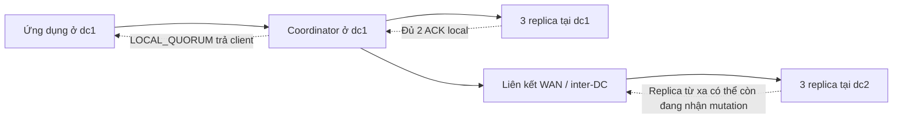
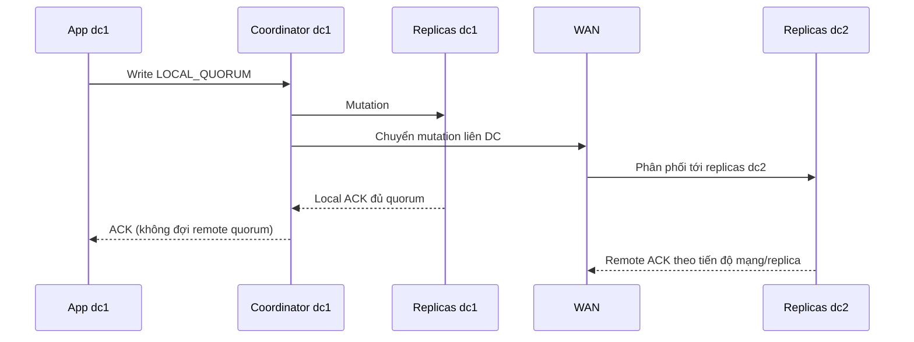
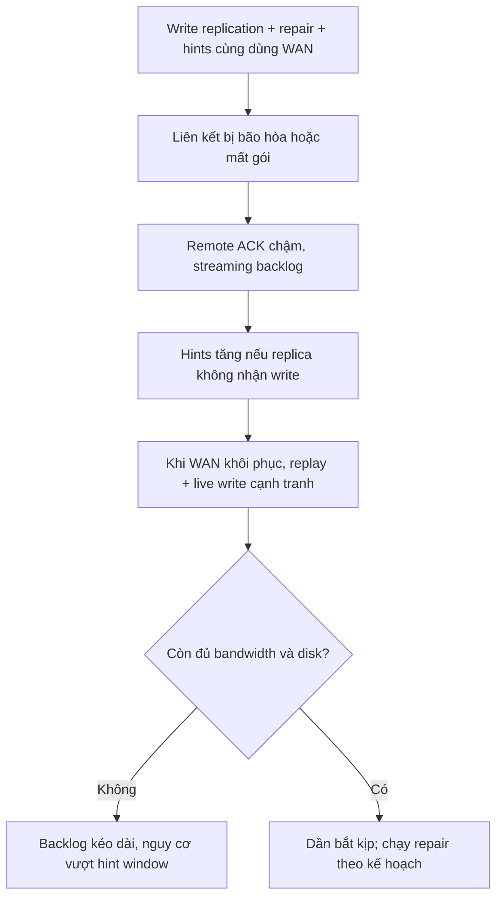

# Băng thông, chi phí truyền và lưu lượng nền

> **Chương:** Nhiều trung tâm dữ liệu  
> **Học phần:** `DATABASE_ENGINE_WIDE_COLUMN_CASSANDRA` — Apache Cassandra

Triển khai Apache Cassandra trên nhiều **data center (DC)** giúp một hệ thống wide-column phân tán tiếp tục phục vụ ứng dụng ngay cả khi một DC gặp sự cố. Đổi lại, **đường truyền liên DC trở thành tài nguyên phải thiết kế và giám sát**, chứ không chỉ là “đường dự phòng”. Một mutation bình thường có thể cần đến các replica ở DC khác; repair, hinted handoff, bootstrap, rebuild và streaming còn tạo ra những đợt lưu lượng nền có thể lớn hơn lưu lượng truy vấn trung bình nhiều lần.

Điểm dễ nhầm nhất là: **`LOCAL_QUORUM` giảm số phản hồi coordinator phải chờ từ DC khác, nhưng không tắt việc Cassandra nhân bản dữ liệu sang DC khác**. Với `NetworkTopologyStrategy` đặt RF trong nhiều DC, mục tiêu lâu dài là tất cả replica được chọn đều nhận dữ liệu. Vì vậy việc đọc/ghi có độ trễ tốt từ một DC không tự chứng minh liên kết WAN đủ băng thông, các bản sao từ xa đã bắt kịp hay hóa đơn egress sẽ thấp.

Bài học trình bày cách xác định nguồn traffic liên DC, tính sơ bộ throughput và chi phí, phân biệt traffic thường xuyên với traffic phục hồi, chọn cơ chế hạn chế tải và xây dựng runbook khi mạng bị nghẽn. Bài cũng liên hệ với khóa phân vùng, thiết kế bảng theo truy vấn, consistency level, repair, compaction và Java Driver.

**Mục tiêu học tập**

- Giải thích vì sao multi-DC tốn băng thông ngay cả khi dùng `LOCAL_QUORUM` và local DC routing.
- Phân loại lưu lượng liên DC: mutation replication, reads, hints, repair, bootstrap/rebuild, schema/gossip và các hoạt động phụ trợ.
- Ước lượng **số byte, thông lượng trung bình/đỉnh, thời gian truyền và chi phí mạng**, nêu rõ giả định.
- Phân biệt giới hạn **streaming** và giới hạn **request traffic**; chọn các knobs cấu hình đúng mục tiêu.
- Viết truy vấn kiểm tra replication, các câu CQL mẫu và Java client đặt local DC/CL.
- Đề xuất kế hoạch capacity, giám sát và xử lý mạng liên DC chậm hoặc phân tách.

## 1. Điều gì xảy ra khi một keyspace có replica ở hai DC?

Ví dụ một cụm có hai DC, mỗi DC ba node, và keyspace được khai báo:

```sql
CREATE KEYSPACE telemetry
WITH replication = {
    'class': 'NetworkTopologyStrategy',
    'dc1': 3,
    'dc2': 3
};
```

`NetworkTopologyStrategy` chọn **ba replica trong mỗi DC** cho mỗi token range, theo topology node/rack mà snitch cung cấp. Một partition có tổng cộng sáu replica ở hai DC trong cấu hình mẫu. Không nên dùng `SimpleStrategy` cho cụm production multi-DC.



Sơ đồ mô tả **luồng logic**, không cố định số kết nối mạng vật lý: Cassandra có thể tối ưu cách chuyển tiếp mutation giữa các node/replica. Nhưng việc **gửi write đến các replica được chọn ở các DC** không bị loại bỏ chỉ vì coordinator đã đủ ACK cục bộ.

Khi client gửi `INSERT` từ dc1 với `LOCAL_QUORUM`:

1. Driver thường chọn coordinator trong **local DC** của ứng dụng, nếu được cấu hình đúng.
2. Coordinator xác định token từ partition key, sau đó lập danh sách replica theo chiến lược replication.
3. Mutation được phân phối tới các replica được chọn, gồm replica ở **dc2**; đường truyền WAN vì thế có traffic.
4. Coordinator trả thành công khi nhận đủ ACK theo `LOCAL_QUORUM` của **dc1** (với RF=3 ở dc1 là 2), không cần chờ đa số replica ở dc2.
5. Nếu dc2 chậm hoặc tạm mất liên lạc, replicas từ xa có thể chưa bắt kịp; Cassandra có hinted handoff trong các điều kiện phù hợp, và anti-entropy repair vẫn là nghĩa vụ vận hành.

Nếu dc1 và dc2 đều nhận ghi từ các ứng dụng đặt tại chỗ, traffic liên DC phát sinh **cả hai chiều**. Khi ước lượng giá, phải phân biệt **egress từ dc1 → dc2**, **egress từ dc2 → dc1** và phí ingress/peering/traffic nội DC theo hợp đồng nhà cung cấp.

### Cần phân biệt token ownership, DC và rack

- **Partition key** xác định token; các partition nóng có thể tập trung tải trên một nhóm replica. Tăng băng thông WAN không tự chữa hot partition.
- **Snitch** khai báo DC/rack để Cassandra chọn replica và định tuyến hiệu quả. Nếu cấu hình sai DC/rack, ứng dụng có thể đọc qua WAN hoặc phân bổ replica sai miền lỗi.
- **Replication factor** theo từng DC xác định số bản sao tại DC đó, không nhất thiết bằng số luồng WAN cùng lúc.
- **Compaction** chạy chủ yếu trên SSTable **cục bộ mỗi node**. Nó làm tăng I/O và có thể tranh chấp tài nguyên với streaming, nhưng không nên tính toàn bộ bytes compaction như bytes chuyển qua WAN.

## 2. Nhóm lưu lượng nào đi qua liên kết liên DC?

Phân loại theo **đường dữ liệu** và **nhịp xuất hiện** để tránh bỏ sót những đợt background traffic.

| Nguồn lưu lượng | Xảy ra khi nào? | Có thể đi qua WAN? | Cần đo gì? |
| --- | --- | --- | --- |
| **Write replication** | `INSERT`, `UPDATE`, `DELETE` đến keyspace có replica ở nhiều DC | **Có**, thường liên tục theo write rate | Mutation bytes, request/s, traffic mỗi hướng, retry/timeout |
| **Read giữa DC** | Client/coordinator ở DC này đọc từ replica khác DC; CL hoặc routing cho phép/yêu cầu | Có; **local routing** giúp hạn chế | Remote reads, p95/p99, response bytes, số lần retry |
| **Gossip, topology, schema** | Node trao đổi trạng thái sống/chết, token và metadata | Có nhưng thường nhỏ hơn bulk streaming | Messages, lỗi kết nối, trạng thái gossip/schema |
| **Hinted handoff** | Một replica bỏ lỡ write; coordinator lưu mutation rồi phát lại | Có, nhất là khi node/đường WAN khôi phục | Hints tồn, tốc độ replay, backlog, drops, disk |
| **Anti-entropy repair** | Các replica so sánh token ranges, truyền dữ liệu khác biệt | Có, tùy DC tham gia và option repair | Bytes stream, Merkle tree, thời gian/coverage, thất bại |
| **Bootstrap / rebuild / replace / removenode** | Thay đổi topology hoặc nạp lại dữ liệu | Có thể rất lớn, đặc biệt tạo DC mới | Streaming bytes, source/destination, throughput, disk headroom |
| **LWT/Paxos và các tính năng phụ trợ** | Những truy vấn có điều kiện/đồng thuận, topology cụ thể | Có thể tạo thêm các vòng thông điệp replica, cả liên DC | Latency, số LWT/s, thông điệp nền, tỷ lệ xung đột |
| **Compaction/flush nội bộ** | Ghi SSTable, hợp nhất SSTable, xử lý tombstone | **Không mặc định** tạo WAN traffic chỉ vì compaction | Disk I/O, pending compaction; tác động gián tiếp đến stream |
| **Backup/snapshot xuất khỏi DC** | Đẩy backup tới object storage/địa điểm khác | Có, nếu đích ngoài DC | Bytes transfer, đích lưu trữ, egress, retention |

Cần xác định **nguồn nào thực sự nằm trên liên kết WAN trả phí**. Ví dụ traffic từ node đến object storage cùng region, streaming liên region và lưu lượng client đi qua load balancer có thể được tính cước khác nhau.

Đừng gộp mọi thứ thành “replication network usage”: nếu dashboard chỉ hiển thị tổng byte trên NIC, sẽ khó biết lưu lượng tăng vì nhu cầu khách hàng, repair chạy sai thời điểm hay một node replay lượng hints tồn đọng.

## 3. Consistency level thay đổi thời gian chờ, không xóa chi phí nhân bản

Với **RF=3 ở mỗi dc1 và dc2**, bảng sau minh họa một số mức nhất quán. Chọn mức CL theo yêu cầu nghiệp vụ và phiên bản Cassandra cụ thể.

| CL | Phản hồi coordinator cần | Tác động đáng chú ý tới WAN |
| --- | --- | --- |
| `LOCAL_ONE` (read) | Một replica trong local DC | Tránh đọc dữ liệu replica từ xa theo đường bình thường; độ trễ đọc thấp nhưng có thể thấy dữ liệu cũ. |
| `LOCAL_QUORUM` | Đa số replica ở local DC; với RF=3 là 2 | Read thông thường lấy dữ liệu local; write vẫn được gửi tới replica ở các DC khác, nhưng **không chờ** ACK ở remote DC. |
| `QUORUM` | Đa số replica toàn keyspace; với tổng RF=6 là 4 | Có thể cần phản hồi xuyên DC, làm p99 nhạy với WAN và DC chậm. |
| `EACH_QUORUM` (write) | Đa số replica **trong từng DC**; ở đây 2 tại dc1 **và** 2 tại dc2 | Phải chờ ít nhất một chặng WAN; giảm khả dụng write nếu DC khác mất liên lạc. |
| `ALL` | Tất cả replica | Nhạy với lỗi/chậm ở bất kỳ replica nào; khả dụng thấp hơn. |

**Lưu ý:** `EACH_QUORUM` là mức áp dụng cho **write**; không dùng nó như một giải pháp đọc quen thuộc. Nếu ứng dụng chỉ cần nhất quán trong local DC, thường cân nhắc `LOCAL_QUORUM` cho write/read; nhưng dữ liệu mới **chưa nhất thiết đã tới remote DC** vào thời điểm ACK. Do đó một truy vấn đọc ngay tại dc2 có thể thấy phiên bản cũ khi đường liên DC đang chậm.

Ví dụ tương quan latency:



**Đừng coi `LOCAL_QUORUM` là cơ chế giảm byte truyền WAN đáng kể.** Lựa chọn đó chủ yếu giảm **độ trễ phản hồi và phụ thuộc đồng bộ remote** của client. Muốn giảm byte WAN phải xem số mutation, payload, replication layout, compression, data lifecycle và lưu lượng nền.

## 4. Một mô hình tính sơ bộ số byte và chi phí

Lập mô hình theo **từng hướng lưu lượng**, tách ba lớp:

1. **Payload nghiệp vụ:** byte/s trung bình và đỉnh của các mutation hợp lệ phát sinh ở DC nguồn.
2. **Chi phí giao thức thực tế:** serialization, metadata, retry, compressed size, framing, TLS và việc chuyển tiếp giữa node. Không thể coi kích cỡ `payload` của CQL là byte trên dây.
3. **Lưu lượng bổ sung:** hints, repair, bootstrap/rebuild, backup và tăng trưởng đột biến khi hồi phục sau sự cố.

Một công thức **dự báo sơ bộ** cho mỗi hướng là:

\[
V_{\text{WAN, day}} \approx
R_{\text{write}} \times S_{\text{wire}} \times 86\,400
+ V_{\text{reads}} + V_{\text{hints}} + V_{\text{repair}} + V_{\text{stream}} + V_{\text{other}}
\]

Trong đó `R_write` là write/s cần sang DC khác, còn `S_wire` là số byte WAN **đo hoặc ước lượng theo cả mutation/protocol/compression** cho một write. **Đừng tự nhân `S_wire` với RF của DC nhận** nếu không biết cơ chế forwarding, vì RF là số bản sao cuối cùng, không phải số bản copy WAN độc lập.

### Ví dụ A — lưu lượng nhân bản thường xuyên

Một hệ thống ghi vào dc1 có mức mutation traffic trên WAN ước lượng **20 MB/s trung bình**, sau khi đã xét kích cỡ thông điệp nhưng **chưa cộng các tác vụ nền**. Dùng đơn vị **MB thập phân = 1.000.000 byte**:

\[
20 \ \text{MB/s} \times 86\,400\ \text{s/day}
= 1\,728\,000\ \text{MB/day}
= 1.728\ \text{TB/day}
\]

Tức khoảng **1,728 TB/ngày** riêng chiều **dc1 → dc2**. Nếu dc2 cũng phát sinh cùng lượng write riêng và các write đó được nhân bản về dc1, tổng byte egress **hai hướng** có thể gần gấp đôi trong ví dụ đối xứng, **trước** khi cộng repair, hints, bootstrap hoặc backup.

Nếu link chỉ có năng lực thực tế khoảng **100 Mb/s**, tương đương **12,5 MB/s lý thuyết trước overhead**, nó không thể chuyển liên tục workload tương đương 20 MB/s trong thời gian dài. Không giải quyết bằng cách “tăng timeout client”: cần năng lực mạng lớn hơn, giảm mutation rate/size hoặc điều chỉnh kiến trúc. Cassandra không thể đảm bảo một hàng đợi nhân bản WAN vô hạn và không mất dữ liệu.

### Ví dụ B — thời gian streaming khi tạo DC mới

Giả sử cần chuyển ít nhất **1 TB (thập phân)** dữ liệu qua một đường chỉ cấp trung bình **200 Mb/s** cho bulk streaming:

\[
t_{\min} =
\frac{1\,000\,000\,000\,000 \times 8}
{200\,000\,000}
= 40\,000\ \text{s} \approx 11.1\ \text{giờ}
\]

Đây là **cận dưới lý tưởng** cho đúng 1 TB truyền trên đúng một luồng chia sẻ tổng thông lượng 200 Mb/s, **không phải ETA**. Trong thực tế còn cạnh tranh write replication, protocol/TLS, lỗi truyền, thay đổi SSTable, thời gian chờ, I/O đĩa và nguồn streaming có thể khác nhau. Nếu giới hạn stream được cấu hình **theo node**, phải tổng hợp các giới hạn trên *toàn bộ nguồn/đích và đường mạng*, không coi 200 Mb/s là giới hạn chung cho cả cụm.

### Ví dụ C — từ byte sang hóa đơn

Giả sử nhà cung cấp tính egress theo **GB thập phân**:

\[
C_{\text{network}} =
V_{\text{dc1→dc2}} \times P_{\text{egress, dc1}}
+ V_{\text{dc2→dc1}} \times P_{\text{egress, dc2}}
+ C_{\text{interconnect}} + C_{\text{ingress (nếu có)}}
\]

Trong đó giá `P` và các khoản cố định do hợp đồng mạng/cloud quy định. **Không gán đơn giá phổ quát**: cùng một byte có thể có giá khác nhau giữa zone, region, cloud provider hoặc đường leased/private peering. Cũng cần xem traffic theo hướng, bậc giá, đơn vị GB/GiB, cam kết băng thông, tiền NAT/gateway và phí lưu trữ/backup.

### Capacity planning phải xét p95/p99, không chỉ trung bình

| Thông số cần ghi | Câu hỏi |
| --- | --- |
| Throughput trung bình mỗi chiều | Link chịu được tải cơ bản 24/7 không? |
| Peak 1 phút / 5 phút / giờ | Có headroom khi sự kiện tăng đột biến, compaction/GC hoặc network jitter không? |
| Tốc độ tăng dữ liệu và write rate | 3–6 tháng nữa network còn đủ không? |
| Bytes của hints/repair/streaming | Khi một DC quay lại, backlog cần bao lâu để được xử lý? |
| WAN RTT/loss/jitter | `EACH_QUORUM` và streaming bị ảnh hưởng thế nào? |
| Network egress theo loại | Traffic nào được billing, traffic nào miễn/giảm giá trong DC? |
| Mục tiêu RTO/RPO | Có đủ băng thông và replica để khôi phục trong thời hạn yêu cầu không? |

**Năng lực truyền là ràng buộc riêng với độ trễ.** Một link băng thông lớn nhưng RTT cao vẫn có thể làm các thao tác cần phản hồi liên DC chậm; một link RTT tốt nhưng băng thông thấp có thể nhanh lúc nhàn rỗi và sụp khi rebuild.

## 5. Lưu lượng nền: khi nào có thể vượt traffic ứng dụng?

### 5.1. Hinted handoff: backlog nổ ra khi liên kết hồi phục

Nếu replica tại dc2 bỏ lỡ mutation do đứt mạng, coordinator ở dc1 có thể giữ **hints** trong một cửa sổ giới hạn, theo chính sách hinted handoff. Khi node/đường mạng hoạt động lại, hints có thể được replay, khiến **WAN traffic tăng mạnh** ngoài write replication đang tiếp diễn.

- Hints **không bảo đảm tồn tại cho mọi mutation**, đặc biệt nếu downtime vượt `max_hint_window` hoặc disk của coordinator gặp lỗi.
- Không được mặc định backlog hints sẽ “tự hết” trước khi hệ thống lại bị nghẽn: phải đo bytes còn tồn, throughput replay và nguy cơ node tái mất kết nối.
- Tốc độ replay có thể được kiểm soát bằng cấu hình/tham số hinted handoff của phiên bản; không nên tăng tốc mù quáng khi băng thông WAN đã chạm trần.
- Khi hints không bao phủ đủ, **repair** vẫn cần để đối soát replica.

### 5.2. Repair: so sánh range và streaming khác biệt

Anti-entropy repair phải đọc dữ liệu và so sánh giữa các replica. Khi phát hiện khác biệt, Cassandra stream dữ liệu cần hòa giải. Một lịch repair đồng thời ở cả dc1 và dc2 có thể ăn hết headroom mạng và làm p99 client xấu đi.

Trong `nodetool repair`, option **`-local` / `--in-local-dc`** chỉ repair với node **trong local DC**, giúp kiểm soát những lần repair không cần đi WAN. Tuy nhiên, **chỉ chạy local repair không chứng minh dữ liệu giữa hai DC đã được đối soát**. Chiến lược có thể gồm repair local thường xuyên và các lần cross-DC được điều phối khi cần, với đủ coverage theo token range và chính sách `gc_grace_seconds`. Không nên bỏ hẳn cơ chế đối soát liên DC nếu dữ liệu và yêu cầu nhất quán đòi hỏi.

```bash
# Quan sát trước, không làm biến đổi dữ liệu:
nodetool status
nodetool netstats
nodetool compactionstats

# Ví dụ lệnh có tác động tài nguyên; chỉ chạy theo lịch đã duyệt:
nodetool repair -pr -local telemetry sensor_events_by_day

# Ví dụ repair không giới hạn local DC; cần điều phối đúng phạm vi:
nodetool repair --full -pr telemetry sensor_events_by_day
```

`-pr` áp dụng trên **primary token ranges của node gọi lệnh**; một lần chạy như trên **không đồng nghĩa full-cluster repair**. Lịch repair phải có bằng chứng về range/table/DC đã được xử lý thành công, tránh một job báo PASS nhưng những range khác bị bỏ sót.

### 5.3. Bootstrap, rebuild và streaming khi mở rộng DC

Thêm một DC mới không phải là “copy cấu hình rồi Cassandra tự có toàn bộ dữ liệu”. Phải cấu hình topology/replication đúng, đưa node vào ring theo thủ tục an toàn rồi stream dữ liệu theo kế hoạch, ví dụ **rebuild từ DC nguồn** ở điều kiện phù hợp.

- Dung lượng truyền có thể tính bằng **TB/PB**, và hoạt động này cạnh tranh trực tiếp với replication đang hoạt động.
- Cần giới hạn số node stream đồng thời và băng thông **theo nguồn, đích, link và DC**; không chỉ nhìn giới hạn một node.
- Sau streaming, xác minh schema agreement, status, endpoint/replica ownership, các truy vấn trên **dữ liệu có trước khi mở DC**, repair/đối soát phù hợp rồi mới chuyển traffic.
- Streaming lớn có thể gây read/write latency tăng do tranh chấp disk I/O tại node nguồn dù WAN còn nhiều dung lượng.
- Nếu stream fail, ưu tiên điều tra log, nguồn, disk, network và phiên bản; không reset bootstrap hoặc xóa SSTable thủ công theo cảm tính.

### 5.4. Lưu lượng ít thấy nhưng có ý nghĩa

Gossip, schema agreement và sự kiện failure detector thường nhỏ so với SSTable streaming, nhưng chúng **nhạy với mạng gián đoạn và packet loss**. Một link chỉ bị giảm chất lượng cũng có thể dẫn tới node bị coi là down, tăng hints, thay đổi route request hoặc gây timeout.

Tương tự, nếu ứng dụng dùng **LWT/CAS** cho các mutation có điều kiện, các vòng thông điệp Paxos có thể làm độ trễ nhạy với topology và DC. LWT không làm replication miễn phí và không được coi như phương án thay network planning.

**Compaction không trực tiếp gửi tất cả bytes qua WAN**, nhưng nó có thể làm data disk luôn bận, kéo dài thời gian repair/rebuild. Việc sắp lịch compaction nặng, snapshot/backup, repair và streaming cần được phối hợp để tránh tranh chấp cùng tài nguyên.

## 6. Những đòn bẩy kỹ thuật giảm tải và giữ an toàn

### 6.1. Định tuyến client về local DC

Ứng dụng Java thường nên kết nối và chọn coordinator **cùng DC** với chính ứng dụng, thông qua load balancing policy và cấu hình `localDatacenter` đúng. Kết hợp mức đọc `LOCAL_ONE` hoặc `LOCAL_QUORUM` khi yêu cầu nghiệp vụ cho phép.

Điều này giúp tránh **client → remote coordinator** và giảm những lần đọc không cần thiết qua WAN. Nhưng nó không làm mất việc nhân bản mutation sang DC khác khi RF ở DC khác lớn hơn 0.

**Không dùng một danh sách contact points trải hai DC rồi bỏ qua local DC** vì mong driver tự chọn đường rẻ nhất; hãy kiểm tra host metadata, chính sách DC và thông số query routing thực tế.

### 6.2. Internode compression: giảm byte, tăng chi phí CPU

Apache Cassandra hỗ trợ cấu hình `internode_compression` trong `cassandra.yaml`:

```yaml
# Trích phần cấu hình minh họa. Đối chiếu với đúng bản Cassandra trước khi sửa:
internode_compression: dc
```

| Giá trị | Ý nghĩa | Cân nhắc |
| --- | --- | --- |
| `dc` | Nén thông điệp **giữa các DC** | Thường là mặc định trong tài liệu Cassandra hiện hành; tiết kiệm WAN nếu dữ liệu nén được. |
| `all` | Nén tất cả lưu lượng internode | Có thể giảm cả network nội DC, nhưng tốn CPU rộng hơn. |
| `none` | Không nén lưu lượng internode | Có thể giảm CPU nhưng tăng byte trên dây; dễ bất lợi khi egress đắt. |

Đây là **nén lưu lượng internode**, khác với nén SSTable trên đĩa và khác với **TLS**. Nếu traffic chứa dữ liệu vốn đã nén/mã hóa, lợi ích nén thêm có thể nhỏ. Đo CPU/GC, throughput WAN và request latency trước–sau, không suy rằng bật `all` luôn tốt hơn `dc`.

Truyền dữ liệu qua mạng công cộng/không đáng tin cậy phải có kiến trúc bảo vệ phù hợp: cấu hình mã hóa internode theo bản Cassandra, xác thực peer, network ACL/TLS, không mặc định nén đồng nghĩa bảo mật.

### 6.3. Giới hạn streaming riêng với traffic thường

Trong tài liệu cấu hình Apache Cassandra hiện hành, các tùy chọn liên quan gồm:

- `stream_throughput_outbound`: tổng giới hạn **outbound file streaming trên mỗi node**.
- `inter_dc_stream_throughput_outbound`: giới hạn **file streaming liên DC** trên node, bổ sung giới hạn tổng streaming.
- `entire_sstable_inter_dc_stream_throughput_outbound` và cấu hình cùng nhóm: điều chỉnh streaming SSTable nguyên tệp trong các phiên bản hỗ trợ.
- `internode_compression`: nén internode messages, **không phải** bộ giới hạn byte/s.

Các key cấu hình theo phiên bản cũ có thể có hậu tố `_megabits_per_sec` và cách biểu diễn đơn vị khác. Trong tài liệu 5.0, các giá trị ví dụ thường ở **MiB/s**, còn một số lệnh `nodetool` mặc định hiển thị **megabits/s**. Không copy số `200` giữa hai nơi mà không kiểm tra đơn vị!

```bash
# Lệnh chỉ đọc trên các bản Cassandra có hỗ trợ:
nodetool getstreamthroughput
nodetool getinterdcstreamthroughput

# Tùy phiên bản, dùng -m để hiển thị MiB/s rõ ràng:
nodetool getinterdcstreamthroughput -m

# Kiểm tra cú pháp, chưa đổi giới hạn:
nodetool help setinterdcstreamthroughput
```

Để điều chỉnh runtime, `nodetool setinterdcstreamthroughput` có thể đặt cap cho streaming liên DC; phải thực hiện có kiểm soát, kiểm tra đơn vị, persistence của cấu hình, tác động lên tất cả node và kế hoạch triển khai. **Giới hạn streaming này không giới hạn toàn bộ normal write replication traffic**. Một link WAN có thể vẫn quá tải do write replication/hints dù cap streaming được đặt thấp.

### 6.4. Thiết kế dữ liệu giảm mutation không cần thiết

Một bảng không hợp với truy vấn có thể tạo traffic WAN lớn hơn cần thiết:

- Ghi một event rồi cập nhật cột nhiều lần trên cùng row → nhiều mutation phải nhân bản.
- Xóa/chèn lại vì một thuộc tính thường thay đổi nằm trong partition key → tombstone + mutation mới.
- Dùng counter hoặc logged batch không cần thiết → thêm chi phí giao thức, retry/đồng thuận/phối hợp trong những trường hợp liên quan.
- Dùng partition key rất nóng → tập trung traffic và CPU trên ít replica; đường WAN tổng còn dư nhưng một nhóm node bị bão hòa.

Ưu tiên **bảng theo truy vấn**, khóa phân vùng ổn định, event ID cố định, retention rõ ràng, bucket theo thời gian và cập nhật có mục đích. Không giảm RF một cách tùy tiện chỉ để tiết kiệm băng thông: đó là thay đổi **khả năng chịu lỗi và yêu cầu dữ liệu**; phải có đánh giá kiến trúc và compliance trước.

### 6.5. Đặt lịch nền theo budget và mức ưu tiên

Tạo **network budget** riêng cho các lớp:

1. Traffic ứng dụng và write replication thường xuyên.
2. Dự phòng cho đỉnh traffic, retry và lỗi ngắn.
3. Streaming/repair/hints phục hồi trong khả năng còn lại, theo thời hạn RTO/RPO.
4. Backup/export và tác vụ batch không gấp.

Thay vì “để repair chạy hết tốc độ vào ban đêm”, hãy phân phối theo nhiều node, tránh trùng segment/range giữa các job và giám sát tác động lên read/write p99. Một lịch repair bị dời liên tục để tiết kiệm egress có thể cuối cùng khiến dữ liệu có nguy cơ zombie vì vượt `gc_grace_seconds`.

## 7. Quan sát và hạch toán băng thông theo từng hướng

Một dashboard multi-DC nên có hai lớp: **Cassandra metrics** và **network provider/OS counters**. Chỉ một trong hai là chưa đủ để giải thích chính xác hóa đơn.

| Nhóm metric | Nên xem theo chiều/khoảng thời gian | Dùng để xác định |
| --- | --- | --- |
| Network rx/tx bytes và packet drops | Theo node, NIC, DC, hướng liên kết, 1 phút/5 phút/giờ | Cấu phần tổng traffic, peak, loss, saturation |
| Egress billed bytes | Theo region/zone, cross-region link, gateway/VPN/peering | Chi phí tiền thực tế và so sánh với forecast |
| Cassandra request traffic | Mutations/s, payload/response sizes, CL, remote reads | Phân biệt tải người dùng với dữ liệu truyền nền |
| Hints | Created, stored, delivered, dropped, backlog | Phát hiện lưu lượng replay tăng khi DC phục hồi |
| Repair | Lần chạy, coverage range/DC, bytes streamed, lỗi | Theo dõi lịch repair có thực sự kết thúc và chi phí liên DC |
| Streaming | Throughput theo source/destination, active sessions, remaining bytes | Tiến độ bootstrap/rebuild/replace hoặc repair |
| Compaction/flush | Pending, disk throughput/latency | Phân biệt bottleneck WAN với disk source/đích |
| Java driver | Local DC, coordinator host, request latency, retries/timeouts | Phát hiện app gửi request sang DC ngoài dự kiến |

Lệnh điều tra mẫu (chỉ đọc):

```bash
nodetool status
nodetool describecluster
nodetool netstats
nodetool compactionstats
nodetool tpstats
nodetool getinterdcstreamthroughput
```

Trong `cqlsh`, kiểm tra replication của keyspace:

```sql
SELECT keyspace_name, replication
FROM system_schema.keyspaces
WHERE keyspace_name = 'telemetry';
```

Và ở phía hệ điều hành/network provider, quan sát throughput/billing theo **từng hướng**. Một số câu hỏi kiểm chứng:

- Traffic dc1 → dc2 tăng có tương quan với **write rate** hay với việc bắt đầu **repair/streaming**?
- Traffic dc2 → dc1 tăng ngay sau khi mạng hồi phục có phải do **replay hints**?
- Khi tăng `internode_compression`, byte WAN giảm nhưng CPU node hoặc p99 ghi có tăng không?
- Khi hạ cap streaming, p99 client cải thiện nhưng vòng rebuild có còn đáp ứng RTO?
- Mạng có còn headroom khi một DC cần khôi phục ngay trong giờ cao điểm?

**Lưu ý tính khả quan:** Network NIC counters thường bao gồm traffic nội DC, traffic client và traffic hệ điều hành. Nếu muốn đo đúng liên DC, cần flow logs/telemetry hạ tầng có nhãn nguồn–đích hoặc metric WAN/peering. Không lấy tổng bytes từ một NIC rồi khẳng định toàn bộ đều bị tính phí egress.

## 8. Tình huống sự cố: WAN nghẽn, đứt hoặc chập chờn

Giả sử dc1 và dc2 đều có RF=3, ứng dụng trong dc1 ghi `LOCAL_QUORUM`. Một link WAN đang bị giới hạn băng thông trong khi repair lớn chạy giữa các DC.



### Trong 15–30 phút điều tra đầu tiên (trình tự, không phải SLA)

1. **Xác định tác động ứng dụng:** read/write timeout ở dc1, dc2, CL nào, có `EACH_QUORUM` hay client được định tuyến nhầm DC không?
2. **So sánh trạng thái:** `nodetool status` từ cả hai DC; xem snitch, latency, gossip, packet drops, streaming/hints.
3. **Tách live vs background:** có repair, rebuild, backup/export hay hinted handoff đang bùng phát không? Có đúng source/destination không?
4. **Giảm tác vụ có thể hoãn:** tạm giảm parallelism hoặc giới hạn streaming/repair theo runbook, giữ khả năng phục vụ write/read quan trọng; không tự dừng mọi repair mãi mãi.
5. **Kiểm tra disk của coordinator và replica:** hints có thể chiếm disk; flush/compaction nghẽn có thể khiến việc bắt kịp tệ hơn.
6. **Khôi phục rồi đối soát:** khi WAN ổn định, theo dõi backlog hints và thực hiện repair có phạm vi nếu downtime vượt cửa sổ tạo hints hoặc có nguy cơ sai lệch.

**Điều không nên làm:** tăng vô hạn timeout/retry của Java service; tự hạ CL từ `EACH_QUORUM` xuống `ONE` mà không xét nghiệp vụ; xóa file hint/commit log; chạy full repair toàn cụm khi WAN đang cạn; hoặc giả định `LOCAL_QUORUM` có thể tiếp tục giữ dữ liệu giữa các DC hoàn toàn nhất quán trong lúc đứt mạng.

### Nếu một DC mất kết nối dài

- Ứng dụng có thể tiếp tục phục vụ trong DC khỏe theo CL local nếu còn đủ replica ở đó; nhu cầu **cross-DC visibility** phải được đánh giá riêng.
- Những mutation không đến được DC khác có thể vượt giới hạn hints, nên không thể hứa “kết nối lại là tự đồng bộ đầy đủ”.
- Khi liên kết trở lại, **đưa traffic nền lên có kiểm soát**, quan sát disk/network và chạy repair theo runbook nhằm bắt kịp dữ liệu.
- Nếu dùng tính năng có điều kiện hoặc phục vụ cùng một khóa ở nhiều DC, cần kiểm tra semantics và xung đột timestamp/concurrency; mạng hồi phục không tự quyết định sự kiện nghiệp vụ nào đúng.

## 9. CQL và Java Driver: ví dụ kiểm tra đúng DC/CL

### 9.1. Bảng theo partition key/bucket

Ví dụ bảng ghi sự kiện theo thiết bị và ngày:

```sql
-- Giả định keyspace telemetry ở mục 1 đã tồn tại và đủ node ở mỗi DC.
CREATE TABLE IF NOT EXISTS telemetry.events_by_device_day (
    device_id text,
    event_day date,
    event_id uuid,
    payload text,
    PRIMARY KEY ((device_id, event_day), event_id)
);

INSERT INTO telemetry.events_by_device_day
    (device_id, event_day, event_id, payload)
VALUES (
    'device-07', '2026-11-21',
    11111111-1111-4111-8111-111111111111,
    'probe-2026-11-21'
);

SELECT payload
FROM telemetry.events_by_device_day
WHERE device_id = 'device-07'
  AND event_day = '2026-11-21'
  AND event_id = 11111111-1111-4111-8111-111111111111;
```

Khóa phân vùng `(device_id, event_day)` giúp ứng dụng đọc theo một thiết bị/ngày. Nếu lưu lượng quá cao, cần bổ sung bucket nhỏ hơn để tránh partition nóng; compaction, compression hay kết nối WAN nhanh không sửa được một truy vấn không phù hợp với partition key.

Để thử CL trong `cqlsh`:

```sql
-- Lệnh của cqlsh, không phải câu SQL/CQL trong ứng dụng:
CONSISTENCY LOCAL_QUORUM;
```

### 9.2. Ứng dụng Java Driver 4.x chọn local DC

```java
import java.net.InetSocketAddress;
import java.time.LocalDate;
import java.util.UUID;

import com.datastax.oss.driver.api.core.CqlSession;
import com.datastax.oss.driver.api.core.DefaultConsistencyLevel;
import com.datastax.oss.driver.api.core.cql.PreparedStatement;
import com.datastax.oss.driver.api.core.cql.Row;

public final class MultiDcProbe {
    private final CqlSession session;
    private final PreparedStatement readByKey;

    public MultiDcProbe(CqlSession session) {
        this.session = session;
        this.readByKey = session.prepare(
            "SELECT payload FROM telemetry.events_by_device_day " +
            "WHERE device_id = ? AND event_day = ? AND event_id = ?");
    }

    public String read(String deviceId, LocalDate day, UUID eventId) {
        Row row = session.execute(
            readByKey.bind(deviceId, day, eventId)
                .setConsistencyLevel(DefaultConsistencyLevel.LOCAL_QUORUM)
                .setIdempotent(true)
        ).one();
        return row == null ? null : row.getString("payload");
    }

    public static CqlSession connectToDc1() {
        // IP ví dụ; trong production dùng host/credentials/TLS từ cấu hình.
        return CqlSession.builder()
            .addContactPoint(new InetSocketAddress("192.0.2.10", 9042))
            .withLocalDatacenter("dc1")
            .build();
    }
}
```

- `withLocalDatacenter("dc1")` phải khớp tên DC theo snitch; nếu service chạy ở dc2 thì cấu hình local DC và contact points tương ứng cho instance đó.
- Đây là read probe, không phải phép đo lưu lượng đầy đủ. Kiểm tra cùng `event_id` từ cả hai DC sau khi streaming/repair; nếu remote DC chưa bắt kịp, kết quả có thể khác ngay sau write ở dc1.
- Driver local routing giúp hạn chế client đi sang DC xa nhưng **không loại bỏ write replication WAN ở phía Cassandra**.
- Nếu client gửi một write rồi timeout, không kết luận ghi chưa áp dụng. Với counter và các cập nhật có side effect, retry tự động có thể làm sai nghiệp vụ.
- Ứng dụng Java không được khởi động repair/rebuild cho từng request. Nó cần ghi nhận latency, lỗi, danh tính coordinator nếu có và đối soát ở tầng nghiệp vụ khi cần.

## 10. Runbook capacity và kiểm soát chi phí khi thêm một DC

### Trước khi mở DC mới

1. **Đo baseline 7–30 ngày theo các hướng đang có:** write/s, kích thước mutation, read/write p99, traffic billed egress, streaming, repair, hints, backup, packet loss.
2. **Xác nhận topology:** DC/rack theo snitch, `NetworkTopologyStrategy` và RF theo từng DC, số node đủ để đáp ứng CL mong muốn.
3. **Ước lượng baseline liên DC:** volume write replication theo hướng, payload nén thực tế, peak traffic; lập hai dự báo thấp/cao.
4. **Ước lượng bulk transfer:** tổng dữ liệu SSTable cần nạp vào DC mới, số node/source, throughput tối đa mỗi link, thời gian tối thiểu và chi phí.
5. **Đặt budget và giới hạn:** reserved traffic cho live writes, cap streaming/repair, số tác vụ song song, safety margin cho lỗi/hints.
6. **Xác nhận bảo mật và cước:** inter-node TLS, network ACL, private/public link, cross-region egress/ingress, backup destination và SLA nhà cung cấp.

### Trong lúc bootstrap/rebuild

- Mở rộng **từng giai đoạn**, không đồng thời kích hoạt bulk repair, rebuild toàn bộ DC và backup lớn trên một link mỏng.
- Theo dõi `nodetool netstats`, `status`, disk I/O, egress mỗi hướng, source/destination và thời gian hoàn thành dự kiến.
- Đánh giá SLO tại cả DC nguồn và DC đích; giảm streaming concurrency khi traffic client bị ảnh hưởng.
- Xác minh những key **đã tồn tại trước khi mở DC** và những key viết trong quá trình streaming.
- Không chuyển load balancer traffic sang DC mới trước khi đủ RF, schema agreement, dữ liệu và query probes đạt điều kiện.

### Sau khi DC đã phục vụ traffic

- So sánh **forecast vs actual** (bytes/giờ, bytes/ngày, chi phí/GB, lượng streaming không theo kế hoạch).
- Kiểm tra được lượng traffic liên DC đến từ live mutation, repair, hints hay backup; lập owner cho từng nguồn.
- Đặt cảnh báo khi egress tăng bất thường, replay hints tăng lâu, stream bị nghẽn, một DC thiếu dữ liệu hoặc quá lâu không repair.
- Thiết lập lịch repair toàn cụm theo `gc_grace_seconds`; cần kế hoạch đối soát **giữa các DC**, không chỉ nội từng DC.
- Đánh giá lại capacity khi thay đổi RF, kiểu dữ liệu, số write, tần suất TTL và retention.

## 11. Bài tập và tình huống tự kiểm tra

**Câu 1.** Cụm có `{'dc1': 3, 'dc2': 3}`. Ứng dụng ở dc1 ghi `LOCAL_QUORUM` thành công khi dc2 mất mạng. Có thể kết luận không có traffic nhân bản liên DC và hai DC đang đồng bộ không?

**Câu 2.** Một dashboard cho thấy WAN egress trung bình 20 MB/s (thập phân) từ dc1 sang dc2 trong một ngày. Ước lượng TB/ngày trước khi cộng hints/repair. Nếu dùng 100 Mb/s link, có đảm bảo tải này truyền hết theo thời gian thực không?

**Câu 3.** Khi sửa từ `QUORUM` sang `LOCAL_QUORUM`, ứng dụng giảm p99 đáng kể. Chi phí WAN của write replication có chắc cũng giảm cùng tỷ lệ không? Vì sao?

**Câu 4.** Một nhóm bật `internode_compression: dc` và giảm inter-DC traffic trên wire. CPU của node tăng mạnh; phải đánh giá thêm những gì trước khi kết luận thiết lập tối ưu?

**Câu 5.** Trong lần thêm dc2, giới hạn streaming từ dc1 sang dc2 là 200 Mb/s cho một tuyến được dùng. Cần chuyển ít nhất 1 TB dữ liệu. Cận dưới truyền lý tưởng khoảng bao lâu? Vì sao không thể coi đó là ETA?

**Câu 6.** Scheduler chạy `nodetool repair -pr -local` đều đặn tại cả hai DC và báo mọi job PASS. Có thể khẳng định dữ liệu giữa dc1 và dc2 đã hoàn toàn đối soát chưa?

**Câu 7.** Sau đứt WAN dài, khi link hồi phục traffic tăng gấp ba. Hãy nêu hai nguồn lưu lượng nền có thể xuất hiện và hai biện pháp giảm tác động không phá dữ liệu.

<details>
<summary>Gợi ý đáp án</summary>

1. Không. `LOCAL_QUORUM` chỉ yêu cầu ACK của đa số replica ở dc1; write vẫn được gửi tới các replica của keyspace ở dc2 khi mạng có thể phục vụ. Trong lúc dc2 mất kết nối, nó có thể bỏ lỡ mutation.
2. `20 × 86.400 = 1.728.000 MB = 1,728 TB/ngày`. 100 Mb/s chỉ bằng 12,5 MB/s lý thuyết, chưa tính overhead; không đủ cho 20 MB/s liên tục.
3. Không. CL thay số ACK phải đợi, không loại bỏ mutation gửi tới replica remote. Cần đo compression, traffic thực tế và hoạt động nền.
4. Đo CPU/GC, read/write p99, throughput, payload compressibility, TLS và packet loss theo từng node/DC; một thiết lập tiết kiệm WAN có thể không hợp với CPU budget.
5. Khoảng `1 TB × 8 / 200 Mb/s = 40.000 giây ≈ 11,1 giờ` trong giả định lý tưởng. Thực tế có nhiều nguồn/đích, I/O, protocol overhead, jitter, background load và cap khác.
6. Chưa. `-local` chỉ đối soát các replica trong cùng DC; cần kế hoạch repair cross-DC khi mục tiêu là đồng bộ các replica giữa DC.
7. Hinted handoff replay và repair/streaming backlog; giảm hoặc dời bulk streaming/repair có kiểm soát, giới hạn throughput, tăng headroom hoặc tạm giảm producer rate nếu nghiệp vụ cho phép, theo dõi thời hạn repair và hints.

</details>

## Ghi nhớ

- Với keyspace có replica ở nhiều DC, **write replication liên DC tồn tại ngay cả khi dùng `LOCAL_QUORUM`**; CL chủ yếu quyết định số phản hồi phải chờ.
- Phải tính **cả hai chiều WAN**, phần thường xuyên (writes/reads) và phần nền (hints, repair, bootstrap/rebuild, backup), cùng network overhead và đơn giá thực tế.
- **Compaction** chủ yếu là I/O cục bộ nhưng có thể tranh chấp tài nguyên với repair/streaming; không tính mọi bytes compaction như WAN traffic.
- `internode_compression: dc` có thể giảm byte WAN với chi phí CPU; **`inter_dc_stream_throughput_outbound` giới hạn streaming**, không phải tất cả mutation traffic.
- Repair `-local` tiết kiệm WAN trong phạm vi đó nhưng **không tự bảo đảm dữ liệu giữa các DC đã được đối soát**.
- Khi thay topology/đổi RF, cần kiểm tra ownership, streaming, query từ từng DC, repair coverage, SLO và hóa đơn egress trước khi tuyên bố hoàn thành.

### Tài liệu tham khảo chính thức

- [Apache Cassandra — Dynamo và consistency levels](https://cassandra.apache.org/doc/stable/cassandra/architecture/dynamo.html)
- [Apache Cassandra — Snitch và topology DC/rack](https://cassandra.apache.org/doc/stable/cassandra/managing/operating/snitch.html)
- [Apache Cassandra — cassandra.yaml: compression, streaming throughput](https://cassandra.apache.org/doc/stable/cassandra/managing/configuration/cass_yaml_file.html)
- [Apache Cassandra — Streaming architecture và throttling](https://cassandra.apache.org/doc/stable/cassandra/architecture/streaming.html)
- [Apache Cassandra — Repair và các tùy chọn local DC](https://cassandra.apache.org/doc/stable/cassandra/managing/operating/repair.html)
- [Apache Cassandra — nodetool repair](https://cassandra.apache.org/doc/stable/cassandra/managing/tools/nodetool/repair.html)
- [Apache Cassandra — nodetool getinterdcstreamthroughput](https://cassandra.apache.org/doc/stable/cassandra/managing/tools/nodetool/getinterdcstreamthroughput.html)
- [Apache Cassandra — Thay đổi topology, bootstrap và replace](https://cassandra.apache.org/doc/stable/cassandra/managing/operating/topo_changes.html)

