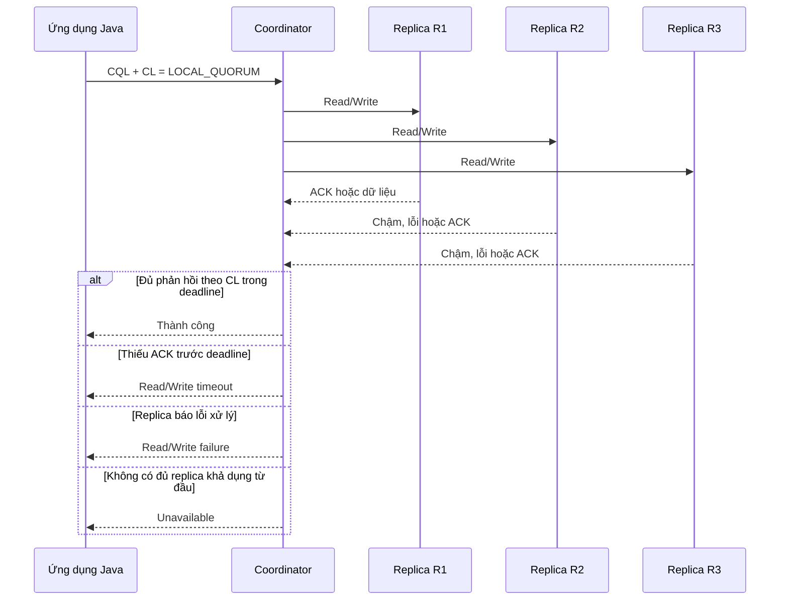
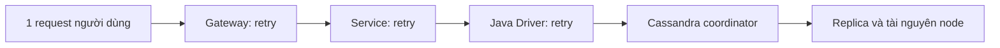

# Timeout, failure, unavailable, dropped message và retry trong Apache Cassandra

## 1. Mục tiêu: phân biệt triệu chứng với nguyên nhân

Apache Cassandra là cơ sở dữ liệu **wide-column phân tán**. Dữ liệu được phân vùng theo **partition key**, mỗi partition có các bản sao (*replica*) theo **replication factor (RF)**, và client chọn **consistency level (CL)** cho truy vấn CQL. Một ứng dụng Java gửi request đến **coordinator**; coordinator liên hệ các replica cần thiết, tập hợp phản hồi và trả kết quả hoặc lỗi.

Trong hệ thống có nhiều node, các tình huống sau dễ bị gọi chung là “Cassandra timeout” nhưng mang ý nghĩa khác nhau:

- **Timeout:** đã chờ quá thời hạn mà chưa nhận đủ kết quả/phản hồi cần thiết.
- **Failure:** có replica hoặc thành phần liên quan báo lỗi trong lúc xử lý, thay vì chỉ phản hồi chậm.
- **Unavailable:** coordinator nhận thấy không đủ replica đang khả dụng để thỏa CL.
- **Dropped message:** một thông điệp nội bộ bị loại bỏ, thường vì không còn hữu ích sau deadline; đây không phải đồng nghĩa trực tiếp với một hàng dữ liệu bị mất.
- **Retry:** một request được gửi lại sau khi thất bại hoặc không có câu trả lời; có thể cải thiện khả dụng nhưng cũng có thể **nhân tải và tạo tác dụng phụ**.

Quan sát hệ thống (*observability*) phải nối các khái niệm trên thành chuỗi bằng chứng: **request nào → CL nào → coordinator/replica nào → tài nguyên nào chậm/lỗi → ứng dụng đã retry ra sao**.

> Nguyên tắc xuyên suốt: một request **không được ACK** không đồng nghĩa một mutation **chắc chắn chưa được ghi**. Đặc biệt với write timeout, ứng dụng phải xử lý khả năng **kết quả chưa xác định**.

## 2. Mô hình đường request và các điểm có thể lỗi



Đây là sơ đồ khái niệm. Việc gửi đến replica nào, số request thực tế, local/remote DC và quy trình xử lý digest/read repair thay đổi theo CL, topology, phiên bản Cassandra và tình trạng node.

Một sự cố còn có thể xảy ra **trước khi coordinator gửi request**, ví dụ client không kết nối được bất kỳ node nào; hoặc **ngoài thời hạn chờ của client**, trong khi server vẫn đang xử lý. Vì thế cần phân biệt **lỗi trả về từ Cassandra server** với **timeout do Java Driver hoặc ứng dụng tự áp đặt**.

## 3. Consistency level xác định “đủ phản hồi” là bao nhiêu

Giả sử một datacenter có RF = 3 và ba replica R1, R2, R3 của cùng partition.

| CL | Số phản hồi cần trong ví dụ | Hệ quả khi một replica chậm/down |
| --- | ---: | --- |
| `ONE` | 1 | Có thể vẫn thành công qua replica khác; khả năng thấy dữ liệu mới nhất phụ thuộc ghi/đọc |
| `LOCAL_ONE` | 1 ở DC địa phương | Có thể thành công nếu ít nhất một replica local phục vụ |
| `LOCAL_QUORUM` | 2 ở DC địa phương | Hai replica phải phản hồi đủ yêu cầu; một replica down vẫn có thể đáp ứng |
| `QUORUM` | `floor(RF_total/2) + 1`; với một DC RF3 là 2 | Cần đủ đa số trên tập replica thuộc phạm vi toàn cluster |
| `ALL` | 3 | Chỉ cần một replica không phản hồi đúng hạn có thể khiến thao tác thất bại |

Với keyspace nhiều DC, `LOCAL_QUORUM` tính quorum **trong DC của coordinator**, còn `QUORUM` dùng tổng RF của keyspace; hai cách không tương đương. `EACH_QUORUM` là CL cho **ghi thông thường** theo quorum ở từng DC, không phải tên khác của đọc local quorum.

Khi thấy timeout, hỏi trước: “Request này cần bao nhiêu replica phản hồi, trong DC nào?” Không thể suy luận tính khả dụng từ một thông số `nodetool status` mà bỏ qua RF và CL.

### Ví dụ có đủ node sống nhưng vẫn timeout

```text
RF = 3, LOCAL_QUORUM = 2
R1: phản hồi 15 ms
R2: vẫn Up nhưng nghẽn I/O, phản hồi sau 3 giây
R3: vẫn Up nhưng queue quá dài, phản hồi sau 4 giây
Deadline áp dụng cho request: 2 giây (minh họa)

Kết quả: có thể là TIMEOUT vì chỉ có 1 ACK kịp thời,
dù nodetool status vẫn thấy 3 node UN.
```

**Node Up/Normal không đồng nghĩa replica đang xử lý kịp thời.** Cần xem thread pools, disk, CPU/GC, mạng, compaction và độ trễ thực tế của query.

## 4. Read timeout: đọc không nhận đủ dữ liệu kịp hạn

**Read timeout** ở mức server là tình huống coordinator chưa có đủ phản hồi/dữ liệu cần thiết để hoàn thành một phép đọc theo CL trước deadline. Java Driver 4.x có exception loại `ReadTimeoutException` khi server trả lỗi này.

Những nguyên nhân có thể:

- Một replica quá tải, hàng đợi đọc dài hoặc tạm dừng vì GC.
- SSTable read amplification cao: partition lớn, nhiều SSTable/tombstone hoặc đọc đĩa chậm.
- Mạng coordinator ↔ replica có mất gói hoặc latency cao.
- Đọc `LOCAL_QUORUM` đợi thêm replica chậm; đọc `ONE` cùng query có thể nhanh hơn nhưng có bảo đảm nhất quán khác.
- Digest mismatch làm coordinator phải lấy dữ liệu và hòa giải/read repair, làm đường đọc kéo dài trong một số trường hợp.

Đối với một số biến thể read timeout, thông tin trả về có thể bao gồm **số phản hồi nhận được, số cần có và việc đã có đủ dữ liệu thực hay chưa** (khác với chỉ có digest). Không được coi số phản hồi thô là bằng chứng coordinator đã có một kết quả đọc hoàn chỉnh.

### Read timeout không chứng minh dữ liệu bị mất

Một partition có thể vẫn tồn tại đầy đủ trong SSTable/memtable trên các replica. Nếu tất cả replica phản hồi quá trễ, ứng dụng nhìn thấy timeout dù dữ liệu chưa mất. Muốn chẩn đoán phải đo **latency của read path**, quan sát các replica được liên hệ và workload tại thời điểm sự cố.

Tuy nhiên, cũng không nên kết luận “chỉ timeout nên cứ retry vô hạn”. Một truy vấn nặng hoặc hot partition có thể làm queue tiếp tục dài hơn sau mỗi retry.

## 5. Write timeout: trạng thái của mutation có thể chưa xác định

**Write timeout** ở mức server xảy ra khi coordinator không thu đủ xác nhận ghi theo CL trong deadline. Java Driver 4.x có loại `WriteTimeoutException`.

Giả sử ghi một hàng tại `LOCAL_QUORUM` trong DC RF3:

```text
Ứng dụng gửi UPDATE (cần 2 ACK).
R1 lưu mutation, ACK thành công.
R2 có thể đã lưu nhưng ACK đến trễ hoặc mất trên mạng.
R3 đang chậm, chưa có ACK trước deadline.
Coordinator trả WRITE TIMEOUT.
```

Ứng dụng biết **chưa nhận được bảo đảm thành công theo CL**, nhưng không thể suy ra mọi replica đều từ chối mutation. Mutation có thể:

1. Đã được lưu trên một số replica.
2. Đã được lưu trên đủ số replica nhưng ACK bị mất/trễ.
3. Vẫn đang được xử lý khi client đã timeout.
4. Có kết quả khác nhau giữa replica và cần hội tụ về sau.

**Retry một write timeout có thể thực hiện mutation lần nữa.** Với thao tác không idempotent, counter update, logic tạo giao dịch bên ngoài hoặc LWT, việc gửi lại mù quáng có thể gây sai lệch nghiệp vụ.

### Phân biệt write type

Cassandra có những kiểu thao tác ghi với đặc tính khác nhau (ví dụ `SIMPLE`, `BATCH`, `BATCH_LOG`, `UNLOGGED_BATCH`, `COUNTER`, `CAS`). Write timeout/failure có thể kèm thông tin loại ghi; khi phân tích cần xem loại đó thay vì áp dụng cùng một quy tắc retry cho mọi câu `INSERT`/`UPDATE`.

Đặc biệt:

- **Counter mutation** không nên được tự động retry như một phép gán giá trị cố định.
- **Conditional mutation/LWT** đòi đánh giá semantics của CAS/Paxos và trạng thái điều kiện, không dùng retry mù.
- **Batch** không biến tất cả mutation đa partition thành một transaction ACID tùy ý; trạng thái khi timeout cần được đánh giá theo kiểu batch và ranh giới nghiệp vụ.

## 6. Failure: replica báo lỗi, không chỉ phản hồi chậm

**Read failure** và **write failure** xuất hiện khi có replica hoặc thành phần xử lý báo một lỗi khiến coordinator không thể đáp ứng thành công theo CL. Trong Java Driver 4.x, hai loại điển hình là `ReadFailureException` và `WriteFailureException`.

Ví dụ nguyên nhân gốc:

- Lỗi đọc/ghi SSTable, disk I/O exception, không còn dung lượng.
- Replica báo một lỗi xử lý request hoặc không thể hoàn tất tác vụ.
- Sự cố bộ nhớ hoặc lỗi nội bộ trên node.
- Lỗi khi node đang nhận tải quá cao, cần xem log và metric cụ thể.

Lỗi **failure** khác timeout vì có **tín hiệu xử lý lỗi**, chứ không chỉ thiếu phản hồi trước deadline. Nhưng failure cũng không tự chỉ ra tên ổ đĩa hay dòng code bị lỗi: cần lấy logs và số liệu từ node báo lỗi.

### Read failure so với write failure

| Loại | Ý nghĩa chính | Cách điều tra trước |
| --- | --- | --- |
| `ReadFailureException` | Đọc không thể thành công theo CL do lỗi được báo trong đường đọc | Node logs, read path, tombstone/IO/GC, replicas và CL |
| `WriteFailureException` | Ghi không thể thành công theo CL do lỗi được báo trong đường ghi | Commit log, disk space, flush, replica logs, loại ghi |
| `ReadTimeoutException` | Chờ đọc hết hạn khi chưa đủ kết quả | Deadline, read latency, queue, network, CL |
| `WriteTimeoutException` | Chờ ghi hết hạn khi chưa đủ ACK | ACK, commit log/memtable, node load, CL, trạng thái mutation chưa biết |

**Không đồng nhất failure với permanent data loss.** Một replica bị lỗi tạm thời có thể phục hồi, nhưng việc trả exception phải được coi là có ảnh hưởng đến request hiện tại.

## 7. Unavailable: không đủ replica để đáp ứng CL

`UnavailableException` thường xuất hiện khi coordinator xác định **không đủ replica khả dụng** để đạt consistency level yêu cầu, thay vì gửi và chờ cho đến timeout.

Ví dụ:

```text
RF = 3 ở dc1
LOCAL_QUORUM = 2
R1: Up
R2: Down
R3: Down

Available = 1 < Required = 2
=> UNAVAILABLE cho truy vấn cần LOCAL_QUORUM.
```

Phân biệt với timeout:

| Tình trạng | Thông tin quan sát | Kết quả khả dĩ |
| --- | --- | --- |
| Chỉ có 1 replica live, cần 2 | Coordinator thấy thiếu số replica yêu cầu | `Unavailable` |
| Có 3 replica live, cần 2 nhưng 2 replica chậm | Đủ replica trong topology nhưng ACK không đến đúng hạn | `ReadTimeout` hoặc `WriteTimeout` |
| Có đủ replica live nhưng một số báo lỗi xử lý | Nhận được tín hiệu lỗi thay vì chỉ chậm | `ReadFailure` hoặc `WriteFailure` |

Trong cluster nhiều DC, mất một DC có thể:

- Không ảnh hưởng đến `LOCAL_QUORUM` tại DC còn đủ replica.
- Làm `QUORUM` toàn cluster hoặc `EACH_QUORUM` write không đạt, tùy RF và DC nào mất.

Không thay đổi CL xuống mức thấp hơn chỉ để “cho hết unavailable” nếu nghiệp vụ cần quorum. Hạ CL có thể làm request thành công về giao thức nhưng **thay đổi cam kết nhất quán** của hệ thống.

## 8. Timeout phía Java Driver khác timeout do Cassandra trả

Cần phân biệt ít nhất ba đồng hồ:

1. **Thời hạn tại client/Java Driver:** thời gian driver chờ toàn bộ request hoặc một attempt, tùy cấu hình.
2. **Thời hạn xử lý read/write tại server:** coordinator đánh giá request theo các timeout Cassandra đang cấu hình.
3. **Deadline tại lớp API/service bên trên:** HTTP/gRPC timeout, circuit breaker hoặc deadline nghiệp vụ.

Một request có thể:

- Bị **server trả Read/WriteTimeoutException** trước khi client hết thời hạn.
- Hết thời hạn ở **driver** (ví dụ `DriverTimeoutException`) dù server vẫn đang xử lý.
- Bị **HTTP gateway** từ bỏ trước khi driver kết thúc, trong khi mutation vẫn được tiến hành.
- Không đến được server vì lỗi kết nối/driver không tìm thấy node; lỗi như `AllNodesFailedException` mô tả một lớp vấn đề khác.

Ví dụ tiến trình:

```text
T+0 ms:    API bắt đầu request.
T+100 ms:  Driver gửi ghi tới coordinator.
T+900 ms:  Gateway hết deadline, client HTTP nhận timeout.
T+1200 ms: Cassandra ghi xong, coordinator có thể ACK.
T+1300 ms: Driver hoàn tất hoặc bị ứng dụng bỏ kết quả.

Người gọi API thấy timeout nhưng dữ liệu vẫn có thể đã thay đổi.
```

**Không coi việc hủy Future, đóng HTTP request hoặc timeout ở Java là rollback của CQL đang chạy.** Cần có idempotency key, trạng thái công việc và cơ chế đối soát ở mức nghiệp vụ khi kết quả ghi chưa xác định.

## 9. Dropped message: đo áp lực nội bộ, không phải đếm dữ liệu mất

Cassandra có nhiều loại **thông điệp nội bộ** phục vụ trao đổi request giữa node, xử lý đọc/ghi, hints hoặc những nhiệm vụ khác. Nếu một thông điệp đã quá deadline hoặc không còn hữu ích khi được xử lý, hệ thống có thể **drop** nó thay vì dành tài nguyên xử lý công việc đã lỗi thời.

Trong `nodetool tpstats`, Cassandra thường cung cấp thống kê **Dropped Messages** theo loại message/verb và các chỉ số thread pool:

```bash
nodetool tpstats
```

Điểm quan trọng:

- **Dropped message tăng** có thể cho thấy request quá hạn, queue bị chậm hoặc node quá tải.
- **Một dropped message không đồng nghĩa một mutation đã được ACK bị xóa khỏi toàn bộ cluster**.
- **Dropped count = 0** cũng không bảo đảm không có timeout: request có thể chậm ở mạng/client hoặc không thuộc loại message được đo.
- Tên loại message, counters và cách hiển thị phụ thuộc **phiên bản Cassandra**.
- Counter thường là **số tích lũy**; muốn biết hiện tại đang xấu hay không phải tính tốc độ tăng theo thời gian.

Ví dụ minh họa:

```text
10:00  READ_REQ dropped total = 180
10:05  READ_REQ dropped total = 230
10:10  READ_REQ dropped total = 480

10:00 → 10:05: +50/5 phút = 10/phút
10:05 → 10:10: +250/5 phút = 50/phút
```

Các nhãn là **mẫu minh họa**, không phải output cố định của `nodetool`. Giá trị cần xét là **tốc độ tăng của từng loại dropped message** và tương quan với read/write timeout, request volume, pending queues, CPU/GC và I/O.

### Phân biệt dropped message và dropped mutation

Thông điệp bị loại bỏ do quá deadline khác với thao tác xóa dữ liệu (`DELETE`/tombstone), khác với ghi thất bại và khác với một kết luận mất dữ liệu vĩnh viễn. Nếu mutation chưa tới đủ replica, hệ thống có thể còn hinted handoff, read repair và anti-entropy repair để hội tụ; **không thể lấy dropped-message counter làm lời bảo đảm dữ liệu sẽ tự phục hồi đầy đủ**.

## 10. Retry: cần tính cả chi phí và an toàn nghiệp vụ

Retry có thể được thực hiện bởi **Java Driver**, lớp service, gateway, job queue hoặc client người dùng. Nếu nhiều lớp đều retry, một request gốc có thể trở thành nhiều attempt lên Cassandra.



Mỗi lớp retry phải có **giới hạn attempt và deadline chung**; tránh tổ hợp tạo *retry storm* khi cluster đang chậm.

### Bài toán nhân tải

Giả sử `10.000 request/giây` tới một API đọc. Trong một cửa sổ, `20%` request phải thử lại **đúng một lần**:

```text
Request logic: 10.000 / giây
Lần thử bổ sung: 10.000 × 20% = 2.000 / giây
Tổng attempt đến tầng Cassandra ≈ 12.000 / giây
Load tăng so với baseline ≈ 20% (chưa tính amplification nội bộ).
```

Khi node đang quá tải vì I/O hoặc queue, 20% tải cộng thêm có thể làm xác suất timeout tăng, dẫn đến nhiều retry tiếp theo. Nếu retry xảy ra ở **nhiều tầng**, mức nhân tải còn lớn hơn ví dụ.

### Retry đọc và retry ghi không giống nhau

| Loại thao tác | Có thể retry khi nào? | Điều phải cân nhắc |
| --- | --- | --- |
| `SELECT` không có side effect nghiệp vụ | Có thể thử lại có giới hạn nếu lỗi tạm thời và còn deadline | Tăng tải; CL và mức dữ liệu quan sát phải giữ nhất quán với yêu cầu |
| Upsert bằng khóa xác định, dữ liệu và timestamp ổn định | Có thể idempotent nếu logic nghiệp vụ bảo đảm | Concurrency, TTL, timestamp, thứ tự cập nhật và trạng thái commit trước đó |
| `UPDATE counter = counter + 1` | Không retry mù | Có thể cộng hai lần |
| LWT `IF` | Không retry mù khi outcome chưa biết | Phải xác minh trạng thái điều kiện và ranh giới serial consistency |
| Batch nhiều mutation | Chỉ retry theo semantics cụ thể, có idempotency | Không đồng nhất batch với transaction đa partition |
| Ghi có side effect ngoài Cassandra | Cần idempotency end-to-end | Không để một request ghi Cassandra trùng gây hai lần trừ tiền/gửi email |

**Idempotent** nghĩa là thực hiện cùng thao tác nhiều lần cho kết quả nghiệp vụ tương đương thực hiện một lần, trong các điều kiện thiết kế đã xác định. Cassandra cho phép upsert nên **không phải mọi `INSERT` đều mặc nhiên idempotent về mặt nghiệp vụ**.

### Chính sách retry an toàn

1. Giới hạn số lần và tổng deadline cho một operation; ưu tiên **exponential backoff và jitter** khi lớp retry cho phép.
2. Giữ CL theo yêu cầu nghiệp vụ; không coi hạ CL là retry “miễn phí”.
3. Với write timeout, phân biệt lỗi chưa có phản hồi với lỗi được xác định; không giả định server đã rollback.
4. Chỉ đánh dấu statement **idempotent** cho driver khi thực sự an toàn nếu gửi lại.
5. Giám sát **logical requests**, **attempts**, **retries**, **speculative executions**, timeout và tổng QPS để nhìn thấy amplification.
6. Khi hệ thống đang nghẽn, giảm đồng thời workload không cấp thiết và giới hạn retry có thể tốt hơn tăng số lần thử.

## 11. Speculative execution không phải cách chữa mọi timeout

Một số phiên bản/cấu hình Java Driver cho phép **speculative execution**: nếu một attempt chưa trả lời trong thời gian cấu hình, driver có thể gửi một attempt khác tới coordinator khác, nhằm giảm tail latency.

Nó khác với retry sau khi nhận lỗi: speculative attempt có thể được gửi **khi attempt đầu vẫn đang chạy**. Điều này tăng khả năng tìm được một đường đọc nhanh hơn, nhưng:

- Tạo thêm request và tải trên cluster, nhất là khi nhiều replica cùng chậm.
- Chỉ an toàn cho statement được đánh dấu và xác minh **idempotent** theo semantics của driver/workload.
- Không giải quyết gốc rễ khi đĩa bão hòa, partition rất nóng hoặc JVM pause hàng loạt.
- Không đồng nghĩa **read repair**, không thay thế consistency level và không làm mọi timeout biến mất.

Với hệ thống latency-sensitive, chỉ bật speculative execution sau khi đã đo baseline p95/p99, throughput và tỷ lệ attempt bổ sung. Nếu chưa hiểu cấu hình driver, đừng mặc định tính năng này đang bật.

## 12. Quan sát đúng bằng nodetool, logs và metrics

### Bộ lệnh chẩn đoán ban đầu

Từ một node Cassandra có quyền vận hành:

```bash
nodetool status
nodetool tpstats
nodetool tablestats observability_lab.requests_by_id
nodetool tablehistograms observability_lab requests_by_id
nodetool proxyhistograms
nodetool compactionstats
nodetool netstats
```

Đây là lệnh quan sát; cú pháp, tên trường và độ đầy đủ phụ thuộc phiên bản. Nếu cluster thực tế chưa tạo keyspace/bảng thử, thay đường dẫn bảng bằng bảng đang điều tra. Không ép production phải tạo bảng lab chỉ để dùng `tablestats`.

| Nguồn | Chỉ số hữu ích | Câu hỏi trả lời |
| --- | --- | --- |
| `nodetool status` | Up/Down, DC, rack, trạng thái joining/leaving | Replica có đủ khả dụng theo CL không? |
| `nodetool tpstats` | Active/pending/blocked tasks, dropped messages | Hàng đợi hay thông điệp quá hạn tăng ở loại nào? |
| `nodetool tablestats` | Local read/write latency, SSTable, memtable, space | Bảng nào có dấu hiệu read/write amplification? |
| `nodetool tablehistograms` | Phân bố latency, SSTables/read, partition sizes | Tail latency và partition lớn có liên quan không? |
| `nodetool proxyhistograms` | Phân bố độ trễ ở lớp coordinator theo khả năng phiên bản | Coordinator có đang chậm so với replica không? |
| `nodetool compactionstats` | Active/pending compactions | Compaction có chiếm I/O hoặc backlog tăng không? |
| `nodetool netstats` | Streaming/hints và kết nối theo output phiên bản | Có repair/bootstrap/streaming cùng lúc không? |
| JMX/metrics exporter | Client request timeouts/failures/unavailable, dropped messages, thread pool, GC | Lỗi tăng ở node/DC và loại request nào? |
| Java Driver và API metrics | p50/p95/p99, timeout, retries, pool saturation, attempts | Người dùng chịu tác động gì? |

JMX thường có metrics thuộc nhóm request, latency, thread pool và dropped messages; **đường tên metric cụ thể khác theo bản Cassandra và exporter**. Khi xây dashboard cần map theo version, node, DC, keyspace/table và request type, không sao chép mù tên metric từ một hệ khác.

### Đo rate, không chỉ tổng counter

Nếu một counter dropped message tăng từ 1.000 lên 1.050 trong 5 phút:

```text
Δcount = 1.050 - 1.000 = 50
Rate trung bình = 50 / 300 giây ≈ 0,167 message/giây
```

Nếu node restart làm counter về 0, cần hệ thống giám sát xử lý **counter reset**; không tạo “rate âm” và kết luận đã giảm lỗi. Đồng thời chuẩn hóa theo tổng request: 50 drops khi có một triệu request khác xa 50 drops khi chỉ có một nghìn request.

### Tracing cho một truy vấn đại diện

Trong `cqlsh` có thể bật:

```text
CONSISTENCY LOCAL_QUORUM;
TRACING ON;
```

Chạy truy vấn có partition key cụ thể, quan sát trace rồi tắt:

```text
TRACING OFF;
```

Tracing giúp thấy một số bước coordinator/replica nhưng có overhead và **không phải bằng chứng đầy đủ của mọi retry cấp client**, đặc biệt khi gateway hoặc Java Driver đã gửi nhiều attempt. Không bật tracing tràn lan trên cụm production để tìm mọi timeout.

## 13. Ma trận chẩn đoán: triệu chứng nào dẫn tới bước nào?

| Quan sát đầu tiên | Giả thuyết ưu tiên | Kiểm tra tiếp |
| --- | --- | --- |
| `Unavailable` tăng, nhiều node Down | Không đủ replica live cho CL | `nodetool status`, DC/RF, mạng, lịch bảo trì |
| `ReadTimeout` tăng nhưng node đều UN | Replica chậm, queue, I/O, đọc nặng | `tpstats`, local read p99, SSTables/read, tombstone |
| `WriteTimeout` tăng, disk util cao | Commit log/flush/đĩa chậm hoặc mạng ACK | Disk latency, logs, memtable flush, write CL |
| `ReadFailure`/`WriteFailure` tăng | Replica báo lỗi xử lý | Lọc logs theo thời điểm và node, lỗi I/O/disk/heap |
| Dropped message rate tăng mạnh | Request hết deadline trước khi xử lý | Loại message, queue depth, GC, latency, request rate |
| Driver timeout tăng nhưng Cassandra server timeout thấp | Client deadline, network, pool saturation hoặc metric chưa bao phủ | Driver metrics, network, request timeout, query attempts |
| Retry count tăng cùng QPS và p99 | Retry storm làm khuếch đại tải | Retry policy của từng tầng, attempts/request, backoff |
| Chỉ một partition chậm | Hot/large partition, tombstone, SSTable | Partition key, query plan, tablestats/histograms |
| Lỗi chỉ ở một DC | Local replicas, mạng DC, mismatch RF/CL | So metrics từng DC, topology và local load |

**Tương quan không chứng minh nguyên nhân.** Nếu timeout tăng đồng thời compaction backlog tăng, cần xem compaction thực sự chiếm disk/CPU hay có một đợt ghi lớn làm tăng cả hai.

## 14. Thực hành CQL trên cluster test

Ví dụ dùng cluster có datacenter `dc1`, ba replica sẵn sàng và Cassandra hỗ trợ `NetworkTopologyStrategy`. Thay tên DC, RF và CL theo lab thực tế; **không ép lỗi node trên production**.

### Bước 1 — Tạo bảng theo partition key

```sql
CREATE KEYSPACE IF NOT EXISTS observability_lab
WITH replication = {
    'class': 'NetworkTopologyStrategy',
    'dc1': 3
}
AND durable_writes = true;

CREATE TABLE IF NOT EXISTS observability_lab.requests_by_id (
    request_id uuid PRIMARY KEY,
    state text,
    updated_at timestamp
);
```

### Bước 2 — Ghi và đọc theo CL

Trong `cqlsh`:

```text
CONSISTENCY LOCAL_QUORUM;
```

Sau đó:

```sql
INSERT INTO observability_lab.requests_by_id
    (request_id, state, updated_at)
VALUES (
    11111111-1111-4111-8111-111111111111,
    'SUBMITTED',
    '2026-11-20 10:00:00+0000'
);

SELECT state, updated_at
FROM observability_lab.requests_by_id
WHERE request_id = 11111111-1111-4111-8111-111111111111;
```

Đối chiếu `nodetool status` và `tpstats` trước/sau truy vấn. **Một vài truy vấn khỏe mạnh sẽ không tạo lỗi hoặc dropped message đáng kể**; mục tiêu là thực hành đo baseline và hiểu các phản hồi thông thường.

### Bước 3 — Thử nghiệm có kiểm soát

Trong **lab cô lập** có khả năng mô phỏng một node chậm hoặc tạm thời mất kết nối, đo:

1. Số replica live và CL của từng request.
2. Kết quả thành công, timeout, failure hoặc unavailable (nếu xuất hiện).
3. Số logical requests so với attempts/retries của Java Driver.
4. Dropped-message **delta/rate**, thread pool pending, disk latency và p95/p99.
5. Kết quả đọc lại theo partition key sau khi topology phục hồi, cùng trạng thái repair.

Không được cố ý làm đầy đĩa, xóa SSTable/commit log, tắt node production hay để mặc định retry vô hạn chỉ để “tạo số liệu”.

## 15. Java Driver 4.x: phân loại lỗi thay vì retry mù

Ví dụ repository ghi với **khóa request ổn định** và timestamp CQL cố định do caller quản lý. Một upsert cùng dữ liệu, cùng timestamp và không có side effect khác **có thể được thiết kế idempotent**; điều đó phải được kiểm tra trước khi đặt `setIdempotent(true)`.

```java
import java.util.UUID;

import com.datastax.oss.driver.api.core.CqlSession;
import com.datastax.oss.driver.api.core.DefaultConsistencyLevel;
import com.datastax.oss.driver.api.core.DriverTimeoutException;
import com.datastax.oss.driver.api.core.cql.BoundStatement;
import com.datastax.oss.driver.api.core.cql.PreparedStatement;
import com.datastax.oss.driver.api.core.servererrors.UnavailableException;
import com.datastax.oss.driver.api.core.servererrors.WriteFailureException;
import com.datastax.oss.driver.api.core.servererrors.WriteTimeoutException;

public final class RequestWriter {
    public enum WriteOutcome {
        ACKNOWLEDGED,
        UNAVAILABLE,
        UNKNOWN
    }

    private final CqlSession session;
    private final PreparedStatement upsert;

    public RequestWriter(CqlSession session) {
        this.session = session;
        this.upsert = session.prepare(
            "INSERT INTO observability_lab.requests_by_id " +
            "(request_id, state) VALUES (?, ?) USING TIMESTAMP ?"
        );
    }

    public WriteOutcome upsertState(
            UUID requestId, String state, long timestampMicros) {
        BoundStatement statement = upsert.bind(requestId, state, timestampMicros)
            .setConsistencyLevel(DefaultConsistencyLevel.LOCAL_QUORUM)
            .setIdempotent(true);

        try {
            session.execute(statement);
            return WriteOutcome.ACKNOWLEDGED;
        } catch (UnavailableException e) {
            // Chưa đủ replica khả dụng cho consistency level đã chọn.
            return WriteOutcome.UNAVAILABLE;
        } catch (WriteTimeoutException |
                 WriteFailureException |
                 DriverTimeoutException e) {
            // Không biết chắc mutation đã có hiệu lực trên bao nhiêu replica.
            // Không tự động ghi lại một thao tác không idempotent.
            return WriteOutcome.UNKNOWN;
        }
    }
}
```

Ví dụ cố ý trả `UNKNOWN` cho kết quả ghi chưa chắc chắn. Trong hệ thống thật cần ghi log có **operation/request ID**, triển khai chính sách đối soát/đọc lại theo CL phù hợp, deadline, monitoring và retry có giới hạn. `UNAVAILABLE` cũng phải được xử lý theo chính sách nghiệp vụ: không suy từ exception này ra một cam kết tuyệt đối rằng **không thể có side effect nào** ở mọi đường đi.

**Không áp dụng `setIdempotent(true)`** cho một mutation bất kỳ chỉ vì nó dùng `INSERT`. Trong ví dụ, trạng thái mới và timestamp phải do nghiệp vụ cố định cho cùng logical operation; concurrent writes, TTL, LWT, counter và side effect ngoài Cassandra cần phân tích riêng.

### Đọc với phân loại read timeout/failure

```java
import java.util.UUID;

import com.datastax.oss.driver.api.core.CqlSession;
import com.datastax.oss.driver.api.core.DriverTimeoutException;
import com.datastax.oss.driver.api.core.DefaultConsistencyLevel;
import com.datastax.oss.driver.api.core.cql.PreparedStatement;
import com.datastax.oss.driver.api.core.cql.Row;
import com.datastax.oss.driver.api.core.servererrors.ReadFailureException;
import com.datastax.oss.driver.api.core.servererrors.ReadTimeoutException;
import com.datastax.oss.driver.api.core.servererrors.UnavailableException;

// Trích đoạn minh họa trong một class repository đã giữ sẵn session.
public String readState(CqlSession session, PreparedStatement select, UUID id) {
    try {
        Row row = session.execute(
            select.bind(id)
                  .setConsistencyLevel(DefaultConsistencyLevel.LOCAL_QUORUM)
                  .setIdempotent(true)
        ).one();
        return row == null ? null : row.getString("state");
    } catch (UnavailableException e) {
        throw new IllegalStateException("Không đủ replica theo CL", e);
    } catch (ReadTimeoutException | ReadFailureException e) {
        throw new IllegalStateException("Đọc thất bại tại Cassandra", e);
    } catch (DriverTimeoutException e) {
        throw new IllegalStateException("Client hết thời hạn chờ đọc", e);
    }
}
```

Đây là **trích đoạn về luồng xử lý lỗi**, không phải class Java biên dịch độc lập: phương thức phải được đặt trong class phù hợp, và `select` là prepared statement đã chuẩn bị trước. Với một repository thật, hãy dùng exception/domain result rõ ràng thay vì `IllegalStateException` chung.

Trong Java Driver 4.x, `AllNodesFailedException` và các lỗi kết nối khác có thể phát sinh **trước khi nhận một server read/write exception**. Cần bắt/xử lý chúng tại lớp boundary phù hợp, log nguyên nhân theo từng node và không biến tất cả thành cùng một thông báo “read timeout”.

## 16. Runbook điều tra sự cố theo thời gian

### Bước 1 — Xác định loại lỗi và mức độ ảnh hưởng

Lấy một khoảng thời gian cụ thể: thời điểm bắt đầu, số logical requests, attempts, error rate, p95/p99, nhóm API và DC. Phân loại exception:

```text
server ReadTimeout / WriteTimeout
server ReadFailure / WriteFailure
server Unavailable
driver DriverTimeout / AllNodesFailed / transport issues
HTTP/gateway deadline exceeded
```

Nếu các tầng đồng thời báo timeout, cần so **timestamp và request ID** để tránh đếm một request lỗi ba lần như ba sự cố độc lập.

### Bước 2 — Kiểm tra RF, CL, DC và node sức khỏe

```bash
nodetool status
nodetool tpstats
```

Với một request cụ thể, ghi RF của keyspace và CL đã đặt từ driver/CQL. Nếu chỉ một replica live mà cần `LOCAL_QUORUM` RF3, ưu tiên khôi phục khả dụng. Nếu đủ node UN nhưng vẫn timeout, tiếp tục tìm điểm chậm/queue.

### Bước 3 — Tìm node và tài nguyên đang nghẽn

Kiểm tra:

- CPU, JVM pause/GC, heap và thread pool pending.
- Disk latency, free space, commit log, flush, số SSTable/tombstone.
- Network packet loss, inter-node latency, streaming/repair cùng thời điểm.
- Hot partition, truy vấn thiếu partition key hoặc đọc lát cắt quá lớn.
- Sự thay đổi gần đây của workload, compaction configuration, bootstrap hoặc replication.

Không kết luận “Cassandra chậm” từ một số `Dropped Messages` tích lũy mà thiếu thời gian đo và message type.

### Bước 4 — Kiểm soát retry amplification

So attempts/request, retry rate, speculative execution và request timeout của driver/gateway. Nếu retries tăng cùng lúc p99 xấu, có thể tạm thời **giới hạn nguồn tải phụ** theo runbook thay vì tăng retries. Với write outcome `UNKNOWN`, ưu tiên đối soát bằng request ID và thao tác idempotent được thiết kế trước.

### Bước 5 — Xác minh phục hồi, không chỉ hết thông báo lỗi

Sau khắc phục:

1. Tỷ lệ timeout/failure/unavailable trở lại mức chấp nhận.
2. Dropped-message rate và thread pool queue giảm ổn định.
3. CQL read/write p95/p99 và API p99 trở về trong SLO.
4. Replica bị gián đoạn có kế hoạch hints/anti-entropy repair phù hợp; không nhầm “request thành công” với “mọi replica đã đồng bộ”.
5. Retry policy, deadline và cảnh báo đã được cập nhật dựa trên nguyên nhân thực tế.

## 17. Bốn tình huống luyện tập

**Tình huống A — Cả ba node UN nhưng read timeout cao.** RF3, `LOCAL_QUORUM`, chỉ một replica trả lời nhanh; hai replica có disk latency lớn, `tpstats` pending read tasks tăng. Có nên hạ CL cho hết timeout?

**Đáp án định hướng:** Không mặc định. Đây là bài toán replica chậm hơn deadline. Điều tra disk/queue, partition/query shape và tải nền; chỉ đổi CL nếu nghiệp vụ chủ động chấp nhận thay đổi semantics nhất quán.

**Tình huống B — Write timeout, người dùng nhấn “Thanh toán” lần nữa.** API ghi trạng thái đơn hàng và gọi thêm một hệ thống thanh toán. Caller nhận HTTP timeout nhưng Cassandra mutation có thể đã thực hiện. Hành động an toàn?

**Đáp án định hướng:** Dùng idempotency key và truy vấn/đối soát trạng thái operation theo thiết kế trước khi lặp side effect. Không gửi lại thanh toán mù hoặc suy ra Cassandra chắc chắn chưa ghi.

**Tình huống C — Dropped messages tăng sau một đợt ingest.** Counter tăng từ 500 lên 2.000 sau 5 phút, nhưng node mới restart trong khoảng đó. Có thể kết luận rate bằng 300/phút không?

**Đáp án định hướng:** Không. Counter có thể reset theo restart; phải dùng chuỗi thời gian đúng với counter reset và phân loại message. Đối chiếu thêm request volume, queue và timeout, không suy đoán mất dữ liệu chỉ từ counter.

**Tình huống D — Toàn bộ DC1 mất, DC2 vẫn khỏe.** Keyspace RF3 ở mỗi DC, ứng dụng ở DC2 dùng `LOCAL_QUORUM`; một ứng dụng khác dùng `QUORUM` toàn cluster. Vì sao chỉ một ứng dụng thấy unavailable?

**Đáp án định hướng:** `LOCAL_QUORUM` tại DC2 cần 2 trong 3 replica local; `QUORUM` tổng RF6 cần 4, nhưng DC2 chỉ còn 3. Khác biệt do phạm vi CL, không nhất thiết do node DC2 có lỗi.

## 18. Checklist trước khi đưa vào production

- [ ] Phân loại rõ **server timeout, server failure, unavailable, driver timeout và network error**.
- [ ] Ghi request/operation ID, CL, DC, query shape, endpoint và timestamp để đối chiếu các tầng.
- [ ] Hiểu write timeout/failure có thể mang **outcome chưa xác định**; không dùng retry mù.
- [ ] Đặt idempotency key cho operation có thể được client/gateway/driver gửi lại.
- [ ] Không đánh dấu `setIdempotent(true)` cho counter, LWT hoặc thao tác có side effect khi chưa phân tích.
- [ ] Đo logical QPS và attempt QPS, retry rate, speculative executions, error rate và p95/p99.
- [ ] Xem **dropped message theo loại và tốc độ tăng**, không dùng counter tổng làm kết luận mất dữ liệu.
- [ ] Kiểm tra `nodetool status`, `tpstats`, `tablestats`, `compactionstats` và giám sát đĩa/GC/mạng theo triệu chứng.
- [ ] Bảo vệ CL/RF theo nghiệp vụ; không tự hạ consistency để che lỗi availability.
- [ ] Giới hạn retry bằng deadline, backoff/jitter và cơ chế giảm tải để tránh retry storm.
- [ ] Duy trì repair/replica recovery sau sự cố, không coi việc hết timeout là mọi replica đã đồng bộ.
- [ ] Thử nghiệm failover, node chậm và retry trên **lab cô lập**, không cố ý phá production.

**Ghi nhớ:** Trong Cassandra, **timeout** nói rằng phản hồi không đến kịp, **failure** báo có lỗi xử lý, **unavailable** báo không đủ replica đáp ứng CL, **dropped message** là dấu hiệu về thông điệp nội bộ bị bỏ qua, còn **retry** là quyết định có thể tăng cả khả dụng lẫn rủi ro nghiệp vụ. Quan sát tốt đòi hỏi kết hợp node metrics, RF/CL, timeline request và hành vi Java Driver; xử lý tốt đòi hỏi **giới hạn retry, idempotency, bảo vệ tải và xác minh dữ liệu sau sự cố**.
