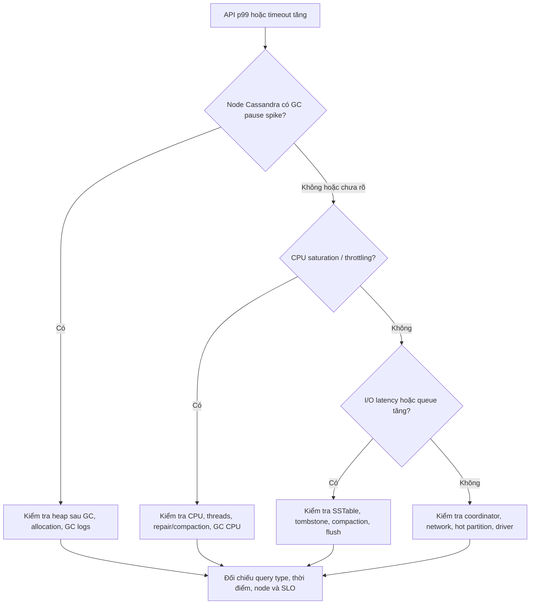

# Heap, off-heap, GC, CPU và thời gian chờ I/O

> **Chương:** Quan sát hệ thống  
> **Phạm vi:** Apache Cassandra — cơ sở dữ liệu phân tán theo mô hình *wide-column* — và các node JVM chạy trong môi trường máy chủ hoặc container.  
> **Mục tiêu:** Phân biệt bộ nhớ heap, off-heap và bộ nhớ cache của hệ điều hành; đọc đúng tín hiệu garbage collection (GC), CPU và I/O wait; liên hệ các tín hiệu này với partition key, SSTable, compaction, repair và độ trễ CQL/Java Driver.

## 1. Tình huống: p99 tăng, nhưng nguyên nhân thật nằm ở đâu?

Một API Java đọc 20 đơn hàng gần nhất của khách hàng bằng Cassandra. Bình thường p99 là 70 ms. Khi tải tăng, p99 lên 450 ms. Trên một node Cassandra:

- Heap sử dụng dao động từ 40% đến 85%.
- CPU hiển thị 78%.
- Chỉ số `iowait` có lúc lên 30%.
- Hàng đợi compaction tăng và xuất hiện một số read timeout.

Kết luận ngay “thiếu RAM nên tăng heap” có thể sai. Trong thực tế, **cùng một triệu chứng p99 tăng** có thể đến từ:

1. GC dừng luồng ứng dụng trong các giai đoạn cần *stop-the-world*.
2. CPU bị bão hòa do xử lý request, nén/giải nén, so sánh replica hoặc compaction.
3. Disk đọc nhiều SSTable và tombstone, làm request chờ thiết bị lưu trữ.
4. Bộ nhớ ngoài heap/native tăng, tạo áp lực RAM tổng thể hoặc bị container OOM-kill.
5. Partition nóng, truy vấn sai access pattern hoặc một replica chậm khiến coordinator phải chờ.

Do đó, bài học không tìm một “metric thần kỳ” mà dạy cách **liên hệ các metric theo thời gian, theo node và theo loại truy vấn**.

## 2. Bản đồ bộ nhớ và tài nguyên của một node

```text
                    CASSANDRA NODE (JVM PROCESS)
+--------------------------------------------------------------+
| JVM HEAP                                                     |
|  - Object Java: mutation, metadata, allocation tạm           |
|  - Dữ liệu/quản lý cấu trúc thực sự đặt trên heap             |
|  - Được JVM Garbage Collector quản lý                        |
+--------------------------------------------------------------+
| BỘ NHỚ NGOÀI HEAP / NATIVE                                  |
|  - Direct buffers, allocator và các cấu trúc off-heap         |
|  - Thread stacks, JVM native, thư viện native, mmap...        |
|  - Không được mô tả đầy đủ bằng JVM heap-used                 |
+--------------------------------------------------------------+
              | I/O                                | mạng
              v                                    v
+-----------------------------+           +-------------------+
| OS / FILESYSTEM / STORAGE   |           | REPLICA / CLIENT  |
| - Page cache hệ điều hành   |           | - CQL request     |
| - SSTable, commit log       |           | - Streaming/repair|
| - Flush, compaction, fsync  |           +-------------------+
+-----------------------------+

RAM máy chủ hoặc giới hạn container phải chứa nhiều thành phần.
CPU và I/O xử lý công việc của cả đường đọc, ghi, compaction, repair.
```

### Đừng cộng/trừ các số bộ nhớ như thể chúng không giao nhau

Có nhiều phép đo mang ý nghĩa khác nhau:

| Chỉ số | Ý nghĩa | Không được hiểu là |
| --- | --- | --- |
| **JVM heap used** | Bộ nhớ đang được JVM ghi nhận đã dùng bên trong heap | Toàn bộ RAM Cassandra sử dụng |
| **JVM heap committed/max** | Bộ nhớ heap JVM đã cam kết/có thể mở rộng tới giới hạn cấu hình | Bộ nhớ đang chứa dữ liệu sống |
| **Off-heap/direct** | Một số cấu trúc/buffer cấp phát ngoài heap | Toàn bộ native memory của process |
| **RSS của process** | Trang bộ nhớ vật lý gắn với process theo cách OS hạch toán | Luôn bằng heap + off-heap |
| **OS page cache** | RAM hệ điều hành dùng để cache dữ liệu file, có thể thu hồi theo áp lực | Một Java heap thứ hai |
| **Container memory usage** | Bộ nhớ được hạch toán trong cgroup/container, tùy runtime và phiên bản | Chỉ bao gồm Java heap |

RSS, file-backed mappings và page cache có thể có phần chồng lấp trong cách hệ điều hành hạch toán. **Không cộng RSS + toàn bộ page cache để kết luận mức RAM thực tế** nếu chưa biết các phép đo đếm trang theo cách nào.

Nếu ứng dụng chạy trong container, cần đồng thời theo dõi **JVM limits, RSS/native, giới hạn cgroup và số lần OOM-kill**. Một node có heap còn trống vẫn có thể bị hạ vì tổng bộ nhớ của container vượt hạn mức.

## 3. JVM heap: nhìn “đã dùng bao nhiêu” chưa đủ

Heap chứa các object Java do Cassandra, driver nội bộ, thư viện và JVM tạo ra. Các thành phần chính xác nằm trên heap thay đổi theo phiên bản Cassandra, cấu hình memtable, cache và JVM.

### Ba câu hỏi cần hỏi

1. **Sau mỗi đợt GC, bao nhiêu heap vẫn còn được dùng?**  
   Đây là tín hiệu về *live set* và nguy cơ tích lũy object; đường biểu diễn ngay trước GC thường cao vì allocation tạm.
2. **Tốc độ cấp phát object bao nhiêu?**  
   Allocation rate cao có thể tăng số lần GC ngay cả khi live set ổn định.
3. **GC có làm gián đoạn xử lý request tới mức ảnh hưởng SLO không?**  
   Heap 75% không tự chứng minh có vấn đề; hãy kiểm tra thời gian dừng và độ trễ API đồng thời.

Ví dụ hai node cùng có heap peak 80%:

```text
Node A: 35% -- tăng dần --> 80% -- GC --> 36% -- ...
        Live set thấp; phần lớn object tồn tại ngắn.

Node B: 71% -- tăng dần --> 80% -- GC --> 72% -- ...
        Live set cao; ít vùng trống sau GC, cần điều tra.
```

Cùng mức 80% nhưng hành vi rất khác. Node B có thể gặp áp lực old generation, cache/object giữ lâu hoặc cấu hình heap không còn đủ cho workload.

### Heap và memtable

Mutation được ghi vào commit log và cập nhật memtable; memtable sau đó được flush thành SSTable. **Không được suy diễn tất cả memtable đều chiếm hoàn toàn JVM heap**: cách cấp phát bộ nhớ memtable, cấu trúc index/buffer và giới hạn phụ thuộc phiên bản, cấu hình.

Khi có áp lực bộ nhớ, cần đối chiếu:

- Heap used **và** heap sau GC.
- Memtable size, số memtable đang flush, pending flush tasks.
- Tốc độ ghi/flush và disk I/O.
- Cache/đối tượng có thể giữ lâu.
- Lượng mutation/partition quá lớn hoặc nhiều request đồng thời.

Nếu memtable flush chậm vì disk bão hòa, tăng heap có thể chỉ làm triệu chứng xuất hiện muộn hơn, trong khi nguyên nhân I/O chưa được giải quyết.

## 4. Off-heap: vì sao heap khỏe vẫn có thể hết RAM?

**Off-heap** là bộ nhớ được cấp phát ngoài vùng heap Java do GC quản lý trực tiếp. Trong hệ Cassandra/JVM, tùy phiên bản và cấu hình có thể có:

- **Direct buffers** cho thao tác mạng và I/O.
- Những cấu trúc **memtable, buffer pool, cache hoặc metadata SSTable** được triển khai ngoài heap.
- **Memory-mapped file regions** và các trang file được đưa vào RAM khi truy cập.
- Native allocations của JVM, thư viện, JIT/code cache và **thread stacks**.

Không phải mọi phần này đều được đo bởi một metric tên `offHeapUsed`. Chẳng hạn native thread stack và một số thư viện có thể không nằm trong metric buffer pool.

### Ví dụ lỗi

```text
JVM heap used:        5 GiB / 12 GiB
Process RSS:         20 GiB
Container limit:     22 GiB
Container memory:    ~21 GiB, còn tăng
GC pause:            thấp
Kết quả:             nguy cơ OOM-kill dù heap còn trống
```

Đây là **số liệu minh họa**. Hướng điều tra là off-heap/native, page mappings, thread count, container accounting và bộ nhớ các process khác; không phải cứ tăng `-Xmx`.

### Nguồn quan sát

- **JMX/JVM metrics:** `MemoryPool`, `BufferPool`, heap/non-heap; đối chiếu các metric Cassandra off-heap/buffer pool mà phiên bản có hỗ trợ.
- **OS:** RSS, virtual mappings, thread count, `/proc/<pid>/smaps_rollup` (Linux hỗ trợ), cgroup memory usage.
- **JVM native memory tracking (NMT):** `jcmd <pid> VM.native_memory summary` khi JVM được khởi động với NMT phù hợp. NMT có chi phí và không mặc nhiên bao phủ mọi cấp phát native từ mọi thư viện.

Ví dụ lệnh **chỉ đọc trạng thái** trên môi trường được cấp quyền:

```bash
jcmd <pid> GC.heap_info
jcmd <pid> VM.native_memory summary
```

Lệnh thứ hai có thể báo NMT chưa được bật. **Không bật NMT hoặc thay cấu hình khởi động trên production chỉ để làm bài tập**; áp dụng theo quy trình thay đổi và tài liệu của JVM hiện dùng.

## 5. GC: phân biệt tần suất với thời gian dừng

Garbage collection thu hồi bộ nhớ heap không còn được tham chiếu. Một số collector còn có giai đoạn concurrent; những giai đoạn đó không đồng nghĩa toàn bộ tiến trình Cassandra đã dừng.

Cần phân biệt:

- **GC count/rate:** số lần thu gom trong khoảng thời gian.
- **Pause duration:** thời gian các luồng ứng dụng bị dừng trong pha stop-the-world.
- **GC time:** tổng thời gian báo cáo của các sự kiện/pha, tùy metric và collector; không được mặc định tất cả là pause.
- **Live heap after GC:** bộ nhớ tồn tại sau một lần thu gom.
- **Allocation rate:** tốc độ tạo object, có thể đẩy GC chạy dày.
- **Old generation occupancy / promotion:** giúp hiểu dữ liệu sống lâu và áp lực GC.
- **Full GC hoặc allocation failure:** tín hiệu cần chú ý, nhưng tên và cơ chế khác nhau theo collector/JDK.

### Vì sao GC có thể xuất hiện như Cassandra read timeout?

Một pause đáng kể có thể khiến node ngừng xử lý CQL hoặc trả lời coordinator đúng hạn. Nếu nhiều replica tạm dừng cùng lúc, read/write latency p99 và timeout tăng.

```text
12:00:00.000  Coordinator gửi read tới replica N2
12:00:00.010  N2 bắt đầu GC pause
12:00:00.310  N2 xử lý trở lại
12:00:00.320  Phản hồi đọc gửi về coordinator
             -> Đường đọc có thể vượt SLO hoặc timeout
```

Đây là ví dụ tuyến tính hóa để dễ hình dung. Trong thực tế, coordinator cũng có thể bị GC, driver có timeout riêng, và request có thể trễ vì queue hoặc mạng.

### GC cao không nhất thiết phải tăng heap

| Triệu chứng | Giả thuyết phù hợp để kiểm tra |
| --- | --- |
| Frequent GC, heap sau GC thấp, CPU tăng | Allocation rate cao hoặc workload tạo nhiều object tạm |
| Heap sau GC tăng theo ngày | Live set tăng, cache/metadata/memtable, khả năng giữ tham chiếu lâu |
| Pause dài trùng p99 spike | GC là một ứng viên nguyên nhân trực tiếp |
| Pause thấp nhưng p99 vẫn cao | Điều tra I/O, thread pool, partition hot, mạng, coordinator |
| OOM-kill khi heap used thấp | Tổng native/off-heap/container memory, không chỉ heap |

Cassandra hỗ trợ những phiên bản JDK/collector khác nhau theo release. Không áp dụng một bộ JVM flags cho mọi cluster. Tối ưu GC dựa trên log/metrics và phiên bản được hỗ trợ, không chỉnh collector bằng cảm giác.

### Đọc GC trong lab

Trên JVM/JDK hỗ trợ:

```bash
jstat -gcutil <pid> 1000 10
jcmd <pid> GC.heap_info
```

`jstat` cung cấp chỉ số tổng hợp các vùng GC theo JVM hiện dùng; cách trình bày thay đổi theo collector và JDK. Nên dùng **GC logs/JFR/metrics** phù hợp để xác nhận pause duration và timestamps thay vì suy ra pause p99 từ một cột `GCT` tích lũy.

Ví dụ cấu hình ghi log GC trên JVM hỗ trợ *unified logging* có dạng:

```text
-Xlog:gc*:file=/path/to/gc.log:time,uptime,level,tags
```

Đây chỉ là ví dụ cú pháp JVM hiện đại. Đường dẫn, quyền ghi, vòng quay log và overhead cần cấu hình theo quy trình vận hành; không áp dụng bừa lên node production.

## 6. CPU: phải biết đang bận làm gì

CPU cao là tín hiệu *resource utilization*, không tự cho biết đang xử lý công việc hữu ích hay chờ/nghẽn.

CPU Cassandra có thể dùng cho:

- Điều phối request, giải mã CQL và lập kế hoạch đọc/ghi.
- Nén/giải nén dữ liệu SSTable, checksum, bloom/filter/index.
- Mutation, memtable, cache và phân trang.
- Compaction, validation/repair, streaming dữ liệu.
- GC và thread scheduling.
- TLS, xử lý network, serialization và logging.

### CPU utilization và CPU saturation khác nhau

Một node có CPU 85% nhưng vẫn còn phần tài nguyên dự phòng có thể hoạt động tốt. Ngược lại, một container có **CPU quota** rất thấp có thể bị throttling dù dashboard tổng CPU của máy chủ chỉ báo 25%.

Nên quan sát cùng lúc:

| Chỉ số | Ý nghĩa |
| --- | --- |
| Process CPU usage | Cassandra sử dụng bao nhiêu CPU |
| Host CPU usage theo core | Node có bị bão hòa tổng thể không |
| Container CPU throttling | Bị giới hạn quota nên thread không được chạy dù host còn CPU |
| Runnable queue / load average | Có nhiều công việc đang đợi CPU hoặc đợi tài nguyên ở trạng thái được hạch toán |
| CPU steal time (VM) | Hypervisor giữ CPU thay vì cấp cho VM |
| Thread pool pending/blocked | Công việc Cassandra bị xếp hàng dù nguyên nhân có thể là CPU, lock, I/O hoặc phụ thuộc khác |
| GC CPU và pause | CPU đang dành nhiều cho quản lý bộ nhớ? |

**Load average không phải phần trăm CPU.** Trên Linux, load average thường bao gồm tiến trình đang runnable và một số tiến trình chờ I/O ở trạng thái uninterruptible. Đừng so sánh “load=8” với “CPU=8%” mà không biết số core và loại tác vụ.

### Thread pool Cassandra giúp định vị điểm nghẽn

Cassandra có thread pools/stages xử lý công việc như read, mutation, compaction và một số tác vụ liên quan. Công cụ `nodetool tpstats` có thể hiển thị số lượng active, pending và dropped tasks, tùy phiên bản.

Nếu pending read tasks tăng nhưng CPU thấp và I/O wait cao, một hướng điều tra là disk. Nếu pending tăng và CPU full, hãy xem contention, allocation và concurrency. Cần đối chiếu metrics theo thời gian; một ảnh chụp tức thời không đủ chứng minh nguyên nhân.

## 7. I/O wait: không đồng nghĩa “đĩa đã dùng 100%”

Trên Linux, `iowait` thường là **phần thời gian CPU ở trạng thái idle trong khi hệ thống có I/O đang chờ**. Nó là cách hạch toán **thời gian CPU**, không phải phép đo trực tiếp “request đã chờ disk bao nhiêu mili giây”.

Một node có `iowait=30%` có thể đang chờ ổ đĩa, nhưng cần kiểm tra thêm:

- Latency đọc/ghi thiết bị (ví dụ `r_await`, `w_await` của `iostat` nếu có).
- IOPS và throughput (MB/s).
- Queue depth hoặc số request đang chờ.
- `%util`: thời gian thiết bị báo bận theo định nghĩa của công cụ/driver; trên NVMe và thiết bị có xử lý song song, **không** thể coi 100% là mức băng thông tối đa một cách tuyệt đối.
- Filesystem latency, fsync, log storage, RAID/volume/network block storage.
- Cassandra read latency, pending compaction và commit log sync.

### Một số tình huống dễ nhầm

| Dấu hiệu | Cách đọc thận trọng |
| --- | --- |
| I/O wait cao, disk await tăng, query p99 tăng | Khả năng storage bottleneck mạnh; cần xác định I/O đến từ read, commit log, flush hay compaction |
| CPU 100%, iowait gần 0, disk await bình thường | CPU saturation có thể là điểm nghẽn chính; iowait thấp không có nghĩa mọi thứ ổn |
| Disk throughput thấp nhưng await cao | Có thể là I/O ngẫu nhiên nhỏ, thiết bị/volume nghẽn latency hoặc filesystem vấn đề |
| Disk `%util` cao nhưng await ổn định, p99 đạt SLO | Chưa đủ bằng chứng phải nâng disk; xem queue và throughput capacity |
| API chậm nhưng thiết bị Cassandra ổn | Kiểm tra network, driver queue, coordinator, GC, partition hot hoặc thao tác ứng dụng |

### Tại sao workload wide-column ảnh hưởng I/O?

Partition key xác định dữ liệu nằm ở replica nào; clustering key quyết định dải đọc trong partition. Một query đọc chính xác partition/dải cần thiết có thể ít I/O hơn query phải duyệt nhiều SSTable/tombstone.

Cùng một nút nghẽn disk có thể đến từ:

- **Read amplification:** một partition trải qua nhiều SSTable; bloom filter, partition index, disk blocks phải được truy cập.
- **Compaction amplification:** hệ thống đọc/ghi lại nhiều SSTable trong lúc phục vụ request.
- **Flush memtable:** dữ liệu trong RAM được ghi thành SSTable.
- **Commit log fsync:** phụ thuộc chính sách sync, có thể ảnh hưởng thời gian xác nhận ghi.
- **Repair/streaming:** đọc SSTable để so sánh/chuyển dữ liệu, đồng thời phát sinh I/O ghi.

Đó là lý do điều tra I/O phải đi cùng loại request và hoạt động background, không chỉ đi cùng biểu đồ sử dụng ổ đĩa.

## 8. Sơ đồ nhân quả: từ triệu chứng đến nhóm metric



Đây là **thứ tự khoanh vùng**, không phải cây quyết định loại trừ hoàn toàn. GC, CPU và I/O có thể cùng tăng, hoặc một sự cố I/O tạo áp lực memtable rồi gián tiếp tăng allocation/GC. Khi có nhiều chỉ số bất thường, cần kiểm tra **nguyên nhân xuất hiện trước** và quan hệ giữa các node.

## 9. Hệ chỉ số quan sát theo từng tầng

Không phải phiên bản Cassandra nào cũng xuất chính xác cùng tên JMX metric. Nên xác định **đơn vị, loại metric, phạm vi và tên exporter** trước khi dựng dashboard/alert.

| Tầng | Chỉ số gợi ý | Truy vấn chẩn đoán |
| --- | --- | --- |
| **JVM heap** | Used/committed/max, old/live after GC, allocation | Live set có đang tăng dù tải không đổi? |
| **JVM GC** | Pause count/duration, pause max/p95, collector CPU | Spike có trùng request timeout? |
| **Native/off-heap** | Direct buffer pools, off-heap structures, RSS, thread count | Có rò rỉ hoặc tăng bộ nhớ ngoài heap? |
| **OS/container** | Available memory, cgroup usage/limit, OOM kills, swap activity | Có memory pressure ngoài JVM? |
| **CPU** | Host/process CPU, steal, cgroup throttle, run queue | Có thiếu CPU thực tế hay bị quota? |
| **Storage** | Device await/queue/throughput, filesystem space, fsync | Disk chậm hay quá nhiều I/O? |
| **Cassandra read/write** | `ClientRequest` latency và timeout theo Read/Write | Query chậm ở Cassandra hay chỉ chậm ở app? |
| **Cassandra tables** | Read/write latency, SSTable count, memtable data size, tombstones | Bảng/partition nào chịu read amplification? |
| **Compaction** | Pending/active tasks, bytes compacted, backlog | Background I/O có đang chồng lên request? |
| **Thread pools** | Active/pending/dropped theo stage | Node đang xếp hàng công việc ở đâu? |
| **Streaming/repair** | Sessions, bytes streamed, errors, duration | Sự cố trùng lúc anti-entropy hoặc thay topology? |
| **Java Driver** | Request latency, coordinator host, timeouts, retries, pool in-flight | Trễ ở client, mạng hoặc replica/coordinator nào? |

### Chú ý tới nhãn (labels)

Một dashboard đáng tin cậy nên có ít nhất: **cluster, datacenter, node, keyspace, table (khi metric hỗ trợ), operation, instance và khoảng thời gian**. Nếu chỉ có một đường “Cassandra CPU trung bình toàn cluster”, một node nóng hoặc lỗi đĩa cục bộ dễ bị che khuất.

Không có nghĩa mọi metric phải gắn nhãn `partition_key`: cardinality của partition key có thể cực lớn và làm nổ chi phí lưu trữ time-series. Khi cần phân tích hot partition, dùng sampling/tracing hoặc công cụ chẩn đoán phù hợp thay vì thêm toàn bộ khóa làm nhãn metrics.

## 10. Công cụ quan sát thực hành

### 10.1. `nodetool` trên Cassandra

Tại node được cấp quyền, tùy phiên bản:

```bash
nodetool info
nodetool gcstats
nodetool tpstats
nodetool compactionstats
nodetool tablestats shop_md.orders_by_customer
nodetool netstats
```

Ý nghĩa:

- `nodetool info`: thông tin node, heap, trạng thái và một số chỉ số tổng hợp.
- `nodetool gcstats`: thống kê GC theo lệnh, nếu phiên bản hỗ trợ.
- `nodetool tpstats`: thread pool active/pending/completed/dropped.
- `nodetool compactionstats`: công việc compaction hiện tại/đang chờ.
- `nodetool tablestats`: thông tin theo bảng như memtable/SSTable/dung lượng/độ trễ/tombstone (trường cụ thể tùy bản).
- `nodetool netstats`: streaming và network-related activity.

`shop_md.orders_by_customer` chỉ là bảng ví dụ đã tồn tại trong một môi trường lab tương ứng. Nếu bảng không có, thay bằng keyspace/table của lab được phép quan sát.

**Các lệnh trả một ảnh chụp trạng thái, không thay dashboard time-series.** Những số liệu tích lũy (counter) cần lấy chênh lệch theo thời gian; histogram phải dùng cách tính phân vị phù hợp và không trộn các đơn vị microsecond/millisecond.

### 10.2. JVM tools

Trên Linux có JDK/công cụ và quyền phù hợp:

```bash
jcmd <pid> GC.heap_info
jstat -gcutil <pid> 1000 10
jcmd <pid> Thread.print
```

Lệnh `Thread.print` có thể tạo output lớn và overhead; dùng có kiểm soát khi cần tìm thread bị BLOCKED/WAITING. Phải kiểm tra thread name/state lặp lại qua nhiều mẫu trước khi kết luận deadlock hoặc lock contention.

**Đừng dùng `jcmd <pid> GC.run` để “kiểm tra GC” trên production**: kích hoạt GC chủ động có thể thay đổi hiệu năng và gây ngắt quãng, khiến phép đo không còn đại diện.

### 10.3. OS tools

Trên Linux có các công cụ tương ứng:

```bash
vmstat 1
iostat -xz 1
pidstat -u -p <pid> 1
free -h
```

Đọc kết quả theo tầng:

- `vmstat`: runnable tasks, blocked tasks, swap in/out, CPU user/system/iowait.
- `iostat -xz`: latency/queue/throughput của thiết bị, tùy phiên bản `sysstat`.
- `pidstat`: CPU của tiến trình Cassandra và thay đổi theo thời gian.
- `free`: RAM tổng, available và cache của host; không phải heap JVM.

Nếu chạy container/Kubernetes, số liệu host có thể không đại diện CPU quota/giới hạn RAM của container. Cần đối chiếu `cgroup` và nền tảng giám sát tương ứng. Trên Windows, tên công cụ khác; bài tập lệnh OS ở đây dành cho Linux.

### 10.4. Tracing CQL

Trong một cluster lab:

```cql
TRACING ON;

SELECT order_id, created_at, status, total
FROM shop_md.orders_by_customer
WHERE customer_id = aaaaaaaa-aaaa-4aaa-8aaa-aaaaaaaaaaaa
LIMIT 20;

TRACING OFF;
```

Tracing giúp nhìn đường đi đọc và có thể tìm hoạt động trên replica, nhưng **không cung cấp phép đo trực tiếp heap/native của cả hệ thống**. Nó còn có overhead và có thể ảnh hưởng latency khi bật rộng. Chỉ dùng cho truy vấn đại diện, kết hợp metrics ở thời điểm trace.

## 11. Phân tích đường đọc: chọn đúng bảng, đúng partition và đúng replica

Giả sử bảng có khóa:

```cql
CREATE TABLE IF NOT EXISTS shop_md.orders_by_customer (
    customer_id uuid,
    created_at timestamp,
    order_id uuid,
    status text,
    total decimal,
    PRIMARY KEY ((customer_id), created_at, order_id)
) WITH CLUSTERING ORDER BY (created_at DESC, order_id ASC);
```

Query:

```cql
SELECT order_id, created_at, status, total
FROM shop_md.orders_by_customer
WHERE customer_id = aaaaaaaa-aaaa-4aaa-8aaa-aaaaaaaaaaaa
LIMIT 20;
```

Đây là mẫu đọc phù hợp partition key và thứ tự clustering. Tuy nhiên, vẫn có thể chậm nếu partition cực lớn, nhiều tombstone, SSTable chồng lấp hoặc một replica có I/O bất thường.

Một quy trình khoanh vùng:

1. Đo **client latency** từ Java và **server read latency** của Cassandra.
2. Xác định coordinator qua metadata driver và quan sát theo node.
3. Kiểm tra replica chậm có GC pause, CPU hoặc I/O vấn đề không.
4. So sánh tablestats, SSTable count, tombstone scanned, compaction của bảng.
5. Nếu chỉ một vài partition nóng, sửa mô hình bucketing/access pattern trước khi tăng heap/disk vô điều kiện.

**Không dùng `LIMIT 20` làm bằng chứng server chỉ phải đọc 20 hàng vật lý.** Cassandra có thể cần xét nhiều row/cell tombstone, nhiều SSTable hoặc tài nguyên replica khác để tìm đủ kết quả.

### Phân biệt cache miss và disk chậm

Một lượt đọc lạnh có thể cần nhiều disk I/O; lượt sau được page cache hỗ trợ có thể nhanh hơn. Nhưng nếu disk `await` luôn cao và compaction backlog lớn, không thể kết luận vấn đề chỉ là “chưa warm cache”.

Các loại cache trong Cassandra như key cache/row cache (nếu được bật) và OS page cache có cơ chế/chi phí riêng. **Tăng cache Java heap** có thể làm GC tệ hơn hoặc tăng áp lực bộ nhớ, chưa chắc giảm p99 tổng thể. Cần đo hit rate, partition distribution và disk reads trước.

## 12. Phân tích đường ghi: heap, fsync và flush

Với một mutation, replica ghi commit log và cập nhật memtable trước khi dữ liệu được flush thành SSTable về sau. Đường ghi có thể ảnh hưởng:

- **Commit log:** ghi nối tiếp và đồng bộ theo chính sách; ổ đĩa log hoặc fsync chậm làm ảnh hưởng latency trong các mode tương ứng.
- **Memtable:** sử dụng bộ nhớ theo allocator/cấu hình; flush tạo SSTable và sử dụng disk throughput.
- **Compaction:** gom SSTable sau flush, có thể tiêu tốn I/O và CPU ngay cả khi ứng dụng không đang đọc.
- **Replication:** coordinator đợi số ACK theo consistency level; một replica chậm hoặc đường mạng lỗi có thể tạo timeout.

Tình huống:

```text
Tốc độ ghi tăng
    |
    +--> memtable tăng, flush liên tục
    |        |
    |        +--> disk write queue tăng
    |                 |
    |                 +--> compaction backlog tăng
    |                          |
    |                          +--> read p99 tăng vì I/O cạnh tranh
    |
    +--> allocation/CPU/network cũng có thể tăng
```

Nếu chỉ quan sát heap và GC, đội vận hành dễ bỏ qua **chuỗi nguyên nhân từ ghi → flush → compaction → đọc chậm**. Muốn xác nhận, hãy đối chiếu mốc thời gian giữa write throughput, memtable/flush, compaction backlog, disk await và read latency.

### Consistency level tác động tới cách đo độ trễ

`LOCAL_ONE`, `LOCAL_QUORUM` và `QUORUM` yêu cầu những tập phản hồi replica khác nhau. Latency tăng khi đổi CL không tự chứng minh JVM thiếu RAM. Trong multi-DC, `QUORUM` có thể phải chờ WAN, còn `LOCAL_QUORUM` chỉ cần quorum ở datacenter của coordinator.

Mọi phép so sánh p99 trước/sau cần ghi rõ: **CL, RF, topology, số lượng client, loại query và thời gian đo**.

## 13. Tình huống A — GC pause là nguyên nhân chính

Giả sử trong một giờ cao điểm:

| Thời điểm | Heap sau GC | GC pause p99 | Read p99 | Disk await |
| --- | ---: | ---: | ---: | ---: |
| 09:50 | 42% | 12 ms | 65 ms | 3 ms |
| 10:00 | 68% | 80 ms | 140 ms | 4 ms |
| 10:10 | 79% | 260 ms | 390 ms | 4 ms |

Đây là **số liệu giả định**. Disk await không đổi, GC pause tăng sát với read p99. Ta có cơ sở điều tra memory allocation, live set, các pool giữ object và cấu hình JVM.

Các bước:

1. Tách các node có p99 spike; kiểm tra JVM heap sau GC và memory pool.
2. Xem GC logs tại cùng timestamps, xác nhận *pause* thật thay vì chỉ thấy “GC count tăng”.
3. Kiểm tra có workload mới tạo allocation, query quét nhiều hàng hoặc backup/repair kích hoạt công việc chưa.
4. Xem off-heap/native và container memory trước khi sửa `-Xmx`.
5. Thay đổi **một yếu tố một lần** trong môi trường có tải đại diện và đo lại latency + GC + tài nguyên.

Không kết luận “memory leak” chỉ từ việc heap tăng giữa hai lần GC. Phải có bằng chứng live set tăng qua nhiều chu kỳ và không giải thích được bằng tải hợp lệ.

## 14. Tình huống B — Disk bị nghẽn, GC chỉ là hệ quả phụ

Giả sử một node đang compaction lớn:

| Chỉ số | Trước sự cố | Khi sự cố |
| --- | ---: | ---: |
| Disk `r_await` | 2 ms | 45 ms |
| Pending compactions | 2 | 90 |
| Read p99 | 80 ms | 500 ms |
| GC pause p99 | 15 ms | 20 ms |
| CPU utilization | 55% | 60% |

Số liệu giả định cho thấy disk await/compaction tăng mạnh, GC tương đối ổn định. Điều tra nên tập trung vào I/O, compaction và query read amplification.

Các bước an toàn:

- Xem node nào đang compaction, disk queue/latency và khả năng nguồn I/O từ repair hoặc streaming.
- Đối chiếu tốc độ flush, số SSTable, tombstone và phân phối partition.
- Xem disk headroom; compaction có thể cần không gian tạm.
- Cân nhắc điều chỉnh lịch/concurrency repair hoặc thông số compaction **theo phiên bản và SLO**, không tắt compaction vô thời hạn.
- Kiểm tra xem một truy vấn rất rộng có gây đọc quá nhiều SSTable và làm đĩa nghẽn không.

Đổi GC collector trong trường hợp này có thể không cải thiện p99 mà còn tăng rủi ro vận hành.

## 15. Tình huống C — Off-heap/container OOM nhưng heap bình thường

Ví dụ container Cassandra bị khởi động lại do bị hệ thống hạ khi hết RAM:

```text
JVM Xmx = 10 GiB
Heap used ổn định = 6 GiB
RSS/native tăng qua nhiều giờ
Container memory tiến gần limit 16 GiB
GC pause gần như không đổi
Cuối cùng OOM-kill -> node ngừng hoạt động
```

Hướng điều tra:

1. Xác nhận **OOM-kill thuộc container/OS** hay Java báo `OutOfMemoryError: Java heap space`. Hai dạng có nguồn khác nhau.
2. Ghi nhận RSS, cgroup memory, direct buffer pools, thread count, mmap/native memory và phiên bản runtime.
3. Kiểm tra các thay đổi gần đây: concurrency, TLS/native libs, buffer pool, dữ liệu/index/compaction.
4. Đánh giá giới hạn RAM tổng, `-Xmx`, headroom cho native và OS cache cùng nhu cầu workload.
5. Nếu nghi rò rỉ native, dùng NMT/profiling có kiểm soát trong môi trường phù hợp; không khởi động lại node hàng loạt để “dọn RAM” mà chưa bảo vệ RF và CL.

**Heap nhỏ** không phải biện pháp chữa mọi vấn đề off-heap. Giảm heap quá mức có thể làm GC tăng, trong khi native memory vẫn tiếp tục tăng.

## 16. Tình huống D — CPU throttling làm độ trễ tăng

Một Cassandra pod có CPU limit thấp. Dashboard CPU host chỉ 40%, nhưng trong cgroup, số lần throttled tăng và request pending nhiều. JVM có thể không được chạy đủ CPU dù host còn nguồn lực.

Tín hiệu cần đối chiếu:

- CPU sử dụng theo process **và** CPU quota cgroup.
- Thời gian/số lượt throttling.
- Thread runnable hoặc pending Cassandra.
- GC activity: có thể bị chậm vì CPU không được cấp đủ.
- Disk await: nếu không tăng thì storage không phải ứng viên chính.
- p95/p99 read/write khi tăng tải.

Không giải thích mọi hiện tượng bằng `top` trên host. Trong container, quota và số core JVM nhận diện ảnh hưởng hành vi thread/GC; phải kiểm tra cấu hình runtime và số liệu tại chính cgroup Cassandra.

## 17. Từ metrics Cassandra tới Java Driver và SLO

Người dùng cuối nhìn thấy latency của **toàn bộ yêu cầu**, không chỉ Cassandra server latency:

```text
API latency =
  app queue/validation +
  driver queue/connection +
  network client-coordinator +
  Cassandra coordinator/replica read-write path +
  transfer/deserialize +
  xử lý ứng dụng
```

Biểu thức trên là phân rã khái niệm, không phải các thành phần luôn tách rời hoàn toàn trong metric. Nếu API p99 là 500 ms mà Cassandra read latency đo chỉ 15 ms, hãy điều tra driver queue, connection pool, network, retries/speculative executions hoặc xử lý phía application.

Ví dụ Java Driver 4.x đo thời gian một prepared SELECT và ghi nhận coordinator:

```java
import java.util.UUID;
import java.util.concurrent.TimeUnit;

import com.datastax.oss.driver.api.core.CqlSession;
import com.datastax.oss.driver.api.core.DefaultConsistencyLevel;
import com.datastax.oss.driver.api.core.cql.BoundStatement;
import com.datastax.oss.driver.api.core.cql.PreparedStatement;
import com.datastax.oss.driver.api.core.cql.ResultSet;
import com.datastax.oss.driver.api.core.metadata.Node;

public final class ReadProbe {
    private final CqlSession session;
    private final PreparedStatement read;

    public ReadProbe(CqlSession session) {
        this.session = session;
        this.read = session.prepare(
            "SELECT order_id, created_at, status " +
            "FROM shop_md.orders_by_customer " +
            "WHERE customer_id = ? LIMIT ?"
        );
    }

    public void readRecent(UUID customerId) {
        BoundStatement stmt = read.bind(customerId, 20)
            .setConsistencyLevel(DefaultConsistencyLevel.LOCAL_QUORUM)
            .setIdempotent(true)
            .setPageSize(20);

        long startedNs = System.nanoTime();
        try {
            ResultSet result = session.execute(stmt);
            Node coordinator = result.getExecutionInfo().getCoordinator();

            // Truy cập hàng kết quả trong phạm vi được đo nếu
            // SLO ứng dụng bao gồm việc lấy hết trang này.
            int rows = 0;
            for (var row : result) {
                rows++;
            }

            long durationMs = TimeUnit.NANOSECONDS.toMillis(
                System.nanoTime() - startedNs);
            System.out.printf(
                "read_ms=%d rows=%d coordinator_dc=%s%n",
                durationMs, rows,
                coordinator == null ? "unknown" : coordinator.getDatacenter()
            );
        } catch (RuntimeException ex) {
            long durationMs = TimeUnit.NANOSECONDS.toMillis(
                System.nanoTime() - startedNs);
            System.err.printf(
                "read_failed_ms=%d error_type=%s%n",
                durationMs, ex.getClass().getSimpleName()
            );
            throw ex;
        }
    }
}
```

`CqlSession` được giả định đã cấu hình đúng local DC, authentication, contact points và keyspace. Ví dụ dùng `var` trong vòng lặp, cần phiên bản Java hỗ trợ; có thể dùng kiểu `Row` nếu môi trường cũ hơn. Code này **không đo riêng server processing time**; nó đo cả đường thực thi Java/driver và việc duyệt kết quả. Với trang nhiều dữ liệu, driver có thể tự fetch trang kế tiếp khi lặp, nên cần đặt page size/giới hạn phù hợp mục tiêu quan sát.

Trong hệ thống thật, không `System.out.println` mọi request tốc độ cao; nên xuất histogram/metric và trace có sampling, kèm nhãn operation/coordinator DC và phân loại lỗi để tránh overload logging.

### Cách đối chiếu ba nguồn latency

| Nguồn | Đo cái gì? | Khi nào hữu ích? |
| --- | --- | --- |
| API histogram | Người dùng đợi bao lâu | Xác nhận SLO bị ảnh hưởng |
| Driver request metrics | Thời gian/timeout trên client tới coordinator | Phân biệt client queue, retry và network |
| Cassandra `ClientRequest`/table metrics | Thời gian xử lý phía Cassandra theo phạm vi metric | Tìm node, replica và bảng chậm |

**Không trừ trực tiếp hai giá trị p99 để suy ra “network p99”.** Phân vị được tính trên những phân phối khác nhau; hiệu số p99 không bằng p99 của hiệu từng request. Muốn quy trách nhiệm, cần trace với cùng request ID, thời gian và sampling phù hợp.

## 18. Checklist thiết kế dashboard và cảnh báo

Dashboard tốt nên trả lời nhanh:

1. **Dịch vụ có đang chậm?** p95/p99 read/write và timeout theo DC, node, operation.
2. **JVM đang gặp vấn đề gì?** heap sau GC, allocation, pause, native/RSS, OOM.
3. **Có nghẽn CPU không?** process/host CPU, throttling, run queue, thread pools.
4. **Có nghẽn storage không?** disk latency/queue, compaction, flush và commit log.
5. **Một node hay toàn cluster?** so sánh top-N node theo metric và mốc thời gian.
6. **Có hoạt động thay đổi nền?** repair, streaming, snapshot, backup, thay topology.

### Gợi ý cảnh báo theo tương quan thay vì một ngưỡng đơn lẻ

| Cảnh báo | Điều kiện gợi ý | Hành động điều tra |
| --- | --- | --- |
| Tail latency degradation | p99 vượt SLO trong nhiều cửa sổ + error/timeout tăng | Xác định operation, node/DC và tầng chậm |
| GC interference | Pause dài hoặc pause tổng tăng, đồng thời latency tăng | Xem heap sau GC và allocation |
| Memory exhaustion risk | Container usage sát limit, RSS tăng hoặc có OOM kills | Phân tích off-heap/native và headroom |
| Storage latency | Disk await/queue tăng bền vững cùng read/write latency | Xem compaction, flush, SSTable/tombstone |
| Repair/compaction pressure | Background tasks tăng, disk/network và p99 bị ảnh hưởng | Giảm/điều phối concurrency theo runbook |
| CPU starvation | CPU bão hòa/throttling, pending tasks tăng | Xem quota, hot threads, workload |
| Single-node hotspot | Một replica khác biệt lớn so với các node cùng DC | Kiểm tra token/partition, disk, GC và mạng node |

Không lấy các giá trị minh họa trong bài làm ngưỡng production. Ngưỡng phải xuất phát từ SLO, baseline, tài nguyên đã cấp và đặc thù dữ liệu.

### Lưu ý khi lấy metric

- Metric dạng **counter** phải tính tốc độ theo thời gian, phân biệt counter reset sau restart.
- Metric **gauge** có thể nhảy rất nhanh; thu thập đủ thường xuyên nhưng tránh overhead.
- Histogram/phân vị theo nhiều node **không thể cộng/trung bình đơn giản** để tạo “p99 toàn cluster” chính xác.
- Đồng bộ thời gian (NTP) giữa các node giúp ghép sự kiện GC, compaction và request.
- Các nhãn có cardinality cao, trace sampling quá dày và log quá chi tiết có thể chính chúng tạo tải.

## 19. Runbook chẩn đoán p99 trong 15 bước

1. **Xác nhận triệu chứng:** API nào chậm, p95/p99, timeout và thời điểm bắt đầu?
2. **Khoanh vùng:** chỉ một DC/node hay toàn cluster?
3. **Ghi bối cảnh:** RF, CL, phiên bản, số client và loại truy vấn.
4. **Chỉ ra coordinator:** lấy từ driver/trace hoặc metrics host.
5. **Kiểm tra node health:** `nodetool status`, node vừa restart/stream/repair?
6. **Xem heap:** used, after-GC live set, allocation rate.
7. **Xem GC:** pause duration theo thời gian có trùng p99 spike?
8. **Xem off-heap/RSS:** có memory growth, swap/OOM hoặc cgroup pressure?
9. **Xem CPU:** process usage, run queue, throttling, steal.
10. **Xem I/O:** await, queue, throughput, dung lượng trống, commit log/flush.
11. **Xem Cassandra queues:** `tpstats`, pending reads/writes, dropped messages.
12. **Xem compaction/repair:** active/pending jobs có trùng sự cố?
13. **Xem bảng/truy vấn:** partition key, SSTable count, tombstone, cache.
14. **Thử giả thuyết an toàn:** giảm tải background hoặc tối ưu truy vấn trên lab/canary, đo trước/sau.
15. **Xác nhận hồi phục:** p99/error và các resource metrics trở lại baseline; ghi nguyên nhân và phòng ngừa.

Một incident có thể có nhiều nút thắt. Không được coi bước 6–10 là chuỗi loại trừ; cần tổng hợp chúng theo **quan hệ nguyên nhân và thời điểm xảy ra**.

## 20. Những ngộ nhận cần tránh

**“Heap cao là chắc chắn thiếu RAM.”** Sai. Heap dao động theo allocation và GC; xem live set sau GC, pause và giới hạn tổng bộ nhớ.

**“Heap còn trống thì không thể OOM.”** Sai. Off-heap, direct buffer, thread stacks và memory accounting của container có thể vượt giới hạn.

**“GC count tăng chứng minh GC gây p99.”** Sai. Phải đối chiếu pause duration, thời gian sự kiện và request latency.

**“CPU iowait cao bằng ổ đĩa dùng 100% băng thông.”** Sai. Iowait là trạng thái CPU hạch toán; cần disk await, queue, throughput và workload.

**“Disk `%util` 100% chắc chắn đã đạt trần IOPS của NVMe.”** Không thể khẳng định chỉ từ `%util`, nhất là thiết bị có nhiều hàng đợi song song.

**“CPU host thấp nghĩa là Cassandra không thiếu CPU.”** Sai trong container có CPU quota/throttling hoặc VM bị steal.

**“Một node `UN` là node khỏe về latency.”** Sai. `UN` biểu thị trạng thái gossip, không kiểm chứng GC, I/O hay query p99.

**“Tăng cache hoặc heap sẽ sửa mọi truy vấn chậm.”** Sai. Nếu query không khớp partition key hoặc quét tombstone rộng, cần sửa schema và access pattern.

**“Read latency Cassandra bằng API latency.”** Sai. Java Driver, mạng, application queue và phân trang cũng chiếm thời gian.

**“p99 của cluster là trung bình p99 của từng node.”** Sai. Cần histogram có thể tổng hợp đúng hoặc đo p99 từ luồng request hợp nhất.

**“Đổi compaction/GC ngay khi thấy dashboard đỏ là phản ứng tốt.”** Chưa chắc. Phải xác minh nguồn tải, phiên bản, data/repair safety và đo kết quả sau thay đổi.

## 21. Bài tập tự kiểm tra

1. Node có heap peak 85% nhưng sau mỗi GC còn 30%, GC pause p99 rất thấp. Có đủ bằng chứng phải tăng heap không? Cần xem gì thêm?
2. Node có heap used 50% nhưng container bị OOM-kill. Hãy nêu bốn nhóm bộ nhớ/metric cần điều tra.
3. CPU iowait 25%, disk await 2 ms, CPU usage 95%. Bạn có thể khẳng định disk đang là bottleneck không? Vì sao?
4. Compaction backlog tăng, `r_await` tăng, query read p99 tăng. Mô tả chuỗi nhân quả khả dĩ.
5. Vì sao `nodetool tpstats` có pending read lớn chưa đủ để kết luận nguyên nhân là heap?
6. Một ứng dụng thấy p99 500 ms nhưng Cassandra server read p99 20 ms. Liệt kê các thành phần còn cần kiểm tra.
7. Phân biệt JVM heap, off-heap/native và OS page cache; giải thích tại sao không cộng số liệu một cách máy móc.
8. Tại sao thời gian dừng GC và tổng thời gian chạy GC không nhất thiết bằng nhau?
9. Một replica chậm vì disk, nhưng coordinator nằm ở node khác. Làm thế nào ghép metric theo node để tìm đúng nguồn chậm?
10. Tại sao không lấy trung bình của các p99 node để tạo p99 của cả cluster?
11. Nếu thay `LOCAL_QUORUM` bằng `QUORUM` trong cụm nhiều DC, điều gì có thể làm latency tăng mà không liên quan GC?
12. Với bảng có nhiều tombstone, tăng RAM có thay thế việc sửa partition key/clustering query được không?
13. Dựng ba biểu đồ đồng bộ thời gian: GC pause, disk await và API p99. Bạn sẽ dùng thứ tự xuất hiện của sự kiện để đánh giá các giả thuyết như thế nào?
14. Trình bày một runbook ngắn phân biệt CPU throttling của container với CPU saturation của host.

## 22. Kết luận

```text
                    API p99 / Timeout tăng
                             |
                   Điều tra nhiều tầng
                             |
          +------------------+------------------+
          |                  |                  |
       JVM MEMORY          CPU               STORAGE
       heap/off-heap       threads           disk latency
       GC pause            throttle          flush/compaction
          |                  |                  |
          +------------------+------------------+
                             |
               Cassandra read/write path
              partition key, replica, CL,
              cache, SSTable, repair, tombstone
                             |
                   Java Driver / Network
                             |
                  Xác minh bằng đo trước/sau
```

**Ghi nhớ:** Heap, off-heap, GC, CPU và I/O wait là **những lát cắt khác nhau của cùng một hệ thống Cassandra phân tán**. Heap cao không tự chứng minh thiếu RAM; iowait cao không tự chứng minh ổ đĩa đã chạm trần; coordinator hoặc client chậm không đồng nghĩa replica lưu trữ chậm. Luôn đọc các metric **theo thời gian, theo node, theo loại query và cùng SLO**, rồi tối ưu đúng nguyên nhân: mô hình partition, cache, GC, CPU quota, compaction, repair hoặc phần cứng lưu trữ.
