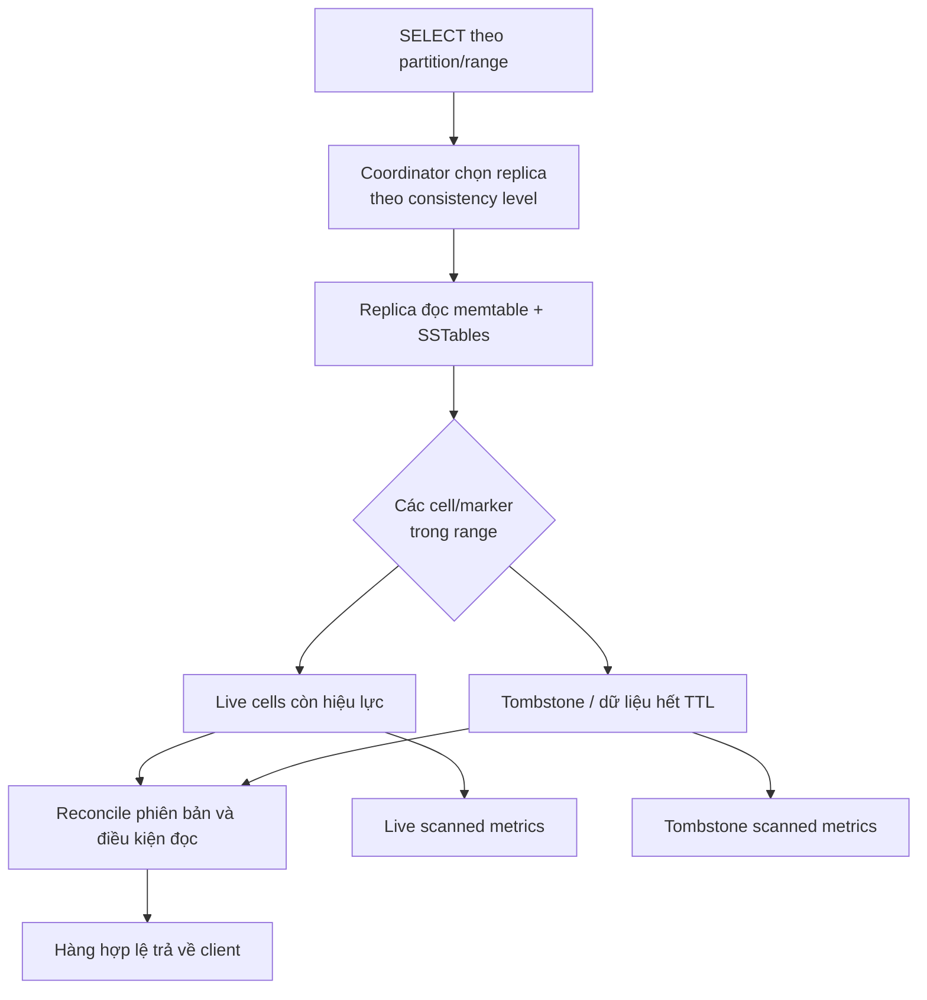
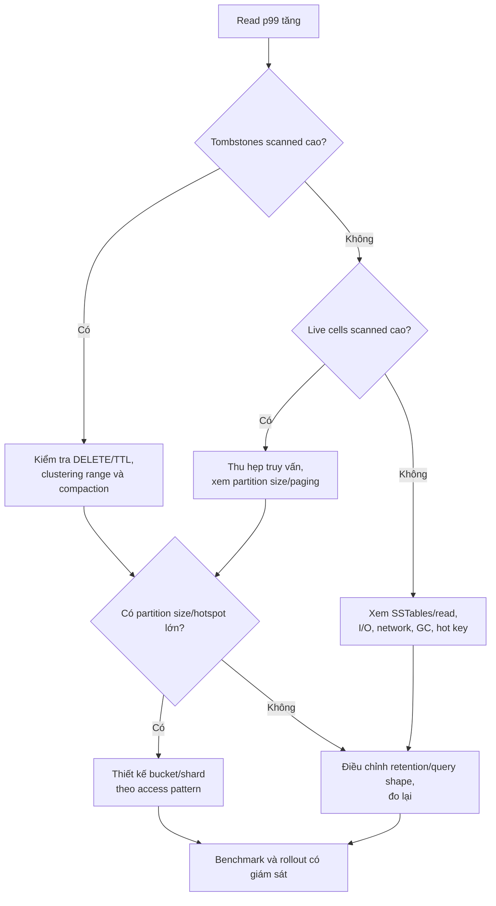

# Tombstone scanned, live cells và kích thước phân vùng

**Chương:** Quan sát hệ thống  
**Module:** `DATABASE_ENGINE_WIDE_COLUMN_CASSANDRA` — Apache Cassandra

Khi đọc một partition trong Apache Cassandra, thời gian phản hồi không chỉ phụ thuộc **số hàng được trả về**. Replica có thể phải duyệt nhiều cell còn sống, các phiên bản cũ, bản ghi đã xóa hoặc dữ liệu hết TTL trước khi tìm thấy kết quả. Trên dashboard, ba tín hiệu thường được dùng cùng nhau là **tombstones scanned**, **live cells scanned** và **partition size**. Nếu không phân biệt chúng, bạn có thể tối ưu sai chỗ: tăng `LIMIT`, chỉnh compaction hoặc thêm cache trong khi nguyên nhân thực sự là partition quá rộng hoặc truy vấn thường xuyên đi qua một vùng có nhiều tombstone.

Bài học thuộc module `DATABASE_ENGINE_WIDE_COLUMN_CASSANDRA`: tìm hiểu kiến trúc phân tán, mô hình wide-column, partition key, thiết kế bảng theo truy vấn, mức nhất quán đọc/ghi, CQL, replication, compaction, repair, xử lý lỗi và kết nối Java. Ở đây chúng ta kết nối **cách Cassandra lưu và đọc dữ liệu** với **các chỉ số quan sát hệ thống**, sử dụng một lab CQL nhỏ, lệnh `nodetool`, tracing và ví dụ Java Driver.

> **Phạm vi:** Mô tả hướng tới Apache Cassandra 4.1/5.x. Tên metric/JMX MBean, định dạng `nodetool`, ngưỡng cảnh báo và cách exporter đặt nhãn có thể khác theo bản Cassandra hoặc nhà cung cấp. Mọi câu lệnh sửa/xóa dữ liệu trong bài chỉ dành cho cluster thử nghiệm; không giảm `gc_grace_seconds` hoặc ép major compaction trên production để làm một biểu đồ trông đẹp hơn.

## 1. Mục tiêu học tập

Sau bài này, bạn có thể:

1. Giải thích “tombstone scanned” và “live cells scanned” mô tả **công việc đọc** chứ không trực tiếp đếm số hàng trả về.
2. Phân biệt **row tombstone**, **cell tombstone**, **range tombstone**, **partition tombstone** và trạng thái dữ liệu hết TTL.
3. Đọc các thống kê theo bảng/replica bằng `nodetool tablestats`, `tablehistograms` và tracing; hiểu giới hạn của chúng.
4. Phân tích vì sao một truy vấn `LIMIT 10` vẫn có thể quét nhiều tombstone.
5. Hiểu kích thước partition gồm **số hàng/cell, bytes trên đĩa, số SSTable chồng lấn và mức độ phân bố truy cập**; không đồng nhất những khái niệm này.
6. Thiết kế thí nghiệm CQL tạo dữ liệu sống, xóa một số hàng, thêm TTL rồi đo trước/sau.
7. Nhận diện truy vấn/range/partition có dấu hiệu nguy cơ mà không dựa vào một trung bình tổng hợp.
8. Chọn cách xử lý: thu hẹp clustering range, tạo time bucket, điều chỉnh chính sách TTL, thiết kế lại access pattern hoặc đánh giá compaction phù hợp.
9. Xây dựng checklist dashboard/alert và ví dụ Java Driver để liên hệ metrics server với tác động client.

**Câu hỏi trung tâm:** Tại sao API trả chỉ ba hàng nhưng Cassandra lại có thể phải kiểm tra hàng nghìn cell/tombstone và tốn hàng trăm mili giây?

## 2. Nhìn lại read path: Cassandra đọc dữ liệu như thế nào?

### 2.1. Partition key chỉ ra vị trí, clustering key chỉ ra khoảng cần đọc

Giả sử bảng ghi các sự kiện theo tenant và ngày:

```sql
CREATE TABLE lab_observability.events_by_tenant_day (
    tenant_id text,
    bucket_day date,
    event_ts timestamp,
    event_id uuid,
    event_type text,
    payload text,
    PRIMARY KEY ((tenant_id, bucket_day), event_ts, event_id)
) WITH CLUSTERING ORDER BY (event_ts DESC, event_id ASC);
```

Ở đây:

- `(tenant_id, bucket_day)` là **composite partition key**; nó định vị một partition logic.
- `event_ts` và `event_id` là clustering columns, xác định thứ tự/định danh hàng trong partition.
- `event_type`, `payload` là các cột thường; mỗi hàng có thể chứa nhiều cell.
- Câu đọc có đủ partition key và giới hạn `event_ts` có thể thu hẹp vùng clustering cần duyệt.

Một câu như:

```sql
SELECT event_ts, event_id, event_type
FROM lab_observability.events_by_tenant_day
WHERE tenant_id = 'tenant-a'
  AND bucket_day = '2026-11-21'
  AND event_ts >= '2026-11-21T10:00:00Z'
  AND event_ts <  '2026-11-21T11:00:00Z'
LIMIT 10;
```

có thể vẫn phải xét nhiều marker xóa đã tồn tại trong khoảng 10:00–11:00. Cassandra không thể xem một marker như hàng hợp lệ chỉ để nhanh chóng đạt `LIMIT 10`.

### 2.2. Dữ liệu trong memtable và SSTable

Cassandra sử dụng kiến trúc LSM-tree. Mutation ghi vào commit log/memtable, sau đó flush ra **SSTable bất biến**. Ghi đè hoặc xóa không cập nhật trực tiếp các SSTable cũ: một key có thể có nhiều phiên bản và tombstone trải qua nhiều tệp. Read path phải hòa giải dữ liệu hợp lệ theo timestamp và quy tắc xóa.



Sơ đồ mang tính khái niệm. Một replica có thể sử dụng Bloom filter, partition index, cache hoặc các cấu trúc đọc khác để tránh mở những tệp không cần thiết. Vì thế **số SSTable của bảng không luôn bằng số SSTable một read thực sự chạm tới**.

### 2.3. Cell, row, partition, SSTable: không cùng một đơn vị

| Đơn vị | Ý nghĩa | Ví dụ |
| --- | --- | --- |
| **Cell** | Giá trị của cột/cấu trúc được đọc và hòa giải | `event_type` hoặc `payload` trong một hàng |
| **Row** | Hàng CQL được nhận diện bởi khóa chính | Một sự kiện có `event_ts` + `event_id` |
| **Partition** | Nhóm hàng theo cùng partition key | Sự kiện của `tenant-a` trong ngày 21/11 |
| **SSTable** | Tệp lưu trữ bất biến trên một replica | Một SSTable có thể chứa nhiều partition |
| **Replica** | Bản sao logic do một node lưu | Một partition có thể có nhiều replica tùy RF |

Một hàng CQL có thể gồm nhiều cell, một partition có thể có hàng triệu hàng, và một partition có thể bị phân tán qua nhiều SSTable **trên cùng replica**. Do đó `live cells scanned = 500` không đồng nghĩa “trả về 500 hàng”, còn “partition size 100 MiB” không đồng nghĩa một lần SELECT phải đọc đủ 100 MiB.

## 3. Tombstone scanned là gì?

### 3.1. Tombstone là dấu xóa mang ngữ nghĩa

Trong Cassandra, `DELETE` thường tạo **tombstone**; khi TTL hết hạn, dữ liệu cũng được xem là hết hiệu lực và có thể xuất hiện trong công việc xử lý tombstone. Tombstone cần tồn tại đủ lâu trong những điều kiện nhất định để không cho bản sao cũ “làm sống lại” dữ liệu đã xóa khi node quay lại.

Một số dạng thường gặp:

| Loại | Thao tác thường tạo | Phạm vi ảnh hưởng |
| --- | --- | --- |
| Cell tombstone | Xóa riêng một cột thường, cập nhật làm cột thành null trong ngữ cảnh phù hợp | Một cell/cột |
| Row tombstone | `DELETE` một hàng theo đủ primary key | Các cell/hàng tương ứng |
| Range tombstone | `DELETE` một dải clustering rows theo cú pháp hỗ trợ | Khoảng hàng trong partition |
| Partition tombstone | Xóa toàn bộ partition theo khóa partition | Các hàng thuộc partition |
| Expired TTL | Cell có TTL đã hết hạn | Giá trị hết hiệu lực; vẫn cần xử lý khi đọc/dọn vật lý |

Dạng marker và cách tính vào metric có thể khác theo thao tác và phiên bản. Không kết luận “mỗi `DELETE` = đúng một tombstone scanned”. Một lệnh DELETE có thể tạo marker có phạm vi rộng, và một read có thể xét marker ấy qua nhiều SSTable hoặc ranges.

### 3.2. Tombstone scanned không phải tổng số DELETE đã gọi

**Tombstones scanned** phản ánh **công việc khi đọc**: có bao nhiêu marker/giá trị bị xem là tombstone mà read phải xử lý trong đường đọc liên quan. Nó không phải:

- Tổng số câu `DELETE` từ ngày hệ thống khởi động.
- Số hàng logic đang bị xóa trên toàn bảng.
- Số bytes vật lý được giải phóng bởi compaction.
- Số tombstone duy nhất trong mọi SSTable.
- Số tombstone luôn được quét khi cùng câu SELECT chạy trên một replica khác.

Hai request cùng CQL có thể có chỉ số khác nhau do khác partition/range, trạng thái cache, SSTable, compaction, replication lag hoặc thời điểm dữ liệu hết TTL.

### 3.3. Vì sao tombstone ảnh hưởng độ trễ?

Giả sử cần lấy **10 sự kiện mới nhất**, nhưng hàng nghìn sự kiện trong phạm vi đầu tiên đã bị xóa. Read path phải xác nhận những hàng đã xóa đó không được trả về, rồi tiếp tục tìm hàng còn sống. Hệ thống tiêu tốn CPU, I/O, memory và có thể quét thêm nhiều SSTable để đạt mục tiêu.

Mô hình ví dụ **giả định** (không phải số đo lab):

```text
CQL: SELECT ... WHERE partition = P LIMIT 10

Replica kiểm tra:
  4.000 tombstone/expired entries
     80 live cells liên quan
  => Client chỉ nhận 10 rows

Latency p99 tăng mặc dù LIMIT nhỏ.
```

Tombstone scanned cao kéo dài có thể dẫn tới warning, thất bại khi vượt giới hạn bảo vệ hoặc timeout tùy cấu hình/phiên bản. Không có một ngưỡng cố định phù hợp cho mọi cluster; cần kiểm tra `tombstone_warn_threshold` và `tombstone_failure_threshold` trong cấu hình thực tế. Đừng tăng giới hạn vô tội vạ để che một truy vấn quét quá rộng.

## 4. Live cells scanned là gì?

**Live cells scanned** phản ánh lượng cell/đơn vị dữ liệu còn sống mà hệ thống xử lý khi phục vụ read trong phạm vi đo. Nó khác với số hàng CQL cuối cùng client nhận vì:

- Một row có thể chứa nhiều cột/cell.
- Một request có thể đọc nhiều hơn những cột cuối cùng được trả về để hòa giải dữ liệu.
- Điều kiện lọc và clustering range có thể khiến replica xét dữ liệu rồi không trả tất cả.
- Paging, partition range và CL ảnh hưởng số request/công việc diễn ra.
- Các SSTable có phiên bản trùng/cell shadowed có thể làm lượng scan không tương ứng trực tiếp số row.

Tùy phiên bản, histograms có cách lấy mẫu/đếm cụ thể; mục đích sử dụng của metric là **so sánh lượng công việc đọc**, không phải làm bộ đếm kết quả API.

### 4.1. Đọc kết hợp tombstone và live cells

| Tombstones scanned | Live cells scanned | Diễn giải có thể | Bước điều tra tiếp |
| --- | --- | --- | --- |
| Thấp | Thấp | Lookup nhỏ, ít dữ liệu bị loại | Xem p99 và SSTables/read; có thể bottleneck khác |
| Cao | Thấp | Nhiều marker hết hiệu lực trước khi tìm dữ liệu sống | DELETE/TTL, clustering range, compaction, tombstone scan warnings |
| Thấp | Cao | Truy vấn quét khối lượng dữ liệu còn sống lớn | Partition size, phân trang, phạm vi clustering, query shape |
| Cao | Cao | Read vừa duyệt nhiều live cells vừa phải xử lý nhiều tombstones | Phân vùng quá lớn, read amplification, hot partitions, retention |
| Thấp trên một node, cao ở node khác | Bất kỳ | Dữ liệu/compaction/cấu hình/replica có thể khác | So từng node, repair status, workload routing, instance health |

Một tỷ lệ minh họa thường hữu ích:

\[
r_{\text{tombstone}} =
\frac{T}{\max(1,L+T)}
\]

với `T` là tombstones scanned và `L` là live cells scanned trong **cùng phạm vi đo**. Đây là **chỉ số phân tích tự tạo**, không phải metric mặc định hay tỷ lệ row “đã chết” của Cassandra. Nếu `T=9.000` và `L=1.000`, tỷ lệ ví dụ là 90%, nhưng một tỷ lệ cao có thể vẫn rẻ khi tổng scan chỉ vài đơn vị; phải xem **số lượng tuyệt đối và độ trễ**.

## 5. Kích thước phân vùng (partition size) phải hiểu ra sao?

Một partition là tập hàng có cùng partition key. Trong Cassandra, một partition lớn có thể khiến:

- Read theo toàn partition cần duyệt nhiều hàng/cell, kể cả những bản đã xóa.
- Một số thao tác query/compaction/streaming/repair tạo áp lực I/O và bộ nhớ.
- Độ trễ cực đại (tail latency) bị kéo bởi một vài tenant/device có volume bất thường.
- Node chứa replica của partition nóng phải phục vụ nhiều request dù cluster có rất nhiều node.
- Việc lấy “trang đầu tiên” trên một partition chứa nhiều tombstone vẫn đắt.

### 5.1. Ba cách đo “lớn”

| Góc nhìn | Phép đo | Điều cần nhớ |
| --- | --- | --- |
| **Logic** | Số hàng/cell còn sống trong partition | Không thấy hết tombstone và phiên bản cũ |
| **Vật lý** | Bytes của partition/SSTable trên một replica | Có thể gồm dữ liệu hết hiệu lực, trùng phiên bản và overhead |
| **Workload** | Số cell/SSTable phải quét và tần suất đọc/ghi vào partition | Partition không quá lớn về bytes vẫn có thể rất nóng |

Không có số MB duy nhất mà vượt qua là “sai” cho mọi bảng Cassandra. Ngưỡng an toàn tùy kích thước row, clustering query, phần cứng, loại compaction, mức đọc/ghi, SLA và phiên bản. Thực tế phải benchmark **p95/p99, partition-size histogram và disk I/O** theo workload thật.

### 5.2. Số liệu ước lượng không phải kết quả COUNT chính xác

`nodetool tablestats` có các số như số partition ước lượng và kích thước compacted partition (minimum/maximum/mean), tùy phiên bản. `nodetool tablehistograms` có phân phối/percentiles của partition size và cell count trên node. Chúng dựa trên thống kê lưu trữ/sampling, có thể khác kết quả đếm toàn bộ row logic của một partition ở thời điểm truy vấn.

**Đặc biệt:** cùng một partition logic có thể xuất hiện trong nhiều SSTable, và mỗi replica có tệp/compaction khác nhau. Đừng lấy một số trong bảng SSTable rồi tuyên bố đó là dung lượng chính xác của một partition duy nhất ở mọi replica.

### 5.3. Hot partition khác large partition

- **Large partition:** quá nhiều dữ liệu/cell trong cùng khóa phân vùng.
- **Hot partition:** quá nhiều request/ghi tới cùng khóa, bất kể bytes.
- Một partition vừa large vừa hot là tình huống nguy hiểm, nhưng một partition rất nhỏ vẫn có thể nóng do hàng nghìn request mỗi giây.

Truy vấn một tenant quá phổ biến có thể tạo tail latency và hotspot. Vì vậy hãy đánh giá **phân bố theo khóa**, không chỉ trung bình partition size toàn bảng.

## 6. Mối liên hệ giữa tombstone, live cells và partition size

Xét partition một ngày của `tenant-a`:

```text
T0: 80.000 events, nhiều live cells
T1: 60.000 events bị DELETE hoặc hết TTL
T2: Client SELECT ... LIMIT 20 trên vùng có nhiều event đã xóa
T3: Tombstones scanned cao, live cells scanned có thể thấp hơn
T4: Compaction dần gom SSTable; tombstone chỉ được dọn khi an toàn
```

Không nên suy diễn rằng:

- “60.000 event bị xóa” nghĩa mỗi lần đọc đều scan 60.000 tombstone; clustering range có thể loại trừ phần lớn.
- “Compaction vừa chạy” nghĩa tất cả tombstone đã biến mất; còn `gc_grace_seconds`, overlap SSTable, dữ liệu còn sống và lịch repair.
- “Partition size giảm” nghĩa read p99 chắc chắn giảm; bottleneck có thể là hot partition, mạng, GC hoặc index.
- “Live cells thấp” nghĩa workload nhỏ; có thể read đang phải đi qua rất nhiều marker xóa trước khi có kết quả.

Vì vậy ba chỉ số chỉ có ý nghĩa đầy đủ khi đặt cùng **câu CQL, partition key, khoảng clustering, node/replica, CL, time window và latency**.

## 7. Chuẩn bị môi trường thực hành

Dùng cluster thử nghiệm Cassandra tương thích 4.1/5.x. Ví dụ một node/1 DC cho phép quan sát cú pháp và metrics với RF=1; production cần RF/CL dựa trên yêu cầu chịu lỗi.

Trên terminal:

```bash
nodetool status
cqlsh
```

Trong `cqlsh`:

```sql
SELECT data_center, release_version FROM system.local;
```

Nếu datacenter thực tế không phải `datacenter1`, thay tên trong cấu hình bên dưới:

```sql
CREATE KEYSPACE IF NOT EXISTS lab_observability
WITH replication = {
  'class': 'NetworkTopologyStrategy',
  'datacenter1': 1
}
AND durable_writes = true;

CREATE TABLE IF NOT EXISTS lab_observability.events_by_tenant_day (
    tenant_id text,
    bucket_day date,
    event_ts timestamp,
    event_id uuid,
    event_type text,
    payload text,
    PRIMARY KEY ((tenant_id, bucket_day), event_ts, event_id)
) WITH CLUSTERING ORDER BY (event_ts DESC, event_id ASC);
```

**Tại sao bucket theo ngày?** `tenant_id` đơn độc có thể tạo partition tăng vô hạn. `(tenant_id, bucket_day)` hạn chế dữ liệu mỗi partition theo khoảng thời gian; nếu một tenant có hàng trăm triệu event/ngày, phải xét bucket nhỏ hơn hoặc chia shard. Điều quan trọng là dự đoán kích thước theo **tenant lớn nhất**, không phải tenant trung bình.

## 8. Thực nghiệm 1: tạo live cells và xóa một phần

### 8.1. Chèn sáu sự kiện có ID cố định

```sql
CONSISTENCY ONE

INSERT INTO lab_observability.events_by_tenant_day
    (tenant_id, bucket_day, event_ts, event_id, event_type, payload)
VALUES ('tenant-a', '2026-11-21', '2026-11-21T10:00:00Z',
        00000000-0000-4000-8000-000000000001, 'OPEN', 'payload-01');

INSERT INTO lab_observability.events_by_tenant_day
    (tenant_id, bucket_day, event_ts, event_id, event_type, payload)
VALUES ('tenant-a', '2026-11-21', '2026-11-21T10:01:00Z',
        00000000-0000-4000-8000-000000000002, 'OPEN', 'payload-02');

INSERT INTO lab_observability.events_by_tenant_day
    (tenant_id, bucket_day, event_ts, event_id, event_type, payload)
VALUES ('tenant-a', '2026-11-21', '2026-11-21T10:02:00Z',
        00000000-0000-4000-8000-000000000003, 'CLICK', 'payload-03');

INSERT INTO lab_observability.events_by_tenant_day
    (tenant_id, bucket_day, event_ts, event_id, event_type, payload)
VALUES ('tenant-a', '2026-11-21', '2026-11-21T10:03:00Z',
        00000000-0000-4000-8000-000000000004, 'CLICK', 'payload-04');

INSERT INTO lab_observability.events_by_tenant_day
    (tenant_id, bucket_day, event_ts, event_id, event_type, payload)
VALUES ('tenant-a', '2026-11-21', '2026-11-21T10:04:00Z',
        00000000-0000-4000-8000-000000000005, 'VIEW', 'payload-05');

INSERT INTO lab_observability.events_by_tenant_day
    (tenant_id, bucket_day, event_ts, event_id, event_type, payload)
VALUES ('tenant-a', '2026-11-21', '2026-11-21T10:05:00Z',
        00000000-0000-4000-8000-000000000006, 'VIEW', 'payload-06');
```

Đọc trạng thái ban đầu:

```sql
SELECT event_ts, event_id, event_type
FROM lab_observability.events_by_tenant_day
WHERE tenant_id = 'tenant-a'
  AND bucket_day = '2026-11-21';
```

Kỳ vọng: sáu hàng được trả về, giảm dần theo `event_ts`. Đây là kết quả CQL, **không phải** số live cells scanned: mỗi hàng có nhiều cell.

### 8.2. Xóa ba hàng theo đủ primary key

```sql
DELETE FROM lab_observability.events_by_tenant_day
WHERE tenant_id = 'tenant-a'
  AND bucket_day = '2026-11-21'
  AND event_ts = '2026-11-21T10:04:00Z'
  AND event_id = 00000000-0000-4000-8000-000000000005;

DELETE FROM lab_observability.events_by_tenant_day
WHERE tenant_id = 'tenant-a'
  AND bucket_day = '2026-11-21'
  AND event_ts = '2026-11-21T10:03:00Z'
  AND event_id = 00000000-0000-4000-8000-000000000004;

DELETE FROM lab_observability.events_by_tenant_day
WHERE tenant_id = 'tenant-a'
  AND bucket_day = '2026-11-21'
  AND event_ts = '2026-11-21T10:02:00Z'
  AND event_id = 00000000-0000-4000-8000-000000000003;
```

Sau đó:

```sql
SELECT event_ts, event_id, event_type
FROM lab_observability.events_by_tenant_day
WHERE tenant_id = 'tenant-a'
  AND bucket_day = '2026-11-21'
LIMIT 3;
```

Kỳ vọng logic: ba hàng còn sống `10:05`, `10:01` và `10:00` (giả sử không có ghi cạnh tranh). Read path có thể phải xử lý marker xóa của các hàng `10:04`, `10:03` và `10:02` trước khi thu thập đủ ba hàng, tùy tình trạng SSTable/memtable.

**Không kỳ vọng nhận warning tombstone chỉ từ ba DELETE.** Ngưỡng warn/fail thường lớn hơn rất nhiều; đây là ví dụ để hiểu cơ chế, không phải benchmark.

### 8.3. Hai phạm vi truy vấn khác nhau dẫn tới khối lượng scan khác nhau

```sql
-- Phạm vi rộng: có thể đi qua nhiều marker đã xóa.
SELECT event_ts, event_type
FROM lab_observability.events_by_tenant_day
WHERE tenant_id = 'tenant-a'
  AND bucket_day = '2026-11-21'
LIMIT 3;

-- Phạm vi hẹp: chỉ xét các sự kiện trước 10:02.
SELECT event_ts, event_type
FROM lab_observability.events_by_tenant_day
WHERE tenant_id = 'tenant-a'
  AND bucket_day = '2026-11-21'
  AND event_ts < '2026-11-21T10:02:00Z';
```

Hai truy vấn không giống hệt kết quả (truy vấn hẹp trả hai hàng), nhưng so sánh chúng giúp thấy **thu hẹp clustering range** có thể tránh phần đã xóa. Khi đánh giá công bằng cần đối chiếu lượng dữ liệu trả về, phân bố sự kiện và đặc điểm read thực tế.

Đừng thêm `ALLOW FILTERING` vào truy vấn thiếu partition key để “tránh tombstone”: filtering trên nhiều partition thường làm scan rộng hơn và có thể dẫn đến latency khó dự đoán.

## 9. Thực nghiệm 2: TTL và các marker hết hạn

TTL làm dữ liệu không còn hiệu lực logic sau một khoảng kể từ **thời điểm ghi**. Nó không tự xóa byte vật lý ngay khi đồng hồ hết TTL.

Dùng một partition lab khác:

```sql
INSERT INTO lab_observability.events_by_tenant_day
    (tenant_id, bucket_day, event_ts, event_id, event_type, payload)
VALUES ('tenant-ttl', '2026-11-21', '2026-11-21T11:00:00Z',
        00000000-0000-4000-8000-000000000101, 'TEMP', 'ttl-60s')
USING TTL 60;

SELECT event_ts, event_type, TTL(payload)
FROM lab_observability.events_by_tenant_day
WHERE tenant_id = 'tenant-ttl'
  AND bucket_day = '2026-11-21';
```

Khi chưa hết 60 giây, `TTL(payload)` cho biết thời gian còn lại trên cột đó. Khi TTL đã hết, hàng có thể không còn xuất hiện trong SELECT logic; dữ liệu hết hiệu lực vẫn có thể ảnh hưởng lưu trữ/scan cho tới khi được dọn theo các điều kiện an toàn.

Đọc sau khi TTL hết và đối chiếu histogram/tombstone metrics. Không thể yêu cầu một khoảng thời gian chính xác để dữ liệu bị dọn khỏi SSTable vì compaction là công việc nền và còn các điều kiện liên quan tombstone.

### 9.1. TTL “30 ngày” và thời gian sự kiện không giống nhau

Nếu một sự kiện có `event_ts` từ hai tuần trước nhưng được ingest hôm nay với `USING TTL 2592000` (30 ngày), Cassandra tính TTL từ thời điểm ghi, không tự trừ đi hai tuần dựa trên giá trị `event_ts`. Điều này quan trọng với backfill và **TimeWindowCompactionStrategy (TWCS)**: cột event time không tự quyết định cửa sổ compaction.

Nếu dữ liệu time-series có TTL cố định, gần như append-only, TWCS có thể giúp loại các SSTable cũ theo window khi toàn bộ dữ liệu trong đó đã hết hiệu lực và an toàn. Nhưng trộn TTL rất khác nhau, late writes và ghi đè thường xuyên làm việc dọn tệp theo khối kém hiệu quả.

### 9.2. Không giảm gc_grace chỉ để có ít tombstone

`gc_grace_seconds` có vai trò trong việc giữ thông tin xóa đủ lâu để replica đã offline có cơ hội đồng bộ. Giảm grace trước khi bảo đảm repair/downtime policy có thể gây **resurrection** khi một replica cũ quay lại. Trong bài này chỉ quan sát, không thay đổi `gc_grace_seconds` hay ép major compaction để tạo biểu đồ.

## 10. Đọc chỉ số bằng nodetool

Trên node Cassandra của lab:

```bash
nodetool status

nodetool tablestats lab_observability.events_by_tenant_day

nodetool tablehistograms lab_observability events_by_tenant_day

nodetool compactionstats
```

Nếu lệnh/định dạng khác, dùng:

```bash
nodetool help tablestats
nodetool help tablehistograms
nodetool help compactionstats
```

Các lệnh này quan sát trạng thái **node được gọi**. Cluster có RF=3 cần xem từng replica/node phù hợp; số liệu không tự đồng nhất ở mọi node.

### 10.1. Các trường có thể thấy trong `tablestats`

Tùy phiên bản, `tablestats` hiển thị các thông tin dạng:

| Trường/nhóm thống kê | Diễn giải | Không được suy ra |
| --- | --- | --- |
| **Average live cells per slice (last five minutes)** | Trung bình live cells đã scan cho slice đọc trong cửa sổ gần đây | Không phải số row trả về hoặc giá trị toàn cluster |
| **Maximum live cells per slice (last five minutes)** | Giá trị scan lớn quan sát ở khoảng thời gian báo cáo | Không phải p99 và không cho biết khóa gây ra |
| **Average tombstones per slice (last five minutes)** | Trung bình tombstones được scan trong các slice đọc | Không phải tổng tombstone tồn tại trên disk |
| **Maximum tombstones per slice (last five minutes)** | Mức scan tombstone lớn quan sát gần đây | Không phải giới hạn an toàn tuyệt đối |
| **Compacted partition minimum/maximum/mean bytes** | Ước lượng kích thước partition từ thống kê lưu trữ | Không phải kích thước chính xác mọi partition logic |
| **Estimated number of partitions** | Ước lượng số partition được lưu trên node | Không phải COUNT chính xác của bảng toàn cluster |
| **SSTable count / space used** | Số tệp, bytes liên quan tới lưu trữ | Không chứng minh số tệp một truy vấn đã đọc |
| **Droppable tombstone ratio** (nếu được báo) | Ước lượng tỷ lệ tombstone có thể dọn | Không bảo đảm compaction ngay giải phóng số byte tương ứng |

“Last five minutes” là mô tả phổ biến trong output của một số phiên bản; một metric khác có thể là cumulative histogram hoặc snapshot tại thời điểm đọc. Không so sánh **trung bình 5 phút** với **tổng số event từ đầu phiên** như thể hai phép đo đồng nhất.

### 10.2. `tablehistograms` để xem phần đuôi phân phối

`nodetool tablehistograms` thường hiển thị các percentile của:

- SSTables per read.
- Write/read latency.
- Partition size (bytes).
- Cell count.

Các cột và đơn vị phụ thuộc phiên bản. Điểm quan trọng là **p95/p99/max của partition size và SSTables per read** có thể lớn hơn nhiều trung bình. Một vài tenant cực lớn có thể bị che nếu chỉ xem mean.

**Ví dụ giả định:**

| Chỉ số partition size | Giá trị minh họa |
| --- | ---: |
| Median | 32 KiB |
| p95 | 2 MiB |
| p99 | 24 MiB |
| Max | 480 MiB |

Không có số nào ở bảng trên là kết quả đo thật. Nó minh họa vì sao chỉ báo “mean nhỏ” không loại trừ large partitions. Trước khi đưa ra ngưỡng cảnh báo cụ thể, hãy đo theo SLO và capacity của cluster.

### 10.3. CQL schema để kiểm tra TTL/compaction

Trong `cqlsh`:

```sql
SELECT keyspace_name, table_name, compaction,
       default_time_to_live, gc_grace_seconds
FROM system_schema.tables
WHERE keyspace_name = 'lab_observability';
```

Thông tin này giúp biết bảng có TTL mặc định và chiến lược compaction nào, **không** trực tiếp đo tombstone scanned. Nếu cần kiểm tra số lượng tombstone đã phát sinh từ thao tác cụ thể, phải kết hợp trace/metrics/log và trạng thái dữ liệu.

## 11. CQL tracing và warning: dùng đúng mục đích

Trong `cqlsh`:

```sql
TRACING ON;

SELECT event_ts, event_id, event_type
FROM lab_observability.events_by_tenant_day
WHERE tenant_id = 'tenant-a'
  AND bucket_day = '2026-11-21'
LIMIT 3;

SELECT event_ts, event_id, event_type
FROM lab_observability.events_by_tenant_day
WHERE tenant_id = 'tenant-a'
  AND bucket_day = '2026-11-21'
  AND event_ts < '2026-11-21T10:02:00Z';

TRACING OFF;
```

Khi trace được tạo, kiểm tra:

- Replica/coordinator nào xử lý request.
- Có những sự kiện read/scan liên quan tới SSTable/tombstone (nếu phiên bản ghi chi tiết).
- Tổng thời gian và các bước đóng góp vào latency.
- Khác biệt giữa truy vấn range rộng/hẹp.
- Warning từ server nếu query vượt ngưỡng tombstone.

Tracing có overhead; chỉ bật có kiểm soát khi chẩn đoán. Không dùng tracing như cơ chế đo p99 thường trực. Không phải mọi trace đều in số tombstone quét theo định dạng giống nhau; **không có dòng trace** không có nghĩa không hề scan tombstone.

### 11.1. Các ngưỡng cảnh báo tombstone

Một số cấu hình Cassandra liên quan tới:

- `tombstone_warn_threshold`: ngưỡng dùng để cảnh báo khi truy vấn scan nhiều tombstone.
- `tombstone_failure_threshold`: giới hạn bảo vệ có thể khiến read bị dừng/thất bại khi scan quá nhiều.
- Read timeout và paging settings: ảnh hưởng trải nghiệm client khi query nặng.

Tên/ý nghĩa chính xác theo phiên bản và cấu hình cụ thể phải được xác minh. Không tự hạ hay nâng hai ngưỡng trên trong production chỉ để làm phép thử cảnh báo. Tăng threshold có thể chỉ khiến một read tốn thêm tài nguyên trước khi fail, làm p99 toàn node xấu hơn.

Trong logs, ghi nguyên văn warning, keyspace/table, partition key nếu được hiển thị và thời điểm. Tránh đưa dữ liệu nhạy cảm của người dùng vào log/alert không kiểm soát.

## 12. JMX/metrics và dashboard

Cassandra có các metric theo bảng qua JMX; tùy phiên bản, bạn có thể gặp các histogram mang tên gần như:

```text
org.apache.cassandra.metrics:
  type=Table,
  keyspace=<keyspace>,
  scope=<table>,
  name=TombstoneScannedHistogram

org.apache.cassandra.metrics:
  type=Table,
  keyspace=<keyspace>,
  scope=<table>,
  name=LiveScannedHistogram
```

Đây là **mô hình tên minh họa** để tìm metric. Tên MBean thực tế, dấu cách, scope, object-name và hỗ trợ metric theo table có thể thay đổi. Khi xuất sang Prometheus/JMX exporter, tên metric và nhãn cũng **phụ thuộc exporter**; không viết một truy vấn PromQL giả định như thể mọi hệ thống đều có cùng tên.

Để dựng dashboard:

1. Khám phá MBean/metrics trên **phiên bản thực tế** và xác nhận đơn vị, khoảng lấy mẫu.
2. Phân biệt histogram dạng cumulative với thống kê rolling; tính rate/window nếu phù hợp.
3. Gắn nhãn node, datacenter, keyspace, table và environment; tránh cardinality cao không kiểm soát như nhãn cho mọi partition key.
4. Kết hợp scan metrics với read latency, read timeouts, SSTables per read, partition size histogram, CPU, disk I/O và compaction.
5. Hiển thị **distribution/p95/p99** thay vì chỉ mean; có thể cần exporter chuyên dụng để thu histogram buckets/percentiles đúng.
6. Đặt annotation khi có deploy, thay TTL, compaction strategy, repair hoặc thay schema; các sự kiện này thay đổi baseline.
7. Dùng query tracing/log có chọn lọc để truy ra partition/query shape nếu dashboard chỉ cho thấy bảng bất thường.

### 12.1. Dashboard tối thiểu cho một bảng

| Panel | Dữ liệu | Câu hỏi được trả lời |
| --- | --- | --- |
| Read p50/p95/p99 + timeout rate | Client và server latency | Người dùng có thực sự bị ảnh hưởng? |
| Tombstones scanned histogram | Theo node/table | Workload đọc đang phải xử lý bao nhiêu marker xóa? |
| Live cells scanned histogram | Theo node/table | Query đang quét nhiều dữ liệu còn sống không? |
| SSTables per read | Theo table, per replica | Có read amplification do nhiều SSTable không? |
| Partition size / cell count histogram | Theo table | Có tail partition quá lớn không? |
| Tombstone warnings/failures | Logs/metrics | Có query scan vượt ngưỡng bảo vệ? |
| Compaction pending, disk free, I/O wait | Node | Dọn SSTable có đang theo kịp ingest/TTL không? |
| Request counts / traffic source | Endpoint, app, DC | Tải tăng do query mới hay do dữ liệu thay đổi? |

Không chỉ “đo tombstones” mà bỏ qua số request. Một histogram có p99 tăng từ 100 lên 2.000 khi traffic từ 10/s thành 5.000/s có tác động rất khác với 1 request hiếm mỗi ngày; cần rate, cardinality và độ ảnh hưởng thực tế.

## 13. Vì sao `LIMIT`, paging hoặc cache không tự giải quyết?

### 13.1. `LIMIT 10` chỉ giới hạn kết quả, không giới hạn scan

Một SELECT có `LIMIT 10` phải tìm **10 hàng sống**. Nếu có hàng nghìn tombstone ở đầu clustering range, replica vẫn phải xét chúng. Tăng hoặc giảm `LIMIT` không loại bỏ vùng dữ liệu bị xóa.

Giải pháp khả dĩ:

- Đọc một khoảng clustering hẹp hơn.
- Thiết kế partition bucket theo thời gian/loại sự kiện.
- Phân chia dữ liệu sống và đã hết retention theo mô hình phù hợp.
- Tránh DELETE từng hàng hàng loạt trong partition quá lớn nếu nghiệp vụ có thể dùng TTL/retention có tổ chức.

### 13.2. Paging chuyển chi phí thành nhiều request, không làm biến mất chi phí

Java Driver có `pageSize`; nó giới hạn số hàng/trang theo API và cách protocol xử lý. Nếu cả query có dữ liệu lớn, nhiều trang vẫn phải đọc tiếp. Một client chỉ fetch trang đầu không đo được chi phí của toàn query; một client tự lặp tất cả trang có thể phát sinh I/O và latency lớn.

**Không** dùng `SELECT COUNT(*)` để “đo nhanh” một partition lớn: nó có thể phải duyệt rất nhiều hàng và tombstone, làm tình trạng tệ thêm. Dùng metadata/metrics và thử truy vấn có phạm vi hẹp hơn.

### 13.3. Cache hit không chữa lỗi dữ liệu

Key cache, row cache hoặc page/cache ở ứng dụng có thể giảm một số lần đọc, nhưng không làm tombstone biến mất khỏi SSTable. Khi cache miss hoặc workload truy vấn nhiều khóa khác nhau, read vẫn phải xử lý phần dữ liệu tương ứng. Đừng bật cache rộng trên partition cực lớn để che mô hình khóa thiếu kiểm soát.

### 13.4. `ALLOW FILTERING` có thể làm phạm vi đọc rộng hơn

Một truy vấn trên cột thường không có đường truy cập phù hợp thường bị Cassandra từ chối. Thêm `ALLOW FILTERING` có thể khiến coordinator/replica phải duyệt nhiều dữ liệu ngoài partition được chọn. Với dữ liệu có tombstone, chi phí có thể tăng mạnh. Cách đúng là thiết kế table/query/index hỗ trợ workload, không dùng filtering như một nút “chạy được là tối ưu”.

## 14. Xác định nguyên nhân: quy trình chẩn đoán

### 14.1. Bắt đầu từ triệu chứng người dùng

Ví dụ API “get recent events” tăng từ p99=80 ms lên p99=900 ms. Không kết luận ngay do tombstone; hãy thu:

- Endpoint/query shape và thay đổi deploy gần nhất.
- Partition key, clustering range, `LIMIT`, page size và consistency level.
- p50/p95/p99 cùng timeout rate theo client/DC.
- SSTables/read, tombstone/live scanned histograms theo table/replica.
- Partition size distribution và phân bố tenant lớn/hot.
- Compaction queue, disk I/O wait, heap/GC, node health.

**Phân tích theo cùng time window:** so metric tombstone ở 10:00–10:05 với latency ở đúng khoảng đó, không dùng tombstone max hôm qua để giải thích timeout hôm nay.

### 14.2. Cây quyết định



Dù sơ đồ có nhánh “có/không”, dữ liệu thật có thể đồng thời có nhiều bottleneck. Đừng điều chỉnh compaction hoặc schema trước khi xác định được **đường đọc** nào là nguyên nhân chính.

### 14.3. Bảng triệu chứng và hành động

| Triệu chứng | Khả năng cao | Việc cần làm trước |
| --- | --- | --- |
| Tombstones scanned cao, live scanned thấp | Truy vấn đi qua nhiều hàng đã xóa/TTL | Xem DELETE/TTL patterns, clustering range, tombstone warnings |
| Live scanned cao, tombstone thấp | Truy vấn rộng hoặc partition quá nhiều live cells | Thu hẹp khoảng clustering, paging có kiểm soát, model bucket |
| Cả hai cao | Large/hot partition, retention xáo trộn | Đo partition size, theo dõi compaction và thiết kế lại |
| Partition size p99 cao, mean thấp | Một số ít tenant/device vượt trội | Tìm nhóm khóa lớn qua logs/query sampling, chia shard/bucket |
| SSTables/read cao | Nhiều tệp chồng lấn, compaction backlog | Xem compaction strategy, I/O, mutation pattern |
| Tombstone warnings tăng sau TTL rollout | TTL hết hạn hàng loạt, query vẫn đọc vùng cũ | Xem retention, TWCS phù hợp hay không, lọc time range |
| Read timeout ngay sau repair/streaming | Tranh I/O/network, không hẳn do tombstone | So disk queue, CPU, compaction, stream progress |
| Một replica có scan lớn hơn peers | Chênh lệch dữ liệu/compaction, routing | So node health, SSTable metrics, repair và CL |
| `COUNT(*)` trên table lớn rất chậm | Toàn phạm vi quét quá lớn | Dùng metadata/ước lượng và aggregation riêng, không dùng COUNT đo giám sát |

## 15. Giải pháp thiết kế dữ liệu và retention

### 15.1. Chia partition theo time bucket hợp lý

Nếu một tenant ghi 2 triệu event mỗi ngày, partition theo `(tenant_id, bucket_day)` vẫn có thể quá lớn. Một thiết kế có thể thêm bucket theo giờ:

```sql
CREATE TABLE lab_observability.events_by_tenant_hour (
    tenant_id text,
    bucket_hour text,
    event_ts timestamp,
    event_id uuid,
    event_type text,
    PRIMARY KEY ((tenant_id, bucket_hour), event_ts, event_id)
) WITH CLUSTERING ORDER BY (event_ts DESC, event_id ASC);
```

Ví dụ `bucket_hour` là chuỗi chuẩn hóa dạng `2026-11-21T10` và được ứng dụng tính từ timestamp UTC. Việc dùng kiểu `text` chỉ để minh họa cách bucket; trong production có thể chọn cấu trúc khóa/bucket gọn hơn, có kiểm soát timezone.

Truy vấn:

```sql
SELECT event_ts, event_id, event_type
FROM lab_observability.events_by_tenant_hour
WHERE tenant_id = 'tenant-a'
  AND bucket_hour = '2026-11-21T10'
LIMIT 50;
```

Đổi lại, muốn hiển thị sự kiện 24 giờ qua cần query nhiều bucket và merge có kiểm soát. **Partition nhỏ hơn không miễn phí**: tăng số partition, fan-out và số round-trip. Chọn kích thước bucket bằng benchmark với tenant lớn nhất, read pattern và SLO.

### 15.2. Có cần shard trong cùng time bucket?

Nếu một tenant ghi 1 triệu event/giờ, có thể thêm `shard_id` để phân tán tải. Khi đó cần thuật toán gán shard ổn định và read fan-out/merge. Đừng tạo shard ngẫu nhiên cho mọi record rồi quên lưu nơi nó nằm; sẽ khiến truy vấn không thể định vị đầy đủ partition key.

### 15.3. TTL nhất quán và TWCS cho dữ liệu append-only

Với time-series ghi nối tiếp, retention rõ ràng và TTL gần đồng nhất, **TimeWindowCompactionStrategy (TWCS)** có thể giúp SSTable già đồng thời, dễ loại cả tệp khi mọi dữ liệu trong đó hết hạn và đủ điều kiện an toàn. Tuy nhiên:

- Bật TWCS **không tự đặt TTL**.
- Ghi đè vào key cũ/late writes/backfill làm dữ liệu rải qua nhiều cửa sổ.
- Trộn TTL 1 giờ với TTL 1 năm khiến cùng tệp có dữ liệu hết hạn và còn sống.
- Sửa `default_time_to_live` chỉ ảnh hưởng các lần ghi mới theo quy tắc TTL, không lập tức thay TTL của mọi cell cũ.
- Dọn tombstone vẫn phải tôn trọng điều kiện repair/grace/SSTable overlap.

Nếu workload update-heavy và delete-heavy, benchmark LCS/UCS (với phiên bản hỗ trợ)/STCS theo read/write mix thay vì mặc định TWCS chỉ vì bảng có cột timestamp.

### 15.4. Thay chiến lược compaction có giải quyết được hết không?

Không. Compaction có thể giảm số SSTable phải đọc và dọn dữ liệu hết hiệu lực khi an toàn, nhưng **không** biến partition key xấu thành access pattern tốt. Nếu API cần “20 sự kiện mới nhất của mọi tenant” trên toàn bảng, phải thiết kế bảng/index/aggregation theo truy vấn; không mong một compaction strategy tạo được thứ tự toàn cục.

Không ép `nodetool compact` thường xuyên chỉ để xóa tombstone. Major compaction có thể tạo đợt disk I/O lớn, cần nhiều headroom và làm một số chiến lược kém hiệu quả. Phải điều tra điều kiện dọn và theo dõi compaction nền trước.

### 15.5. Tránh xóa hàng triệu row riêng lẻ khi có chính sách tuổi dữ liệu

Với dữ liệu có retention theo ngày/tháng, mô hình time bucket và TTL nhất quán giúp giới hạn phạm vi và thuận lợi hơn cho compaction. Nếu nghiệp vụ cần xóa cả một tenant, phải hiểu **partition tombstone** và phạm vi scan/replica; không đánh đổi bằng một truy vấn SELECT quét rộng sau đó DELETE từng hàng mà không đo tác động.

Không khuyến nghị thay `DELETE` bằng `TRUNCATE` trong ứng dụng production: TRUNCATE là thao tác phá hủy toàn bảng, không phải xóa có điều kiện theo người dùng.

## 16. Java Driver: quan sát cảnh báo từ server và latency client

Java Driver 4.x có thể cho thấy latency request và các warning được server trả trong execution info. Nó **không trực tiếp thay thế** histograms tombstone/live scanned trên replica: metrics của client và server cần được đối chiếu.

```java
import com.datastax.oss.driver.api.core.CqlSession;
import com.datastax.oss.driver.api.core.DefaultConsistencyLevel;
import com.datastax.oss.driver.api.core.cql.PreparedStatement;
import com.datastax.oss.driver.api.core.cql.ResultSet;
import com.datastax.oss.driver.api.core.cql.Row;
import com.datastax.oss.driver.api.core.data.CqlDate;

import java.time.Instant;
import java.time.LocalDate;
import java.util.UUID;

public final class TombstoneReadProbe {
    public static void readRecent(CqlSession session) {
        PreparedStatement ps = session.prepare(
            "SELECT event_ts, event_id, event_type " +
            "FROM lab_observability.events_by_tenant_day " +
            "WHERE tenant_id = ? AND bucket_day = ? " +
            "AND event_ts >= ? AND event_ts < ? LIMIT 100"
        );

        LocalDate day = LocalDate.of(2026, 11, 21);
        CqlDate cqlDay = CqlDate.fromDaysSinceEpoch(
            (int) day.toEpochDay()
        );

        long startNanos = System.nanoTime();
        try {
            ResultSet rs = session.execute(
                ps.bind(
                    "tenant-a",
                    cqlDay,
                    Instant.parse("2026-11-21T10:00:00Z"),
                    Instant.parse("2026-11-21T11:00:00Z")
                ).setConsistencyLevel(DefaultConsistencyLevel.ONE)
                 .setPageSize(50)
            );

            // Warning do server trả nếu có: không phải mọi read nặng
            // đều chắc chắn phát sinh warning.
            for (String warning : rs.getExecutionInfo().getWarnings()) {
                System.err.println("Cassandra warning: " + warning);
            }

            int rows = 0;
            for (Row row : rs) {
                Instant at = row.getInstant("event_ts");
                UUID eventId = row.getUuid("event_id");
                String type = row.getString("event_type");
                System.out.println(at + " " + eventId + " " + type);
                rows++;
            }

            double elapsedMs =
                (System.nanoTime() - startNanos) / 1_000_000.0;

            System.out.println(
                "rows=" + rows + ", elapsedMs=" + elapsedMs
            );
        } catch (RuntimeException ex) {
            // Timeout/unavailable là lỗi request, không phải hàng rỗng.
            System.err.println("Read failed: " + ex);
        }
    }
}
```

**Giải thích và giới hạn:**

- `DefaultConsistencyLevel.ONE` phù hợp với **RF=1 của lab**. Khi dùng RF=3 production, lựa chọn CL cần dựa vào mục tiêu nhất quán, topology/DC và SLA.
- `setPageSize(50)` không đặt số cell tối đa replica phải quét; `LIMIT 100` chỉ giới hạn số row logic trả về.
- Thời gian đo quanh toàn bộ vòng lặp gồm cả tải các trang tiếp theo và việc in stdout; nó **không** chỉ là server read latency. Benchmark chuẩn cần tránh in console và dùng metrics theo nhiều lượt.
- `getExecutionInfo().getWarnings()` cho biết warning của execution được mô tả, không phải audit tất cả trang hoặc mọi replica. Theo dõi metrics/logs server để có bức tranh đầy đủ.
- Để xác định partition/query nào gây scan cao, ghi correlation ID, request shape, khung thời gian và key đã hash/ẩn danh nếu có dữ liệu người dùng; tránh gắn partition key raw thành label Prometheus gây cardinality cao hoặc lộ dữ liệu nhạy cảm.

## 17. Thiết kế phép so sánh có giá trị

Sáu hàng của lab giúp hiểu CQL và marker xóa nhưng không đo được hiệu năng production. Muốn kết luận một biện pháp có ích, tạo workload đủ lớn ở **cluster disposable**, không cần thay đổi các threshold hệ thống.

### 17.1. Bốn cohort dữ liệu

| Nhóm | Đặc điểm | Câu hỏi cần trả lời |
| --- | --- | --- |
| A — Small/clean | Partition nhỏ, gần như không DELETE/TTL | Baseline read latency |
| B — Small/deleted | Partition nhỏ nhưng nhiều marker xóa | Tombstone ảnh hưởng khi bytes nhỏ thế nào? |
| C — Large/live | Partition lớn, hầu hết data sống | Live scanned/partition size tác động ra sao? |
| D — Large/deleted | Partition lớn, nhiều TTL/DELETE và read range rộng | Tình huống nặng nhất và dấu hiệu cảnh báo |

Dữ liệu của các cohort phải có write timestamp, TTL, clustering order, compaction strategy và CL được ghi rõ. Không so partition 10 hàng có cache warm với partition 10 triệu hàng trên node khác rồi quy mọi chênh lệch cho tombstones.

### 17.2. Lượt chạy và cách đo

1. Chuẩn bị dữ liệu với phân bố tenant phổ biến/hiếm đúng như production; tránh workload chỉ có một partition được cache.
2. Warm up có kiểm soát, ghi cả cold/warm cache nếu mục tiêu cần.
3. Chạy cùng query shape và rate trên từng cohort.
4. Thu read p50/p95/p99, timeout rate, tombstone/live scanned histograms, SSTables/read, partition size và disk I/O.
5. Thử phiên bản truy vấn có clustering range hẹp hơn.
6. Thử schema bucket nhỏ hơn trên một tập dữ liệu tương đương, đo thêm chi phí fan-out.
7. Ghi workload ingest/update/delete/TTL và compaction backlog trong từng lượt.
8. Chỉ kết luận khi latency, lượng scan và resource usage cùng cho thấy cải thiện có ý nghĩa.

Không chạy `COUNT(*)` toàn bảng, ép flush liên tục hoặc chạy major compaction trước mỗi phép đo nếu production không có các hành vi đó; các thao tác này biến benchmark thành workload khác.

## 18. Tình huống chẩn đoán thực tế

### A. Endpoint chỉ trả 10 row nhưng bị warning “scanned many tombstones”

Khả năng truy vấn đang đi qua các hàng bị xóa/TTL. Xem partition key, clustering range, thứ tự DESC, LIMIT, dữ liệu bị xóa theo thời gian và ảnh hưởng compaction. Giảm số marker phải xét bằng cách thu hẹp range hoặc thay thiết kế retention; tăng threshold chỉ trì hoãn cảnh báo.

### B. Live scanned rất cao, tombstones scanned gần 0

Có thể truy vấn đang đọc một partition quá rộng chứa hầu hết dữ liệu còn sống. Đừng tìm cách chỉnh `gc_grace_seconds`; hãy giảm lượng dữ liệu mỗi request bằng range/bucket, xem p99 và số trang. Nếu cần aggregation, xây read model phù hợp thay vì duyệt toàn partition theo từng API request.

### C. Partition-size max tăng mạnh ở một node

Có thể có một vài tenant được định tuyến tới cùng replica với volume bất thường. Đối chiếu phân bố partition bytes/cell count, bảng theo token và workload; kiểm tra hot key bằng query logs/tracing có kiểm soát. Không lấy trung bình toàn cluster che tail distribution.

### D. Sau triển khai TTL, disk usage chưa giảm

TTL hết hạn không đồng nghĩa dọn vật lý ngay. Kiểm tra SSTable overlap, compaction backlog, TTL pha trộn, `gc_grace_seconds` và repair status. TWCS có thể giúp với append-only time-series phù hợp, nhưng không tự sửa backfill/ghi đè.

### E. Server latency bình thường nhưng API vẫn chậm

Điều tra network/client pooling, paging, ứng dụng xử lý từng row, timeout ở downstream và logging. Tombstone/live scan không phải nguyên nhân của **mọi** lỗi chậm; dashboard phải có metrics client lẫn server.

### F. Tombstones trên replica A nhiều hơn B/C

Khác biệt SSTable/compaction, hinted handoff, repair hoặc lịch sử ghi có thể gây chênh lệch. Không tự kết luận “replica A hỏng” chỉ từ histogram; xem topology/CL, trạng thái node, repair logs và token range. `nodetool repair` là hoạt động nặng cần lên lịch, không phải lệnh gõ theo phản xạ cho mỗi alert.

### G. Sau khi thêm time bucket, p99 một truy vấn giảm nhưng tổng request tăng

Kích thước partition nhỏ hơn giúp mỗi read rẻ, nhưng truy vấn “30 ngày” nay phải gọi 30 partition hoặc nhiều shards. Phải đo tổng latency/fan-out và lượng dữ liệu chuyển qua mạng; thiết kế bucket tối ưu cho **truy vấn phổ biến**, không chỉ một query ví dụ.

## 19. Checklist dashboard, alert và quy trình phản ứng

Một checklist vận hành nên xác nhận:

- [ ] Có phân tách per-table, per-node, datacenter và môi trường.
- [ ] Có read p95/p99, throughput, timeouts cùng histogram tombstone/live scanned.
- [ ] Có partition-size/cell-count distribution, không chỉ mean.
- [ ] Có SSTables/read, compaction pending, disk free, CPU, I/O wait và GC.
- [ ] Biết tên metric/JMX exporter, đơn vị và rolling/cumulative semantics đúng phiên bản.
- [ ] Threshold/alert được thiết kế theo SLO thực tế và so với baseline, không dùng số ngưỡng tùy tiện.
- [ ] Có correlation giữa query shape, clustering range, deployment, TTL/DELETE batch và thời điểm tăng scan.
- [ ] Khi có warning, không tự động tăng `tombstone_failure_threshold` hoặc bật `ALLOW FILTERING`.
- [ ] Trước khi giảm `gc_grace_seconds` phải có phân tích đầy đủ về repair, node downtime và resurrection risk.
- [ ] Có quy trình kiểm tra trên clone/lab trước khi đổi table design/compaction/retention.
- [ ] Có kế hoạch kiểm chứng sau thay đổi bằng cùng workload và metrics ở nhiều time windows.
- [ ] Không ghi partition key nhạy cảm vào dashboard label/log ngoài chính sách bảo vệ dữ liệu.

## 20. Câu hỏi tự kiểm tra

1. Vì sao một `SELECT ... LIMIT 10` có thể quét hàng nghìn tombstone?
2. Tombstones scanned có bằng số câu `DELETE` từ lúc cluster chạy không? Giải thích.
3. Live cells scanned khác số rows trả về như thế nào?
4. Một partition có 500 MiB dữ liệu còn sống và không có tombstone: nó vẫn có thể gây p99 cao không? Vì sao?
5. Khác biệt giữa large partition và hot partition là gì? Một partition nhỏ có thể nóng không?
6. Tại sao nên xem p95/p99/max partition size thay vì chỉ mean?
7. Với bảng `events_by_tenant_day`, điều kiện nào giúp giảm khoảng clustering cần đọc?
8. Dữ liệu TTL 60 giây có bị xóa vật lý khỏi SSTable chính xác sau 60 giây không?
9. Vì sao `gc_grace_seconds` không phải nút điều chỉnh hiệu năng được phép giảm tùy tiện?
10. Khi tombstones scanned thấp nhưng live scanned cao, bạn điều tra gì trước?
11. Một kết quả `nodetool tablestats` từ một node có chứng minh toàn bộ cluster có cùng histogram không?
12. Tracing nên được dùng ra sao để tránh tạo quá nhiều overhead?
13. Vì sao `COUNT(*)` trên một partition lớn có thể là bài kiểm tra nguy hiểm?
14. Thiết kế partition theo giờ thay vì ngày tạo lợi ích và đánh đổi nào?
15. Khi nào TWCS có thể phù hợp với TTL? Tại sao ghi đến trễ/trộn nhiều TTL làm giảm lợi ích?
16. Trong Java Driver, `setPageSize` và `LIMIT` có giới hạn số tombstone được scan ở server không?
17. Nếu replica A có histogram tombstone cao bất thường, điều gì cần kiểm tra trước khi kết luận A bị lỗi?
18. Ba cohort dữ liệu nào bạn chọn để tách ảnh hưởng tombstone khỏi ảnh hưởng kích thước partition?
19. Tại sao read latency server và end-to-end latency ứng dụng có thể khác nhau?
20. Hãy viết một biểu mẫu sự cố ghi rõ query shape, tenant bucket, p99, tombstone/live scanned, partition-size tail, compaction backlog và phương án sửa/đo lại.

**Ghi nhớ:** **Tombstones scanned** cho biết read phải xử lý bao nhiêu dữ liệu đã hết hiệu lực, **live cells scanned** cho biết read đã duyệt bao nhiêu dữ liệu còn sống, còn **partition size** mô tả quy mô tổ chức dữ liệu dưới một partition key. Ba tín hiệu này không độc lập với schema, clustering range, TTL/DELETE, compaction và replica state. Chỉ khi quan sát chúng **cùng độ trễ, query shape và phân bố khóa** mới có thể chọn cách tối ưu hiệu quả, thay vì che cảnh báo bằng cấu hình.

