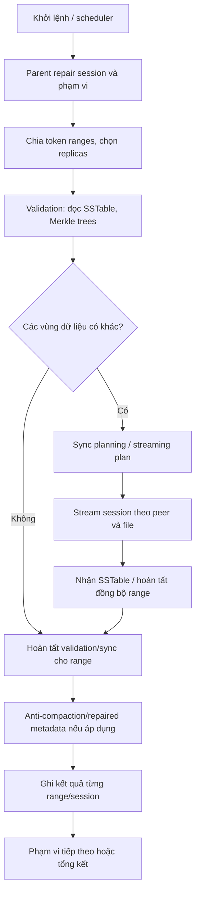
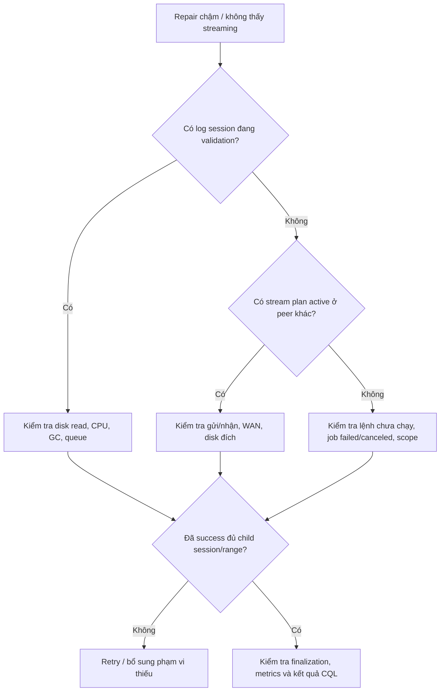

# Streaming, repair session và hoạt động đồng bộ bản sao

## 1. Mục tiêu quan sát: dữ liệu đang được chuyển hay đã thực sự đồng bộ?

Trong Apache Cassandra, mỗi partition được đặt trên các **natural replicas** theo partition key, token, replication strategy và topology. Một lần ghi với consistency level (CL) không yêu cầu mọi replica xác nhận có thể trả thành công khi một replica chưa nhận mutation. Vì vậy cluster cần các cơ chế đưa dữ liệu về trạng thái hội tụ, chẳng hạn **hinted handoff**, **read repair** và **anti-entropy repair**. Khi thay đổi topology (bootstrap, rebuild, replace, decommission), Cassandra cũng phải **stream** dữ liệu giữa các node.

Người vận hành dễ gặp ba kết luận nhầm:

- “`nodetool status` hiển thị `UN` nên replica đã nhận đủ mọi dữ liệu”.
- “`nodetool netstats` báo không còn stream nên repair đã xong toàn bộ”.
- “Một phiên repair streaming 0 byte nên chắc chắn mọi bảng, mọi DC đều giống nhau”.

Cả ba đều **không đủ bằng chứng**. Trạng thái node, hoạt động truyền byte và độ bao phủ của repair là **ba đại lượng khác nhau**. Bài thuộc chương **Quan sát hệ thống** của mô-đun `DATABASE_ENGINE_WIDE_COLUMN_CASSANDRA`, liên hệ kiến trúc phân tán/wide-column, khóa phân vùng, mô hình theo truy vấn, mức nhất quán đọc/ghi, compaction, repair, khắc phục lỗi và kết nối Java.

Sau bài này, người học có thể:

1. Phân biệt **streaming plan/session**, **repair parent session**, **validation**, **sync** và **anti-compaction**.
2. Dùng `nodetool status`, `netstats`, `compactionstats`, `tpstats`, log và metric để dựng lại diễn tiến.
3. Tìm node nguồn/đích, DC, phạm vi keyspace/bảng/token range và tình trạng thành công/thất bại của một phiên.
4. Đo tác động đồng bộ lên disk, network, CPU, p95/p99 latency và timeout của ứng dụng Java.
5. Chỉ tuyên bố hoàn tất khi có **bằng chứng coverage theo phạm vi**, không chỉ thấy tiến trình truyền dữ liệu dừng.

## 2. Bản đồ những hoạt động liên quan

Các hoạt động sau đều có thể khiến network và disk tăng, nhưng **không thay thế nhau**:

| Hoạt động | Tác nhân kích hoạt | Có truyền dữ liệu giữa node? | Điều cần quan sát |
| --- | --- | --- | --- |
| **Anti-entropy repair** | `nodetool repair`, công cụ điều phối hoặc Auto Repair ở phiên bản có hỗ trợ | **Có thể**: nếu dữ liệu khác nhau; pha validation vẫn tốn I/O khi streaming = 0 | Repair session/range, validation, Merkle tree, sync/streaming, kết quả từng phạm vi |
| **Bootstrap/rebuild/replace** | Node tham gia cluster, xây lại dữ liệu hoặc thay node | Thường **có** streaming các token range cần nhận | State Joining/Normal, streaming peer, số byte, phạm vi mới, lỗi bootstrap |
| **Decommission/removenode** | Thay đổi membership/token ownership | Có thể stream đến node nhận trách nhiệm mới | Leaving/removal, nguồn/đích, tiến trình từng range và tính sẵn sàng RF |
| **Hinted handoff** | Coordinator phát lại mutation đã lưu cho replica phục hồi | Có truyền mutation qua mạng nhưng **không phải anti-entropy streaming plan** | Pending hints, gửi hint thành công/thất bại, thời gian giữ hint |
| **Read repair** | Đường đọc phát hiện bất đồng trong điều kiện phù hợp | Có thể gửi mutation bổ sung, không phải một lượt quét toàn bảng | Read repair metrics, query trace có chọn mẫu, latency |
| **Compaction/anti-compaction** | Scheduler SSTable hoặc bước phụ trợ của incremental repair | Chủ yếu đọc/ghi SSTable **cục bộ** | Pending/active tasks, disk I/O, SSTable output và repaired state |

**Điểm mấu chốt:** “Đồng bộ bản sao” là mục tiêu; “streaming” là một cơ chế vận chuyển; “repair session” là đơn vị điều phối đối soát. Một node có thể không còn streaming nhưng vẫn có validation, anti-compaction hoặc token range chưa được xử lý.

## 3. Dựng đường đi một phiên repair

Một anti-entropy repair thường trải qua các giai đoạn ở mức khái niệm:



Trong các phiên bản Cassandra sử dụng **incremental repair**, trạng thái **repaired/unrepaired/pending repair** và thao tác anti-compaction có thể xuất hiện theo lịch trình/phân loại nội bộ; không nên áp sơ đồ như một chuỗi event có tên chính xác giống nhau ở mọi version. Hành vi full/incremental, repair coordinator, số subrange và cách xử lý failures cũng phụ thuộc phiên bản.

### Các định danh phải phân biệt

| Định danh | Ý nghĩa | Vì sao cần? |
| --- | --- | --- |
| **Repair command ID / parent repair session ID** | Định danh ở cấp công việc được khởi tạo hoặc một lượt repair cấp cha, tùy version | Dùng để nối lệnh người vận hành, tiến trình con, log và trạng thái cuối |
| **Repair session/subsession ID** | Đơn vị repair của một nhóm range/replica; có thể có nhiều phiên con | Một child session thất bại không đồng nghĩa mọi child session đều thất bại |
| **Streaming plan ID / stream session** | Hoạt động vận chuyển với peer nguồn/đích và tập dữ liệu/file | Một repair có thể tạo nhiều stream; bootstrap cũng có stream dù không có repair parent |
| **Token range** | Phạm vi partition theo token cần kiểm tra/đồng bộ | Phục vụ tính coverage, phát hiện range bị bỏ sót |
| **Node host ID / endpoint / DC** | Node tham gia và vùng rack/DC được gán | Nối log các node, phân biệt hostname/IP thay đổi với danh tính host |

**Không giả định các ID ở các tầng luôn trùng nhau.** Khi xử lý sự cố, lưu cả ID và thời gian/peer/table để xây quan hệ giữa parent repair, child session và stream. Một thông điệp stream báo “completed” chỉ là kết quả của **đơn vị streaming đó**, không phải lời xác nhận repair mọi range.

## 4. Lớp quan sát đầu tiên: `nodetool` từ đúng node

Các lệnh dưới đây dùng cho thu thập trạng thái. Để điều tra đa DC, cần chạy trên **coordinator repair, các replica liên quan và node nguồn/đích streaming**, không chỉ một máy quản trị.

```bash
# Xác nhận topology, vị trí DC/rack và khả năng kết nối node:
nodetool status
nodetool describecluster

# Ảnh chụp streaming hiện tại của node:
nodetool netstats

# Công việc validation / compaction và backlog:
nodetool compactionstats
nodetool tpstats

# Bối cảnh SSTable và đọc/ghi của bảng cần đối soát:
nodetool tablestats repair_lab_ks.orders_by_id
```

Khi công cụ chạy từ máy vận hành có kết nối quản trị đến các node:

```bash
nodetool -h cassandra-a netstats
nodetool -h cassandra-b netstats
nodetool -h cassandra-c compactionstats
```

Tên host chỉ là ví dụ; môi trường thật có thể yêu cầu port JMX, TLS, credentials và chính sách truy cập riêng. `nodetool` là **giao diện quản trị node**, không phải một câu CQL gửi qua cổng 9042.

### `nodetool status` trả lời được gì?

Các trạng thái thường gặp gồm `UN` (Up/Normal), `DN` (Down/Normal), `UJ` (Up/Joining), `UL` (Up/Leaving) và đôi khi `UM` (Up/Moving) tùy phiên bản. Kèm theo DC/rack, host ID, load và mức ownership.

**Được kết luận:** node đang được các thành viên nhìn nhận là Up/Down và thuộc trạng thái topology nào tại thời điểm đo. **Không được kết luận:** mọi mutation, tombstone hoặc partition đã được nhân bản đầy đủ. `Owns (effective)` chỉ phản ánh ownership theo keyspace/replication, không phải tỷ lệ sửa sai khác đã hoàn tất.

### `nodetool netstats` trả lời được gì?

Thường có các mục liên quan **Mode**, **Receiving/Sending**, thông tin stream tới một peer, tệp/byte đã chuyển và số công việc còn lại; một số bản còn hiển thị thống kê read repair hoặc messaging pool.

**Ví dụ minh họa, không phải đầu ra của cluster thực:**

```text
Mode: NORMAL
Receiving 2 files, 134217728 bytes total
    from /192.0.2.12:
        file 1/2 ... progress 48 MiB / 64 MiB (75%)
Sending 1 files, 67108864 bytes total
    to /192.0.2.13:
        file 1/1 ... progress 16 MiB / 64 MiB (25%)
```

Chuỗi, đơn vị và kiểu dòng thực tế **khác theo phiên bản**. Ý nghĩa cần lấy từ ảnh chụp này là **hướng truyền, peer, số file/byte và trạng thái lúc quan sát**, không phải một cam kết về khối lượng còn lại của toàn bộ repair.

Nếu `netstats` báo không có stream:

1. Repair có thể đang ở **pha validation** nên chưa cần stream.
2. Những range đã so sánh **không có chênh lệch** nên không cần stream.
3. Streaming vừa kết thúc, nhưng repair còn **anti-compaction/finalization**.
4. Repair **không được chạy, đã lỗi, bị hủy hoặc chưa bao phủ** những range khác.
5. Bạn có thể đang xem **sai node**: stream nằm trên peer khác.

Do đó `netstats` là **snapshot hoạt động**, không phải **audit lịch sử repair**.

## 5. Theo dõi tiến độ: delta, tốc độ và độ trễ

Các con số stream hữu ích nhất khi thu **liên tục theo cùng interval** và kết hợp với log/session:

| Đại lượng | Cách hiểu | Điểm cần lưu ý |
| --- | --- | --- |
| Bytes sent/received hiện tại | Lưu lượng node nguồn/đích đã chuyển trong tiến trình đang chạy | Có thể reset khi stream kết thúc; không nhất thiết là counter tích lũy |
| Tổng incoming/outgoing bytes theo node | Phản ánh hoạt động streaming qua nhiều thời điểm nếu exporter có metric tương ứng | Nên tính **delta/rate**, chú ý restart/reset và metric scope |
| Stream plan/session active | Có bao nhiêu phiên vận chuyển đang hoạt động | Không tương đương số repair session hay số token range còn thiếu |
| File progress | Đã gửi bao nhiêu file/byte của stream cụ thể | File size có thể đổi; chi phí mạng còn phụ thuộc compression/protocol |
| Duration của repair | Thời gian từ lúc khởi đến kết thúc hoặc trạng thái checkpoint | Không được lấy từ timestamp một stream duy nhất |
| Streaming retries/failures | Truyền lại hoặc stream bị lỗi | Có thể ảnh hưởng SLA và khiến khối lượng thực tế khác dự kiến |

Nếu exporter phát một **counter tăng dần** `streamed_bytes_total`, tốc độ trung bình trong khoảng \(\Delta t\) giây là:

\[
\text{stream rate (MiB/s)}
= \frac{C(t_2)-C(t_1)}{(t_2-t_1)\times 2^{20}}
\]

Đây là **công thức đọc counter**; tên `streamed_bytes_total` chỉ mang tính minh họa, **không phải cam kết Cassandra cung cấp metric với đúng tên này**. Trước khi tính, phải xác nhận đó là counter chứ không phải gauge, đơn vị byte, chiều gửi/nhận, node và chưa reset trong khoảng đo.

**Ví dụ minh họa:** một counter outgoing tăng 256 MiB trong 64 giây tương đương tốc độ trung bình 4 MiB/s. Đây không phải giới hạn throughput đặt trong `cassandra.yaml` và **không đo được** lượng validation I/O không truyền mạng.

### Đừng cộng byte giữa mọi node một cách máy móc

Một luồng A → B được ghi **outbound ở A** và **inbound ở B**. Nếu cộng cả hai counter thành “lượng dữ liệu độc lập”, bạn có thể đếm đôi. Đối với repair đa DC, nên tính **theo hướng**, theo **link/DC**, theo **node nguồn/đích**, tách lưu lượng stream repair khỏi bootstrap, streaming nghiệp vụ khác và network CQL bình thường.

## 6. Tầng repair session: log, completion và phạm vi token range

Để trả lời “repair đã hoàn tất đủ chưa?”, cần nối từ **lệnh được khởi chạy** tới **session và range**.

### Nhật ký một phiên repair nên chứa

- Thời điểm bắt đầu/kết thúc với timezone.
- Cassandra version, node khởi repair, keyspace, bảng và mode **incremental/full/preview/validate**.
- Token range/primary ranges, DC/host filters, các natural replicas tham gia.
- Command/parent session ID và các child repair session ID.
- Số range thành công/thất bại/hủy, trạng thái validation và streaming.
- Peer nguồn/đích, bytes streamed, thời lượng, lỗi timeout/streaming/anti-compaction.
- ID/cấu hình của scheduler: chạy thủ công, cron, Reaper hoặc Auto Repair (nếu cluster hỗ trợ).

**Ví dụ nhật ký tổng hợp tự ghi, không phải log Cassandra nguyên văn:**

```text
2026-11-21T09:00:00Z REPAIR_START
  job=repair-window-42 keyspace=repair_lab_ks table=orders_by_id
  mode=incremental coordinator=A scope=primary-ranges-on-A
2026-11-21T09:01:10Z REPAIR_VALIDATION
  range=(t0,t1] participants=A,B,C
2026-11-21T09:03:20Z REPAIR_SYNC
  range=(t0,t1] stream=A->C bytes=67108864
2026-11-21T09:04:00Z REPAIR_RANGE_SUCCESS
  range=(t0,t1]
2026-11-21T09:05:00Z REPAIR_RANGE_FAILED
  range=(t1,t2] reason=stream-timeout
2026-11-21T09:05:10Z REPAIR_PARTIAL
  successful=1 failed=1 remaining=unknown
```

Kết luận đúng ở đây: **có ít nhất một range đã thành công và ít nhất một range chưa sửa xong**. Kết luận sai: “phiên đã chạy 5 phút và stream xong một file nên đã đồng bộ toàn bộ bảng”.

### Xem log từ những node nào?

1. **Node điều phối repair:** thông tin command, tổng tiến độ, session IDs, failures và kết quả cuối.
2. **Các replica tham gia validation:** lỗi đọc SSTable, quá tải, thời gian xây Merkle tree, timeouts.
3. **Node gửi/nhận stream:** đường truyền, thiếu đĩa, lỗi I/O, hủy streaming.
4. **Scheduler:** xác minh lịch dự kiến, range bị bỏ sót, retry policy, job trùng và kết quả theo lần chạy.

Các chuỗi log chính xác, mức INFO/DEBUG/WARN và nơi lưu thay đổi theo version và log configuration. **Không dùng một pattern log tự tưởng tượng làm điều kiện duy nhất để hệ giám sát kết luận thành công**. Thu thập có cấu trúc từ công cụ điều phối và exit/status của repair khi có; nối ID theo phiên, đối chiếu cả sự kiện thất bại.

### Repair history qua bảng hệ thống: kiểm tra phiên bản

Một số nhánh Cassandra có các bảng như `system_distributed.parent_repair_history`, `system_distributed.repair_history`; nhánh tích hợp **Auto Repair** còn có thể có `system_distributed.auto_repair_history`. **Schema, TTL/lịch sử lưu, mức độ chi tiết và tính năng không đồng nhất giữa các phiên bản**.

Trước khi truy vấn:

```sql
-- Đây là lệnh cqlsh để kiểm tra metadata, không phải SELECT chuẩn:
DESCRIBE KEYSPACE system_distributed;
```

Chỉ sau khi xác nhận bảng tồn tại và biết partition/clustering keys từ schema mới viết truy vấn `SELECT ... WHERE ...` phù hợp. Không dùng `SELECT *` không giới hạn trên bảng hệ thống lớn rồi coi đó là phương pháp quan sát production. Nếu không có history table mong muốn, hãy dựa vào logs, scheduler hoặc metrics sẵn có; **không suy rằng repair chưa từng xảy ra**.

## 7. Validation, streaming và anti-compaction: đọc đúng metric

| Dấu hiệu | Gợi ý thành phần đang làm việc | Nguồn kiểm chứng tiếp theo |
| --- | --- | --- |
| Network stream ~0, disk read và CPU tăng | Validation/Merkle tree hoặc công việc khác đọc SSTable | `compactionstats`, `tpstats`, log validation, disk/CPU host |
| Network outbound A và inbound C tăng cùng thời điểm | Streaming A → C | `netstats` tại cả hai node, session/peer trong log |
| Disk free giảm sau stream, nhiều SSTable mới | Node nhận đang ghi dữ liệu hoặc anti-compaction/compaction | `tablestats`, file count, compactionstats, snapshots |
| Số file stream = 0 nhưng session báo success | Có thể replica đã đồng bộ trong phạm vi này | Parent repair summary, range coverage, validation success |
| Stream tắt đột ngột, repair log WARN/ERROR | Stream failed/canceled hoặc tiến trình node bị gián đoạn | Repair status/exit code, logs nguồn/đích, timeout và disk |
| Nhiều pending compactions và p99 đọc xấu | Repair/anti-compaction tranh I/O/CPU với foreground CQL | Table read latency, disk await, CPU/GC, số job đồng thời |
| `UN` ở mọi node nhưng repair báo failed | Node sống, **đối soát có lỗi** | Số range thất bại, logs, repair coordinator, xử lý retry |

**Tên JMX/Prometheus metric phụ thuộc Cassandra version và cách exporter đổi tên.** Có thể nhóm dashboard theo:

- **Streaming:** lượng byte vào/ra, số active streams, failures/retries nếu có.
- **Repair:** validation duration, repair sessions/completed/failed, bytes/ranges đã xử lý và kết quả scheduler.
- **Compaction/table:** pending tasks, repaired/unrepaired SSTables, disk space, read/write latency, `SSTablesPerReadHistogram`, tombstone scans.
- **Network/host:** inbound/outbound throughput, retransmission, RTT, packet loss, disk read/write throughput/latency, CPU và GC.
- **ClientRequest:** read/write latency distribution, timeouts, failures, unavailables.

Chỉ số **client latency** ở coordinator, **local read latency** ở replica và **disk read latency** của hệ điều hành có phạm vi khác nhau. Không cộng ba con số thành một latency tổng. Khi so sánh nhiều node, đồng bộ đồng hồ (NTP), dùng cùng timezone và bảo đảm metrics dùng cùng cửa sổ thời gian.

## 8. Đếm đúng “đã xong bao nhiêu”

Tiến độ một phiên được thể hiện bởi nhiều mẫu số:

| Thước đo | Mẫu số / phạm vi | Vì sao không thể thay cho coverage |
| --- | --- | --- |
| 90% bytes của một stream đã gửi | Tổng byte của **stream đó** | Có thể còn nhiều streams/replica/ranges chưa bắt đầu |
| 100% file của một streaming plan | Các file thuộc **plan đó** | Repair còn validation/anti-compaction/finalization |
| Một child repair session success | Range/participants của **child đó** | Parent còn các session khác và các bảng khác |
| Parent repair command success | Những keyspace/table/ranges mà **command yêu cầu** | `-pr`, `-dc`/`-local` hoặc filter có thể giới hạn phạm vi |
| Scheduler hoàn thành ngày hôm nay | Các job mà **lịch đã đăng ký** | Lịch có thể bỏ quên bảng mới, một DC hoặc token range |
| Cluster có `UN` ở mọi node | Trạng thái sống của node | Không có thông tin về sự hội tụ các bản sao |

Một chỉ số coverage hữu dụng có thể thiết kế ở **tầng điều phối**, không nhất thiết có sẵn từ Cassandra:

\[
\text{Coverage theo phạm vi}
= \frac{\text{số đơn vị range/table/DC đã repair thành công}}
{\text{số đơn vị range/table/DC phải repair theo kế hoạch}}
\]

Đây là **một ví dụ định nghĩa vận hành**, không phải metric tích hợp tên `repair_coverage`; khi các range có kích thước rất khác nhau, tỷ lệ theo số lượng range có thể gây hiểu nhầm, cần thêm **byte/ước lượng dữ liệu, tuổi của lần repair cuối và phạm vi token thực**. Với node có nhiều vnodes, “đã repair 20/20 range của node A” chưa bảo đảm tất cả range của node B/DC khác đã xong.

### Tính tuổi của lần repair thành công

Với mỗi đơn vị `keyspace × table × token range × DC/replica set`, lưu:

- Thời gian **lần thành công gần nhất**, không phải thời điểm lên lịch.
- Ngày/giờ của lần thất bại mới nhất và nguyên nhân.
- Khoảng thời gian còn lại trước chính sách bảo vệ tombstone (`gc_grace_seconds`) của bảng.
- Có thay đổi topology, RF, table mới hoặc node down dài ngày làm tăng nhu cầu đối soát không?

Nếu một số range quá hạn, alert phải chỉ ra **range nào chưa được repair**, chứ không chỉ hiển thị “repair jobs completed: 99%”. Rủi ro zombie data phụ thuộc tombstone, lịch repair và tình trạng replica; chỉ số coverage không tự động chứng minh mọi tombstone đã an toàn.

## 9. Runbook điều tra: từ triệu chứng tới bằng chứng

### Bước 1 — Xác định sự kiện khởi phát

Nêu rõ: đây là **repair theo lịch**, một **bootstrap/rebuild/replace**, hay **outage replica**? Ghi cluster, Cassandra version, keyspace/table, RF theo DC, CL ứng dụng, thời gian và người/scheduler khởi tác vụ.

```sql
SELECT keyspace_name, replication
FROM system_schema.keyspaces
WHERE keyspace_name = 'repair_lab_ks';
```

Nếu nhiều keyspace, không lấy RF của một keyspace làm đại diện cho toàn cluster.

### Bước 2 — Chụp topology và trạng thái nguồn/đích

```bash
nodetool status repair_lab_ks
nodetool describecluster
nodetool getendpoints repair_lab_ks orders_by_id cust-42
```

`getendpoints` xác định natural replicas cho **partition key cụ thể**, không chỉ ra replica nào giữ bản ghi mới nhất. Ghi host ID, DC, rack, token range; nếu topology vừa đổi, lấy snapshot từ **hơn một node** để nhận biết metadata chưa hội tụ.

### Bước 3 — Lấy snapshot stream và validation trên mọi node tham gia

```bash
nodetool -h cassandra-a netstats
nodetool -h cassandra-b netstats
nodetool -h cassandra-c netstats

nodetool -h cassandra-a compactionstats
nodetool -h cassandra-b compactionstats
nodetool -h cassandra-c tpstats
```

Thời gian giữa các lần gọi có thể làm một stream biến mất; vì vậy trong điều tra liên tục, **thu định kỳ cùng nhịp** để có chuỗi thời gian. Giới hạn truy vấn quản trị phù hợp, không spam `nodetool` ở tần suất cao khi node đã quá tải.

### Bước 4 — Nối parent session, child session và stream

Tìm trong log/scheduler của coordinator theo **thời gian và repair ID**; theo dõi child session theo token range và các peer. Mở log nguồn/đích của stream theo peer ID/endpoint và khoảng thời gian; xác định phases: validating, syncing, streaming, anti-compacting, completed/failed.

**Nếu không có sự kiện khởi repair nhưng `netstats` đang stream**, đừng tự nhận đó là repair: có thể là bootstrap, rebuild, replace hoặc decommission. Dùng trạng thái node, logs và nguồn lệnh để phân loại đúng.

### Bước 5 — Phân biệt bão hòa tài nguyên và sai khác dữ liệu

Ghi p95/p99 CQL, timeouts, disk free/await, CPU/GC, outbound/inbound bandwidth. Ví dụ một node gửi 100 MiB/s không chứng minh dữ liệu **sai nhiều**: bootstrap bình thường cũng có thể chuyển lượng lớn SSTable. Ngược lại streaming 0 MiB/s không chứng minh dữ liệu **đúng** nếu validation chưa chạy hoặc đã thất bại.

### Bước 6 — Quyết định điều tiết/hồi phục theo phạm vi

- Nếu streaming chiếm mạng WAN: xem throughput throttle, phạm vi liên DC và số node stream đồng thời; giữ bandwidth cho CQL.
- Nếu validation khiến disk/CPU bão hòa: kiểm tra job concurrency, compaction/validation throughput, queue; giảm số job, tránh lịch chồng.
- Nếu thiếu disk tại node nhận: không tăng concurrency; điều tra SSTable, snapshot/backup và dữ liệu streaming.
- Nếu một repair session failed: khoanh **những range chưa thành công**; retry theo lịch/runbook và version, không đánh dấu cả parent thành công.
- Nếu một replica down lâu hơn thời gian bảo vệ tombstone: xử lý bằng runbook restore/rebuild/repair và đánh giá zombie data, không đơn giản khởi repair mù quáng.

Thay **một biến chính mỗi lần** và kiểm tra tác động trên nguồn/đích cùng SLO ứng dụng.

### Bước 7 — Đóng việc bằng bằng chứng

Chỉ đóng sự cố khi:

1. Tất cả keyspace/table/ranges/DC theo **phạm vi mục tiêu** có trạng thái hoàn tất hoặc ghi rõ phần còn thiếu.
2. Các stream plan liên quan không còn lỗi và đã được đối chiếu với parent/child repair; không chỉ dựa trên `netstats` trống.
3. Quá trình anti-compaction hoặc các bước hoàn tất bắt buộc của version không còn lỗi.
4. Replica phục hồi trạng thái topology phù hợp; không tồn tại pending replacement/bootstrap chưa giải quyết.
5. p95/p99, throughput và disk/network/CPU trở về mức ổn định; query nghiệp vụ mẫu trả kết quả đúng theo CL.
6. Báo cáo repair history/lần thành công cuối được cập nhật để phát hiện những range quá hạn trong chu kỳ tiếp theo.

## 10. Minh họa phân tích diễn tiến theo thời gian (số liệu giả định)

Giả sử ba replica A, B, C cùng sở hữu một range cần repair, CL ứng dụng = `LOCAL_QUORUM`:

| Thời điểm | Triệu chứng | `netstats` | `compactionstats` / log | Kết luận có cơ sở |
| --- | --- | --- | --- | --- |
| 09:00 | Repair bắt đầu | Chưa có stream | Log tạo parent và phân bổ range | Chưa đủ bằng chứng validation hoàn tất |
| 09:01 | Disk read/CPU tăng | 0 byte | Validation/Merkle tree đang chạy | Chi phí chủ yếu có thể ở SSTable scan/hash |
| 09:03 | Network A → C tăng | Có stream A → C | Sync session nhận thấy vùng khác biệt | Một số dữ liệu đang được đồng bộ |
| 09:05 | Network về 0 | Không có stream | Một child thành công, child khác timeout | **Repair chưa thành công đủ phạm vi** |
| 09:07 | CQL p99 vẫn cao | Không có stream | Pending anti-compaction/compactions còn nhiều | Tác động I/O có thể còn dù stream đã xong |
| 09:20 | p99 ổn định | Không có stream | Job lỗi đã được retry và log xác nhận hoàn tất tất cả range được yêu cầu | Có thể đóng **phạm vi đã repair**, chưa suy mọi bảng khác đều đồng bộ |

Đây là **bảng giả định để luyện cách kết hợp bằng chứng**, không phải log/benchmark có thật. Nếu ở 09:05 chỉ nhìn `netstats`, người vận hành rất dễ đóng job sớm và bỏ quên child session thất bại.

### Cây chẩn đoán ngắn



## 11. Tình huống đa DC: link WAN bận nhưng repair có đang tiến triển?

Giả sử `NetworkTopologyStrategy` có `dc1:3` và `dc2:3`. Trong khi full repair chạy, link WAN bị bão hòa nhưng `netstats` trên node A của dc1 chỉ báo vài MiB/s.

Các giả thuyết cần kiểm tra:

1. **Nhiều node cùng stream**: A gửi ít nhưng B/C và một số node dc2 đang gửi đồng thời. Thu theo node và tổng theo link/DC.
2. **Traffic không phải repair**: bootstrap, backups, ứng dụng, replication writes hoặc hinted handoff cũng dùng WAN; đối chiếu session/log.
3. **Đơn vị đo khác nhau**: NIC báo Mbit/s, dashboard streaming báo bytes/s hoặc MiB/s.
4. **Node đích chậm disk**: stream bị backpressure hoặc pause/retry; kiểm tra incoming stream, disk await và log tại đích.
5. **Phiên bị lỗi**: tốc độ rất thấp và không có tiến triển trong các interval, log cảnh báo timeout.

Điều tiết mạng có thể dùng các lệnh `nodetool getstreamthroughput`/`getinterdcstreamthroughput` và các cấu hình tương ứng, nhưng **không tự ý thay đổi trong lúc đang điều tra** nếu chưa có baseline/giá trị cũ và phê duyệt. Các lệnh set tác động đến **node và hoạt động streaming khác**, không chỉ một repair session. Chỉ dùng `LOCAL_QUORUM` để phục vụ CQL trong từng DC cũng **không** làm streaming/repair xuyên DC trở nên miễn phí.

## 12. Lab thực hành: tạo dữ liệu, quan sát một repair phạm vi nhỏ

**Chỉ chạy trên cluster lab** với RF và tên data center phù hợp, không tạo outage trên production. Ví dụ cluster một DC có ba node tại `dc1`:

```sql
CREATE KEYSPACE repair_lab_ks
WITH replication = {'class': 'NetworkTopologyStrategy', 'dc1': 3}
AND durable_writes = true;

CREATE TABLE repair_lab_ks.orders_by_id (
    customer_id text,
    order_id uuid,
    state text,
    updated_at timestamp,
    PRIMARY KEY ((customer_id), order_id)
);

INSERT INTO repair_lab_ks.orders_by_id
    (customer_id, order_id, state, updated_at)
VALUES ('cust-42',
        11111111-2222-3333-4444-555555555555,
        'CREATED', toTimestamp(now()));

SELECT customer_id, order_id, state
FROM repair_lab_ks.orders_by_id
WHERE customer_id = 'cust-42'
  AND order_id = 11111111-2222-3333-4444-555555555555;
```

Trên node đã chọn:

```bash
# Trước thực nghiệm — chỉ đọc:
nodetool help repair
nodetool status repair_lab_ks
nodetool getendpoints repair_lab_ks orders_by_id cust-42
nodetool netstats
nodetool compactionstats
nodetool tablestats repair_lab_ks.orders_by_id

# CHỈ trong lab đã kiểm tra disk và không có repair trùng lịch:
# nodetool repair --full -pr repair_lab_ks orders_by_id

# Trong/sau lượt repair, quan sát trên coordinator lẫn peers:
nodetool netstats
nodetool compactionstats
nodetool tpstats
```

**`--full`** yêu cầu full repair; **`-pr`** giới hạn **primary token ranges của node gọi lệnh** theo ngữ nghĩa phiên bản hỗ trợ. Một lượt như vậy **không repair toàn cluster**; để có coverage phải thiết kế lịch phù hợp trên các node/không gian còn lại. Luôn kiểm tra `nodetool help repair` của binary thực tế, đặc biệt nếu cluster có Auto Repair/Reaper đang chạy.

### Phiếu ghi nhận thực nghiệm

| Trường | Trước repair | Trong repair | Sau repair |
| --- | --- | --- | --- |
| Node/DC/rack, keyspace/table, mode | Ghi rõ | Không đổi ngoài kế hoạch | Xác nhận phạm vi |
| Command/parent session ID | Chưa có | Ghi ID và giờ | Kết quả tổng |
| Child sessions và token ranges | Danh sách phạm vi dự kiến | Validation/sync/fail theo range | Thành công/thất bại theo range |
| `netstats` nguồn/đích | Idle hoặc workload nền | Peer, sending/receiving, bytes | Không còn stream lỗi |
| `compactionstats`/`tpstats` | Baseline | CPU/disk/queue/validation | Backlog phục hồi |
| Host metrics | Disk, CPU, network | Peak và p95/p99 | Trở về baseline |
| CQL và Java client | Kết quả, latency | Timeout, latency | Đúng dữ liệu và SLO |
| Phạm vi chưa repair | Từ lịch/coverage | Theo phiên con | Ghi phần thiếu + kế hoạch bù |

Với một bảng chỉ vài hàng và replica đã đồng bộ, repair có thể **không tạo streaming** hoặc hoàn tất quá nhanh để `netstats` bắt được. Đây vẫn là bài tập hợp lệ để học **đọc log/session và phân biệt snapshot với completion**; không chủ ý làm hỏng replica chỉ để xuất hiện byte streaming.

## 13. Ảnh hưởng đến ứng dụng Java và cách đo

Ứng dụng Java **không gọi `nodetool repair` qua CQL** để đối soát cluster. Tuy nhiên repair dùng chung tài nguyên với những truy vấn mà driver đang thực hiện. Với Java Driver 4.x, có thể đo một truy vấn theo partition key để quan sát biến động latency:

```java
PreparedStatement ps = session.prepare(
    "SELECT state, updated_at FROM repair_lab_ks.orders_by_id " +
    "WHERE customer_id = ? AND order_id = ?"
);

BoundStatement query = ps.bind(
    "cust-42",
    UUID.fromString("11111111-2222-3333-4444-555555555555")
).setConsistencyLevel(DefaultConsistencyLevel.LOCAL_QUORUM);

long started = System.nanoTime();
Row row = session.execute(query).one();
long elapsed = System.nanoTime() - started;

System.out.printf("elapsedMs=%.2f; state=%s%n",
    elapsed / 1_000_000.0,
    row == null ? "<missing>" : row.getString("state"));
```

Đoạn mã minh họa giả sử đã tạo `session` và import Java Driver 4.x/Java chuẩn. **Một latency đơn lẻ không đại diện p99**; cần metrics driver theo loại query, số request, timeout/retry, connection pool, thời gian page đầu/toàn bộ page khi có paging và kích thước payload.

Trong lúc repair, có thể đồng thời quan sát:

- **Đúng dữ liệu:** query đọc tại `LOCAL_QUORUM` trả kỳ vọng không, có timestamp/TTL/tombstone ảnh hưởng?
- **Khả dụng:** bao nhiêu `ReadTimeoutException`, `WriteTimeoutException` hoặc `UnavailableException` ở request thật?
- **Độ trễ:** p50/p95/p99 trên cùng workload trước, trong và sau repair.
- **Nguyên nhân:** thời gian trùng với validation/streaming trên **đúng replica** không? Disk/GC/network của node đó có tăng không?

Với RF = 3, `LOCAL_QUORUM` cần 2 replica tại DC địa phương; **hai replica cùng quá tải** trong validation/streaming có thể làm query timeout dù cả ba node hiển thị `UN`. Thay CL hoặc timeout ứng dụng để che hiện tượng này không phải bước chẩn đoán đầu tiên.

## 14. Những ngộ nhận thường gặp

| Ngộ nhận | Cách hiểu đúng |
| --- | --- |
| “`netstats` trống nên repair toàn cluster đã xong.” | Chỉ nói thời điểm đó không có stream được hiển thị trên node đang hỏi; cần parent/child session và range coverage. |
| “Streaming 0 byte chứng minh mọi replica giống nhau.” | Có thể chỉ là một range đã validation không thấy sai khác, hoặc validation chưa chạy/đã lỗi; kiểm tra kết quả đúng scope. |
| “Bytes sent + bytes received là lượng dữ liệu sửa được.” | Một chuyển A → B có thể được đếm ở cả hai phía; còn retry/protocol overhead và dữ liệu khác chưa kiểm tra. |
| “`UN` đồng nghĩa mọi replica đã nhận mutation trong outage.” | Trạng thái node sống không chứng minh consistency hay completion của hints/repair. |
| “Một stream session success đồng nghĩa parent repair success.” | Còn các child session/range khác và bước finalization. |
| “Validation không stream nên không tốn tài nguyên.” | Validation đọc SSTable, hash Merkle tree và tranh CPU/disk. |
| “Compaction xong cũng là repair xong.” | Compaction cục bộ không đối chiếu giữa replica; anti-compaction chỉ là phần phụ trợ của một số repair. |
| “Repair thành công trên node A là đủ cho mọi DC.” | Cần xem scope/range/DC và lịch điều phối toàn cluster. |
| “Tăng throughput là luôn cải thiện repair.” | Có thể bão hòa WAN, disk đích hoặc làm p99 CQL xấu đi; phải đo tài nguyên và hạn hoàn tất. |
| “Có thể xác minh bằng một `SELECT` theo khóa nóng.” | Chỉ kiểm tra một partition qua các replica đáp ứng CL, không chứng minh dữ liệu lạnh hay mọi token range. |

## 15. Câu hỏi tự kiểm tra

1. Sự khác nhau giữa **repair parent session**, child repair session và streaming plan là gì? Có thể có stream plan mà không có repair không?
2. Tại sao `nodetool netstats` là ảnh chụp và không thể thay lịch sử thành công theo range?
3. Nếu network = 0 nhưng disk read/CPU cao trong repair, cần quan sát pha nào và bằng chứng gì?
4. Một stream A → B có outbound 300 MiB tại A và inbound 300 MiB tại B. Có được báo 600 MiB dữ liệu độc lập đã sửa không?
5. `nodetool repair --full -pr ks tbl` trên node A hoàn tất: phạm vi nào được đảm bảo, phạm vi nào cần thêm kế hoạch?
6. Vì sao một parent repair có một child thành công và một child thất bại phải được xem là chưa hoàn tất?
7. Làm thế nào nối một đợt tăng p99 latency ở ứng dụng Java với validation/streaming của replica mà không khẳng định sai quan hệ nhân quả?
8. Khi có Auto Repair/Reaper và tác vụ repair thủ công cùng hoạt động, những dấu hiệu nào cho thấy lịch đang chồng lấn?
9. Node đã `UN` sau outage vượt thời gian hint hoặc `gc_grace_seconds`; còn cần kiểm tra dữ liệu gì và vì sao?
10. Nêu ba chỉ số bổ sung để chứng minh “repair đã xong” đáng tin hơn “`netstats` hết stream”.

**Tiêu chí hoàn thành:** người học dựng được chuỗi **command → parent session → child/range → validation/sync → stream plan → kết quả**, đối chiếu log/metrics trên coordinator và peers, đánh giá tác động CQL và chỉ kết luận thành công cho phạm vi có bằng chứng rõ ràng.

## 16. Tài liệu tham khảo

- [Apache Cassandra — Repair](https://cassandra.apache.org/doc/stable/cassandra/managing/operating/repair.html): anti-entropy, Merkle trees, full/incremental và các lựa chọn phạm vi.
- [Apache Cassandra — nodetool netstats](https://cassandra.apache.org/doc/stable/cassandra/managing/tools/nodetool/netstats.html): theo dõi streaming đang hoạt động và thông tin gửi/nhận theo peer.
- [Apache Cassandra — nodetool compactionstats](https://cassandra.apache.org/doc/stable/cassandra/managing/tools/nodetool/compactionstats.html): validation/compaction tasks và tiến trình.
- [Apache Cassandra — nodetool tpstats](https://cassandra.apache.org/doc/stable/cassandra/managing/tools/nodetool/tpstats.html): active/pending/completed/dropped tasks của thread pools.
- [Apache Cassandra — Monitoring metrics](https://cassandra.apache.org/doc/stable/cassandra/managing/operating/metrics.html): JMX metric nhóm streaming, repair, table, client requests.
- [Apache Cassandra — Storage Engine](https://cassandra.apache.org/doc/stable/cassandra/architecture/storage-engine.html): SSTable và compaction liên quan đến validation/anti-compaction; đối chiếu với tài liệu đúng phiên bản.
- [Apache Cassandra — nodetool repair](https://cassandra.apache.org/doc/stable/cassandra/managing/tools/nodetool/repair.html): tùy chọn `--full`, `-pr` và điều kiện hỗ trợ theo version.

**Kết luận:** Streaming cho biết **dữ liệu đang di chuyển**; repair session cho biết **công việc đối soát nào đang chạy hoặc đã kết thúc**; còn coverage theo token range/table/DC và bằng chứng từ log/metrics mới trả lời **bản sao đã được sửa đến đâu**. Quan sát đúng cần kết hợp trạng thái node, session IDs, validation, streaming peer, thời gian, tài nguyên và kết quả ứng dụng Java. Không đánh đồng “không có stream” với “toàn cluster đã đồng bộ”.
