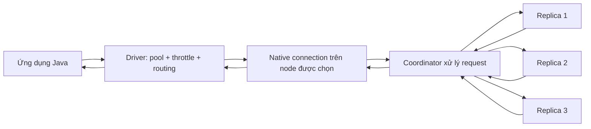
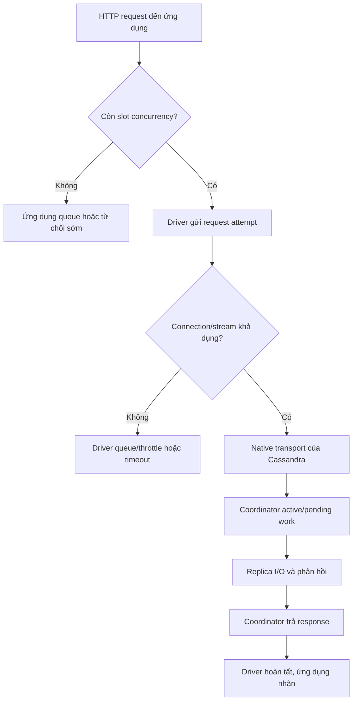

# Client connection, request in-flight và tải coordinator trong Apache Cassandra

## 1. Vì sao quan sát kết nối thôi chưa đủ để biết cụm có quá tải?

Trong **Apache Cassandra**, ứng dụng Java thường mở một số kết nối **native protocol/CQL** lâu dài đến các node. Mỗi kết nối có thể truyền nhiều request đồng thời (*multiplexing*). Khi ứng dụng báo đọc chậm hoặc ghi timeout, ba con số thường được hỏi đầu tiên là:

1. **Client connections:** có bao nhiêu kết nối TCP/native protocol đang mở đến từng node?
2. **Requests in-flight:** có bao nhiêu yêu cầu đã gửi nhưng chưa hoàn tất, và chúng nằm ở hàng đợi nào?
3. **Coordinator load:** node nào đang nhận/điều phối nhiều yêu cầu, chờ replica, tiêu thụ CPU, disk hoặc network?

Ba con số có liên hệ nhưng **không thể thay thế nhau**. Một ứng dụng có thể giữ 200 kết nối nhàn rỗi với latency tốt; ứng dụng khác giữ chỉ vài kết nối nhưng có hàng nghìn truy vấn đồng thời dẫn đến timeout. Một node có thể nhận ít kết nối hơn node khác nhưng lại làm coordinator cho nhiều truy vấn nặng.

Bài thuộc chương **Quan sát hệ thống** của mô-đun `DATABASE_ENGINE_WIDE_COLUMN_CASSANDRA`: học kiến trúc phân tán, partition key, thiết kế bảng theo truy vấn, mức nhất quán đọc/ghi, CQL, replication, compaction, repair, xử lý lỗi và ứng dụng Java. Trọng tâm là **quan sát thực tế để tìm bottleneck**, không phải mặc định thay mọi tham số pool hoặc tăng số node.

### Mục tiêu

Sau bài này, người học có thể:

- Phân biệt **kết nối đang mở**, **request đang in-flight** ở ứng dụng/driver/server, **queue**, **attempt** và **logical operation**.
- Giải thích coordinator xử lý request trong Cassandra và vì sao tải có thể lệch giữa các node.
- Quan sát bằng `nodetool clientstats`, `tpstats`, `proxyhistograms`, metrics/JMX và Java Driver 4.x.
- Đọc đúng latency, throughput, retry, timeout, pending tasks; ước lượng concurrency theo Little's Law và nhận biết giới hạn của phép tính.
- Xây dựng dashboard, cảnh báo, runbook phân loại connection storm, queue buildup, hot partition và coordinator overload.
- Áp dụng giới hạn concurrency/backpressure ở Java để tránh khuếch đại sự cố.

## 2. Một request CQL đi từ client tới coordinator như thế nào?

Cassandra dùng kiến trúc phân tán **không có một primary coordinator cố định**. Node nhận CQL request từ client là **coordinator của request đó**. Coordinator phân tích kế hoạch truy cập, xác định các replica theo token của partition key và replication strategy, gửi yêu cầu tương ứng, chờ số phản hồi theo **consistency level (CL)**, rồi trả về cho client.



**Điểm cần hiểu:**

- Node được chọn làm coordinator **không nhất thiết** là replica giữ partition đang hỏi, mặc dù driver có thể ưu tiên replica gần khi có đầy đủ routing key/token metadata.
- Với `NetworkTopologyStrategy` và `LOCAL_QUORUM`, coordinator phải thu đủ phản hồi thích hợp **ở DC cục bộ**; RF, CL và độ khỏe replica ảnh hưởng số yêu cầu bên trong cluster.
- Một `SELECT` có paging có thể tạo **nhiều lần fetch**; một logical query của ứng dụng không phải lúc nào tương ứng một server request.
- Retry và speculative execution có thể tạo **nhiều attempt** cho một logical operation. Vì vậy bộ đếm ở client, driver và server có thể khác nhau mà không nhất thiết là mất request.
- Truy vấn thiếu partition key, range scan, partition lớn hoặc lượng dữ liệu trả về lớn có thể tiêu thụ công suất coordinator và replica khác nhau dù có cùng QPS.

### Ví dụ truy vấn định tuyến hiệu quả

```sql
-- Giả sử keyspace và bảng được tạo sẵn trong lab.
SELECT display_name, updated_at
FROM traffic_lab.profile_by_user
WHERE user_id = 11111111-1111-1111-1111-111111111111;
```

Với partition key đầy đủ, driver có thể xác định token và ưu tiên coordinator phù hợp nếu metadata/statement chuẩn bị đầy đủ. Ngược lại, truy vấn quét rộng hoặc `ALLOW FILTERING` có thể tạo tải cao dù trả rất ít hàng. **Không chẩn đoán coordinator bằng số connection mà bỏ qua hình dạng CQL.**

## 3. Client connection: kết nối khác request

### 3.1. Native transport và session

Java Driver 4.x thường quản lý nhiều connection **lâu dài** trong pool tới các Cassandra node theo cấu hình và chính sách load balancing. Native transport CQL thường dùng cổng **9042** theo mặc định, nhưng có thể thay đổi và có TLS tùy triển khai.

| Khái niệm | Ý nghĩa | Không có nghĩa |
| --- | --- | --- |
| **TCP connection mở** | Socket client–node đã tồn tại ở hệ điều hành | Có một query đang chạy |
| **CQL/native connection** | Kết nối ứng dụng đã thực hiện giao thức Cassandra | Mỗi connection chỉ chạy một request |
| **Driver session** | Đối tượng `CqlSession` thread-safe quản lý cấu hình/pool | Tương đương một socket |
| **Connection pool per-node** | Tập kết nối driver duy trì đến một node | Tất cả node đều luôn có chính xác cùng số kết nối |
| **Active stream/request slot** | Tài nguyên multiplexing cho attempt đang xử lý | Tương đương số session hoặc số client |
| **Accepted vs authenticated connection** | Socket đã đến máy chủ và quá trình protocol/auth hoàn tất hay chưa | Có đủ năng lực CPU/disk để trả query |

Một connection có thể mang nhiều request nhờ request IDs/stream IDs của native protocol. Vì vậy **connections = 10** không đồng nghĩa **tối đa 10 request đang chạy**. Ngược lại, 10.000 connections nhàn rỗi không có nghĩa Cassandra đang thực thi 10.000 query, dù chúng vẫn tiêu thụ socket, file descriptor, memory và chi phí keepalive.

### 3.2. Ví dụ không được suy diễn sai

Giả sử hệ thống có **40 pod Java**, Cassandra có **6 node**, mỗi pod giữ trung bình một kết nối tới mỗi node mà nó sử dụng. Về mặt *minh họa*, số kết nối có thể xấp xỉ `40 × 6 = 240`. Đây không phải công thức cố định: driver có thể mở nhiều connection/node hoặc chỉ một phần node; topology, địa phương hóa DC, reconnect và hành vi server ảnh hưởng số thực tế.

Nếu mỗi pod mở **một `CqlSession` mới cho mỗi HTTP request**, số kết nối có thể tăng vọt khi RPS cao. Đây là **connection storm** và dấu hiệu phải sửa vòng đời session, không phải lập tức nâng ngưỡng native transport của server.

**Thực hành Java:** tạo và tái sử dụng một `CqlSession` dài hạn cho mỗi bộ cấu hình cần thiết, chia sẻ an toàn giữa các luồng; đóng session khi ứng dụng kết thúc. Tránh lập session theo từng truy vấn.

### 3.3. Đếm từ Cassandra khác đếm từ driver

- **Server:** nhìn số client đang kết nối tới **một node**; con số có thể gồm nhiều ứng dụng/dịch vụ/`cqlsh`, các kết nối đang dở xác thực và các thay đổi trong thời điểm lấy mẫu.
- **Driver:** nhìn số connection **pool của phiên ứng dụng đó**, phân theo node; không thấy kết nối của những ứng dụng khác.
- **Hệ điều hành:** nhìn socket TCP theo trạng thái `ESTABLISHED`, `TIME_WAIT`, `CLOSE_WAIT`...; có thể gồm các port/giao thức ngoài native transport.

Phải ghi rõ **phạm vi và thời điểm** khi so số liệu; không cộng những tập đếm giao nhau rồi báo số lượng client độc lập.

## 4. Request in-flight: có ít nhất ba cấp khác nhau

Một yêu cầu bắt đầu “in-flight” tại mốc nào? Không có một định nghĩa duy nhất dùng cho mọi công cụ.

| Cấp | Định nghĩa thao tác | Điểm cần chú ý |
| --- | --- | --- |
| **Application in-flight** | Số logical operation đã ứng dụng phát đi nhưng chưa hoàn tất/timeout/được xử lý kết quả | Có thể gồm thời gian đứng chờ trong limiter hoặc queue của ứng dụng |
| **Driver in-flight** | Số request attempt đã được giao cho connection/stream và đang chờ phản hồi theo định nghĩa metric driver | Có thể khác số logical operation vì retry, speculative execution, paging |
| **Server in-progress/queued** | Công việc coordinator đang xử lý hoặc đang chờ tại native transport, execution stage, response path | Không đếm giống stream ID của driver; metric tùy phiên bản |



**Quan trọng:** đường đi thực tế còn có request throttler, callback/event loop, retry policy và streaming result pages; sơ đồ chỉ cho biết **những nơi có thể dồn việc**. Không đồng nhất các hàng đợi.

### 4.1. In-flight cao có luôn xấu?

Không. Với pool multiplexing, vài trăm request in-flight trên một node có thể bình thường nếu latency, throughput, timeout và queue đều ổn định. Nhưng nếu in-flight tăng liên tục trong khi successful RPS không tăng, đó là dấu hiệu **hệ thống không xử lý kịp lượng yêu cầu đến**.

Ví dụ:

- **200 in-flight, không pending queue, p99 ổn định:** có thể là mức concurrency hợp lý.
- **200 → 2.000 in-flight, throughput đứng yên, p99 tăng:** có thể đang bão hòa node/replica hoặc mạng, driver đang tích tụ request.
- **0 in-flight sau khi driver timeout hàng loạt:** không có nghĩa hệ thống khỏe; request có thể đã bị từ chối trước khi gửi hoặc server vẫn còn công việc cũ.

Không có một ngưỡng “in-flight > N là Cassandra quá tải” dùng chung cho mọi cluster. Giới hạn phải dựa trên cấu hình driver, latency, RPS, query cost và SLO của từng workload.

## 5. Coordinator load: node điều phối đang chịu công việc gì?

Tải coordinator gồm nhiều hơn việc nhận TCP packet. Trong một truy vấn, coordinator có thể:

1. Nhận và giải mã thông điệp CQL/native protocol, xác thực và xử lý context của request.
2. Xác định partition token, replica endpoints, consistency level và phương án điều phối.
3. Gửi read/write tới các replica, thu ACK/data/digest hoặc các bước cần thiết theo loại truy vấn.
4. Hòa giải phiên bản dữ liệu, xử lý timeout/unavailable, retry nội bộ hoặc speculative request nếu cơ chế áp dụng.
5. Chuẩn bị response, serialization và trả dữ liệu/page về connection client.

**Coordinator load** chịu tác động từ ba phía:

- **Client-facing:** số request attempt/s, connections, in-flight, kích thước response và native transport throughput.
- **Replica-facing:** RPC/network nội cụm, CL, số replica cần phối hợp, query/range cost, độ trễ read/write trên replica.
- **Node resources:** CPU, heap/GC, disk I/O, compaction/repair/streaming, network và thread-pool queues.

Một node vừa là coordinator cho request A, vừa là replica cho các request do node khác điều phối. Vì vậy **CPU cao trên node không tự chứng minh nó quá tải vì coordinator**; phải tách request/coordinator metrics với hoạt động replica và tác vụ nền.

### Vì sao coordinator có thể bị lệch tải?

| Nguyên nhân | Biểu hiện thường gặp | Cách kiểm tra |
| --- | --- | --- |
| Driver không token-aware / thiếu routing key | Request dồn về vài contact points/coordinators | Driver config, prepared/bound keys, số request/node |
| Ứng dụng kết nối một số node cố định | Những node đó xử lý quá nhiều request | Pool per-node và clientstats phân node |
| Hot partition | Một replica set bị truy cập nhiều bất thường | Partition size, token, query shapes, latency per table |
| Node khác bị down/slow | Driver né node xấu, dồn request sang số node ít hơn | `nodetool status`, timeout, health, routing |
| Khác DC hoặc rack | Traffic về DC sai, WAN khiến in-flight tồn tại lâu | Local DC driver, CL, network latency |
| Retry/speculative execution nhiều | Server request attempts vượt logical request count | Retry/speculation metrics, timeouts |
| Đọc range/scan nặng | Ít request nhưng p99 cao, CPU/network nặng | Query shape, `proxyhistograms`, tablehistograms |

Không “cân bằng” bằng cách đưa mọi query tới node random mà bỏ token awareness. Khi partition key đầy đủ, coordinator ở replica gần thường giúp hạn chế số hop, nhưng kết quả vẫn phụ thuộc load balancing policy và topology thực tế.

## 6. Các chỉ số nên đặt cạnh nhau

### 6.1. Góc nhìn tổng thể

| Lớp đo | Chỉ số | Ý nghĩa |
| --- | --- | --- |
| **Client Java** | HTTP/RPC accepted RPS, successful RPS, p50/p95/p99 | Workload người dùng và SLO thực |
| **Driver 4.x** | Per-node open connections, in-flight, pending/available streams nếu được exporter hỗ trợ | Đường request từ session tới node |
| **Driver** | Request throttling queue, retries, speculative executions, timeouts | Đo áp lực và việc tạo thêm attempt |
| **Cassandra native transport** | Connected native clients và tốc độ tạo/hủy connection | Connection leak/storm, thay đổi số client |
| **Coordinator request metrics** | Read/write/range latency, count, timeout, unavailable, failures | Sức khỏe điều phối request theo node |
| **Thread pools/queues** | Active/pending/completed/blocked tasks ở các stage tương ứng | Có dồn việc trong server hay không |
| **Replica/table** | SSTables/read, partition size, tombstone scans, write/read latency | Truy nguyên query chậm từ dữ liệu |
| **Node/system** | CPU, heap/GC, disk util/latency, network, file descriptors | Hạn chế phần cứng/runtime |
| **Cluster operations** | Compaction, repair, streaming, node `UN/DN` | Tác vụ nền và thay đổi topology gây nhiễu |

**Không** xây dashboard bằng mỗi “connections” và “CPU”. Một kết luận có ích cần ghép **workload → in-flight/queue → coordinator latency/errors → replica/storage**.

### 6.2. Giá trị trung bình không thay thế tail latency

Ví dụ một node có read p50 = 3 ms nhưng p99 = 180 ms. Nếu đa số request nhỏ, một số ít query quét partition lớn có thể kéo p99 lên dù average gần như không đổi. Thu phân phối **p50/p95/p99**, timeout và request failures. Dữ liệu lỗi phải tính riêng: thống kê latency chỉ từ request thành công có thể làm hệ thống quá tải trông “nhanh hơn”.

**Không lấy trung bình cộng p99 từ sáu node** làm “p99 cluster”. Phải tổng hợp histogram/mẫu với trọng số và phạm vi đúng, vì mỗi node có lưu lượng và phân phối khác nhau.

## 7. Quan sát bằng nodetool: lệnh nào giải quyết câu hỏi nào?

Những lệnh bên dưới là **quan sát**, không thay đổi dữ liệu. Chạy trên từng node liên quan, theo cùng mốc thời gian và ghi Cassandra version; tên trường/metric có thể thay đổi theo phiên bản.

```bash
# Client native protocol tới node đang kiểm tra.
nodetool clientstats

# Stage/thread pool active, pending, completed, blocked...
nodetool tpstats

# Phân phối độ trễ coordinator/proxy cho read, write, range.
nodetool proxyhistograms

# Membership, DC/rack, trạng thái và load node.
nodetool status

# Kiểm tra riêng một bảng gây tải.
nodetool tablestats traffic_lab.profile_by_user
nodetool tablehistograms traffic_lab profile_by_user

# Loại trừ tác vụ nền đang tranh CPU/disk.
nodetool compactionstats
nodetool netstats
```

| Công cụ | Câu hỏi trả lời | Giới hạn |
| --- | --- | --- |
| `clientstats` | Có bao nhiêu client native đang kết nối **node này**, phân loại theo thông tin được version hỗ trợ? | Không phải số query in-flight; một connection multiplex nhiều request |
| `tpstats` | Work ở stage nào đang active, pending hay blocked? | Pool/field thay đổi theo version; không tương đương trực tiếp logical request count |
| `proxyhistograms` | Độ trễ request ở coordinator/proxy phân bố thế nào? | Không phải latency hoàn chỉnh client, không cho biết connection count |
| `tablestats` | Tình trạng bảng: SSTable count, bytes, read/write và các chỉ số liên quan | Một bảng không đại diện cho tất cả request trên node |
| `tablehistograms` | Phân bố partition/cell và độ trễ/hệ quả I/O ở bảng | Không phải request queue histogram của driver |
| `status` | Node Up/Down, Normal/Joining/Leaving, DC và load | `UN` không có nghĩa không nghẽn |
| `compactionstats`, `netstats` | Task compaction và streaming đang diễn ra | Streaming ≠ tốc độ xử lý mutation CQL bình thường |

Một số bản Cassandra có **virtual table** như `system_views.clients` để quan sát kết nối. Nếu bản đang chạy hỗ trợ:

```sql
-- Chỉ dùng khi system_views.clients tồn tại ở đúng Cassandra release.
SELECT * FROM system_views.clients;
```

Không giả định mọi phiên bản đều có cùng cột (IP/driver/protocol/user/request count). Nếu virtual table không tồn tại, dùng `nodetool clientstats`/JMX tương ứng. Tránh đọc/xuất thông tin IP, username và metadata kết nối ra dashboard công khai.

### 7.1. Đọc tpstats thế nào?

Giả sử snapshot **minh họa**:

```text
Pool/Stage              Active   Pending   Completed   Blocked
Native-Transport-...      16       600      5200000       0
Read-related-stage        12       180      4000000       0
Mutation-related-stage     3         0      6000000       0
```

Tên stage được rút gọn, **không phải output chuẩn** của một phiên bản cụ thể. Diễn giải: pending 600 có thể là tín hiệu queue buildup, nhưng cần quan sát **xu hướng**, latency và successful RPS. `Completed` thường là counter **tích lũy**; nếu node restart, counter có thể reset. Không so raw completed giữa hai node đã chạy uptime khác nhau để kết luận node nào tải cao; hãy dùng **rate/s** cùng thời gian lấy mẫu.

### 7.2. Điều gì không thấy trong nodetool?

`nodetool` không cung cấp đầy đủ số request đang chờ trong queue **của một JVM client**, cũng không tự biết HTTP request nào người dùng đang chờ. Muốn kết luận end-to-end, phải lấy metrics từ ứng dụng/driver và correlate bằng timestamp, request ID, query shape, local DC, node/cluster metadata.

## 8. JMX/Prometheus: tách đúng loại metrics

Cassandra công bố nhiều metrics qua **JMX**, có thể được exporter/collector chuyển sang Prometheus hoặc hệ thống observability khác. Tên MBean, scope và tên metric xuất ra exporter có thể khác theo **Cassandra release** và cấu hình collector.

Một số nhóm metric thường dùng:

- **`ClientRequest` Read/Write/Range Latency, Timeouts, Failures, Unavailables:** hiểu coordinator đã xử lý request thế nào; kiểm tra tên/scope chính xác trên cluster.
- **`ThreadPools` ActiveTasks/PendingTasks/CompletedTasks/BlockedTasks:** xem queue và sử dụng stage; không phải count socket.
- **`Client`/`Connection` metrics** và thông tin native transport: kiểm tra các metric client connected/bytes/requests tùy version.
- **`Table` ReadLatency, WriteLatency, SSTableCount, tombstone-related metrics:** tìm bảng hoặc kiểu truy vấn tạo chi phí.
- **JVM/OS:** heap, GC pauses, process CPU, file descriptors, disk I/O latency, network bandwidth.

### Quy tắc biến metric thành dữ liệu có nghĩa

| Kiểu | Ví dụ | Cách hiển thị |
| --- | --- | --- |
| **Gauge** | Connected clients, active/pending tasks, in-flight | Giá trị tại thời điểm; theo xu hướng và theo node |
| **Counter** | Completed tasks, total timeouts, total requests | `rate`/`increase` trên một khoảng thời gian; chú ý reset khi restart |
| **Timer/histogram** | Coordinator read latency, driver request latency | Phân phối hoặc percentile từ dữ liệu histogram thích hợp |
| **Size/bytes** | Memory, disk free, SSTable bytes | Đơn vị thống nhất, theo node/table, free headroom |

Không lấy một counter tích lũy từ server trừ một gauge hiện tại của driver rồi gọi kết quả là “backlog”. Không áp dụng công thức rate cho metric histogram đã được pre-aggregate mà chưa hiểu exporter. Các dashboard phải ghi **nhãn cluster, DC, node, keyspace/table, app/service, client local DC**, nhưng tránh các label có cardinality lớn như `request_id`/`partition_key` cho mọi request.

## 9. Mối quan hệ giữa throughput, latency và số request đang chạy

**Little's Law** giúp ước lượng *concurrency trung bình* ở trạng thái ổn định:

\[
L = \lambda W
\]

Trong đó:

- `L`: số request **trung bình** tồn tại trong phần hệ thống đang đo.
- `λ`: tốc độ throughput **trung bình** của đúng tập request đó, ví dụ request/giây.
- `W`: thời gian trung bình mỗi request ở đúng phạm vi đó, đổi về **giây**.

Ví dụ ứng dụng có **4.000 request/s**, thời gian từ lúc gửi xuống driver đến completion trung bình **25 ms = 0,025 s**. Khi workload ổn định và phạm vi đồng nhất:

\[
L \approx 4000 \times 0.025 = 100
\]

Tức **khoảng 100 request in-flight trung bình** ở phạm vi đo. Nhưng điều đó **không có nghĩa** node Cassandra đang có 100 active native transport tasks, và không được thay **mean latency** bằng p99 để tính “p99 concurrency”.

### 9.1. Nhận diện bão hòa từ xu hướng

| Quan sát | Diễn giải ban đầu |
| --- | --- |
| Offered RPS tăng, successful RPS tăng, p99 ổn định | Hệ thống có thể còn headroom |
| Offered RPS tăng, successful RPS đi ngang, in-flight/queue tăng | Có bottleneck hoặc throttling, gần/đã vượt năng lực xử lý |
| In-flight tăng vì latency tăng, offered RPS không đổi | Công việc tồn tại lâu hơn, có thể do server/replica/WAN |
| Connected clients tăng nhưng RPS không đổi | Nghi session churn, autoscaling, reconnect hoặc leak |
| RPS không đều giữa node nhưng tổng ổn | Nghi skew token/driver routing, không kết luận toàn cluster đủ headroom |
| Latency đo ở client tăng nhưng server latency ổn | Nghi driver queue, mạng, callback thread, pool hoặc client CPU |

Little's Law áp dụng được khi **số lượng và throughput đã tương đối ổn định trong cửa sổ quan sát**, không phải khi queue đang phình vô hạn. Khi request timeout/thất bại, định nghĩa completion và rate phải rõ; nếu chỉ tính các request thành công, mô hình có thể che tải bị loại bỏ.

## 10. Ví dụ quan sát: kết nối ít nhưng coordinator nghẽn

Giả sử ba node của DC1 ghi nhận số liệu **giả định**, cùng khoảng một phút:

| Chỉ số | Node A | Node B | Node C |
| --- | ---: | ---: | ---: |
| Native connections | 110 | 105 | 108 |
| Coordinator request attempts/s | 7.000 | 2.500 | 2.400 |
| Active/pending requests tương ứng | 60 / 500 | 25 / 20 | 22 / 15 |
| Coordinator read p99 | 210 ms | 38 ms | 36 ms |
| CPU sử dụng | 91% | 55% | 53% |
| Read timeout/s | 70 | 2 | 1 |

Đây **không phải benchmark thực tế** và stage active/pending chỉ là biến tổng hợp để giải thích.

**Kết luận có căn cứ ban đầu:** Node A có số connections gần tương đương B/C, nhưng nhận nhiều request attempt, hàng đợi cao, CPU/p99/timeout xấu. Không thể quy nguyên nhân cho “thiếu connection” hay “quá nhiều connections” chỉ bằng bảng này. Những giả thuyết nên kiểm tra:

1. Driver có xác định token/routing key đúng không? Có request bị gửi dồn tới một số coordinator vì cấu hình load balancing không?
2. Một số partition nóng nằm trong replica set mà Node A phục vụ có gây I/O, tombstone scan hoặc data skew không?
3. Node B/C có bị đánh dấu slow/unavailable tạm thời nên driver tránh chuyển request đến không?
4. Retry/speculative execution có làm số attempt của Node A lớn hơn logical request từ ứng dụng không?
5. Có compaction/repair/GC/streaming bất thường trên A khiến cả coordinator và replica operations chậm không?

Một giải pháp an toàn phải giải quyết **nguyên nhân**. Tăng `advanced.connection.pool.local.size` (nếu sử dụng tùy chọn đó ở driver) không sửa hot partition, disk bão hòa hoặc query scan lớn.

## 11. Thực hành CQL: bảng đơn giản để thử tải có kiểm soát

Ví dụ cho **cluster lab**, thay `dc1` và RF theo topology thật:

```sql
CREATE KEYSPACE IF NOT EXISTS traffic_lab
WITH replication = {
    'class': 'NetworkTopologyStrategy',
    'dc1': 3
};

CREATE TABLE IF NOT EXISTS traffic_lab.profile_by_user (
    user_id uuid PRIMARY KEY,
    display_name text,
    updated_at timestamp
);

INSERT INTO traffic_lab.profile_by_user (user_id, display_name, updated_at)
VALUES (
    11111111-1111-1111-1111-111111111111,
    'User A',
    '2026-11-21T00:00:00Z'
);

SELECT display_name, updated_at
FROM traffic_lab.profile_by_user
WHERE user_id = 11111111-1111-1111-1111-111111111111;
```

Một dòng đơn lẻ **không tạo workload representative**. Muốn thử concurrency/routing, tạo nhiều UUID ở nhiều token và giới hạn RPS trong môi trường staging; so riêng thử nghiệm nhiều partition đều và thử nghiệm cố tình dồn vào một hot key.

### Kế hoạch ba lượt đo

1. **Baseline:** truy vấn theo partition key đầy đủ, số client cố định, offered RPS thấp. Thu số connections/node, driver in-flight/node, coordinator read/write p99, pending stage, CPU/disk và timeout.
2. **Tăng concurrency từ từ:** giữ query/payload/CL ổn định, tăng đồng thời qua các bước có giới hạn. Ghi điểm successful RPS bão hòa, queue bắt đầu tăng và p99 vượt SLO.
3. **Giảm tải có kiểm soát:** áp dụng concurrency limiter và request throttle phía Java; so p99, timeout, rejected requests và throughput. Không xem “p99 giảm vì đã từ chối 90% request” là cải thiện toàn diện.

Không dùng `ALLOW FILTERING`, mass `COUNT(*)` hoặc range scan toàn bảng để “đo connection”; chúng chủ yếu đo query cost khác. Nếu muốn kiểm tra query nặng, tách thành một thử nghiệm khác và ghi rõ mục tiêu.

## 12. Java Driver 4.x: ví dụ giới hạn in-flight bằng semaphore

`CqlSession` nên là thành phần **thread-safe và tái sử dụng**. Ví dụ Java 17+ sau thể hiện cách đặt giới hạn ứng dụng, đo **app in-flight** và từ chối sớm khi hết slot. Driver vẫn có connection pool, request throttling, retry và các metrics riêng; không nhầm counter ở lớp ứng dụng với server.

```java
import com.datastax.oss.driver.api.core.CqlSession;
import com.datastax.oss.driver.api.core.DefaultConsistencyLevel;
import com.datastax.oss.driver.api.core.cql.AsyncResultSet;
import com.datastax.oss.driver.api.core.cql.BoundStatement;
import com.datastax.oss.driver.api.core.cql.PreparedStatement;
import java.util.UUID;
import java.util.concurrent.CompletableFuture;
import java.util.concurrent.CompletionStage;
import java.util.concurrent.RejectedExecutionException;
import java.util.concurrent.Semaphore;
import java.util.concurrent.atomic.AtomicInteger;
import java.util.concurrent.atomic.LongAdder;

public final class ProfileReader {
    private final CqlSession session;
    private final PreparedStatement query;
    private final Semaphore slots = new Semaphore(128);
    private final AtomicInteger appInFlight = new AtomicInteger();
    private final LongAdder completed = new LongAdder();
    private final LongAdder failed = new LongAdder();
    private final LongAdder rejected = new LongAdder();

    public ProfileReader(CqlSession session) {
        this.session = session;
        this.query = session.prepare(
            "SELECT display_name, updated_at " +
            "FROM traffic_lab.profile_by_user WHERE user_id = ?");
    }

    public CompletionStage<AsyncResultSet> read(UUID userId) {
        if (!slots.tryAcquire()) {
            rejected.increment();
            return CompletableFuture.failedFuture(
                new RejectedExecutionException("Cassandra concurrency limit"));
        }

        appInFlight.incrementAndGet();
        final long startedNs = System.nanoTime();
        try {
            BoundStatement statement = query.boundStatementBuilder()
                .setUuid(0, userId)
                .setConsistencyLevel(DefaultConsistencyLevel.LOCAL_QUORUM)
                .build();

            return session.executeAsync(statement).whenComplete((result, error) -> {
                long latencyNs = System.nanoTime() - startedNs;
                appInFlight.decrementAndGet();
                slots.release();
                if (error == null) {
                    completed.increment();
                } else {
                    failed.increment();
                }
                // Gửi latencyNs, completed, failed, rejected, appInFlight
                // tới hệ thống metrics theo window; không log raw userId.
            });
        } catch (RuntimeException error) {
            appInFlight.decrementAndGet();
            slots.release();
            failed.increment();
            return CompletableFuture.failedFuture(error);
        }
    }

    public int inFlight() { return appInFlight.get(); }
    public long rejectedCount() { return rejected.sum(); }
}
```

**Giải thích kỹ thuật:**

- `Semaphore(128)` giới hạn tối đa **128 thao tác được gửi qua lớp ProfileReader này**, không phải giới hạn cứng cho toàn ứng dụng, toàn session hoặc một Cassandra node.
- `tryAcquire()` từ chối sớm khi bão hòa; nên chuyển thành lỗi **overload/backpressure** phù hợp HTTP/gRPC và chỉ retry sau backoff có giới hạn khi nghiệp vụ cho phép.
- `executeAsync` không chiếm một thread Java để chờ network cho mỗi request; callback `whenComplete` giải phóng slot khi request hoàn tất theo tương tác của API.
- `appInFlight` không bao gồm mọi attempt nội bộ do retry/speculative execution hoặc request từ các lớp khác cùng dùng session.
- `latencyNs` từ trước gửi đến completion ở Java; queue được tạo **bên ngoài** `read()` sẽ không được tính, trừ khi bạn đo từ điểm nhận request nghiệp vụ.
- Code minh họa không đóng `CqlSession`, vì session do ứng dụng cấp và cần chia sẻ lâu dài; controller gọi phải quản lý vòng đời session.
- Tên `failed` gồm mọi lỗi trả về ở lớp client; muốn tách `ReadTimeout`, `Unavailable`, server overload và driver-side timeout phải phân loại exception/cause.

### 12.1. Vì sao không tăng semaphore vô hạn?

Nếu coordinator có công suất giới hạn, tăng slots từ 128 lên 10.000 có thể chỉ tăng số request chờ, p99/timeout và số retry. Chọn hạn mức dựa trên **throughput đã đo**, mean/percentile latency, số client pod, memory budget, request timeout, retry policy và SLO. Cần dùng **hạn mức tổng trên mỗi service** hoặc điều phối giữa pod nếu lượng instance autoscale tăng quá nhanh.

### 12.2. Driver metrics và khả năng quan sát pool

Java Driver 4.x có hệ thống metrics tùy phiên bản/module và cấu hình; có thể xuất ra Micrometer/registry phù hợp. Khi cấu hình exporter, ưu tiên những nhóm:

- Per-node **open connections**, **in-flight requests** và **available streams** khi bản driver hỗ trợ.
- Per-session **request latency**, **request count**, **errors**, **retry/speculative attempts**.
- Request **throttling queue**, số tác vụ bị chặn/từ chối và timeouts.
- Event loop/callback saturation nếu instrument được, **client JVM CPU/GC**.

Không chép nguyên tên khóa `datastax-java-driver.*` hoặc chuỗi metric từ một bản khác mà không kiểm tra docs/`reference.conf` của **phiên bản driver đang chạy**. Tên metric và cách bật có thể khác giữa driver 4.0, 4.1x và các bản phân phối bảo trì.

## 13. Tính capacity an toàn thay vì chỉ nhìn max connections

Một cách tiếp cận có thể lặp:

1. **Chốt workload:** tỷ lệ read/write, các query chính, kích thước partition/row, CL, số node/RF, target RPS và SLO p95/p99.
2. **Chạy load test có giới hạn:** tăng offered RPS/concurrency, thu successful RPS, latency, timeout, app/driver in-flight, coordinator CPU/queue và node resources.
3. **Tìm điểm gãy:** khi successful RPS gần như không tăng trong khi p99, pending, error/retry tăng, workload đã đạt một bottleneck.
4. **Chọn headroom:** vận hành dưới ngưỡng bão hòa được đo, trừ dự phòng cho node down, repair, compaction, retry hoặc DC failover.
5. **Thử failure mode:** một node chậm, một DC mất liên lạc, autoscaling pod, rolling restart; kiểm chứng request limiter và reconnect không gây storm.

**Không** dùng “max native connections” làm đại diện duy nhất của capacity. Hạn mức còn phụ thuộc connection per-node, stream slots, request queue, CPU, disk, NIC, query cost, timeout và topology.

### Ước lượng bắt đầu cho app in-flight

Giả sử tổng service cần 2.000 successful requests/s, mean latency Cassandra từ Java là 20 ms:

\[
L = 2000 \times 0.020 \approx 40
\]

Khoảng **40 request in-flight trung bình** cho phần xử lý đó, **không phải** số slot nên cấu hình ngay. Mức đỉnh theo burst, tail latency, failure handling, pagination và retries có thể cần headroom; phải đo ở tải thật rồi điều chỉnh.

## 14. Runbook: xử lý từng dạng bất thường

### 14.1. Số connection tăng đột ngột

**Triệu chứng:** `clientstats` và số socket tăng nhanh, application RPS không tăng tương ứng; file descriptor/memory tăng.

**Kiểm tra:**

1. Có deployment/autoscaling tạo thêm pod, mỗi pod có session riêng không?
2. Code có tạo `CqlSession` mỗi request hoặc session không được đóng không?
3. Node vừa restart gây reconnect storm? Driver jitter/backoff đúng không?
4. Có authentication/TLS failure và vòng reconnect liên tục không?
5. Tăng connection đến tất cả node hay chỉ một node/DC?

**Hành động:** sửa vòng đời session/pool, giới hạn tốc độ tạo client, cấu hình reconnect/backoff theo driver, quan sát file descriptor và server load. **Không** tăng giới hạn native connection mà không có mô hình tài nguyên.

### 14.2. In-flight và pending tăng, throughput đứng yên

**Triệu chứng:** driver in-flight/queue hoặc `tpstats Pending` tăng; coordinator p99 và timeout tăng; successful RPS giữ nguyên.

**Kiểm tra:** CPU, disk I/O, GC, tombstone/partition size, compaction/repair, network, CL, retry storms. Đối chiếu **driver queue** và **server queue** xem dồn việc bắt đầu ở đâu.

**Hành động:** giảm offered load hoặc concurrency có kiểm soát; loại bỏ query scan nặng; giới hạn retry/speculation; khắc phục bottleneck phần cứng/range data. Nếu quá tải server, **tăng số connection có thể làm tệ hơn**.

### 14.3. Chỉ một coordinator hoặc một số node bị nóng

**Triệu chứng:** cùng cluster nhưng p99, attempts/s, `tpstats` hoặc CPU của một node cao hơn nhiều.

**Kiểm tra:** session local DC/routing key/token awareness, node down, partition hot, retry distribution, top query shapes, data size per node, disk skew. Tách **coordinator traffic** khỏi **replica work** bằng metric phù hợp.

**Hành động:** sửa cách định tuyến, partition key/bucket, cân bằng workload và xử lý node yếu. Không tự chọn coordinator random từ tất cả DC vì có thể đưa latency WAN vào đường đọc/ghi.

### 14.4. Driver timeout nhưng server read latency không tăng

**Triệu chứng:** ứng dụng p99/timeout xấu, `proxyhistograms` tại coordinator bình thường.

**Kiểm tra:** request còn nằm trong **client-side throttle queue**, connection stream slots, event loop/callback backlog, DNS/TLS/reconnect, network client → coordinator, downstream consumer chậm, test page size. Một request bị timeout **trước khi gửi lên server** sẽ không xuất hiện như completed request cùng kiểu trên server.

**Hành động:** quan sát thời gian queue/dispatch riêng với network/server, áp backpressure sớm, kiểm tra giới hạn và callback/CPU của client. Đừng chỉ tăng `read_request_timeout_in_ms` ở Cassandra khi vấn đề nằm phía driver.

### 14.5. Server báo timeout nhưng client nhìn “không có lỗi”

**Nguyên nhân có thể:** retry/speculative attempt đã thành công trên một node khác; client application chỉ thấy logical operation cuối cùng thành công. Hoặc metric server thuộc các ứng dụng khác. Xem attempt counts và logs/correlation IDs.

**Hành động:** báo cả **logical success rate** và **attempt failure/retry rate**; nếu attempt nhiều, tải thật đến cluster có thể cao hơn RPS nghiệp vụ.

## 15. Thiết kế dashboard và alerting có ngữ cảnh

Một dashboard đủ dùng cần thể hiện ba hàng thời gian cạnh nhau:

| Khối | Dashboard tối thiểu | Cảnh báo theo mục tiêu |
| --- | --- | --- |
| **Client/session** | Connected clients/node, tốc độ connection mới, lỗi TLS/auth/reconnect | Connection storm hoặc gần giới hạn resource/FD |
| **Driver** | Per-node pool connections, in-flight, available streams, throttle queue | Queue tồn tại lâu, stream exhaustion, retry tăng |
| **Coordinator** | Request attempts/s, read/write/range p95/p99, timeout, unavailable, failure | Tail latency vượt SLO hoặc errors tăng |
| **Work queues** | Pending/active/blocked tasks của native transport và read/write stages | Pending tăng liên tục, throughput không cải thiện |
| **Replica/storage** | Table latency, SSTables/read, partition size, tombstone, disk latency | Tập trung ở một bảng/partition hoặc disk saturation |
| **Node/cluster** | CPU, heap/GC, network, disk free, compaction/repair, topology | Node unhealthy, failure domain mất capacity |
| **User outcome** | End-to-end RPS/p99/error theo endpoint và DC | SLO nghiệp vụ không đạt dù server trung bình đẹp |

### 15.1. Ngưỡng cảnh báo theo baseline

Không có ngưỡng universal như “trên 100 connections/node là nguy hiểm”. Một nguyên tắc dựng cảnh báo:

- **Cảnh báo sớm:** in-flight hoặc pending p95 theo cửa sổ tăng trong khi successful RPS không tăng; retry rate tăng; p99 tiến gần SLO.
- **Cảnh báo hành động:** p99/timeout/error rate vượt ngưỡng SLO đủ lâu, pending queue tăng liên tục, driver liên tục từ chối vì hết slot hoặc node tụt khỏi cluster.
- **Cảnh báo giới hạn:** disk free thấp, CPU/GC ở ngưỡng cao kéo dài, file descriptor/native connection gần budget hoặc stream exhaustion.

Đặt thông số **trước khi triển khai** bằng benchmark và lịch sử workload; dùng các cửa sổ thời gian phù hợp để tránh alert noise do một vài request chậm. Gắn runbook tương ứng vào mỗi alert.

### 15.2. Phân biệt tổng thể với per-node/per-DC

Cụm có sáu node nhưng một node xử lý 40% attempts có thể bị nghẽn dù CPU trung bình cụm mới 55%. Dashboard phải cho phép drill-down theo **cluster → DC → node → table/query/service**. Khi aggregate, dùng tổng **counters/rates** hợp lệ và histogram có thể hợp nhất, không cộng/average các p99.

## 16. Lỗi dữ liệu và tính nhất quán có liên quan tới quan sát tải thế nào?

Request in-flight cao hoặc coordinator timeout có thể xảy ra cùng bất đồng bộ replica, nhưng **đó là hai vấn đề khác nhau**:

- Ghi `LOCAL_QUORUM` với RF 3 có thể thành công khi chỉ hai replica ACK, replica thứ ba cập nhật sau nhờ hints/repair; connection count không đo được độ hội tụ của replica.
- `UnavailableException` khi không đủ replica sống khác với một `ReadTimeoutException` khi replica chậm; phân loại theo CL và topology.
- Sau thêm node/DC hoặc tăng RF, node `UN`/connection ổn chưa chứng minh dữ liệu cũ đã được backfill. Phải xác minh streaming/repair và sample data riêng.
- Tombstone scan, compaction backlog và repair có thể làm read latency tăng; chúng là lý do cần xem **table-level và background metrics** cùng coordinator load.
- Giảm CL để làm request nhanh hơn có thể đổi bảo đảm đọc/ghi của nghiệp vụ, không phải cách khắc phục bản chất quá tải hay dữ liệu thiếu.

Không chạy repair, cleanup, major compaction hay thay RF chỉ dựa vào biểu đồ in-flight/connection. Các thao tác đó có yêu cầu an toàn và tác động tài nguyên độc lập.

## 17. Tính đúng của số liệu: những bẫy thường gặp

1. **Connection ≠ user:** một pod có nhiều connection, còn nhiều user có thể chia sẻ cùng một session/pool.
2. **Connection ≠ query đang chạy:** multiplexing cho phép nhiều request/connection, và connection idle vẫn tồn tại.
3. **In-flight client ≠ active server:** client có thể đang queue, server đang xử lý hoặc chờ replica.
4. **Logical operation ≠ request attempt:** retry, speculation và paging gây khác biệt giữa counters.
5. **Completed counter ≠ throughput:** phải tính rate trong khoảng đo, xử lý counter reset khi restart.
6. **Request p99 thành công ≠ chất lượng toàn bộ:** timeout và rejection có thể bị bỏ khỏi histogram.
7. **CPU node cao ≠ coordinator quá tải:** node còn là replica và chạy compaction/repair/GC.
8. **Native connections cân bằng ≠ coordinator attempts cân bằng:** routing key, hot partition và retry có thể tạo skew.
9. **Node `UN` ≠ khỏe về latency:** membership không kiểm tra queuing hay I/O.
10. **Tăng pool size ≠ tăng capacity server:** có thể chỉ tạo thêm công việc đợi.
11. **Time window khác nhau không so được:** một mẫu khi maintenance không đại diện workload ổn định.
12. **Metric name phụ thuộc version/exporter:** JMX MBeans và label có thể đổi; luôn xác nhận semantics trên bản triển khai.

## 18. Checklist điều tra sự cố trong 15 phút đầu

Đây là thứ tự **thu thập bằng chứng**, không phải quy định sẽ giải quyết xong trong 15 phút:

```text
1. Nhận diện: cluster/DC/service, thời điểm, read hay write,
   query shape, consistency level, p99, timeout/error.
2. Client: active pods, số CqlSession, connection churn,
   driver pool connections, in-flight, throttled/queued, retries.
3. Coordinator: request attempts/s per node, proxy latency,
   clientstats, tpstats active/pending, unavailable/failures.
4. Replica: table latency, SSTables/read, tombstone scans,
   partition size, compaction/repair/streaming, hot keys.
5. Node: CPU, heap/GC, disk util/latency, network, disk free.
6. So sánh: client p99 vs server p99; offered vs successful RPS;
   in-flight vs queue; per-node/per-DC thay vì chỉ cluster average.
7. Hạn chế tác động: bounded concurrency/backoff, không retry storm;
   dùng runbook theo nguyên nhân gốc và bảo vệ CL/dữ liệu.
8. Kiểm chứng: chạy lại workload đại diện, lưu before/after,
   p50/p95/p99, errors, RPS và capacity headroom.
```

Nếu dữ liệu không đủ để phân biệt driver queue và server processing, ghi **chưa xác định bottleneck** thay vì đoán. Ưu tiên thêm instrumentation ở đúng lớp thiếu quan sát.

## 19. Câu hỏi thực hành và tự kiểm tra

### Tình huống A: 1.000 kết nối nhưng throughput rất thấp

Cassandra có 1.000 connections, CPU chỉ 30%, coordinator read p99 10 ms. Đội vận hành muốn thêm hai node vì “quá nhiều kết nối”.

1. Vì sao chưa đủ bằng chứng cluster quá tải?
2. Bạn sẽ xem session lifecycle, connection churn, RPS, heap/FD và pool idle như thế nào?
3. Khi nào cần giới hạn connection? Khi nào cần sửa code tạo session per request?

### Tình huống B: 15 connections mà timeout tăng

Một node chỉ có 15 native connections nhưng driver in-flight tăng 150 → 1.800; successful RPS không tăng; `tpstats` pending và p99 đều xấu.

1. Vì sao 15 connections không có nghĩa “không thể quá tải”?
2. Little's Law nói gì khi latency và số in-flight tăng?
3. Có nên tăng connections lên 300 ngay không? Cần kiểm tra bottleneck nào trước?

### Tình huống C: một coordinator bị nóng

Ba node cùng số kết nối nhưng một node có 5 lần request attempts/s so với hai node kia.

1. Các nguyên nhân nào đến từ driver routing, partition key, node health và retry?
2. Những metric nào phân biệt coordinator load và replica/compaction load?
3. Làm sao kiểm chứng khi đã sửa phân phối request?

### Tình huống D: Java limiter giúp p99 nhưng tăng rejection

Giới hạn request từ 2.000 xuống 200 in-flight làm p99 giảm một nửa, song 15% request bị từ chối.

1. Có thể coi đây là cải thiện SLO không?
2. Cần báo cáo offered RPS, successful RPS, rejection, latency và retry thế nào?
3. Nếu muốn giữ throughput, cần ưu tiên tối ưu query, partition hay tăng capacity ở đâu?

### Câu hỏi nhanh

1. Một `CqlSession` tương đương một socket TCP hay không?
2. Vì sao in-flight ở ứng dụng có thể lớn hơn active tasks ở server?
3. Retry và speculative execution làm lệch hai bộ đếm client/server như thế nào?
4. `nodetool clientstats` giúp trả lời gì, và không trả lời được gì?
5. `nodetool proxyhistograms` khác `tablestats` về phạm vi đo như thế nào?
6. Vì sao phải tính `rate(CompletedTasks)` thay vì so raw CompletedTasks giữa hai node?
7. Khi client p99 tăng còn coordinator p99 ổn, nên kiểm tra hàng đợi nào?
8. Vì sao không lấy trung bình p99 theo node làm p99 cluster?
9. Khi một replica down, load coordinator và available throughput có thể đổi ra sao?
10. Vì sao không sửa sự cố overload bằng cách hạ consistency level một cách tùy tiện?

## 20. Kết luận

**Client connection cho biết đường kết nối; request in-flight cho biết lượng việc chưa hoàn tất; tải coordinator cho biết công việc điều phối và các điểm nghẽn liên quan replica.** Cả ba không phải cùng một chỉ số. Trong Cassandra, các kết nối native protocol có thể multiplex nhiều request, coordinator được chọn **theo từng operation**, và workload không cân đều chỉ vì số TCP connection cân đều.

Một hệ thống quan sát đáng tin cậy phải ghép **Java application/driver metrics** với **`nodetool clientstats`, `tpstats`, `proxyhistograms`**, latency/errors theo node, queue, tài nguyên CPU/disk/network và số liệu bảng/partition. Hãy so **offered RPS, successful RPS, app/driver in-flight, server pending và p95/p99** trong cùng khoảng thời gian; dùng Little's Law có điều kiện và giới hạn concurrency để tránh retry/connection storm. **Chỉ thay pool, schema hay cluster capacity sau khi đã xác định rõ bottleneck và kiểm chứng hiệu quả theo SLO.**
