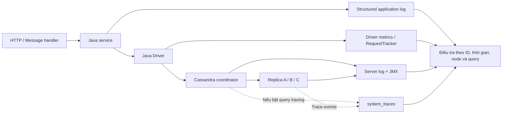
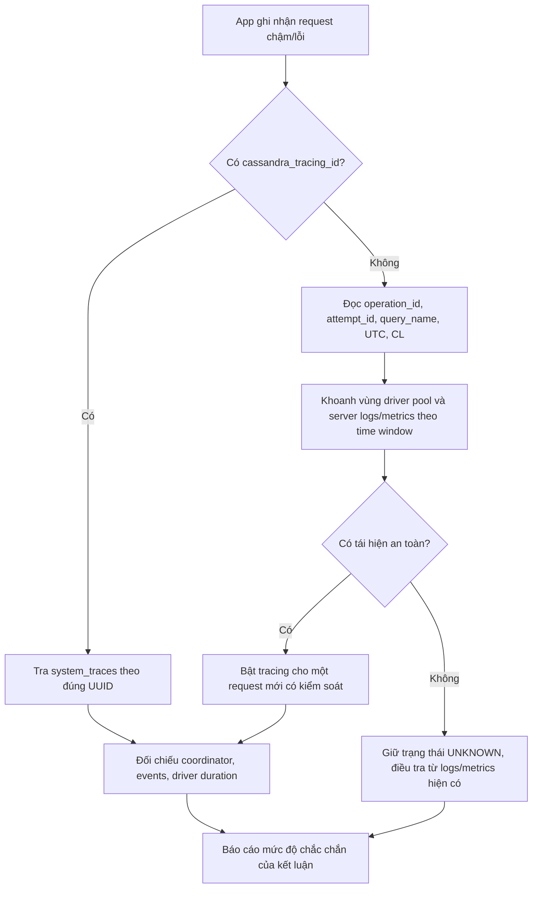

# Log có cấu trúc, định danh yêu cầu và đối chiếu driver/server

Khi một API Java trả lỗi `ReadTimeout` hoặc `WriteTimeout`, câu hỏi đầu tiên của người vận hành thường là: **“Yêu cầu nào chậm, driver gửi tới coordinator nào, Cassandra đã làm gì, và thao tác ghi thật sự thành công hay chưa?”**. Một dòng `ERROR query timed out` thiếu định danh, kiểu truy vấn, consistency, địa chỉ coordinator và khoảng thời gian sẽ không đủ để trả lời. Ngược lại, bật toàn bộ DEBUG hoặc query tracing cho mọi request có thể làm tăng tải và lộ dữ liệu nhạy cảm.

Bài thuộc chương **Quan sát hệ thống** của mô-đun **DATABASE_ENGINE_WIDE_COLUMN_CASSANDRA**. Ta xây một chuỗi bằng chứng có thể đối chiếu từ **HTTP/worker → ứng dụng Java → Cassandra Java Driver → coordinator → replica**, sử dụng log có cấu trúc, định danh yêu cầu, metrics và truy vết có chọn lọc. Cách quan sát này gắn trực tiếp với mô hình wide-column, partition key, consistency, replication, tombstone, compaction, repair và vận hành cụm.

> **Nguyên tắc:** không có một “request ID Cassandra” mặc định tự xuất hiện xuyên suốt mọi log ứng dụng, driver và server. Ứng dụng cần tự cấp ID cho thao tác nghiệp vụ; tracing ID của Cassandra là một cơ chế **khác**, chỉ có khi query tracing được bật và ID được trả về/ghi nhận thành công.

## 1. Mục tiêu học tập

Sau bài này, bạn có thể:

1. Phân biệt **structured logs**, **metrics**, **distributed traces**, **Cassandra query tracing** và **server logs**.
2. Thiết kế bộ định danh `operation_id`, `attempt_id`, `trace_id`, `cassandra_tracing_id` và `query_name` có ngữ nghĩa rõ ràng.
3. Ghi log Java Driver 4.x với `ExecutionInfo`, `getCoordinator()`, `getWarnings()` và `getTracingId()`, tránh log raw CQL/bind values.
4. Bật tracing cho **một truy vấn được chọn**, đọc `system_traces.sessions/events` và nhận diện dữ liệu trace đến chậm.
5. Đối chiếu latency end-to-end, driver, coordinator/replica và các tín hiệu thread pool, compaction, disk, GC và mạng.
6. Điều tra timeout/unknown outcome mà không ngầm kết luận request chưa được Cassandra thực hiện.
7. Xây dashboard và quy trình incident có kiểm soát cardinality, overhead, bảo mật và vòng đời lưu log.

## 2. Bốn lớp quan sát: không một công cụ nào đủ

| Lớp | Câu hỏi trả lời tốt | Giới hạn cần nhớ |
| --- | --- | --- |
| **Application structured log** | API nào, business operation nào, attempt nào, query nào, trạng thái/latency? | Không tự biết mỗi replica đã làm gì; nếu request chết trước phản hồi, coordinator có thể không rõ. |
| **Java Driver telemetry** | Driver chọn coordinator nào, bao nhiêu speculative executions, warnings, lỗi network/pool, thời gian phía client? | Driver nhìn thấy những request/response nó quan sát được; một timeout có thể có outcome chưa biết. |
| **Cassandra query tracing** | Coordinator/replica đã thực hiện các bước nào cho **một truy vấn được trace**? | Cần bật theo request, tốn tài nguyên, trace ghi bất đồng bộ và có TTL; không phải mọi lỗi đều có trace ID đọc được. |
| **Server logs + metrics** | Node nào down/GC/disk đầy/streaming/compaction backlog, hệ thống có vấn đề lan rộng không? | `system.log` thường không chứa business operation ID; metrics là số liệu tổng hợp, không xác định một request cụ thể. |

Một phép chẩn đoán tốt ghép **log để định vị request**, **metrics để xác định phạm vi ảnh hưởng**, rồi **query tracing để đào sâu một vài request đại diện**. Không nên bật tracing dày đặc trước khi biết truy vấn nào cần điều tra.



Mũi tên tới `system_traces` chỉ có nghĩa khi tracing được bật và event thực sự được ghi; sơ đồ không hàm ý mọi yêu cầu luôn được lưu ở đó.

## 3. Bộ định danh: cùng một tên “trace” nhưng không cùng mục đích

| Trường | Ai cấp, tồn tại bao lâu? | Dùng để làm gì? |
| --- | --- | --- |
| `operation_id` | Ứng dụng cấp cho **một hành động nghiệp vụ logic**; giữ nguyên qua retry và message redelivery. | Trả lời: cùng một việc đã được thử bao nhiêu lần và kết quả cuối thế nào? |
| `request_id` / `http_request_id` | HTTP gateway/framework hoặc ứng dụng cấp cho **lượt HTTP** cụ thể. | Ghép gateway, controller và service; một operation có thể có nhiều HTTP request. |
| `attempt_id` | Ứng dụng cấp cho **mỗi lần gọi driver** có chủ đích. | Đối chiếu lần thử thứ nhất timeout, lần thứ hai success. |
| `trace_id` / `span_id` | Hệ thống tracing phân tán (ví dụ OpenTelemetry) cấp cho workflow/span. | Liên kết hành trình service-to-service. **Không mặc định là Cassandra tracing ID**. |
| `cassandra_tracing_id` | Cassandra cấp cho **query tracing đã bật**; có thể lấy từ phản hồi driver. | Khóa tra `system_traces.sessions/events` của một lượt thực thi được trace. |
| `query_name` | Ứng dụng định nghĩa **nhãn ổn định** như `events_by_day.select_latest`. | Tổng hợp metric/log an toàn hơn raw CQL. |
| `coordinator` | Node driver đã nhận phản hồi từ đó (khi biết). | Giới hạn tìm logs/metrics node cụ thể và hiểu DC local routing. |
| **Protocol stream ID** | Driver/protocol dùng **trên một kết nối TCP** để ghép request/response đang in-flight. | Không phải ID toàn cục, không nên dùng thay operation ID. |
| **Prepared statement ID** | Liên quan đến query đã prepare trên server/driver. | Nhận diện statement dạng chuẩn; **không duy nhất cho một lần thực thi**. |

### Một logical operation có thể tạo nhiều request

```text
operation_id = op-784c                         (một yêu cầu nghiệp vụ)
  HTTP request = http-101
    driver invocation attempt_id = att-01
      coordinator = node-A
      kết quả = timeout (không có tracing ID được trả)
    driver invocation attempt_id = att-02
      coordinator = node-B
      kết quả = success
      cassandra_tracing_id = <UUID nếu đã bật tracing>

Ngoài ra driver có thể retry/speculative execution nội bộ;
không đồng nhất 1 invocation = đúng 1 gói tin gửi 1 node.
```

**Giữ `operation_id` qua retry** là nền tảng cho chẩn đoán và idempotency. Nếu mỗi lần retry tự tạo một `operation_id` mới, log sẽ trông như những giao dịch độc lập và có thể che lỗi double write. Nhưng một ID giống nhau trong log **không tự làm thao tác idempotent**: tầng lưu trữ và logic nghiệp vụ phải thực thi điều đó.

### Quy tắc về tên

- Dùng `operation_id` cho **logical action**; `attempt_id` cho **lần gọi driver** do app tạo. Driver retry/speculative execution bên trong có thể nhiều hơn số `attempt_id` bạn thấy.
- Dùng `cassandra_tracing_id` riêng thay vì gọi chung là `trace_id`. `trace_id` của OpenTelemetry/HTTP có thể tồn tại ngay cả khi không bật Cassandra tracing.
- Không kỳ vọng UUID `operation_id` được Cassandra server tự đọc và ghi trong `system.log`. Nếu cần nối hai phía, hãy **ghi quan hệ** `operation_id ↔ cassandra_tracing_id` khi ID tracing được driver trả về.
- Nếu ứng dụng gửi custom payload trong native protocol, **đừng tự giả định** Cassandra sẽ tự gắn payload đó vào log/traces; việc hiển thị phụ thuộc server/framework/plugin cụ thể.

## 4. Thiết kế schema log JSON có cấu trúc

Log cần **dễ parse, có tên trường nhất quán, không lộ dữ liệu**. Có thể dùng JSON serializer qua Logback/SLF4J hoặc logging platform đang có; cấu trúc dưới đây là **schema đề xuất ở tầng ứng dụng**, không phải định dạng JSON mặc định do Cassandra xuất ra.

| Trường | Kiểu | Vai trò |
| --- | --- | --- |
| `timestamp` | ISO-8601 UTC | Thời điểm **ghi sự kiện log**; không dùng thay monotonic elapsed time. |
| `severity` / `event` | Enum/string | `INFO`, `WARN`; `cql.request.succeeded`, `cql.request.failed`… |
| `service`, `environment`, `version` | String giới hạn | Biết deployment nào tạo log. |
| `operation_id`, `http_request_id`, `attempt_id` | ID | Ghép các lớp yêu cầu. |
| `query_name`, `table` | Enum/string ổn định | Nhóm truy vấn theo workload và bảng, không lưu raw bind values. |
| `consistency`, `serial_consistency` | Enum/nullable | Phân biệt `LOCAL_QUORUM`, `ONE`, LWT. |
| `local_dc`, `coordinator` | String/nullable | Vùng ứng dụng và coordinator thực tế nếu biết. |
| `elapsed_ms` | Number | Đo bằng đồng hồ monotonic ở phía app; gồm những phần app theo dõi được. |
| `outcome`, `error_class` | Enum/string | `SUCCESS`, `FAILED`, `UNKNOWN`, exception category. |
| `warning_count` | Integer | Có server warning hay không, không nhất thiết lưu nội dung raw. |
| `speculative_executions` | Integer | Số speculative executions driver báo cho request thành công, khi hỗ trợ. |
| `cassandra_tracing_id` | UUID/nullable | Chỉ có khi bật server tracing và ID đã được trả về. |
| `partition_key_hash` hoặc `bucket_class` | String/nullable | Phục vụ phân nhóm hot partition theo chính sách bảo mật; không đưa raw PII vào log. |

### Ví dụ log thành công

```json
{
  "timestamp": "2026-11-21T09:30:12.481Z",
  "severity": "INFO",
  "service": "event-query-api",
  "environment": "lab",
  "event": "cql.request.succeeded",
  "operation_id": "op-784c",
  "http_request_id": "http-101",
  "attempt_id": "att-02",
  "trace_id": "otel-3a2f",
  "query_name": "events_by_tenant_day.select_latest",
  "table": "observability_lab.events_by_tenant_day",
  "consistency": "LOCAL_QUORUM",
  "local_dc": "dc1",
  "coordinator": "node-b:9042",
  "elapsed_ms": 18.3,
  "outcome": "SUCCESS",
  "warning_count": 0,
  "speculative_executions": 0,
  "cassandra_tracing_id": null
}
```

Đây là **dữ liệu minh họa**, không phải kết quả quan sát của một cụm thực. `trace_id` là ID ví dụ của hệ thống tracing riêng, `cassandra_tracing_id=null` vì truy vấn thường không bật Cassandra query tracing. Trong triển khai, ID trace OpenTelemetry sẽ có định dạng cụ thể và cần được cấp bằng thư viện tracing chứ không bịa ở tầng log.

### Ví dụ log timeout

```json
{
  "timestamp": "2026-11-21T09:30:13.010Z",
  "severity": "WARN",
  "service": "event-query-api",
  "event": "cql.request.failed",
  "operation_id": "op-784c",
  "attempt_id": "att-01",
  "query_name": "events_by_tenant_day.select_latest",
  "consistency": "LOCAL_QUORUM",
  "local_dc": "dc1",
  "coordinator": null,
  "elapsed_ms": 500.8,
  "error_class": "DriverTimeoutException",
  "outcome": "UNKNOWN",
  "cassandra_tracing_id": null
}
```

Log `coordinator=null` có nghĩa **ứng dụng chưa xác định được coordinator từ thông tin nó đã thu**, không có nghĩa Cassandra chắc chắn không nhận request. `outcome=UNKNOWN` là cách phân loại thận trọng đối với ghi đã gửi nhưng client không nhận kết luận cuối; đối với đọc, kết quả của lượt thử đó không khả dụng, nhưng truy vấn có thể đã tiêu thụ tài nguyên phía server.

## 5. Đo thời gian: đồng hồ nào đang được so sánh?

**Không dùng một latency để đại diện cho tất cả.**

```text
T_http = ingress + auth + business logic + T_driver_invocation + response serialization

T_driver_invocation =
  queue/throttling tại client + connection/pool + network RTT
  + coordinator xử lý + replica phản hồi + retry/speculation
  + giải mã response

T_server_trace =
  thời gian được Cassandra ghi nhận cho một query trace cụ thể;
  không bao gồm đầy đủ mọi bước tại client và không nhất thiết bằng
  tổng thời gian từ lời gọi session.execute đến trả về.
```

Trong Java, đo duration bằng `System.nanoTime()` lấy hiệu hai mốc rồi đổi sang milliseconds; timestamp UTC dùng để **tìm khung thời gian** trong log. Không lấy hai `Instant.now()` ở hai host để tính duration mạng rồi quy sai số clock cho truy vấn.

Đối với multi-DC, `LOCAL_QUORUM` chỉ chờ đủ replica cục bộ theo consistency level, nhưng coordinator vẫn có thể phân phối mutation đến replica DC khác. **Thời gian từ app đến response** không tự phản ánh thời điểm replica ở DC khác hội tụ. Khi so server log giữa các node, giám sát NTP/clock offset và giữ sai số tìm kiếm đủ rộng.

### Bộ ba số liệu nên đặt cạnh nhau

1. **Application p50/p95/p99** theo `query_name`, DC, outcome; đo end-to-end hoặc driver invocation rõ ranh giới.
2. **Driver session/node metrics**: `cql-requests`, connections, in-flight, errors/timeout theo cấu hình driver và framework giám sát.
3. **Server metrics**: read/write latency, pending tasks, dropped messages, compaction, tombstone scans, GC pause, disk I/O, network và trạng thái replica.

Nếu ứng dụng thấy p99 2 giây còn trace một request cho biết server làm 30 ms, hãy kiểm tra **pool/queue, throttling, mạng, retry, GC của app, serialization** và sự khác nhau giữa đúng những request được đo. Không kết luận Cassandra “chậm 2 giây” chỉ dựa trên tổng thời gian HTTP.

## 6. Java Driver 4.x: log kết quả có coordinator và tracing ID

Ví dụ dùng Java Driver 4.x, `CqlSession session` đã được cấu hình contact points/local datacenter; một `PreparedStatement` đã chuẩn bị sẵn lúc khởi tạo service. Mã dùng **SLF4J MDC** để đưa `operation_id` và `attempt_id` vào log JSON, giả định logging configuration đã xuất các trường MDC. Với framework bất đồng bộ/reactive, **MDC theo thread phải được truyền context đúng cách**, không thể giả định tự đi theo các callback.

```java
import com.datastax.oss.driver.api.core.ConsistencyLevel;
import com.datastax.oss.driver.api.core.cql.BoundStatement;
import com.datastax.oss.driver.api.core.cql.ExecutionInfo;
import com.datastax.oss.driver.api.core.cql.PreparedStatement;
import com.datastax.oss.driver.api.core.cql.ResultSet;
import java.time.LocalDate;
import java.util.UUID;
import org.slf4j.Logger;
import org.slf4j.LoggerFactory;
import org.slf4j.MDC;

public final class CassandraQueryProbe {
  private static final Logger LOG =
      LoggerFactory.getLogger(CassandraQueryProbe.class);

  public static ResultSet selectDay(
      com.datastax.oss.driver.api.core.CqlSession session,
      PreparedStatement selectByDay,
      String tenantId,
      LocalDate eventDay,
      UUID operationId,
      boolean sampleCassandraTracing) {

    UUID attemptId = UUID.randomUUID(); // Mỗi lời gọi driver do app tạo.
    BoundStatement request = selectByDay.bind(tenantId, eventDay)
        .setConsistencyLevel(ConsistencyLevel.LOCAL_QUORUM)
        .setPageSize(100)
        .setIdempotent(true) // Chỉ đúng vì đây là SELECT không side effect.
        .setTracing(sampleCassandraTracing);

    long startNanos = System.nanoTime();
    MDC.put("operation_id", operationId.toString());
    MDC.put("attempt_id", attemptId.toString());

    try {
      ResultSet result = session.execute(request);
      ExecutionInfo info = result.getExecutionInfo();
      String coordinator = info.getCoordinator() == null
          ? "unknown"
          : info.getCoordinator().getEndPoint().toString();
      double elapsedMs = (System.nanoTime() - startNanos) / 1_000_000.0;

      LOG.info(
          "event=cql.request.succeeded query_name=events_by_day.read " +
          "elapsed_ms={} coordinator={} cassandra_tracing_id={} " +
          "warning_count={} speculative_executions={}",
          elapsedMs,
          coordinator,
          info.getTracingId(),
          info.getWarnings().size(),
          info.getSpeculativeExecutionCount());
      return result;

    } catch (RuntimeException error) {
      double elapsedMs = (System.nanoTime() - startNanos) / 1_000_000.0;
      LOG.warn(
          "event=cql.request.failed query_name=events_by_day.read " +
          "elapsed_ms={} error_class={}",
          elapsedMs, error.getClass().getSimpleName());
      throw error;

    } finally {
      MDC.remove("attempt_id");
      MDC.remove("operation_id");
    }
  }
}
```

**Những giới hạn của ví dụ:**

- Với lời gọi **thành công**, `ExecutionInfo.getCoordinator()` là node đã gửi phản hồi mà driver giải mã. Nó **không** phải danh sách tất cả replicas, không chứng minh mọi replica đã nhận ghi.
- Nếu query **không bật tracing**, `getTracingId()` trả `null`. Nếu bật nhưng request lỗi/mất response, ứng dụng có thể không nhận được ID trace.
- `getWarnings()` trả các server warnings đã nhận; log **số lượng** trước, chỉ lưu nội dung đã được redaction trong kênh hạn chế khi thật sự cần vì warning có thể chứa thông tin truy vấn.
- `getSpeculativeExecutionCount()` phản ánh speculative executions theo driver, **không** là tổng mọi retry/attempt do ứng dụng hoặc framework tạo.
- `ResultSet.getExecutionInfo()` thể hiện thông tin của phần thực thi được trả. Với **paging**, các trang tiếp theo có thể gây thêm request; phải thu execution info cho các trang nếu muốn đo **toàn bộ quá trình đọc**.
- Ví dụ trả về `ResultSet` trước khi client đi hết các trang; duration trên chỉ đo lời gọi `execute()` ban đầu. Không gọi đó là tổng latency để xử lý hàng triệu bản ghi.
- `MDC.remove()` phù hợp khi method này tự sở hữu các key; nếu có context cha cùng tên, cần **lưu và khôi phục giá trị cũ** để không làm mất context ngoài method.

Mã thực tế nên **khai báo `query_name` ổn định trong code**, không ghép từ raw parameter. `tenantId` có thể là dữ liệu khách hàng, không log trực tiếp; nếu cần phân tích hot partition, dùng hash được quản lý theo chính sách bảo mật hoặc bucket có giới hạn. Không ghi token truy cập, query chứa PII, toàn bộ bind values hoặc exception payload chưa được kiểm duyệt.

## 7. Tracing có chọn lọc: lấy Cassandra tracing ID từ Java

Theo API Java Driver 4.x, một statement được bật query tracing bằng `setTracing(true)`. Sau khi thành công:

```java
BoundStatement traced = selectByDay.bind("tenant-lab",
        LocalDate.of(2026, 11, 21))
    .setConsistencyLevel(ConsistencyLevel.LOCAL_QUORUM)
    .setTracing(true);

ResultSet rows = session.execute(traced);
ExecutionInfo executionInfo = rows.getExecutionInfo();
UUID cassandraTracingId = executionInfo.getTracingId();

if (cassandraTracingId != null) {
    // Ghi UUID này kèm operation_id/attempt_id ở log ứng dụng.
    // Chỉ trong công cụ chẩn đoán, khi cần, gọi:
    // executionInfo.getQueryTraceAsync()
    // để truy vấn chi tiết trace ở hệ thống Cassandra.
}
```

Driver có API `getQueryTrace()` và `getQueryTraceAsync()`. Việc lấy chi tiết trace làm phát sinh **các truy vấn nền đọc `system_traces`**. Bản ghi trace được Cassandra lưu **bất đồng bộ**, nên ngay sau khi nhận ID có thể chưa đọc đủ `sessions/events`. Driver có cơ chế thử lại theo cấu hình; không cần tự xây vòng `while(true)` truy vấn không giới hạn.

**Quy tắc vận hành:**

- Chỉ bật tracing ở **một phần nhỏ request** (ví dụ một lần debug có điều kiện hoặc tỷ lệ sampling được kiểm soát). Tracing tốn thêm ghi/lưu trữ trên server và truy vấn khi lấy chi tiết; không bật 100% trong production.
- Mọi query đang được trace có thể tạo nhiều events; **query dài**, paging và lượng request cao càng tăng chi phí giám sát.
- Ưu tiên ghi **ID trace và metadata không nhạy cảm** ở log thông thường; lấy nội dung chi tiết theo quyền hạn khi điều tra.
- Không gọi blocking `getQueryTrace()` trên I/O thread, request tracker callback hoặc event-loop quan trọng. Dùng `getQueryTraceAsync()` và giới hạn concurrency.
- Trace ID không phải bằng chứng Cassandra đã xử lý xong mọi replica hay một update nghiệp vụ không thể bị ghi đè sau đó.

## 8. Lab CQL: TRACING ON và hai bảng system_traces

Đây là lab trên cluster dùng data center tên `dc1` với **ít nhất ba node** nếu đặt RF=3. Nếu có một node, điều chỉnh RF/consistency **cho môi trường lab**, không chỉnh production. Cần có quyền query những system tables tương ứng.

### Bước 1 — Tạo bảng theo partition key

```sql
CREATE KEYSPACE IF NOT EXISTS observability_lab
WITH replication = {
  'class': 'NetworkTopologyStrategy',
  'dc1': 3
}
AND durable_writes = true;

CREATE TABLE IF NOT EXISTS observability_lab.events_by_tenant_day (
  tenant_id text,
  event_day date,
  event_id uuid,
  payload text,
  PRIMARY KEY ((tenant_id, event_day), event_id)
);

INSERT INTO observability_lab.events_by_tenant_day
  (tenant_id, event_day, event_id, payload)
VALUES ('tenant-lab', '2026-11-21',
        11111111-1111-4111-8111-111111111111,
        'lab-only');
```

Khóa phân vùng là `(tenant_id, event_day)`, nên `SELECT` dưới đây có thể dùng trực tiếp key thay vì quét toàn bảng. UUID cố định cho phép kiểm chứng chính xác qua retry; không dùng `now()` để sinh thêm sự kiện cho cùng logical operation.

### Bước 2 — Trace đúng một truy vấn

Trong `cqlsh`:

```sql
CONSISTENCY LOCAL_QUORUM;
TRACING ON;

SELECT event_id, payload
FROM observability_lab.events_by_tenant_day
WHERE tenant_id = 'tenant-lab'
  AND event_day = '2026-11-21';

TRACING OFF;
```

`TRACING ON` áp dụng cho **những truy vấn của phiên cqlsh đó** cho tới khi tắt; nó không có nghĩa tất cả truy vấn của mọi application client trên cluster đều được bật tracing. Sau khi SELECT, cqlsh thường in **tracing session ID** và các sự kiện/độ trễ liên quan; định dạng thực tế tùy phiên bản Cassandra/cqlsh.

### Bước 3 — Tra cứu session ID

Thay `aaaaaaaa-bbbb-4ccc-8ddd-eeeeeeeeeeee` bằng UUID tracing **đã quan sát**:

```sql
SELECT *
FROM system_traces.sessions
WHERE session_id = aaaaaaaa-bbbb-4ccc-8ddd-eeeeeeeeeeee;

SELECT activity, source, source_elapsed, thread
FROM system_traces.events
WHERE session_id = aaaaaaaa-bbbb-4ccc-8ddd-eeeeeeeeeeee;
```

Thông tin thường gồm thời điểm bắt đầu, coordinator/request type, thời lượng, các events ở nhiều node và độ trễ `source_elapsed` theo **microsecond**. Trường/schema cụ thể tùy version, vì vậy có thể dùng `DESCRIBE TABLE system_traces.events` trong lab nếu quyền truy cập cho phép.

**Nếu truy vấn vừa chạy mà system_traces chưa có events:** đó có thể là **độ trễ ghi trace bất đồng bộ hoặc TTL/replication/access**, không tự suy rằng Cassandra chưa chạy SELECT. Trace information có vòng đời ngắn và có thể bị dọn theo TTL; không dùng `system_traces` làm kho audit lâu dài. Muốn lưu bằng chứng dài hạn, trích xuất theo chính sách bảo mật/retention riêng.

### Bước 4 — Đối chiếu với một phiên Java

Chạy cùng `query_name` từ Java với `setTracing(true)`, lưu `operation_id`, `attempt_id`, `getCoordinator()` và `getTracingId()`. Dùng **UUID do phản hồi Java trả về** để tra `system_traces`; đó mới là liên kết chính xác giữa **một** driver invocation được trace và các server trace events.

Không dùng ID của cqlsh để khẳng định đã trace chính request Java: chúng là **hai lượt thực thi khác nhau**, dù câu CQL và partition key giống nhau.

## 9. Đối chiếu driver/server theo từng bước

Khi nhận ticket “SELECT bị timeout”, xây **chuỗi bằng chứng** theo thứ tự:

1. **Tìm operation_id từ request đầu vào**: xác định endpoint, khung giờ UTC, service deployment, `query_name`, `attempt_id`, consistency, deadline, error class.
2. **Xác định trạng thái của lần thử**: success/failed/unknown; có `getCoordinator()` hay không; có server warnings/speculative execution không.
3. **Mở rộng theo node và DC**: driver metrics per-node, connection pool, in-flight, application CPU/GC và mạng từ service đến coordinator.
4. **So server trong cùng khung giờ**: `system.log`, `debug.log` khi có, GC logs, pending tasks, read/write latency, tombstone scans, dropped messages và disk/compaction.
5. **Nếu có Cassandra tracing ID**, tra đúng `system_traces.sessions/events`. Nếu không có ID, chọn một truy vấn tái hiện **có kiểm soát**, bật tracing cho request mới và **không gán trace mới cho request lỗi cũ**.
6. **Kiểm tra replica behavior**: RF, token ownership, CL, node health, hints/repair, tombstone/compaction. Coordinator có thể là một node khác với các replica thực sự phản hồi.
7. **Phân loại nguyên nhân** và xây điều kiện xác nhận: driver pool/throttling, mạng, replica unavailable, server overload, slow partition, GC, quá nhiều tombstone, compaction hoặc contention.
8. **Theo dõi sau fix**: p95/p99, timeout rate, warnings, server resources và số lần retry trước/sau trên **cùng loại workload**.

### Ma trận dấu hiệu

| Dấu hiệu từ app/driver | Điều cần kiểm tra ở Cassandra | Kết luận không được nhảy tới |
| --- | --- | --- |
| Driver timeout, chưa biết coordinator | Client pool, throttler, DNS/network, driver node metrics, server có nhận request hay không. | “Server chắc chắn không thấy request”. |
| `ReadTimeout` | CL, số replica phản hồi, read latency, pending tasks, tombstone scanned, GC/disk, network. | “Partition đã hỏng” hoặc “đọc trả về sai”. |
| `WriteTimeout` | CL, commit log/disk I/O, replica availability, mutation có thể đã áp dụng, hints. | “Ghi chắc chắn thất bại”; retry bằng event ID mới. |
| `Unavailable` | Replication/DC, node UP/DOWN, tập replica của partition, topology. | “Tăng deadline sẽ khắc phục” nếu không đủ replica. |
| Server warning tombstone | Query range, partition size, TTL/DELETE, SSTable count, compaction, tombstone scans. | “Nâng threshold giúp query nhẹ hơn”. |
| Nhiều speculative executions | Tail latency, read path, driver config và request mix; tỉ lệ extra load lên node. | “Mỗi speculative execution là một user request riêng”. |
| Đọc nhanh nhưng API chậm | App queuing, network RTT, paging, serialization, business logic, retry. | “Cassandra chiếm toàn bộ HTTP latency”. |
| Chỉ DC2 lỗi | Driver local DC routing, WAN, RF/CL, coordinator/replica health ở DC2. | “Cả cluster đều chậm như nhau”. |

## 10. Không có tracing ID: điều tra thế nào?

Đây là tình huống **bình thường** vì tracing mặc định tắt và lỗi có thể xảy ra trước khi nhận response.



**Không nên** tìm một UUID `operation_id` trong `system.log` rồi kết luận “server không nhận request” nếu không thấy. Cassandra mặc định không biết ID đó. Cũng không nên giả định mọi CQL request đều tạo row trong `system_traces`: chỉ request được trace mới có các bản ghi đó, và dữ liệu có TTL.

### Có thể tìm theo khung thời gian nhưng đừng coi là nối ID chính xác

Khi không có server trace ID, dùng `timestamp UTC ± clock skew/processing delay`, `coordinator` (nếu biết), `query_name`, node warnings, read/write metrics và incident timeline. Đây là **correlation gián tiếp**, không phải chứng minh một dòng server log thuộc đúng một HTTP request giữa hàng nghìn request giống nhau.

Để cải thiện việc lần sau, thêm **sampling tracing** ở điểm được phép và ghi liên kết ID tại ứng dụng; không cố thay đổi server log formatter để tự nhận một ID mà protocol không chuyển tới nó.

## 11. Server log: system.log, debug.log, gc.log và audit/FQL

Cassandra thường có:

- **`system.log`**: điểm bắt đầu khi xem exception, lỗi disk, gossip/topology, slow operation và thông báo vận hành.
- **`debug.log`**: thêm chi tiết tùy cấu hình; nhiều deployment không bật hoặc giữ ngắn.
- **`gc.log`** hoặc log GC của JVM: chẩn đoán stop-the-world pauses, heap pressure và tác động latency.
- **Audit log / full query log** (khi tính năng được bật theo phiên bản): phục vụ yêu cầu kiểm toán/chẩn đoán riêng, **không giống** log structured của ứng dụng hoặc tracing per-request; chi phí và rủi ro dữ liệu nhạy cảm cao hơn.

Đường dẫn log mặc định/phân phối có thể khác nhau, thường thuộc thư mục logs của Cassandra hoặc thư mục được cấu hình cho dịch vụ. Hệ thống đóng gói container có thể gửi log qua stdout/agent. Format có thể được điều chỉnh qua **Logback**, nhưng **không được giả định Cassandra mặc định xuất JSON schema như ứng dụng Java**.

### Mẫu điều tra ở phía node (đọc-only)

```bash
nodetool status
nodetool info
nodetool tpstats
nodetool tablestats observability_lab.events_by_tenant_day
nodetool tablehistograms observability_lab events_by_tenant_day
nodetool compactionstats
nodetool netstats
```

Trong môi trường có quyền truy cập, đối chiếu node ↔ log ↔ metrics theo **đúng thời điểm** và **đúng DC**. `nodetool status` cho thấy nút UP/Normal hay Down, nhưng không xác nhận request cụ thể đã xử lý thành công. `compactionstats` và `netstats` phản ánh công việc hiện hành; một hoạt động đã kết thúc có thể không còn hiện trong snapshot sau sự cố.

### Log server có cấu trúc: nên làm ở đâu?

Nếu tổ chức cần JSON server logs, chọn pipeline hỗ trợ bởi phiên bản/packaging (Logback encoder, collector hoặc parser tại log ingestion), đảm bảo:

1. Không làm mất stacktrace/multi-line context và metadata node/DC.
2. Có `node_id/host/DC`, timestamp UTC, severity, logger name và loại sự kiện được chuẩn hóa.
3. Không giả định `operation_id` tự xuất hiện; nếu không có liên kết giao thức, dùng `cassandra_tracing_id` hoặc correlation gián tiếp.
4. Có backpressure/retention/rotation để logging không làm đầy disk hoặc chặn I/O.
5. Có test trên bản Cassandra thực tế trước khi triển khai toàn cluster.

## 12. Driver RequestTracker và metrics: tách log chi tiết khỏi số liệu tổng hợp

Java Driver 4.x cung cấp **RequestTracker** để theo dõi request ở tầng driver, bao gồm callback success/error và các lần thử trên node. Driver cũng có **request logger** tùy chọn và **session-level/node-level metrics**. Không nên thay thế mọi thứ bằng log INFO cho từng query vì khối lượng ghi log có thể quá lớn.

### Driver metrics mẫu

Ví dụ cấu hình HOCON **minh họa** (tên metric được xác minh trong tài liệu driver 4.x; cần có metrics backend phù hợp):

```hocon
datastax-java-driver.advanced.metrics {
  session.enabled = [connected-nodes, cql-requests]
  node.enabled = [pool.open-connections, pool.in-flight]
}
```

Tùy bản driver và metrics factory, có thể kết nối Dropwizard/Micrometer để xuất histogram latency và connection pool metrics. **Mặc định driver có thể chưa bật metrics**; không thể đọc số liệu driver nếu chưa cấu hình thu thập. Đặt nhãn metric hữu hạn như `service`, `dc`, `query_name`, `outcome`, `node`. **Không đặt `operation_id`, `attempt_id`, `tenant_id` hoặc `cassandra_tracing_id` thành Prometheus labels** vì cardinality tăng không giới hạn.

### Chống logging trở thành nguyên nhân chậm

- `RequestTracker` chạy trên đường thực thi “hot path” và có thể hoạt động trên **driver I/O threads**; callback phải **nhanh, không blocking I/O, không gọi query khác để lấy trace trực tiếp**.
- Dùng event/queue bất đồng bộ **có giới hạn**, sampling hoặc aggregated counters; không để logging đẩy hệ thống vào OOM khi cluster chậm.
- Không bật verbose driver request logger và Cassandra server DEBUG cho mọi request chỉ vì thiếu một ID.
- Nếu cần đếm retry/speculative execution, ghi các số từ driver nơi API cho phép; đừng cộng nhầm mỗi lần thử như một thao tác nghiệp vụ độc lập.
- Nếu đo performance trước/sau cấu hình observability, theo dõi **overhead chính của instrumentation** để bảo đảm phép đo không làm thay đổi đáng kể hệ thống.

## 13. Paging, retries và LWT: những trường hợp làm log dễ hiểu sai

### Paging — một SELECT logic có thể tạo nhiều request

Một câu `SELECT` trả về nhiều trang có thể buộc driver gửi tiếp truy vấn lấy page khác. `LIMIT 100`, `pageSize=100` và số hàng trả về là những khái niệm khác nhau:

- **Page size** giới hạn số hàng trong một page, không giới hạn số tombstone được scan trên server.
- Log **page đầu success** chưa chứng minh đã xử lý xong toàn bộ kết quả; request page sau có thể timeout.
- Một operation ID nên gom metrics của toàn bộ việc duyệt kết quả, và nên có page index/attempt ID cho các lần fetch nếu cần phân tích chuyên sâu.
- Tracing có thể tạo trace riêng cho các page requests; không gán tracing ID của page đầu cho mọi page.

### Retry và speculative execution

Driver retry nội bộ có thể thử node khác sau lỗi theo policy; speculative execution có thể gửi thêm một lần thử nếu request idempotent và đủ điều kiện. **Một logical operation → nhiều coordinator** là tình huống có thể xảy ra. Log chỉ có “coordinator cuối” chưa kể hết toàn bộ các node đã thử; cần driver request tracker/metrics hay error list phù hợp để nhìn các lần thử, nhưng không expose raw dữ liệu nhạy cảm.

### LWT và counter

- Một LWT `IF ...` có **serial consistency** (`SERIAL` hoặc `LOCAL_SERIAL`) và regular consistency; ghi cả hai vào telemetry để giải thích latency và behavior.
- `[applied]=false` là một kết quả **đã xử lý điều kiện**, không nhất thiết là lỗi mạng hay timeout. Nếu ứng dụng gộp vào “db failed”, dashboard sẽ sai.
- Counter increments và side effects có thể **không idempotent**. Timeout rồi retry mù có thể nhân đôi hiệu ứng; giữ operation ID nhưng vẫn phải có giao thức dedup/đối soát đúng nghiệp vụ.
- Một write timeout có thể ở trạng thái **unknown outcome**; truy vấn đọc sau đó giúp đối soát nhưng cũng phải xét consistency, replica lag và timestamp.

## 14. Quy trình incident mẫu: timeout ghi khi một replica down

Giả sử hệ thống quản lý đơn hàng ghi một trạng thái theo `LOCAL_QUORUM`, keyspace RF=3 ở `dc1`. Trong một đợt sự cố, một node DOWN, một request ghi bị timeout.

| Mốc | Bằng chứng | Cách diễn giải thận trọng |
| --- | --- | --- |
| **09:15:00.100** | `operation_id=order-op-88`, `attempt_id=a1`, query `orders_by_id.upsert_state` | Một logical mutation được gửi; ID ổn định giúp đối soát các lần thử. |
| **09:15:00.600** | Java `WriteTimeout`, `LOCAL_QUORUM`, elapsed 500ms | Không biết chắc mutation đã áp dụng trên bao nhiêu replica chỉ từ timeout. |
| **09:15:00.630** | Driver/node metrics cho thấy pool/coordinator áp lực | Cần kiểm chứng trên server; không suy ngay commit log bị lỗi. |
| **09:15:00.700** | `nodetool status` có node DOWN; server `system.log` có network/timeout cùng khung giờ | Giải thích một phần rủi ro quorum; phải xác định node có phải replica của partition. |
| **09:15:01.000** | Retry có cùng `operation_id`, primary key, payload/idempotency semantics | Tránh nhân bản event; vẫn cần xác minh mức độ idempotent thực tế. |
| **09:15:01.020** | Retry success; có coordinator và tracing ID nếu được sample | Chỉ báo lần retry trả thành công; không gắn trace ID này cho lần timeout đầu. |
| **Sau recovery** | Kiểm tra hints/repair, đọc dữ liệu theo CL phù hợp, đánh giá p99 | Xác định replica hội tụ và business state đúng, không chỉ cluster hiển thị UN. |

**Không chạy destructive tests trên production** để tạo lỗi minh họa. Trong lab, có thể mô phỏng bằng một node/ứng dụng giả lập hoặc công cụ kiểm thử có phê duyệt; muốn đo write timeout phải tách lỗi do network, quorum và driver deadline. Không tăng `socket timeout`, giảm CL hoặc bật tracing 100% chỉ để có một request trông như “đã thành công”.

### Mẫu ticket nghiệm thu điều tra

```text
INCIDENT: INC-lab-17
BUSINESS_OPERATION: order-op-88
QUERY_NAME: orders_by_id.upsert_state
KEYSPACE/TABLE: orders.orders_by_id
CONSISTENCY: LOCAL_QUORUM (dc1, RF=3)
ATTEMPTS: a1 timeout/unknown; a2 success
COORDINATOR: known for a2; unknown for a1
CASSANDRA_TRACING_ID: present for a2 only
SERVER_EVIDENCE: system.log + node metrics within bounded time window
ROOT_CAUSE: [điền bằng chứng, không đoán từ một exception]
DATA_OUTCOME: [đã đối soát key và version ở CL phù hợp]
REMEDIATION: [repair/runbook/query fix/driver routing...]
FOLLOW_UP: [p99, timeout, retries, server health, business invariant]
```

## 15. An toàn dữ liệu, quyền truy cập và chi phí lưu log

Quan sát tốt không có nghĩa lưu mọi thứ:

| Dữ liệu | Rủi ro | Cách xử lý |
| --- | --- | --- |
| **Bind values/raw CQL chứa dữ liệu khách hàng** | Rò rỉ PII/secrets trong log và backup log. | Ghi `query_name` ổn định, bỏ parameter hoặc redact nghiêm ngặt. |
| **Partition key/tenant ID** | Lộ danh tính, tạo metric cardinality cao. | Hash có quản lý khóa/salt hoặc nhãn bucket có giới hạn, theo chính sách tổ chức. |
| **Tracing events** | Có thể chứa hoạt động nội bộ và tham số; tốn dung lượng. | Bật có chọn lọc, RBAC, TTL/retention rõ và kho chẩn đoán riêng nếu cần. |
| **Full query/audit logs** | Chi phí ghi lớn và thông tin truy vấn nhạy cảm. | Chỉ bật theo nhu cầu kiểm toán/pháp lý, giới hạn quyền truy cập và lưu trữ. |
| **Exception messages** | Một số thư viện có thể nhúng query text, address hoặc chi tiết nhạy cảm. | Log error class/code trước; kiểm tra/redact message, hạn chế stacktrace chi tiết. |
| **High-cardinality IDs trong metrics** | Bùng nổ time series, RAM/chi phí và dashboard chậm. | ID thuộc **log/span**, metric chỉ gắn nhãn ít giá trị. |

Định nghĩa **retention** khác nhau cho log ứng dụng, driver telemetry, server logs và trace chi tiết. Không dựa vào TTL của `system_traces` để lưu hồ sơ nghiệp vụ. Chuẩn hóa timestamp UTC và giữ lại `service_version`, `driver_version`, `cassandra_version` trong metadata để tái hiện lỗi sau deploy.

## 16. Bài tập thực hành

### Bài A — Thiết kế bộ ID

Một order update ban đầu do HTTP request `http-1` gửi; ứng dụng timeout, HTTP client retry bằng `http-2`; Java Driver trên mỗi lượt có thể retry nội bộ. Thiết kế bảng giá trị `operation_id`, `http_request_id`, `attempt_id`, `trace_id` và `cassandra_tracing_id`. Giải thích:

1. ID nào giữ nguyên qua HTTP retry?
2. ID nào thay đổi theo một lần `session.execute()`?
3. ID nào chỉ xuất hiện khi bật Cassandra query tracing và nhận phản hồi?
4. Vì sao không dùng native protocol stream ID làm ID xuyên cluster?

### Bài B — Correlate timeout khi không có trace ID

Cho một log `cql.request.failed` có `operation_id`, `query_name`, `consistency`, `elapsed_ms` và `error_class` nhưng **không có `coordinator` lẫn Cassandra tracing ID**. Hãy viết quy trình sử dụng khung giờ, driver metrics, node health, `system.log` và tracing ở **request tái hiện**. Nêu ít nhất ba kết luận không đủ chứng cứ để khẳng định.

### Bài C — Java logging + bảo mật

Viết một wrapper cho một `PreparedStatement` trả về nhiều trang, bổ sung `operation_id`, page index, `query_name`, elapsed time, warnings và coordinator. Giải thích vì sao không log `tenantId` raw và vì sao một `ResultSet.getExecutionInfo()` ở page đầu chưa phản ánh mọi request của toàn bộ vòng lặp.

### Bài D — Tracing đối chiếu server

Trong lab:

1. Tạo `observability_lab.events_by_tenant_day` và ghi một event.
2. Chạy `TRACING ON` cho một SELECT đúng partition, sau đó `TRACING OFF`.
3. Lưu tracing session UUID từ cqlsh.
4. Tra hai bảng `system_traces.sessions` và `system_traces.events` bằng đúng ID đó.
5. So thời lượng server trace với `System.nanoTime()` của một lần SELECT Java tương đương; giải thích vì sao không thể so trực tiếp hai **request khác nhau** như cùng một phép đo.

### Bài E — Đọc dashboards

Một dashboard có `app read p99 = 1500ms`, `server read p99 = 20ms`, driver `pool.in-flight` tăng và nhiều timeout. Hãy đưa ra ít nhất bốn giả thuyết và metrics/log để phân biệt: client queue, pool saturation, network, retry/speculative execution, GC ứng dụng, request mix hoặc thiếu kích thước mẫu server. Không kết luận “Cassandra chạy 20ms nên app vô lý” khi thời gian đo khác ranh giới.

### Bài F — Review thiết kế logging sai

Một nhóm đưa `operation_id` và `tenant_id` làm Prometheus labels, bật `TRACING ON` cho mọi SELECT, log tất cả bind values và tìm cùng `operation_id` trong `system.log`. Hãy chỉ ra bốn vấn đề **cardinality, overhead, dữ liệu nhạy cảm và sai giả định correlation**, rồi thiết kế lại bằng structured log + sampling + driver metrics + Cassandra tracing ID.

### Tiêu chí hoàn thành

Học viên đạt yêu cầu khi trình bày được một luồng yêu cầu có:

1. **Định danh có ngữ nghĩa:** operation, HTTP request, app attempt và Cassandra tracing ID tách biệt.
2. **Bằng chứng ứng dụng và driver:** query_name, CL, DC, elapsed, coordinator/warnings khi biết.
3. **Bằng chứng server:** logs/metrics theo node và `system_traces` nếu request đã bật tracing.
4. **Mức độ chắc chắn:** phân biệt success, failed và unknown outcome; không gán nhầm trace ID của request mới cho request cũ.
5. **Rào chắn vận hành:** không lộ raw PII, không tracing 100%, không đặt ID có cardinality cao trong metric labels.

## 17. Câu hỏi tự kiểm tra

1. Vì sao `operation_id` và `cassandra_tracing_id` không thể dùng thay nhau?
2. Một `WriteTimeout` có cho biết mutation chưa được replica nào ghi không? Vì sao?
3. Khi nào `getTracingId()` trả `null` và tại sao điều đó không phải là bug của Java Driver?
4. Vì sao `TRACING ON` trong một phiên cqlsh không tự bật tracing cho toàn bộ ứng dụng Java?
5. Lấy chi tiết trace từ `system_traces.events` ngay sau response không thấy rows: ít nhất ba nguyên nhân nào hợp lý?
6. Vì sao `getCoordinator()` không đại diện cho mọi replica của partition?
7. Vì sao `cql-requests` ở driver, `read latency` ở Cassandra và HTTP latency có thể khác nhau nhiều?
8. Một SELECT phân trang có thể sinh bao nhiêu native protocol requests? Vì sao một log success page đầu chưa đủ?
9. Tại sao không đặt `operation_id` hoặc `tenant_id` làm labels cho time-series metrics?
10. Khi không có server tracing ID, bằng chứng nào có thể giúp khoanh vùng nhưng chưa phải mapping request chính xác?
11. Tại sao request tracker không nên thực hiện truy vấn khác hoặc blocking logging trên I/O thread?
12. Làm cách nào để điều tra tombstone warnings mà không nâng threshold hoặc bật debug vô hạn?

## 18. Tài liệu tham khảo

- [Apache Cassandra — Đọc server logs](https://cassandra.apache.org/doc/latest/cassandra/troubleshooting/reading_logs.html): `system.log`, `debug.log`, `gc.log` và điểm bắt đầu điều tra.
- [Apache Cassandra — cqlsh](https://cassandra.apache.org/doc/latest/cassandra/managing/tools/cqlsh.html): `TRACING ON`/`OFF` và lệnh thao tác lab.
- [Apache Cassandra Java Driver 4.x — Query tracing](https://apache.github.io/cassandra-java-driver/4.18.1/core/tracing/): bật tracing per-statement, tracing ID và truy vấn trace.
- [Apache Cassandra Java Driver 4.x — ExecutionInfo API](https://apache.github.io/cassandra-java-driver/4.18.1/api/com/datastax/oss/driver/api/core/cql/ExecutionInfo.html): coordinator, tracing ID, warnings, speculative executions.
- [Apache Cassandra Java Driver 4.x — Request Tracker](https://apache.github.io/cassandra-java-driver/4.19.0/core/request_tracker/): callbacks, request logger và cấu hình.
- [Apache Cassandra Java Driver 4.x — Metrics](https://apache.github.io/cassandra-java-driver/4.19.0/core/metrics/): session/node metrics, backend và chi phí.
- [Apache Cassandra Java Driver 4.x — Performance](https://apache.github.io/cassandra-java-driver/4.19.0/core/performance/): giới hạn tracing, tracker trên hot path và instrumentation overhead.
- [Apache Cassandra — nodetool](https://cassandra.apache.org/doc/latest/cassandra/managing/tools/nodetool/): health, thread pools, bảng, histograms, compaction, streaming.

**Ghi nhớ:** log có cấu trúc giúp trả lời **ai làm gì và lần thử nào lỗi**; Java Driver telemetry cho biết **khi biết, request đi qua coordinator nào và thấy warning/latency gì**; Cassandra query tracing giúp đào sâu **một lần thực thi được trace**; server logs/metrics phản ánh sức khỏe **node và cụm**. Tách rõ `operation_id`, `attempt_id` và `cassandra_tracing_id`, không coi timeout là chưa ghi, không lộ bind values, và chỉ tuyên bố tương quan driver/server khi có bằng chứng nối hai phía.
