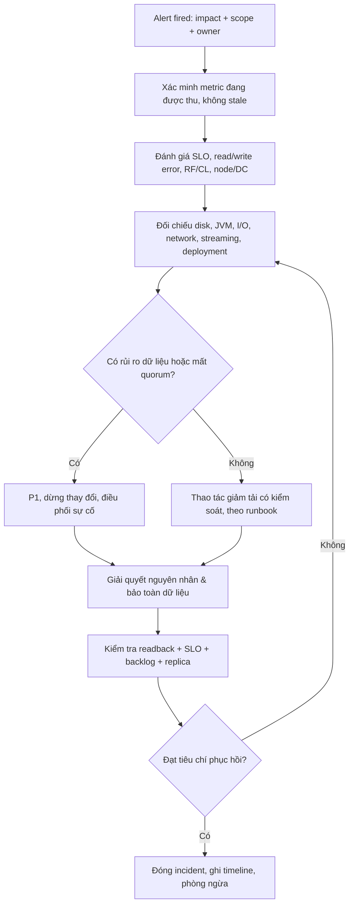

# Cảnh báo có thể hành động và sổ tay ứng phó tương ứng

> **Chương:** Quan sát hệ thống  
> **Học phần:** `DATABASE_ENGINE_WIDE_COLUMN_CASSANDRA` — Apache Cassandra

Một cụm Apache Cassandra nhiều node có thể tạo ra hàng trăm chỉ số từ request, memtable, commit log, SSTable, compaction, repair, hints, streaming, JVM, disk và network. **Có metric không đồng nghĩa đã có cảnh báo hữu ích.** Một cảnh báo chỉ có giá trị khi người nhận biết **điều gì đang ảnh hưởng người dùng**, **phạm vi nào bị ảnh hưởng**, **cần làm bước đầu tiên nào**, và **khi nào phải chuyển cấp**.

Bài học xây dựng danh mục *cảnh báo có thể hành động* (actionable alerts) và **runbook tương ứng**, lấy bối cảnh Cassandra phân tán theo mô hình wide-column: partition key quyết định replica, bảng được thiết kế theo truy vấn, mức nhất quán `ONE`/`LOCAL_QUORUM`/`EACH_QUORUM` tác động khả năng phục vụ, trong khi replication, compaction, repair, streaming và ứng dụng Java cùng quyết định độ bền và khả năng phục hồi.

**Kết quả mong đợi:** bạn có thể thiết kế cảnh báo ưu tiên đúng SLO, nối từng alert đến runbook, điều tra trên đúng node/DC/bảng, tránh thao tác phá dữ liệu và xác minh hệ thống hồi phục trước khi đóng incident.

## 1. Thế nào là một cảnh báo “có thể hành động”?

Cảnh báo kiểu “CPU cao”, “compaction pending > 0” hoặc “một node có tombstone” có thể đúng về số liệu nhưng không nhất thiết cần đánh thức người trực lúc nửa đêm.

Một cảnh báo tốt chứa tối thiểu:

1. **Tín hiệu và điều kiện:** metric, ngưỡng, khoảng đo, lưu lượng tối thiểu, trạng thái liên tục hay bùng phát.
2. **Đối tượng:** cluster, data center, rack, node, keyspace/table, read/write, consistency level hoặc nhóm ứng dụng.
3. **Tác động:** SLO bị vi phạm, quorum có nguy cơ mất, sắp hết đĩa, dữ liệu không được repair trước deadline.
4. **Mức khẩn cấp và owner:** ai nhận, có cần phản ứng ngay hay đưa vào hàng đợi cải thiện?
5. **Runbook và hành động đầu tiên:** đường dẫn tài liệu, lệnh **chỉ đọc** để xác nhận, cách giảm tác động và tiêu chí escalation.
6. **Điều kiện kết thúc:** lỗi giảm đến mức nào, trong bao lâu, bằng chứng nào chứng minh dữ liệu/dịch vụ đã phục hồi.

Ví dụ so sánh:

| Chưa tốt | Có thể hành động hơn |
| --- | --- |
| “Disk usage > 80%” | “Data volume node A dự báo còn dưới 24 giờ trước khi hết chỗ cho SSTable/compaction; owner storage cần xác nhận tốc độ tăng, snapshot và mở rộng trước deadline.” |
| “Latency p99 cao” | “Read p99 của truy vấn đặt hàng tại dc1 vượt SLO 10 phút đồng thời timeout rate tăng; on-call kiểm tra CL, các replica liên quan và resource contention theo runbook RB-01.” |
| “Repair failed” | “Token ranges của bảng X ở dc2 chưa repair đủ coverage trong cửa sổ `gc_grace_seconds`; không còn dự phòng cho một lần retry thất bại; chuyển cấp cho DB on-call.” |
| “Node DN” | “DC còn đúng hai replica khỏe cho RF=3 với `LOCAL_QUORUM`; thêm một replica lỗi sẽ mất khả năng phục vụ một phần partition — cần trực tiếp xử lý trong ca.” |

**Cảnh báo đo triệu chứng** (SLO, timeout, unavailable) giúp biết người dùng có bị ảnh hưởng không. **Cảnh báo về nguyên nhân/rủi ro** (disk dự báo đầy, node mất, repair trễ) giúp can thiệp **trước** sự cố. Cần cả hai, nhưng không nên tạo 20 page độc lập cho cùng một đợt mất disk.

### Phân loại mức độ

| Mức | Tiêu chí gợi ý | Đường xử lý |
| --- | --- | --- |
| **P1 / page ngay** | Người dùng mất dịch vụ diện rộng, không đạt CL, dữ liệu/khả năng khôi phục có nguy cơ cận kề; cần hành động trong ca | Báo người trực Cassandra và incident commander, mở cầu điều phối |
| **P2 / phản ứng trong ca** | SLO suy giảm bền vững, node mất làm giảm dư địa, disk hoặc repair có nguy cơ trong vài giờ/ngày | Owner xác nhận bằng chứng, giảm tải và lập kế hoạch khôi phục |
| **P3 / ticket** | Xu hướng tăng lâu dài, tuning cần benchmark, cảnh báo đơn lẻ không ảnh hưởng SLO | Ticket có deadline và owner, không page 24/7 |

Đây chỉ là **khung ví dụ**. Phải gắn ngưỡng với mục tiêu SLO, lưu lượng, quy mô và RPO/RTO thực tế; không có một con số p99 hay phần trăm đĩa chung cho mọi cụm.

## 2. Dữ liệu quan sát lấy ở đâu?

Cassandra xuất metric theo **Dropwizard Metrics**, thường qua **JMX**, virtual tables hoặc reporter/exporter. Tài liệu Apache Cassandra mô tả metric là **trên từng node**; nếu muốn nhìn ở mức cluster/DC, hệ thống giám sát ngoài phải tổng hợp có chủ đích.

| Lớp | Ví dụ nguồn | Giúp trả lời |
| --- | --- | --- |
| **Ứng dụng/Java Driver** | request latency, request/s, timeout, retry, error code, coordinator host, local DC, CL | Người dùng đang chịu lỗi nào, trên câu truy vấn nào? |
| **Coordinator Cassandra** | `ClientRequest`: `Latency`, `Timeouts`, `Failures`, `Unavailables`, read/write/CAS theo loại | Coordinator không đáp ứng kịp, không đủ replica hay request thất bại? |
| **Table & SSTable** | `Table`: `ReadLatency`, `WriteLatency`, `PendingCompactions`, `PendingFlushes`, `TombstoneScannedHistogram`, `TombstoneWarnings`, `TombstoneFailures`, `LiveSSTableCount` | Bảng/partition gây đọc chậm, tombstone nhiều hoặc I/O nền nghẽn? |
| **Commit log/flush** | `CommitLog.TotalCommitLogSize`, `WaitingOnCommit`, `WaitingOnSegmentAllocation`; số flush task | Log có bị chặn vì fsync, segment/disk hoặc flush không theo kịp? |
| **Compaction/repair/streaming** | `Compaction.PendingTasks`, `Streaming.IncomingBytes`/`OutgoingBytes`, lịch sử repair & range coverage | Có backlog, stream đang diễn ra hay tiến độ repair thiếu? |
| **Hints** | hinted handoff/hint delivery metrics, file hints, log lỗi | Node vừa quay lại đã nhận hết những mutation còn hint chưa? |
| **JVM & OS** | GC pause, heap/off-heap, file descriptors, CPU, I/O await, disk free/inode, NIC drops | Vấn đề ở runtime, đĩa hay mạng? |
| **Topology và quyền sở hữu** | `nodetool status`, `describecluster`, `ring`/`getendpoints` | Mất node nào, còn đủ replica theo RF/DC và CL không? |

**Một số chi tiết quan trọng khi thiết kế collector:**

- `Counter` chỉ tích lũy từ lúc process khởi động, nên xem **tốc độ tăng** hoặc chênh lệch có xử lý restart, không so trực tiếp counter của hai node có uptime khác nhau.
- `Gauge` là giá trị tức thời; cần xem xu hướng nhiều mẫu, tốc độ tăng và thời gian backlog kéo dài.
- `Timer/Histogram` có đơn vị và cách xuất dữ liệu riêng. **Không cộng hoặc lấy trung bình p99 của từng node** để suy ra p99 toàn cụm: cần histogram phân bố có thể tổng hợp hoặc SLI đo từ ứng dụng.
- Tên JMX trong tài liệu không nhất thiết trùng tên Prometheus sau khi qua exporter; **xác nhận tên metric và label đang được triển khai** trước khi copy rule.
- Dùng nhãn `cluster`, `dc`, `node`, `keyspace`, `table`, `operation` hợp lý; không đưa `partition_key` hoặc `event_id` không giới hạn vào nhãn metric vì gây **high cardinality** và lộ dữ liệu.
- Hệ thống giám sát cũng có thể chết. Cảnh báo **mất scrape/telemetry** phải được xử lý khác với “metric bằng 0”.

### Lệnh quan sát ban đầu, không thay đổi dữ liệu

```bash
# Chạy trên node được phép vận hành, đối chiếu theo nhiều node/DC.
nodetool version
nodetool status
nodetool describecluster
nodetool tpstats
nodetool compactionstats
nodetool netstats

# Thay keyspace/table bằng tên thực.
nodetool tablestats telemetry.sensor_events_by_day
nodetool proxyhistograms

# Trên Linux: phải dùng đường dẫn data/commitlog thực tế của cụm.
df -h /var/lib/cassandra/data /var/lib/cassandra/commitlog
df -i /var/lib/cassandra/data /var/lib/cassandra/commitlog
iostat -xz 1 5
```

`proxyhistograms` cung cấp histogram latency từ góc nhìn coordinator; `tablestats` chi tiết hơn theo bảng; `tpstats` cho hàng chờ task và dropped messages. Với Windows hoặc dịch vụ Cassandra managed, thay những lệnh OS/JMX bị giới hạn bằng metric tương ứng trong nền tảng vận hành.

Không bật tracing với toàn bộ traffic production để “đủ dữ liệu”. Dùng tracing có chọn lọc, thời gian ngắn và đã phê duyệt nếu cần điều tra một truy vấn cụ thể.

## 3. Danh mục cảnh báo và runbook gắn kèm

Định nghĩa các alert ID để mọi trang dashboard, pager và ticket dùng **chung tên và cùng sổ tay**:

| Alert ID | Tín hiệu kích hoạt thực tế | Mức ban đầu | Runbook |
| --- | --- | --- | --- |
| **A01 — Request SLO burn** | Read/write timeout, unavailable hoặc latency vượt error budget, đủ lượng request | P1/P2 theo mức độ | **RB-01 — Client read/write suy giảm** |
| **A02 — Replica/quorum risk** | Node/rack/DC down khiến số replica khỏe gần hoặc thấp hơn CL yêu cầu | P1 nếu mất quorum; P2 khi còn một mức dự phòng | **RB-02 — Node down/mất quorum** |
| **A03 — Disk exhaustion forecast** | Data/commitlog volume còn ít hoặc dự báo hết trước thời gian có thể mở rộng | P1 nếu ghi đã lỗi; P2 nếu đang cạn | **RB-03 — Đĩa sắp đầy/đầy** |
| **A04 — Commitlog/flush pressure** | Commit log chờ lâu, flush backlog kéo dài, write latency tăng | P1/P2 theo tác động | **RB-04 — Đường ghi bị nghẽn** |
| **A05 — Compaction backlog** | Pending compactions tăng liên tục, SSTable count và read latency xấu đi | P2; P1 nếu mất dịch vụ | **RB-05 — Compaction/đọc nhiều SSTable** |
| **A06 — Tombstone scan failures** | `TombstoneWarnings`/`TombstoneFailures` tăng ở query quan trọng | P2; P1 nếu truy vấn bắt buộc thất bại | **RB-06 — Tombstone/data model** |
| **A07 — Repair coverage overdue** | Range/table/DC chưa repair hoàn tất trước hạn liên quan `gc_grace_seconds` | P1 khi có rủi ro dữ liệu gần hết grace; còn lại P2 | **RB-07 — Repair trễ/thất bại** |
| **A08 — Hints backlog/delivery failures** | Hints còn tồn, delivery fail tăng, peer down quá cửa sổ tạo hints | P2; nâng P1 khi kết hợp mất quorum hoặc nguy cơ dữ liệu | **RB-08 — Hinted handoff** |
| **A09 — Streaming stalled** | Bootstrap/rebuild/replace/repair streaming bị kẹt, có lỗi, không có tiến độ | P2/P1 theo ảnh hưởng availability | **RB-09 — Streaming/topology** |
| **A10 — JVM/GC/FD pressure** | GC pause dài, heap/FD cạn; tương quan với timeout và dropped messages | P2; P1 nếu liên tiếp lỗi nhiều node | **RB-10 — Runtime/resource** |
| **A11 — Network/DC isolation** | Packet loss, unreachable peers, internode timeout, liên DC nghẽn | P1/P2 tùy RF/CL | **RB-11 — Mạng/đa DC** |
| **A12 — Schema/topology disagreement** | Schema chưa đồng bộ, node Joining/Leaving kéo dài sau thay đổi, endpoint sai | P2/P1 nếu DDL/DML hoặc truy vấn lỗi | **RB-12 — Schema/ownership** |
| **A13 — Missing telemetry** | Không scrape được node hoặc exporter down, không có thông số trong thời gian yêu cầu | P2/P3, tùy mức mù giám sát | **RB-13 — Mất quan sát** |

**Nguyên tắc ghép alert:** A01 thường phản ánh triệu chứng cuối. Nếu A03 (disk đầy) là nguyên nhân gây A04, A05 và A01, hệ thống alert manager nên nhóm theo `cluster + dc + node + incident`, để người trực nhận một luồng sự cố có nguyên nhân và tác động, không phải nhiều lần page độc lập.

### Rule minh họa — chưa phải cấu hình Prometheus dùng ngay

Đoạn dưới là **đặc tả logic**; `app_write_requests_total` và các tên khác là **bí danh metric giả định** do nhóm quan sát chuẩn hóa, *không phải tên exporter Cassandra chính thức*.

```yaml
alert: CassandraWriteErrorBudgetBurn
scope: cluster + dc + service
severity: page_if_multiburn
rule:
  numerator: "rate(app_write_errors_total[5m])"
  denominator: "rate(app_write_requests_total[5m])"
  condition: "error_ratio > service_error_budget_burn_threshold"
  persist: "10m, with minimum request volume"
  compare_to: "longer window such as 1h"
annotation:
  impact: "Writes failing in dc1 at LOCAL_QUORUM"
  runbook: "RB-01"
  first_step: "Compare app errors with ClientRequest Timeouts/Unavailables"
  owner: "database-oncall"
```

Mỗi rule phải định nghĩa rõ **tử số có những lỗi nào**, retry có được tính là một request không, lượng request tối thiểu, và cách loại trừ mất telemetry. Các chính sách nhiều cửa sổ (*multi-window multi-burn-rate*) giúp bắt cả sự cố nghiêm trọng ngắn hạn lẫn suy giảm kéo dài, nhưng ngưỡng phải lấy từ **SLO thực tế**, không copy một tỷ lệ cố định cho mọi dịch vụ.

## 4. Quy trình chung khi nhận page

Dùng cùng một “xương sống” trước mọi runbook chuyên biệt:



**Bước 1 — xác nhận sự thật.** Ghi timestamp, cluster/DC/node/table, phiên bản Cassandra, exporter, lần gần nhất scrape thành công, tuổi metric và thay đổi triển khai gần đây. Nếu telemetry mất, không được kết luận “timeout=0”.

**Bước 2 — đánh giá ảnh hưởng.** Dùng SLI ứng dụng và `ClientRequest` theo Read/Write/CAS: latency, timeout, unavailable và failures. Kiểm tra RF/CL để biết còn quorum không; phân biệt mất một node với mất một DC.

**Bước 3 — liên hệ nguyên nhân.** Cùng khung thời gian, đối chiếu disk free/I/O, commit log, flush, compaction, GC, network, hints, streaming, repair và hot partition. Tăng CPU một mình không chứng minh nguyên nhân; request timeout có thể do coordinator, replica, network hoặc disk.

**Bước 4 — giảm ảnh hưởng mà không phá dữ liệu.** Có thể hạn chế producer, dừng batch/repair/rebuild chưa cấp bách, giảm concurrency có kiểm soát, đưa node lỗi về quy trình khôi phục. Tránh chạy song song nhiều tác vụ heavy I/O hoặc tăng retry vô hạn.

**Bước 5 — xác minh phục hồi.** Dựa trên latency/error SLO *và* tình trạng replica/repair/hints/streaming. Một lần truy vấn thành công không chứng minh dữ liệu đã hoàn toàn đồng bộ. Đóng incident khi có bằng chứng phù hợp và người phụ trách công việc tồn đọng.

## 5. RB-01 — Read/write timeout, unavailable hoặc p99 vượt SLO

**Khi kích hoạt:** A01 với lượng request đủ lớn, lỗi request tăng hoặc latency vượt SLO theo service/operation/DC.

**Xác minh:**

1. Chia theo Read, Write, CAS và đường gọi ứng dụng; kiểm tra **CL** và **local DC** của Java Driver.
2. So sánh request-side `ClientRequest.Timeouts`, `Unavailables`, `Failures` và `Latency` với client metrics; một request timeout phía ứng dụng có thể không tương đương một timeout do server ghi nhận.
3. Dùng `nodetool status` từ nhiều node để xác định node/rack/DC nào down; xem `tpstats` để phát hiện hàng chờ/dropped message.
4. Kiểm tra disk/commitlog/flush, compaction, GC và network quanh thời điểm bắt đầu; xác định partition/table nóng thay vì xem trung bình toàn cluster.
5. Với truy vấn có nguy cơ quét tombstone hoặc partition lớn, dùng `tablestats` và tracing có chọn lọc.

**Hành động an toàn:** giảm request concurrency hoặc ingest burst ở producer theo SLA; tạm dừng công việc nền có thể hoãn khi đã xác nhận tranh chấp I/O; xử lý node và network theo RB-02/RB-11. Nếu chỉ một DC gặp lỗi, cân nhắc chính sách chuyển traffic **đã được thiết kế và thử**, không tự thay CL như cách chữa mọi lỗi.

**Không làm:** bật retry vô hạn; tăng timeout thật cao để che lỗi; retry counter/LWT/ghi có side effect như mutation idempotent; chạy `ALLOW FILTERING` để tránh sửa partition key.

**Tiêu chí đóng:** error rate và p95/p99 trở lại SLO trong cửa sổ đã thống nhất, không còn tình trạng quorum risk và backlog nguy hiểm, một tập key/probe đại diện đọc/ghi đúng ở DC/CL liên quan.

## 6. RB-02 — Node down, ring bất ổn và nguy cơ mất quorum

**Khi kích hoạt:** A02 khi node `DN`, node ở `UJ/UL/UM` quá lâu, hoặc số replica khỏe không đáp ứng CL trên một phần token ranges.

**Xác minh:**

```bash
nodetool status
nodetool describecluster
nodetool netstats
nodetool tpstats
```

Dùng host ID, DC/rack, RF và partition token ranges để đánh giá tác động. **Một node down không đồng nghĩa toàn cluster mất dịch vụ**; với RF=3, `LOCAL_QUORUM` cần 2 replica tại DC, nhưng tình trạng thực tế phụ thuộc range và node còn khỏe. Kiểm tra ở nhiều node để phân biệt mạng phân tách/gossip với node thật sự ngừng.

**Hành động an toàn:** xác nhận lỗi host/disk/network; phục hồi **một node theo runbook**, giám sát hinted handoff và repair sau khi trở lại. Nếu mất toàn bộ disk hoặc máy, dùng quy trình replacement/restore phù hợp, không restart hàng loạt.

**Không làm:** `nodetool assassinate`, `removenode force` hoặc xóa disk của node nghi ngờ đang offline nếu chưa chứng minh membership/range và dữ liệu nguồn.

**Escalation:** P1 khi mất khả năng đạt CL hoặc có nguy cơ mất bản sao duy nhất. Đóng khi topology khỏe, các key trước/sau sự cố đọc được theo CL yêu cầu, hints/repair được điều phối.

## 7. RB-03 — Data disk/commit log đầy hoặc dự báo hết chỗ

**Khi kích hoạt:** A03 trên **bất kỳ** volume chứa `data_file_directories`, `commitlog_directory`, hints hoặc snapshot; phát hiện xu hướng cạn trước khi có lỗi ghi.

**Xác minh:** đối chiếu `df -h`, `df -i`, quota/file descriptor nếu liên quan, `nodetool tablestats`, snapshot/backup retention, `TotalCommitLogSize` và log `FSWriteError`/`No space left on device`. Tách vấn đề **đầy dung lượng** khỏi **I/O chậm**: cả hai có thể gây write latency, nhưng hướng xử lý khác nhau.

**Hành động an toàn:**

- Ưu tiên mở rộng dung lượng hoặc giải phóng **chỉ những tệp không thuộc dữ liệu Cassandra** đã xác minh an toàn; quản lý snapshot/backups qua quy trình được hỗ trợ và chính sách retention.
- Giảm tải ghi/streaming nếu hệ thống sắp đầy; hạn chế tác vụ có thể tạo thêm SSTable hoặc streaming lớn.
- Xử lý data volume trước nếu flush không thể tạo SSTable; theo dõi segment commit log có được thu hồi sau flush thành công.

**Không làm:** xóa thủ công SSTable, commit log, file hints hoặc snapshot không hiểu nguồn gốc; chạy major compaction ngay khi gần đầy vì compaction còn cần không gian đầu ra; giả định restart tạo thêm chỗ trống.

**Tiêu chí đóng:** có disk headroom cho data và commit log, dự báo hết chỗ vượt thời gian xử lý sự cố và mở rộng, flush/compaction hoạt động lại, write latency ổn định.

## 8. RB-04 — Commit log, memtable và flush bị nghẽn

**Khi kích hoạt:** A04 khi `CommitLog.WaitingOnCommit`/`WaitingOnSegmentAllocation` bất thường, `TotalCommitLogSize` tăng cùng backlog flush, request write chậm hoặc lỗi.

**Xác minh:** kiểm tra log commit log và flush, `PendingFlushes` theo bảng, memtable sizes, disk await/throughput, `Compaction.PendingTasks` và I/O cạnh tranh. Commit log có thể không thu hồi segment cũ nếu mutation chưa flush đủ; trên volume chung, việc data disk đầy có thể khiến cả log và data bị ảnh hưởng.

**Hành động an toàn:** giảm ingest concurrency, giải quyết disk full/slow volume, kiểm tra tác vụ nền chiếm I/O; tăng/giảm flush writer hoặc throughput compaction chỉ sau khi xác định bottleneck và có baseline.

**Không làm:** chạy `nodetool flush` chỉ để “dọn backlog” khi data disk đầy; xóa segment commit log; đổi commit log sync mode trong incident mà không tính tác động durability.

**Tiêu chí đóng:** flush hoàn tất đều, commit log size không tăng vô hạn, hàng chờ giảm và write SLO phục hồi. Nếu có write timeout, ứng dụng vẫn cần xử lý outcome chưa xác định.

## 9. RB-05 — Compaction backlog, nhiều SSTable, read chậm

**Khi kích hoạt:** A05 khi `Compaction.PendingTasks`/`Table.PendingCompactions` tăng kéo dài, `LiveSSTableCount`/`SSTablesPerReadHistogram` tăng và read p99 xấu đi.

**Xác minh:** `nodetool compactionstats`, `tablestats keyspace.table`, disk I/O, CPU, source of pressure (repair, streaming, ingest). Xem strategy hiện tại `STCS`/`LCS`/`TWCS` hoặc `UCS` (UCS từ Apache Cassandra 5.0), TTL/tombstones và read amplification.

**Hành động an toàn:** giảm workload cạnh tranh I/O; kiểm tra compaction throughput/concurrency và sizing của node, cân nhắc tuning hoặc điều chỉnh data model **sau** khi thu baseline. Đặt lịch lại những full repair/streaming không cấp bách nếu là nguyên nhân trực tiếp.

**Không làm:** force major compaction hàng loạt; tùy tiện đổi `gc_grace_seconds=0`; đổi strategy toàn cụm chỉ dựa một metric pending. Chạy compaction có thể cần nhiều disk space cho SSTable đầu ra.

**Tiêu chí đóng:** backlog không còn tăng, read latency đáp ứng SLO, disk/CPU còn headroom và không xuất hiện lỗi compaction mới.

## 10. RB-06 — Tombstone scan và query/data-model gây lỗi

**Khi kích hoạt:** A06 khi `Table.TombstoneWarnings` hoặc `TombstoneFailures` tăng trên bảng quan trọng, hoặc query quét nhiều tombstone rồi timeout.

**Xác minh:** phân tích truy vấn và partition key, kích thước partition, số rows scan/tombstones scan (metric/tracing có chọn lọc), TTL, DELETE, UPDATE cột `null`, collection biến động và compaction strategy.

**Hành động an toàn:** ưu tiên giảm truy vấn quét lớn, phân trang đúng, giới hạn partition/bucket, điều chỉnh bảng theo truy vấn. Với workflow “xóa rồi insert vì trạng thái nằm trong key”, cân nhắc mô hình state theo ID + event append-only hoặc projection phù hợp.

**Không làm:** chỉ tăng `tombstone_warn_threshold`/`tombstone_failure_threshold` rồi tuyên bố hết vấn đề; tắt grace để ép tombstone biến mất; dùng `ALLOW FILTERING` trên tập dữ liệu ngày càng lớn.

**Tiêu chí đóng:** query chuẩn có số tombstone scan trong mức đo kiểm phù hợp, warning/failure rate giảm dưới cùng tải, read p99 cải thiện; migration schema có đối soát và kế hoạch khôi phục.

## 11. RB-07 — Repair quá hạn hoặc thất bại kéo dài

**Khi kích hoạt:** A07 khi công cụ Reaper/Auto Repair/cron báo segment failed, vòng repair chưa bao phủ đủ keyspace/table/range/DC trước deadline hoặc tuổi lần repair thành công tăng nguy hiểm so với `gc_grace_seconds`.

**Xác minh:** xem **coverage thực tế**, không chỉ `schedule enabled`. Xác định full hay incremental, node/range bị bỏ, lỗi network/disk/schema, phiên bản Cassandra và thời điểm gần nhất từng range được repair thành công. Dùng `nodetool compactionstats`/`netstats`, log repair và dashboard scheduler để đối chiếu.

**Hành động an toàn:** khôi phục node/streaming/storage bị lỗi; điều phối repair có giới hạn segment/parallelism theo năng lực; cân nhắc full repair sau sự cố nghiêm trọng khi đủ nguồn dữ liệu. Giữ khoảng dự phòng trước grace, liên hệ owner nếu không thể hoàn thành trong hạn.

**Không làm:** giả định cron có exit 0 là repair toàn cluster; chỉ chạy `nodetool repair -pr` ở một node rồi đánh dấu toàn cụm; dùng repair như backup; tự đặt `gc_grace_seconds=0`. Nếu dữ liệu đã mất khỏi tất cả replica, cần restore từ nguồn đáng tin cậy.

**Tiêu chí đóng:** range/table/DC bắt buộc đạt coverage, scheduler có lịch tiếp, không còn quá hạn; có bằng chứng repair success ở đúng phạm vi chứ không chỉ số lần job chạy.

## 12. RB-08 — Hints backlog và delivery failures

**Khi kích hoạt:** A08 khi node từ trạng thái down quay lại nhưng hints delivery fail, backlog không giảm hoặc peer down vượt `max_hint_window`.

**Xác minh:** thời điểm node down/up, hints được tạo ở coordinator nào, window thực tế, hints stored/delivered/failed, disk chứa hints, health của node nhận và mạng liên DC. `nodetool netstats` có thể cho góc nhìn network nhưng không thay thế metric hints chi tiết.

**Hành động an toàn:** khôi phục đường mạng/node đích, giám sát delivery và disk, giảm streaming nền cạnh tranh nếu cần; lập **repair** có phạm vi phù hợp khi downtime vượt giới hạn tạo hint hoặc không chắc mọi mutation đã được replay.

**Không làm:** xóa hints thủ công, dùng `nodetool truncatehints` chỉ để giảm disk, cho rằng `resumehandoff` tạo lại hints đã thiếu; nhầm `replaybatchlog` với hinted handoff.

**Tiêu chí đóng:** delivery hoạt động, backlog còn lại đã được xử lý/đánh giá, có kế hoạch repair cho khoảng không có hints và không ảnh hưởng SLO.

## 13. RB-09 — Streaming, bootstrap hoặc rebuild bị kẹt

**Khi kích hoạt:** A09 khi một node vẫn `UJ/UL`, `nodetool netstats` cho thấy streaming không tiến triển, transfer fail lặp lại hoặc disk/network nguồn–đích bão hòa.

**Xác minh:** xác định loại thao tác (bootstrap, rebuild, replace, removenode, repair), token ranges dự kiến, source/destination, tổng bytes, throughput theo chiều, lỗi mạng/disk và version compatibility. Kiểm tra node còn đủ RF/quorum theo DC trong thời gian chuyển.

**Hành động an toàn:** giảm số stream đồng thời hoặc điều chỉnh stream throughput đúng đơn vị, sửa liên kết mạng và thiếu dung lượng; theo dõi task đến khi hoàn tất, xác minh ownership và **read-before/write-after** của những partition thuộc range được chuyển.

**Không làm:** reset bootstrap progress, xóa file, restart toàn cụm hoặc gọi `removenode force` như bước đầu; chạy `cleanup` trước khi chắc owner mới đã nhận dữ liệu.

**Tiêu chí đóng:** thao tác topology/stream thành công, node ở trạng thái đúng, token ownership khớp dự kiến, query probes/CL ổn và repair/cleanup được điều phối khi cần.

## 14. RB-10 — JVM, GC, file descriptors hoặc CPU pressure

**Khi kích hoạt:** A10 khi GC pause kéo dài đúng lúc timeout tăng, heap/off-heap cạn, FD gần hết hoặc node liên tiếp chậm.

**Xác minh:** JVM/GC metrics và log, heap/off-heap memory, CPU, thread pools, `tpstats`, OS FD, direct buffers, disk I/O. Tìm tác vụ bất thường như repair/compaction/streaming hoặc UDF nặng trước khi kết luận “RAM không đủ”.

**Hành động an toàn:** giảm tải tác vụ không quan trọng, điều tra memory leak, partition lớn, hàng chờ tasks và workload cụ thể. Tuning heap/GC, cache, concurrency hay file descriptor limit phải được thử theo phiên bản JVM/Cassandra và kế hoạch vận hành; thay đổi có thể cần rolling restart.

**Không làm:** tăng heap tuỳ tiện vượt sức chứa OS page cache, restart tất cả replica cùng lúc, coi giảm GC pause là bằng chứng lỗi dữ liệu đã được sửa.

**Tiêu chí đóng:** GC pause/FD/CPU ổn định, client error rate giảm, không còn backlog tăng, SLO đạt và có hành động phòng ngừa.

## 15. RB-11 — Mất mạng, cô lập DC hoặc nghẽn băng thông liên DC

**Khi kích hoạt:** A11 khi gossip không nhìn thấy peer, inter-DC link loss/jitter cao, Hints tăng hoặc repair/rebuild streaming nghẽn.

**Xác minh:** DC/rack mapping, snitch, route/network ACL/TLS, packet drops, network throughput từng chiều, tình trạng `nodetool status` từ các DC khác nhau. Kiểm tra workload CL: `EACH_QUORUM` write phải đợi quorum ở từng DC; `LOCAL_QUORUM` có thể phục vụ ở DC khỏe nhưng vẫn cần replication sang DC khác.

**Hành động an toàn:** khôi phục mạng, ưu tiên live traffic, hạn chế hoặc tạm hoãn bulk streaming/repair theo rủi ro grace; giám sát hints backlog và lập repair khi WAN hoạt động lại.

**Không làm:** đổi RF/CL trong incident khi chưa được thiết kế cho failover; tuyên bố hai DC đồng bộ chỉ vì một DC vẫn trả `LOCAL_QUORUM`.

**Tiêu chí đóng:** peer kết nối ổn định, error rate/latency SLO đạt ở từng DC, streaming/hints và cross-DC repair được đánh giá/hoàn thành theo yêu cầu.

## 16. RB-12 — Schema disagreement hoặc ownership không hội tụ

**Khi kích hoạt:** A12 khi sau DDL, thêm/rút/thay node mà schema versions chưa thống nhất lâu hơn cửa sổ đã chốt, node kẹt trạng thái chuyển tiếp hoặc endpoint của key mẫu sai.

**Xác minh:**

```bash
nodetool describecluster
nodetool status
nodetool ring telemetry
nodetool describering telemetry
nodetool netstats

# Dùng bảng probe events_by_bucket (partition key đơn) ở mục 18:
nodetool getendpoints telemetry events_by_bucket sensor-07_2026-11-21
```

**Lưu ý:** lệnh `getendpoints` trên sử dụng bảng probe `events_by_bucket` có partition key đơn `bucket_id`. Với bảng có partition key ghép như `(sensor_id, event_day)`, phải mã hóa key đúng kiểu theo công cụ/driver; không nối chuỗi tùy ý rồi suy ra endpoint.

**Hành động an toàn:** dừng topology change tiếp theo, xác minh cùng version schema từ nhiều node, log migration, host ID/DC/rack và nguồn streaming; kiểm tra đúng replica cho từng token range. Phục hồi node đang gây bất đồng bằng quy trình chuẩn của phiên bản.

**Không làm:** lặp DDL vô hạn, chỉnh sửa bảng `system_schema` trực tiếp, dùng `assassinate` hoặc xóa SSTable để ép hội tụ.

**Tiêu chí đóng:** schema agreement, ring/ownership đúng, node về trạng thái mong đợi, các truy vấn đại diện chạy thành công từ những DC/CL liên quan.

## 17. RB-13 — Mất telemetry hoặc exporter không gửi metric

**Khi kích hoạt:** A13 khi scrape target down, metric stale hoặc thiếu một node/DC/table quan trọng trên dashboard.

**Xác minh:** exporter/JMX có chạy không, quyền truy cập, TLS, network, cấu hình service discovery và target labels; so sánh danh sách node trên `nodetool status` với inventory target. Kiểm tra collector đang bị quá tải hay cardinality cao.

**Hành động an toàn:** khôi phục scrape/collector, kiểm tra retention và target discovery, xem log exporter; dùng `nodetool`/OS/driver metric thay thế tạm thời nếu cần. Nếu cụm đang có dấu hiệu suy giảm song song, **nâng mức incident** vì thiếu visibility.

**Không làm:** coi dữ liệu không đến là 0; gắn `up=0` như “node Cassandra down” khi chính exporter/JMX có thể đã lỗi; xóa nhãn DC/node khiến cảnh báo không định tuyến được.

**Tiêu chí đóng:** mọi node/DC cần quan sát có dữ liệu tươi, alert pipeline test pass và dashboard/notification đã trở lại.

## 18. Mẫu CQL và Java để kiểm tra sau incident

### 18.1. Bảng và truy vấn mẫu theo partition key

Giả sử môi trường lab có keyspace `telemetry` và bảng:

```sql
-- Chỉ minh họa trong lab; tạo RF đúng topology thực tế.
CREATE KEYSPACE IF NOT EXISTS telemetry
WITH replication = {
    'class': 'NetworkTopologyStrategy',
    'dc1': 3
};

CREATE TABLE IF NOT EXISTS telemetry.events_by_bucket (
    bucket_id text,
    event_id uuid,
    payload text,
    PRIMARY KEY ((bucket_id), event_id)
);

INSERT INTO telemetry.events_by_bucket (bucket_id, event_id, payload)
VALUES (
    'sensor-07_2026-11-21',
    11111111-1111-4111-8111-111111111111,
    'probe-before-incident'
);

SELECT payload FROM telemetry.events_by_bucket
WHERE bucket_id = 'sensor-07_2026-11-21'
  AND event_id = 11111111-1111-4111-8111-111111111111;
```

`bucket_id` là partition key **đơn**, cho phép kiểm tra endpoint của một partition cụ thể:

```bash
nodetool getendpoints telemetry events_by_bucket sensor-07_2026-11-21
```

Trên các hệ thống dữ liệu thực, probe phải bao gồm **key đã có trước incident** và **key mới sau phục hồi**, ở nhiều token range; không dùng `SELECT *` quét cả bảng để chứng minh phục hồi.

Có thể kiểm tra RF và cấu hình bảng qua CQL chỉ đọc:

```sql
SELECT keyspace_name, replication
FROM system_schema.keyspaces
WHERE keyspace_name = 'telemetry';

SELECT keyspace_name, table_name, gc_grace_seconds, compaction
FROM system_schema.tables
WHERE keyspace_name = 'telemetry'
  AND table_name = 'events_by_bucket';
```

### 18.2. Java Driver 4.x: đo request ở nơi người dùng thật gọi

```java
import java.util.UUID;
import java.util.concurrent.TimeUnit;
import java.util.logging.Level;
import java.util.logging.Logger;

import com.datastax.oss.driver.api.core.CqlSession;
import com.datastax.oss.driver.api.core.DefaultConsistencyLevel;
import com.datastax.oss.driver.api.core.DriverException;
import com.datastax.oss.driver.api.core.cql.PreparedStatement;
import com.datastax.oss.driver.api.core.cql.Row;

public final class CassandraReadProbe {
    private static final Logger LOG =
        Logger.getLogger(CassandraReadProbe.class.getName());

    private final CqlSession session;
    private final PreparedStatement read;

    public CassandraReadProbe(CqlSession session) {
        this.session = session;
        this.read = session.prepare(
            "SELECT payload FROM telemetry.events_by_bucket " +
            "WHERE bucket_id = ? AND event_id = ?");
    }

    public String read(String bucket, UUID eventId) {
        long start = System.nanoTime();
        boolean success = false;
        try {
            Row row = session.execute(
                read.bind(bucket, eventId)
                    .setConsistencyLevel(DefaultConsistencyLevel.LOCAL_QUORUM)
                    .setIdempotent(true)
            ).one();
            success = true;
            return row == null ? null : row.getString("payload");
        } catch (DriverException error) {
            // Không log partition key/event ID/payload nếu có dữ liệu nhạy cảm.
            LOG.log(Level.WARNING,
                "Cassandra read probe failed: " +
                error.getClass().getSimpleName());
            throw error;
        } finally {
            long elapsedMs = TimeUnit.NANOSECONDS.toMillis(
                System.nanoTime() - start);
            // Trong production: xuất histogram + counter có label giới hạn,
            // không log từng request như ví dụ minh họa.
            LOG.log(Level.FINE,
                "probe outcome=" + success + ", latency_ms=" + elapsedMs);
        }
    }
}
```

**Điểm cần mở rộng ở sản xuất:**

- Đo từ phía Java **end-to-end latency**, error code, timeout/unavailable và retry; so với metric coordinator. Một request có thể được retry nhiều lần và gặp coordinator khác, nên denominator SLO phải nhất quán.
- Nếu phát hiện lỗi từ một DC, kiểm tra `CqlSession` cấu hình **local data center** đúng; `LOCAL_QUORUM` chỉ hữu ích khi RF trong DC đó đáp ứng yêu cầu.
- `setIdempotent(true)` áp dụng với truy vấn `SELECT` này, không suy rộng sang counter `+1` hoặc mutation có side effect.
- Với write timeout, trạng thái có thể **chưa xác định**; không dùng alert hoặc repair để quyết định gửi lại thao tác không idempotent.
- Đừng dùng mỗi probe khỏe để kết luận đã hoàn thành repair/streaming toàn cụm. Phải kiểm tra coverage và trạng thái các replica.

## 19. Mẫu playbook phát hành alert và bài tập

### 19.1. Mẫu alert card trong hệ thống trực ca

```yaml
id: A03-CassandraDiskExhaustionForecast
title: "Data volume at risk within capacity response time"
severity: P2
group_by: ["cluster", "dc", "node", "volume"]
evidence:
  - "free_bytes / rate_of_fill"
  - "free_inodes"
  - "commitlog/flush/compaction metrics"
impact: "Potential SSTable flush/compaction failure and write timeouts"
owner: "cassandra-oncall"
runbook: "RB-03"
first_action: "Verify actual data/commitlog paths; inspect df -h/-i"
escalate_if: "No safe headroom or write failures start"
resolve_when: "Capacity margin and write SLO verified"
```

**Lưu ý:** đây là **mẫu dữ liệu cho quy trình alert**, không phải cú pháp đầy đủ của Prometheus Alertmanager/Grafana. Chỉ số dự báo thời gian hết chỗ phải xử lý tốc độ tăng bằng 0 hoặc âm, có smoothing theo cửa sổ thích hợp; trong giờ cao điểm, tốc độ tăng có thể khác đáng kể.

### 19.2. Kiểm thử toàn bộ chuỗi cảnh báo

Không dừng ở việc “rule chạy trên dashboard”:

1. Tạo một tín hiệu **mô phỏng** trong staging hoặc hệ thống alert test, không phá Cassandra production.
2. Xác minh alert gắn nhãn cluster/DC/node/service, severity, owner và runbook đúng.
3. Kiểm tra nhóm alert: A03 + A04 + A01 cùng incident không gửi trùng hàng chục page.
4. Kiểm tra condition resolve dựa trên metric **tươi** và độ ổn định đủ lâu, không tắt cảnh báo khi exporter down.
5. Đo thời gian phát hiện, xác nhận, khắc phục; cập nhật runbook dựa vào những bước thực tế đã làm.

### 19.3. Bài tập tình huống

**Câu 1.** Một node có CPU 92% trong 3 phút, request p99 và error rate vẫn bình thường, compaction đang chạy đúng lịch. Có nên page P1 ngay không? Bạn cần thêm tín hiệu gì?

**Câu 2.** `ClientRequest.Timeouts` ở dc1 tăng, trong khi metrics ứng dụng tăng `UnavailableException` theo CL `LOCAL_QUORUM`. `nodetool status` thấy hai replica có liên quan tới một nhóm token range đang down. Alert chính nào cần ưu tiên, và kiểm tra ở đâu?

**Câu 3.** Cụm có data disk free giảm đều, ước lượng hết chỗ trước khi đội hạ tầng có thể mở rộng. Một người đề xuất xóa một vài SSTable và chạy major compaction. Bạn xử lý ra sao?

**Câu 4.** Lịch repair được cấu hình 48 giờ/lần nhưng một số token ranges chưa bao giờ thành công trong 9 ngày, `gc_grace_seconds` là 10 ngày. Vì sao schedule active không đủ? Cần chỉ số nào?

**Câu 5.** Cassandra metrics biến mất ở dashboard; hệ thống alert không còn thấy timeout và báo “đã hồi phục”. Có thể đóng incident không?

**Câu 6.** Sau mạng liên DC hồi phục, hints backlog và streaming tăng đột ngột; `LOCAL_QUORUM` ở dc1 vẫn trả thành công. Có thể kết luận dc2 đã nhất quán không? Hành động nào giúp an toàn hơn?

**Câu 7.** Tại sao không dùng “trung bình p99 của các node Cassandra” làm p99 toàn dịch vụ? Đâu là nguồn số liệu tốt cho SLI người dùng?

<details>
<summary>Gợi ý đáp án</summary>

1. Chưa cần P1 nếu không có rủi ro cấp bách; xác minh CPU sustain, GC/disk, pending compaction, p99, error rate và headroom. Tạo ticket nếu có xu hướng vượt khả năng.
2. Ưu tiên A02 (mất quorum) cùng A01 (tác động người dùng); kiểm tra RF/CL, token ranges, các node/rack/DC và việc khôi phục replica.
3. Không xóa SSTable thủ công hay ép compaction trên đĩa gần đầy. Ưu tiên mở rộng, kiểm tra snapshot/retention và giảm tải có kiểm soát.
4. Cần coverage theo table/range/DC và thời điểm repair **thành công**, khoảng dự phòng trước grace, node lỗi và khả năng hoàn tất vòng tiếp theo.
5. Không. Mất telemetry không chứng minh không có lỗi. Điều tra A13, dùng nguồn quan sát dự phòng và phục hồi collector.
6. Không. `LOCAL_QUORUM` không bắt coordinator đợi remote quorum. Theo dõi hints/backlog, điều phối repair phù hợp và kiểm tra query từ dc2.
7. Percentile không cộng/trung bình tuyến tính. Dùng histogram có thể tổng hợp đúng hoặc latency SLI đo end-to-end từ Java service.

</details>

## Ghi nhớ

- **Mỗi alert phải gắn với một hành động, owner và runbook**; metric đơn lẻ không đủ làm lý do page nếu không có tác động hoặc rủi ro rõ ràng.
- Kết hợp **triệu chứng ứng dụng** với tín hiệu **Cassandra, JVM, OS và network**, theo node/DC/table/CL; điều tra bằng tương quan thời gian.
- Chỉ số Cassandra chủ yếu phát từ **từng node**; tổng hợp percentile/counter phải đúng kiểu và phải phát hiện collector mất dữ liệu.
- **Disk/commit log/flush**, **compaction/tombstone**, **repair/hints/streaming**, **quorum/DC** cần runbook khác nhau, không nên “restart/retry/compact” như một phương án chung.
- Alert repair phải dựa **coverage thực tế trước `gc_grace_seconds`**, không chỉ dựa lịch scheduler.
- Sau khi giảm cảnh báo, vẫn phải xác nhận **read/write SLO, replication/repair/streaming và tính đúng của key mẫu**; không xóa dữ liệu để chữa cảnh báo.

### Tài liệu tham khảo

- [Apache Cassandra — Monitoring metrics (JMX, ClientRequest, Table, Compaction, CommitLog, Streaming)](https://cassandra.apache.org/doc/stable/cassandra/managing/operating/metrics.html)
- [Apache Cassandra — Use nodetool for troubleshooting](https://cassandra.apache.org/doc/stable/cassandra/troubleshooting/use_nodetool.html)
- [Apache Cassandra — Repair và token range coverage](https://cassandra.apache.org/doc/stable/cassandra/managing/operating/repair.html)
- [Apache Cassandra — Tombstones và thu hồi](https://cassandra.apache.org/doc/stable/cassandra/managing/operating/compaction/tombstones.html)
- [Apache Cassandra — Topology changes](https://cassandra.apache.org/doc/stable/cassandra/managing/operating/topo_changes.html)
- [Apache Cassandra — Hints](https://cassandra.apache.org/doc/stable/cassandra/managing/operating/hints.html)

